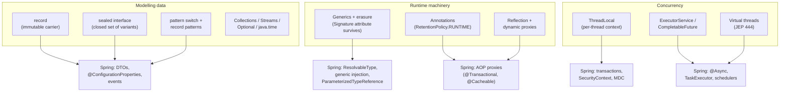
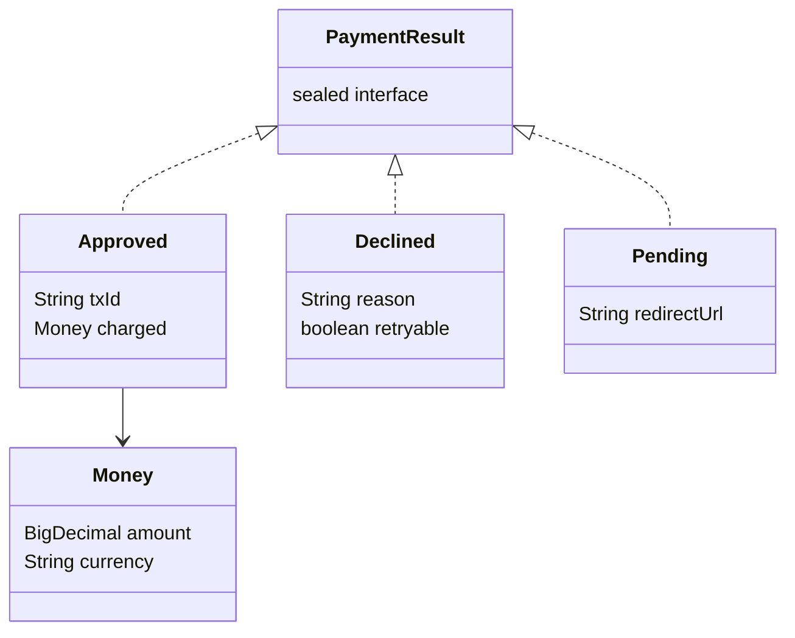
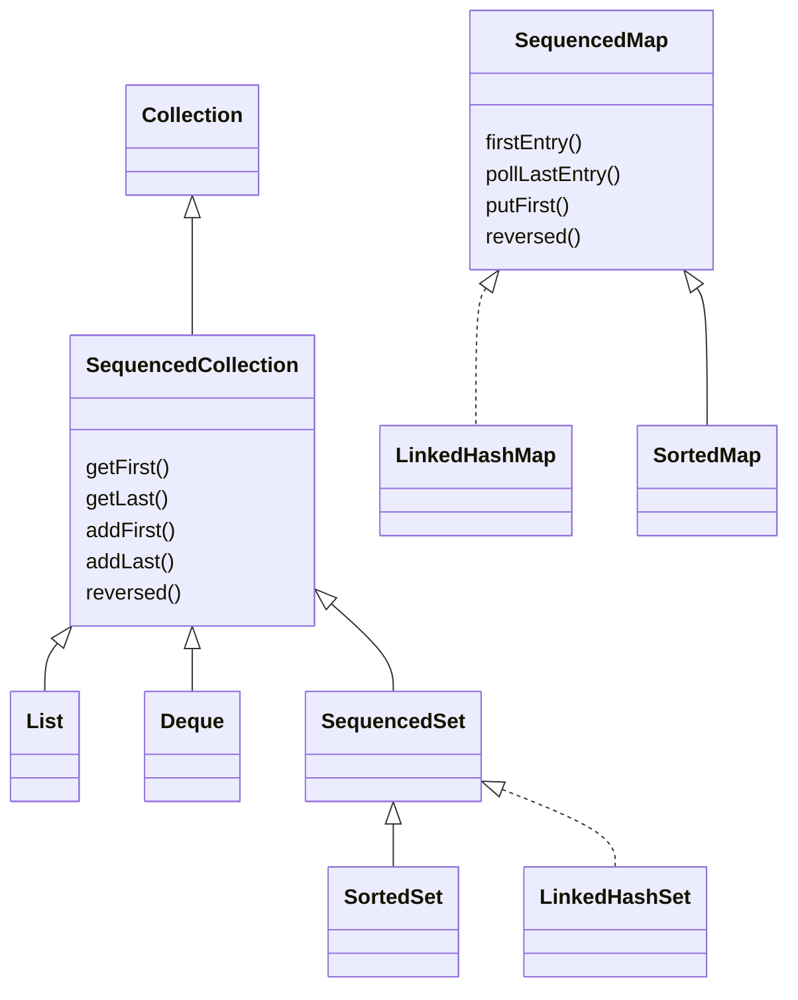
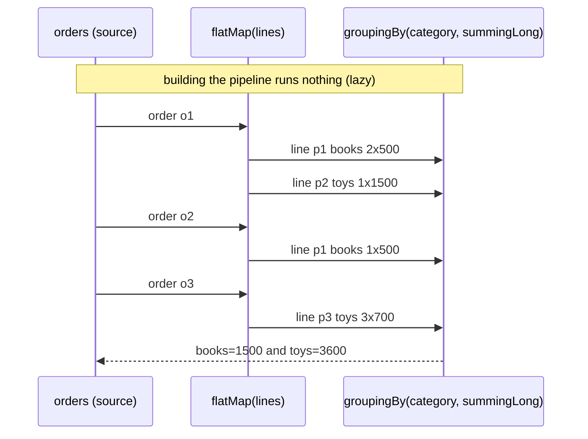
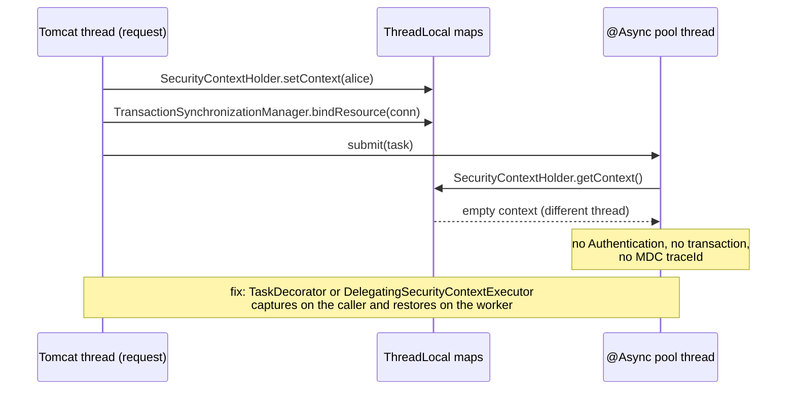
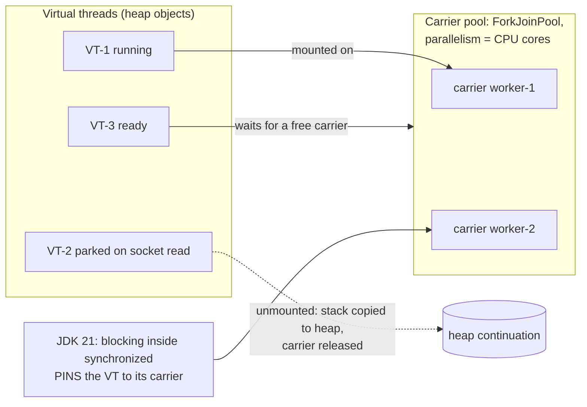
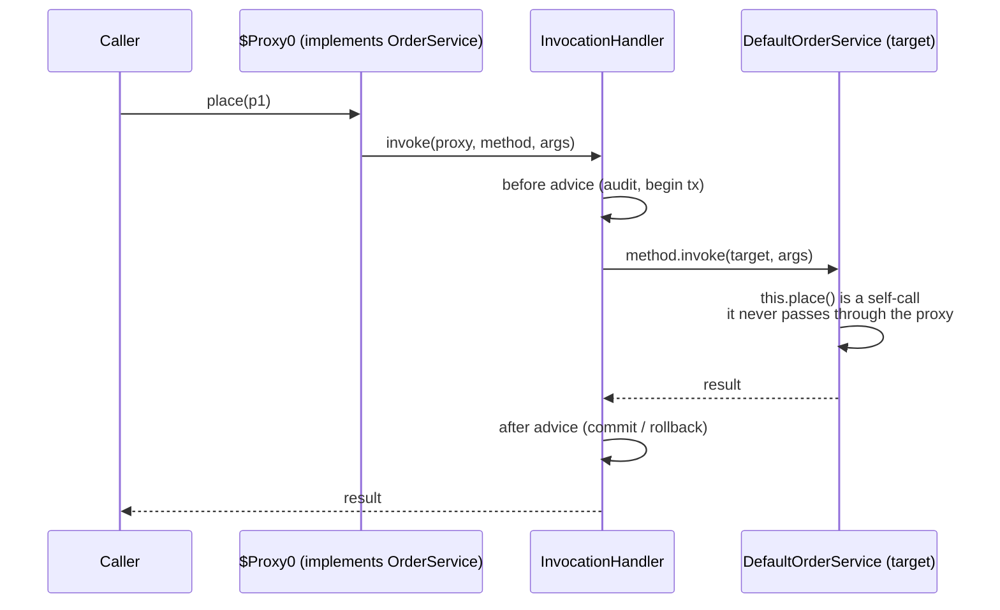
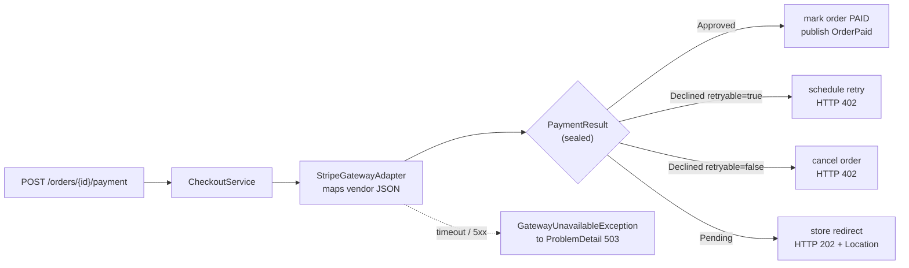
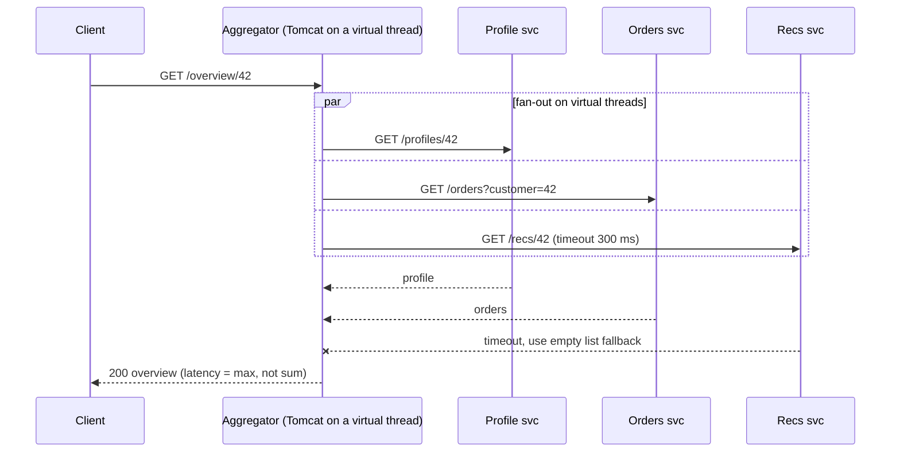
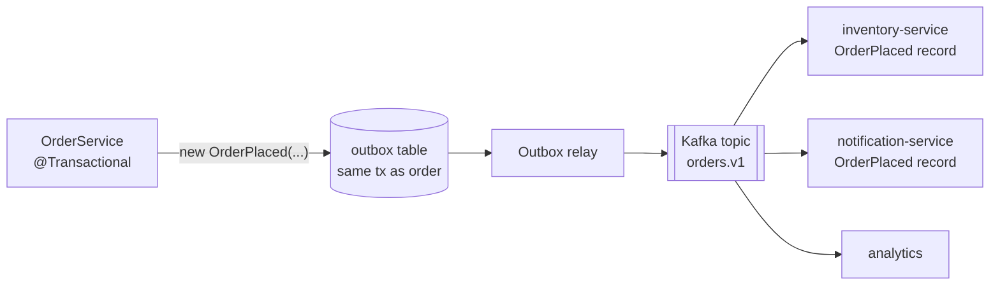

# 00 — Java 21 Refresher for Spring Developers

> **Lab:** none (code verified with `java` single-file runs)
> **Capstone use:** every capstone class. Record DTOs and `@ConfigurationProperties`, sealed `PaymentResult` types for checkout, records as Kafka/SQS event payloads, virtual threads for the microservices' fan-out calls, and correct `equals`/`hashCode` on JPA entities.
> **Prereqs:** none. This is the starting note. Read it before 01 Spring Core.

---

## 1. What & why

Spring Boot 4 runs on a JDK 17 baseline, and this repo targets **Java 21 (LTS)**. Modern Spring code, the Spring docs, and interviewers all assume you write Java 21 fluently. A lot of Spring "magic" is also just Java features used cleverly:

| Spring behavior you already use | The Java feature underneath |
|---|---|
| `@Transactional`, `@Cacheable`, `@Async`, method security | Dynamic proxies (`java.lang.reflect.Proxy`, CGLIB subclassing) and **runtime-retained annotations** |
| Transaction binding, `SecurityContextHolder`, `RequestContextHolder`, MDC logging | **`ThreadLocal`** |
| Injecting `Repository<Order>` but not `Repository<User>`, `RestClient...body(new ParameterizedTypeReference<List<OrderDto>>() {})` | **Generics** and the generic signatures that survive **type erasure** |
| `DataAccessException`, `ResponseStatusException` | The **unchecked exception** design choice |
| `spring.threads.virtual.enabled=true` | **Virtual threads** (JEP 444) |
| `@ConfigurationProperties` records, Jackson record binding | **Records** and their canonical constructor |

**What people did before Java 21:**

| Before | Java 21 idiom | Why it's better |
|---|---|---|
| Lombok `@Value`/`@Data` DTOs, or 60 lines of getters/equals/hashCode | `record` | Language feature, no annotation processor, and the canonical constructor is the single entry point for validation |
| `instanceof` chains, the visitor pattern, or `enum` + nullable fields for results | `sealed interface` + pattern-matching `switch` | The compiler checks exhaustiveness. Add a new variant and every `switch` that forgot it fails to compile |
| `"{\n  \"id\": 1\n}"` string concatenation | Text blocks `"""` | Readable SQL, JSON, and test fixtures |
| `list.get(list.size() - 1)`, `deque.peekLast()`, `map.entrySet().iterator().next()` | `SequencedCollection.getLast()` / `getFirst()` / `reversed()` | One API for every ordered collection |
| A pool of 200 platform threads blocked on HTTP/JDBC, or rewriting everything in WebFlux | Virtual threads | Thread-per-request code that scales to thousands of concurrent blocking calls |
| `Date`, `Calendar`, `SimpleDateFormat` (mutable, not thread-safe) | `java.time` | Immutable, thread-safe, explicit about zones |

**When *not* to reach for these features:**
- **Records are not JPA entities** (section 3.1). They're also a poor fit for objects with an identity that changes over time.
- **Sealed hierarchies** suit closed sets you own, like results, commands, and events. Don't seal an extension point that plugins or other teams must implement.
- **`Optional`** belongs in return types only. Don't use it for fields, parameters, or collections.
- **Virtual threads** don't help CPU-bound work, and they don't replace a connection pool. Section 3.6 covers this.
- **Parallel streams** rarely belong in a web request. They share one JVM-wide pool (section 5).

---

## 2. Mental model

Think of the Java 21 toolbox in three layers. Each Spring feature you'll study later sits on top of one of them.



### Type hierarchy: a sealed result type

This is the shape you'll use again and again: one sealed interface, a few record variants, and an exhaustive `switch`.



### Collections after JEP 431



`HashSet` and `HashMap` are **not** sequenced, because they have no defined order. The demo printed `HashSet=false TreeSet=true`.

---

## 3. How it works internally

### 3.1 Records

A record `record Money(BigDecimal amount, String currency) {}` compiles to:
- a `final` class extending `java.lang.Record`;
- `private final` fields;
- a **canonical constructor** taking all components in order;
- accessors `amount()` and `currency()`, with no `get` prefix;
- `equals`, `hashCode`, and `toString` generated via `invokedynamic` to `java.lang.runtime.ObjectMethods`. Equality is component-wise.

You can add static factories, instance methods, and static fields. You **cannot** add instance fields or extend another class.

**Compact constructor.** It is the canonical constructor without the parameter list. Use it for validation and normalization. You reassign the *parameter*, and the compiler assigns the fields at the end:

```java
record Money(BigDecimal amount, String currency) {
    Money {
        Objects.requireNonNull(amount, "amount");
        if (amount.signum() < 0) throw new IllegalArgumentException("negative amount");
        currency = currency.toUpperCase();          // parameter, not this.currency
    }
}
```

**Shallow immutability.** A record holding a `List` holds the caller's list. If the caller mutates it, your "immutable" record changes. Defensive copy in the compact constructor:

```java
record Order(String id, List<String> items) {
    Order { items = List.copyOf(items); }           // also rejects null elements
}
```

The demo mutated the source list after construction: `o.items()` still printed `[a]`, and `o.items().add("c")` threw `UnsupportedOperationException`.

**Records in Spring:**
- **API DTOs.** Jackson binds records through the canonical constructor. Bean Validation annotations work on components: `record CreateOrderRequest(@NotBlank String customerId, @NotEmpty List<@Valid LineItem> items) {}`.
- **`@ConfigurationProperties`.** Since Boot 3.0, a record with a single constructor uses **constructor binding automatically**, so `@ConstructorBinding` isn't needed. Use `@DefaultValue` for defaults (section 4.1).
- **Spring Data projections.** A record works as a class-based DTO projection, and JPQL `select new com.acme.OrderSummary(o.id, o.total) ...` works too.
- **Hibernate `@Embeddable`.** Hibernate 6.2+ maps a record as an embeddable value object, such as `Money` or `Address`.

**Why a record can't be a JPA entity:**

| JPA entity requirement | Record |
|---|---|
| A no-arg constructor (public or protected) | Has only the canonical constructor (you can add others, but each must delegate to it) |
| Non-`final` class and methods, so Hibernate can create lazy-loading proxy subclasses | `final` |
| Mutable state, so dirty checking can track changes and the provider can set the generated `@Id` and `@Version` | All fields `final` |
| Identity-based equality (section 3.5) | Value-based `equals` over *all* fields, which breaks once the id is assigned and lazy collections get involved |

### 3.2 Sealed types and pattern matching

- `sealed interface PaymentResult permits Approved, Declined, Pending` writes a `PermittedSubclasses` attribute into the class file. Every permitted subclass must be `final`, `sealed`, or `non-sealed`. Records are implicitly `final`.
- When the subclasses are declared in the same source file, you can omit `permits`, and the compiler infers it.
- **Pattern matching for `switch` (JEP 441, final in 21)** and **record patterns (JEP 440, final in 21)** compile to an `invokedynamic` call to `java.lang.runtime.SwitchBootstraps.typeSwitch`. That call picks the matching case label index at runtime.
- A `switch` over a sealed type with a case for every permitted subtype is **exhaustive**, so you don't need a `default`. Leave one out and the code doesn't compile:

```text
Missing.java:23: error: the switch expression does not cover all possible input values
        return switch (r) {
               ^
```

That compile error is the whole point. Add `Refunded` to `PaymentResult`, and the compiler lists every `switch` you must update. A `default` branch would silently swallow the new case, so **don't add `default` to a switch over a sealed type**.

If a class is recompiled with a new subtype but an old `switch` isn't, the old `switch` throws `MatchException` at runtime (JEP 441).

**Pattern features in 21:**

```java
return switch (r) {
    case Approved(var tx, Money(var amt, var cur)) -> "approved " + tx + " " + amt + " " + cur; // nested record pattern
    case Declined d when d.retryable() -> "declined, retry: " + d.reason();                     // guard
    case Declined d -> "declined, final: " + d.reason();                                        // order matters: guarded case first
    case Pending p -> "3DS redirect to " + p.redirectUrl();
};
```

- `case null` is allowed. Without it, a pattern `switch` on `null` throws `NullPointerException`.
- A case that is *dominated* by an earlier one is a compile error. Putting `case Declined d` before `case Declined d when ...` fails to compile.
- The unnamed pattern `_` (`case Approved(var tx, _)`) is **preview in 21** (JEP 443) and final in 22 (JEP 456). Don't use it in Java 21 code without `--enable-preview`.

### 3.3 `var`, text blocks, lambdas

- **`var`** is local type inference. It is compile-time only, so the bytecode holds the real type. Use it when the right-hand side makes the type obvious: `var orders = new ArrayList<Order>()`. Avoid it when it hides the type: `var x = service.process()`.
  - `var` is allowed in lambda parameters (`(var a, var b) -> ...`) so you can annotate them, e.g. `(@NonNull var a) -> ...`.
  - `var list = new ArrayList<>()` infers `ArrayList<Object>`. That's a classic slip.
- **Text blocks.** Incidental indentation is stripped, based on the closing `"""` position. A trailing `\` joins lines, and `\s` keeps a trailing space. Use them for SQL in `@Query`, JSON fixtures in tests, and GraphQL documents.
- **Lambdas** compile to `invokedynamic` plus `LambdaMetafactory`, not to an anonymous inner class file. A lambda captures **effectively final** locals only, and `this` inside a lambda is the enclosing instance.
- **Method references** come in four kinds, all exercised by the demo:

| Kind | Example | Equivalent lambda |
|---|---|---|
| Static | `Integer::parseInt` | `s -> Integer.parseInt(s)` |
| Bound instance | `prefix::concat` | `s -> prefix.concat(s)` |
| Unbound instance | `String::length` | `s -> s.length()` |
| Constructor | `ArrayList::new` | `() -> new ArrayList<>()` |

**Core functional interfaces** (`java.util.function`):

| Interface | Signature | Spring examples |
|---|---|---|
| `Supplier<T>` | `() -> T` | `ObjectProvider.getIfAvailable(Supplier)`, `BeanRegistry` suppliers, lazy log messages |
| `Function<T,R>` | `T -> R` | `Optional.map`, WebFlux `map`, Spring Cloud Function beans |
| `Consumer<T>` | `T -> void` | `RestClient` `.headers(h -> ...)`, the `HttpSecurity` lambda DSL customizers (`Customizer<T>` is a consumer) |
| `Predicate<T>` | `T -> boolean` | `RequestMatcher`-like filters, Gateway route predicates |
| `BiFunction`, `UnaryOperator`, `BinaryOperator` | | `Map.merge(k, 1, Integer::sum)` |

None of them declares checked exceptions, so a lambda that calls `throws IOException` code must wrap the exception (section 3.7).

### 3.4 Streams internals

A stream is a **lazy pipeline**: a source, zero or more intermediate operations (`map`, `filter`, `flatMap`, `peek`, `sorted`), and one terminal operation (`collect`, `toList`, `forEach`, `reduce`). Nothing runs until the terminal operation. Each element flows through the whole chain one at a time, except for stateful operations like `sorted`. A stream can be consumed **once**.



Verified output:

```text
before terminal op, peeked=[]
after terminal op, peeked=[1, 2]
stream reuse: stream has already been operated upon or closed
```

**Collectors you'll use in Spring services:**

```java
Map<String, Long> revenueByCategory = orders.stream()
    .flatMap(o -> o.lines().stream())                              // Order -> many Lines
    .collect(Collectors.groupingBy(Line::category, TreeMap::new,   // key, map factory
             Collectors.summingLong(l -> l.qty() * l.priceCents()))); // downstream collector
// {books=1500, toys=3600}

Map<String, List<String>> idsByCustomer = orders.stream()
    .collect(Collectors.groupingBy(Order::customer, Collectors.mapping(Order::id, Collectors.toList())));
// {alice=[o1, o3], bob=[o2]}

Map<Boolean, Long> multiLine = orders.stream()
    .collect(Collectors.partitioningBy(o -> o.lines().size() > 1, Collectors.counting()));
// {false=2, true=1}
```

`Collectors.toMap` **throws on duplicate keys**: `Duplicate key a (attempted merging values 1 and 1)`. Always pass a merge function when keys may repeat: `toMap(k, v, Integer::sum)`. `groupingBy` returns a `HashMap` unless you pass a map factory.

**`toList()` vs `Collectors.toList()` vs `toUnmodifiableList()`** (all verified):

| | `stream.toList()` (Java 16+) | `collect(Collectors.toList())` | `collect(Collectors.toUnmodifiableList())` |
|---|---|---|---|
| Mutable? | **No**, unmodifiable | Not specified. In practice an `ArrayList` | No |
| Nulls | **Allowed** | Allowed | **NPE** |
| Use when | The default for results | You need to mutate afterwards (prefer `toCollection(ArrayList::new)` to make that explicit) | You want nulls rejected |

### 3.5 `equals`/`hashCode` contract

The contract (from `Object` javadoc):
- `equals` must be reflexive, symmetric, transitive, consistent, and `x.equals(null) == false`.
- Equal objects **must** have equal hash codes. The reverse isn't required.
- The hash code must not change while the object sits in a hash-based collection.

Each rule violation shows up as a real bug (all verified):

| Mistake | Result |
|---|---|
| `equals` overridden, `hashCode` not | `HashSet.contains(equalObject)` printed **`false`** |
| `hashCode` uses the DB-generated `id`, and the entity is added to a `Set` before `persist` | After the id is assigned, `set.contains(entity)` printed **`false`**. The entity sits in the wrong bucket forever |
| `BigDecimal` component in a record | `new BigDecimal("10.5").equals(new BigDecimal("10.50"))` is **false** (scale-sensitive). Normalize with `stripTrailingZeros()` or `setScale` in the compact constructor, or compare with `compareTo` |
| Lombok `@Data` on a JPA entity | `equals` and `hashCode` over all fields, including lazy collections, so it triggers lazy loading, `LazyInitializationException`, and infinite recursion across bidirectional associations |

**The JPA-safe pattern** (note 06 goes deeper). Equal only when both have the same non-null id, with a **constant** hash code per class:

```java
@Override public boolean equals(Object o) {
    if (this == o) return true;
    if (!(o instanceof Order other)) return false;    // instanceof, not getClass(): Hibernate proxies are subclasses
    return id != null && id.equals(other.getId());    // getId(), not other.id: a lazy proxy's fields are empty,
}                                                     // but Hibernate answers getId() without initializing it
@Override public int hashCode() { return Order.class.hashCode(); }  // class literal, not getClass(): a proxy's class differs
```

The demo printed `GoodEntity found after id assigned: true` and `two transient entities equal? false`. It used a plain class, so it didn't exercise Hibernate proxies. Those two details come from how proxies work: a proxy is a generated subclass whose own fields are never populated, and its `getClass()` is the proxy class. With `getClass().hashCode()`, an entity and its proxy could be `equals` but have different hash codes, which breaks the contract.

The constant hash code costs bucket distribution, so every entity of one class lands in the same bucket. That's harmless for the small sets entity associations hold. If the entity has a natural **business key** (ISBN, email, SKU), use that for both methods instead.

### 3.6 Concurrency: what Spring stands on

**Thread pools.** `ExecutorService` decouples task submission from threads.
- `Executors.newFixedThreadPool(n)` uses an *unbounded* queue. Under overload the queue grows until you run out of memory.
- Spring's `ThreadPoolTaskExecutor` (Boot's default `applicationTaskExecutor` without virtual threads) adds a bounded queue option, a rejection policy, and graceful shutdown.
- Since Java 19, `ExecutorService` is `AutoCloseable`. `try (var pool = ...) {}` waits for submitted tasks.

**`CompletableFuture`.** A promise you can compose:
- `thenApply` maps a value.
- `thenCompose` flat-maps to another future.
- `thenCombine` zips two futures.
- `allOf` / `anyOf` wait on many.
- `exceptionally` / `handle` recover from errors.
- `orTimeout` / `completeOnTimeout` set deadlines.

Without an explicit executor, `supplyAsync` runs on **`ForkJoinPool.commonPool()`**. That's a bad home for blocking I/O, so always pass your own executor in server code. `join()` wraps failures in `CompletionException`, and `get()` wraps them in `ExecutionException`.

**`ThreadLocal`.** Each `Thread` has a `ThreadLocalMap`. `ThreadLocal.get()` reads the *current thread's* entry. Spring stores per-request context there:

| Spring component | What it keeps in a `ThreadLocal` |
|---|---|
| `TransactionSynchronizationManager` | The current transaction's connection or `EntityManager`, synchronizations, and the read-only flag. That's how a repository called deep down joins the `@Transactional` started in the service |
| `SecurityContextHolder` (default `MODE_THREADLOCAL`) | The current `Authentication` |
| `RequestContextHolder` | The current `HttpServletRequest` (used by request-scoped proxies) |
| `LocaleContextHolder` | The request locale |
| SLF4J `MDC` | traceId and other log correlation fields |

The consequence: **context does not cross threads.** The demo set `alice` on the caller thread. A pool task and `CompletableFuture.supplyAsync` both printed `null`.



What this means for your code:
- An `@Async` method **doesn't join** the caller's transaction, and it **doesn't see** the caller's `Authentication` unless you propagate it. A `TaskDecorator` (which Boot applies to the auto-configured executor) or Spring Security's `DelegatingSecurityContextAsyncTaskExecutor` copies the context.
- Pooled threads are reused. A `ThreadLocal` you set and never `remove()` leaks into the *next* task. The demo printed `next task on reused thread sees: bob`. Always clear in `finally`. Spring's own filters do this.

**`volatile`, atomics, locks:**
- `volatile` gives **visibility** and ordering (a happens-before edge), but **not atomicity**. `count++` on a volatile is still a read-modify-write race.
- `AtomicInteger` / `AtomicLong` / `LongAdder` give lock-free atomic updates. `LongAdder` is better under heavy contention for counters.
- `synchronized` / `ReentrantLock` give mutual exclusion plus visibility.

The demo ran 8 threads × 100,000 increments: the racy `int` gave **667,406**, and `AtomicInteger` gave **800,000**.

**`ConcurrentHashMap`:**
- Reads are lock-free. Writes lock per bin.
- `compute`, `computeIfAbsent`, and `merge` are **atomic per key**. The demo's 80,000 concurrent `merge` calls gave exactly 80,000.
- `get`-then-`put` is **not** atomic.
- Null keys and values are **rejected** (NPE), so `get` returning `null` always means "absent".
- Spring uses it for its internal caches, such as `ConcurrentMapCacheManager` and the bean factory's singleton maps.

### 3.7 Exceptions

| | Checked (`Exception` but not `RuntimeException`) | Unchecked (`RuntimeException`, `Error`) |
|---|---|---|
| Compiler forces handling | Yes (`throws` or `catch`) | No |
| Typical meaning | A recoverable, expected condition | A programming error or an unrecoverable infrastructure failure |
| Works in lambdas | No. `java.util.function` types don't declare `throws` | Yes |

**Why Spring translates to unchecked exceptions:**
- Most infrastructure failures (a lost DB connection, a constraint violation, a timeout) can't be handled meaningfully where they occur. Checked `SQLException` forced every DAO method to catch or declare it, which produced `catch (SQLException e) { e.printStackTrace(); }` everywhere.
- Spring translates vendor exceptions into the unchecked **`DataAccessException`** hierarchy, such as `DuplicateKeyException`, `DataIntegrityViolationException`, and `OptimisticLockingFailureException`. It does this via `SQLExceptionTranslator` and, for `@Repository` beans, `PersistenceExceptionTranslationPostProcessor`. You catch only what you can handle, and your code stays portable across databases.
- **Transactions roll back only on unchecked exceptions by default.** The Spring reference says: *"marks a transaction for rollback only in the case of runtime, unchecked exceptions … (`Error` instances also, by default, result in a rollback)"*. Checked exceptions **commit**. You can override this per method with `@Transactional(rollbackFor = Exception.class)`, or globally since Framework 6.2 with `@EnableTransactionManagement(rollbackOn = RollbackOn.ALL_EXCEPTIONS)`.

**Mechanics worth knowing (verified):**
- `try`-with-resources: if both the body and `close()` throw, the body's exception wins and the `close()` exception is attached as **suppressed**. The demo printed `body failed, suppressed=close failed`.
- A `finally` that throws **replaces** the original exception.
- A `finally` that `return`s **swallows** the exception entirely. The demo returned `1`.
- Wrap checked exceptions with the cause: `throw new UncheckedIOException("cannot load " + n, e)`. Never lose the cause.

### 3.8 Generics, erasure, and why Spring needs `ResolvableType`

- Generics are compile-time only. At runtime, `ArrayList<String>` and `ArrayList<Integer>` are the **same class**: the demo printed `erasure: true`. You can't write `new T()`, `T.class`, or `instanceof List<String>`.
- **What survives erasure:** generic types in **declarations** are kept in the class file's `Signature` attribute. That covers a class's superclass and interfaces, field types, and method parameter and return types. Reflection exposes them as `ParameterizedType`. The demo printed `OrderRepo.class.getGenericSuperclass()` as `Equality$Repo<java.lang.String>`.
- That's exactly what Spring reads. **`ResolvableType`** wraps `java.lang.reflect.Type` and resolves generics through class hierarchies, fields, and method parameters. That's how Spring:
  - injects `Repository<Order>` and not `Repository<User>`;
  - matches `ApplicationListener<OrderPlaced>`;
  - picks an `HttpMessageConverter` for `List<OrderDto>`.
- **The super type token.** A *local variable's* type argument is erased. `new ArrayList<OrderDto>()` carries nothing at runtime. So Spring asks you to create an **anonymous subclass**, whose generic superclass is recorded in the class file:

```java
// The trick behind ParameterizedTypeReference (and Jackson's TypeReference)
abstract class TypeRef<T> {
    final Type type;
    protected TypeRef() {
        type = ((ParameterizedType) getClass().getGenericSuperclass()).getActualTypeArguments()[0];
    }
}
new TypeRef<Map<String, List<Integer>>>() {}.type;
// java.util.Map<java.lang.String, java.util.List<java.lang.Integer>>

// Spring usage: note the {} that creates the anonymous subclass
List<OrderDto> orders = restClient.get().uri("/orders").retrieve()
    .body(new ParameterizedTypeReference<List<OrderDto>>() {});
```

**Wildcards and PECS ("Producer Extends, Consumer Super"):**

| Signature | You can | Example |
|---|---|---|
| `List<? extends Number>` | **read** as `Number` (it *produces* values). You can't add, except `null` | `double sum(List<? extends Number> xs)` accepts `List<Integer>` and `List<Double>` |
| `List<? super Integer>` | **add** an `Integer` (it *consumes* values). Reads come back as `Object` | `void fill(List<? super Integer> xs)` accepts `List<Number>` and `List<Object>` |
| `List<?>` | read as `Object` only | Utility code that doesn't care about the type |

The JDK follows the rule itself: `Collections.copy(List<? super T> dest, List<? extends T> src)`. Generics are **invariant**: a `List<Integer>` is *not* a `List<Number>`. Arrays are covariant, and the cost of that is a runtime `ArrayStoreException`.

**Raw types cause heap pollution.** Adding an `Integer` through a raw `List` alias of a `List<String>` compiles with only a warning. The `ClassCastException` then surfaces later, at the `get`, far from the cause (verified).

### 3.9 Virtual threads (JEP 444, final in Java 21)

A **platform thread** is a thin wrapper over an OS thread. It has about 1 MB of reserved stack, and you can afford only a few thousand. A **virtual thread** is a `java.lang.Thread` scheduled by the JDK, not the OS:
- Its stack lives on the heap as a *continuation*.
- It **mounts** on a **carrier thread** (a platform thread in a dedicated `ForkJoinPool`) to run.
- When it blocks on I/O, `sleep`, `BlockingQueue`, or a `ReentrantLock`, it **unmounts**. The carrier is then free to run another virtual thread.

You can have millions of virtual threads.



**Details:**
- The scheduler's parallelism defaults to the number of cores. You can tune it with `-Djdk.virtualThreadScheduler.parallelism`.
- The demo's virtual thread printed `VirtualThread[#10267,vt-1]/runnable@ForkJoinPool-1-worker-20`. That's the virtual thread, its state, and the carrier it's mounted on.
- Virtual threads are **always daemon threads**. The demo printed `isDaemon=true`.
- Create them with `Thread.ofVirtual().start(r)`, `Thread.startVirtualThread(r)`, or `Executors.newVirtualThreadPerTaskExecutor()`. **Never pool virtual threads.** Create one per task.

**When they help:** high concurrency of **blocking I/O**, where threads mostly wait on HTTP calls, JDBC, or message brokers. Thread-per-request code scales without a reactive rewrite. In the demo, 10,000 tasks that each block 100 ms took **5,547 ms** on a fixed pool of 200 platform threads. The bound is 10,000 / 200 × 100 ms ≈ 5 s. With a virtual thread per task they took **1,673 ms**. That's a single run on a 22-core laptop, and it includes creating 10,000 threads.

**When they don't help:**
- CPU-bound work, because you still have only N cores.
- Code whose real bottleneck is a pool of something else. Your **JDBC connection pool** (HikariCP's default is 10) still caps concurrent queries, so 10,000 virtual threads just queue on `getConnection()`.

**Pinning in JDK 21.** A virtual thread is *pinned* to its carrier, so it can't unmount, when it blocks:
1. inside a **`synchronized`** block or method (this includes `Object.wait()`);
2. inside a native method or foreign function.

A pinned virtual thread blocks its carrier. If every carrier is pinned, no other virtual thread can run. The demo proves it on 21.0.10 with 22 carriers and 220 tasks, each blocking 100 ms on its *own* lock, so there was no contention, only pinning:

```text
VirtualThread[#10268]/runnable@ForkJoinPool-1-worker-20 reason:MONITOR
    Virtual.lambda$main$2(Virtual.java:29) <== monitors:1
  synchronized (pins):     220 tasks took 1096 ms     // 220/22 waves x 100 ms
  ReentrantLock (no pin):  220 tasks took 110 ms
```

The `reason:MONITOR` trace comes from `-Djdk.tracePinnedThreads=short`, which works on JDK 21. The JFR event `jdk.VirtualThreadPinned` (over 20 ms by default) is the production-grade detector.

**JDK 24 changed this (JEP 491, "Synchronize Virtual Threads without Pinning").** Blocking inside `synchronized` no longer pins: the virtual thread releases its carrier. Native frames (JNI, FFM downcalls) still pin. `jdk.tracePinnedThreads` was removed in JDK 24, so use JFR. This is why the Spring Boot reference now says: *"Virtual threads require Java 21 or later. For the best experience, Java 24 or later is strongly recommended."*

On Java 21, the guidance is to replace `synchronized` around blocking calls with `ReentrantLock`, in your own code. Many libraries (JDBC drivers, HTTP clients) have since replaced `synchronized` on hot paths. Check your driver version, and use `-Djdk.tracePinnedThreads=full` on JDK 21 to find pinning.

**Other caveats:**
- `ThreadLocal` works on virtual threads, but every virtual thread gets its own copy. Don't use `ThreadLocal` as a **cache of expensive objects** (the old `SimpleDateFormat` or buffer-pool trick). With a million virtual threads, you get a million copies.
- Unbounded concurrency can overwhelm downstreams. Throttle with a `Semaphore` or Framework 7's `@ConcurrencyLimit`, not with a small pool.

**Spring Boot: `spring.threads.virtual.enabled=true`** (Boot 3.2+, Java 21+). Per the Boot reference:
- The embedded web server handles requests on virtual threads.
- The auto-configured `applicationTaskExecutor` (used by `@Async`) becomes a **`SimpleAsyncTaskExecutor` using virtual threads**, instead of a `ThreadPoolTaskExecutor`.
- The scheduler becomes a **`SimpleAsyncTaskScheduler`** using virtual threads.
- Thread-pool properties (`spring.task.execution.pool.*` and similar) **stop having any effect**.
- Virtual threads are daemon threads, so an app whose only live work is `@Scheduled` jobs can exit. Set **`spring.main.keep-alive=true`**.

Note 12 covers the Spring side in depth.

### 3.10 `ScopedValue` and structured concurrency: PREVIEW in Java 21

> ⚠️ Both are **preview APIs in Java 21**. They need `--enable-preview` to compile and run. Without it, the demo fails with `error: ScopedValue is a preview API and is disabled by default.`
> - **Scoped values:** JEP 446 in 21 (preview). Finalized in **JDK 25 (JEP 506)**. One API change at finalization: `orElse` no longer accepts `null`.
> - **Structured concurrency:** JEP 453 in 21 (preview). **Still preview in JDK 25** (JEP 505), and its API changed between previews. In 25, scopes are opened with `StructuredTaskScope.open(...)` instead of `new ShutdownOnFailure()`.
>
> Don't use either in production code that targets Java 21.

- **`ScopedValue`** is an immutable, bounded alternative to `ThreadLocal`. You bind a value for the *dynamic scope* of a call, and it's automatically unbound afterwards, so there's nothing to `remove()` and nothing to leak. There's no `set()`. A nested scope can rebind it, and the outer value is restored after. Child threads forked in a `StructuredTaskScope` **inherit** it cheaply.
- **`StructuredTaskScope`** treats a group of concurrent subtasks as one unit of work. `fork` each subtask (each on a new virtual thread), `join`, and then either all of them succeeded or the scope cancels the rest (`ShutdownOnFailure`). No subtask outlives the scope.

```java
// java --enable-preview --source 21 Preview.java
static final ScopedValue<String> TENANT = ScopedValue.newInstance();

ScopedValue.where(TENANT, "acme").run(() -> {
    try (var scope = new StructuredTaskScope.ShutdownOnFailure()) {
        Supplier<String> profile = scope.fork(Preview::fetchProfile);  // sees TENANT = acme
        Supplier<String> orders  = scope.fork(Preview::fetchOrders);
        scope.join().throwIfFailed();
        System.out.println(profile.get() + ", " + orders.get());     // profile@acme, orders@acme
    } catch (Exception e) { throw new RuntimeException(e); }
});
// when one fork throws: "one failed, siblings cancelled: recs service down"
```

### 3.11 Reflection, dynamic proxies, annotations

**Reflection:**
- `Class.getDeclaredMethods()`, `Method.invoke`, `Field.setAccessible(true)`, `getGenericSuperclass()`, and `getAnnotation()`.
- Spring uses it everywhere: constructor discovery, `@Autowired` field injection, `@EventListener` method discovery, and Jackson binding.
- With the Java module system, `setAccessible` on JDK internals fails unless the package is `--add-opens`. With GraalVM native images, reflection needs metadata, which Spring AOT generates (note 15).

**`java.lang.reflect.Proxy`** generates a class at runtime (`$Proxy0` in the demo) that implements the given **interfaces** and routes every call to an `InvocationHandler`. This is Spring AOP's `JdkDynamicAopProxy`.



| | JDK dynamic proxy | CGLIB (Spring's repackaged copy) |
|---|---|---|
| How | Implements the target's **interfaces** | Generates a **subclass** of the target class |
| Needs | At least one interface | A non-`final` class. `final` and `private` methods can't be intercepted |
| `proxy instanceof TargetClass` | **false** (the demo printed `instanceof DefaultOrderService=false`) | true |
| Spring default | Used when configured for interfaces | Boot's default since 2.0. Framework 7 applies the global CGLIB default to all proxy processors, `@Async` included |

**Self-invocation.** Inside the target, `this.place()` calls the raw object, not the proxy, so no advice runs. The demo's `placeTwice` printed the audit line **zero** times. This is the number one reason `@Transactional` "doesn't work" (note 02).

**Annotations and retention:**

| `RetentionPolicy` | Stored in class file | Visible to reflection | Examples |
|---|---|---|---|
| `SOURCE` | No | No | `@Override`, `@SuppressWarnings`, Lombok |
| `CLASS` (the **default** if you omit `@Retention`) | Yes | **No** | Bytecode tools |
| `RUNTIME` | Yes | Yes | **Every** Spring and JPA annotation |

The demo printed `RUNTIME visible=true, CLASS visible=false`. If you write a custom annotation for an aspect and forget `@Retention(RUNTIME)`, the aspect silently never matches.

More annotation rules:
- `@Inherited` works only for **class** annotations inherited from a **superclass**, never from interfaces or on methods. The demo printed `from superclass=true, from interface=false`.
- Plain Java reflection doesn't follow **meta-annotations**: `@Service` carries `@Component`, but `isAnnotationPresent(Component.class)` on a `@Service` class is false. Spring's `MergedAnnotations` / `AnnotatedElementUtils` walk meta-annotations and apply `@AliasFor`. That's what makes composed annotations like `@RestController` and `@SpringBootApplication` work.
- `@Target` restricts where an annotation can go: `TYPE`, `METHOD`, `FIELD`, `PARAMETER`, `TYPE_USE`, and so on. JSpecify's `@Nullable` is a `TYPE_USE` annotation, which is why it goes right before the type: `@Nullable String`.

---

## 4. Full worked code

The plain-Java code in this section comes from single-file demo programs run on `java 21.0.10` (`java File.java`), and every output comment is real output from those runs. Some blocks (4.3, 4.4, 4.5) are trimmed to the interesting lines, and their surrounding calls such as `repo.findByEmail` are illustrative. The Spring snippets are illustrative too, since they need a Spring app to run, and they follow the repo's conventions: 4.1, the `TaskDecorator` in 4.6, and all of section 7.

### 4.1 Records as DTOs and typed config

```java
// API boundary DTOs (Jackson 3 binds records through the canonical constructor)
public record CreateOrderRequest(
        @NotBlank String customerId,
        @NotEmpty List<@Valid LineItem> items) {
    public record LineItem(@NotBlank String sku, @Positive int quantity) {}
}

public record OrderResponse(String id, String status, BigDecimal total, Instant createdAt) {
    static OrderResponse from(Order order) {               // plain mapping method, no MapStruct yet
        return new OrderResponse(order.getId().toString(), order.getStatus().name(),
                order.getTotal(), order.getCreatedAt());
    }
}

// Typed, validated configuration: constructor binding is automatic for records
@ConfigurationProperties(prefix = "payments")
@Validated
public record PaymentProperties(
        @NotBlank String provider,
        @DefaultValue("5s") Duration timeout,             // "5s", "500ms", "PT5S" all bind
        @Valid @DefaultValue Retry retry) {               // @DefaultValue on a nested record = bind an empty instance
    public record Retry(@DefaultValue("3") @Min(1) int maxAttempts) {}
}
// enable with @ConfigurationPropertiesScan on the main class
```

### 4.2 Sealed result type + exhaustive switch (verified)

```java
sealed interface PaymentResult permits Approved, Declined, Pending {}
record Approved(String txId, Money charged) implements PaymentResult {}
record Declined(String reason, boolean retryable) implements PaymentResult {}
record Pending(String redirectUrl) implements PaymentResult {}

static String describe(PaymentResult r) {
    return switch (r) {
        case Approved(var tx, Money(var amt, var cur)) -> "approved " + tx + " " + amt + " " + cur;
        case Declined d when d.retryable() -> "declined, retry: " + d.reason();
        case Declined d -> "declined, final: " + d.reason();
        case Pending p -> "3DS redirect to " + p.redirectUrl();
    };
}
// approved tx1 10.50 INR
// declined, retry: insufficient funds
// declined, final: stolen card
// 3DS redirect to https://bank/3ds
```

### 4.3 `Optional`: do's and don'ts (verified)

```java
// DO: return Optional from a lookup that may legitimately find nothing
Optional<Customer> findByEmail(String email);           // Spring Data does exactly this

// DO: transform and fall back without null checks
String name = repo.findByEmail(email).map(Customer::name).orElse("guest");
Customer c = repo.findById(id).orElseThrow(() -> new CustomerNotFoundException(id)); // maps to 404 in the advice

// DON'T: orElse with an expensive call. It is evaluated EVEN WHEN a value is present
Optional.of("x").orElse(log("orElse-on-present"));     // prints "[computed orElse-on-present]"
Optional.of("x").orElseGet(() -> log("never"));        // lazy: prints nothing

// DON'T: Optional.of(null) throws NPE. Use ofNullable for values that may be null
// DON'T: opt.get() without isPresent(). Use orElseThrow(), which says the same thing honestly
// DON'T: Optional fields, Optional parameters, Optional<List<T>> (return an empty list),
//        or Optional in a JPA entity or a DTO (not Serializable, and absence belongs to the field's nullability)
// DON'T: if (opt.isPresent()) { use(opt.get()); }  →  opt.ifPresent(this::use)
```

### 4.4 Collections: immutability and `SequencedCollection` (verified)

```java
List.of("a").contains(null);                 // NPE! List.of/Set.of/Map.of reject nulls, even in queries
var view = Collections.unmodifiableList(backing);  // a read-only VIEW: changes to backing show through
var copy = List.copyOf(backing);             // a real immutable snapshot
backing.add("b");                            // view=[a, b], copy=[a]

var set = new LinkedHashSet<>(List.of("b", "c"));
set.addFirst("a");                           // [a, b, c] (Java 21)
set.getFirst(); set.getLast(); set.reversed();       // a, c, [c, b, a]
var m = new LinkedHashMap<String, Integer>();
m.put("one", 1); m.put("two", 2); m.putFirst("zero", 0);
m.firstEntry();    // zero=0
m.pollLastEntry(); // two=2
List.of(1, 2, 3).reversed();                 // [3, 2, 1]: a view, immutable if the source is
```

`Set.of` and `Map.of` have **unspecified, randomized iteration order**, which changes between JVM runs. Never assert on their order in tests.

### 4.5 `java.time` essentials (verified)

```java
Instant instant = Instant.parse("2026-03-29T00:30:00Z");       // a point on the UTC timeline: store THIS
ZonedDateTime berlin = instant.atZone(ZoneId.of("Europe/Berlin")); // 01:30+01:00, the night DST starts
berlin.plusDays(1);                     // 2026-03-30T01:30+02:00 (same wall-clock time)
berlin.plus(Duration.ofHours(24));      // 2026-03-30T02:30+02:00 (exactly 24 h later)
Period.between(LocalDate.of(2026,1,31), LocalDate.of(2026,3,1));  // P1M1D (calendar units)
Duration.ofMinutes(90);                 // PT1H30M (exact time units)
LocalDate.of(2026, 1, 31).plusMonths(1);   // 2026-02-28 (clamped, no exception)
LocalDate.parse("2026-02-30");          // DateTimeParseException: Invalid date 'FEBRUARY 30'

// Testability: inject a Clock bean instead of calling now() with no argument
var fixed = Clock.fixed(instant, ZoneOffset.UTC);
LocalDate.now(fixed);                   // 2026-03-29
```

| Type | Means | Use for |
|---|---|---|
| `Instant` | A UTC timestamp | DB `timestamptz` columns, events, audit fields (`createdAt`) |
| `OffsetDateTime` | Date-time plus a fixed offset | API payloads (ISO-8601 with offset) and JDBC `timestamptz` |
| `ZonedDateTime` | Date-time plus a region zone (DST rules) | Scheduling in a user's zone ("every day 09:00 Berlin") |
| `LocalDate` / `LocalDateTime` | No zone | Birthdays and business dates. **Never** for "when did it happen" |
| `Duration` / `Period` | Exact time units / calendar units | Timeouts in config (`Duration` binds from `5s`), subscription lengths |

All of these are immutable and thread-safe, and so is `DateTimeFormatter`, unlike `SimpleDateFormat`. Jackson serializes them as ISO-8601 strings by default in Boot.

### 4.6 Context propagation and the `ThreadLocal` leak (verified)

```java
static final ThreadLocal<String> CURRENT_USER = new ThreadLocal<>();

CURRENT_USER.set("alice");
pool.submit(() -> CURRENT_USER.get()).get();                    // null: different thread
CompletableFuture.supplyAsync(CURRENT_USER::get).get();         // null: commonPool thread

String captured = CURRENT_USER.get();                           // capture on the caller...
pool.submit(() -> {
    CURRENT_USER.set(captured);                                 // ...restore on the worker
    try { return CURRENT_USER.get(); } finally { CURRENT_USER.remove(); }  // ...and always clean up
}).get();                                                       // "alice"
```

The same idea, done by Spring:

```java
@Bean
TaskDecorator mdcTaskDecorator() {      // Boot applies a single TaskDecorator bean to the auto-configured executor
    return task -> {
        Map<String, String> mdc = MDC.getCopyOfContextMap();
        return () -> {
            if (mdc != null) MDC.setContextMap(mdc);
            try { task.run(); } finally { MDC.clear(); }
        };
    };
}
```

### 4.7 `CompletableFuture` composition (verified)

```java
var price = CompletableFuture.supplyAsync(() -> 100, executor);   // always pass an executor in server code
var tax   = CompletableFuture.supplyAsync(() -> 18, executor);
price.thenCombine(tax, Integer::sum).join();                       // 118

CompletableFuture.<Integer>supplyAsync(() -> { throw new IllegalStateException("inventory down"); })
    .exceptionally(ex -> -1)                                       // ex is a CompletionException wrapping the cause
    .join();                                                       // -1

CompletableFuture.supplyAsync(() -> slowCall())
    .completeOnTimeout("fallback", 100, TimeUnit.MILLISECONDS)     // or orTimeout(...) to fail instead
    .join();                                                       // "fallback"
```

### 4.8 A dynamic proxy, the way Spring AOP builds one (verified)

```java
@Retention(RetentionPolicy.RUNTIME) @Target(ElementType.METHOD) @interface Audited {}

@SuppressWarnings("unchecked")
static <T> T auditing(T target, Class<T> iface) {
    InvocationHandler h = (proxy, method, args) -> {
        Method impl = target.getClass().getMethod(method.getName(), method.getParameterTypes());
        if (impl.isAnnotationPresent(Audited.class)) System.out.println("  [audit] before " + method.getName());
        try { return method.invoke(target, args); }
        catch (InvocationTargetException e) { throw e.getCause(); }   // unwrap, or callers see the wrapper
    };
    return (T) Proxy.newProxyInstance(iface.getClassLoader(), new Class<?>[]{iface}, h);
}
//   [audit] before place
// placed p1
// placeTwice (self-invocation bypasses proxy):
// placed p2 & placed p2          <- no audit line: the inner calls went through `this`
```

The handler looks up the annotation on the **implementation** method. Annotations on the interface method are not on `impl`. Spring's `AopUtils.getMostSpecificMethod` and `MergedAnnotations` deal with exactly this mismatch.

---

## 5. Gap fillers & niche details

- **Record accessor names** are `amount()`, not `getAmount()`. Libraries that expect JavaBeans getters, such as old templating engines or some mappers, may not see record properties. Jackson, Spring's binder, Thymeleaf, and MapStruct support records.
- **Records and `@JsonProperty`.** Annotations on a record component propagate to the field, the accessor, and the constructor parameter, depending on each annotation's `@Target`. That's why `record Dto(@JsonProperty("order_id") String orderId)` just works.
- **A record's `toString()` prints every component**, including `password` and `token`. Override `toString()` for records that carry secrets, or they end up in logs.
- **An enum can implement a sealed interface**, and an enum is itself a closed set. Use an enum for variants without data and a sealed interface of records for variants with data.
- **`switch` on a sealed type must not have `default`** if you want the compiler to catch a new variant. Exhaustiveness is checked only when no catch-all exists.
- **`instanceof` patterns** (`if (o instanceof Order ord && ord.total() > 0)`) bind a variable whose scope follows definite assignment, so it's also in scope after `if (!(o instanceof Order ord)) return;`.
- **`Stream.toList()` returns an unmodifiable list**, so `.toList().add(...)` throws. Sorting the result in place (`Collections.sort`) throws too. That surprises people migrating from `Collectors.toList()`.
- **`Collectors.groupingBy` never produces empty groups**, and its map is a `HashMap` with no ordering. Pass `TreeMap::new` or `LinkedHashMap::new` for a stable order.
- **Parallel streams** run on the JVM-wide `ForkJoinPool.commonPool()`. The demo showed `[ForkJoinPool.commonPool-worker-N, main]`: the caller thread participates too.
  - One request with a slow parallel stream starves every other parallel stream and every `supplyAsync` without an executor in the JVM.
  - `ThreadLocal` context (transactions, security) is **not** present on worker threads.
  - Mutating shared state in `forEach` corrupts it. The demo's unsafe `ArrayList.add` threw `ArrayIndexOutOfBoundsException` twice and returned **411,519 of 1,000,000** once. Use collectors.
  - Parallel streams pay off only for large, CPU-bound, splittable sources (`ArrayList`, arrays, `IntStream.range`), not for `LinkedList`, I/O, or small lists.
- **`peek` is for debugging.** Since Java 9, `count()` may skip the pipeline entirely when the size is known, and then `peek` never runs.
- **`Optional` is not `Serializable`**, and Spring Data's `findById` returns it precisely because it's a return type. Don't map it onto a DTO.
- **`Map.of` takes at most 10 pairs.** Use `Map.ofEntries(Map.entry(k, v), ...)` beyond that.
- **`Arrays.asList`** is fixed-size but **writable** (`set` works, `add` throws), and it's backed by the array.
- **`ConcurrentHashMap.computeIfAbsent`** must not modify the same map inside its mapping function. That can throw `IllegalStateException` ("Recursive update") or deadlock.
- **`volatile` on a `long` or `double`** also makes its reads and writes atomic, which non-volatile 64-bit writes aren't guaranteed to be.
- **Double-checked locking** for lazy singletons needs `volatile` on the field. Spring beans rarely need this, because the container already guarantees one instance.
- **`InheritableThreadLocal`** copies values to *child* threads at creation time only. Pooled threads were created long ago, so it doesn't help with executors. That's why Spring Security's `MODE_INHERITABLETHREADLOCAL` doesn't help `@Async` with a pool.
- **Virtual threads and `synchronized` in your own beans.** On JDK 21, a `synchronized` method that calls a blocking HTTP client pins the carrier. Prefer `ReentrantLock` or a better design (no shared mutable state). On JDK 24+ this is no longer a problem.
- **Don't pool virtual threads, and don't size them.** `Executors.newFixedThreadPool(200, Thread.ofVirtual().factory())` brings back the very limit you wanted to remove. To limit concurrency, use a `Semaphore`.
- **Thread names:** virtual threads are unnamed by default (`VirtualThread[#10268]`). Name them with `Thread.ofVirtual().name("api-", 0).factory()` for readable thread dumps. Thread dumps that include virtual threads: `jcmd <pid> Thread.dump_to_file -format=json file.json`.
- **Generic methods and `Class<T>` tokens.** Spring APIs take `Class<T>` (`getBean(OrderService.class)`) for raw types and `ParameterizedTypeReference` / `ResolvableType` when the type has generics. `getBean(List.class)` can't tell `List<Order>` from `List<User>`.
- **Lambdas and Spring proxies.** A lambda `@Bean` (e.g. `Function<String, String>`) is a synthetic class. Its generic types are **not** recoverable by reflection, because there is no `Signature` attribute. Spring Cloud Function and Spring Kafka sometimes need the type declared another way, such as the `@Bean` method's return type, for that reason.
- **Custom annotations need `@Retention(RUNTIME)`.** Otherwise the default `CLASS` retention makes your aspect never match, with no error.
- **`java.time` with JPA.** Hibernate 6 maps `Instant` and `OffsetDateTime` natively. Set `spring.jpa.properties.hibernate.jdbc.time_zone=UTC` so `LocalDateTime` columns aren't shifted by the server zone. Better still, store `Instant`.

---

## 6. Boot 4 / Framework 7 delta

Sources: [Spring Boot 4.0 Migration Guide](https://github.com/spring-projects/spring-boot/wiki/Spring-Boot-4.0-Migration-Guide), [Spring Framework 7.0 Release Notes](https://github.com/spring-projects/spring-framework/wiki/Spring-Framework-7.0-Release-Notes), and the [Spring Boot reference: virtual threads](https://docs.spring.io/spring-boot/reference/features/spring-application.html#features.spring-application.virtual-threads).

This note is about Java, so here is what the Java side means for Spring Boot 4:

| Change | What it means for you |
|---|---|
| **Baseline JDK 17**, and this repo uses **21** | Records, sealed types, pattern switch, and text blocks are fair game in every Spring API. Virtual threads need 21 |
| **Boot reference: "Java 24 or later is strongly recommended"** for virtual threads | That's JEP 491: `synchronized` stops pinning. On 21, watch for pinning (section 3.9) |
| **Jackson 3** (`tools.jackson.*`; annotations stay in `com.fasterxml.jackson.annotation`) | Records bind out of the box. Update imports of `ObjectMapper`/`JsonMapper` and the like to `tools.jackson`. `@JsonProperty` imports don't change |
| **JSpecify nullness** (`org.jspecify.annotations.Nullable`) across the Framework 7 API | Null-safety is expressed with `@Nullable` on types, not with `Optional` parameters. It's a `TYPE_USE` annotation (section 3.11). Keep `Optional` for return values |
| **`@ConcurrencyLimit`** in Framework 7 core | Throttles a method's concurrency. It's the right tool for capping virtual-thread fan-out against a fragile downstream, instead of a small thread pool |
| **Global CGLIB proxy default applies to all proxy processors, including `@Async`** | Section 3.11: class-based proxies. `final` classes and methods can't be advised. Records are `final`, so they can never be CGLIB-proxied: never put `@Transactional` on a record |
| **`javax.annotation` / `javax.inject` removed** | If an old library still ships `@javax.annotation.PostConstruct`, it's silently ignored. That's a retention or classpath issue, not a Java feature, but it looks identical: an annotation that does nothing |

> ⚠️ **Outdated advice still common in tutorials and Baeldung articles:**
> - `@ConstructorBinding` on `@ConfigurationProperties` records isn't needed since Boot 3.0 when there's a single constructor, and its old package `org.springframework.boot.context.properties.ConstructorBinding` was moved in 3.0.
> - "Avoid `synchronized` with virtual threads" is a JDK 21–23 concern. On JDK 24+ (JEP 491) it no longer pins. `-Djdk.tracePinnedThreads` no longer exists on 24+, so use the JFR `jdk.VirtualThreadPinned` event.
> - "Size your thread pool to N" advice doesn't apply with `spring.threads.virtual.enabled=true`. The pool properties are ignored. Size the **connection pools** instead.
> - `collect(Collectors.toList())` in every stream: prefer `.toList()`, but know it's unmodifiable.
> - Articles showing `ScopedValue` / `StructuredTaskScope` code often target a later JDK's API. On 21 both are preview, and structured concurrency's API changed in later previews.
> - `new Date()`, `SimpleDateFormat`, and `Calendar` in examples: use `java.time` and inject a `Clock`.

---

## 7. Real-life architecture solutions

### 7.1 Payment outcomes as a sealed result type

**Problem:** a checkout service calls a payment gateway. The outcome isn't just success or failure: it can be approved, declined (retryable or not), pending a 3-D Secure redirect, or a gateway timeout. Teams typically model this with exceptions for control flow, or with a `PaymentResponse` full of nullable fields and a status string. The result is a forgotten `"PENDING"` branch, and orders shipped without payment.

**Solution:** model the outcome as a sealed interface of records. The gateway adapter maps the vendor's response into it. The order service and the web layer each `switch` exhaustively. Exceptions are reserved for *infrastructure* failures, which become `ProblemDetail` responses through the single `@RestControllerAdvice`.



```java
sealed interface PaymentResult permits Approved, Declined, Pending {}
record Approved(String txId, Money charged) implements PaymentResult {}
record Declined(String reason, boolean retryable) implements PaymentResult {}
record Pending(URI redirectUrl) implements PaymentResult {}

@PostMapping("/orders/{id}/payment")
ResponseEntity<PaymentResponse> pay(@PathVariable UUID id) {
    return switch (checkoutService.pay(id)) {                       // exhaustive: no default
        case Approved a -> ResponseEntity.ok(PaymentResponse.paid(a.txId()));
        case Declined d -> ResponseEntity.status(HttpStatus.PAYMENT_REQUIRED).body(PaymentResponse.declined(d.reason()));
        case Pending p  -> ResponseEntity.accepted().location(p.redirectUrl()).build();
    };
}
```

**Trade-offs:**
- **Pros:** the compiler enforces that every outcome is handled. The types document the protocol, and tests can assert on values, not on exception types.
- **Cons:** adding a variant is a breaking change for every `switch` (on purpose), and for API consumers if the type is exposed.
- Don't serialize a sealed hierarchy straight onto the wire without a type discriminator (`@JsonTypeInfo` + `@JsonSubTypes`). Map it to an explicit response DTO instead.
- Keep genuinely exceptional failures (timeouts, bugs) as exceptions. A `Result` type for *everything* recreates checked exceptions.

**Who uses it:** payment orchestration layers, and any domain with a closed outcome set: KYC decisions, fraud verdicts, booking confirmations. It's also the Java equivalent of Kotlin sealed classes and Rust's `Result`.

### 7.2 Virtual threads for an I/O-heavy API aggregator (fan-out)

**Problem:** a "product page" or "account overview" endpoint (a BFF, or backend-for-frontend) calls 4–6 downstream services: profile, orders, recommendations, inventory, pricing. Each takes 50–300 ms. Calling them sequentially sums the latencies. On a 200-thread platform pool, a traffic spike makes every thread wait on sockets and requests queue up. The classic answer was a WebFlux rewrite, with a different programming model, stack traces, and debugging.

**Solution:** keep the blocking, imperative `RestClient` code. Run requests on virtual threads (`spring.threads.virtual.enabled=true`), and fan out the independent calls in parallel on a virtual-thread-per-task executor. Total latency ≈ the slowest call, not the sum. Each call gets a timeout and a fallback.



```java
@Service
class OverviewService {
    private final RestClient profiles, orders, recs;
    private final AsyncTaskExecutor fanOut;   // Boot's executor: virtual threads when the property is on,
                                              // applies your TaskDecorator, and shuts down with the context

    OverviewService(RestClient.Builder builder,
                    @Qualifier("applicationTaskExecutor") AsyncTaskExecutor fanOut) {
        this.fanOut = fanOut;
        /* build three clients with base URLs and timeouts */
    }

    Overview load(long customerId) {
        var profile = CompletableFuture.supplyAsync(() -> profiles.get().uri("/profiles/{id}", customerId)
                .retrieve().body(Profile.class), fanOut);
        var recent = CompletableFuture.supplyAsync(() -> orders.get().uri("/orders?customer={id}", customerId)
                .retrieve().body(new ParameterizedTypeReference<List<OrderSummary>>() {}), fanOut);
        var recommended = CompletableFuture.supplyAsync(() -> recs.get().uri("/recs/{id}", customerId)
                .retrieve().body(new ParameterizedTypeReference<List<Product>>() {}), fanOut)
                .completeOnTimeout(List.of(), 300, TimeUnit.MILLISECONDS)   // degrade, don't fail
                .exceptionally(ex -> List.of());
        return new Overview(profile.join(), recent.join(), recommended.join());
    }
}
```

On JDK 25+, `StructuredTaskScope` expresses the same fan-out with automatic cancellation of siblings. It's still preview, so on 21 use `CompletableFuture` as shown.

**Trade-offs:**
- **Pros:** imperative code with readable stack traces. It scales to thousands of concurrent in-flight calls with a few carrier threads, and needs no reactive rewrite.
- **Cons:**
  - Context **doesn't propagate** to the fan-out threads by itself, so the traceId MDC and the `SecurityContext` must be copied. That's why the code uses Boot's executor, which applies a `TaskDecorator` (section 4.6), instead of a bare `Executors.newVirtualThreadPerTaskExecutor()`. Use Micrometer's context-propagation for tracing (note 10).
  - Unbounded concurrency can DDoS a downstream. Cap it with `@ConcurrencyLimit`, a `Semaphore`, or Resilience4j bulkheads (note 14).
  - The **HTTP client's connection pool** is now the real limit, so size it.
  - Pinning on JDK 21 if any library blocks inside `synchronized`. Check with JFR, or run on 24+.
- Use WebFlux instead when you need streaming and backpressure end to end. Note 13 compares them.

**Who uses it:** BFF and API-gateway aggregation layers, and "dashboard" endpoints in banking and e-commerce. It's the main motivation behind Boot's one-property virtual-thread switch.

### 7.3 Immutable records as event payloads in event-driven systems

**Problem:** services exchange domain events (`OrderPlaced`, `PaymentCaptured`) over Kafka or SQS. If an event object is mutable, a listener can change it while another reads it, or a producer can mutate it after publishing. Lombok-heavy payload classes drift, and nobody knows which fields are guaranteed.

**Solution:** each event is a **record** with only immutable components (`String`, `UUID`, `Instant`, `BigDecimal`, `List.copyOf(...)` collections). The compact constructor validates invariants. A small envelope record carries metadata. The same record type is used in-process (`ApplicationEventPublisher`, note 01) and on the wire (Jackson 3 JSON or Avro), and is published through a **transactional outbox** (note 11).



```java
public record EventEnvelope<T>(UUID eventId, String type, int version, Instant occurredAt, T payload) {
    public EventEnvelope {
        Objects.requireNonNull(eventId); Objects.requireNonNull(payload);
    }
    public static <T> EventEnvelope<T> of(String type, int version, T payload, Clock clock) {
        return new EventEnvelope<>(UUID.randomUUID(), type, version, Instant.now(clock), payload);
    }
}

// A sealed event family: consumers switch over it exhaustively, just like 7.1
public sealed interface OrderEvent permits OrderPlaced, OrderCancelled {}

public record OrderCancelled(UUID orderId, String reason) implements OrderEvent {}

public record OrderPlaced(UUID orderId, UUID customerId, List<Line> lines, BigDecimal total) implements OrderEvent {
    public OrderPlaced {
        lines = List.copyOf(lines);                                   // deep enough: Line is a record too
        if (total.signum() < 0) throw new IllegalArgumentException("total < 0");
    }
    public record Line(String sku, int qty, BigDecimal unitPrice) {}
}
```

**Trade-offs:**
- **Pros:** thread-safe by construction, so events can be shared safely across async listeners. Value equality makes **idempotency checks and tests** trivial (`assertThat(event).isEqualTo(expected)`). Payloads are small and self-documenting.
- **Cons:**
  - **Schema evolution:** adding a component changes the canonical constructor. Consumers must tolerate unknown fields (Jackson's `FAIL_ON_UNKNOWN_PROPERTIES` off is Boot's default) and missing fields. Keep the `version` field and add new components as nullable, or use a schema registry with Avro.
  - Never put JPA entities or `Optional` inside an event.
  - A generic envelope needs a `ParameterizedTypeReference`/`TypeReference` (section 3.8) to deserialize `EventEnvelope<OrderPlaced>`.

**Who uses it:** event-driven microservices (order → inventory → shipping → notifications), CQRS read-model projections, and audit and event-sourcing stores. Spring Modulith's event publication registry stores exactly these kinds of records.

---

## 8. Pitfalls & debugging checklist

- [ ] **`UnsupportedOperationException` on `add`/`set`/`sort`**. The list came from `List.of`, `Stream.toList()`, `List.copyOf`, or `Collections.unmodifiable*`. Copy it into an `ArrayList` if you really need to mutate.
- [ ] **NPE from `List.of(...).contains(null)`, `Map.of(k, null)`, `ConcurrentHashMap.put(k, null)`, or `toUnmodifiableList()`**. These collections reject nulls by design. Filter nulls first, or don't model absence with null.
- [ ] **`IllegalStateException: Duplicate key`** from `Collectors.toMap`. Pass a merge function.
- [ ] **An entity "disappears" from a `Set` after save**. `hashCode` uses the generated id or mutable fields. Use the id-based `equals` with a constant `hashCode` (section 3.5).
- [ ] **`LazyInitializationException` or `StackOverflowError` from `toString`/`hashCode`**. Lombok `@Data` or a record-like `equals` over associations. Exclude associations.
- [ ] **A record DTO leaks a password in logs**. A record's `toString` prints all components. Override `toString()`.
- [ ] **Compile error "the switch expression does not cover all possible input values"**. That's the feature: handle the new sealed variant. Don't add `default`.
- [ ] **`MatchException` at runtime**. The sealed hierarchy was recompiled with a new subtype but a dependent module wasn't. Rebuild everything.
- [ ] **`SecurityContext` empty or no transaction in `@Async`, `CompletableFuture`, or a parallel stream**. `ThreadLocal`s don't cross threads. Use a `TaskDecorator` or `DelegatingSecurityContext*` executor, and don't expect the caller's transaction there.
- [ ] **User A sees user B's data, or the wrong tenant**. A `ThreadLocal` wasn't cleared on a pooled thread. Use `try { set } finally { remove }`.
- [ ] **Throughput collapse under load with virtual threads on JDK 21**. Pinning. Record with JFR (`jdk.VirtualThreadPinned`), or use `-Djdk.tracePinnedThreads=short` on 21–23. Replace `synchronized` around blocking calls with `ReentrantLock`, or move to JDK 24+.
- [ ] **Virtual threads enabled but latency got worse**. The bottleneck is a pool: HikariCP connections or the HTTP client's max connections. Threads now queue on `getConnection()`. Size the pool to what the DB can take, and use `@ConcurrencyLimit` or a `Semaphore`.
- [ ] **App with only `@Scheduled` jobs exits right after startup with virtual threads**. Virtual threads are daemons. Set `spring.main.keep-alive=true`.
- [ ] **Everything slows down when one endpoint runs a parallel stream**. The common `ForkJoinPool` is starved. Remove `.parallel()` from request paths, or use a dedicated executor.
- [ ] **`ClassCastException` far from the cause**. Heap pollution via a raw type or an unchecked cast. Fix the compiler's `unchecked` warnings.
- [ ] **`RestClient`/Jackson returns `List<LinkedHashMap>` instead of `List<OrderDto>`**. You passed `List.class`. Use `new ParameterizedTypeReference<List<OrderDto>>() {}`, and don't forget the `{}`.
- [ ] **A custom annotation is ignored by your aspect**. It's missing `@Retention(RUNTIME)`, or it's on an interface method while the aspect checks the implementation.
- [ ] **Checked exception committed the transaction**. That's the default. Use `rollbackFor`, or `rollbackOn = ALL_EXCEPTIONS` (Framework 6.2+).
- [ ] **Times off by hours in the DB**. A `LocalDateTime` plus a JVM or DB zone mismatch. Store `Instant`, and set `hibernate.jdbc.time_zone=UTC`.

---

## 9. Interview questions

<details><summary>Q1. What is a record, and why can't it be a JPA entity?</summary>

A record is a transparent, shallowly immutable data carrier. The compiler generates a `final` class with `private final` fields, a canonical constructor, accessors, and component-wise `equals`/`hashCode`/`toString`. A compact constructor validates and normalizes inputs.

JPA entities need:
- a no-arg constructor;
- a non-final class, so the provider can subclass it for lazy proxies;
- mutable fields, so it can set the generated id and version and do dirty checking;
- identity-based equality.

Records violate all four. Use records for DTOs, projections, `@ConfigurationProperties`, events, and (Hibernate 6.2+) `@Embeddable` value objects.
</details>

<details><summary>Q2. Why use a sealed interface with a pattern-matching switch instead of an instanceof chain or a visitor?</summary>

The compiler knows the full set of subtypes, so a `switch` without `default` is checked for **exhaustiveness**. Adding a variant breaks the compile of every `switch` that doesn't handle it, instead of silently falling through.

Record patterns deconstruct components inline (`case Approved(var tx, Money(var amt, var cur))`), and `when` guards refine a case. The visitor pattern achieves exhaustiveness with a lot of boilerplate, and `instanceof` chains have none.

Pitfalls:
- `default` defeats the check.
- Dominated cases must come after more specific (guarded) ones.
- An old compiled `switch` meeting a new subtype throws `MatchException`.
</details>

<details><summary>Q3. Stream.toList() vs Collectors.toList() vs Collectors.toUnmodifiableList()?</summary>

- `toList()` (Java 16+) returns an unmodifiable list that **allows nulls**.
- `Collectors.toList()` makes no guarantee about mutability, but in practice returns an `ArrayList`, and code often relies on mutating it.
- `toUnmodifiableList()` is unmodifiable and throws NPE on null elements.

When migrating, check whether the caller later mutates the list. If it does, use `toCollection(ArrayList::new)` to make that explicit.
</details>

<details><summary>Q4. When should you not use parallel streams?</summary>

Almost always in a web application.
- They run on the JVM-wide `ForkJoinPool.commonPool()`, so one slow request starves every other user of it, including `CompletableFuture.supplyAsync` without an executor.
- `ThreadLocal` context (transaction, security, MDC) isn't on the workers.
- Side effects on shared collections corrupt data. The demo lost 59% of the elements, or threw `ArrayIndexOutOfBoundsException`.
- Small or poorly splittable sources (`LinkedList`, I/O) are slower in parallel.

Use them only for large, CPU-bound, stateless work on splittable sources, and measure.
</details>

<details><summary>Q5. What are the do's and don'ts of Optional?</summary>

**Do:**
- Return `Optional` from lookups that may find nothing.
- Chain `map`/`filter`/`flatMap`.
- Use `orElseThrow` to turn absence into a domain exception.
- Use `orElseGet` for expensive defaults, because `orElse`'s argument is **always evaluated**.

**Don't:**
- Use it for fields, parameters, collections (return an empty collection), DTOs, or entities. It isn't serializable.
- Call `get()` without a check.
- Write `Optional.of(nullable)`, which throws NPE. Use `ofNullable`.

Framework 7 expresses nullability of parameters with JSpecify `@Nullable` instead.
</details>

<details><summary>Q6. State the equals/hashCode contract. How do you implement it for a JPA entity?</summary>

`equals` must be reflexive, symmetric, transitive, consistent, and false for `null`. Equal objects must have equal hash codes, and the hash code must not change while the object is in a hash-based collection.

For an entity, the generated id is null before persist and then assigned. So:
- `equals` is true only if `this == o`, or both are the same entity type (via `instanceof`, because Hibernate proxies are subclasses) with the **same non-null id**, read through `getId()` so it works on a lazy proxy;
- `hashCode` returns a **constant** per entity class (`Order.class.hashCode()`). Don't use `getClass()`, which returns the proxy class for a proxy.

The alternative is an immutable natural business key. Never use Lombok `@Data`: its all-field `equals`/`hashCode` touches lazy associations and recurses.
</details>

<details><summary>Q7. Checked vs unchecked exceptions: why does Spring prefer unchecked, and how does that affect @Transactional?</summary>

Checked exceptions force handling at compile time. That suits recoverable, expected conditions. Most infrastructure failures can't be handled where they occur, and checked `SQLException` led to swallowed or boilerplate catches. Spring translates vendor exceptions into the unchecked, portable `DataAccessException` hierarchy (via `SQLExceptionTranslator` and `PersistenceExceptionTranslationPostProcessor` for `@Repository`). Unchecked exceptions also work in lambdas.

By default `@Transactional` rolls back on `RuntimeException` and `Error` only. A checked exception **commits**. Override with `rollbackFor`, or globally with `@EnableTransactionManagement(rollbackOn = RollbackOn.ALL_EXCEPTIONS)` (Framework 6.2+).
</details>

<details><summary>Q8. What is type erasure, and how does Spring still know you want a List of OrderDto?</summary>

Generic type arguments are removed from runtime objects: `ArrayList<String>` and `ArrayList<Integer>` share one `Class`. But generic **declarations** (superclass, interfaces, field, parameter, and return types) are kept in the class file's `Signature` attribute and exposed via `ParameterizedType`.

Spring's `ResolvableType` reads them for generic injection and event matching. For a call site like `body(...)`, you pass `new ParameterizedTypeReference<List<OrderDto>>() {}`. The `{}` creates an anonymous subclass, whose `getGenericSuperclass()` carries `List<OrderDto>`. This is the "super type token" pattern, the same one as Jackson's `TypeReference`.
</details>

<details><summary>Q9. Explain PECS with an example.</summary>

"Producer Extends, Consumer Super."
- If a parameter **produces** values you read, use `? extends T`: `double sum(List<? extends Number>)` accepts `List<Integer>` and `List<Double>`, but you can't add to it.
- If it **consumes** values you write, use `? super T`: `void fill(List<? super Integer>)` accepts `List<Number>` and `List<Object>`.

`Collections.copy(List<? super T> dest, List<? extends T> src)` uses both. It's needed because generics are invariant: `List<Integer>` isn't a `List<Number>`.
</details>

<details><summary>Q10. How does Spring use ThreadLocal, and what goes wrong with @Async?</summary>

Spring uses `ThreadLocal` in several places:
- `TransactionSynchronizationManager` binds the transaction's connection or `EntityManager` to the thread, so repositories join the service's transaction.
- `SecurityContextHolder` holds the `Authentication`.
- `RequestContextHolder` holds the current request.
- `MDC` holds log context.

An `@Async` method, a `CompletableFuture`, or a parallel stream runs on another thread, so it sees **none** of this. It gets no transaction (it starts its own if annotated), no authentication, and no traceId. Fix this with a `TaskDecorator` or `DelegatingSecurityContextAsyncTaskExecutor`, which capture on the caller and restore on the worker.

Pooled threads also make leaks possible: always `remove()` in `finally`. `ScopedValue` (preview in 21, final in 25) fixes this by design.
</details>

<details><summary>Q11. What are virtual threads, when do they help, and what is pinning?</summary>

Virtual threads are JDK-scheduled `Thread`s (JEP 444, final in 21) whose stacks live on the heap. They mount on a small `ForkJoinPool` of carrier threads, and when they block on I/O, they unmount, freeing the carrier. This makes thread-per-request code scale to many thousands of concurrent **blocking I/O** calls. They don't speed up CPU-bound work, and they don't remove other limits like DB connection pools.

**Pinning** means a virtual thread can't unmount, so it blocks its carrier. On JDK 21 that happens when it blocks inside `synchronized` (including `Object.wait`) or a native frame. JEP 491 (JDK 24) removed the `synchronized` case. Detect pinning with JFR `jdk.VirtualThreadPinned`, or `-Djdk.tracePinnedThreads` on 21–23.

Rules: never pool virtual threads, avoid `ThreadLocal` caches, and throttle with a semaphore, not with a pool.
</details>

<details><summary>Q12. What does spring.threads.virtual.enabled=true change in Spring Boot?</summary>

On Java 21+:
- The embedded server handles requests on virtual threads.
- The auto-configured `applicationTaskExecutor` (`@Async`) becomes a `SimpleAsyncTaskExecutor` using virtual threads.
- The scheduler becomes a `SimpleAsyncTaskScheduler` using virtual threads.

Thread-pool properties stop having any effect. Because virtual threads are daemon threads, an app kept alive only by `@Scheduled` work can exit, so set `spring.main.keep-alive=true`. The Boot reference strongly recommends Java 24+ because of pinning.
</details>

<details><summary>Q13. thenApply vs thenCompose, and how do you handle errors and timeouts in CompletableFuture?</summary>

- `thenApply` maps the value (`T -> R`).
- `thenCompose` flat-maps when your function itself returns a `CompletableFuture`, which avoids nested futures.
- `thenCombine` joins two independent futures.
- `allOf` waits for many.

For errors, `exceptionally` recovers, `handle` sees both value and exception, and `whenComplete` observes. `join()` throws `CompletionException` and `get()` throws `ExecutionException`, both wrapping the cause.

For timeouts, `orTimeout` fails the future and `completeOnTimeout` substitutes a value. Without an executor argument, async stages run on `ForkJoinPool.commonPool()`. Pass your own executor (or a virtual-thread executor) for I/O.
</details>

<details><summary>Q14. JDK dynamic proxy vs CGLIB, and why does self-invocation bypass @Transactional?</summary>

- A JDK proxy (`java.lang.reflect.Proxy`) implements the target's **interfaces** and dispatches to an `InvocationHandler`. It isn't an instance of the target class.
- CGLIB generates a **subclass**, so it can't intercept `final` or `private` methods or `final` classes. Boot defaults to CGLIB, and Framework 7 applies that default to all proxy processors, including `@Async`.

In both cases, advice runs only when the call goes **through the proxy**. A method calling `this.other()` inside the target calls the raw object, so the transaction, cache, or security advice never runs. Fixes:
- move the method to another bean;
- inject the bean's own proxy (`@Lazy` self-injection or `ObjectProvider`);
- use AspectJ weaving.
</details>

<details><summary>Q15. volatile vs AtomicInteger vs synchronized, and why ConcurrentHashMap over a synchronized HashMap?</summary>

- `volatile` guarantees visibility and ordering only. `count++` on it still races.
- `AtomicInteger` (CAS) makes single-variable read-modify-write atomic and lock-free. `LongAdder` is better for hot counters.
- `synchronized` / `ReentrantLock` give mutual exclusion over multi-step invariants.

In the demo, a racy `int` reached 667,406 of 800,000, and `AtomicInteger` reached exactly 800,000.

`ConcurrentHashMap` has lock-free reads and per-bin write locking, so it scales far better than one global lock. Its `compute`, `computeIfAbsent`, and `merge` are atomic per key, while `get`-then-`put` isn't. It rejects nulls, so a `null` from `get` always means "absent".
</details>

---

## 10. Sources

- OpenJDK JEPs:
  - [JEP 395 Records](https://openjdk.org/jeps/395), [JEP 409 Sealed Classes](https://openjdk.org/jeps/409), [JEP 440 Record Patterns](https://openjdk.org/jeps/440), [JEP 441 Pattern Matching for switch](https://openjdk.org/jeps/441), [JEP 431 Sequenced Collections](https://openjdk.org/jeps/431)
  - [JEP 444 Virtual Threads](https://openjdk.org/jeps/444), [JEP 491 Synchronize Virtual Threads without Pinning (JDK 24)](https://openjdk.org/jeps/491)
  - [JEP 446 Scoped Values (Preview, 21)](https://openjdk.org/jeps/446), [JEP 506 Scoped Values (final, 25)](https://openjdk.org/jeps/506), [JEP 453 Structured Concurrency (Preview, 21)](https://openjdk.org/jeps/453), [JEP 505 Structured Concurrency (Fifth Preview, 25)](https://openjdk.org/jeps/505), [JEP 443 Unnamed Patterns (Preview, 21)](https://openjdk.org/jeps/443), [JEP 378 Text Blocks](https://openjdk.org/jeps/378)
- Oracle JDK 21 docs:
  - [Virtual Threads guide](https://docs.oracle.com/en/java/javase/21/core/virtual-threads.html), [Record Classes](https://docs.oracle.com/en/java/javase/21/language/records.html), [Sealed Classes](https://docs.oracle.com/en/java/javase/21/language/sealed-classes-and-interfaces.html), [Pattern Matching](https://docs.oracle.com/en/java/javase/21/language/pattern-matching.html)
  - API: [`Object` (equals/hashCode contract)](https://docs.oracle.com/en/java/javase/21/docs/api/java.base/java/lang/Object.html), [`java.util.stream`](https://docs.oracle.com/en/java/javase/21/docs/api/java.base/java/util/stream/package-summary.html), [`Optional`](https://docs.oracle.com/en/java/javase/21/docs/api/java.base/java/util/Optional.html), [`SequencedCollection`](https://docs.oracle.com/en/java/javase/21/docs/api/java.base/java/util/SequencedCollection.html), [`CompletableFuture`](https://docs.oracle.com/en/java/javase/21/docs/api/java.base/java/util/concurrent/CompletableFuture.html), [`ConcurrentHashMap`](https://docs.oracle.com/en/java/javase/21/docs/api/java.base/java/util/concurrent/ConcurrentHashMap.html), [`java.lang.reflect.Proxy`](https://docs.oracle.com/en/java/javase/21/docs/api/java.base/java/lang/reflect/Proxy.html), [`RetentionPolicy`](https://docs.oracle.com/en/java/javase/21/docs/api/java.base/java/lang/annotation/RetentionPolicy.html), [`java.time`](https://docs.oracle.com/en/java/javase/21/docs/api/java.base/java/time/package-summary.html)
  - [JDK 24 Release Notes](https://www.oracle.com/java/technologies/javase/24-relnote-issues.html) (removal of `jdk.tracePinnedThreads`)
- Spring docs:
  - [Boot: virtual threads](https://docs.spring.io/spring-boot/reference/features/spring-application.html#features.spring-application.virtual-threads), [Boot: task execution and scheduling](https://docs.spring.io/spring-boot/reference/features/task-execution-and-scheduling.html), [Boot: `@ConfigurationProperties` constructor binding](https://docs.spring.io/spring-boot/reference/features/external-config.html#features.external-config.typesafe-configuration-properties.constructor-binding)
  - [Framework: rolling back declarative transactions](https://docs.spring.io/spring-framework/reference/data-access/transaction/declarative/rolling-back.html), [`RollbackOn` (6.2+)](https://docs.spring.io/spring-framework/docs/current/javadoc-api/org/springframework/transaction/annotation/RollbackOn.html), [Framework: AOP proxying mechanisms](https://docs.spring.io/spring-framework/reference/core/aop/proxying.html), [`ResolvableType`](https://docs.spring.io/spring-framework/docs/current/javadoc-api/org/springframework/core/ResolvableType.html), [`ParameterizedTypeReference`](https://docs.spring.io/spring-framework/docs/current/javadoc-api/org/springframework/core/ParameterizedTypeReference.html), [DAO exception translation](https://docs.spring.io/spring-framework/reference/data-access/dao.html)
  - [Spring Framework 7.0 Release Notes](https://github.com/spring-projects/spring-framework/wiki/Spring-Framework-7.0-Release-Notes), [Spring Boot 4.0 Migration Guide](https://github.com/spring-projects/spring-boot/wiki/Spring-Boot-4.0-Migration-Guide)
- Hibernate: [ORM 6.2 Final announcement (records as embeddables)](https://in.relation.to/2023/03/30/orm-62-final/)
- Baeldung. These pages mostly predate Java 21 and Boot 4, so check them against sections 3.9, 3.10 and 6:
  - [Java Records](https://www.baeldung.com/java-record-keyword), [Sealed Classes](https://www.baeldung.com/java-sealed-classes-interfaces), [Record Patterns](https://www.baeldung.com/java-19-record-patterns), [Sequenced Collections](https://www.baeldung.com/java-21-sequenced-collections)
  - [Collecting Stream Elements into a List](https://www.baeldung.com/java-stream-to-list-collecting), [Optional guide](https://www.baeldung.com/java-optional), [Type Erasure](https://www.baeldung.com/java-type-erasure), [equals and hashCode](https://www.baeldung.com/java-equals-hashcode-contracts)
  - [CompletableFuture](https://www.baeldung.com/java-completablefuture), [ThreadLocal](https://www.baeldung.com/java-threadlocal), [Virtual Threads](https://www.baeldung.com/java-virtual-thread-vs-thread), [Scoped Values](https://www.baeldung.com/java-20-scoped-values) (shows a newer preview API), [Structured Concurrency](https://www.baeldung.com/java-structured-concurrency)
  - [Dynamic Proxies](https://www.baeldung.com/java-dynamic-proxies), [Spring virtual threads](https://www.baeldung.com/spring-6-virtual-threads)
