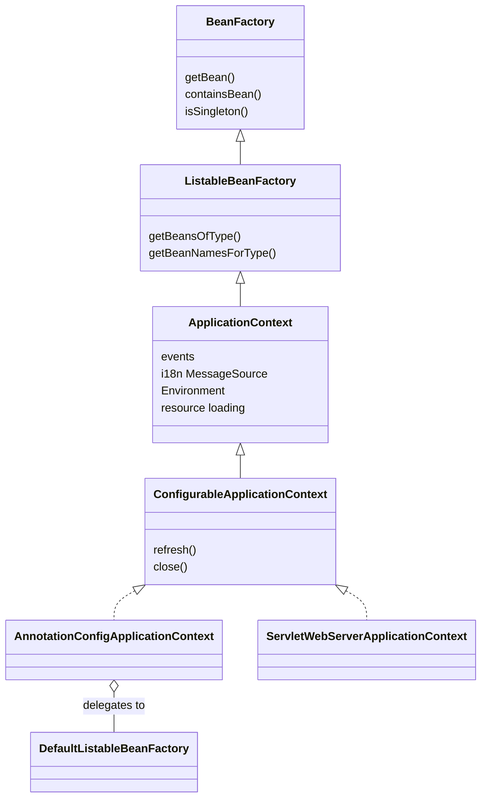
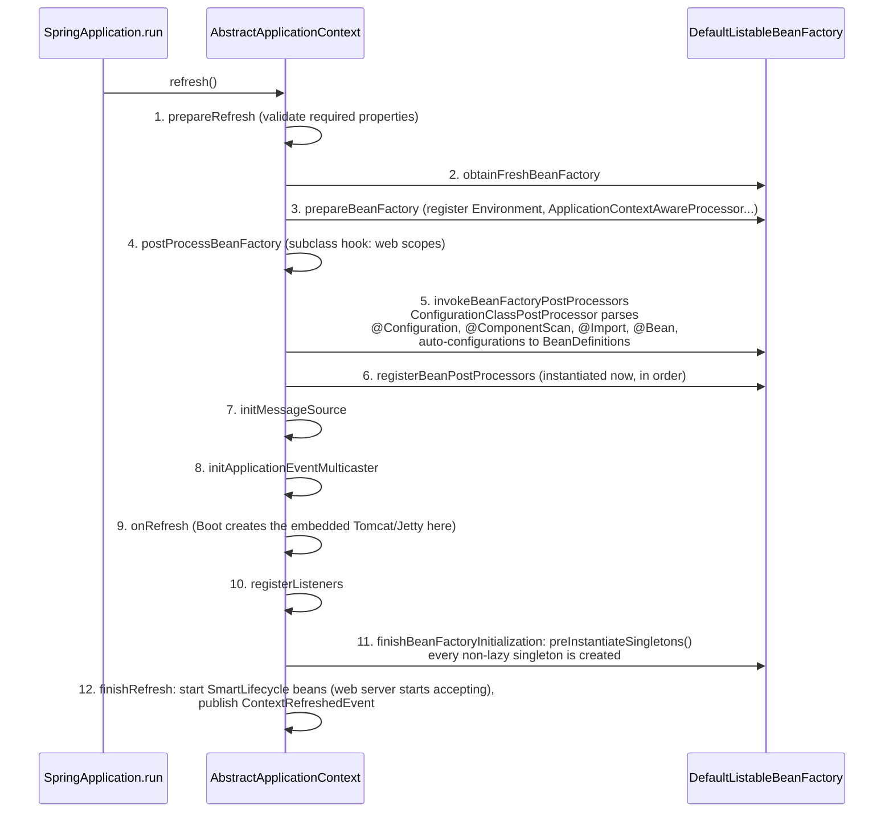
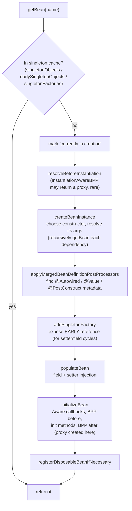
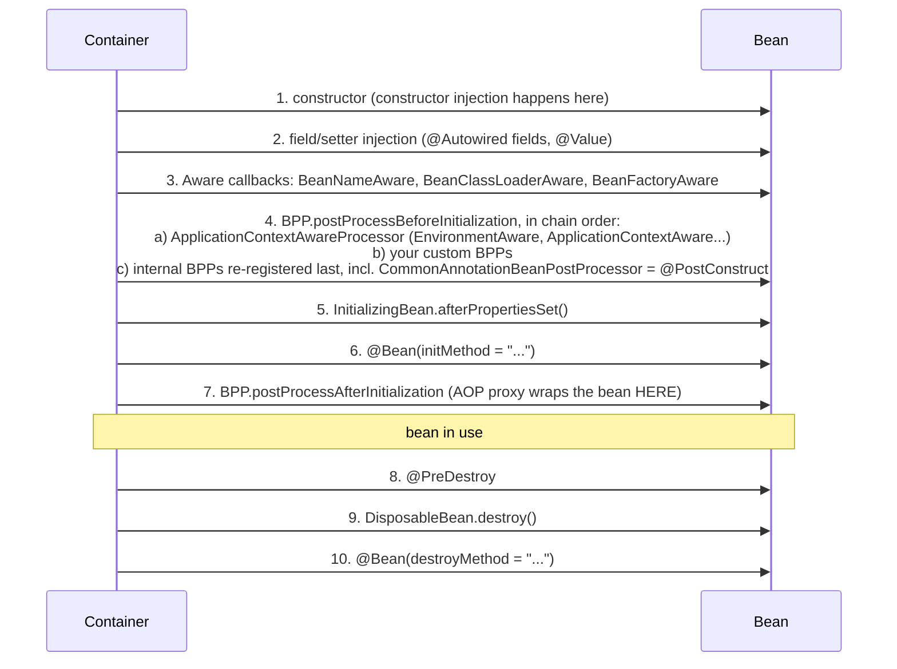
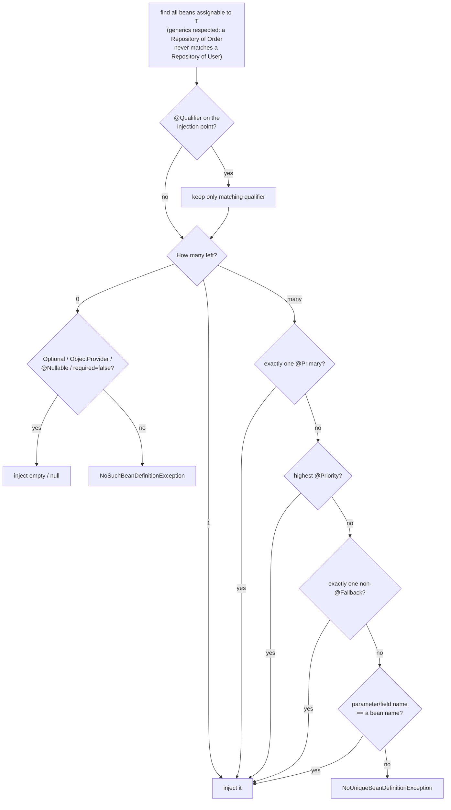
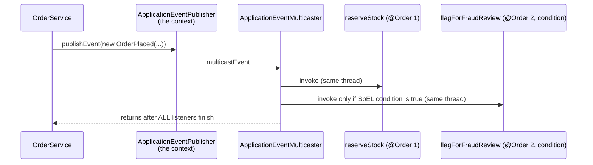
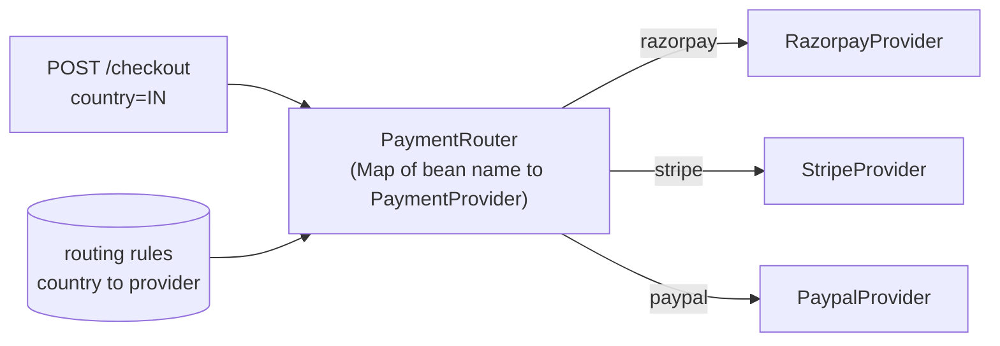
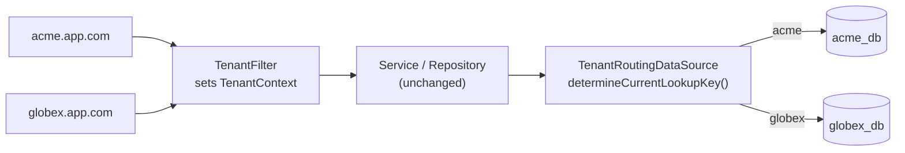
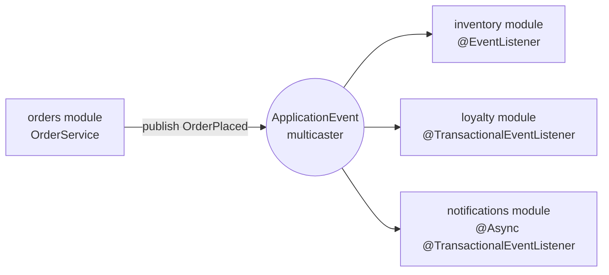

# 01 — Spring Core: IoC Container & Dependency Injection

> **Lab:** [`labs/01-core-ioc`](https://github.com/sumit-mishra-itp/springboot-roadmap/tree/main/labs/01-core-ioc)
> **Capstone use:** every bean in both capstones. Strategy-map injection powers payment-provider routing, and domain events decouple order → inventory → email.
> **Prereqs:** Java 21 refresher (records, `Optional`).

---

## 1. What & why

**Inversion of Control (IoC)** means your code no longer creates and wires its own collaborators. The *container* does it. **Dependency Injection (DI)** is how IoC is implemented: an object declares what it needs, through its constructor, a setter, or a field, and the container supplies it.

**Before Spring:**

| Era | How objects got their dependencies | Pain |
|---|---|---|
| Plain Java | `new PaymentService(new StripeClient(new HttpClient()))` everywhere | Swapping an implementation meant editing every call site, and tests couldn't substitute fakes |
| Factories / Service Locator | `ServiceLocator.get(PaymentService.class)` | Hidden dependencies and a global mutable registry. Tests had to set up the locator |
| EJB 2.x | JNDI lookups, home/remote interfaces, XML deployment descriptors | Huge ceremony, an app server was required, and beans were untestable outside the container |
| **Spring (2003+)** | The container injects plain objects (POJOs) | Dependencies are explicit in constructors, implementations swap through config, and unit tests use `new` |

**What the container gives you beyond wiring:** lifecycle management (init/destroy), scopes, AOP proxies (transactions, security, caching), events, environment/profiles, resource loading, and i18n.

**When *not* to lean on it:**
- Value objects and DTOs (records). These are data, not beans. Don't make an entity or a request DTO a `@Component`.
- Libraries you publish. Keep them framework-free and offer an *auto-configuration* separately (note 03).
- Tiny CLI tools and AWS Lambdas where startup time dominates, unless you use AOT or native image (note 15).

---

## 2. Mental model

Think of the container as a **factory that reads recipes**. Each *recipe* is a `BeanDefinition`. A recipe can come from `@Component` scanning, `@Bean` methods, `@Import`, a `BeanRegistrar`, or XML. The container first collects *all* recipes, lets post-processors edit them, and only then cooks the beans, in dependency order.

```mermaid
flowchart LR
  subgraph Sources["Bean definition sources"]
    S1["@Component scan"]
    S2["@Configuration + @Bean"]
    S3["@Import / BeanRegistrar"]
    S4["Auto-configuration<br/>(Boot)"]
  end
  Sources --> BD["BeanDefinitionRegistry<br/>(recipes only, no objects yet)"]
  BD --> BFPP["BeanFactoryPostProcessors<br/>edit recipes<br/>e.g. ConfigurationClassPostProcessor,<br/>PropertySourcesPlaceholderConfigurer"]
  BFPP --> INST["Instantiate + inject<br/>(constructor, then fields/setters)"]
  INST --> BPP["BeanPostProcessors<br/>wrap or modify instances<br/>e.g. @Autowired processing, AOP proxies"]
  BPP --> READY["Ready bean in<br/>singleton cache"]
```



**Two post-processor families. Interviewers love this distinction:**

| | `BeanFactoryPostProcessor` (BFPP) | `BeanPostProcessor` (BPP) |
|---|---|---|
| Operates on | **Definitions** (metadata) | **Instances** (objects) |
| Runs | Once, before any regular bean is created | Around the initialization of *every* bean |
| Examples | `ConfigurationClassPostProcessor` (parses `@Configuration`/`@ComponentScan`/`@Bean`), `PropertySourcesPlaceholderConfigurer` (resolves `${...}`) | `AutowiredAnnotationBeanPostProcessor` (`@Autowired`, `@Value`), `CommonAnnotationBeanPostProcessor` (`@PostConstruct`, `@PreDestroy`, `@Resource`), `AnnotationAwareAspectJAutoProxyCreator` (AOP proxies) |
| Declare with | A **`static`** `@Bean` method | A **`static`** `@Bean` method |

### Container type hierarchy



- **`BeanFactory`** is the bare DI engine. It is lazy, with no events and no automatic BPP registration.
- **`ApplicationContext`** is a `BeanFactory` plus events, `Environment`, i18n, resources, and *eager* singleton creation. You always use this one. It *delegates* to an internal `DefaultListableBeanFactory`.
- Spring Boot chooses the context class for you: `AnnotationConfigServletWebServerApplicationContext` for MVC, `...ReactiveWebServerApplicationContext` for WebFlux, and `AnnotationConfigApplicationContext` for non-web apps.

---

## 3. How it works internally

### 3.1 `refresh()`: the twelve steps that start every Spring app

`AbstractApplicationContext.refresh()` is *the* method. Boot's `SpringApplication.run()` creates the context, prepares the environment, and then calls `refresh()`.



If any step throws, `refresh()` destroys the beans created so far and rethrows. Boot then prints the **failure analysis** (`FailureAnalyzer`) banner you see on startup errors.

### 3.2 Creating one bean: `getBean()` → `doCreateBean()`



**The three-level singleton cache** (`DefaultSingletonBeanRegistry`) exists only to resolve **field/setter circular references**:

1. `singletonObjects`: fully initialized beans.
2. `earlySingletonObjects`: early references already handed out to a bean in a cycle.
3. `singletonFactories`: an `ObjectFactory` that can produce the early reference, *possibly a proxy* (via `SmartInstantiationAwareBeanPostProcessor.getEarlyBeanReference`). That's why the third level exists: if A needs B, B needs A, and A will be proxied, B must receive A's *proxy*, not the raw object.

**Constructor cycles can never be resolved**, because no object exists yet to hand out early, so you get `BeanCurrentlyInCreationException`. Since **Boot 2.6**, *all* circular references are prohibited by default (`spring.main.allow-circular-references=false`). Treat a cycle as a design smell. The fixes, in order of preference:
1. Extract the shared logic into a third bean.
2. Replace the back-call with an event.
3. Inject `ObjectProvider<B>` or mark the parameter `@Lazy`, which injects a lazy-resolution proxy.

### 3.3 Lifecycle callbacks: the *real* order (verified by the lab test)



The lab's `LifecycleOrderTest` asserts exactly this:

```text
constructor
BeanNameAware.setBeanName
BeanPostProcessor.before        <- custom BPP
@PostConstruct                  <- CommonAnnotationBeanPostProcessor
InitializingBean.afterPropertiesSet
@Bean(initMethod)
BeanPostProcessor.after
... context.close() ...
@PreDestroy
DisposableBean.destroy
@Bean(destroyMethod)
```

> **Niche detail: why does a custom BPP's `before` run *before* `@PostConstruct`?** `CommonAnnotationBeanPostProcessor` is `PriorityOrdered`, so you'd expect it first. But it is also a `MergedBeanDefinitionPostProcessor`, which Spring classes as "internal". At the end of `PostProcessorRegistrationDelegate.registerBeanPostProcessors()`, Spring **re-registers all internal BPPs, moving them to the end of the chain**. Many blog posts get this wrong, which is why the lab proves it with a test.

**Consequence you must remember:** `@PostConstruct` runs on the **raw object, before** the AOP proxy exists, because the proxy is created in step 7. So inside `@PostConstruct`, calling your own `@Transactional`, `@Cacheable` or `@Async` method has **no effect**. For start-up work that needs proxies, use `ApplicationReadyEvent`, `SmartInitializingSingleton`, or `ApplicationRunner`.

**Which callback should you use?**

| Callback | Use when |
|---|---|
| Constructor | Validating and assigning dependencies. Prefer this whenever possible |
| `@PostConstruct` | Post-injection setup (needs `jakarta.annotation-api`, which Boot includes) |
| `InitializingBean` | Framework or library code that must not depend on annotations |
| `@Bean(initMethod)` | Third-party classes you can't annotate |
| `SmartInitializingSingleton.afterSingletonsInstantiated()` | You need *all* singletons to exist (e.g. a registry scanning other beans) |
| `ApplicationRunner` / `ApplicationReadyEvent` | App-level start-up tasks, after the web server is up |
| `SmartLifecycle` | Things with start/stop *phases* (message listeners, schedulers). Boot's graceful shutdown uses it |

### 3.4 How autowiring picks a candidate

For a dependency of type `T`, `DefaultListableBeanFactory.doResolveDependency` does the following:



Special injection shapes:

| Injection point | What you get |
|---|---|
| `List<T>` / `Set<T>` / `T[]` | All beans of type `T`. A `List` is sorted by `@Order` / `Ordered` / `@Priority` |
| `Map<String, T>` | Bean name → bean. This is the basis of the **strategy pattern** (section 7) |
| `Optional<T>` | Empty if none |
| `ObjectProvider<T>` | Lazy, optional, and re-resolvable: `getObject()`, `getIfAvailable()`, `getIfUnique()`, `orderedStream()` |
| `@Lazy T` | A proxy that resolves `T` on first method call |

### 3.5 Scopes

| Scope | Instances | Destroy callbacks? | Notes |
|---|---|---|---|
| `singleton` (default) | One per **container**, not per JVM | Yes | Must be thread-safe, so keep it stateless |
| `prototype` | New on every `getBean`/injection | **No**: the container forgets it after creating it | You must clean it up yourself |
| `request` | One per HTTP request | Yes | Web only. Needs a scoped proxy when injected into a singleton |
| `session` | One per HTTP session | Yes | Web only |
| `application` | One per `ServletContext` | Yes | Rarely needed |
| `websocket` | One per WebSocket session | Yes | |

**The prototype-in-singleton trap.** A singleton is created once, so a prototype injected into it is also injected **once**, and every caller shares it. The lab's `CartService.staleCart()` returns the same cart every time. Here are the fixes:

```java
// 1. ObjectProvider (preferred, explicit)
private final ObjectProvider<ShoppingCart> carts;
ShoppingCart cart = carts.getObject();      // new instance each call

// 2. Scoped proxy: inject a proxy that fetches the real target on every method call
@Scope(value = "prototype", proxyMode = ScopedProxyMode.TARGET_CLASS)

// 3. @Lookup method injection: Spring CGLIB-overrides the method
@Lookup protected ShoppingCart newCart() { return null; }
```

A `@RequestScope` bean injected into a singleton controller works only because `@RequestScope` *defaults* to `proxyMode = TARGET_CLASS`. The proxy looks up the current request's instance from `RequestContextHolder` (a `ThreadLocal`) on each call.

### 3.6 `@Configuration` full mode vs lite mode

| | `@Configuration` (full, `proxyBeanMethods = true`) | `@Configuration(proxyBeanMethods = false)` or `@Bean` inside a `@Component` (lite) |
|---|---|---|
| Class is CGLIB-subclassed | Yes (`FullModeConfig$$SpringCGLIB$$0`) | No |
| `@Bean` method calling another `@Bean` method | Intercepted, returns the **container singleton** | Plain Java call, so it creates a **new object** |
| Startup cost | Higher (class generation) | Lower, and friendlier to native images |
| Spring Boot's own auto-configs use | | **Lite**, everywhere |

In lite mode, get dependencies as **method parameters**: `@Bean ClockHolder holder(Clock clock)`. The lab's `ConfigurationModeTest` proves all three behaviors.

**`static @Bean` methods:** a BFPP or BPP declared by a non-static `@Bean` forces its configuration class to be instantiated *during post-processor registration*, before other BPPs exist. That class then misses `@Autowired` processing, and you see the log line *"Bean 'x' of type [...] is not eligible for getting processed by all BeanPostProcessors"*. Declaring the method `static` avoids creating the config instance at all.

### 3.7 Application events



- Listeners are **synchronous** and run on the **publisher's thread** by default. A listener exception propagates back to `publishEvent()`, and if you're inside a transaction it rolls the transaction back.
- `@Async @EventListener` makes a listener async. That requires `@EnableAsync`, and the exception is then handled by an `AsyncUncaughtExceptionHandler`.
- `@TransactionalEventListener(phase = AFTER_COMMIT)` (the default phase) fires only after the publishing transaction commits. Use it for "send email after the order is saved". Without an active transaction, the event is **dropped** unless `fallbackExecution = true`.
- If a listener method returns a non-null value (or a collection), that value is **published as a new event**.
- Events can be any object since Spring 4.2. Generic events (`EntityCreated<Order>`) are matched on generics via `ResolvableTypeProvider`.

**Boot's startup events, in order** (useful when hooking early):

`ApplicationStartingEvent` → `ApplicationEnvironmentPreparedEvent` → `ApplicationContextInitializedEvent` → `ApplicationPreparedEvent` → `ContextRefreshedEvent` → `ApplicationStartedEvent` → `AvailabilityChangeEvent(LivenessState.CORRECT)` → `ApplicationReadyEvent` → `AvailabilityChangeEvent(ReadinessState.ACCEPTING_TRAFFIC)`. On failure, `ApplicationFailedEvent` is published.

The first few fire **before the context exists**, so `@EventListener` beans can't receive them. Register those listeners via `SpringApplication.addListeners(...)` or `META-INF/spring.factories`.

---

## 4. Full worked code

The full source is in the lab, and every snippet below is exercised by its tests (`./mvnw verify` gives 7 tests, all green).

### 4.1 Resolving ambiguity: `@Primary`, `@Qualifier`, `List`, `Map`

```java
public interface NotificationSender { String send(String message); }

@Component @Primary @Order(1)
public class EmailSender implements NotificationSender {
    public String send(String message) { return "email:" + message; }
}

@Component @Qualifier("sms") @Order(2)
public class SmsSender implements NotificationSender {
    public String send(String message) { return "sms:" + message; }
}

@Service
public class NotificationService {
    private final NotificationSender defaultSender;       // @Primary → EmailSender
    private final NotificationSender smsSender;           // @Qualifier → SmsSender
    private final List<NotificationSender> allSenders;    // [EmailSender, SmsSender] sorted by @Order
    private final Map<String, NotificationSender> byName; // {"emailSender": ..., "smsSender": ...}

    // Single constructor: no @Autowired needed (since Spring 4.3)
    public NotificationService(NotificationSender defaultSender,
                               @Qualifier("sms") NotificationSender smsSender,
                               List<NotificationSender> allSenders,
                               Map<String, NotificationSender> byName) { /* assign */ }
}
```

### 4.2 Prototype in a singleton

```java
@Component @Scope(ConfigurableBeanFactory.SCOPE_PROTOTYPE)
public class ShoppingCart { private final String id = UUID.randomUUID().toString(); /* ... */ }

@Service
public class CartService {
    private final ShoppingCart injectedOnce;              // trap: same instance forever
    private final ObjectProvider<ShoppingCart> provider;  // fix: fresh per call

    public CartService(ShoppingCart injectedOnce, ObjectProvider<ShoppingCart> provider) { /* assign */ }
    public ShoppingCart staleCart() { return injectedOnce; }
    public ShoppingCart newCart()   { return provider.getObject(); }
}
```

### 4.3 Lifecycle and a BeanPostProcessor

```java
@Configuration(proxyBeanMethods = false)
public class LifecycleConfig {
    @Bean
    static RecordingBeanPostProcessor recordingBeanPostProcessor() {   // static!
        return new RecordingBeanPostProcessor();
    }

    @Bean(initMethod = "customInit", destroyMethod = "customDestroy")
    LifecycleBean lifecycleBean() { return new LifecycleBean(); }
}

public class RecordingBeanPostProcessor implements BeanPostProcessor {
    public Object postProcessBeforeInitialization(Object bean, String name) {
        if (bean instanceof LifecycleBean b) b.record("BeanPostProcessor.before");
        return bean;
    }
    public Object postProcessAfterInitialization(Object bean, String name) {
        if (bean instanceof LifecycleBean b) b.record("BeanPostProcessor.after");
        return bean;   // AOP returns a proxy here instead of `bean`
    }
}

// Test: plain container, no Boot, so you see pure core behavior
try (var ctx = new AnnotationConfigApplicationContext(LifecycleConfig.class)) {
    bean = ctx.getBean(LifecycleBean.class);
    assertThat(bean.events()).containsExactly("constructor", "BeanNameAware.setBeanName",
        "BeanPostProcessor.before", "@PostConstruct", "InitializingBean.afterPropertiesSet",
        "@Bean(initMethod)", "BeanPostProcessor.after");
}
```

### 4.4 Full vs lite configuration

```java
@Configuration                                   // full: CGLIB subclass
public class FullModeConfig {
    @Bean Clock fullClock() { return new Clock(); }
    @Bean ClockHolder fullHolder() { return new ClockHolder(fullClock()); } // same singleton
}

@Configuration(proxyBeanMethods = false)         // lite
public class LiteModeConfig {
    @Bean Clock liteClock() { return new Clock(); }
    @Bean ClockHolder liteHolderByCall() { return new ClockHolder(liteClock()); }        // NEW Clock!
    @Bean ClockHolder liteHolderByParam(Clock liteClock) { return new ClockHolder(liteClock); } // the bean
}
```

### 4.5 Events

```java
public record OrderPlaced(String orderId, long amountCents) {}

@Service
public class OrderService {
    private final ApplicationEventPublisher publisher;
    public OrderService(ApplicationEventPublisher publisher) { this.publisher = publisher; }
    public void placeOrder(String id, long cents) { publisher.publishEvent(new OrderPlaced(id, cents)); }
}

@Component
public class OrderListeners {
    @EventListener @Order(1)
    void reserveStock(OrderPlaced e) { /* runs on caller's thread */ }

    @EventListener(condition = "#event.amountCents() > 100000") @Order(2)
    void flagForFraudReview(OrderPlaced e) { /* only big orders */ }
}
```

### 4.6 Framework 7 `BeanRegistrar`: programmatic registration

```java
public class PaymentGatewayRegistrar implements BeanRegistrar {
    @Override
    public void register(BeanRegistry registry, Environment env) {
        String provider = env.getProperty("payments.provider", "stripe");
        registry.registerBean("paymentGateway", PaymentGateway.class,
                spec -> spec.supplier(ctx -> new PaymentGateway(provider)));

        if (env.getProperty("features.fast-checkout", Boolean.class, false)) {   // conditional registration
            registry.registerBean("featureFlags", FeatureFlags.class,
                    spec -> spec.supplier(ctx -> new FeatureFlags(true)));
        }
    }
}

@Configuration(proxyBeanMethods = false)
@Import(PaymentGatewayRegistrar.class)
public class RegistrarConfig {}
```

The `spec` builder also offers `.primary()`, `.lazyInit()`, `.prototype()`, `.description(...)`, and so on. It is AOT-friendly, unlike reflection-heavy `BeanDefinitionRegistryPostProcessor`.

---

## 5. Gap fillers & niche details

- **Bean naming:** `@Component class OrderService` is named `orderService`. Spring uses `Introspector.decapitalize`, so `URLService` stays **`URLService`**: if the first two letters are uppercase, the name isn't lowercased. A `@Bean` method's name is the bean name.
- **Same-name beans:** a second bean definition with the same name *overrides* the first in plain Spring. In **Boot it fails** (`spring.main.allow-bean-definition-overriding=false`).
- **Constructor selection:** with one constructor, no `@Autowired` is needed. With several, Spring uses the `@Autowired` one, otherwise the no-arg one, otherwise it fails.
- **Field injection can't be `final`**, hides dependencies, and needs reflection or a container in tests. Constructor injection makes the object valid on creation and testable with `new`.
- **`@Autowired` on a `static` field does nothing.** Spring only injects instance members, and it logs a warning.
- **`new MyComponent()` is not a bean.** It gets no injection, no proxy, and no `@Transactional`. Only objects the container creates are managed.
- **`@ComponentScan` default base package** is the package of the class that carries it. With Boot, that's the package of `@SpringBootApplication`, so put the main class in the *root* package. A bean in `com.acme.other` beside `com.acme.app` is invisible, which gives a classic `NoSuchBeanDefinitionException`.
- **Lazy init:** `@Lazy` on a bean, or globally with `spring.main.lazy-initialization=true`. Startup is faster, but configuration errors surface at the first request instead of at startup. Use it in dev, think twice in prod.
- **`FactoryBean<T>`:** `getBean("foo")` returns the *product* `T`, while `getBean("&foo")` returns the factory itself. Before Boot, this is how `SqlSessionFactoryBean`, `LocalContainerEntityManagerFactoryBean`, and others plugged in.
- **`@Bean` destroy-method inference:** if a `@Bean`'s class has a public `close()` or `shutdown()` method, Spring calls it on shutdown **automatically**. To disable this, use `@Bean(destroyMethod = "")`. This is how `HikariDataSource` gets closed for free.
- **Prototype `@PreDestroy` never runs.** The container doesn't track prototypes after creating them.
- **Singletons are per container, not per JVM.** A parent/child context, or two `ApplicationContext`s in tests, gives two instances.
- **Thread-safety:** singletons are shared across all request threads. Never keep request-specific mutable state in fields. The lab's `OrderListeners` uses `CopyOnWriteArrayList` for exactly this reason.
- **`@Fallback` (Framework 6.2+)** is the opposite of `@Primary`. It marks a bean to use only if no other candidate exists, which is ideal for library defaults.
- **`@Order` on a `@Component` doesn't control creation order.** It only sorts collection injection and listener invocation. Creation order comes from dependencies. Use `@DependsOn` if there's a hidden dependency (e.g. a DB migration must run first).
- **`ApplicationContextAware` / `BeanFactoryAware`** couple you to Spring. Inject `ApplicationContext` through the constructor if you really need it, but usually you don't.
- **`@Value("${x}")` vs `@Value("#{...}")`**: `$` is a property placeholder, while `#` is SpEL. `@Value("${missing}")` fails at startup unless you give it a default: `${missing:default}`.

---

## 6. Boot 4 / Framework 7 delta

Source: [Spring Framework 7.0 Release Notes](https://github.com/spring-projects/spring-framework/wiki/Spring-Framework-7.0-Release-Notes) and the [Spring Boot 4.0 Migration Guide](https://github.com/spring-projects/spring-boot/wiki/Spring-Boot-4.0-Migration-Guide).

| Change | Status | What it means for you |
|---|---|---|
| **`BeanRegistrar`** (`org.springframework.beans.factory.BeanRegistrar`) | **New** | The official way to register several beans or conditional beans programmatically. Don't register multiple beans inside one `@Bean` method. `@Bean` methods should declare the **most concrete return type** |
| **`@Proxyable`** | **New** | Per-bean override of proxy type (`INTERFACES` / `TARGET_CLASS`, or `interfaces = ...`) |
| Global proxy default (CGLIB) applied consistently | **Changed** | All proxy processors, including `@Async`, now honor the context-wide default |
| `javax.annotation.*` / `javax.inject.*` support | **Removed** | `@javax.annotation.PostConstruct`, `@javax.inject.Inject` and similar are silently **ignored**. Use the `jakarta.*` versions |
| Null-safety via **JSpecify** (`org.jspecify.annotations.Nullable`) | **New** | The framework API is annotated with JSpecify. JSR-305-based annotations are deprecated |
| `spring-jcl` module | **Removed** | Replaced by Apache Commons Logging 1.3. This is transparent unless you excluded `spring-jcl` explicitly |
| `@Retryable`, `@ConcurrencyLimit`, `@EnableResilientMethods`, `org.springframework.core.retry.RetryTemplate` | **New in core** | Retry without the separate Spring Retry project. Covered in note 02 (they're proxy-based) |
| SpEL: `Optional` unwrapping; default **10,000-operation limit** (`spring.expression.maxOperations`) | **New / Changed** | Huge SpEL expressions can now throw |
| `ClassFileMetadataReader` on Java 24+ | **New** | Uses the JDK Class-File API instead of ASM for `@Configuration` parsing |
| Baselines | | JDK 17+ (Boot 4 also requires 17+, and this repo uses 21), Jakarta EE 11, Kotlin 2.2 |

> ⚠️ **Outdated advice still common in tutorials and Baeldung articles:**
> - Field `@Autowired` everywhere: use constructor injection.
> - XML `<bean>` config and `@Required`: the annotation was removed in 6.0.
> - `import javax.annotation.PostConstruct`: silently ignored now.
> - Registering beans with `BeanDefinitionRegistryPostProcessor` for simple cases: use `BeanRegistrar`.
> - "`@PostConstruct` runs before all BeanPostProcessors": false, see section 3.3.

---

## 7. Real-life architecture solutions

### 7.1 Strategy routing via `Map<String, Bean>` injection: payment provider selection

**Problem:** checkout must support Stripe, PayPal, and Razorpay. Different countries and merchants use different providers, and new providers keep arriving. An `if/else` or `switch` on the provider name grows forever and violates open/closed.

**Solution:** each provider is a bean implementing `PaymentProvider`. Spring injects them all as a `Map<String, PaymentProvider>`, and the router picks by key. Adding a provider means adding one class, with zero edits elsewhere.



```java
@Component("stripe")   class StripeProvider   implements PaymentProvider { ... }
@Component("razorpay") class RazorpayProvider implements PaymentProvider { ... }

@Service
class PaymentRouter {
    private final Map<String, PaymentProvider> providers;
    PaymentRouter(Map<String, PaymentProvider> providers) { this.providers = providers; }

    PaymentResult charge(String providerKey, Money amount) {
        PaymentProvider p = providers.get(providerKey);
        if (p == null) throw new UnsupportedProviderException(providerKey);
        return p.charge(amount);
    }
}
```

**Trade-offs:** bean names become part of your contract (keep them as constants). Feature flags can toggle providers with `@ConditionalOnProperty`.
**Who uses it:** payment orchestration layers at e-commerce companies, notification hubs (email, SMS, push), and file-export services (CSV, PDF, XLSX). It is the same pattern as the lab's `NotificationService.notifyVia`.

### 7.2 Multi-tenant SaaS: routing `DataSource` by tenant

**Problem:** a B2B SaaS app keeps each enterprise customer in its own database for isolation and compliance, but runs one codebase.

**Solution:** `AbstractRoutingDataSource` is a single `DataSource` bean that delegates to a per-tenant pool. A servlet filter extracts the tenant (subdomain, header, or JWT claim) into a `ThreadLocal` (or a Java 21 `ScopedValue`), and `determineCurrentLookupKey()` reads it.



```java
class TenantRoutingDataSource extends AbstractRoutingDataSource {
    @Override protected Object determineCurrentLookupKey() { return TenantContext.current(); }
}
```

**Trade-offs:**
- **Pros:** strong isolation, per-tenant backup/restore, and per-tenant DB sizing.
- **Cons:** schema migrations must run N times (Flyway per tenant). The connection-pool count grows with tenants. You must **clear the `ThreadLocal`** in a `finally` block, or tenant data leaks across pooled threads.

Alternatives are schema-per-tenant (Hibernate multi-tenancy) and a shared schema with a `tenant_id` column, which is the cheapest but has the weakest isolation.
**Who uses it:** B2B SaaS platforms (HR, CRM, and accounting products) with enterprise customers who demand data isolation.

### 7.3 Modular monolith with in-process domain events

**Problem:** in an order system, `OrderService` directly calls `InventoryService`, `LoyaltyService`, and `EmailService`. Every new reaction means editing `OrderService`, and the modules become a tangled ball.

**Solution:** `OrderService` publishes `OrderPlaced`, and each module listens. Modules depend on the *event*, not on each other. This is the core idea behind **Spring Modulith**, which adds an *event publication registry* so that events survive crashes.



**Trade-offs:**
- Synchronous listeners share the transaction, so they're consistent but slow down the request.
- `AFTER_COMMIT` listeners lose the event if the JVM crashes right after commit. Fix this with Spring Modulith's registry or the **transactional outbox** (note 11).
- This is the stepping stone before microservices. Extracting a module later means swapping the in-process event for a Kafka message.

**Who uses it:** teams running the "monolith first" approach, and Shopify-style modular monoliths.

---

## 8. Pitfalls & debugging checklist

- [ ] **`NoSuchBeanDefinitionException`**. The class is outside the scanned package, is missing a stereotype annotation, a condition excluded it, or the profile isn't active. To debug, run with `--debug` for the condition evaluation report, or check `/actuator/beans`.
- [ ] **`NoUniqueBeanDefinitionException`**. There are two candidates. Add `@Primary`, `@Qualifier`, or `@Fallback`, or inject a `List` or `Map`.
- [ ] **`BeanCurrentlyInCreationException` / "circular references are prohibited"**. Redesign (section 3.2). Don't just set `allow-circular-references=true`.
- [ ] **Prototype behaves like a singleton**. It was injected into a singleton. Use `ObjectProvider`.
- [ ] **`@Transactional` / `@Cacheable` ignored**:
  - it's called from `@PostConstruct`, which runs before the proxy exists;
  - it's a self-call (`this.method()`, note 02);
  - the object was created with `new`;
  - the method is private or final.
- [ ] **"Bean X is not eligible for getting processed by all BeanPostProcessors"**. A BPP or BFPP has dependencies, or isn't a `static @Bean`. Make it `static` and give it no injected dependencies (use `ObjectProvider` lazily if you must).
- [ ] **Lite-mode `@Bean` call creates duplicates**. Take the dependency as a method parameter.
- [ ] **`@PostConstruct` never called**. You're still importing `javax.annotation`, which is ignored in Framework 7.
- [ ] **Race conditions under load**. Mutable fields on a singleton. Make it stateless, or use `ConcurrentHashMap` / atomics.
- [ ] **Event listener exception breaks the publisher's request**. Listeners are synchronous. Use `@Async` or `@TransactionalEventListener` plus error handling.
- [ ] **Startup is slow or you need to see what got created**: `/actuator/beans`, `/actuator/conditions`, `/actuator/startup` (with `BufferingApplicationStartup`), and `-Dspring.main.lazy-initialization=true` in dev.

---

## 9. Interview questions

<details><summary>Q1. What is IoC, and how is DI different from it?</summary>

IoC is the principle that a framework controls object creation and the flow of control, not your code. DI is one implementation of IoC: dependencies are *pushed* into an object (constructor, setter, or field) rather than *pulled* by it (`new`, a service locator, or JNDI). Spring's IoC container implements DI.
</details>

<details><summary>Q2. BeanFactory vs ApplicationContext?</summary>

`BeanFactory` is the core DI engine. It is lazy, and BPPs must be registered manually. `ApplicationContext` extends it with eager singleton creation, automatic BFPP/BPP detection, events, `Environment`/profiles, i18n (`MessageSource`), and resource loading. Apps always use `ApplicationContext`, which internally delegates to a `DefaultListableBeanFactory`.
</details>

<details><summary>Q3. Why is constructor injection preferred over field injection?</summary>

- Dependencies can be `final`, so the object is immutable and fully initialized on construction.
- Required dependencies are explicit.
- You can unit test with `new` and no container.
- Too many constructor parameters makes an SRP violation visible.
- Constructor circular dependencies fail fast.

Field injection hides dependencies, needs reflection, and allows partially constructed objects.
</details>

<details><summary>Q4. Walk through the bean lifecycle.</summary>

Instantiate (constructor injection) → field/setter injection → Aware callbacks (`BeanNameAware`, `BeanFactoryAware`...) → `BeanPostProcessor.postProcessBeforeInitialization` chain (`ApplicationContextAware` & co, then custom BPPs, then `@PostConstruct` via the internal `CommonAnnotationBeanPostProcessor`, which is re-registered last) → `InitializingBean.afterPropertiesSet` → custom init-method → `postProcessAfterInitialization` (AOP proxies are created here) → in use → on close: `@PreDestroy` → `DisposableBean.destroy` → custom destroy-method. Prototypes get no destruction callbacks.
</details>

<details><summary>Q5. BeanPostProcessor vs BeanFactoryPostProcessor?</summary>

A BFPP modifies bean *definitions* before any regular bean is instantiated. Examples are `ConfigurationClassPostProcessor` and `PropertySourcesPlaceholderConfigurer`. A BPP modifies bean *instances* around initialization. Examples are `@Autowired` processing and AOP proxy creation. Both should be declared as `static @Bean` methods.
</details>

<details><summary>Q6. How does Spring resolve circular dependencies, and what changed in Boot 2.6?</summary>

For field and setter injection on singletons, Spring exposes an early reference through a three-level cache (`singletonObjects`, `earlySingletonObjects`, `singletonFactories`). The third level lets the early reference be a proxy if needed. Constructor cycles can't be resolved (`BeanCurrentlyInCreationException`). Since Boot 2.6, circular references are prohibited by default (`spring.main.allow-circular-references=false`). Fix the design, or use `@Lazy` or `ObjectProvider`.
</details>

<details><summary>Q7. What happens when you inject a prototype bean into a singleton?</summary>

The prototype is created once, when the singleton is created, so it effectively becomes a singleton for that holder. To get a new instance each time, use `ObjectProvider<T>.getObject()`, a scoped proxy (`proxyMode = TARGET_CLASS`), or `@Lookup` method injection.
</details>

<details><summary>Q8. What's the difference between @Configuration and @Component when declaring @Bean methods?</summary>

A `@Configuration` (full mode) class is CGLIB-subclassed, so inter-`@Bean` method calls are intercepted and return the container's singleton. A `@Bean` inside a `@Component`, or `@Configuration(proxyBeanMethods = false)` (lite mode), is a plain method call that creates a new instance on each call. Boot's auto-configs use lite mode for faster startup and native-image friendliness, and they inject dependencies as method parameters.
</details>

<details><summary>Q9. Two beans implement the same interface. How does Spring choose?</summary>

It filters by `@Qualifier` if one is present. Then `@Primary` wins, then the highest `@Priority`, then the only non-`@Fallback` candidate, then a bean whose name matches the parameter or field name. Otherwise it throws `NoUniqueBeanDefinitionException`. Alternatively, inject `List<T>` or `Map<String, T>` to get all of them.
</details>

<details><summary>Q10. Are Spring singleton beans thread-safe?</summary>

No. Spring doesn't synchronize anything. A singleton is shared by all threads, so it must be stateless or use thread-safe structures. Request-specific state belongs in method locals, request-scoped beans, or the request itself.
</details>

<details><summary>Q11. Are application events synchronous? How do you make them run after commit?</summary>

They're synchronous by default and run on the publisher's thread, and an exception propagates to the publisher. Use `@Async` (with `@EnableAsync`) for async listeners. Use `@TransactionalEventListener` (default phase `AFTER_COMMIT`) to run after the transaction commits. Note that without a transaction, the event is dropped unless `fallbackExecution = true`.
</details>

<details><summary>Q12. Why might @Transactional not work when called from @PostConstruct?</summary>

`@PostConstruct` runs during initialization on the raw target object. The AOP proxy that applies transactions is created later, in `postProcessAfterInitialization`, and the call goes through `this` rather than the proxy anyway. Use `ApplicationReadyEvent`, `ApplicationRunner`, or `SmartInitializingSingleton` instead.
</details>

<details><summary>Q13. What is a FactoryBean, and how do you get the factory itself?</summary>

A `FactoryBean<T>` is a bean that produces another object. `getBean("x")` returns the product, and `getBean("&x")` returns the factory. It is used for complex construction, such as JPA's `LocalContainerEntityManagerFactoryBean`.
</details>

<details><summary>Q14. What's new in the Framework 7 core container?</summary>

- `BeanRegistrar` for programmatic bean registration.
- `@Proxyable` to choose the proxy type per bean.
- JSpecify null-safety annotations.
- Core resilience support: `@Retryable`, `@ConcurrencyLimit`, `@EnableResilientMethods`, and `RetryTemplate` in `org.springframework.core.retry`.
- Removal of `javax.annotation`/`javax.inject` support and of `spring-jcl`.
- SpEL `Optional` support and an operations limit.
- Baselines of JDK 17 and Jakarta EE 11.
</details>

---

## 10. Sources

- Spring Framework reference: [The IoC Container](https://docs.spring.io/spring-framework/reference/core/beans.html), [Bean Scopes](https://docs.spring.io/spring-framework/reference/core/beans/factory-scopes.html), [Lifecycle Callbacks](https://docs.spring.io/spring-framework/reference/core/beans/factory-nature.html), [Container Extension Points](https://docs.spring.io/spring-framework/reference/core/beans/factory-extension.html), [@Bean and @Configuration](https://docs.spring.io/spring-framework/reference/core/beans/java/basic-concepts.html), [Programmatic Bean Registration](https://docs.spring.io/spring-framework/reference/core/beans/java/programmatic-bean-registration.html), [Application Events](https://docs.spring.io/spring-framework/reference/core/beans/context-introduction.html#context-functionality-events)
- [Spring Framework 7.0 Release Notes](https://github.com/spring-projects/spring-framework/wiki/Spring-Framework-7.0-Release-Notes)
- [Spring Boot 4.0 Migration Guide](https://github.com/spring-projects/spring-boot/wiki/Spring-Boot-4.0-Migration-Guide) · [Spring Boot reference: SpringApplication events](https://docs.spring.io/spring-boot/reference/features/spring-application.html#features.spring-application.application-events-and-listeners)
- Baeldung: [Inversion of Control and DI](https://www.baeldung.com/inversion-control-and-dependency-injection-in-spring), [Bean Scopes](https://www.baeldung.com/spring-bean-scopes), [Injecting Prototype Beans into a Singleton](https://www.baeldung.com/spring-inject-prototype-bean-into-singleton), [Circular Dependencies](https://www.baeldung.com/circular-dependencies-in-spring), [Spring Events](https://www.baeldung.com/spring-events) (3.x era; verify against section 6)
- Spring source to read: `AbstractApplicationContext#refresh`, `AbstractAutowireCapableBeanFactory#doCreateBean`, `DefaultSingletonBeanRegistry#getSingleton`, `PostProcessorRegistrationDelegate#registerBeanPostProcessors`
- Oracle: [`java.beans.Introspector#decapitalize`](https://docs.oracle.com/en/java/javase/21/docs/api/java.desktop/java/beans/Introspector.html#decapitalize(java.lang.String))
