# 02 — Spring AOP: Proxies, Aspects & Framework 7 Resilience

> **Lab:** [`labs/02-aop-logging`](https://github.com/sumit-mishra-itp/springboot-roadmap/tree/main/labs/02-aop-logging)
> **Capstone use:** the audit trail on money-moving operations, `@Retryable` around payment-provider and inventory calls, `@ConcurrencyLimit` on heavy exports, and an understanding of every `@Transactional` / `@Cacheable` / `@PreAuthorize` proxy in both capstones.
> **Prereqs:** [01 Spring Core](../01-core/spring-core.md), especially the bean lifecycle and `BeanPostProcessor` (section 3.3).

---

## 1. What & why

**Aspect-Oriented Programming (AOP)** pulls *cross-cutting concerns* out of business code. These are behaviors that would otherwise be copy-pasted into dozens of methods: logging, timing, auditing, transactions, caching, security checks, and retries. You write the concern once, in an **aspect**, and declare *where* it applies with a **pointcut**.

**Before AOP:**

| Era | How cross-cutting code was handled | Pain |
|---|---|---|
| Plain Java | `long start = System.nanoTime(); try { ... } finally { log(...) }` in every method | Business logic buried in boilerplate. One forgotten `finally` and a connection leaks |
| Template Method / decorators | Hand-written `LoggingOrderService implements OrderService` wrappers | One decorator class per interface per concern, so N × M classes |
| EJB 2.x | Container-managed transactions and security declared in XML descriptors | Worked only for EJBs, needed an app server, and offered no custom concerns |
| **Spring AOP (2004+)** | Declarative `@Transactional`, `@Cacheable` and custom `@Aspect`s on POJOs | One aspect, any number of beans, and the business code stays clean |

You use AOP every day even if you never write an `@Aspect`. **`@Transactional`, `@Cacheable`, `@Async`, `@PreAuthorize`, `@Validated` (method validation), `@Retryable` and `@ConcurrencyLimit` are all implemented as Spring AOP proxies.** Nearly every "my annotation does nothing" bug in Spring is an AOP proxy bug, and that's why interviews probe this topic so hard.

**When *not* to use AOP:**
- **Business rules.** "Apply a 10% discount for gold customers" belongs in the service, not hidden in an aspect. Aspects should be *orthogonal* to the domain. If removing the aspect changes business results, it shouldn't be an aspect.
- **Request-level concerns in a web app.** A servlet `Filter`, `HandlerInterceptor` or `@ControllerAdvice` is simpler and more visible for HTTP concerns (auth headers, CORS, request logging).
- **Hot inner loops.** Every proxied call pays for a reflective advice chain. That's nanoseconds to microseconds, which is irrelevant for a service call but measurable in a tight loop over millions of items.
- **Anything a reader can't discover.** Aspects are "spooky action at a distance". Prefer annotation-driven pointcuts (`@Loggable`), which are visible at the call site, over broad `execution(* com.acme..*(..))` sweeps.

---

## 2. Mental model

**A Spring bean that needs advice is replaced in the container by a proxy.** Everybody who injects the bean gets the proxy. The proxy runs a chain of interceptors and then calls the real object (the *target*). Calls the target makes on itself (`this.foo()`) never go back through the proxy.

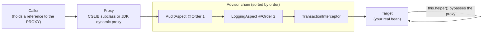

### Vocabulary (interviewers ask for these definitions)

| Term | Meaning | In the lab |
|---|---|---|
| **Aspect** | A module that bundles a cross-cutting concern: pointcuts plus advice | `LoggingAspect`, `AuditAspect` |
| **Join point** | A point in execution where advice *could* run. In Spring AOP this is **always a method execution** on a Spring bean | `TransferService.transfer(..)` |
| **Pointcut** | A predicate that selects join points | `within(dev.roadmap.aop..*) && @annotation(loggable)` |
| **Advice** | The action taken at a join point: `@Around`, `@Before`, `@After`, `@AfterReturning`, `@AfterThrowing` | `LoggingAspect.time(..)` |
| **Advisor** | Spring's own unit: exactly one pointcut plus one advice. Every `@Aspect` advice method becomes one advisor | `InstantiationModelAwarePointcutAdvisorImpl` |
| **Target** | The real object being advised | the `TransferService` instance created by `new` |
| **Proxy** | The object handed out by the container, which applies advice and then delegates to the target | `TransferService$$SpringCGLIB$$0` |
| **Weaving** | Linking aspects with targets. Spring weaves **at runtime, by proxying**. AspectJ weaves bytecode at compile time or load time | `AnnotationAwareAspectJAutoProxyCreator` |
| **Introduction** | Adding a new interface (and its implementation) to an advised object (`@DeclareParents`) | not used, and rarely seen in practice |

### Spring AOP vs full AspectJ

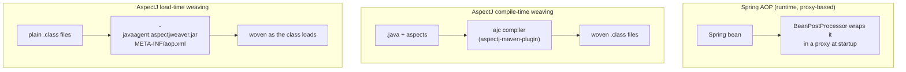

| | Spring AOP | AspectJ (CTW / LTW) |
|---|---|---|
| Join points | Method **execution** on Spring beans only | Method call and execution, field get/set, constructors, static initializers, exception handlers |
| Objects advised | Only container-managed beans | Any object, even `new Order()` (with `@Configurable`) |
| Self-invocation | **Not advised** (proxy is bypassed) | Advised: the code is in the bytecode itself |
| `private` / `final` / `static` methods | Can't be advised | Can be advised |
| Build/runtime setup | None beyond the starter | `ajc` compiler plugin, or a JVM agent |
| Performance | Proxy dispatch on each call | Near-zero: it's just inlined bytecode |
| Syntax | The **AspectJ annotations** (`@Aspect`, `@Around`) and pointcut language, a subset of designators | Full language |

Spring AOP *borrows* AspectJ's annotations and pointcut parser (that's what `aspectjweaver` on the classpath is for), but **it doesn't use the AspectJ weaver**. Pick full AspectJ only if you need to advise non-beans, fields, constructors or self-calls, or need maximum performance. For 95% of applications, Spring AOP is enough.

---

## 3. How it works internally

### 3.1 Who creates the proxy: `AbstractAutoProxyCreator` in `postProcessAfterInitialization`

Recall the lifecycle from note 01: the **AOP proxy is created in `BeanPostProcessor.postProcessAfterInitialization`**, after `@PostConstruct` and the init methods. Spring Boot's `AopAutoConfiguration` (triggered by `spring.aop.auto=true`, the default) adds `@EnableAspectJAutoProxy`, which registers **one** `AnnotationAwareAspectJAutoProxyCreator` under the bean name `org.springframework.aop.config.internalAutoProxyCreator`.

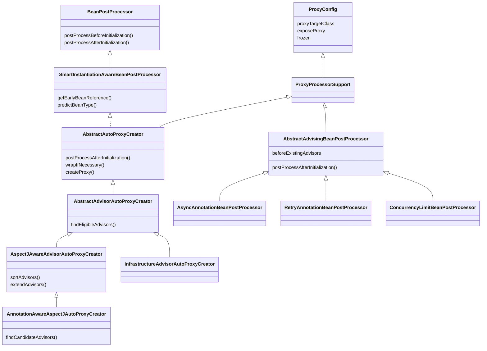

There are **two families of proxy-creating post-processors**. Interviewers rarely know this, and it explains the ordering surprises in section 3.6:

1. **Auto-proxy creators** (`AbstractAutoProxyCreator` subclasses) collect **all `Advisor` beans** in the context plus all `@Aspect` beans, filter them per bean, and build one proxy with the whole chain. `@Transactional` (`BeanFactoryTransactionAttributeSourceAdvisor`), `@Cacheable` (`BeanFactoryCacheOperationSourceAdvisor`), `@PreAuthorize` (Spring Security's `AuthorizationManagerBeforeMethodInterceptor`, which is itself an `Advisor` bean) and your `@Aspect`s all join this one chain. Only one creator is active: `@EnableTransactionManagement`, `@EnableCaching` and `@EnableAspectJAutoProxy` each *escalate* the single `internalAutoProxyCreator` to the most capable class (`AopConfigUtils`), and their `proxyTargetClass`/`exposeProxy` flags are merged so "the strongest setting wins".
2. **Advising post-processors** (`AbstractAdvisingBeanPostProcessor` subclasses) each own **one advisor**: `@Async` (`AsyncAnnotationBeanPostProcessor`), `@Retryable` (`RetryAnnotationBeanPostProcessor`), `@ConcurrencyLimit` (`ConcurrencyLimitBeanPostProcessor`) and `@Validated` method validation (`MethodValidationPostProcessor`). If the bean is **already a proxy**, they add their advisor to the existing proxy instead of double-wrapping it. With `beforeExistingAdvisors = true` (set by the retry and async processors), the advisor goes to **index 0**, making it the **outermost** interceptor.

### 3.2 Proxy creation, step by step

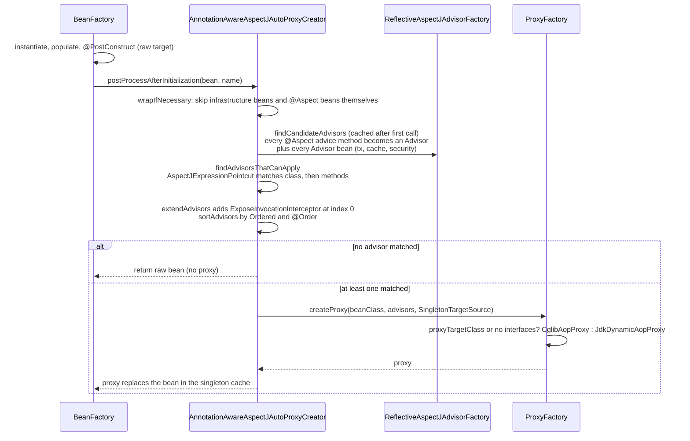

Niche details hidden in that diagram:
- **Matching is done once, at startup, per method.** At call time, `AdvisedSupport.getInterceptorsAndDynamicInterceptionAdvice` returns the cached chain for that `Method`. Only *dynamic* pointcuts (`args(..)`, `this(..)`, `target(..)`, `@args`) evaluate a runtime check on each call.
- **The `@Aspect` bean itself is never proxied** (`isInfrastructureClass` treats `@Aspect` classes as infrastructure), so an aspect can't advise itself.
- **Circular references:** if a bean in a cycle is handed out early, `getEarlyBeanReference()` creates the proxy *early*, and `postProcessAfterInitialization` then skips it. That's why the third level of the singleton cache (note 01, section 3.2) holds a *factory*.

### 3.3 JDK dynamic proxy vs CGLIB

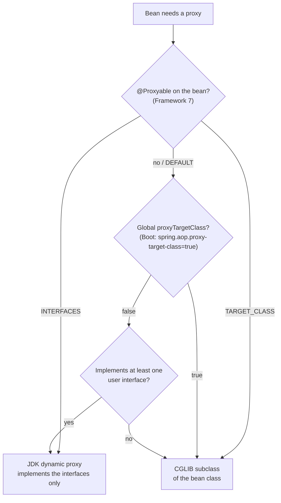

| | JDK dynamic proxy (`JdkDynamicAopProxy`) | CGLIB (`CglibAopProxy`, repackaged in `spring-core`) |
|---|---|---|
| How | `java.lang.reflect.Proxy` implements the bean's interfaces | Generates a subclass of the bean class at runtime |
| Type of the proxy | Only the interfaces. **Not** an instance of the implementation class | A subclass, so it *is* an instance of the class |
| Inject by class type | **Fails** (`BeanNotOfRequiredTypeException`) | Works |
| What can be advised | Public interface methods | Public, protected and package-visible methods that aren't `final` |
| Limits | Needs an interface | `final` classes can't be proxied. `final`/`private` methods silently skip advice |
| Constructor | n/a | **Not** run a second time: the proxy instance is created through Objenesis, so its own fields stay `null` |

**The defaults in this stack:**
- **Spring Framework's own default** is JDK proxies when the bean has interfaces. The lab's `PlainFrameworkProxyTest` proves this with a bare `@EnableAspectJAutoProxy`.
- **Spring Boot's default is CGLIB** for everything: `spring.aop.proxy-target-class=true`. The lab's `ProxyTypeTest` shows `CardPaymentGateway implements PaymentGateway` still comes out as a CGLIB proxy (`AopUtils.isCglibProxy(..) == true`). Boot chose this so that injecting by class type never breaks.
- **Framework 7 change:** the global default is now **applied consistently to all proxy processors**, including `@EnableAsync`, `@EnableResilientMethods` and similar, not just the auto-proxy creator. The lab's `AdvisingProcessorProxyTypeTest` proves it: `EmailStockNotifier implements StockNotifier` carries only `@Retryable`, so the retry post-processor builds its proxy alone (exactly one advisor), and it still comes out as CGLIB. Before 7.0, those processors carried their own `proxyTargetClass` flag (default `false`), so a bean proxied *only* for `@Async` could come out as a JDK proxy in a Boot app where everything else was CGLIB.
- **Framework 7 `@Proxyable`** overrides the default per bean, on a `@Component` class or a `@Bean` method: `@Proxyable(INTERFACES)`, `@Proxyable(TARGET_CLASS)`, or `@Proxyable(interfaces = PaymentGateway.class)` to expose only selected interfaces. The lab's `WalletPaymentGateway` uses `@Proxyable(ProxyType.INTERFACES)` and becomes a JDK proxy (`AopUtils.isJdkDynamicProxy(..) == true`) while its siblings stay CGLIB.

### 3.4 Invoking a proxied method: the interceptor chain

Every advice type is adapted into an AOP Alliance `MethodInterceptor`, and `ReflectiveMethodInvocation.proceed()` walks the list recursively: each interceptor calls `invocation.proceed()` to reach the next one, and the last call hits the target through reflection.

| Advice annotation | Interceptor class | What it does around `proceed()` |
|---|---|---|
| `@Around` | `AspectJAroundAdvice` | Your method *decides* whether and how to call `pjp.proceed()` |
| `@Before` | `MethodBeforeAdviceInterceptor` | advice, then `proceed()` |
| `@After` | `AspectJAfterAdvice` | `try { proceed() } finally { advice }` |
| `@AfterReturning` | `AfterReturningAdviceInterceptor` | `result = proceed()`, then advice(result) |
| `@AfterThrowing` | `AspectJAfterThrowingAdvice` | `try { proceed() } catch (ex) { advice(ex); throw ex }` |

**Order inside one aspect** (from the reference docs, highest to lowest precedence): `@Around`, `@Before`, `@After`, `@AfterReturning`, `@AfterThrowing`. "Highest precedence" means *outermost*: first on the way in, last on the way out. Because `@After` is a `finally` wrapped *around* the `@AfterReturning`/`@AfterThrowing` interceptors, it runs after them. The lab's `AdviceOrderTest` records exactly this:

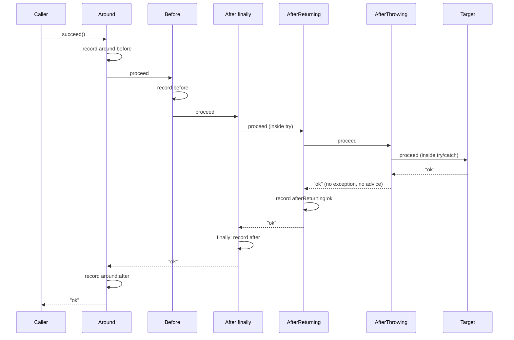

Recorded orders (from `AdviceOrderTest`):

```text
success: around:before, before, target, afterReturning:ok,   after, around:after
failure: around:before, before, target, afterThrowing:boom,  after, around:caught
```

**Two advices of the *same* type in the same aspect** on the same join point (two `@Before`s, say) run in an **undefined order**. Javac doesn't preserve declaration order in a way reflection can read. The docs recommend collapsing them into one advice method, or splitting them into separate aspects ordered with `@Order`. The lab's `DesignatorAspect` has four `@Before` methods, and `DesignatorTest` deliberately asserts only *membership* (`contains`), never order.

### 3.5 Ordering across aspects: `@Order`

Across aspects, precedence comes from `Ordered`/`@Order` on the **aspect class**. A **lower value means higher precedence, which means outermost**: first in, last out. Without `@Order`, the order between two aspects is undefined. `@Order` on an *advice method* is ignored.

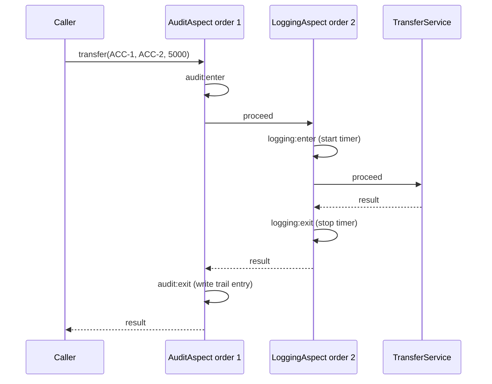

`AspectOrderTest` asserts `audit:enter, logging:enter, target, logging:exit, audit:exit`. The consequence: the outer aspect *sees* what inner ones do. Here the audit entry is written even if logging throws, and the timer excludes audit time. Put **security outermost**, then **audit**, then **transaction**, then the target, so that a denied call never opens a transaction and the audit record captures the final outcome.

### 3.6 When several infrastructure aspects hit the same method

| Combination | Default nesting (outer to inner) | Source |
|---|---|---|
| `@Retryable` + custom `@Aspect` | **Retry**, then custom aspect, then target. Your aspect runs **once per attempt** | **Lab-proven:** `RetryableTest.retryIsOutsideTheCustomAspect_soLoggingRunsOncePerAttempt` records 3 enter/exit pairs for 2 failures + 1 success |
| `@Retryable` + `@Transactional` | Retry, then transaction. **Each attempt gets a fresh transaction** | Framework resilience docs. Retry is always applied outside tx and cache, regardless of `@EnableResilientMethods(order)` |
| `@Retryable` + `@Cacheable` | Retry, then cache. The cache is checked on every attempt | Framework resilience docs |
| `@Async` + `@Retryable` | Async, then retry. Submitted once, and all attempts run on the same async thread | Framework resilience docs. Change with `@EnableResilientMethods(order=..)` / `@EnableAsync(order=..)`, rarely a good idea |
| `@PreAuthorize` + `@Transactional` | Security (order 200) outside the transaction (default `LOWEST_PRECEDENCE`) | Spring Security method-security docs (`AuthorizationInterceptorsOrder`, `@EnableMethodSecurity(offset=..)`) |
| `@Transactional` + `@Cacheable` | Both default to `Ordered.LOWEST_PRECEDENCE`, so the relative order is **not something to rely on** | Set it explicitly: `@EnableCaching(order = ..)` and `@EnableTransactionManagement(order = ..)` |
| `@Transactional` + custom `@Aspect` without `@Order` | Also a tie at `LOWEST_PRECEDENCE` | Give your aspect an explicit `@Order` |

**Why retry ends up outermost** (lab-proven, and explained by the source): `RetryAnnotationBeanPostProcessor` is an advising post-processor whose constructor calls `setBeforeExistingAdvisors(true)`. Because the bean is already a proxy (built by the auto-proxy creator for your `@Loggable` aspect), the retry advisor is **inserted at index 0** of that proxy's chain. So `@Order` on your aspect can't move it inside retry.

**The classic recommendation for `@Transactional` + `@Cacheable`:** make caching *outer* (`@EnableCaching(order = Ordered.LOWEST_PRECEDENCE - 1)` or lower), so a cache hit returns without ever borrowing a DB connection or opening a transaction.

### 3.7 Pointcut designators

The `execution` format is `execution(modifiers? return-type declaring-type?.name(params) throws?)`. `*` matches one segment, `..` in a package means "this package and sub-packages", and `(..)` in the params means "any arguments".

| Designator | Matches when | Example | Static or dynamic |
|---|---|---|---|
| `execution` | The method signature matches. The workhorse | `execution(public * dev.roadmap..*Service.*(..))` | static |
| `within` | The method is declared in a matching type or package. Fast, so **always use it to scope** | `within(dev.roadmap.aop..*)` | static |
| `@annotation` | The executing **method** carries the annotation. Binds it if you give a parameter name | `@annotation(loggable)` | static |
| `@within` | The method's **declaring type** carries the annotation | `@within(org.springframework.stereotype.Service)` | static |
| `@target` | The **runtime class** of the target carries the annotation | `@target(dev.roadmap.Audited)` | dynamic, so scope it |
| `args` | The **runtime** arguments are instances of the types. Binds them | `args(amountCents)` / `args(String, ..)` | dynamic |
| `@args` | The runtime arguments' classes carry the annotations | `@args(dev.roadmap.Sensitive)` | dynamic |
| `this` | The **proxy** is an instance of the type | `this(dev.roadmap.WalletPaymentGateway)` | dynamic |
| `target` | The **target object** is an instance of the type | `target(dev.roadmap.WalletPaymentGateway)` | dynamic |
| `bean` | The **bean name** matches (wildcards allowed). Spring-only, not AspectJ | `bean(card*)`, `bean(*Repository)` | static |

**`this` vs `target`.** In real AspectJ, both refer to the same object. Spring AOP distinguishes the proxy (`this`) from the object behind it (`target`). With a CGLIB proxy, the proxy *is a subclass*, so both match the implementation class. With a JDK proxy, the proxy only implements the interfaces, so `this(ImplClass)` **doesn't match** while `target(ImplClass)` does. `DesignatorTest.jdkProxy_matchesTarget_butNotThis` proves it on the `@Proxyable(INTERFACES)` wallet bean.

**Not supported in Spring AOP** (they throw `IllegalArgumentException`): `call`, `get`, `set`, `initialization`, `preinitialization`, `staticinitialization`, `handler`, `adviceexecution`, `withincode`, `cflow`, `cflowbelow`, `if`, `@this`, `@withincode`.

**Good pointcuts** combine a *kinded* designator (`execution`), a *scoping* one (`within`) and optionally a *contextual* one (`@annotation`, `args`, `this`, `target`). Build complex ones from named `@Pointcut` methods with `&&`, `||` and `!`.

### 3.8 The self-invocation trap

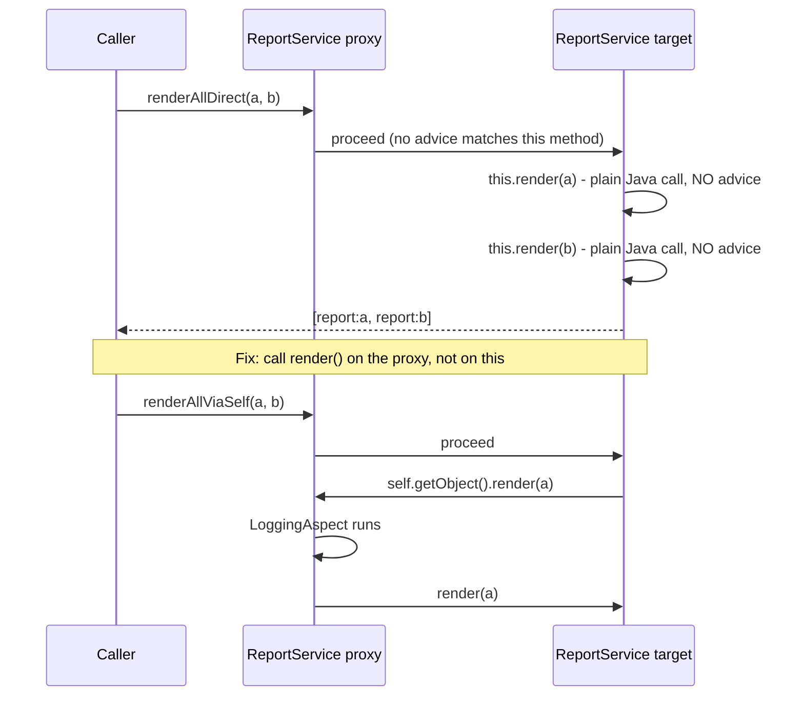

The proxy only sees calls that *enter* the bean from outside. Once execution is inside the target, `this` is the raw object. The same trap breaks `@Transactional`, `@Cacheable`, `@Async`, `@Retryable` and `@PreAuthorize`.

**Fixes, from best to worst:**
1. **Restructure.** Move the advised method into a separate bean, for example `ReportRenderer.render(..)` called by `ReportService`. It's the cleanest option, needs no Spring tricks, and usually reveals a missing abstraction.
2. **Self-injection.** Inject the bean into itself and call through that reference. In Boot, constructor self-injection is a circular reference and fails at startup (`spring.main.allow-circular-references=false`). Defer the lookup:
   - `ObjectProvider<ReportService> self`, then `self.getObject().render(..)`. This is what the lab does.
   - `@Lazy ReportService self` as a constructor parameter, which injects a lazy-resolution proxy.
3. **`AopContext.currentProxy()`.** It needs `exposeProxy = true` (`@EnableAspectJAutoProxy(exposeProxy = true)`), which stores the current proxy in a `ThreadLocal` for the duration of the call. It couples your code to Spring AOP. The docs call it "highly discouraged", a last resort. It also doesn't work after a thread hop (`@Async`), since it's a `ThreadLocal`.
4. **Switch to AspectJ weaving** (`@EnableTransactionManagement(mode = AdviceMode.ASPECTJ)` plus CTW or LTW). Self-calls are then woven, but the build and runtime get more complex.

`SelfInvocationTest` proves the trap and fixes 2 and 3.

### 3.9 Final and private methods

- **`private`** methods can't be overridden, so a CGLIB subclass can't intercept them. They're only ever called from inside the class anyway, which is self-invocation. **The advice is silently skipped.**
- **`final`** methods are worse. CGLIB can't override them, so the call runs **directly on the proxy instance**. That instance was created by Objenesis *without running a constructor*, so **all its fields are `null`**. `SelfInvocationTest.finalMethod_isNotAdvised_andRunsOnTheEmptyProxyInstance` shows a `final` method returning `callLog != null` as `false`, with no advice recorded. With real code, this shows up as a baffling `NullPointerException` on a field that was clearly injected. Spring logs a startup warning: *"Public final method [...] cannot get proxied via CGLIB, consider removing the final marker or using interface-based JDK proxies."*
- **`final` classes** can't be CGLIB-proxied at all, and startup fails. Kotlin classes are `final` by default, which is why the `kotlin-spring` (all-open) compiler plugin exists.
- **`static`** methods belong to the class, not the instance, so no proxy can intercept them.

---

## 4. Full worked code

The full source is in the lab, and everything below is exercised by its tests (`./mvnw verify` gives 23 tests, all green).

### 4.1 Dependency

```xml
<!-- Boot 4 name. In Boot 3.x this was spring-boot-starter-aop -->
<dependency>
    <groupId>org.springframework.boot</groupId>
    <artifactId>spring-boot-starter-aspectj</artifactId>
</dependency>
```

It brings `spring-aop` and `aspectjweaver`. The `@Retryable`/`@ConcurrencyLimit` annotations live in `spring-context` and need no extra dependency, but they still need `spring-aop` on the classpath for proxying, which `spring-context` already pulls in.

### 4.2 A custom annotation-driven aspect

```java
@Target(ElementType.METHOD)
@Retention(RetentionPolicy.RUNTIME)          // RUNTIME is mandatory: matching is done by reflection
public @interface Loggable {
    long slowThresholdMs() default 500;
}

@Aspect
@Component                                    // @Aspect alone is NOT a bean
@Order(2)                                     // on the class, not the advice method
public class LoggingAspect {
    private static final Logger log = LoggerFactory.getLogger(LoggingAspect.class);
    private final CallLog callLog;

    public LoggingAspect(CallLog callLog) { this.callLog = callLog; }

    @Around("within(dev.roadmap.aop..*) && @annotation(loggable)")   // scope + bind
    public Object time(ProceedingJoinPoint pjp, Loggable loggable) throws Throwable {
        String method = pjp.getSignature().getName();
        callLog.record("logging:enter:" + method);
        long start = System.nanoTime();
        try {
            return pjp.proceed();                 // forget this and the method never runs
        } finally {
            long tookMs = (System.nanoTime() - start) / 1_000_000;
            callLog.record("logging:exit:" + method);
            if (tookMs > loggable.slowThresholdMs()) {
                log.warn("{} took {} ms (threshold {} ms)", pjp.getSignature().toShortString(), tookMs, loggable.slowThresholdMs());
            } else {
                log.debug("{} took {} ms", pjp.getSignature().toShortString(), tookMs);
            }
        }
    }
}
```

### 4.3 A second aspect, ordered first: the audit trail

```java
@Aspect @Component @Order(1)                 // lower = outermost
public class AuditAspect {
    @Around("within(dev.roadmap.aop..*) && @annotation(audited)")
    public Object audit(ProceedingJoinPoint pjp, Audited audited) throws Throwable {
        callLog.record("audit:enter:" + audited.action());
        try {
            Object result = pjp.proceed();
            log.info("AUDIT action={} outcome=SUCCESS", audited.action());
            return result;
        } catch (Throwable ex) {
            log.info("AUDIT action={} outcome=FAILURE reason={}", audited.action(), ex.getClass().getSimpleName());
            throw ex;                              // never swallow: the caller must see the failure
        } finally {
            callLog.record("audit:exit:" + audited.action());
        }
    }
}

@Service
public class TransferService {
    @Loggable
    @Audited(action = "FUNDS_TRANSFER")       // annotation order here is irrelevant, aspect @Order decides
    public String transfer(String from, String to, long amountCents) { ... }
}
```

### 4.4 All five advice types in one aspect

```java
@Aspect @Component
public class AdviceOrderAspect {
    @Pointcut("within(dev.roadmap.aop.ordering.OrderProbe)")
    void probe() {}

    @Around("probe()")
    public Object around(ProceedingJoinPoint pjp) throws Throwable {
        callLog.record("around:before");
        try {
            Object result = pjp.proceed();
            callLog.record("around:after");
            return result;
        } catch (Throwable ex) {
            callLog.record("around:caught");
            throw ex;
        }
    }

    @Before("probe()")         public void before() { callLog.record("before"); }
    @After("probe()")          public void after()  { callLog.record("after"); }

    @AfterReturning(pointcut = "probe()", returning = "result")
    public void afterReturning(Object result) { callLog.record("afterReturning:" + result); }

    @AfterThrowing(pointcut = "probe()", throwing = "ex")     // parameter type narrows the match
    public void afterThrowing(IllegalStateException ex) { callLog.record("afterThrowing:" + ex.getMessage()); }
}
```

### 4.5 Self-invocation: trap and fixes

```java
@Configuration(proxyBeanMethods = false)
@EnableAspectJAutoProxy(exposeProxy = true)   // merged into Boot's creator. proxyTargetClass stays true
@EnableResilientMethods                       // Boot does NOT enable @Retryable/@ConcurrencyLimit for you
public class AopConfig {}

@Service
public class ReportService {
    private final CallLog callLog;
    private final ObjectProvider<ReportService> self;          // lazy, so no circular-reference failure

    public ReportService(CallLog callLog, ObjectProvider<ReportService> self) { ... }

    @Loggable
    public String render(String name) { return "report:" + name; }

    public List<String> renderAllDirect(List<String> names) {              // TRAP: no advice
        return names.stream().map(this::render).toList();
    }

    public List<String> renderAllViaSelf(List<String> names) {             // FIX: through the proxy
        ReportService proxy = self.getObject();
        return names.stream().map(proxy::render).toList();
    }

    public List<String> renderAllViaCurrentProxy(List<String> names) {     // LAST RESORT
        ReportService proxy = (ReportService) AopContext.currentProxy();
        return names.stream().map(proxy::render).toList();
    }

    @Loggable
    public final boolean hasCallLog() { return callLog != null; }          // false via the proxy!
}
```

The preferred restructuring fix in production code:

```java
@Service
class ReportService {
    private final ReportRenderer renderer;                   // a separate bean, so a separate proxy
    List<String> renderAll(List<String> names) { return names.stream().map(renderer::render).toList(); }
}

@Component
class ReportRenderer {
    @Loggable String render(String name) { ... }             // always called from outside: advised
}
```

### 4.6 Proxy type control

```java
public interface PaymentGateway { String charge(long amountCents); }

@Component                                         // Boot: CGLIB, despite the interface
public class CardPaymentGateway implements PaymentGateway { @Loggable public String charge(long c) { ... } }

@Component
@Proxyable(ProxyType.INTERFACES)                   // Framework 7: JDK proxy for this bean only
public class WalletPaymentGateway implements PaymentGateway { @Loggable public String charge(long c) { ... } }

// Test
assertThat(AopUtils.isCglibProxy(gateways.get("cardPaymentGateway"))).isTrue();
assertThat(AopUtils.isJdkDynamicProxy(gateways.get("walletPaymentGateway"))).isTrue();
```

### 4.7 Framework 7 `@Retryable` around a flaky downstream call

```java
@Component
public class InventoryClient {
    @Loggable
    @Retryable(includes = DownstreamUnavailableException.class, maxRetries = 3, delay = 5, multiplier = 2)
    public int stockFor(String sku) {
        attempts.incrementAndGet();
        if (sku.isBlank()) throw new IllegalArgumentException("sku must not be blank"); // not retried
        if (remainingFailures.getAndUpdate(n -> Math.max(0, n - 1)) > 0) {
            throw new DownstreamUnavailableException("inventory-service returned 503");
        }
        return 42;
    }
}
```

`RetryableTest` proves the following:
- With 2 failures, the call succeeds after **3 attempts**.
- With permanent failure, it stops after **4 attempts** (1 + `maxRetries`) and rethrows the **original** `DownstreamUnavailableException`, not a wrapper.
- An `IllegalArgumentException` isn't in `includes`, so it runs **once**.
- `@Loggable` runs once **per attempt**, because retry is outermost.

### 4.8 Programmatic `RetryTemplate` (`org.springframework.core.retry`)

```java
var retryTemplate = new RetryTemplate(RetryPolicy.builder()
        .includes(DownstreamUnavailableException.class)
        .maxRetries(2)
        .delay(Duration.ofMillis(1))
        .build());

String result = retryTemplate.invoke(() -> client.call());   // unchecked: last original exception propagates

try {
    retryTemplate.execute(() -> client.call());               // checked RetryException
} catch (RetryException ex) {
    ex.getExceptions();      // every attempt's exception (3 here)
    ex.getLastException();
}
```

### 4.9 `@ConcurrencyLimit`

```java
@Component
public class ReportExporter {
    @ConcurrencyLimit(limit = 1, policy = ThrottlePolicy.REJECT)   // 7.0.3+: fail fast
    public void exportOrReject(Runnable job) { job.run(); }

    @ConcurrencyLimit(1)                                           // default BLOCK: callers queue up
    public void exportOrWait(Runnable job) { job.run(); }
}
```

`ConcurrencyLimitTest` holds one call inside `exportOrReject` with a latch, then asserts that a second caller gets `InvocationRejectedException`. For `BLOCK`, it runs 8 virtual threads through `exportOrWait` and asserts that the maximum number in flight was exactly 1, with all 8 completing.

---

## 5. Gap fillers & niche details

- **`@Aspect` isn't a stereotype.** Without `@Component` (or a `@Bean`), the aspect is never registered and silently does nothing.
- **Unscoped pointcuts can break startup.** `@target(..)` and `@args(..)` used *alone* are runtime checks that make Spring consider proxying every bean, including Boot's own (some are `final` classes that can't be subclassed). Always add `&& within(com.yourcompany..*)`. Scoping every pointcut is good practice anyway, since `within` is the cheapest designator to match.
- **`ProceedingJoinPoint.proceed(Object[])`** lets an `@Around` advice **replace arguments**, for example to trim or normalize input. Changing the returned value is just `return somethingElse`.
- **An `@Around` advice must return the result.** A `void` around advice on a non-void method makes callers receive `null` (or an NPE when unboxing primitives).
- **`@AfterThrowing` can't swallow the exception.** It sees it and rethrows. Only `@Around` can translate or suppress exceptions.
- **`@AfterReturning`/`@AfterThrowing` parameter types narrow the match.** `throwing = "ex"` typed as `IllegalStateException` means the advice runs only for that type.
- **Parameter names:** binding by name (`@annotation(loggable)`, `args(amountCents)`) needs `-parameters` (Boot's parent POM sets it) or `argNames`.
- **`JoinPoint.getThis()` returns the proxy and `getTarget()` returns the raw object.** Returning `getTarget()` out of an aspect leaks an unproxied reference.
- **`ExposeInvocationInterceptor`** is silently added at the head of every AspectJ chain so that `@Around` advice can find the current `MethodInvocation`. That's why `AopUtils`/debuggers show one more interceptor than you declared.
- **Spring's CGLIB class name** is `MyService$$SpringCGLIB$$0` (Framework 6+). Older posts show `$$EnhancerBySpringCGLIB$$`.
- **`AopUtils.getTargetClass(proxy)`** returns the real class. `AopProxyUtils.ultimateTargetClass` unwraps nested proxies. Use `AopTestUtils.getTargetObject` in tests.
- **`spring.aop.auto=false`** turns off Boot's `AopAutoConfiguration` (its `@EnableAspectJAutoProxy`). Your `@Aspect`s then stop working unless you declare `@EnableAspectJAutoProxy` yourself, as this lab's `AopConfig` does, so flipping the property here changes nothing. `@Transactional` keeps working because `@EnableTransactionManagement` registers its own infrastructure-only auto-proxy creator (unverified).
- **`@EnableResilientMethods(proxyTargetClass = true)`** affects only the retry and concurrency post-processors. The javadoc recommends relying on the global default plus `@Proxyable` instead.
- **`@Retryable` attributes (Framework 7, `org.springframework.resilience.annotation`)**:

  | Attribute | Default | Notes |
  |---|---|---|
  | `value` / `includes` | `{}` = any exception | Matched against the exception **and its nested causes** |
  | `excludes` | `{}` | Same matching |
  | `predicate` | `MethodRetryPredicate.class` (retry all) | Custom `(Method, Throwable) -> boolean`, applied after includes/excludes. One instance per method, can be autowired |
  | `maxRetries` / `maxRetriesString` | `3` | **Retries after the first call**, so total attempts = 1 + `maxRetries` |
  | `delay` / `delayString` | `1000` ms | Starting back-off |
  | `multiplier` / `multiplierString` | `1.0` (fixed delay) | Exponential back-off factor, also applied to jitter |
  | `maxDelay` / `maxDelayString` | `Long.MAX_VALUE` | Cap on any single delay |
  | `jitter` / `jitterString` | `0` | ± random spread around the delay |
  | `timeout` / `timeoutString` | `0` (none) | **Since 7.0.2.** Total budget for all attempts and delays |
  | `timeUnit` | `MILLISECONDS` | For the numeric delay attributes. `*String` attributes accept `${...}`, SpEL and duration strings like `500ms` |

  It works on reactive return types too (`Mono`/`Flux` get a Reactor retry spec), and Spring publishes a `MethodRetryEvent` for every failed attempt, so you can log each failure even though the caller sees only the last one.
- **`@ConcurrencyLimit` attributes:** `value`/`limit` (an `int`, sentinel default, so always set it. `-1` = unbounded), `limitString` (placeholders/SpEL), and `policy` (`BLOCK` default, or `REJECT`, which throws `InvocationRejectedException extends RejectedExecutionException`; since 7.0.3). On a **method** it's a per-method throttle. On a **type**, all methods share one throttle. The docs pitch it for virtual threads, where there's no thread pool size to limit concurrency for you.
- **Spring Retry vs Framework 7 retry:** the old `org.springframework.retry.annotation.Retryable` used `maxAttempts` (**total** attempts, default 3), while Framework's uses `maxRetries` (**retries after the first**, default 3, so 4 total). Migrating a config number unchanged adds an extra call.

---

## 6. Boot 4 / Framework 7 delta

Sources: [Spring Framework 7.0 Release Notes](https://github.com/spring-projects/spring-framework/wiki/Spring-Framework-7.0-Release-Notes), the [Spring Boot 4.0 Migration Guide](https://github.com/spring-projects/spring-boot/wiki/Spring-Boot-4.0-Migration-Guide), and the [Resilience Features reference](https://docs.spring.io/spring-framework/reference/core/resilience.html).

| Change | Status | What it means for you |
|---|---|---|
| `spring-boot-starter-aop` renamed **`spring-boot-starter-aspectj`** (test starter `spring-boot-starter-aspectj-test`) | **Renamed** | Update the POM. The guide also says to check whether you need it at all: you need it only if you use `org.aspectj.lang.annotation` (your own `@Aspect`s) or a library feature that documents it (e.g. Micrometer `@Timed`/`@Counted`) |
| Global proxy default applied **consistently to all proxy processors** | **Changed** | `@Async`, `@Retryable` and similar now follow `spring.aop.proxy-target-class` too. A `ProxyConfig` bean can carry context-wide defaults |
| **`@Proxyable`** (`org.springframework.context.annotation`) | **New** | Per-bean `INTERFACES` / `TARGET_CLASS` / `interfaces = ...`, on `@Component` classes or `@Bean` methods |
| **`@Retryable`**, **`@ConcurrencyLimit`**, **`@EnableResilientMethods`** (`org.springframework.resilience.annotation`) | **New** | Core retry and throttling, with no extra dependency. **Not auto-enabled by Boot**: add `@EnableResilientMethods` (or the `RetryAnnotationBeanPostProcessor`/`ConcurrencyLimitBeanPostProcessor` beans) |
| **`RetryTemplate`**, **`RetryPolicy`**, `RetryListener`, `RetryException` (`org.springframework.core.retry`) | **New** | Programmatic retry. Spring Kafka and Spring AMQP moved their retry onto it |
| Spring Retry dependency management | **Removed from Boot** | If you still use `spring-retry`, you must declare its version yourself. Move to the Framework APIs |
| `@Retryable(timeout)` (7.0.2), `@ConcurrencyLimit(policy = REJECT)` (7.0.3) | **New in patch releases** | Boot 4.1.2 ships Framework 7.0.10, so both are available |
| CGLIB proxy class naming `$$SpringCGLIB$$` | Since 6.0 | Update any log or regex matching on `$$EnhancerBySpringCGLIB$$` |

> ⚠️ **Outdated advice still common in tutorials and Baeldung articles:**
> - "Add `spring-boot-starter-aop`": in Boot 4 it's `spring-boot-starter-aspectj`.
> - "Add `spring-retry` + `@EnableRetry`": use Framework 7's `@Retryable` + `@EnableResilientMethods`. Note the different package, and `maxRetries` vs `maxAttempts`.
> - "Spring uses JDK proxies when there's an interface": true for plain Framework, false for Boot (CGLIB by default since Boot 2.0).
> - "Set `proxyTargetClass` on `@EnableAsync` separately": Framework 7 applies the global default consistently.
> - "`@Recover` methods": that was Spring Retry. Framework 7 has no `@Recover`. Catch the original exception at the caller, or use a `RetryListener` / `MethodRetryEvent`.

---

## 7. Real-life architecture solutions

### 7.1 Audit logging / compliance trail

**Problem:** regulators (SOX, PCI-DSS, HIPAA, RBI/SEBI rules) require an immutable record of *who did what, when, to which entity, and with what outcome* for sensitive operations: fund transfers, limit changes, PII access, and role grants. Sprinkling `auditRepository.save(..)` into every service method gets forgotten, is inconsistent, and is easy to bypass.

**Solution:** an `@Audited(action = "FUNDS_TRANSFER")` annotation plus an `AuditAspect` ordered **outside** the transaction. It captures the principal (from `SecurityContextHolder`), the action, the arguments (masked), the outcome, and the duration, and publishes an `AuditEvent`. A listener writes it to an append-only store. For guaranteed delivery, write to an **outbox table in the same transaction** and relay it to Kafka (note 11).

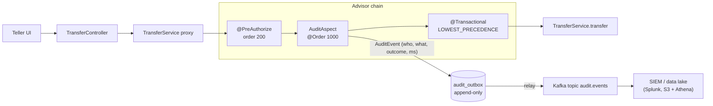

**Trade-offs:**
- **Placement matters.** If the aspect is *inside* the transaction, a rollback also erases the audit row for a *failed* attempt, which regulators often want kept. If it's *outside*, it needs its own transaction (`REQUIRES_NEW`) or the outbox.
- **Mask arguments.** Never log card numbers, passwords or tokens. Use an `@Sensitive` parameter annotation or a per-action field allow-list.
- **Self-invocation and internal calls aren't audited.** Make audited methods the public entry points of their bean.
- Spring Data's `@CreatedBy`/`@LastModifiedBy` (JPA auditing) only records the *latest* writer on the row. It complements an audit trail but doesn't replace it.

**Who uses it:** banks and brokerages (transaction journals), healthcare platforms (PHI access logs), and SaaS admin consoles (Atlassian/GitHub-style org audit logs).

### 7.2 Idempotency-key annotation (and rate limiting) for payment APIs

**Problem:** the client times out and retries `POST /payments`. Without protection, the customer is charged twice. Stripe-style APIs solve this with an `Idempotency-Key` header: the same key must return the same response without re-executing the side effect.

**Solution:** an `@Idempotent(key = "#request.idempotencyKey()", ttl = "24h")` annotation. The aspect evaluates the SpEL key, then tries `SET key IN_PROGRESS NX PX ttl` in Redis.
- If the key is **new**, it proceeds and stores the serialized response under the key.
- If the key is **completed**, it returns the stored response without calling the method.
- If the key is **in progress**, it throws `409 Conflict`.

The same shape gives you a `@RateLimited(permits = 10, per = "1s", key = "#principal.name")` aspect backed by a Redis token bucket (or Bucket4j).

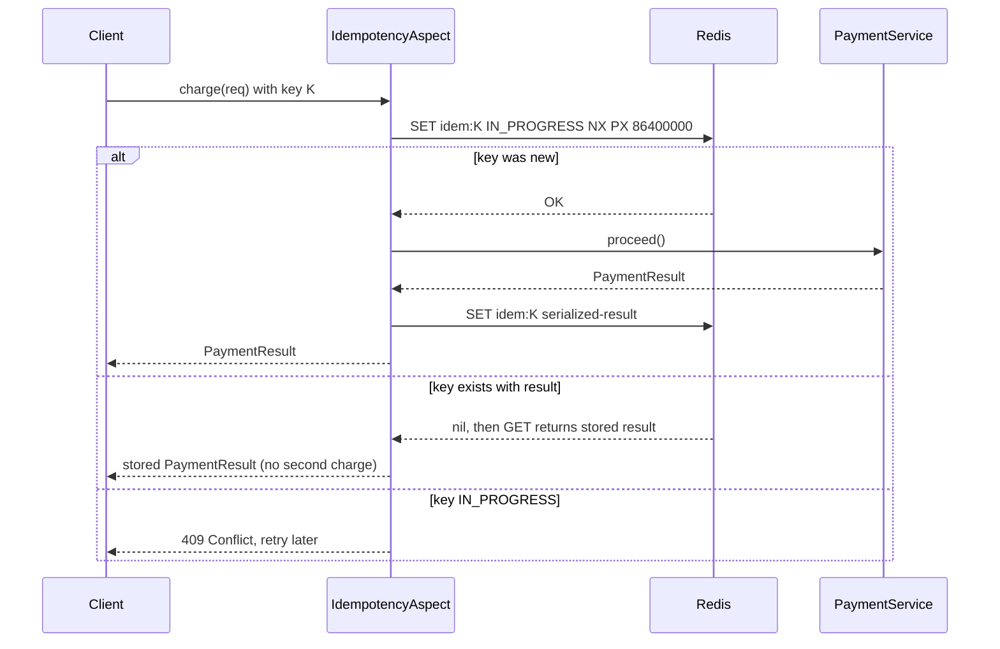

```java
@Aspect @Component @Order(10)
class IdempotencyAspect {
    private final StringRedisTemplate redis;
    private final JsonMapper json;                                  // Jackson 3: tools.jackson.databind.json.JsonMapper
    private final SpelExpressionParser parser = new SpelExpressionParser();

    @Around("within(com.acme..*) && @annotation(idempotent)")
    Object guard(ProceedingJoinPoint pjp, Idempotent idempotent) throws Throwable {
        String key = "idem:" + evaluate(idempotent.key(), pjp);
        Boolean fresh = redis.opsForValue().setIfAbsent(key, "IN_PROGRESS", Duration.parse("PT" + idempotent.ttl()));
        if (Boolean.FALSE.equals(fresh)) {
            return replayOrConflict(key, pjp);                      // stored result, or 409
        }
        try {
            Object result = pjp.proceed();
            redis.opsForValue().set(key, json.writeValueAsString(result), Duration.parse("PT" + idempotent.ttl()));
            return result;
        } catch (Throwable ex) {
            redis.delete(key);                                      // let the client retry a failed attempt
            throw ex;
        }
    }
}
```

**Trade-offs:**
- **Redis is now on the critical path.** Decide whether to fail open (allow) or fail closed (503) if it's down.
- The **TTL must outlive the client's retry window**.
- The stored response must be serializable and must not contain secrets.
- **Order it outside `@Transactional`.** Otherwise a stored "completed" key can belong to a rolled-back transaction.
- In-process rate limits don't work across instances. Use Redis or the API gateway (note 14) for a global limit.

**Who uses it:** Stripe, Adyen and PayPal (an `Idempotency-Key` header is part of their public APIs), AWS (`ClientToken` on EC2 APIs), and most payment orchestration layers.

### 7.3 Retry around a flaky downstream call, contrasted with a circuit breaker

**Problem:** the order service calls inventory-service over HTTP. Most failures are *transient*: a pod restarting, a 503 during a deploy, a connection reset. Failing the user's checkout on the first blip is poor UX. But blindly retrying a *down* service multiplies its load and turns an outage into a **retry storm**.

**Solution:** Framework 7 `@Retryable` with **exponential back-off and jitter** for transient errors only. Add `@ConcurrencyLimit` as a simple **bulkhead** so a slow downstream can't consume every (virtual) thread. Put a **circuit breaker** (Resilience4j / Spring Cloud CircuitBreaker, note 14) in front for sustained outages.

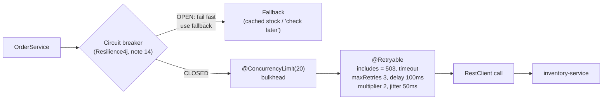

```java
@Retryable(includes = {HttpServerErrorException.ServiceUnavailable.class, ResourceAccessException.class},
           maxRetries = 3, delay = 100, multiplier = 2, jitter = 50, maxDelay = 1000, timeout = 3000)
@ConcurrencyLimit(20)
public StockLevel stockFor(String sku) { return restClient.get().uri("/stock/{sku}", sku).retrieve().body(StockLevel.class); }
```

| | Retry (`@Retryable`) | Circuit breaker (Resilience4j) |
|---|---|---|
| Handles | **Transient** blips, so the next attempt probably succeeds | **Sustained** outages, so stop calling for a while |
| State | Stateless per call | Stateful across calls (CLOSED, OPEN, HALF_OPEN), based on failure rate over a sliding window |
| Effect on a down service | Multiplies load (up to 1 + maxRetries ×) | Removes load and lets it recover |
| Fallback | None built in (the caller catches the original exception) | First-class `fallbackMethod` |
| Where it lives | Spring Framework core | Separate library (`spring-cloud-starter-circuitbreaker-resilience4j`) |

**Trade-offs and rules:**
- **Only retry idempotent operations.** Retrying a `POST /charge` without an idempotency key (section 7.2) double-charges.
- **Retry at one layer only.** If the gateway, the client and the service all retry 3 times, one user click becomes 4 × 4 × 4 = 64 calls.
- **Always add jitter.** Synchronized retries from many pods hit the downstream in waves (the thundering herd).
- **Bound the total time** with `timeout` (7.0.2+) so retries fit inside the caller's own deadline.
- **Retry sits outside `@Transactional`** by design (section 3.6), so each attempt gets a fresh transaction. Don't hold a DB transaction open across a remote call anyway.

**Who uses it:** the AWS SDKs (built-in exponential back-off with "full jitter"), Netflix (the Hystrix → Resilience4j lineage), and every service mesh (Istio/Envoy retry policies are the same idea moved into the sidecar).

---

## 8. Pitfalls & debugging checklist

- [ ] **Custom aspect never fires** →
  - the aspect lacks `@Component`;
  - the starter is missing (Boot 4: `spring-boot-starter-aspectj`);
  - the annotation lacks `@Retention(RUNTIME)`;
  - the pointcut package is wrong;
  - the object was created with `new`.
  Check with `AopUtils.isAopProxy(bean)` and look for the advisor in `((Advised) bean).getAdvisors()`.
- [ ] **`@Transactional` / `@Cacheable` / `@Retryable` ignored on some calls** → self-invocation (section 3.8), a `private` or `final` method, or a call from `@PostConstruct` (the proxy doesn't exist yet, see note 01).
- [ ] **`@Retryable` does nothing at all** → `@EnableResilientMethods` is missing. Boot doesn't add it. Also check that you imported `org.springframework.resilience.annotation.Retryable`, not Spring Retry's.
- [ ] **One more attempt than expected after migrating from Spring Retry** → `maxAttempts=3` (total) became `maxRetries=3` (4 total). Use `maxRetries = maxAttempts - 1`.
- [ ] **`NullPointerException` on an injected field inside a method** → the method is `final` and runs on the CGLIB proxy instance (section 3.9). Look for the "cannot get proxied via CGLIB" startup warning.
- [ ] **`BeanNotOfRequiredTypeException: ... is expected to be of type X but was actually of type jdk.proxy2.$Proxy..`** → a JDK proxy injected by class type. Inject the interface, or remove `@Proxyable(INTERFACES)` / `spring.aop.proxy-target-class=false`.
- [ ] **Startup fails with "Cannot subclass final class"** → a pointcut matches a `final` class (Kotlin, records, or a JDK type). Scope the pointcut with `within(..)`, or use the Kotlin all-open plugin.
- [ ] **`IllegalStateException: Cannot find current proxy`** → `AopContext.currentProxy()` without `exposeProxy = true`, or called on a different thread.
- [ ] **Aspects run in the wrong order** → `@Order` is on the advice method instead of the class, or two aspects share the default `LOWEST_PRECEDENCE`. For infrastructure, set `order` on `@EnableCaching` / `@EnableTransactionManagement`.
- [ ] **Two `@Before` advices in one aspect fire in a different order across JVMs** → that order is undefined by design. Merge them, or split them into ordered aspects.
- [ ] **Around advice makes a method return `null`** → the advice is `void`, or forgot `return pjp.proceed()`.
- [ ] **Concurrency-limited method hangs forever** → the `BLOCK` policy plus a stuck holder. Consider `REJECT`, and add timeouts inside the guarded code.
- [ ] **Debugging:**
  - set the log level of `org.springframework.aop` to `DEBUG` to see proxy creation;
  - set a breakpoint in `ReflectiveMethodInvocation.proceed()` to step through the chain;
  - `/actuator/beans` shows bean types;
  - `AopTestUtils.getUltimateTargetObject(..)` gives you the raw target in tests.

---

## 9. Interview questions

<details><summary>Q1. Define aspect, join point, pointcut, advice, advisor, target, proxy and weaving.</summary>

- An **aspect** is a module bundling a cross-cutting concern.
- A **join point** is a point in execution where advice can apply. In Spring AOP that's always a method execution on a bean.
- A **pointcut** is an expression selecting join points.
- **Advice** is the code run at a join point (`@Around`, `@Before`, `@After`, `@AfterReturning`, `@AfterThrowing`).
- An **advisor** is Spring's pairing of exactly one pointcut with one advice.
- The **target** is the real object.
- The **proxy** is the object the container hands out, which runs the advice chain and then calls the target.
- **Weaving** links aspects to targets. Spring does it at runtime by proxying, while AspectJ does it at compile time or load time by rewriting bytecode.
</details>

<details><summary>Q2. Spring AOP vs AspectJ: what are the differences, and when would you need AspectJ?</summary>

Spring AOP is proxy-based and runtime-only. It supports only method-execution join points on Spring beans, can't advise self-invocation or `private`/`final`/`static` methods, and costs a proxy dispatch per call. AspectJ weaves bytecode (compile-time with `ajc`, or load-time with the `aspectjweaver` agent). It supports field access, constructors, call-site join points and any object (including `new`), and self-calls are advised. Spring AOP uses AspectJ's annotations and pointcut parser but not its weaver. Choose AspectJ when you need to advise non-beans or self-calls, or need maximum performance, for example `@Transactional(mode = ASPECTJ)`.
</details>

<details><summary>Q3. JDK dynamic proxy vs CGLIB. Which does Spring Boot use, and what changed in Framework 7?</summary>

A JDK proxy implements the bean's interfaces, so it isn't an instance of the class and only interface methods are advised. CGLIB generates a subclass, so it can be injected by class, but it can't handle `final` classes or methods. Plain Framework defaults to JDK proxies when interfaces exist. **Boot defaults to CGLIB** (`spring.aop.proxy-target-class=true`). Framework 7 applies the global default **consistently to every proxy processor** (`@Async`, `@Retryable`, …) and adds **`@Proxyable`** to override it per bean (`INTERFACES`, `TARGET_CLASS`, or specific `interfaces`).
</details>

<details><summary>Q4. Why doesn't @Transactional work when I call the method from another method in the same class?</summary>

Because of self-invocation. The proxy only intercepts calls coming from outside. Inside the target, `this.method()` is a plain Java call on the raw object, so no advice runs. Fixes, in order of preference:
1. Move the method to another bean.
2. Call through a self-reference obtained lazily (`ObjectProvider<Self>` or `@Lazy Self`, since a plain self-injection is a forbidden circular reference in Boot).
3. `AopContext.currentProxy()` with `exposeProxy = true` (discouraged).
4. AspectJ weaving.
</details>

<details><summary>Q5. In what order do advice types run within a single aspect, and why does @After run after @AfterReturning?</summary>

The precedence, from highest (outermost) to lowest, is `@Around`, `@Before`, `@After`, `@AfterReturning`, `@AfterThrowing`. On success the recorded order is around-before, before, target, afterReturning, after, around-after. On failure it's around-before, before, target, afterThrowing, after, around-catch. `@After` has "after finally" semantics: it's a `try/finally` interceptor that *wraps* the `AfterReturning`/`AfterThrowing` interceptors, so its `finally` runs after them.
</details>

<details><summary>Q6. Two aspects advise the same method. How do you control which runs first? What if two @Before methods are in the same aspect?</summary>

Put `@Order` on the aspect class (or implement `Ordered`). A lower value means higher precedence, so that aspect runs first on the way in and last on the way out. Without it, the order is undefined. `@Order` on advice methods is ignored. Two advices of the same type in one aspect have an **undefined** order, because reflection can't recover declaration order from javac-compiled classes. Merge them, or move them into separately ordered aspects.
</details>

<details><summary>Q7. Explain this() vs target() in Spring AOP pointcuts.</summary>

`this(T)` matches when the **proxy** is an instance of `T`, while `target(T)` matches when the **target object** is. With CGLIB, the proxy is a subclass, so both match the implementation class. With a JDK proxy, the proxy only implements interfaces, so `this(ImplClass)` fails and `target(ImplClass)` matches. In native AspectJ they refer to the same object at an execution join point. The distinction exists only because Spring AOP is proxy-based.
</details>

<details><summary>Q8. Where in the bean lifecycle are AOP proxies created, and by which class?</summary>

In `BeanPostProcessor.postProcessAfterInitialization`, after `@PostConstruct` and init methods. `AbstractAutoProxyCreator.wrapIfNecessary` finds eligible advisors (in Boot, `AnnotationAwareAspectJAutoProxyCreator` turns `@Aspect` methods into advisors and also collects `Advisor` beans for tx, cache and security), sorts them, and builds the proxy with `ProxyFactory`. If the bean is part of a circular reference, the proxy is created earlier in `getEarlyBeanReference`. Some features (`@Async`, `@Retryable`, `@ConcurrencyLimit`, method validation) use `AbstractAdvisingBeanPostProcessor` instead, which adds one advisor to an existing proxy or creates a new one.
</details>

<details><summary>Q9. Why can't final or private methods be advised? What actually happens if you call a final method on a CGLIB proxy?</summary>

CGLIB works by overriding methods in a subclass, and `final` and `private` methods can't be overridden. A `private` method is only reachable from inside the class anyway (self-invocation). A `final` method call executes **on the proxy instance itself**, which Objenesis created without running the constructor, so its fields are `null`. You get no advice and possibly an NPE on "injected" fields. Spring logs a warning at startup.
</details>

<details><summary>Q10. You have @Transactional, @Cacheable and a custom logging aspect on one method. In what order do they run, and how do you control it?</summary>

All three are advisors in the same auto-proxy creator chain, sorted by order. `@EnableTransactionManagement` and `@EnableCaching` default to `LOWEST_PRECEDENCE`, as does an `@Aspect` without `@Order`, so ties are not something to rely on. Set the orders explicitly: `@EnableCaching(order = ..)`, `@EnableTransactionManagement(order = ..)` and `@Order` on the aspect. A good layout is security (Spring Security's interceptors default to small values, e.g. 200 for `@PreAuthorize`), then caching (a cache hit skips the transaction entirely), then logging/audit, then the transaction, then the target. If `@Retryable` is added, it's always outside tx and cache. In the lab it's also outside the custom aspect, because the retry post-processor inserts its advisor at index 0 of the existing proxy.
</details>

<details><summary>Q11. What are @Retryable and @ConcurrencyLimit in Spring Framework 7, and how do they differ from Spring Retry?</summary>

They're core annotations in `org.springframework.resilience.annotation`, enabled with `@EnableResilientMethods`, which Boot doesn't do automatically.
- **`@Retryable`** has these attributes:
  - `includes`/`excludes` (matched against the exception and its causes) and `predicate`;
  - `maxRetries` (default 3, *after* the first call);
  - `delay` (default 1s), `multiplier`, `jitter` and `maxDelay`;
  - `timeout` (7.0.2+), `timeUnit`, and `*String` variants for placeholders/SpEL.

  On exhaustion, the original exception propagates. It also supports reactive return types.
- **`@ConcurrencyLimit(n)`** throttles concurrent calls. The `policy` is `BLOCK` (default) or `REJECT`, which throws `InvocationRejectedException` (7.0.3+).
- The programmatic API is `RetryTemplate`/`RetryPolicy` in `org.springframework.core.retry`.

Compared with Spring Retry: there's no `@Recover`, `maxRetries` replaces `maxAttempts` (total), the packages differ, and Boot 4 dropped dependency management for `spring-retry`.
</details>

<details><summary>Q12. When should you use a retry and when a circuit breaker?</summary>

Retry handles **transient** failures where the next attempt is likely to succeed. It's stateless and multiplies load. A circuit breaker handles **sustained** failures. It's stateful, tracking the failure rate, and it opens to fail fast and give the downstream time to recover, usually with a fallback. Production systems combine them: circuit breaker outermost, then a bulkhead or concurrency limit, then retry with back-off and jitter, then the call. Only retry idempotent operations, and retry at one layer only to avoid multiplicative retry storms.
</details>

<details><summary>Q13. How do you write an annotation-driven aspect, and what are the common mistakes?</summary>

1. Declare an annotation with `@Retention(RUNTIME)`.
2. Write an `@Aspect @Component` class with `@Around("within(com.acme..*) && @annotation(myAnno)")` and a parameter `MyAnno myAnno` to bind it.
3. Call `pjp.proceed()` and return its result.

Common mistakes:
- forgetting `@Component`;
- `CLASS` retention;
- not returning the result;
- swallowing exceptions;
- putting `@Order` on the method instead of the class;
- leaving the pointcut unscoped;
- relying on it for self-calls.
</details>

<details><summary>Q14. What does exposeProxy do, and why is AopContext.currentProxy() discouraged?</summary>

`exposeProxy = true` makes the proxy store itself in a `ThreadLocal` (`AopContext`) for the duration of each call, so the target can fetch it and call itself through the proxy. It's discouraged because it couples business code to Spring AOP, adds a `ThreadLocal` cost to every call, and fails on other threads. Restructuring into two beans is cleaner.
</details>

<details><summary>Q15. Is Spring AOP slow? What does a proxied call cost?</summary>

A proxied call walks the interceptor list held by `ReflectiveMethodInvocation` and invokes the target reflectively (CGLIB uses a `MethodProxy`). The chain per method is computed once and cached, so the per-call cost is small (sub-microsecond for a few interceptors) and negligible next to I/O. It matters only in hot loops, or with dynamic pointcuts (`args`, `this`, `target`) that need a runtime check per call. If it's measurable, move the hot path out of the proxied bean or use AspectJ compile-time weaving.
</details>

---

## 10. Sources

- Spring Framework reference: [AOP concepts](https://docs.spring.io/spring-framework/reference/core/aop/introduction-defn.html), [Declaring a Pointcut](https://docs.spring.io/spring-framework/reference/core/aop/ataspectj/pointcuts.html), [Declaring Advice and Advice Ordering](https://docs.spring.io/spring-framework/reference/core/aop/ataspectj/advice.html), [Proxying Mechanisms and Understanding AOP Proxies](https://docs.spring.io/spring-framework/reference/core/aop/proxying.html), [Using AspectJ with Spring](https://docs.spring.io/spring-framework/reference/core/aop/using-aspectj.html), [Resilience Features](https://docs.spring.io/spring-framework/reference/core/resilience.html)
- Javadoc: [`@Retryable`](https://docs.spring.io/spring-framework/docs/current/javadoc-api/org/springframework/resilience/annotation/Retryable.html), [`@ConcurrencyLimit`](https://docs.spring.io/spring-framework/docs/current/javadoc-api/org/springframework/resilience/annotation/ConcurrencyLimit.html), [`@EnableResilientMethods`](https://docs.spring.io/spring-framework/docs/current/javadoc-api/org/springframework/resilience/annotation/EnableResilientMethods.html), [`RetryTemplate`](https://docs.spring.io/spring-framework/docs/current/javadoc-api/org/springframework/core/retry/RetryTemplate.html), [`@Proxyable`](https://docs.spring.io/spring-framework/docs/current/javadoc-api/org/springframework/context/annotation/Proxyable.html)
- [Spring Framework 7.0 Release Notes](https://github.com/spring-projects/spring-framework/wiki/Spring-Framework-7.0-Release-Notes) · [Spring Boot 4.0 Migration Guide](https://github.com/spring-projects/spring-boot/wiki/Spring-Boot-4.0-Migration-Guide) (sections "AOP Starter POM" and "Dependency Management for Spring Retry")
- Spring Retry (legacy): [`@Retryable` source, `maxAttempts` javadoc](https://github.com/spring-projects/spring-retry/blob/main/src/main/java/org/springframework/retry/annotation/Retryable.java)
- Spring Security: [Method Security](https://docs.spring.io/spring-security/reference/servlet/authorization/method-security.html) (interceptor ordering, `@EnableMethodSecurity(offset)`)
- Baeldung: [Introduction to Spring AOP](https://www.baeldung.com/spring-aop), [Pointcut Expressions](https://www.baeldung.com/spring-aop-pointcut-tutorial), [Advice Types](https://www.baeldung.com/spring-aop-advice-tutorial), [Spring AOP vs AspectJ](https://www.baeldung.com/spring-aop-vs-aspectj), [Guide to Spring Retry](https://www.baeldung.com/spring-retry) (Spring Retry era: uses `spring-boot-starter-aop` and `maxAttempts`, see section 6)
- Spring source to read: `AbstractAutoProxyCreator#wrapIfNecessary`, `AbstractAdvisingBeanPostProcessor#postProcessAfterInitialization`, `ReflectiveMethodInvocation#proceed`, `CglibAopProxy`, `JdkDynamicAopProxy`, `RetryAnnotationBeanPostProcessor`
- Oracle: [`java.lang.reflect.Proxy`](https://docs.oracle.com/en/java/javase/21/docs/api/java.base/java/lang/reflect/Proxy.html), [`InvocationHandler`](https://docs.oracle.com/en/java/javase/21/docs/api/java.base/java/lang/reflect/InvocationHandler.html)
