# 03 — Spring Boot Internals: Auto-configuration, Starters & Startup

> **Lab:** [`labs/03-custom-starter`](https://github.com/sumit-mishra-itp/springboot-roadmap/tree/main/labs/03-custom-starter) (shared with note 04)
> **Capstone use:** both capstones consume Boot's starters. The `ConditionalOnMissingBean` back-off pattern explains every "I defined my own X and Boot's disappeared" moment, and the condition report is the first tool you reach for when a bean is missing.
> **Prereqs:** [01 Spring Core](../01-core/spring-core.md) (BeanDefinitions, BFPP vs BPP, `refresh()`, `@Configuration` lite mode).

---

## 1. What & why

Spring Framework gives you a container. It does **not** decide which beans you need. Before Boot, every project wired the same 200 lines by hand: a `DataSource`, a `JdbcTemplate`, a `DispatcherServlet` registered in `web.xml`, Jackson message converters, a transaction manager, and a WAR deployed to a Tomcat someone else installed.

**Spring Boot adds three things on top of the container:**

| Piece | What it does | Where it lives |
|---|---|---|
| **Auto-configuration** | Ordinary `@Configuration` classes guarded by `@Conditional*`. They register sensible beans only when the classpath, the existing beans, and the properties say they make sense | `spring-boot-autoconfigure` (core) plus one module per technology in Boot 4 |
| **Starters** | Pom-only dependency bundles. Adding one puts libraries on the classpath, and that classpath is what lights up the matching auto-configurations | `spring-boot-starter-*` |
| **`SpringApplication`** | The bootstrap: it builds the `Environment` from every property source, picks the `ApplicationContext` type, starts the embedded server, and reports failures in plain English | `spring-boot` |

**The core contract is "back off".** Boot configures a default *only if you have not*. Every auto-configured bean is a suggestion, and your own bean always wins. Section 3.4 explains why that ordering is guaranteed, and the lab proves it.

**Before Boot:**

| Era | How infrastructure got wired | Pain |
|---|---|---|
| XML + WAR (2004–2013) | `applicationContext.xml`, `web.xml`, `dispatcher-servlet.xml`, an external Tomcat | Copy-pasted XML, version clashes between Spring modules, and dev/prod server drift |
| Java config (Spring 3/4) | `@EnableWebMvc`, `@EnableTransactionManagement`, hand-written `@Bean DataSource` | Less XML, but still boilerplate in every project, and you still had to pick compatible versions |
| **Boot (2014+)** | Starters + auto-config + an embedded server in an executable jar | Opinionated defaults you can override one bean or one property at a time |

**When not to lean on auto-configuration:**
- **Libraries.** A library should not *depend on* Boot. Ship the library plain, and add a separate auto-configure module, as the lab does.
- **When you need full control of a subsystem**, such as two `DataSource`s or a custom `ObjectMapper`. Define the beans yourself (auto-config backs off), or exclude the auto-configuration explicitly so nobody gets surprised.
- **Startup-critical functions** (Lambda, CLI). Auto-config condition evaluation costs time. AOT processing or a native image moves that work to build time (note 15).

---

## 2. Mental model

Auto-configuration is **just more `@Configuration` classes, imported last and guarded by conditions**. Nothing magic happens at runtime: every auto-configured bean is an ordinary `BeanDefinition` produced by the same `ConfigurationClassPostProcessor` that handles your own `@Configuration` (note 01, section 3.1, step 5).

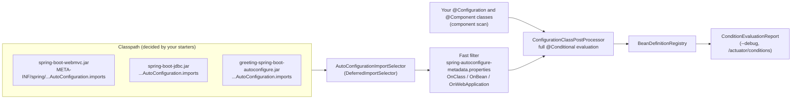

**Three questions every auto-configuration asks before registering a bean:**

1. **Is the library here?** `@ConditionalOnClass(DataSource.class)`. If the jar is missing, skip the whole class.
2. **Did the user already provide one?** `@ConditionalOnMissingBean`. If so, back off.
3. **Did the user switch it off, or configure it?** `@ConditionalOnProperty` / `@ConditionalOnBooleanProperty`, plus `@ConfigurationProperties` for the values.

### What `@SpringBootApplication` really is

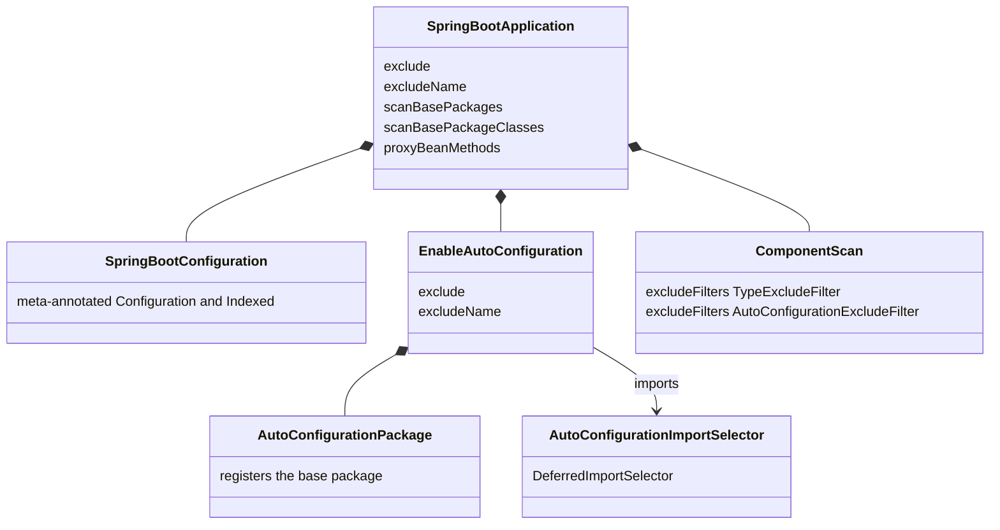

- **`@SpringBootConfiguration`**: a `@Configuration`. There should be exactly one, because test slices search *up* the package tree for it to find the app's configuration.
- **`@EnableAutoConfiguration`**: `@Import(AutoConfigurationImportSelector.class)` plus `@AutoConfigurationPackage`. The package registration is what lets JPA entity scanning and Spring Data repositories default to *your* package.
- **`@ComponentScan`** with two exclude filters:
  - `TypeExcludeFilter` lets tests exclude `@TestConfiguration` and similar classes.
  - `AutoConfigurationExcludeFilter` stops an auto-configuration from being component-scanned by accident. An auto-config that gets scanned is processed as *user* config, early, and its `@ConditionalOnMissingBean` then evaluates before your beans exist.

---

## 3. How it works internally

### 3.1 `SpringApplication.run()` end to end

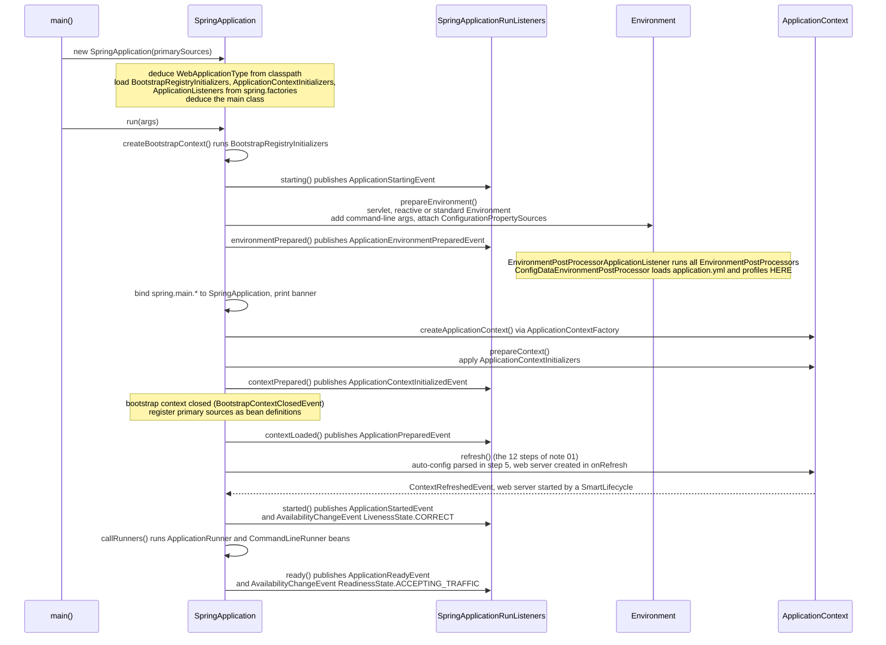

The lab's `StartupOrderTest` records every extension point and asserts this exact sequence:

```text
BootstrapRegistryInitializer
ApplicationStartingEvent
EnvironmentPostProcessor                      <- runs inside the "environment prepared" phase...
ApplicationEnvironmentPreparedEvent           <- ...before an ordinary listener sees the event
ApplicationContextInitializer
ApplicationContextInitializedEvent
ApplicationPreparedEvent
ContextRefreshedEvent                         <- refresh() done, all singletons exist
ApplicationStartedEvent
AvailabilityChangeEvent CORRECT               <- liveness
ApplicationRunner                             <- runners run AFTER "started", BEFORE "ready"
ApplicationReadyEvent
AvailabilityChangeEvent ACCEPTING_TRAFFIC     <- readiness: Kubernetes may now route traffic
```

> **Niche detail: why `EnvironmentPostProcessor` comes before the listener.** EPPs are not invoked directly by `SpringApplication`. They are run by `EnvironmentPostProcessorApplicationListener`, which is itself a listener for `ApplicationEnvironmentPreparedEvent` with a very high precedence (`Ordered.HIGHEST_PRECEDENCE + 10`). A plain listener has the lowest precedence, so it sees the event after every EPP, including the one that loaded `application.yml`, has already run.

**If anything throws**, `handleRunFailure` publishes `ApplicationFailedEvent`, asks each `SpringBootExceptionReporter` to report it (the only built-in one is `FailureAnalyzers`, section 3.8), closes the context, and rethrows.

**Which context class?** `WebApplicationType` is deduced from the classpath: `SERVLET` when the Servlet API and Spring MVC's web context are present, `REACTIVE` when WebFlux is present without MVC, else `NONE`. Force it with `spring.main.web-application-type=none` (handy for a batch job that happens to have Tomcat on the classpath). In Boot 4 the servlet context class is `org.springframework.boot.web.server.servlet.context.ServletWebServerApplicationContext`, in the new `spring-boot-web-server` module (verified from the 4.1.2 jar).

### 3.2 Discovery: from `.imports` files to candidate classes

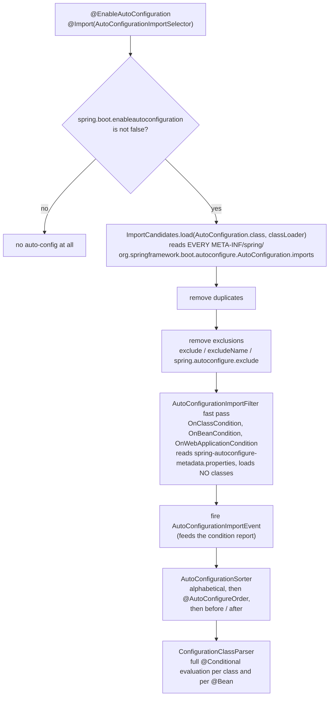

Key facts, each checked against the 4.1.2 jars or proven in the lab:

- **`ImportCandidates`** (`org.springframework.boot.context.annotation.ImportCandidates`, in `spring-boot`) reads `META-INF/spring/<annotation FQCN>.imports` from every jar. One class per line, `#` starts a comment, and a nested class uses `$`. The lab's `StarterPackagingTest.importsFile_isDiscoveredByImportCandidates` makes the same call Boot makes.
- **`spring.factories` is no longer read for auto-configurations.** Since Boot 3.0, the `org.springframework.boot.autoconfigure.EnableAutoConfiguration=` key is ignored. Boot 2.7 introduced the `.imports` file and deprecated the old key. `spring.factories` is still used for many other things (section 5).
- **`AutoConfigurationImportSelector` is a `DeferredImportSelector`.** The parser handles deferred imports only after **all** user `@Configuration` classes and component-scanned classes have been parsed. That one detail is why `@ConditionalOnMissingBean` in an auto-config can see your beans (section 3.4).
- **The fast filter.** `spring-boot-autoconfigure-processor` writes `META-INF/spring-autoconfigure-metadata.properties` at build time. The lab's generated file contains:
  ```properties
  dev.roadmap.greeting.autoconfigure.GreetingAutoConfiguration=
  dev.roadmap.greeting.autoconfigure.GreetingAutoConfiguration.ConditionalOnClass=dev.roadmap.greeting.GreetingService
  ```
  Boot can drop an auto-config whose `@ConditionalOnClass` fails **without loading the class**. With hundreds of candidates, that saves real startup time.
- **`AutoConfiguration.replacements`** (`META-INF/spring/org.springframework.boot.autoconfigure.AutoConfiguration.replacements`) maps an old class name to a new one. Exclusions and `after` references to the old name keep working after a library renames its auto-config.

### 3.3 Ordering: `@AutoConfiguration(before/after)`

```java
@AutoConfiguration(after = DataSourceAutoConfiguration.class)        // class reference
@AutoConfiguration(afterName = "org.acme.OtherAutoConfiguration")    // when the class may be absent
@AutoConfigureOrder(Ordered.HIGHEST_PRECEDENCE)                      // coarse ordering, auto-configs only
```

- Ordering decides the order in which **bean definitions are registered**. It does **not** decide bean *creation* order, which follows dependencies (and `@DependsOn`).
- You need it when one auto-config's `@ConditionalOnBean` / `@ConditionalOnMissingBean` must see a bean that another auto-config registers. For example, `JdbcTemplateAutoConfiguration` must come after `DataSourceAutoConfiguration`.
- `@AutoConfiguration` is a meta-annotation: `@Configuration(proxyBeanMethods = false)` + `@AutoConfigureBefore` + `@AutoConfigureAfter`. So auto-configs are **lite mode** (note 01, section 3.6), and they take dependencies as `@Bean` method parameters.
- `@Order` on an auto-config does nothing for this purpose. Use `@AutoConfigureOrder`.

### 3.4 Why "your bean always wins": user config first, auto-config last

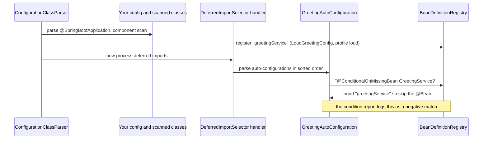

Two lab tests pin this down:
- `GreetingAutoConfigurationTest.backsOff_whenUserDefinesGreetingService`: there is exactly one `GreetingService`, and it is the user's.
- `conditionalOnBean_inUserConfiguration_cannotSeeAutoConfiguredBeans`: the reverse. A `@ConditionalOnBean(GreetingService.class)` inside *user* configuration does **not** match, because when user config is parsed the auto-configured definition does not exist yet. This is why the reference docs say to use `@ConditionalOnBean`/`@ConditionalOnMissingBean` only in auto-configuration classes.

### 3.5 Every `@Conditional*` annotation and how conditions are evaluated

All of them live in `org.springframework.boot.autoconfigure.condition`. The list below matches the classes in `spring-boot-autoconfigure-4.1.2.jar`.

| Annotation | Matches when | Notes |
|---|---|---|
| `@ConditionalOnClass` / `@ConditionalOnMissingClass` | Class(es) present / absent | `value = X.class` is safe even if `X` is missing, because Boot reads annotation metadata with ASM, not reflection. Inside a composed annotation, use `name = "..."` |
| `@ConditionalOnBean` / `@ConditionalOnMissingBean` | Bean(s) by type, name, or annotation present / absent | On a `@Bean` method, the type defaults to the **method return type**. `search = CURRENT / ANCESTORS / ALL`. `ignored` and `parameterizedContainer` exist for edge cases |
| `@ConditionalOnSingleCandidate` | Exactly one bean of the type, or one `@Primary` among several | `JdbcTemplate` uses it: "auto-configure only if there's an unambiguous `DataSource`" |
| `@ConditionalOnMissingFilterBean` | No `Filter` bean or `FilterRegistrationBean` for that filter type | Servlet filters only |
| `@ConditionalOnProperty` | Property present and not `false`, or equal to `havingValue` | `prefix`, `name`, `havingValue`, `matchIfMissing`. With several names, **all** must pass. Repeatable since 3.5 (`@ConditionalOnProperties` is the container) |
| `@ConditionalOnBooleanProperty` | Boolean property equals `havingValue` (default `true`) | Since 3.5. Clearer than `havingValue = "true"` strings |
| `@ConditionalOnResource` | A resource exists (`classpath:...`, `file:...`) | |
| `@ConditionalOnWebApplication` / `@ConditionalOnNotWebApplication` | Servlet or reactive web context (`type = SERVLET / REACTIVE / ANY`) | |
| `@ConditionalOnWarDeployment` / `@ConditionalOnNotWarDeployment` | Deployed as a WAR to an external container | Does not match embedded servers |
| `@ConditionalOnExpression` | A SpEL expression is `true` | Referencing a bean in the expression initializes it very early. Prefer property conditions |
| `@ConditionalOnJava` | JVM version range | `range = EQUAL_OR_NEWER / OLDER_THAN` |
| `@ConditionalOnJndi` | JNDI locations available | App-server deployments |
| `@ConditionalOnCloudPlatform` | `KUBERNETES`, `CLOUD_FOUNDRY`, `HEROKU`, ... detected | Kubernetes is detected from `KUBERNETES_SERVICE_HOST`/`_PORT` env vars |
| `@ConditionalOnThreading` | `Threading.VIRTUAL` or `PLATFORM` is active | Since 3.2. Virtual threads are on when `spring.threads.virtual.enabled=true` on Java 21+ |
| `@ConditionalOnCheckpointRestore` | Running with CRaC checkpoint/restore support | Since 3.2 |
| Spring's `@Profile` | Profile expression matches | It is also a `@Conditional` (`ProfileCondition`) |

**How evaluation works:**

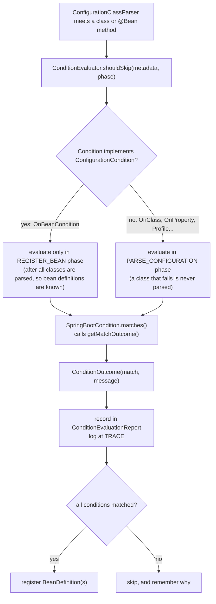

- Conditions **on the class** guard everything inside it, including `@EnableConfigurationProperties`. The lab's `backsOff_whenLibraryClassIsMissing` shows that `GreetingProperties` is not registered either.
- Conditions on a **`@Bean` method** guard only that bean.
- All conditions on one element must match (logical AND). For OR, extend `AnyNestedCondition`. For NOT-ALL, use `NoneNestedConditions` or `AllNestedConditions`.
- **Class-level `@ConditionalOnClass` plus `@Bean` methods whose signatures mention optional types is a trap.** The JVM may need those types while introspecting the class. Put type-specific beans in a **nested static `@Configuration`** guarded by its own `@ConditionalOnClass`, as Boot's own auto-configs do.
- To write your own condition, extend `SpringBootCondition` so you get report messages for free:

```java
class OnLinuxCondition extends SpringBootCondition {
    @Override
    public ConditionOutcome getMatchOutcome(ConditionContext context, AnnotatedTypeMetadata metadata) {
        boolean linux = System.getProperty("os.name").toLowerCase(Locale.ROOT).contains("linux");
        return linux ? ConditionOutcome.match("running on Linux") : ConditionOutcome.noMatch("not Linux");
    }
}
```

### 3.6 The condition evaluation report

There are three ways to see it:
1. **`--debug`** (or `debug=true`) prints `CONDITIONS EVALUATION REPORT` at startup. `ConditionEvaluationReportLoggingListener` (registered as an `ApplicationContextInitializer` in `spring-boot-autoconfigure`'s `spring.factories`) prints it. On a *failed* startup without `--debug`, it logs a hint to re-run with debug enabled.
2. **`/actuator/conditions`** returns the same data as JSON: `positiveMatches`, `negativeMatches`, `exclusions`, `unconditionalClasses`. It needs `spring-boot-starter-actuator` and `management.endpoints.web.exposure.include=conditions`. Don't expose it publicly.
3. **In a test**: `ConditionEvaluationReport.get(context.getBeanFactory())`. The lab's `conditionEvaluationReport_recordsWhyAutoConfigurationDidNotMatch` asserts the message `@ConditionalOnProperty (greeting.enabled=true) found different value`.

Real output from the lab jar (`java -jar demo-app.jar --debug --spring.profiles.active=loud`):

```text
Positive matches:
-----------------
   GreetingAutoConfiguration matched:
      - @ConditionalOnClass found required class 'dev.roadmap.greeting.GreetingService' (OnClassCondition)
      - @ConditionalOnProperty (greeting.enabled=true) matched (OnPropertyCondition)

Negative matches:
-----------------
   GreetingAutoConfiguration#greetingService:
      Did not match:
         - @ConditionalOnMissingBean (types: dev.roadmap.greeting.GreetingService; SearchStrategy: all)
           found beans of type 'dev.roadmap.greeting.GreetingService' greetingService (OnBeanCondition)
```

Read it as: *the class* matched, but *the bean method* backed off because the user supplied one.

### 3.7 How starters work, and Boot 4's modular layout

A starter has **no code**. It is a pom whose dependencies put the right jars on your classpath. Auto-configuration reacts to the classpath, so the starter is the on-switch.

**Boot 4 split the monolithic `spring-boot-autoconfigure` jar into per-technology modules.** Source: [Boot 4.0 Migration Guide](https://github.com/spring-projects/spring-boot/wiki/Spring-Boot-4.0-Migration-Guide). The 4.1.2 jars show the result:

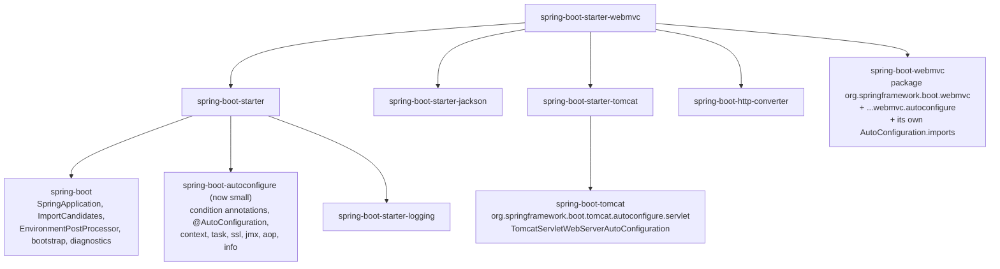

- **Naming:** modules are `spring-boot-<technology>`, with root package `org.springframework.boot.<technology>`. Starters are `spring-boot-starter-<technology>`. Test modules are `spring-boot-<technology>-test`, and test starters are `spring-boot-starter-<technology>-test`.
- **There are no separate `-autoconfigure` jars per technology.** Each module carries its auto-configurations in an `...<technology>.autoconfigure` package and its own `.imports` file. For example, `WebMvcAutoConfiguration` is now `org.springframework.boot.webmvc.autoconfigure.WebMvcAutoConfiguration`.
- **The core `spring-boot-autoconfigure` jar (4.1.2) lists only 12 auto-configs** in its own `.imports`: AOP, availability, `ConfigurationPropertiesAutoConfiguration`, lifecycle, `MessageSource`, property placeholders, project info, JMX, SSL, task execution and scheduling, and admin JMX. Everything else moved out.
- **Consequence:** in Boot 3 a class like `DataSourceAutoConfiguration` sat in one big jar and only its conditions kept it inactive. In Boot 4 it is not even on the classpath until you add the starter. Startup scans fewer candidates, and "why is X auto-configured?" has a smaller answer.
- **Renamed starters** (old names still work but are deprecated): `web` → `webmvc`, `web-services` → `webservices`, `aop` → `aspectj`, `oauth2-client` → `security-oauth2-client`, `oauth2-resource-server` → `security-oauth2-resource-server`, `oauth2-authorization-server` → `security-oauth2-authorization-server`.
- **Classic starters for migration:** `spring-boot-starter-classic` and `spring-boot-starter-test-classic` (both published for 4.1.2) bring in every module, roughly recreating the Boot 3 classpath. The migration guide's recipe is: switch to the classic starters, fix imports until it compiles and passes, then replace them with the specific starters the compiler and runtime ask for.

### 3.8 The other startup extension points

| Extension point | When it runs | Registered via | Typical use |
|---|---|---|---|
| `BootstrapRegistryInitializer` | First thing in `run()`, before the `Environment` exists | `spring.factories` or `SpringApplication.addBootstrapRegistryInitializer` | Register expensive objects needed while building config (a Config Server or Vault client) |
| `BootstrapRegistry` / `BootstrapContext` | Lives until `prepareContext` closes it | (Boot 4 package: `org.springframework.boot.bootstrap`) | Share instances across EPPs and config-data loaders. `addCloseListener` can promote one to a bean |
| `EnvironmentPostProcessor` | During `ApplicationEnvironmentPreparedEvent` | `spring.factories` key **`org.springframework.boot.EnvironmentPostProcessor`** (Boot 4) | Add or decrypt property sources, set defaults. The constructor can take `DeferredLogFactory`, `ConfigurableBootstrapContext`/`BootstrapContext`/`BootstrapRegistry` |
| `ApplicationContextInitializer` | After the context is created, before bean definitions load | `spring.factories` or `SpringApplication.addInitializers` | Programmatic context tweaks, registering early singletons, Testcontainers in tests |
| `ApplicationListener` for early events | From `ApplicationStartingEvent` on | `spring.factories` or `SpringApplication.addListeners` | `@EventListener` beans can't see events fired before refresh |
| `FailureAnalyzer` | When `run()` fails | `spring.factories` key `org.springframework.boot.diagnostics.FailureAnalyzer` | Turn a stack trace into "Description / Action" |
| `ApplicationRunner` / `CommandLineRunner` | After `ApplicationStartedEvent`, before ready | Beans | Start-up tasks. A failure here fails startup |

The lab's `RecordingEnvironmentPostProcessor` reads a `FakeSecretStore` that a `BootstrapRegistryInitializer` put in the bootstrap registry, and adds its values as the highest-priority property source. That is exactly how Spring Cloud's Vault and Config clients work (note 14).

**Failure analyzers in action.** The lab's starter validates `greeting.template`. Run the jar with a bad value and `BindValidationFailureAnalyzer` (from `spring-boot`) turns the `BindValidationException` into:

```text
***************************
APPLICATION FAILED TO START
***************************

Description:

Binding to target dev.roadmap.greeting.autoconfigure.GreetingProperties failed:

    Property: greeting.template
    Value: "oops"
    Origin: "greeting.template" from property source "commandLineArgs"
    Reason: must contain %s

Action:

Update your application's configuration
```

A custom analyzer for your own starter (not in the lab):

```java
class MissingTenantFailureAnalyzer extends AbstractFailureAnalyzer<MissingTenantException> {
    @Override
    protected FailureAnalysis analyze(Throwable rootFailure, MissingTenantException cause) {
        return new FailureAnalysis(
                "Tenant '%s' is not configured.".formatted(cause.tenant()),
                "Add acme.tenants.%s.url to your configuration.".formatted(cause.tenant()),
                cause);
    }
}
// META-INF/spring.factories
// org.springframework.boot.diagnostics.FailureAnalyzer=com.acme.MissingTenantFailureAnalyzer
```

### 3.9 Embedded server startup

> (unverified: not exercised by this lab, which has no web module.) The class names below are verified against the 4.1.2 jars. The create-in-`onRefresh` / start-in-`finishRefresh` timing comes from the Boot source and docs, not from a lab test.

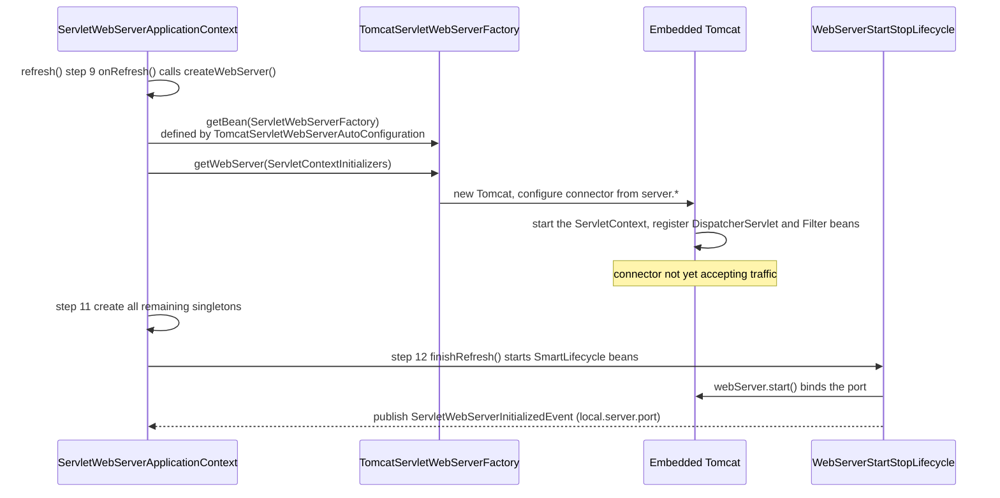

- The server is **created** in `onRefresh()` (so `ServletContextAware` beans can see a real `ServletContext`), but it **starts accepting connections** only in `finishRefresh()`, after every singleton exists. Requests never hit a half-built context.
- `WebServerGracefulShutdownLifecycle` stops intake first on shutdown (`server.shutdown=graceful` is the default in 4.1.2, per the `spring-boot-web-server` jar's metadata).
- Servlets, filters and listeners are registered from beans by `ServletContextInitializerBeans`. Any `Filter` bean is auto-registered for `/*`. Use `FilterRegistrationBean` with `setEnabled(false)` to stop that (a classic double-filter bug with Spring Security filters declared as `@Component`).
- Boot 4 supports Tomcat and Jetty. **Undertow support was removed** (migration guide).

### 3.10 The executable ("fat") jar and its launcher

What the lab build actually produced (`unzip -p demo-app-0.0.1-SNAPSHOT.jar META-INF/MANIFEST.MF`):

```text
Main-Class: org.springframework.boot.loader.launch.JarLauncher
Start-Class: dev.roadmap.demo.DemoApplication
Spring-Boot-Version: 4.1.2
Spring-Boot-Classes: BOOT-INF/classes/
Spring-Boot-Lib: BOOT-INF/lib/
Spring-Boot-Classpath-Index: BOOT-INF/classpath.idx
Spring-Boot-Layers-Index: BOOT-INF/layers.idx
```

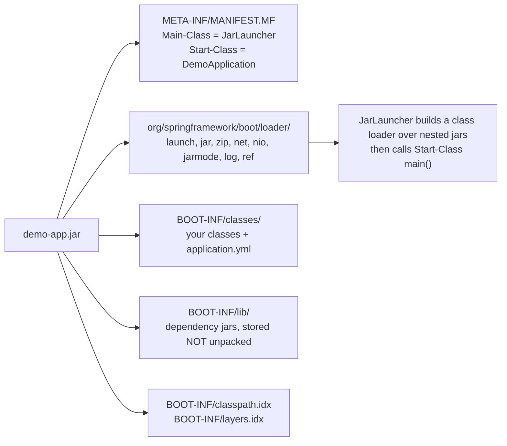

- `java -jar` runs `JarLauncher`. The launcher builds a class loader that reads nested jars **in place** (no unzip) and calls your `main` on a new thread context. `WarLauncher` and `PropertiesLauncher` (`loader.path` / `LOADER_PATH` for external lib folders) are the alternatives.
- The **launcher package `org.springframework.boot.loader.launch`** arrived with the rewritten loader in Boot 3.2. That loader uses `jar:nested:` URLs and a `NestedJarFile`, plus a `java.nio` `FileSystemProvider` (the jar's `META-INF/services/java.nio.file.spi.FileSystemProvider` entry).
- **Boot 4 removed the "classic" loader.** `<loaderImplementation>CLASSIC</loaderImplementation>` must go (migration guide). It also removed the embedded "fully executable" launch script (`<executable>true</executable>`, used to run the jar as an `init.d` service), and **optional dependencies are no longer packaged** unless `<includeOptional>true</includeOptional>`.
- `classpath.idx` keeps the build tool's classpath order (only used with `java -jar`). `layers.idx` groups files into Docker layers: `dependencies`, `spring-boot-loader`, `snapshot-dependencies`, `application`. In the lab, the two `-SNAPSHOT` greeting jars landed in `application`, because reactor-module snapshots change with every build.
- For container images, extract instead of running the fat jar: `java -Djarmode=tools -jar app.jar extract --layers --launcher` (the `spring-boot-jarmode-tools` jar is inside `BOOT-INF/lib`). That gives better Docker layer caching, and CDS/AOT cache training works on the extracted form (note 15).

---

## 4. Full worked code

Everything below is in the lab and exercised by its 36 tests (`./mvnw verify` at the lab root builds all three modules).

### 4.1 Module layout

```text
labs/03-custom-starter/
├── pom.xml                                  parent: spring-boot-starter-parent 4.1.2, packaging pom
├── greeting-spring-boot-autoconfigure/      library + auto-config + properties
│   └── src/main/resources/META-INF/spring/org.springframework.boot.autoconfigure.AutoConfiguration.imports
├── greeting-spring-boot-starter/            pom only
└── demo-app/                                consumer, the only module with spring-boot-maven-plugin
```

> The parent pom deliberately does **not** declare `spring-boot-maven-plugin`. If a library module were repackaged, its classes would move into `BOOT-INF/classes` and no other module could compile against it.

### 4.2 The auto-configure module

```xml
<dependencies>
    <dependency>
        <groupId>org.springframework.boot</groupId>
        <artifactId>spring-boot-autoconfigure</artifactId>
    </dependency>
    <dependency> <!-- optional: annotations compile, the starter decides whether a validator is present -->
        <groupId>org.springframework.boot</groupId>
        <artifactId>spring-boot-starter-validation</artifactId>
        <optional>true</optional>
    </dependency>
</dependencies>
<build><plugins><plugin>
    <groupId>org.apache.maven.plugins</groupId>
    <artifactId>maven-compiler-plugin</artifactId>
    <configuration>
        <annotationProcessorPaths>
            <path> <!-- META-INF/spring-configuration-metadata.json -->
                <groupId>org.springframework.boot</groupId>
                <artifactId>spring-boot-configuration-processor</artifactId>
            </path>
            <path> <!-- META-INF/spring-autoconfigure-metadata.properties -->
                <groupId>org.springframework.boot</groupId>
                <artifactId>spring-boot-autoconfigure-processor</artifactId>
            </path>
        </annotationProcessorPaths>
    </configuration>
</plugin></plugins></build>
```

```java
// The "library". In real life it lives in its own jar (think HikariDataSource).
public class GreetingService {
    private final String template;
    public GreetingService(String template) { this.template = template; }
    public String greet(String name) { return template.formatted(name); }
}

/**
 * @param enabled Whether to auto-configure a GreetingService
 * @param template Message template; must contain a single %s placeholder for the name
 */
@Validated
@ConfigurationProperties("greeting")
public record GreetingProperties(
        @DefaultValue("true") boolean enabled,
        @NotBlank @Pattern(regexp = ".*%s.*", message = "must contain %s") @DefaultValue("Hello, %s!") String template) {
}

@AutoConfiguration
@ConditionalOnClass(GreetingService.class)
@ConditionalOnProperty(prefix = "greeting", name = "enabled", havingValue = "true", matchIfMissing = true)
@EnableConfigurationProperties(GreetingProperties.class)
public final class GreetingAutoConfiguration {

    @Bean
    @ConditionalOnMissingBean          // type = return type = GreetingService
    GreetingService greetingService(GreetingProperties properties) {
        return new GreetingService(properties.template());
    }
}
```

```properties
# META-INF/spring/org.springframework.boot.autoconfigure.AutoConfiguration.imports
dev.roadmap.greeting.autoconfigure.GreetingAutoConfiguration
```

The generated `spring-configuration-metadata.json` (record `@param` tags became descriptions, and `@DefaultValue` became `defaultValue`):

```json
{ "name": "greeting.template", "type": "java.lang.String",
  "description": "Message template; must contain a single %s placeholder for the name",
  "sourceType": "dev.roadmap.greeting.autoconfigure.GreetingProperties", "defaultValue": "Hello, %s!" }
```

### 4.3 The starter

```xml
<artifactId>greeting-spring-boot-starter</artifactId>
<dependencies>
    <dependency><groupId>org.springframework.boot</groupId><artifactId>spring-boot-starter</artifactId></dependency>
    <dependency><groupId>org.springframework.boot</groupId><artifactId>spring-boot-starter-validation</artifactId></dependency>
    <dependency><groupId>dev.roadmap</groupId><artifactId>greeting-spring-boot-autoconfigure</artifactId></dependency>
</dependencies>
```

### 4.4 Overriding the bean in the app

```java
@Configuration(proxyBeanMethods = false)
@Profile("loud")
class LoudGreetingConfig {
    @Bean
    GreetingService greetingService(GreetingProperties properties) { // reuse the starter's validated properties
        return new LoudGreetingService(properties.template());       // subclass, so OnMissingBean(GreetingService) sees it
    }
}
```

### 4.5 Testing every condition with `ApplicationContextRunner`

```java
class GreetingAutoConfigurationTest {

    private final ApplicationContextRunner contextRunner = new ApplicationContextRunner()
            .withConfiguration(AutoConfigurations.of(GreetingAutoConfiguration.class));

    @Test
    void backsOff_whenUserDefinesGreetingService() {
        contextRunner.withUserConfiguration(UserGreetingConfig.class).run(context -> {
            assertThat(context).hasSingleBean(GreetingService.class);
            assertThat(context).getBean("customGreeting").isSameAs(context.getBean(GreetingService.class));
        });
    }

    @Test
    void backsOff_whenLibraryClassIsMissing() {
        contextRunner.withClassLoader(new FilteredClassLoader(GreetingService.class)).run(context -> {
            assertThat(context).doesNotHaveBean(GreetingService.class);
            assertThat(context).doesNotHaveBean(GreetingProperties.class);
        });
    }

    @Test
    void backsOff_whenDisabledByProperty() {
        contextRunner.withPropertyValues("greeting.enabled=false")
                .run(context -> assertThat(context).doesNotHaveBean(GreetingService.class));
    }

    @Test
    void failsFast_whenTemplateIsInvalid() {
        contextRunner.withPropertyValues("greeting.template=Hello").run(context -> {
            assertThat(context).hasFailed();
            assertThat(context.getStartupFailure()).rootCause()
                    .isInstanceOf(BindValidationException.class).hasMessageContaining("must contain %s");
        });
    }
}
```

`ApplicationContextRunner` builds a fresh, tiny context per `run()`. It has no component scan and no `@SpringBootApplication`. `AutoConfigurations.of(...)` applies the same ordering a real app uses. Use `WebApplicationContextRunner` or `ReactiveWebApplicationContextRunner` for web conditions.

### 4.6 Startup extension points (test code)

```java
public class RecordingEnvironmentPostProcessor implements EnvironmentPostProcessor { // org.springframework.boot (Boot 4)
    private final BootstrapContext bootstrapContext;                               // org.springframework.boot.bootstrap

    public RecordingEnvironmentPostProcessor(BootstrapContext bootstrapContext) {
        this.bootstrapContext = bootstrapContext;
    }

    @Override
    public void postProcessEnvironment(ConfigurableEnvironment environment, SpringApplication application) {
        if (!bootstrapContext.isRegistered(FakeSecretStore.class)) return;
        var secrets = new HashMap<String, Object>(bootstrapContext.get(FakeSecretStore.class).secrets());
        environment.getPropertySources().addFirst(new MapPropertySource("fakeSecretStore", secrets));
    }
}
// src/test/resources/META-INF/spring.factories
// org.springframework.boot.EnvironmentPostProcessor=dev.roadmap.demo.startup.RecordingEnvironmentPostProcessor

new SpringApplicationBuilder(DemoApplication.class)
        .addBootstrapRegistryInitializer(registry -> registry.register(FakeSecretStore.class,
                InstanceSupplier.of(new FakeSecretStore(Map.of("demo.secret", "s3cr3t")))))
        .initializers(context -> { /* ApplicationContextInitializer */ })
        .listeners(listener)
        .run();   // environment.getProperty("demo.secret") == "s3cr3t"
```

---

## 5. Gap fillers & niche details

- **Never put an auto-config where the app scans it.** The lab uses `dev.roadmap.greeting.autoconfigure`, outside `dev.roadmap.demo`. `AutoConfigurationExcludeFilter` (checked with `javap` on the 4.1.2 jar) skips a scanned `@Configuration` class if it is annotated `@AutoConfiguration` *or* listed in an `.imports` file. But it only helps when the scan uses that filter, as `@SpringBootApplication` does. A hand-written `@ComponentScan` doesn't, and an old-style plain `@Configuration` auto-config that's missing from `.imports` isn't caught either. A scanned config is treated as user config, and its `@ConditionalOnMissingBean` runs too early.
- **`@ConditionalOnMissingBean` matches on the method's return type.** If your auto-config's `@Bean` returns the concrete `StripeClientImpl` but users define a `StripeClient`, both beans register. Return the type you want to match on, or set `@ConditionalOnMissingBean(StripeClient.class)` explicitly.
- **Same bean name, no condition:** if user config and an auto-config both define `greetingService` and the auto-config had no `@ConditionalOnMissingBean`, Boot fails with `BeanDefinitionOverrideException` (`spring.main.allow-bean-definition-overriding=false` by default). In the lab, both are called `greetingService`, and the condition is what prevents the clash.
- **`spring.factories` still matters.** In 4.1.2, `spring-boot`'s own file registers `SpringApplicationRunListener`, `ApplicationContextInitializer`, `ApplicationListener`, `EnvironmentPostProcessor`, `PropertySourceLoader`, `ConfigDataLocationResolver`/`ConfigDataLoader`, `FailureAnalyzer`, `FailureAnalysisReporter`, `LoggingSystemFactory`, and `ProtocolResolver`. Only *auto-configurations* moved to `.imports`.
- **Excluding:** `@SpringBootApplication(exclude = DataSourceAutoConfiguration.class)`, or `spring.autoconfigure.exclude=...` in config, which you can change per profile. Excluding a class that is not an auto-configuration fails startup with an `IllegalStateException`. Typos don't pass silently.
- **`proxyBeanMethods = false` everywhere:** `@AutoConfiguration` implies it. Never call another `@Bean` method directly inside an auto-config. Take it as a parameter.
- **Boot 4 trimmed auto-config classes:** "public members (aside from constants) have been removed from auto-configuration classes" (4.0 release notes), and the reference docs now show `public final class MyAutoConfiguration`. Code that subclassed or called Boot's auto-configs has to change.
- **Customizers beat replacement.** Boot exposes `*Customizer` beans (`RestClientCustomizer`, `JsonMapperBuilderCustomizer`, `TomcatConnectorCustomizer`, `WebServerFactoryCustomizer`). Defining one tweaks Boot's bean without making it back off. Replace only when you need a different object altogether.
- **`@ConditionalOnBean` in an auto-config still depends on ordering.** It only sees definitions registered so far, so declare `after = TheOtherAutoConfiguration.class`.
- **`spring-boot-autoconfigure-processor` is optional but cheap.** Without it, every candidate class is loaded to evaluate `@ConditionalOnClass`.
- **Naming rule from the reference docs:** don't start your artifact with `spring-boot`, even under your own groupId. Use `acme-spring-boot-starter`. The 4.1 docs call the auto-config module `acme-spring-boot` (Boot's own Boot 4 convention). `acme-spring-boot-autoconfigure`, as in this lab, is the older but still common name.
- **Starter content rules:** a starter must not declare optional dependencies, and should depend on `spring-boot-starter` directly or via another starter.
- **`@ConfigurationPropertiesSource` (Boot 4.0, new):** mark a type in *another* module so that the configuration processor can generate metadata for nested types it cannot see in source.
- **`@ImportAutoConfiguration`** imports specific auto-configs. Test slices such as `@WebMvcTest` use it, through their own `.imports` files keyed by the slice annotation (for example `META-INF/spring/org.springframework.boot.webmvc.test.autoconfigure.AutoConfigureWebMvc.imports`; the package is per module in Boot 4).
- **`spring.main.*`** properties bind onto `SpringApplication` itself after the environment is prepared: `banner-mode`, `web-application-type`, `lazy-initialization`, `allow-circular-references`, `allow-bean-definition-overriding`, `log-startup-info`, `keep-alive` (keeps the JVM alive with virtual threads, which are daemon threads).
- **Lazy init vs auto-config:** `spring.main.lazy-initialization=true` defers *bean creation*, not *condition evaluation*. The condition report looks identical.
- **`context.initializer.classes` / `context.listener.classes`:** older tutorials register initializers and listeners through these properties. The classes behind them (`DelegatingApplicationContextInitializer`, `DelegatingApplicationListener`) are not in any 4.1.2 Boot jar (checked while building the lab). Use `spring.factories` or `SpringApplication` methods.
- **`--debug` vs `--trace`:** `--debug` only raises a few core loggers (and prints the report). It does not put your own app in DEBUG. `--trace` is far noisier.

---

## 6. Boot 4 / Framework 7 delta

Sources: [Spring Boot 4.0 Migration Guide](https://github.com/spring-projects/spring-boot/wiki/Spring-Boot-4.0-Migration-Guide), [Spring Boot 4.0 Release Notes](https://github.com/spring-projects/spring-boot/wiki/Spring-Boot-4.0-Release-Notes), and the 4.1.2 jars inspected while building the lab.

| Change | Status | What it means for you |
|---|---|---|
| Modular codebase: `spring-boot-<tech>` modules with their own auto-config packages and `.imports` files | **New** | Auto-configs for a technology are absent until its starter is added. Package names changed (`org.springframework.boot.webmvc.autoconfigure.WebMvcAutoConfiguration`) |
| Starter renames (`web` → `webmvc`, `aop` → `aspectj`, OAuth2 ones gain a `security-` prefix) | **Deprecated old names** | Old names still resolve for now. Switch |
| `spring-boot-starter-classic` / `spring-boot-starter-test-classic` | **New** | A migration crutch that restores the Boot 3-like classpath |
| Test starters per technology (`spring-boot-starter-webmvc-test`, ...) | **New** | Slices live in their technology's test module |
| `EnvironmentPostProcessor` moved to `org.springframework.boot` | **Moved** | The old `org.springframework.boot.env.EnvironmentPostProcessor` is deprecated. Update the `spring.factories` key too. The lab uses the new key |
| `BootstrapRegistry` & co moved to `org.springframework.boot.bootstrap` | **Moved** | Recompile Spring Cloud-style bootstrap code |
| Web server classes moved to `spring-boot-web-server` / `spring-boot-tomcat` (`...web.server.servlet.context.ServletWebServerApplicationContext`, `...tomcat.servlet.TomcatServletWebServerFactory`) | **Moved** | Fix imports in `WebServerFactoryCustomizer`s |
| Undertow | **Removed** | Use Tomcat or Jetty |
| Classic jar loader, launch script | **Removed** | Delete `loaderImplementation=CLASSIC` and `executable=true` |
| Optional dependencies in uber jars | **Changed** | No longer packaged unless `includeOptional=true` |
| Public members on auto-config classes | **Removed** | Don't subclass or call Boot's auto-configs |
| `@ConfigurationPropertiesSource` | **New** | Metadata for property types from other modules |
| `ConditionalOnEnabledTracing` → `ConditionalOnEnabledTracingExport` | **Renamed** | Only if you wrote custom tracing auto-config |
| JSpecify nullability across Boot's API | **New** | Kotlin and NullAway builds may see new warnings or errors |

Earlier changes that tutorials still get wrong:
- `@ConditionalOnBooleanProperty` and repeatable `@ConditionalOnProperty` (3.5). `@ConditionalOnThreading` and `@ConditionalOnCheckpointRestore` (3.2).
- `.imports` file (2.7). `spring.factories` `EnableAutoConfiguration` key ignored (3.0).
- `@AutoConfiguration` annotation (2.7).

> ⚠️ **Outdated advice still common in tutorials and Baeldung articles:**
> - "Register your auto-config in `META-INF/spring.factories` under `EnableAutoConfiguration`": ignored since 3.0.
> - `@Configuration` + `@AutoConfigureAfter` on auto-configs: use `@AutoConfiguration(after = ...)`.
> - `org.springframework.boot.env.EnvironmentPostProcessor`: deprecated in Boot 4.
> - `spring-boot-starter-web` / `spring-boot-starter-aop`: deprecated names.
> - `org.springframework.boot.loader.JarLauncher` (pre-3.2 package) in Dockerfiles: the class is `org.springframework.boot.loader.launch.JarLauncher`.
> - `java -Djarmode=layertools -jar app.jar extract`: replaced by `-Djarmode=tools ... extract --layers --launcher` (3.3+).
> - Undertow as a lighter alternative to Tomcat: gone in Boot 4.

---

## 7. Real-life architecture solutions

### 7.1 A company platform starter shared by 50 microservices

**Problem:** 50 services each hand-roll JSON logging, correlation IDs, security defaults, tracing export, and actuator exposure. They drift. A security fix means 50 pull requests, and a new team takes a week to get "production-ready".

**Solution:** the platform team publishes `acme-platform-spring-boot-starter` plus a BOM. Each concern is its own auto-configuration, guarded so services can opt out or override:

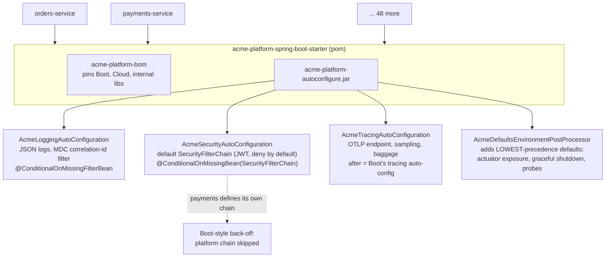

```java
@AutoConfiguration(before = SecurityAutoConfiguration.class) // be considered before Boot's own default chain
@ConditionalOnClass(SecurityFilterChain.class)
@ConditionalOnBooleanProperty(name = "acme.security.defaults.enabled", matchIfMissing = true)
public final class AcmeSecurityAutoConfiguration {

    @Bean
    @ConditionalOnMissingBean(SecurityFilterChain.class)  // a service's own chain always wins
    SecurityFilterChain acmeDefaultChain(HttpSecurity http) throws Exception {
        return http.authorizeHttpRequests(a -> a.requestMatchers("/actuator/health/**").permitAll()
                                                .anyRequest().authenticated())
                   .oauth2ResourceServer(o -> o.jwt(Customizer.withDefaults()))
                   .build();
    }
}

public class AcmeDefaultsEnvironmentPostProcessor implements EnvironmentPostProcessor {
    @Override
    public void postProcessEnvironment(ConfigurableEnvironment env, SpringApplication app) {
        // addLast = LOWEST precedence: every service's application.yml still overrides these
        env.getPropertySources().addLast(new MapPropertySource("acmePlatformDefaults", Map.of(
                "management.endpoints.web.exposure.include", "health,info,prometheus",
                "server.shutdown", "graceful",
                "logging.structured.format.console", "ecs")));
    }
}
```

**Trade-offs:**
- **Pros:** one place for security fixes, consistent telemetry, and new services production-ready on day one.
- **Cons:** "magic" a service team didn't write. Mitigate by documenting every property in metadata and pointing people to `--debug` and `/actuator/conditions`.
- Upgrades become a platform release train: one Boot upgrade, 50 consumers. Version the starter semantically and run a canary service first.
- Never put business logic in the platform starter. It becomes a distributed monolith.
- Defaults belong at the **lowest** precedence (`addLast`), never `addFirst`, or services lose control.

**Who uses it:** platform-engineering teams at large Spring shops. Spring Cloud's own starters (Config, Netflix, AWS) are this pattern at open-source scale, and most banks and retailers on Spring run an internal "service chassis" starter.

### 7.2 Replacing a bean safely with `@ConditionalOnMissingBean`

**Problem:** the platform starter provides an `AuditPublisher` that writes to Kafka. The payments team needs a synchronous, database-backed publisher for compliance. Another team wants the Kafka one but with a different topic. Copying the starter's code is not an option.

**Solution:** design the starter for three levels of control, from lightest to heaviest:

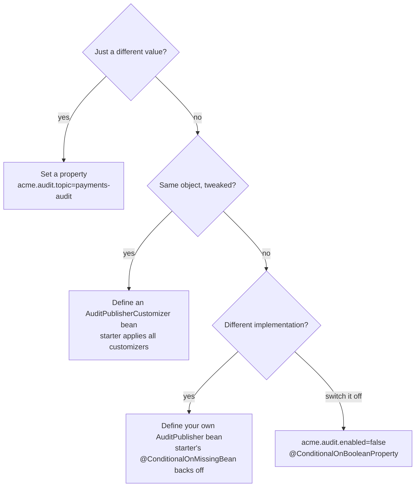

```java
@AutoConfiguration(after = KafkaAutoConfiguration.class)
@ConditionalOnClass(KafkaTemplate.class)
@EnableConfigurationProperties(AuditProperties.class)
public final class AuditAutoConfiguration {

    @Bean
    @ConditionalOnMissingBean(AuditPublisher.class)   // explicit type: matches ANY implementation the user defines
    @ConditionalOnBooleanProperty(name = "acme.audit.enabled", matchIfMissing = true)
    KafkaAuditPublisher kafkaAuditPublisher(KafkaTemplate<String, String> kafka, AuditProperties props,
                                            ObjectProvider<AuditPublisherCustomizer> customizers) {
        var publisher = new KafkaAuditPublisher(kafka, props.topic());
        customizers.orderedStream().forEach(c -> c.customize(publisher));
        return publisher;
    }
}
```

**Rules that make replacement safe:**
- Put `@ConditionalOnMissingBean` on the **interface** type, not the concrete return type.
- Make consumers depend on the interface, so that the user's implementation fits everywhere.
- Order after any auto-config whose beans you need (`after = KafkaAutoConfiguration.class`).
- Test the override with `ApplicationContextRunner.withUserConfiguration(...)` and `hasSingleBean`, as the lab does.
- Spring Framework 6.2's `@Fallback` is an alternative for *libraries without Boot*: the default bean is marked `@Fallback`, so any other candidate wins at injection time. Unlike `@ConditionalOnMissingBean`, both beans still exist.

**Trade-offs:** back-off is all or nothing per bean. If users routinely replace a bean only to change one detail, add a customizer or a property. Too many conditions make behavior hard to predict, so log the chosen implementation at startup.

**Who uses it:** Boot itself, everywhere: `ObjectMapper`/`JsonMapper`, `DataSource`, `SecurityFilterChain`, `RestClient.Builder`, `TaskExecutor`. Internal starters at most companies copy this exact shape.

### 7.3 Classpath-driven integrations ("add a jar, get a feature")

**Problem:** a shared observability library must export metrics to Prometheus in some services, Datadog in others, and nothing in batch jobs, without `if` statements or per-service config classes.

**Solution:** one auto-config per backend, each with `@ConditionalOnClass` on that backend's client library. The service chooses by adding a dependency.

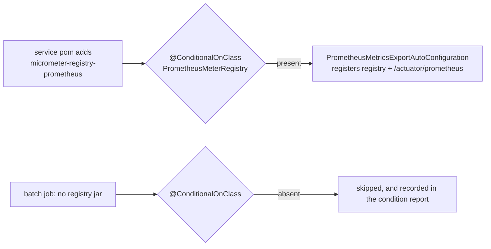

**Trade-offs:** it's zero-config and dead simple. But a transitive dependency can switch a feature on by surprise ("why are we exporting to Datadog?"). Check `mvn dependency:tree` and the condition report. Boot 4's modules make this less likely, because far fewer integrations are on the classpath by default.
**Who uses it:** Micrometer registries, Spring Boot's own `spring-boot-docker-compose` and Testcontainers `@ServiceConnection` support, and Flyway/Liquibase (add the starter, migrations run).

---

## 8. Pitfalls & debugging checklist

- [ ] **"My bean is missing"**. Run with `--debug` and search the report for the auto-config: `Did not match` tells you which condition failed. In production, use `/actuator/conditions`.
- [ ] **"Boot's bean disappeared after I added mine"**. That's the design: `@ConditionalOnMissingBean` backed off. If you only wanted to tweak it, use a `*Customizer` bean or properties instead.
- [ ] **Two beans of my type, `NoUniqueBeanDefinitionException`**. The auto-config's `@ConditionalOnMissingBean` matched a concrete return type and your bean has a different type. Fix the starter (explicit type), or mark yours `@Primary`.
- [ ] **My custom starter's auto-config never runs**:
  - check the file path and name: `META-INF/spring/org.springframework.boot.autoconfigure.AutoConfiguration.imports` (exactly that, under `spring/`);
  - check for typos in the class name;
  - you may have registered it only in `spring.factories`, which is ignored since 3.0.
- [ ] **My auto-config runs too early and doesn't see the user's bean**. It's in a component-scanned package. Move it, and make sure it's listed in `.imports`.
- [ ] **`@ConditionalOnBean` never matches**. It's in user config (section 3.4), or the other auto-config is ordered after yours. Add `after = ...`.
- [ ] **`ClassNotFoundException` / `NoClassDefFoundError` from an auto-config**. A `@Bean` method signature references an optional type. Move it into a nested `@Configuration` with its own `@ConditionalOnClass`.
- [ ] **Boot 3 → 4 upgrade: an auto-config "vanished"**. It moved to a module you don't depend on. Add the technology starter, or temporarily `spring-boot-starter-classic`.
- [ ] **`EnvironmentPostProcessor` not called**. Wrong `spring.factories` key, or it's declared as a bean (too late). In Boot 4, use `org.springframework.boot.EnvironmentPostProcessor`.
- [ ] **`@EventListener(ApplicationStartingEvent.class)` never fires**. The context doesn't exist yet. Register through `SpringApplication.addListeners` or `spring.factories`.
- [ ] **The app starts, then exits immediately**. There's no web server on the classpath (Boot 4: no `spring-boot-starter-webmvc`), or `spring.main.web-application-type=none`.
- [ ] **The jar works in the IDE but fails with `java -jar`**:
  - a resource read through `new File(getResource(...))` fails because nested jars are not files (use `getInputStream()`);
  - an optional dependency was not packaged (Boot 4).

---

## 9. Interview questions

<details><summary>Q1. What does @SpringBootApplication do?</summary>

It is a composed annotation with three parts:
- `@SpringBootConfiguration`, a `@Configuration` that test slices look up to find the app.
- `@EnableAutoConfiguration`, which imports `AutoConfigurationImportSelector` and registers the base package through `@AutoConfigurationPackage` (used by entity scanning and Spring Data).
- `@ComponentScan` from the class's package, with `TypeExcludeFilter` and `AutoConfigurationExcludeFilter`.

Its attributes `exclude`, `excludeName`, `scanBasePackages` and `proxyBeanMethods` are aliases for those parts.
</details>

<details><summary>Q2. How does Spring Boot find auto-configuration classes?</summary>

`AutoConfigurationImportSelector` calls `ImportCandidates.load(AutoConfiguration.class, classLoader)`, which reads every `META-INF/spring/org.springframework.boot.autoconfigure.AutoConfiguration.imports` on the classpath. Then it:
1. removes duplicates and exclusions (`exclude`, `spring.autoconfigure.exclude`);
2. runs a fast filter (`OnClassCondition`, `OnBeanCondition`, `OnWebApplicationCondition`) driven by the precomputed `spring-autoconfigure-metadata.properties`;
3. sorts the rest (`@AutoConfigureOrder`, `before`/`after`);
4. hands them to the configuration-class parser for full condition evaluation.

`spring.factories` stopped being used for this in Boot 3.0.
</details>

<details><summary>Q3. Why does a user-defined bean always win over an auto-configured one?</summary>

`AutoConfigurationImportSelector` is a `DeferredImportSelector`, so auto-configurations are parsed only after all user configuration and component-scanned classes. When an auto-config's `@ConditionalOnMissingBean` is evaluated (in the `REGISTER_BEAN` phase), the user's bean definition already exists, so the auto-config backs off. The flip side: `@ConditionalOnBean` in user config can't see auto-configured beans.
</details>

<details><summary>Q4. List the main @Conditional annotations Boot provides.</summary>

- **Classpath:** `@ConditionalOnClass` / `OnMissingClass`.
- **Beans:** `@ConditionalOnBean` / `OnMissingBean` / `OnSingleCandidate` / `OnMissingFilterBean`.
- **Properties:** `@ConditionalOnProperty` / `OnBooleanProperty`.
- **Environment:** `@ConditionalOnResource`, `@ConditionalOnWebApplication` / `OnNotWebApplication`, `@ConditionalOnWarDeployment` / `OnNotWarDeployment`, `@ConditionalOnCloudPlatform`, `@ConditionalOnJava`, `@ConditionalOnJndi`, `@ConditionalOnThreading`, `@ConditionalOnCheckpointRestore`.
- **Escape hatch:** `@ConditionalOnExpression`.

Spring's `@Profile` is also a condition.
</details>

<details><summary>Q5. What is the difference between @AutoConfigureOrder and @AutoConfiguration(after = ...)?</summary>

`after`/`before` express a relative dependency between two specific auto-configs. Use them when one's conditions need the other's beans. `@AutoConfigureOrder` is an absolute priority, like `@Order` but only among auto-configs, for classes that shouldn't know each other. Both affect only bean-definition registration order, not bean creation order.
</details>

<details><summary>Q6. How do you find out why an auto-configuration did or didn't apply?</summary>

- Start with `--debug` (or `debug=true`) to print the Conditions Evaluation Report: positive matches, negative matches with the failing condition's message, exclusions, and unconditional classes.
- In a running app, use `/actuator/conditions`.
- In tests, use `ConditionEvaluationReport.get(beanFactory)` or `ConditionEvaluationReportLoggingListener` on an `ApplicationContextRunner`.
</details>

<details><summary>Q7. How would you build a custom starter?</summary>

- **Auto-configure module:** your `@AutoConfiguration` classes with `@ConditionalOnClass`, `@ConditionalOnMissingBean` and property conditions, and an `@ConfigurationProperties` record under your own prefix (validated). List the classes in `META-INF/spring/...AutoConfiguration.imports`, make library dependencies `optional`, and add `spring-boot-configuration-processor` and `spring-boot-autoconfigure-processor`.
- **Starter module:** a pom-only artifact depending on the auto-configure module, `spring-boot-starter`, and the libraries.
- **Naming:** `acme-spring-boot-starter`, never `spring-boot-...`.
- **Tests:** `ApplicationContextRunner` for each condition, `FilteredClassLoader` for missing classes, and `withUserConfiguration` to prove back-off.
</details>

<details><summary>Q8. Walk through SpringApplication.run().</summary>

1. Create the bootstrap context (run `BootstrapRegistryInitializer`s), then `ApplicationStartingEvent`.
2. Prepare the `Environment`: command-line args, then `ApplicationEnvironmentPreparedEvent`, during which `EnvironmentPostProcessor`s run and `application.yml` and profiles are loaded. Bind `spring.main.*`.
3. Print the banner and create the context for the `WebApplicationType`.
4. Apply `ApplicationContextInitializer`s, then `ApplicationContextInitializedEvent`. Close the bootstrap context and load sources, then `ApplicationPreparedEvent`.
5. `refresh()`: auto-config is parsed and the web server is created in `onRefresh` and started in `finishRefresh`. Then `ContextRefreshedEvent`.
6. `ApplicationStartedEvent` + liveness `CORRECT`.
7. Runners.
8. `ApplicationReadyEvent` + readiness `ACCEPTING_TRAFFIC`.

On failure: `ApplicationFailedEvent` and the failure analyzers.
</details>

<details><summary>Q9. What changed with starters in Spring Boot 4?</summary>

Boot 4 is modular: `spring-boot-<tech>` modules each contain their own auto-configurations and `.imports` file, so a technology's auto-config isn't even on the classpath without its starter. Several starters were renamed:
- `spring-boot-starter-web` → `spring-boot-starter-webmvc`;
- `spring-boot-starter-aop` → `spring-boot-starter-aspectj`;
- the OAuth2 starters → `spring-boot-starter-security-oauth2-*`.

Test support split into `spring-boot-starter-<tech>-test`. `spring-boot-starter-classic` and `spring-boot-starter-test-classic` exist to ease migration.
</details>

<details><summary>Q10. How does an executable Spring Boot jar work?</summary>

The manifest's `Main-Class` is `org.springframework.boot.loader.launch.JarLauncher`, and `Start-Class` is your app. App classes are in `BOOT-INF/classes` and dependencies are stored unextracted in `BOOT-INF/lib`. The launcher creates a class loader that reads nested jars in place (`jar:nested:` URLs) in `classpath.idx` order, then invokes your `main`. `layers.idx` drives Docker layering. Boot 4 removed the classic loader and the launch script, and no longer packages optional dependencies by default.
</details>

<details><summary>Q11. When would you use an EnvironmentPostProcessor vs an ApplicationContextInitializer vs a BootstrapRegistryInitializer?</summary>

- **`BootstrapRegistryInitializer`:** register objects needed *while building configuration*, such as a Vault client. It runs first.
- **`EnvironmentPostProcessor`:** add, modify or decrypt property sources before the context exists, such as platform defaults or secrets. Register it in `spring.factories`; in Boot 4 the key is `org.springframework.boot.EnvironmentPostProcessor`.
- **`ApplicationContextInitializer`:** customize the context after it's created and before beans are defined, such as registering singletons or setting active profiles programmatically.
</details>

<details><summary>Q12. Where and when does the embedded Tomcat start?</summary>

`ServletWebServerApplicationContext.onRefresh()` creates it through the auto-configured `ServletWebServerFactory`, which registers `DispatcherServlet` and filter beans into the `ServletContext`. The connector only begins accepting requests when `WebServerStartStopLifecycle` (a `SmartLifecycle`) starts it in `finishRefresh()`, after all singletons are created. `ServletWebServerInitializedEvent` then carries the port.
</details>

<details><summary>Q13. What is a FailureAnalyzer?</summary>

It's an extension that converts a startup exception into a human-readable "Description / Action" report. Boot ships many, for example for bind validation, port in use, a missing bean, or a bean override. You write one by extending `AbstractFailureAnalyzer<T extends Throwable>` and registering it in `spring.factories` under `org.springframework.boot.diagnostics.FailureAnalyzer`. `FailureAnalyzers` is the `SpringBootExceptionReporter` that runs them.
</details>

<details><summary>Q14. Why do Boot's auto-configs use proxyBeanMethods = false?</summary>

Lite mode avoids CGLIB subclassing of hundreds of configuration classes, which makes startup faster and is friendlier to AOT and native images. Auto-configs never call other `@Bean` methods directly. They take dependencies as method parameters. `@AutoConfiguration` sets `proxyBeanMethods = false` for you.
</details>

---

## 10. Sources

- Spring Boot reference (4.1): [Creating Your Own Auto-configuration](https://docs.spring.io/spring-boot/reference/features/developing-auto-configuration.html), [Auto-configuration (using)](https://docs.spring.io/spring-boot/reference/using/auto-configuration.html), [SpringApplication](https://docs.spring.io/spring-boot/reference/features/spring-application.html), [Executable Jar format](https://docs.spring.io/spring-boot/specification/executable-jar/index.html), [Launching Executable Jars](https://docs.spring.io/spring-boot/specification/executable-jar/launching.html), [Nested Jars](https://docs.spring.io/spring-boot/specification/executable-jar/nested-jars.html), [Conditions endpoint](https://docs.spring.io/spring-boot/api/rest/actuator/conditions.html), [`@ConditionalOnBooleanProperty` Javadoc](https://docs.spring.io/spring-boot/api/java/org/springframework/boot/autoconfigure/condition/ConditionalOnBooleanProperty.html)
- [Spring Boot 4.0 Migration Guide](https://github.com/spring-projects/spring-boot/wiki/Spring-Boot-4.0-Migration-Guide) · [Spring Boot 4.0 Release Notes](https://github.com/spring-projects/spring-boot/wiki/Spring-Boot-4.0-Release-Notes) · [Spring Framework 7.0 Release Notes](https://github.com/spring-projects/spring-framework/wiki/Spring-Framework-7.0-Release-Notes)
- Spring Framework reference: [`@Conditional` / composing Java configuration](https://docs.spring.io/spring-framework/reference/core/beans/java/composing-configuration-classes.html)
- Spring source to read: `SpringApplication#run`, `AutoConfigurationImportSelector#getAutoConfigurationEntry`, `ImportCandidates#load`, `AutoConfigurationSorter`, `OnBeanCondition`, `ConditionEvaluator#shouldSkip`, `ServletWebServerApplicationContext#createWebServer`, `EnvironmentPostProcessorApplicationListener`
- Baeldung (3.x era, check against section 6): [Create a Custom Auto-Configuration](https://www.baeldung.com/spring-boot-custom-auto-configuration), [Creating a Custom Starter](https://www.baeldung.com/spring-boot-custom-starter), [Display Auto-Configuration Report](https://www.baeldung.com/spring-boot-auto-configuration-report), [Spring Boot Failure Analyzer](https://www.baeldung.com/spring-boot-failure-analyzer)
- Oracle: [JAR File Specification (manifest `Main-Class`)](https://docs.oracle.com/en/java/javase/21/docs/specs/jar/jar.html), [`java.util.ServiceLoader`](https://docs.oracle.com/en/java/javase/21/docs/api/java.base/java/util/ServiceLoader.html)
