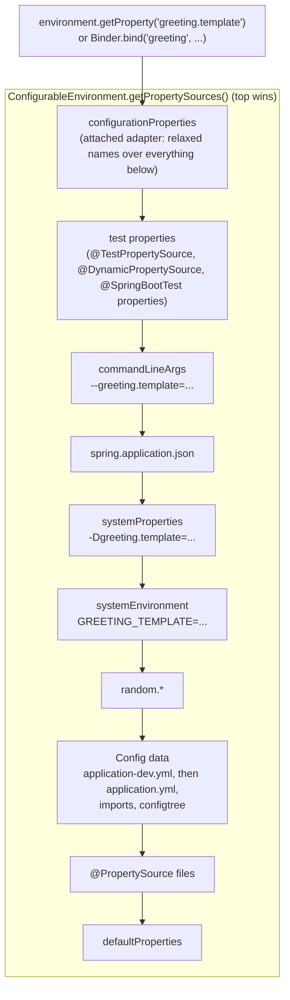
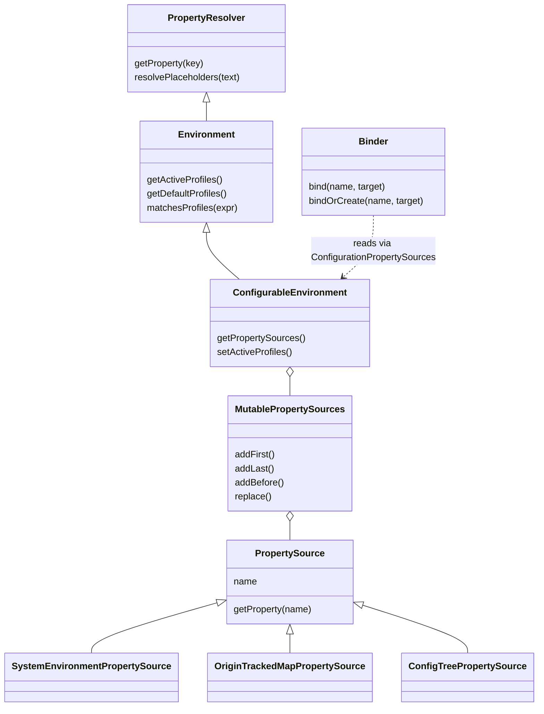
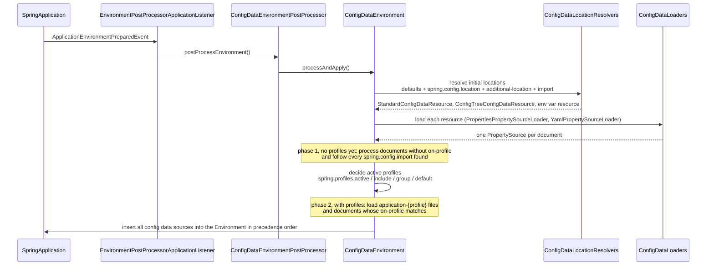
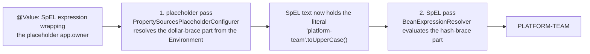
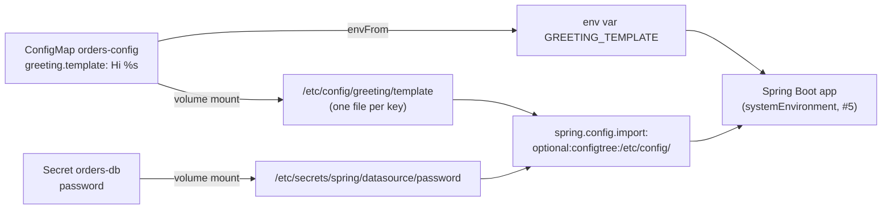
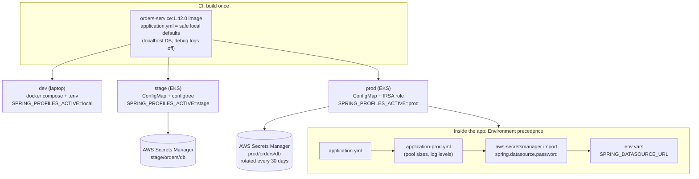
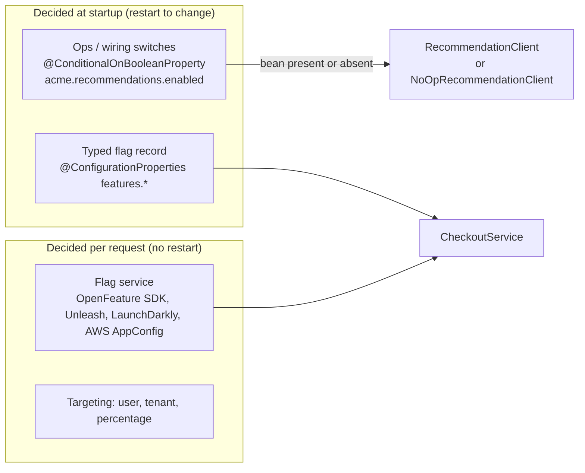
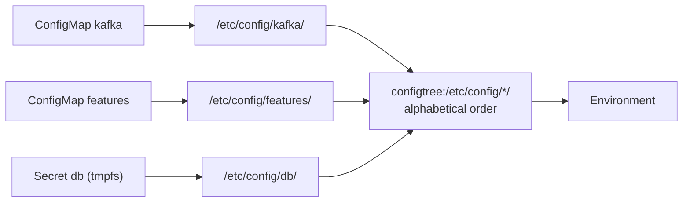

# 04 — Configuration & Profiles: Externalized Config, Binding, Secrets

> **Lab:** [`labs/03-custom-starter`](https://github.com/sumit-mishra-itp/springboot-roadmap/tree/main/labs/03-custom-starter) (the `demo-app` module, shared with note 03)
> **Capstone use:** every capstone service reads typed, validated `@ConfigurationProperties` records, runs `dev`/`test`/`prod` profiles, takes secrets from AWS Secrets Manager (note 16), and is configured on Kubernetes through env vars and mounted files.
> **Prereqs:** [01 Spring Core](../01-core/spring-core.md) (`Environment`, `@Value`, BFPPs), [03 Boot internals](../03-boot-internals/auto-configuration.md) (`SpringApplication.run`, `EnvironmentPostProcessor`).

---

## 1. What & why

**Externalized configuration** means the same build artifact runs everywhere, and only its *configuration* changes between laptop, CI, staging, and production. The jar never changes. Database URLs, credentials, timeouts, and feature switches come from outside: files, env vars, command-line arguments, mounted volumes, or a config server.

**Before Boot:**

| Era | How config reached the app | Pain |
|---|---|---|
| Constants in code | `static final String DB_URL = "jdbc:..."` | A rebuild per environment, and secrets in git |
| One WAR per environment | Maven profiles filtered `db.properties` at build time | "It worked in QA" because QA tested a *different artifact* |
| JNDI / app-server config | `java:comp/env/jdbc/orders` configured in the server admin console | Config lived in a server nobody versioned |
| `PropertyPlaceholderConfigurer` (Spring 2/3) | `${db.url}` from `classpath:app.properties` | One file. Overrides meant custom code |
| **Boot (2014+)** | A layered `Environment` with 15 ordered sources, profiles, type-safe binding, and validation | One artifact, config by precedence |

**When not to use it, or what not to put in it:**
- **Secrets in `application.yml` in git.** Never. Use env vars, mounted secrets, or a secrets manager (section 3.9).
- **Values that never change** (an HTTP header name, a regex for an ISBN). A constant is clearer than a property nobody will override.
- **Flags that must flip at runtime without a restart.** Boot reads config at startup. Use a feature-flag service (section 7.2), or Spring Cloud's refresh scope with care.
- **Business data** (price lists, tenant lists that grow weekly). That belongs in a database.

---

## 2. Mental model

The `Environment` is an **ordered list of `PropertySource`s**. A lookup walks the list from the top, and **the first source that has the key wins**. Everything else, including profiles, `application.yml`, env vars, and `--args`, is just a question of *where in that list a source is inserted*.



**Two ways to read it, and they behave differently:**

| | `@Value("${...}")` / `environment.getProperty` | `@ConfigurationProperties` (the `Binder`) |
|---|---|---|
| Unit | One key | A whole tree under a prefix |
| Types | Basic conversion | Records, nested objects, lists, maps, `Duration`, `DataSize`, `Period`, enums |
| Relaxed binding | Only if you write the **canonical** key (kebab-case) | Yes, all forms |
| Validation | No | `@Validated` + Bean Validation, fails at startup |
| IDE metadata | No | Yes (configuration processor) |
| SpEL | Yes (`#{...}`) | No |



`OriginTrackedMapPropertySource` is what an `application.yml` document becomes. It remembers the file, line, and column of every value. That is how a failure analyzer can print `Origin: class path resource [application.yml] - 12:15`.

---

## 3. How it works internally

### 3.1 The full property-source precedence order

Verbatim order from the Boot 4.1 reference, *lowest to highest*. Each later item overrides the earlier ones.

| # | Source | Lab proof |
|---|---|---|
| 1 | Default properties (`SpringApplication.setDefaultProperties(Map)`) | |
| 2 | `@PropertySource` annotations on your `@Configuration` classes. They are added only when the context refreshes, **too late for `logging.*` and `spring.main.*`** | |
| 3 | **Config data** (`application.properties`/`.yml`, profile-specific variants, imports) | every test |
| 4 | `RandomValuePropertySource` (only `random.*` keys) | `ConfigBindingTest.randomValue_isResolvedOncePerStart` |
| 5 | OS environment variables | `RelaxedBindingTest.upperCaseEnvironmentVariable_bindsToCanonicalName` |
| 6 | Java system properties (`System.getProperties()`) | `PropertyPrecedenceTest.systemProperty_beatsApplicationYml` |
| 7 | JNDI attributes from `java:comp/env` | |
| 8 | `ServletContext` init parameters | |
| 9 | `ServletConfig` init parameters | |
| 10 | `SPRING_APPLICATION_JSON` (inline JSON in an env var or system property) | |
| 11 | **Command-line arguments** (`--key=value`) | `PropertyPrecedenceTest.commandLineArgument_beatsSystemProperty` |
| 12 | `properties` attribute on `@SpringBootTest` and the slice test annotations | `TestPropertyPrecedenceTest.springBootTestProperties_beatApplicationYml` |
| 13 | `@DynamicPropertySource` methods in tests | |
| 14 | `@TestPropertySource` | `TestPropertyPrecedenceTest.testPropertySource_beatsSpringBootTestProperties` |
| 15 | Devtools global settings (`$HOME/.config/spring-boot`) when devtools is active | |

**Within #3 (config data), files load in this order (later wins):**

1. `application.properties`/`.yml` **packaged inside your jar**.
2. Profile-specific `application-{profile}.*` **inside your jar**.
3. `application.*` **outside your jar**.
4. Profile-specific `application-{profile}.*` **outside your jar**.

**Default search locations, lowest to highest:** `classpath:/`, `classpath:/config/`, `file:./`, `file:./config/`, `file:./config/*/`. So `./config/application.yml` next to the jar overrides the one inside it, which is the classic "drop a file next to the jar" ops trick.

Two rules people miss:
- **`.properties` beats `.yml` in the same location.** Pick one format per app.
- **With several active profiles, the last one wins:** `spring.profiles.active=dev,hsqldb` means `application-hsqldb.yml` overrides `application-dev.yml`.

### 3.2 How config data gets loaded



- Resolvers and loaders are pluggable through `spring.factories`. In 4.1.2, `spring-boot` registers `ConfigTreeConfigDataLocationResolver`, `StandardConfigDataLocationResolver` and `SystemEnvironmentConfigDataLocationResolver` (the `env:` prefix), plus a loader for each. Spring Cloud AWS adds `aws-secretsmanager:` and `aws-parameterstore:` the same way, and Spring Cloud Config adds `configserver:`.
- `spring.config.name`, `spring.config.location`, and `spring.config.additional-location` are read **before** any file is loaded. So they must come from an env var, a system property, or a command-line argument, never from `application.yml`.
- `spring.config.location` **replaces** the defaults. `spring.config.additional-location` **adds** to them. A directory location must end in `/`.

### 3.3 YAML vs properties, and multi-document files

| | `.properties` | `.yml` |
|---|---|---|
| Structure | Flat `a.b.c=value` | Nested, so less repetition |
| Lists | `servers[0]=a` or `servers=a,b` | `- a` or `[a, b]` |
| Multi-document separator | `#---` or `!---` on its own line (exactly three dashes, no leading space) | `---` |
| Gotchas | ISO-8859-1 encoding by default for imports (use `[encoding=utf-8]`) | Indentation errors. `on`/`off`/`yes`/`no` are booleans in YAML 1.1. Leading zeros (`0123`) can be read as octal. **Quote** strings with `%`, `:`, `*`, `@` |
| `@PropertySource` support | Yes | **No** (needs a custom `PropertySourceFactory`) |

**Multi-document files** let one file hold per-profile sections:

```yaml
greeting:
  template: "Hello, %s!"
---
spring:
  config:
    activate:
      on-profile: prod           # profile expression: "prod | staging", "!dev", ...
greeting:
  template: "Good day, %s."
---
spring:
  config:
    activate:
      on-cloud-platform: kubernetes   # active only when running on Kubernetes
management:
  endpoint:
    health:
      probes:
        add-additional-paths: true
```

- Documents are applied **in order**, so a later document overrides an earlier one when both are active. The lab's `ProfilesTest.prodProfile_activatesSecondDocumentOfApplicationYml` proves the `prod` section wins.
- `spring.config.activate.on-profile` lists **profile expressions**, and at least one must match.
- `@PropertySource` and `@TestPropertySource` **cannot** load multi-document files.
- `spring.profiles.active`, `include`, `default` and `group` are **illegal** inside a profile-specific file or an `on-profile` document. Boot fails with `InvalidConfigDataPropertyException`. That's chicken-and-egg protection.

### 3.4 `spring.config.import`

```yaml
spring:
  config:
    import:
      - "optional:file:./local-overrides.yml"        # missing file is OK
      - "classpath:defaults/messages.properties"
      - "optional:configtree:/etc/config/"           # Kubernetes volume mounts (one file per key)
      - "env:MY_CONFIGURATION"                       # whole YAML/properties document in one env var (3.5+)
      - "optional:file:.env[.properties]"            # extension hint: parse as properties
      - "optional:aws-secretsmanager:prod/orders/db" # Spring Cloud AWS (note 16)
```

| Feature | Rule |
|---|---|
| Position | Imported sources are inserted **just above the document that imports them**, so imports override their importer |
| `optional:` | A missing location is skipped. Without it, startup fails with `ConfigDataLocationNotFoundException`. `spring.config.on-not-found=ignore` makes *everything* optional (risky) |
| Fixed vs relative | A location starting with `/` or a prefix (`file:`, `classpath:`) is fixed. Anything else resolves relative to the importing file |
| Extension hint | `file:/etc/app/config[.yaml]` gives the loader a format when the file has none. `[extension=.yaml][encoding=utf-8]` is the long form |
| Wildcards | Only for file directories: one `*`, ending in `*/` or `*/<filename>`, sorted alphabetically. Not for `classpath:` |
| Each file imported once | Even if two documents import it |

**`.env` files: no native support.** The Boot 4.1 reference doesn't mention `.env` files. The working pattern is `optional:file:.env[.properties]`, which parses `KEY=value` lines as a properties file. The lab's `ConfigImportTest.dotEnvFile_needsTheExtensionHint_andFeedsPlaceholders` proves two things:
1. `APP_OWNER=dotenv-team` in `.env` **does** feed the placeholder `${APP_OWNER:platform-team}` in `application.yml`, because the key matches literally.
2. `APP_REGION=us-east-1` in `.env` does **not** bind to `app.region`. A `.env` file imported this way is a properties file, not the OS environment, so the env-var relaxed mapping does not apply.

### 3.5 Profiles

| Property / API | Effect |
|---|---|
| `spring.profiles.active=dev,metrics` | Activates profiles. Normal precedence applies, so a command-line `--spring.profiles.active` replaces the one in `application.yml` |
| `spring.profiles.include[0]=common` | Adds profiles **on top of** the active ones, even when `--spring.profiles.active` is given. Included profiles come before active ones |
| `spring.profiles.group.prod=proddb,prodmq` | Activating `prod` also activates `proddb` and `prodmq` (expanded in order) |
| `spring.profiles.default=none` | Profile used when **no** profile is active. The default name is `default` |
| `SpringApplication.setAdditionalProfiles(...)` / `SpringApplicationBuilder.profiles(...)` | Programmatic, applied before run |
| `@ActiveProfiles("dev")` | Test-only. Sets the profiles for that test context |
| `spring.profiles.validate=false` | Turns off name validation. By default names may contain letters, digits, `-`, `_`, `.`, `+`, `@`, and must start and end with a letter or digit |

Proven in the lab (`ProfilesTest`):
- No profile: `getActiveProfiles()` is empty and `getDefaultProfiles()` is `["default"]`.
- `--spring.profiles.active=demo` (a group `demo: dev, loud`) gives active profiles `[demo, dev, loud]`, in that order. The dev template and the loud bean both apply.

**`@Profile` expressions** (Spring Framework):

```java
@Profile("prod")                      // active
@Profile("!prod")                     // not active
@Profile({"dev", "test"})             // dev OR test
@Profile("prod & eu")                 // both
@Profile("prod & (eu | us)")          // mixing & and | requires parentheses
```

`@Profile` is a `@Conditional` (`ProfileCondition`). On a `@Configuration` class it guards every `@Bean` inside it. For `@ConfigurationProperties` registered via `@EnableConfigurationProperties`, put `@Profile` on the `@Configuration` class that enables them.

**Profile-specific *beans* vs profile-specific *properties*:** prefer properties. One `GreetingService` configured differently per profile is easier to reason about than two classes chosen by `@Profile`. Use `@Profile` beans for genuinely different implementations, like a fake payment gateway in `dev`. The lab does both: `application-dev.yml` (properties) and `@Profile("loud")` (a different bean).

### 3.6 `@ConfigurationProperties` binding in depth

**Registration.** Pick one:
- `@ConfigurationPropertiesScan` on the app class (the lab's `DemoApplication`). It scans for `@ConfigurationProperties` types.
- `@EnableConfigurationProperties(GreetingProperties.class)`. Starters use this, because they must not scan.
- `@Bean @ConfigurationProperties("acme.pool") HikariDataSource ds()` binds onto a *third-party* object through its setters.

**Two binding styles:**

| | JavaBean binding | Constructor binding (records) |
|---|---|---|
| Shape | Mutable class with setters, or getters for nested/collection fields | `record`, or a class with a single parameterized constructor (or one marked `@ConstructorBinding`) |
| Defaults | Field initializers | `@DefaultValue("30s")` on the parameter. Without it, an unset value is `null` (or 0/false for primitives) |
| Empty nested object | Created by you | `@DefaultValue` with no value on a nested record parameter creates an empty instance instead of `null` |
| Rename a parameter | n/a | `@Name("import")` binds to a key that isn't a legal Java name |
| Immutability | No | Yes, so prefer it (repo convention) |

**The lab's record:**

```java
@Validated
@ConfigurationProperties("app")
public record AppProperties(@NotBlank String owner, String instanceId, @Valid @NotNull Support support) {

    public record Support(@NotBlank @Email String onCallEmail, Duration responseTime, DataSize maxAttachmentSize) {
    }
}
```

**Validation:** `@Validated` on the class enables JSR-380 constraints, but it **only works if a validator is on the classpath** (`spring-boot-starter-validation`). Without one, the constraints are silently ignored. **Nested objects are validated only if the field or parameter has `@Valid`.** `RelaxedBindingTest.nestedRecord_isValidated_becauseOfValid` sets `app.support.on-call-email=not-an-email` and startup fails with `BindValidationException` mentioning `support.onCallEmail`.

**Conversions:**

| Type | Accepted input | Default unit | Change the default unit |
|---|---|---|---|
| `Duration` | `500` (a plain number), `10s`, `4h`, `PT30S` (ISO-8601) | milliseconds | `@DurationUnit(ChronoUnit.SECONDS)` |
| `Period` | `3`, `1y3d`, `P1Y3D` | days | `@PeriodUnit(ChronoUnit.MONTHS)` |
| `DataSize` | `512`, `10MB`, `1GB` | bytes | `@DataSizeUnit(DataUnit.MEGABYTES)` |
| enums | `on-call`, `ON_CALL`, `onCall` | | relaxed |
| `List`/`Set` | `a,b,c` or indexed `[0]` | | |

Suffixes: `ns us ms s m h d` for durations, `y m w d` for periods (a week is just 7 days), and `B KB MB GB TB` for data sizes. **Always use `Duration` instead of `long timeoutMs`.** The unit is then part of the value, not of the property name. For custom types, register a `Converter` bean annotated `@ConfigurationPropertiesBinding`.

**Merging collections across sources:** a `List` is **replaced** wholesale by the highest-priority source that defines it, and never merged item by item. A `Map` is **merged** by key, and each key's value comes from its highest-priority source.

### 3.7 Relaxed binding rules

All of these bind to the canonical name `app.support.on-call-email`:

| Form | Where to use it |
|---|---|
| `app.support.on-call-email` | **Canonical** (kebab-case). Use it in `.yml`/`.properties` and **always in `@Value` and placeholders** |
| `app.support.onCallEmail` | camelCase, allowed in files |
| `app.support.on_call_email` | underscore, allowed in files |
| `APP_SUPPORT_ONCALLEMAIL` | **Environment variables**: replace `.` with `_`, **remove** `-`, then uppercase |

- **Lists from env vars:** `MY_SERVICE_0_OTHER` binds to `my.service[0].other`, because the index is wrapped in underscores.
- **Map keys from env vars** are always **lowercased**. Only the name is lowercased, not the value.
- **Map keys with special characters** need brackets: `app.headers[X-Request-Id]=...`. Without brackets, characters other than alphanumerics, `-` and `.` are stripped. In YAML, quote the bracketed key: `"[X-Request-Id]": value`.
- **The `@ConfigurationProperties` prefix itself must be kebab-case** (`app.support`, not `app.Support`).
- `SpringApplication.setEnvironmentPrefix("orders")` makes the env var `ORDERS_SERVER_PORT` map to `server.port`. This is useful when many apps share one environment.

**`@Value` and relaxed binding: what the lab actually shows.**
- `@Value("${app.support.on-call-email}")` (canonical) resolves. `ConfigBindingTest.value_resolvesCanonicalKey_butNotCamelCaseAlias`
- `@Value("${app.support.onCallEmail:not-found}")` against a kebab key in YAML gives **`not-found`**. A non-canonical `@Value` key is not relaxed against file sources.
- Against the OS environment, both `app.support.on-call-email` **and** `app.support.onCallEmail` find `APP_SUPPORT_ONCALLEMAIL`, because `SystemEnvironmentPropertySource` uppercases any requested name itself (`RelaxedBindingTest.upperCaseEnvironmentVariable_bindsToCanonicalName`). This is why a camelCase `@Value` "works in prod (env var) but not locally (YAML)". Use the canonical form and the behavior is consistent.

### 3.8 Placeholders `${...}` vs SpEL `#{...}`



| | `${key:default}` | `#{expression}` |
|---|---|---|
| What it is | Property lookup in the `Environment` | Spring Expression Language, evaluated at bean creation |
| Where it works | `@Value`, values inside YAML/properties files, `@PropertySource` locations, XML bean definitions. (`@ConditionalOnProperty` takes a property *name*, not a placeholder) | `@Value`, `@Cacheable(key=...)`, `@PreAuthorize`, `@EventListener(condition=...)`, `@ConditionalOnExpression` |
| Defaults | `${a:${b:fallback}}` (nested). Proven: `ConfigBindingTest.placeholders_resolveNestedDefaults_andBackslashEscapes` | `#{x ?: 'fallback'}` (Elvis) |
| Missing key | Boot's auto-configured placeholder configurer **fails startup** for an unresolvable `@Value("${x}")` | Evaluation error |
| Escaping | Framework 6.2+: `\${not.a.placeholder}` stays literal (the lab proves it with `Environment.resolvePlaceholders`). The escape character is configurable via `spring.placeholder.escapeCharacter.default` | |

- **Placeholders inside config files are resolved at bind/lookup time against the whole `Environment`.** So `app.owner: ${APP_OWNER:platform-team}` in `application.yml` picks up an env var, a system property, or (as the lab shows) a value from an imported `.env` file.
- **Random values:** `${random.uuid}`, `${random.value}`, `${random.int}`, `${random.long}`, `${random.int(10)}`, `${random.int[1024,65536]}`. They are resolved **once per lookup source per start**. A bound record field keeps the value, but two separate `${random.uuid}` placeholders give two different values.
- **`SPRING_APPLICATION_JSON='{"app":{"owner":"x"}}'`** is handy in container platforms that make multi-key env vars awkward. JSON `null` values are treated as missing.

### 3.9 Secrets: what Boot does and doesn't do

**Boot has no built-in property encryption.** `{cipher}...` values are a **Spring Cloud Config** feature (note 14), and `ENC(...)` comes from the third-party **Jasypt** library. Pick the right tool:

| Option | How it reaches the `Environment` | Rotation | Notes |
|---|---|---|---|
| Env vars injected by the platform (ECS task definition, Kubernetes `secretKeyRef`) | `systemEnvironment` (#5) | Restart | Simple, but visible in `/proc/<pid>/environ`, `docker inspect`, and crash dumps |
| **Mounted secret files** (Kubernetes Secret volume, Docker secrets) | `spring.config.import=optional:configtree:/run/secrets/` | Files update in place. The app must re-read (restart, or Spring Cloud Kubernetes reload) | Better than env vars: not inherited by child processes and not in `env` output |
| **AWS Secrets Manager / Parameter Store** | `spring.config.import=aws-secretsmanager:prod/orders/db` (Spring Cloud AWS) | Restart, or Spring Cloud AWS reload | IAM-scoped, audited, rotatable (**note 16**) |
| **HashiCorp Vault** | `spring.config.import=vault://` (Spring Cloud Vault) | Leases, dynamic DB credentials | |
| **Spring Cloud Config Server** | `spring.config.import=configserver:` with `{cipher}` values decrypted server- or client-side | `/actuator/refresh` + `@RefreshScope` | Central git-backed config (**note 14**) |

Never log secrets. Actuator's `/env` and `/configprops` mask values by default (`management.endpoint.env.show-values=never`). Don't change that to `always` in production.

### 3.10 Kubernetes ConfigMaps and `configtree:`



- **`configtree:`** turns a directory tree into properties: the **path** is the key and the **file content** is the value. `/etc/config/greeting/template` becomes `greeting.template`. A flat file named `greeting.template` also works. A trailing newline is trimmed, which the lab test proves by writing one. The lab's `ConfigImportTest.configTree_turnsEachFileIntoAProperty` mounts a temp directory exactly like Kubernetes does, and the value overrides `application.yml`.
- `optional:configtree:/etc/config/*/` (wildcard) imports **every** subdirectory: one per mounted ConfigMap or Secret.
- A ConfigMap exposed via `envFrom` instead becomes env vars, which need the `UPPER_SNAKE` form.
- **Changes to a mounted ConfigMap appear in the file after the kubelet sync, but Boot reads config only at startup.** A rolling restart (`kubectl rollout restart`) is the twelve-factor answer. Spring Cloud Kubernetes can watch and refresh, at the cost of complexity.
- `@ConditionalOnCloudPlatform(KUBERNETES)` and `spring.config.activate.on-cloud-platform: kubernetes` let one artifact behave differently in the cluster.

### 3.11 Twelve-factor configuration

Factor III of the [Twelve-Factor App](https://12factor.net/config): *store config in the environment*, with strict separation of config from code. Its litmus test is "could you open-source the codebase right now without leaking credentials?"

How Boot maps to it:
- **One artifact, many deploys.** The same jar or image is promoted dev → stage → prod. Never rebuild per environment.
- **Defaults in `application.yml`** (safe, non-secret, local-friendly). **Per-environment differences come from outside**: env vars, mounted files, or a secrets manager. The 12-factor purist position says no `application-prod.yml` at all. The pragmatic Boot position allows profile files for **non-secret** structural differences (pool sizes, log levels), and keeps every secret and endpoint in the environment.
- **Profiles are not environments.** Treat profiles as *capabilities* (`kafka`, `metrics`, `fake-payments`), and let groups bundle them per environment. Hard-coding `if (profile == "prod")` logic is a smell.
- **Fail fast.** `@Validated` config records turn a typo into a startup failure with a precise origin, instead of a 3 a.m. `NullPointerException`.

---

## 4. Full worked code

All of this is in `labs/03-custom-starter/demo-app` and covered by its tests (the whole lab runs 36 tests with `./mvnw verify`).

### 4.1 `application.yml` and `application-dev.yml`

```yaml
spring:
  application:
    name: demo-app
  profiles:
    group:
      demo: dev, loud            # --spring.profiles.active=demo turns on dev AND loud

greeting:
  template: "Hello, %s!"

app:
  owner: ${APP_OWNER:platform-team}   # env var if set, else the default after ':'
  instance-id: ${random.uuid}
  support:
    on-call-email: oncall@roadmap.dev
    response-time: 4h                 # Duration.ofHours(4)
    max-attachment-size: 10MB         # DataSize.ofMegabytes(10)

---
spring:
  config:
    activate:
      on-profile: prod
greeting:
  template: "Good day, %s."
```

```yaml
# application-dev.yml: loaded only when dev is active, overrides application.yml
greeting:
  template: "Hey %s, you are on dev"
app:
  support:
    response-time: 15m
```

### 4.2 Typed config vs `@Value`

```java
@SpringBootApplication
@ConfigurationPropertiesScan
public class DemoApplication { /* main + an ApplicationRunner that logs a greeting */ }

@Validated
@ConfigurationProperties("app")
public record AppProperties(@NotBlank String owner, String instanceId, @Valid @NotNull Support support) {
    public record Support(@NotBlank @Email String onCallEmail, Duration responseTime, DataSize maxAttachmentSize) {}
}

@Component
public record ValueSettings(
        @Value("${app.support.on-call-email}") String canonicalKey,          // resolves
        @Value("${app.support.onCallEmail:not-found}") String camelCaseKey,  // "not-found": no relaxation vs YAML
        @Value("${app.region:eu-west-1}") String region,                     // placeholder default
        @Value("#{'${app.owner}'.toUpperCase()}") String ownerUpperCase) {   // placeholder, then SpEL
}
```

### 4.3 Profile-specific bean

```java
@Configuration(proxyBeanMethods = false)
@Profile("loud")
class LoudGreetingConfig {
    @Bean
    GreetingService greetingService(GreetingProperties properties) {
        return new LoudGreetingService(properties.template());   // the starter's bean backs off
    }
}
```

### 4.4 Proving precedence

```java
// application.yml < system property < command line. Plain runs, not @SpringBootTest:
// the test context cache key ignores System properties, so a cached context could hide the change.
@Test
void commandLineArgument_beatsSystemProperty() {
    System.setProperty("greeting.template", "System property %s");
    assertThat(greetWith("--greeting.template=Command line %s")).isEqualTo("Command line Ada");
}

private static String greetWith(String... args) {
    try (var context = new SpringApplicationBuilder(DemoApplication.class).run(args)) {
        return context.getBean(GreetingService.class).greet("Ada");
    }
}

// Test-property precedence: #14 beats #12
@SpringBootTest(properties = {"greeting.template=From @SpringBootTest %s", "app.owner=springboottest-properties"})
@TestPropertySource(properties = "app.owner=test-property-source")
class TestPropertyPrecedenceTest {
    // greet("Ada") == "From @SpringBootTest Ada"     (beats application.yml)
    // app.owner()   == "test-property-source"        (@TestPropertySource beats properties=)
}
```

### 4.5 Relaxed env-var binding without touching the real environment

```java
var environment = new StandardEnvironment();
String name = StandardEnvironment.SYSTEM_ENVIRONMENT_PROPERTY_SOURCE_NAME;
environment.getPropertySources().replace(name,
        new SystemEnvironmentPropertySource(name, Map.of("APP_SUPPORT_ONCALLEMAIL", "env@roadmap.dev")));
ConfigurationPropertySources.attach(environment);

Binder.get(environment).bind("app.support.on-call-email", String.class).get(); // "env@roadmap.dev"
environment.getProperty("app.support.on-call-email");                         // "env@roadmap.dev"
```

### 4.6 `configtree:` and `.env`

```java
@Test
void configTree_turnsEachFileIntoAProperty(@TempDir Path mount) throws IOException {
    Files.createDirectories(mount.resolve("greeting"));
    Files.writeString(mount.resolve("greeting/template"), "From a mounted file, %s\n"); // trailing newline is trimmed
    try (var context = start("--spring.config.import=optional:configtree:" + slashed(mount) + "/")) {
        assertThat(context.getBean(GreetingService.class).greet("Ada")).isEqualTo("From a mounted file, Ada");
    }
}

@Test
void dotEnvFile_needsTheExtensionHint_andFeedsPlaceholders(@TempDir Path dir) throws IOException {
    Path dotEnv = dir.resolve(".env");
    Files.writeString(dotEnv, "APP_OWNER=dotenv-team\nAPP_REGION=us-east-1\n");
    try (var context = start("--spring.config.import=optional:file:" + slashed(dotEnv) + "[.properties]")) {
        assertThat(context.getBean(AppProperties.class).owner()).isEqualTo("dotenv-team");  // via ${APP_OWNER:...}
        assertThat(context.getBean(ValueSettings.class).region()).isEqualTo("eu-west-1");   // NOT relaxed
    }
}
```

---

## 5. Gap fillers & niche details

- **`@PropertySource` is weak.** It's #2 of 15, it's added only at refresh (so it can't set `logging.*` or `spring.main.*`), it doesn't support YAML or multi-document files, and it can't be profile-activated through config data. Prefer `spring.config.import`.
- **`spring.config.import` inside a profile-specific file** works, and imports only for that profile.
- **`spring.profiles.active` in `application-dev.yml`** fails startup (`InvalidConfigDataPropertyException`). Profiles can't activate profiles from profile-specific documents. Use groups.
- **The test context cache key** includes active profiles, `properties`, and `@TestPropertySource`, but **not** JVM system properties or env vars. Tests that set `System.setProperty` and share a cached `@SpringBootTest` context are order-dependent. The lab avoids this by using `SpringApplicationBuilder` runs.
- **`@DynamicPropertySource`** (#13) is how Testcontainers feeds a random port in. `@ServiceConnection` (note 06) replaces it for supported containers.
- **Boolean traps:** `@ConditionalOnProperty(name = "x")` with no `havingValue` matches any value *except* `false`. So `x=no` **matches**. Use `@ConditionalOnBooleanProperty` (3.5+) for real booleans.
- **YAML 1.1 surprises:** an unquoted `on`, `off`, `yes` or `no` is a boolean, and `0777` can become octal. Norway's country code `NO` turns into `false`. Quote such strings.
- **Empty value vs missing:** `app.region=` (empty) is *present*. `${app.region:eu-west-1}` gives `""`, not the default.
- **`OriginTrackedValue`:** Boot knows where each value came from (`"greeting.template" from property source "commandLineArgs"`). `/actuator/env` shows it per source, which makes it the fastest way to answer "who set this?".
- **`spring-boot-properties-migrator`** (runtime scope, temporary) logs renamed or removed properties at startup and temporarily maps them. Use it during Boot upgrades, then remove it.
- **Metadata extras:**
  - `META-INF/additional-spring-configuration-metadata.json` adds hints (allowed values) and documents properties you read manually.
  - `@DeprecatedConfigurationProperty(replacement = "...")` on a getter marks a property as deprecated in the IDE.
  - The processor reads record `@param` tags for descriptions. The lab's `StarterPackagingTest` checks the generated JSON.
- **`@ConfigurationProperties` beans are ordinary beans.** You can inject them anywhere. Don't inject `Environment` into business code just to read a property.
- **Binding happens once.** Changing the `Environment` later doesn't rebind, except with Spring Cloud's `@RefreshScope`/`ConfigurationPropertiesRebinder`.
- **Unknown properties are ignored by default** (`ignoreUnknownFields = true`). A typo like `greeting.tempalte` silently does nothing. IDE metadata and `spring-boot-properties-migrator` help. Records with `@NotNull` turn the resulting `null` into a startup failure.
- **Logging config is read early:** `logging.level.*` works from `application.yml`, but **not** from `@PropertySource`. `logging.config` must point at a file that exists at startup.
- **`SpringApplication.setDefaultProperties`** is the lowest source. Platform starters can also add their own lowest-precedence source with `addLast` from an `EnvironmentPostProcessor` (note 03, section 7.1).

---

## 6. Boot 4 / Framework 7 delta

Sources: [Spring Boot 4.0 Migration Guide](https://github.com/spring-projects/spring-boot/wiki/Spring-Boot-4.0-Migration-Guide), [Spring Boot 4.0 Release Notes](https://github.com/spring-projects/spring-boot/wiki/Spring-Boot-4.0-Release-Notes), [Boot 4.1 Externalized Configuration reference](https://docs.spring.io/spring-boot/reference/features/external-config.html).

| Change | Status | What it means for you |
|---|---|---|
| The precedence list and config data model | **Unchanged** since 2.4 / 3.x | Everything in section 3.1 is still true in 4.1 |
| `EnvironmentPostProcessor` → `org.springframework.boot.EnvironmentPostProcessor` | **Moved** | Update the `spring.factories` key for custom config sources |
| Property renames: `spring.jackson.read.*`/`write.*` → `spring.jackson.json.read.*`/`write.*`, `spring.data.mongodb.*` connection → `spring.mongodb.*`, `spring.session.redis.*` → `spring.session.data.redis.*`, `spring.dao.exceptiontranslation.enabled` → `spring.persistence.exceptiontranslation.enabled`, `management.tracing.enabled` → `management.tracing.export.enabled` | **Renamed** | Run `spring-boot-properties-migrator` once during the upgrade |
| `@ConfigurationPropertiesSource` | **New** | Metadata for property types that live in another module |
| `PropertyMapper` no longer calls adapters/predicates for `null` sources. `alwaysApplyingWhenNonNull()` removed | **Changed** | Only affects code that maps properties onto third-party builders |
| JSpecify `@Nullable` on Boot API | **New** | Null-checked builds may flag code that handles bound values |
| Liveness/readiness probes enabled by default | **Changed** | `management.endpoint.health.probes.enabled=false` to opt out |
| `logging.console.enabled` | **New** | Turn off console logging (for example, file-only in some hosts) |
| `env:` import prefix | 3.5+ (documented in 4.1) | Load a whole YAML or properties document from one env var |
| `@ConditionalOnBooleanProperty` | 3.5+ | Typed boolean flag conditions |
| Placeholder escape character | Framework 6.2+ | `\${...}` stays literal |

> ⚠️ **Outdated advice still common in tutorials and Baeldung articles:**
> - `spring.profiles: dev` inside a YAML document: removed in 2.4. Use `spring.config.activate.on-profile`.
> - `spring.profiles.include` inside profile-specific files: illegal since 2.4.
> - `@ConstructorBinding` on the class plus `@ConfigurationPropertiesScan` "to make records work": a record with one constructor needs nothing. `@ConstructorBinding` is now a constructor-level annotation in `org.springframework.boot.context.properties.bind`, and only for disambiguation.
> - "Use `bootstrap.yml` for Spring Cloud Config": replaced by `spring.config.import=configserver:` (bootstrap context disabled by default since Spring Cloud 2020).
> - `PropertySourcesPlaceholderConfigurer` beans in Boot apps: Boot auto-configures one (`PropertyPlaceholderAutoConfiguration`).
> - "`@Value` supports relaxed binding": only for the canonical form (section 3.7).

---

## 7. Real-life architecture solutions

### 7.1 Twelve-factor config across dev, stage and prod with a secrets manager

**Problem:** an `orders-service` runs on laptops, in CI, and in stage and prod on EKS. Developers need one-command local startup. Prod needs rotated DB credentials, and nobody should ever see them. Today there are three branches of `application.yml` and a password in git history.

**Solution:** one image, promoted unchanged. Layer config by precedence: safe defaults in the jar, structural per-environment values from env vars or ConfigMaps, and secrets imported from AWS Secrets Manager at startup.



```yaml
# application.yml (in the jar: no secrets, works locally)
spring:
  datasource:
    url: ${DB_URL:jdbc:postgresql://localhost:5432/orders}
    username: ${DB_USER:orders}
    password: ${DB_PASSWORD:orders}       # local only. In stage/prod the import below supplies it.
  config:
    import:
      - "optional:file:.env[.properties]"                       # local convenience
      - "optional:configtree:/etc/config/*/"                    # Kubernetes ConfigMaps/Secrets
---
spring:
  config:
    activate:
      on-profile: "stage | prod"
    import: "aws-secretsmanager:${SECRETS_PREFIX}/orders/db"    # NOT optional: fail fast if missing
```

**Trade-offs:**
- **Pros:** no secrets in git or in the image, the same artifact everywhere, and rotation without redeploying code (restart, or Spring Cloud AWS reload).
- **Cons:** startup now depends on Secrets Manager being reachable. Use IAM/IRSA scoping and VPC endpoints. `optional:` must **not** be used for prod secrets, or a misconfigured app starts with local defaults. Keep the `${DB_PASSWORD:orders}` default only for local profiles, or drop it and fail fast.
- Rotation requires reconnecting the pool. Hikari picks up new credentials only for new connections, so pair rotation with a restart or a refreshable `DataSource`.

**Who uses it:** the standard pattern on AWS for Spring services (Spring Cloud AWS), and the GCP/Azure equivalents with Secret Manager and Key Vault. Note 16 builds it with LocalStack.

### 7.2 Feature-flag configuration

**Problem:** product wants to ship a new checkout flow dark, enable it for 5% of users, and kill it instantly if errors spike. Engineering also wants permanent "ops switches" (disable the recommendation call when that service is down).

**Solution:** separate the three kinds of flag. They need different machinery:



```java
@Validated
@ConfigurationProperties("features")
public record FeatureFlags(@DefaultValue("false") boolean newCheckout,
                           @DefaultValue Map<String, Boolean> experiments) {
}

@AutoConfiguration
public final class RecommendationsAutoConfiguration {
    @Bean
    @ConditionalOnBooleanProperty(name = "acme.recommendations.enabled", matchIfMissing = true)
    RecommendationClient httpRecommendationClient(RestClient.Builder builder) { ... }

    @Bean
    @ConditionalOnMissingBean(RecommendationClient.class)   // ops switch off: a harmless no-op
    RecommendationClient noOpRecommendationClient() { return productId -> List.of(); }
}
```

**Trade-offs:**
- Property flags are simple, typed, validated and reviewable in git, but need a restart. Kubernetes ConfigMap + rolling restart is minutes, not seconds.
- Runtime flag services give per-user targeting and instant kill switches, but add a dependency, latency, and a "what's the default when the flag service is down?" decision (answer: put the default in the `@ConfigurationProperties` record).
- **Delete flags after rollout.** Stale flags are dead code with a config file attached.
- Never wire business logic to profile names (`if prod`). Use explicit flags.

**Who uses it:** practically every product team. Big tech companies built their own flag systems, and the OpenFeature standard (CNCF) gives a vendor-neutral Java SDK. Spring Cloud Config + `@RefreshScope` is the in-ecosystem middle ground.

### 7.3 Kubernetes-native config with ConfigMaps and `configtree`

**Problem:** platform policy forbids secrets in env vars (they leak via `kubectl describe` and crash dumps), and teams want one ConfigMap per concern (`db`, `kafka`, `features`).

**Solution:** mount each ConfigMap and Secret under `/etc/config/<name>/` and import them all with one wildcard line: `spring.config.import=optional:configtree:/etc/config/*/`. Keys become file paths (`/etc/config/db/spring/datasource/password`, or flat `spring.datasource.password` files).



**Trade-offs:** secrets stay off the process environment, and each concern is versioned separately. Wildcard directories load **alphabetically**, so if two mounts define the same key, the result depends on directory names. Avoid overlaps. Changes need a restart (or Spring Cloud Kubernetes reload).
**Who uses it:** teams that run Spring on Kubernetes with GitOps (Argo CD, Flux), where ConfigMaps live in the same repo as the deployment manifests.

---

## 8. Pitfalls & debugging checklist

- [ ] **"My property is ignored"**:
  - check `/actuator/env/<key>`, which lists every source that defines the key and which one wins;
  - a higher source may override it, such as a forgotten env var or system property;
  - the key may have a typo (unknown keys are ignored).
- [ ] **Value from `application-prod.yml` not applied**. The profile isn't active (check the "The following profiles are active" log line), or `.properties` in the same location wins over `.yml`.
- [ ] **`InvalidConfigDataPropertyException` at startup**. You set `spring.profiles.active`/`include`/`group` inside a profile-specific file or an `on-profile` document. Move it to the base document.
- [ ] **`ConfigDataLocationNotFoundException`**. A non-`optional:` import is missing. Make it optional only if the app can truly run without it.
- [ ] **Env var not picked up**. Wrong form: `SPRING_DATASOURCE_URL`, not `SPRING.DATASOURCE.URL` and not `SPRING_DATA_SOURCE_URL`. Remove dashes, don't turn them into underscores.
- [ ] **`@Value` works with env vars in prod but not with YAML locally**. A non-canonical key (camelCase) in `@Value`. Use kebab-case, or switch to `@ConfigurationProperties`.
- [ ] **Validation annotations ignored**. `@Validated` is missing, `@Valid` is missing on the nested field, or there's no `spring-boot-starter-validation` on the classpath.
- [ ] **A record field is `null`**. The property wasn't set and there's no `@DefaultValue`. Add a default or a `@NotNull`.
- [ ] **`Could not resolve placeholder 'X'`**. The key is missing in every source. Add `${X:default}` or define it. For literal `${...}` text, use `\${...}` (Framework 6.2+).
- [ ] **Flaky tests around config**. A system property was set while `@SpringBootTest` contexts are cached. Use `properties=`, `@DynamicPropertySource`, or `@DirtiesContext`.
- [ ] **`logging.level` from `@PropertySource` has no effect**. It's loaded too late. Put it in `application.yml`.
- [ ] **A secret shows up in logs or `/actuator/env`**. Keep the masking defaults (`show-values=never`), and never `log.info("config: {}", props)` on a record holding a password. Override `toString()` or keep secrets in a separate type.

---

## 9. Interview questions

<details><summary>Q1. What is the property-source precedence in Spring Boot?</summary>

From lowest to highest:
1. default properties;
2. `@PropertySource`;
3. config data (`application.yml` and profile files, with profile-specific and outside-jar files winning);
4. `random.*`;
5. OS env vars;
6. Java system properties;
7. JNDI;
8. `ServletContext` params;
9. `ServletConfig` params;
10. `SPRING_APPLICATION_JSON`;
11. command-line args;
12. `@SpringBootTest(properties)`;
13. `@DynamicPropertySource`;
14. `@TestPropertySource`;
15. devtools global settings.

The rule of thumb: the closer to the launch, the higher the priority.
</details>

<details><summary>Q2. How do profile-specific files and multi-document YAML interact?</summary>

`application-{profile}.yml` files load after `application.yml` and override it. With several active profiles, the last one wins. In a multi-document file, `---` (or `#---` in properties) separates documents, and `spring.config.activate.on-profile` activates a document. Later documents override earlier ones. `spring.profiles.active`/`include`/`group` can't appear in profile-specific files or activated documents.
</details>

<details><summary>Q3. @ConfigurationProperties vs @Value?</summary>

`@ConfigurationProperties` binds a whole prefix into a typed object (ideally an immutable record). It supports relaxed binding, rich conversion (`Duration`, `DataSize`, collections), JSR-380 validation with `@Validated`, and IDE metadata. `@Value` injects a single key and supports SpEL, but has no validation or metadata, and is relaxed only when you write the canonical kebab-case key. Use `@ConfigurationProperties` for anything grouped or reused, and `@Value` for one-offs or SpEL.
</details>

<details><summary>Q4. Explain relaxed binding and the environment variable rules.</summary>

`my.main-project.first-name`, `my.mainProject.firstName`, `my.main_project.first_name`, and `MY_MAINPROJECT_FIRSTNAME` all bind to the same property. To build the env var form, replace `.` with `_`, remove `-`, and uppercase. List indexes become `_0_` (`MY_LIST_0_NAME`). Env-var map keys are lowercased. Map keys with special characters need `[...]`. Always use the canonical kebab-case form in files, `@Value`, and placeholders.
</details>

<details><summary>Q5. What does spring.config.import do? What do optional: and configtree: mean?</summary>

It pulls additional config data into the `Environment`, inserted just above the importing document, so it overrides that document. `optional:` means a missing location doesn't fail startup. `configtree:` imports a directory tree where each file path is a key and the file content is the value, as Kubernetes mounts ConfigMaps and Secrets. Other prefixes come from libraries: `configserver:`, `aws-secretsmanager:`, `vault://`, and Boot's own `env:` for a whole document in one env var.
</details>

<details><summary>Q6. How do you activate profiles, and what are profile groups?</summary>

Use `spring.profiles.active` (property, env var `SPRING_PROFILES_ACTIVE`, or `--spring.profiles.active`), `SpringApplication.setAdditionalProfiles`, or `@ActiveProfiles` in tests. `spring.profiles.include` adds profiles on top. `spring.profiles.group.prod=proddb,prodmq` makes `prod` expand to its members. With no active profile, `default` is used (configurable with `spring.profiles.default`).
</details>

<details><summary>Q7. What does @Profile("prod & (eu | us)") mean?</summary>

The bean or config class is registered only if `prod` is active **and** either `eu` or `us` is active. Profile expressions support `!`, `&`, and `|`, and mixing `&` and `|` requires parentheses. `@Profile({"a","b"})` means a OR b. `@Profile` is implemented as a `@Conditional` (`ProfileCondition`).
</details>

<details><summary>Q8. How do you validate configuration at startup?</summary>

Annotate the `@ConfigurationProperties` type with `@Validated`, put Bean Validation constraints on the fields or record components, put `@Valid` on nested objects, and make sure a validator (`spring-boot-starter-validation`) is on the classpath. An invalid value fails startup with `BindValidationException`, and `BindValidationFailureAnalyzer` prints the property, value, origin, and reason.
</details>

<details><summary>Q9. What's the difference between ${...} and #{...}?</summary>

`${key:default}` is a property placeholder resolved from the `Environment` by the placeholder configurer, or by the `Environment` itself in config files. `#{...}` is a SpEL expression evaluated when the bean is created, and it can call methods, reference beans, and use operators. They compose: placeholders resolve first, then SpEL runs (`#{'${app.owner}'.toUpperCase()}`). Since Framework 6.2, `\${...}` escapes a placeholder.
</details>

<details><summary>Q10. How do you handle secrets in Spring Boot?</summary>

Keep them out of git and out of the image:
- inject them at runtime as env vars;
- better, as mounted files imported with `configtree:`;
- or import them from a secrets manager (`aws-secretsmanager:`, Vault, Spring Cloud Config with `{cipher}`).

Boot itself doesn't encrypt properties. Keep actuator's value masking on, don't log config objects that contain secrets, and rotate credentials with a restart or refresh strategy.
</details>

<details><summary>Q11. How does Spring Boot work with Kubernetes ConfigMaps?</summary>

There are two ways:
- **`envFrom`/`env`:** keys become env vars and bind through relaxed binding.
- **Volume mounts:** imported with `spring.config.import=optional:configtree:/etc/config/` (or the `*/` wildcard for several mounts). Each file becomes a property.

Boot reads config at startup, so changes need a rolling restart unless you add Spring Cloud Kubernetes reload. `spring.config.activate.on-cloud-platform: kubernetes` and `@ConditionalOnCloudPlatform` allow cluster-specific config.
</details>

<details><summary>Q12. What is twelve-factor config, and how does Boot support it?</summary>

Factor III says config that varies between deploys belongs in the environment, strictly separated from code, so one build artifact is promoted through all environments. Boot supports it with env-var relaxed binding, the precedence order (environment overrides packaged defaults), `spring.config.import` for mounted files and secret stores, and fail-fast validation. Profiles should express capabilities, not hard-coded environment logic.
</details>

<details><summary>Q13. How are lists and maps merged across property sources?</summary>

Lists are replaced wholesale: the highest-priority source that defines the list wins, and the items are never merged. Maps are merged by key, and each key takes its value from the highest-priority source defining it. This applies across all sources, not just files.
</details>

<details><summary>Q14. Why do Duration properties beat long timeoutMs properties?</summary>

A `Duration` carries its unit in the value (`30s`, `5m`, `PT1H`), so the property name doesn't need a unit suffix, and no one misreads seconds as milliseconds. Boot converts it automatically. A bare number defaults to milliseconds unless `@DurationUnit` says otherwise, and IDE metadata documents the type. The same goes for `DataSize` (`10MB`) and `Period`.
</details>

---

## 10. Sources

- Spring Boot reference (4.1): [Externalized Configuration](https://docs.spring.io/spring-boot/reference/features/external-config.html), [Profiles](https://docs.spring.io/spring-boot/reference/features/profiles.html), [Configuration Metadata](https://docs.spring.io/spring-boot/specification/configuration-metadata/index.html), [Common application properties](https://docs.spring.io/spring-boot/appendix/application-properties/index.html), [Kubernetes deployment](https://docs.spring.io/spring-boot/how-to/deployment/cloud.html)
- [Spring Boot 4.0 Migration Guide](https://github.com/spring-projects/spring-boot/wiki/Spring-Boot-4.0-Migration-Guide) · [Spring Boot 4.0 Release Notes](https://github.com/spring-projects/spring-boot/wiki/Spring-Boot-4.0-Release-Notes) · [Config file processing in Spring Boot 2.4](https://spring.io/blog/2020/08/14/config-file-processing-in-spring-boot-2-4)
- Spring Framework reference: [Environment abstraction](https://docs.spring.io/spring-framework/reference/core/beans/environment.html), [Using @Value](https://docs.spring.io/spring-framework/reference/core/beans/annotation-config/value-annotations.html), [SpEL](https://docs.spring.io/spring-framework/reference/core/expressions.html)
- Spring Cloud: [Spring Cloud AWS Secrets Manager](https://docs.awspring.io/spring-cloud-aws/docs/current/reference/html/index.html#secrets-manager-integration), [Spring Cloud Config](https://docs.spring.io/spring-cloud-config/reference/)
- Baeldung (mostly 2.x/3.x era, check against section 6): [Properties with Spring and Spring Boot](https://www.baeldung.com/properties-with-spring), [Guide to @ConfigurationProperties](https://www.baeldung.com/configuration-properties-in-spring-boot), [Spring Profiles](https://www.baeldung.com/spring-profiles), [Spring YAML Configuration](https://www.baeldung.com/spring-yaml)
- [The Twelve-Factor App: III. Config](https://12factor.net/config) · [OpenFeature](https://openfeature.dev/)
- Oracle: [`System.getenv`](https://docs.oracle.com/en/java/javase/21/docs/api/java.base/java/lang/System.html#getenv()), [`java.time.Duration#parse`](https://docs.oracle.com/en/java/javase/21/docs/api/java.base/java/time/Duration.html#parse(java.lang.CharSequence)), [`java.util.Properties#load` (ISO-8859-1)](https://docs.oracle.com/en/java/javase/21/docs/api/java.base/java/util/Properties.html#load(java.io.InputStream))
