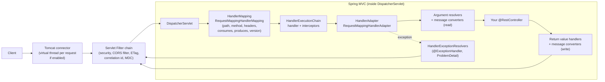
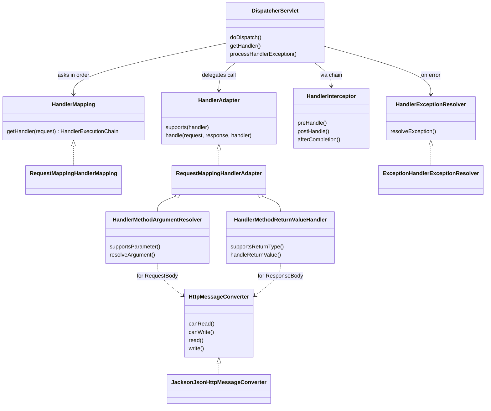
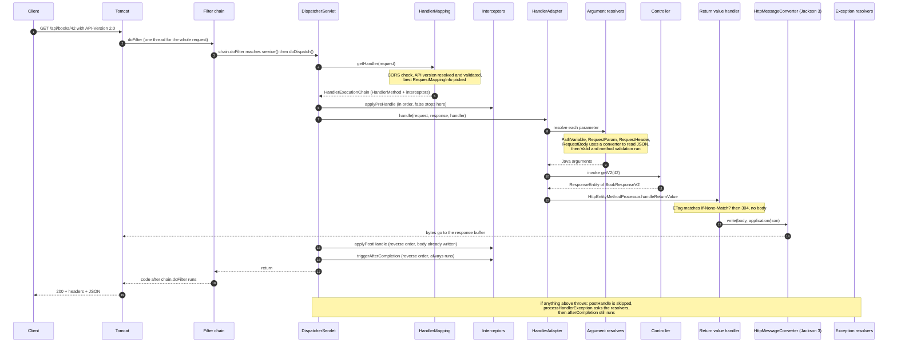
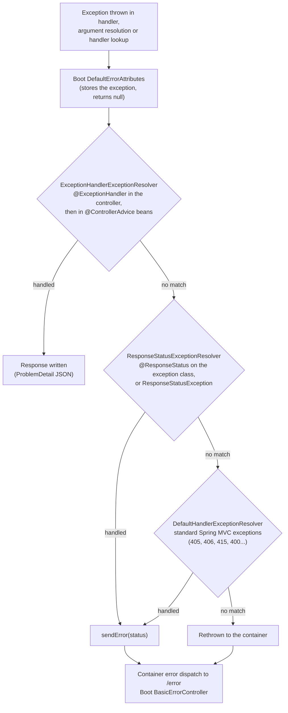
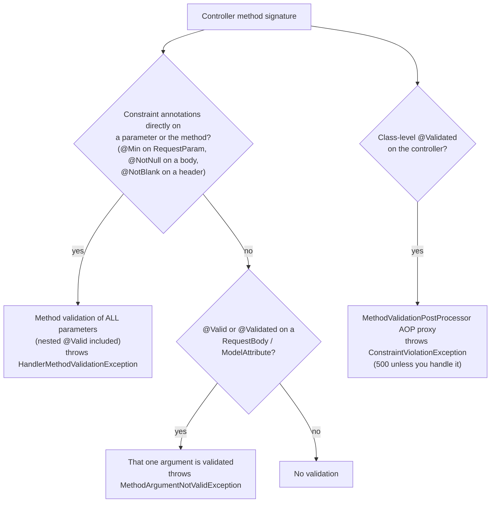
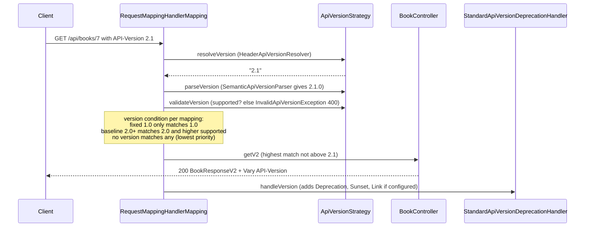
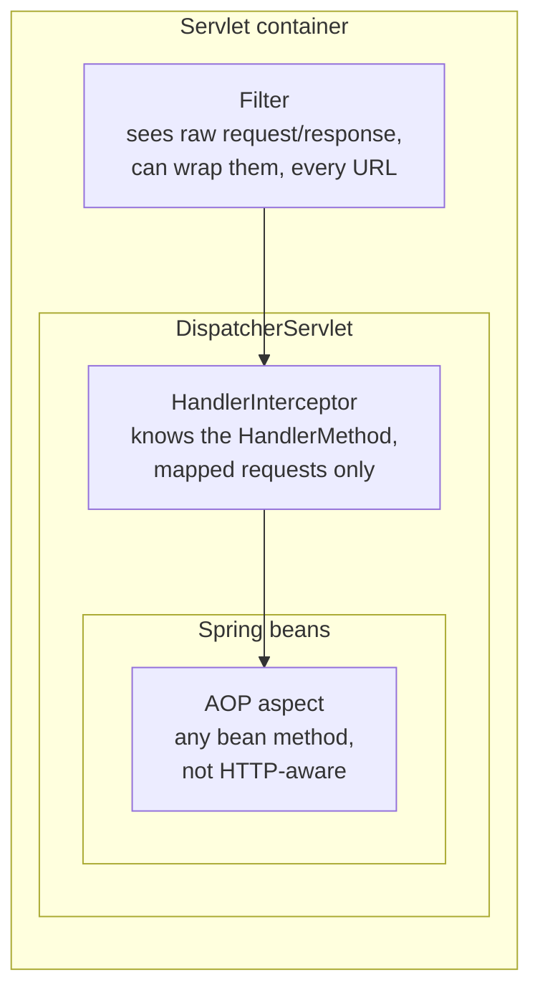
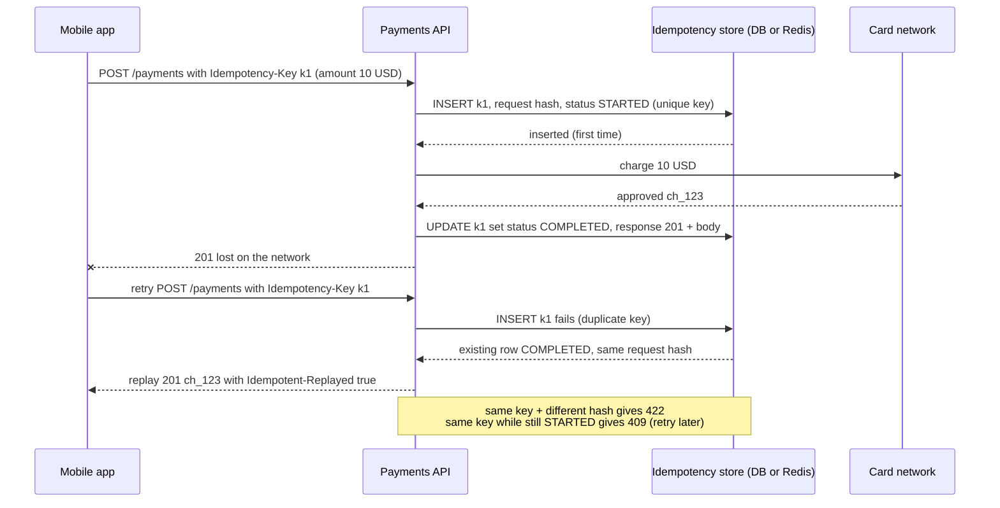
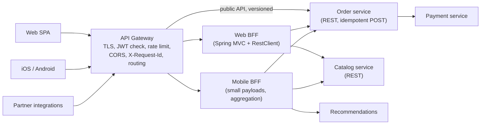
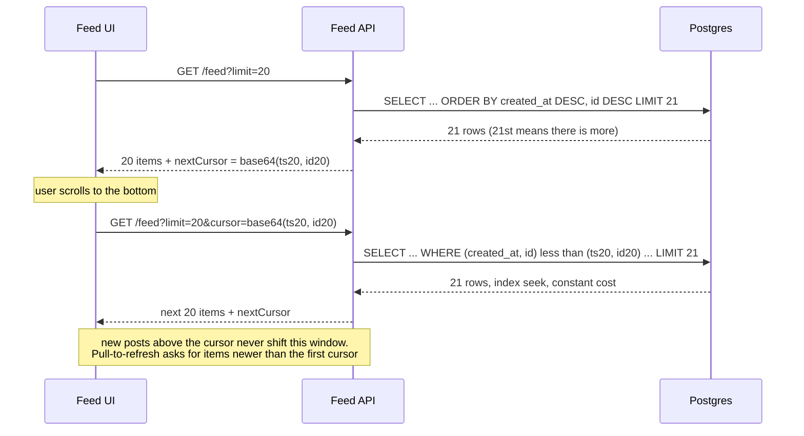

# 05 — Spring Web MVC & REST APIs

> **Lab:** [`labs/05-rest-api`](https://github.com/sumit-mishra-itp/springboot-roadmap/tree/main/labs/05-rest-api)
> **Capstone use:** every HTTP endpoint in both capstones. That covers the products/orders API (ProblemDetail errors, pagination, ETags), the idempotent checkout `POST`, and the versioned public API behind the gateway.
> **Prereqs:** 01 Spring Core (beans, `BeanPostProcessor`), 02 AOP (proxies, needed to compare filters/interceptors/aspects), 03 Boot auto-configuration.

---

## 1. What & why

**Spring Web MVC** is the servlet-based web framework of Spring. A single front controller, the `DispatcherServlet`, receives every request, finds the Java method that should handle it, converts HTTP into Java arguments and converts the return value back into HTTP. **A REST API** built on it is a set of *resources* (`/api/books/42`) manipulated through the *uniform interface* of HTTP methods, status codes and headers.

**Before Spring MVC:**

| Era | How you built an HTTP API | Pain |
|---|---|---|
| Raw Servlets (1997+) | One `HttpServlet` per URL, `doGet`/`doPost`, parse `request.getParameter`, write JSON strings by hand | Routing, parsing, (de)serialization and error handling were copy-pasted in every servlet |
| Struts 1 / WebWork | XML-configured `Action` classes | Actions extended framework classes, XML everywhere, hard to unit test |
| SOAP / JAX-WS | WSDL contracts, XML envelopes, WS-* specs | Heavyweight tooling for simple CRUD, and HTTP was used only as a tunnel |
| JAX-RS (Jersey, RESTEasy) | `@Path`, `@GET` annotated resources | Good, but a separate stack from the Spring container |
| **Spring MVC `@RestController`** | Annotated POJOs, pluggable argument resolvers and message converters, one advice for errors | Testable with `new`, integrated with DI, validation, security and observability |

**When *not* to use Spring MVC REST:**
- **Huge numbers of long-lived, mostly idle connections** (streaming, SSE fan-out to 100k clients). Look at WebFlux (note 13). Virtual threads (section 5.8) shrink this gap for ordinary blocking request/response.
- **Internal, chatty, high-throughput service-to-service calls** with strict contracts. gRPC (HTTP/2 + Protobuf) is smaller and faster.
- **Clients that need to shape their own queries** across many entities (mobile screens that each need different fields). GraphQL (Spring for GraphQL) avoids dozens of bespoke endpoints.
- **Bidirectional real-time** traffic (chat, collaborative editing). Use WebSocket/STOMP.

---

## 2. Mental model

Think of the `DispatcherServlet` as an **airport hub**. Every passenger (request) lands there. **Filters** are the security checkpoint outside the terminal: they see everyone, including people who only came for the shops (static files, error pages). **HandlerMapping** reads the boarding pass and picks a gate (the handler method). **Interceptors** are the gate staff: they only see passengers with a valid gate, and they know which flight it is. The **HandlerAdapter** actually boards the passenger. It uses **argument resolvers** to turn HTTP into Java, calls your method, then **return value handlers** and **HttpMessageConverters** turn the result back into bytes. If anything throws, **exception resolvers** decide what the passenger is told.



**The extension points are all interfaces, so every one of them is replaceable.** This is the type map interviewers probe:



---

## 3. How it works internally

### 3.1 One request, end to end

This is `DispatcherServlet.doDispatch()` and what surrounds it. The filter/interceptor/exception ordering is asserted by the lab's `FilterInterceptorOrderTest`.



**Step by step inside `doDispatch`:**

1. `checkMultipart` wraps multipart requests.
2. `getHandler` iterates the `HandlerMapping` beans by order. `RequestMappingHandlerMapping` (annotated controllers) is consulted before the static-resource mapping. No match gives `NoResourceFoundException`, a 404 (introduced in 6.1, unverified).
3. `getHandlerAdapter` finds the adapter that `supports(handler)`. For `@RequestMapping` methods that is `RequestMappingHandlerAdapter`.
4. `applyPreHandle` calls each interceptor's `preHandle` in registration order. If one returns `false`, the chain stops and `afterCompletion` runs only for the interceptors that already passed.
5. `ha.handle(...)` resolves arguments, invokes the method, and handles the return value. **For `@ResponseBody` / `ResponseEntity` the body is serialized here, inside the adapter.**
6. `applyPostHandle` runs interceptors in **reverse** order. It is skipped if the handler threw.
7. `processDispatchResult` renders a view (not for REST) or, if there was an exception, runs `processHandlerException` through the resolver chain.
8. `triggerAfterCompletion` runs in reverse order. It *always* runs, like a `finally`. Reverse order and the "only for interceptors whose `preHandle` returned `true`" rule come from the [`HandlerInterceptor` javadoc](https://docs.spring.io/spring-framework/docs/current/javadoc-api/org/springframework/web/servlet/HandlerInterceptor.html). The lab (one interceptor) proves the filter/interceptor/exception ordering.

The lab's trace makes this concrete:

```text
GET /api/books (success)                    GET /api/books/424242 (BookNotFoundException)
filter.before                               filter.before
interceptor.preHandle                       interceptor.preHandle
interceptor.postHandle committed=false      @ExceptionHandler          <- postHandle skipped
interceptor.afterCompletion ex=null         interceptor.afterCompletion ex=null   <- resolved, so null
filter.after                                filter.after
```

> **Niche detail, proven by the lab:** `afterCompletion(..., ex)` receives `null` when an `@ExceptionHandler` *resolved* the exception. It only receives the exception if no resolver handled it. If you log errors in `afterCompletion`, you will miss every error your advice handled. Log in the advice instead, or read the `DispatcherServlet.EXCEPTION_ATTRIBUTE` request attribute.

> **Niche detail, proven by the lab:** "you can't add headers in `postHandle` for `@RestController`" is only *half* true. The body is written before `postHandle`, but on Tomcat it sits in an 8 KB response buffer. While the response is uncommitted, a header set in `postHandle` still reaches the client. With a 20 KB body the buffer flushed, the response was committed, and the header was **silently dropped** (`RestApiApplicationTests#headerAddedInPostHandle_survivesOnly...`). Behaviour that depends on payload size is a bug waiting to happen. Set headers in `preHandle`, in a `Filter`, in the controller, or in a `ResponseBodyAdvice`.

### 3.2 Handler lookup: how one method wins

`RequestMappingHandlerMapping` stores a `RequestMappingInfo` per method. Each info is a bundle of **conditions**: patterns, HTTP methods, params, headers, consumes, produces, custom conditions, and (Framework 7) **version**. For a request it:

1. Collects every info whose conditions *all* match.
2. Sorts the matches by specificity: literal paths beat `{variables}`, which beat wildcards. `/api/books/feed` beats `/api/books/{id}`, which is why the lab's feed endpoint works.
3. If the two best are equally specific, it throws `IllegalStateException: Ambiguous handler methods`.
4. If no info matches *only* because of the method, `consumes` or `produces`, you get the precise error: `405 Method Not Allowed` (plus `Allow` header), `415 Unsupported Media Type`, or `406 Not Acceptable`.

Since Framework 6 (per the 6.0 upgrade notes, unverified here), `/api/books/` **does not** match `/api/books` (the trailing-slash match default was flipped to `false`), and Framework 7 removed the option entirely. Canonicalize URLs at the gateway or with a redirect filter if you must support both.

### 3.3 Arguments in, return values out

`RequestMappingHandlerAdapter` holds ~30 `HandlerMethodArgumentResolver`s and ~15 `HandlerMethodReturnValueHandler`s. They are asked in order, and the first that `supports...` wins.

| You write | Resolved / handled by | Notes |
|---|---|---|
| `@PathVariable long id` | `PathVariableMethodArgumentResolver` | Type conversion via `ConversionService`. A bad value gives 400 `MethodArgumentTypeMismatchException` |
| `@RequestParam(defaultValue = "0") int page` | `RequestParamMethodArgumentResolver` | `required = true` by default unless there is a default value or the type is `Optional` |
| `@RequestHeader("Idempotency-Key") String key` | `RequestHeaderMethodArgumentResolver` | Missing and required gives 400 `MissingRequestHeaderException` |
| `@Valid @RequestBody BookRequest req` | `RequestResponseBodyMethodProcessor` | Reads with an `HttpMessageConverter` chosen by `Content-Type`, then validates |
| `UriComponentsBuilder` | `UriComponentsBuilderMethodArgumentResolver` | Pre-filled with scheme/host/port/context path, used to build `Location` |
| `Principal`, `HttpServletRequest`, `Locale` | `ServletRequestMethodArgumentResolver` | |
| Returns a POJO/record in a `@RestController` | `RequestResponseBodyMethodProcessor` | Written with a converter chosen by content negotiation |
| Returns `ResponseEntity` | `HttpEntityMethodProcessor` | Also does **conditional requests**: if the entity has an `ETag`/`Last-Modified` and the request's `If-None-Match` matches, it writes 304 with no body (lab: `conditionalGet_withCurrentEtag_returns304WithoutBody`) |
| Returns `ProblemDetail` | `HttpEntityMethodProcessor` (as an entity) | Status taken from the `ProblemDetail`, content type `application/problem+json` |
| Returns `Callable`, `CompletableFuture`, `DeferredResult`, `SseEmitter` | async handlers | Servlet async: the container thread is released (less important with virtual threads) |

**Content negotiation** decides the response media type:
1. The `ContentNegotiationManager` reads the requested types from the `Accept` header. A query parameter strategy (`?format=json`) is opt-in. Path extensions (`/books.json`) were removed in Framework 7.
2. It intersects them with what the method `produces` and what the converters can write for the return type.
3. No overlap gives **406**. On the way in, a `Content-Type` that no converter can read (or that the method doesn't `consume`) gives **415**.

### 3.4 Exception resolution

When a handler throws, `DispatcherServlet` asks each `HandlerExceptionResolver` in order until one returns a non-null `ModelAndView`. The reference documents the four resolver types but not their default order. The order below is the one `WebMvcConfigurationSupport` registers (unverified from docs). The lab proves only that our `@ExceptionHandler` wins:



- If your `@RestControllerAdvice` **extends `ResponseEntityExceptionHandler`**, it has `@ExceptionHandler` methods for *all* the standard Spring MVC exceptions **and** for any `ErrorResponse`, such as `ResponseStatusException` or the API-versioning exceptions. So `ExceptionHandlerExceptionResolver` handles everything in step one and writes `ProblemDetail` bodies, and the later resolvers never run.
- `@ExceptionHandler` matching picks the **closest exception type** (fewest superclass hops). Handlers in the controller itself beat any advice. Among advices, `@Order` decides.
- Exceptions thrown from a **filter** never reach `@ExceptionHandler` (unverified by the lab, but it follows from the filter running outside the `DispatcherServlet`). They happen outside the `DispatcherServlet`. Spring Security's filter errors are handled by its own `AuthenticationEntryPoint` / `AccessDeniedHandler` (note 07).

### 3.5 Validation: two exceptions, one rule

Since Framework 6.1, Spring MVC has **built-in method validation**. Which exception you get depends on *where* the constraints sit:



| | `MethodArgumentNotValidException` | `HandlerMethodValidationException` |
|---|---|---|
| Trigger | `@Valid @RequestBody`/`@ModelAttribute` with no constraints on the parameters | Any `@Constraint` directly on a method parameter or return value |
| Shape | One object, a `BindingResult` with `FieldError`s | A list of `ParameterValidationResult`, one per parameter, with a `Visitor` API |
| Default status | 400 | 400 (500 if the return value fails) |
| Lab | `create_withInvalidBody_...` | `list_withSizeOver100_isRejectedByBuiltInMethodValidation` |

> **Don't put `@Validated` on the controller class** to "enable" parameter validation. That was the pre-6.1 recipe. It now routes validation through the AOP proxy, which throws `ConstraintViolationException`. `ResponseEntityExceptionHandler` does not map it, so the client gets a **500**. The lab proves this (`RestApiApplicationTests#classLevelValidated_turnsAParameterViolationInto500`). The Spring reference says to *remove* class-level `@Validated` to use the built-in support. Handle **both** exceptions in your advice, because adding one `@NotNull` to a body parameter switches its exception type.

**Validation groups** let one DTO carry different rules per operation:

```java
public interface OnCreate {}
public interface OnUpdate {}

public record ProductRequest(
        @Null(groups = OnCreate.class) @NotNull(groups = OnUpdate.class) Long id,
        @NotBlank(groups = {OnCreate.class, OnUpdate.class}) String name,
        @Positive BigDecimal price) {}                       // Default group only!

@PostMapping
ResponseEntity<ProductResponse> create(@Validated(OnCreate.class) @RequestBody ProductRequest r) { ... }
```

Gotcha: once you name groups, constraints in the `Default` group (no `groups` attribute, like `price` above) are **not** checked unless you also list `Default.class` or make `OnCreate extends Default`. `@Valid` can't take groups. Use Spring's `@Validated(...)`. Many teams find groups confusing and use **separate DTOs per operation** (`CreateProductRequest`, `UpdateProductRequest`) instead, which is often clearer.

**Custom constraint** (lab `@Isbn`): an annotation meta-annotated with `@Constraint(validatedBy = ...)`, declaring `message`, `groups` and `payload`, plus a `ConstraintValidator<A, T>`. Return `true` for `null`, so it composes with `@NotNull`. Validators are created by Spring's `SpringConstraintValidatorFactory`, so they **can** use constructor injection (e.g. a repository for "unique email" checks).

### 3.6 ProblemDetail (RFC 9457) rendering

RFC 9457 (which obsoletes RFC 7807) defines a standard error body with media type `application/problem+json`:

| Member | Meaning | Spring behaviour (lab-verified) |
|---|---|---|
| `type` | URI that identifies the problem *kind*; ideally a docs page | Defaults to `about:blank`, and Spring **omits it from the JSON** when it is `about:blank` (`unsupportedVersion_returns400ProblemDetail`) |
| `title` | Short, human summary of the *type* (stable) | Defaults to the reason phrase (`Bad Request`) |
| `status` | HTTP status, repeated for convenience | Drives the actual response status |
| `detail` | Explanation of *this occurrence* | |
| `instance` | URI of this occurrence | Spring fills it with the request path if you didn't |
| extensions | Any extra members | `problem.setProperty("errors", ...)` is rendered **top-level** by `ProblemDetailJacksonMixin` |

Building blocks: `ProblemDetail` (the body), `ErrorResponse` (status + headers + body contract that *every* Spring MVC exception implements), `ErrorResponseException` (a base class for your own), and `ResponseEntityExceptionHandler` (an advice base class covering all of them). Titles and details can be localized through `MessageSource` codes `problemDetail.title.<exception FQCN>` and `problemDetail.<exception FQCN>`.

Boot also has `spring.mvc.problemdetails.enabled=true`, which registers its *own* `ResponseEntityExceptionHandler` advice. It backs off as soon as you declare yours, so don't use both.

### 3.7 API versioning (Framework 7)



Pieces, all in `org.springframework.web.accept`:
- **`ApiVersionResolver`**: where the version comes from. Built-ins are header, query parameter, media type parameter (`Accept: application/json;v=2`) and path segment (requires a `{version}` URI variable, configured by segment index).
- **`ApiVersionParser`**: `SemanticApiVersionParser` by default, so `2`, `2.0` and `2.0.0` are equal (missing minor/patch become 0). The lab's 400 detail shows the normalised form: `Invalid API version: '9.0.0'.`
- **Validation**: supported versions are the ones declared in mappings (`detectSupportedVersions`, on by default) plus `addSupportedVersions(...)`. Unsupported gives `InvalidApiVersionException` (400). Missing gives `MissingApiVersionException` (400) **unless** you set a default or make it optional. A version that is supported but has no matching mapping gives `NotAcceptableApiVersionException` (400).
- **`ApiVersionDeprecationHandler`**: `StandardApiVersionDeprecationHandler` writes `Deprecation` (RFC 9745, `@<epoch seconds>`), `Sunset` (RFC 8594) and `Link` headers for configured versions.

> **Lab-proven gotcha:** once versioning is enabled it applies to **every** request, not just versioned mappings. Without a default version, unversioned clients, springdoc's `/v3/api-docs` and CORS preflights (browsers never add your custom header to an `OPTIONS` preflight) would all get 400. The lab sets `setDefaultVersion("1.0")`, and `CorsTest` / `RestApiApplicationTests` prove preflight and `/v3/api-docs` still work.

> **Lab-observed detail:** the `Sunset` value came out as `Tue, 1 Jun 2027 00:00:00 GMT`. Strict RFC 9110 IMF-fixdate wants a two-digit day (`01`). Clients that parse leniently won't care, but don't hand-roll a strict parser expecting `01`.

---

## 4. Full worked code

Everything below is from the lab (`./mvnw verify` gives **32 tests, all green**). Package-by-feature: `book/`, `idempotency/`, `web/`.

### 4.1 The controller: status codes, Location, ETag, versions, pagination

```java
@RestController
@RequestMapping("/api/books")
public class BookController {          // NO class-level @Validated, on purpose (section 3.5)

    public static final String IDEMPOTENCY_KEY = "Idempotency-Key";
    public static final String IDEMPOTENT_REPLAYED = "Idempotent-Replayed";

    private final BookService service;

    public BookController(BookService service) { this.service = service; }

    @PostMapping
    public ResponseEntity<BookResponse> create(@Valid @RequestBody BookRequest request,
                                               @RequestHeader(name = IDEMPOTENCY_KEY, required = false) @Nullable String key,
                                               UriComponentsBuilder uriBuilder) {
        Outcome<Book> outcome = service.create(request, key);
        Book book = outcome.value();
        URI location = uriBuilder.path("/api/books/{id}").buildAndExpand(book.id()).toUri();
        return ResponseEntity.created(location)                          // 201 + Location
                .eTag(String.valueOf(book.version()))                    // Spring adds the quotes: "1"
                .header(IDEMPOTENT_REPLAYED, String.valueOf(outcome.replayed()))
                .body(BookResponse.from(book));
    }

    @GetMapping(path = "/{id}", version = "1.0")                         // fixed version
    public ResponseEntity<BookResponse> getV1(@PathVariable long id) {
        Book book = service.find(id);
        return ResponseEntity.ok().eTag(String.valueOf(book.version())).varyBy(WebConfig.API_VERSION)
                .body(BookResponse.from(book));                          // If-None-Match handled for you (304)
    }

    @GetMapping(path = "/{id}", version = "2.0+")                        // baseline: 2.0 and above
    public ResponseEntity<BookResponseV2> getV2(@PathVariable long id) {
        Book book = service.find(id);
        return ResponseEntity.ok().eTag(String.valueOf(book.version())).varyBy(WebConfig.API_VERSION)
                .body(BookResponseV2.from(book));
    }

    @PutMapping("/{id}")                                                 // full replacement, optional If-Match
    public ResponseEntity<BookResponse> replace(@PathVariable long id, @Valid @RequestBody BookRequest request,
                                                @RequestHeader(name = HttpHeaders.IF_MATCH, required = false) @Nullable String ifMatch) {
        Book book = service.replace(id, request, ifMatch == null ? null : parseVersion(ifMatch));
        return ResponseEntity.ok().eTag(String.valueOf(book.version())).body(BookResponse.from(book));
    }

    @DeleteMapping("/{id}")
    public ResponseEntity<Void> delete(@PathVariable long id) {         // 204 every time: idempotent
        service.delete(id);
        return ResponseEntity.noContent().build();
    }

    @GetMapping                                                          // offset pagination
    public PageResponse<BookResponse> list(@RequestParam(defaultValue = "0") @Min(0) int page,
                                           @RequestParam(defaultValue = "20") @Min(1) @Max(100) int size) {
        return service.page(page, size).map(BookResponse::from);
    }

    @GetMapping("/feed")                                                 // cursor (keyset) pagination
    public CursorPage<BookResponse> feed(@RequestParam(required = false) @Nullable String cursor,
                                         @RequestParam(defaultValue = "20") @Min(1) @Max(100) int limit) {
        return service.feed(cursor == null ? 0 : decodeCursor(cursor), limit).map(BookResponse::from);
    }

    private static long decodeCursor(String cursor) {
        try { return Cursor.decode(cursor); }
        catch (IllegalArgumentException ex) {
            throw new ResponseStatusException(HttpStatus.BAD_REQUEST, "Malformed cursor"); // rendered as ProblemDetail
        }
    }

    private static long parseVersion(String ifMatch) {   // "3" -> 3, a weak or garbage tag never matches -> 412
        try { return Long.parseLong(ifMatch.replace("\"", "")); }
        catch (NumberFormatException ex) { return -1; }
    }
}
```

DTOs are records. The request carries the validation, and v1/v2 differ in shape:

```java
public record BookRequest(
        @NotBlank @Size(max = 200) String title,
        @NotBlank String author,
        @NotNull @Isbn String isbn,
        @NotNull @DecimalMin("0.00") @Digits(integer = 6, fraction = 2) BigDecimal price) {
    Book toBook(long id, long version) { return new Book(id, title, author, isbn, price, version); }
}

public record BookResponse(long id, String title, String author, String isbn, BigDecimal price) { ... }        // v1
public record BookResponseV2(long id, String title, String author, String isbn, Money price) {                 // v2
    public record Money(BigDecimal amount, String currency) {}
}
public record PageResponse<T>(List<T> content, int page, int size, long totalElements, int totalPages) { ... }
public record CursorPage<T>(List<T> items, @Nullable String nextCursor) { ... }
```

### 4.2 The custom constraint

```java
@Documented
@Constraint(validatedBy = IsbnValidator.class)
@Target({ElementType.FIELD, ElementType.PARAMETER, ElementType.RECORD_COMPONENT})
@Retention(RetentionPolicy.RUNTIME)
public @interface Isbn {
    String message() default "must be a valid ISBN-13";
    Class<?>[] groups() default {};
    Class<? extends Payload>[] payload() default {};
}

public class IsbnValidator implements ConstraintValidator<Isbn, String> {
    @Override
    public boolean isValid(String value, ConstraintValidatorContext context) {
        if (value == null) return true;                       // @NotNull's job
        String digits = value.replace("-", "");
        if (!digits.matches("\\d{13}")) return false;
        int sum = 0;
        for (int i = 0; i < 13; i++) sum += (digits.charAt(i) - '0') * (i % 2 == 0 ? 1 : 3);
        return sum % 10 == 0;
    }
}
```

### 4.3 One advice for all errors

```java
@RestControllerAdvice
public class ApiExceptionHandler extends ResponseEntityExceptionHandler {

    public static final String PROBLEM_BASE = "https://api.roadmap.dev/problems/";
    public record Violation(String field, String message) {}

    @ExceptionHandler(BookNotFoundException.class)
    ProblemDetail bookNotFound(BookNotFoundException ex, HttpServletRequest request) {
        return problem(request, HttpStatus.NOT_FOUND, "book-not-found", "Book not found", ex.getMessage());
    }

    @ExceptionHandler(StaleVersionException.class)
    ProblemDetail staleVersion(StaleVersionException ex, HttpServletRequest request) {
        return problem(request, HttpStatus.PRECONDITION_FAILED, "stale-version", "Precondition failed", ex.getMessage());
    }

    @ExceptionHandler(IdempotencyKeyReusedException.class)
    ProblemDetail idempotencyKeyReused(IdempotencyKeyReusedException ex, HttpServletRequest request) {
        return problem(request, HttpStatus.UNPROCESSABLE_CONTENT, "idempotency-key-reused", "Idempotency key reused", ex.getMessage());
    }

    @Override   // @Valid @RequestBody failed
    protected ResponseEntity<Object> handleMethodArgumentNotValid(MethodArgumentNotValidException ex, HttpHeaders headers,
                                                                  HttpStatusCode status, WebRequest request) {
        List<Violation> errors = ex.getBindingResult().getFieldErrors().stream()
                .map(error -> new Violation(error.getField(), error.getDefaultMessage()))
                .sorted(Comparator.comparing(Violation::field)).toList();
        return validationProblem(ex, ex.getBody(), errors, headers, status, request);
    }

    @Override   // constraints directly on parameters: built-in method validation
    protected ResponseEntity<Object> handleHandlerMethodValidationException(HandlerMethodValidationException ex, HttpHeaders headers,
                                                                            HttpStatusCode status, WebRequest request) {
        List<Violation> errors = ex.getParameterValidationResults().stream()
                .flatMap(result -> result.getResolvableErrors().stream()
                        .map(error -> new Violation(result.getMethodParameter().getParameterName(), error.getDefaultMessage())))
                .sorted(Comparator.comparing(Violation::field)).toList();
        return validationProblem(ex, ex.getBody(), errors, headers, status, request);
    }

    private ResponseEntity<Object> validationProblem(Exception ex, ProblemDetail body, List<Violation> errors,
                                                     HttpHeaders headers, HttpStatusCode status, WebRequest request) {
        body.setType(URI.create(PROBLEM_BASE + "validation-error"));
        body.setTitle("Validation failed");
        body.setDetail(errors.size() + " invalid value(s)");
        body.setProperty("errors", errors);                   // rendered as a top-level "errors" member
        return handleExceptionInternal(ex, body, headers, status, request);
    }

    private static ProblemDetail problem(HttpServletRequest request, HttpStatus status, String slug, String title, String detail) {
        RequestTraceFilter.record(request, "@ExceptionHandler");      // lab-only trace for the order test
        ProblemDetail problem = ProblemDetail.forStatusAndDetail(status, detail);
        problem.setType(URI.create(PROBLEM_BASE + slug));
        problem.setTitle(title);
        return problem;
    }
}
```

The exact response the lab asserts for an invalid `POST /api/books`:

```json
{
  "type": "https://api.roadmap.dev/problems/validation-error",
  "title": "Validation failed",
  "status": 400,
  "detail": "4 invalid value(s)",
  "instance": "/api/books",
  "errors": [
    {"field": "author", "message": "must not be blank"},
    {"field": "isbn",   "message": "must be a valid ISBN-13"},
    {"field": "price",  "message": "must be greater than or equal to 0.00"},
    {"field": "title",  "message": "must not be blank"}
  ]
}
```

### 4.4 Web configuration: versioning, interceptor, CORS

```java
@Configuration(proxyBeanMethods = false)
@EnableConfigurationProperties(CorsProperties.class)
public class WebConfig implements WebMvcConfigurer {

    public static final String API_VERSION = "API-Version";
    private final CorsProperties cors;

    public WebConfig(CorsProperties cors) { this.cors = cors; }

    @Override
    public void configureApiVersioning(ApiVersionConfigurer configurer) {
        var deprecation = new StandardApiVersionDeprecationHandler();
        deprecation.configureVersion("1.0")
                .setDeprecationDate(ZonedDateTime.parse("2026-06-01T00:00:00Z"))
                .setDeprecationLink(URI.create("https://api.roadmap.dev/docs/migrate-to-v2"))
                .setSunsetDate(ZonedDateTime.parse("2027-06-01T00:00:00Z"));

        configurer.useRequestHeader(API_VERSION)            // or usePathSegment(1), useQueryParam("v"),
                .addSupportedVersions("1.0", "2.0", "2.1")    //    useMediaTypeParameter(mediaType, "v")
                .setDefaultVersion("1.0")
                .setDeprecationHandler(deprecation);
    }

    @Override
    public void addInterceptors(InterceptorRegistry registry) {
        registry.addInterceptor(new RequestTraceInterceptor()).addPathPatterns("/api/**");
    }

    @Override
    public void addCorsMappings(CorsRegistry registry) {
        registry.addMapping("/api/**")
                .allowedOrigins(cors.allowedOrigins().toArray(String[]::new))
                .allowedMethods("GET", "POST", "PUT", "DELETE")
                .allowedHeaders("Content-Type", "If-Match", "If-None-Match", API_VERSION, BookController.IDEMPOTENCY_KEY)
                .exposedHeaders("Location", "ETag", "Deprecation", "Sunset", RequestTraceFilter.REQUEST_ID,
                        BookController.IDEMPOTENT_REPLAYED)
                .maxAge(3600);
    }
}

@Validated
@ConfigurationProperties("app.cors")
public record CorsProperties(@NotEmpty List<String> allowedOrigins) {}
```

Boot's property-only alternative for versioning (no code):

```properties
spring.mvc.apiversion.use.header=API-Version
spring.mvc.apiversion.default=1.0
spring.mvc.apiversion.supported=1.0,2.0
# also: spring.mvc.apiversion.use.query-parameter / .use.path-segment / .use.media-type-parameter,
#       spring.mvc.apiversion.required, spring.mvc.apiversion.detect-supported
```

Declare `ApiVersionResolver`, `ApiVersionParser` or `ApiVersionDeprecationHandler` beans and Boot plugs them in.

### 4.5 Filter vs interceptor (the lab's pair)

```java
@Component
public class RequestTraceFilter extends OncePerRequestFilter {      // servlet level, every request
    @Override
    protected void doFilterInternal(HttpServletRequest request, HttpServletResponse response, FilterChain chain)
            throws ServletException, IOException {
        request.setAttribute(TRACE_ATTRIBUTE, new ArrayList<String>());
        String requestId = request.getHeader(REQUEST_ID) != null ? request.getHeader(REQUEST_ID) : UUID.randomUUID().toString();
        response.setHeader(REQUEST_ID, requestId);    // before the chain: headers freeze once the body is flushed
        MDC.put("requestId", requestId);
        record(request, "filter.before");
        try {
            chain.doFilter(request, response);
        } finally {
            record(request, "filter.after");
            MDC.remove("requestId");                  // threads are reused: always clean up
        }
    }
}

public class RequestTraceInterceptor implements HandlerInterceptor { // MVC level, mapped handlers only
    public boolean preHandle(HttpServletRequest req, HttpServletResponse res, Object handler) {
        RequestTraceFilter.record(req, "interceptor.preHandle");
        return true;
    }
    public void postHandle(HttpServletRequest req, HttpServletResponse res, Object handler, @Nullable ModelAndView mv) {
        RequestTraceFilter.record(req, "interceptor.postHandle committed=" + res.isCommitted());
    }
    public void afterCompletion(HttpServletRequest req, HttpServletResponse res, Object handler, @Nullable Exception ex) {
        RequestTraceFilter.record(req, "interceptor.afterCompletion ex=" + (ex == null ? "null" : ex.getClass().getSimpleName()));
    }
}
```

### 4.6 Idempotency store (Stripe-style)

```java
@Component
public class IdempotencyStore {
    public record Outcome<T>(T value, boolean replayed) {}
    private record Entry(Object fingerprint, Object result) {}

    // ponytail: unbounded, no TTL, single node. Production: Redis SET NX EX or a DB table with a unique key.
    private final Map<String, Entry> entries = new ConcurrentHashMap<>();

    @SuppressWarnings("unchecked")
    public <T> Outcome<T> execute(String key, Object fingerprint, Supplier<T> action) {
        var ranNow = new AtomicBoolean();
        Entry entry = entries.computeIfAbsent(key, k -> {      // atomic per key: concurrent retries run it once
            ranNow.set(true);
            return new Entry(fingerprint, action.get());       // throws? nothing stored, the client may retry
        });
        if (!entry.fingerprint().equals(fingerprint)) {
            throw new IdempotencyKeyReusedException(key);      // same key, different body -> 422
        }
        return new Outcome<>((T) entry.result(), !ranNow.get());
    }
}
```

`IdempotencyStoreTest` fires 32 virtual threads with one key at once and asserts the action ran **exactly once**.

### 4.7 Tests: slices with `MockMvcTester`, end to end with `RestTestClient`

```java
@WebMvcTest(BookController.class)                          // needs spring-boot-starter-webmvc-test in Boot 4
@Import({BookService.class, BookRepository.class, IdempotencyStore.class})
class BookControllerTest {

    @Autowired MockMvcTester mvc;                           // AssertJ-flavoured MockMvc (Framework 6.2+)

    @Test
    void get_unknownId_returns404ProblemDetail() {
        assertThat(mvc.get().uri("/api/books/999999"))
                .hasStatus(HttpStatus.NOT_FOUND)
                .hasContentType(MediaType.APPLICATION_PROBLEM_JSON)
                .bodyJson().isLenientlyEqualTo("""
                        {"type": "https://api.roadmap.dev/problems/book-not-found",
                         "title": "Book not found", "status": 404,
                         "detail": "Book 999999 does not exist", "instance": "/api/books/999999"}""");
    }
}

@SpringBootTest(webEnvironment = SpringBootTest.WebEnvironment.RANDOM_PORT)
@AutoConfigureRestTestClient                                // Boot 4: @SpringBootTest no longer gives you a client
class RestApiApplicationTests {

    @Autowired RestTestClient client;

    @Test
    void retriedPostWithIdempotencyKey_createsExactlyOneBook() {
        long before = totalBooks();
        String key = UUID.randomUUID().toString();
        BookResponse first = createWithKey(key);
        BookResponse retry = createWithKey(key);
        assertThat(retry).isEqualTo(first);
        assertThat(totalBooks()).isEqualTo(before + 1);
    }

    @Test
    void tomcatHandlesRequestsOnVirtualThreads_whenEnabled() {
        client.get().uri("/test/thread").exchange()          // test-only controller reports Thread.isVirtual()
                .expectStatus().isOk()
                .expectBody().jsonPath("$.virtual").isEqualTo(true);
    }
}
```

---

## 5. Gap fillers & niche details

### 5.1 Filter vs HandlerInterceptor vs AOP: when to use each



| | Servlet `Filter` | `HandlerInterceptor` | AOP `@Aspect` |
|---|---|---|---|
| Layer | Servlet container, outside Spring MVC | Inside `DispatcherServlet` | Spring bean proxy (note 02) |
| Sees | Every request: static files, `/error` dispatch, unmapped URLs | Only requests that matched a handler | Method calls on any bean (services, repositories), HTTP or not |
| Knows the handler method? | No | Yes (`HandlerMethod` gives annotations, bean, method) | Yes (`JoinPoint`) |
| Can wrap request/response? | **Yes** (e.g. `ContentCachingRequestWrapper`) | No | No |
| Can stop the request? | Yes (don't call `chain.doFilter`) | Yes (`preHandle` returns `false`) | Yes (throw, or don't `proceed()`) |
| Exceptions reach `@ExceptionHandler`? | **No** | Yes | Yes (if thrown inside a controller call) |
| Typical uses | Security (Spring Security is a filter chain), CORS for all URLs, correlation id/MDC, request logging, gzip, `ShallowEtagHeaderFilter`, rate limiting | Auth checks that need handler annotations, locale/tenant resolution, per-endpoint metrics, API-key checks for some paths | Transactions, caching, retries, auditing service methods, timing business logic |
| Registered via | `@Component` (`OncePerRequestFilter`) or `FilterRegistrationBean` (for URL patterns and order) | `WebMvcConfigurer#addInterceptors` | `@Aspect @Component` |

**Rule of thumb:** if it's about *HTTP bytes* or must cover every URL, use a Filter. If it needs to know *which endpoint* runs, use an interceptor. If it's about *business methods* regardless of how they're called (HTTP, Kafka, scheduler), use AOP.

`OncePerRequestFilter` guarantees one execution per request even across `FORWARD`/`ERROR`/`ASYNC` dispatches. A plain `Filter` registered for all dispatcher types would run again on the `/error` dispatch (unverified by the lab).

### 5.2 `@RestController` vs `@Controller`

`@RestController` = `@Controller` + `@ResponseBody` on every method. With plain `@Controller`, a `String` return value is a **view name** that a `ViewResolver` turns into HTML (Thymeleaf). With `@RestController`, it's the response body, written by `StringHttpMessageConverter`. Mixing the two styles in one class: use `@Controller` and put `@ResponseBody` on the API methods. `@RestControllerAdvice` = `@ControllerAdvice` + `@ResponseBody`.

### 5.3 HTTP semantics that interviews test

**Method properties (RFC 9110):**

| Method | Safe (no state change) | Idempotent (N calls = 1 call) | Typical success |
|---|---|---|---|
| GET / HEAD | Yes | Yes | 200 (304 with validators) |
| OPTIONS | Yes | Yes | 200/204 |
| PUT | No | **Yes** (full replacement) | 200 or 204, 201 if it created |
| DELETE | No | **Yes** (the *state* is the same, even if the 2nd call returns 404) | 204 |
| POST | No | **No**. Make it idempotent with an `Idempotency-Key` (section 7.1) | 201 + `Location`, or 202 for async work |
| PATCH | No | Not guaranteed (`{"op":"add"}` to a list isn't) | 200/204 |

**PUT vs PATCH:** PUT sends the **whole** representation, and missing fields mean "set to null/default". PATCH sends a **change description**. With *JSON Merge Patch* (RFC 7396, `application/merge-patch+json`) the body looks like the resource, and `null` means delete the field. With *JSON Patch* (RFC 6902, `application/json-patch+json`) it is a list of operations (`add`, `remove`, `replace`, `move`, `copy`, `test`). In Java, merge patch with records is easiest by reading into a `JsonNode` (Jackson 3 `tools.jackson.databind.JsonNode`) and applying only the present fields. Distinguishing "absent" from "explicitly null" is exactly why a plain record DTO can't model PATCH directly.

**Status codes worth getting exactly right:**

| Code | Use it when | Common mistake |
|---|---|---|
| 201 Created | POST created a resource. Add `Location` | Returning 200 with no location |
| 202 Accepted | Work queued (async). Return a status URL | Pretending it's done |
| 204 No Content | Success, nothing to return (DELETE) | Sending a body anyway |
| 304 Not Modified | Conditional GET matched | |
| 400 Bad Request | Malformed syntax, failed validation | |
| 401 Unauthorized | **Not authenticated** (missing/invalid credentials), send `WWW-Authenticate` | Using it for "forbidden" |
| 403 Forbidden | Authenticated but **not allowed** | |
| 404 Not Found | No such resource (also used to hide existence from unauthorized users) | |
| 405 / 406 / 415 | Wrong method / can't produce `Accept` / can't consume `Content-Type` | Spring generates these for you |
| 409 Conflict | State conflict (duplicate unique key, concurrent in-flight idempotent request) | |
| 412 Precondition Failed | `If-Match` didn't match (optimistic lock) | Returning 409 for ETag mismatches |
| 422 Unprocessable Content | Syntax fine, semantics wrong (idempotency key reused with another body). RFC 9110 renamed it from "Unprocessable Entity". Spring has `HttpStatus.UNPROCESSABLE_CONTENT` | |
| 428 Precondition Required | You *require* `If-Match` on updates and it was missing | |
| 429 Too Many Requests | Rate limited. Add `Retry-After` | |
| 500 vs 503 | Bug vs temporarily unavailable (add `Retry-After`) | Leaking stack traces in 500 bodies |

**Richardson Maturity Model:** Level 0 is one URL with RPC over POST (SOAP-style). Level 1 adds resources. Level 2 adds HTTP verbs + status codes, which is where nearly all "REST" APIs live, this lab included. Level 3 adds **HATEOAS**: responses carry links (`_links.self`, `_links.cancel`) so clients discover transitions instead of hard-coding URLs. **Spring HATEOAS** provides `EntityModel`, `RepresentationModel`, `WebMvcLinkBuilder.linkTo(methodOn(...))` and HAL rendering. HATEOAS pays off for long-lived public APIs with workflow states (an order that can be `cancel`led only while `PENDING`). Most internal APIs skip it, and that's a defensible answer.

### 5.4 Pagination styles

| Style | Request | How the DB does it | Pros | Cons |
|---|---|---|---|---|
| **Offset** (`page`/`size`) | `?page=3&size=20` | `LIMIT 20 OFFSET 60` | Jump to any page. Total count. Spring Data `Pageable` (note 06) | Deep pages are slow (the DB still walks the skipped rows). Rows shift (duplicates/skips) when data changes between requests. `COUNT(*)` is expensive on big tables |
| **Keyset / cursor** | `?cursor=opaque&limit=20` | `WHERE (created_at, id) < (:c, :id) ORDER BY created_at DESC, id DESC LIMIT 21` | Constant cost at any depth (an index seek). Stable under inserts. Perfect for infinite scroll | No "jump to page 37". Needs a unique, indexed sort key (add `id` as a tie-breaker). Sort order is fixed per cursor |
| **Seek with `Link` headers** | `Link: <...?after=X>; rel="next"` (GitHub) | Either of the above | Body stays a plain array | Clients must parse headers |

Lab: `GET /api/books?page=1&size=2` (offset, with `totalElements`/`totalPages`) and `GET /api/books/feed?cursor=...` (keyset, fetches `limit + 1` rows to know whether there is a next page without a `COUNT`). Make cursors **opaque** (base64). Clients then can't do arithmetic on them, and you can change what's inside later. Spring Data's `Pageable` and `Window`/`ScrollPosition` (keyset scrolling) are covered in note 06.

### 5.5 API versioning strategies

| Strategy | Example | Pros | Cons |
|---|---|---|---|
| URI path | `/api/v2/books/7` | Visible, cache-friendly, trivial to route at gateways, easy in browsers | Not "pure REST" (one resource, many URIs). Clients rewrite URLs |
| Header | `API-Version: 2.0` | Clean URIs, version independent of resource identity | Invisible in logs/links. **You need `Vary: API-Version`** so caches don't mix versions. CORS must allow the header |
| Query param | `?version=2` | Easy to try in a browser | Pollutes resource identity and cache keys |
| Media type | `Accept: application/vnd.acme.book+json;v=2` | Most "RESTful", versions the *representation* | Hardest for clients and tooling |
| No versioning (evolve compatibly) | add fields only, never remove | Zero overhead | Needs discipline (tolerant readers). Breaking changes still need a plan |

Framework 7 supports all four natively (section 3.7), plus deprecation signalling. Whatever you choose, **version only for breaking changes**: removing or renaming fields, changing types (the lab's price went from number to object), or changing semantics. Adding an optional field is not breaking for tolerant readers.

### 5.6 Calling other APIs: `RestClient` and `@HttpExchange` (details in note 14)

```java
// Fluent, synchronous client (Framework 6.1+). Prefer it over RestTemplate (maintenance mode).
RestClient client = restClientBuilder                       // inject Boot's auto-configured RestClient.Builder
        .baseUrl("https://inventory.internal")
        .apiVersionInserter(ApiVersionInserter.useHeader("API-Version"))   // Framework 7 client-side versioning
        .build();

StockLevel stock = client.get().uri("/stock/{sku}", sku).apiVersion("2.0")
        .retrieve()
        .onStatus(HttpStatusCode::is4xxClientError, (req, res) -> { throw new StockLookupException(res.getStatusCode()); })
        .body(StockLevel.class);

// Declarative HTTP interface client: Spring generates the implementation
@HttpExchange("/stock")
public interface InventoryClient {
    @GetExchange("/{sku}")
    StockLevel stock(@PathVariable String sku);
}

// Boot 4: register interface clients by group and configure them with properties
@SpringBootApplication
@ImportHttpServices(group = "inventory", types = InventoryClient.class)
public class App {}
// spring.http.serviceclient.inventory.base-url=https://inventory.internal
```

The lab's end-to-end test uses exactly this `RestClient` + `ApiVersionInserter` combination against the running app. Timeouts, retries and circuit breakers for these clients (Resilience4j, Framework 7 `@Retryable` in `org.springframework.resilience.annotation`, enabled with `@EnableResilientMethods`) are in note 14. Note: Boot's server-side `spring.mvc.apiversion.*` settings are *not* applied to clients. Configure the inserter explicitly.

### 5.7 More details tutorials skip

- **`ETag` quoting:** `ResponseEntity.eTag("1")` emits `"1"` (quoted, per RFC 9110). Weak ETags (`W/"1"`) are fine for `If-None-Match` (weak comparison) but **never** match `If-Match` (strong comparison).
- **`ShallowEtagHeaderFilter`** computes an MD5 ETag from the response bytes and returns 304 when it matches. It saves *bandwidth*, not *server work*, because the controller still ran and serialized everything. A version-based ETag (the lab) can skip work, and it also enables `If-Match` concurrency control.
- **`Vary`** must list every request header that changes the representation (`Accept`, `API-Version`, `Accept-Language`). Spring's CORS support already adds `Vary: Origin` (the lab saw `Origin` as the first value, and the preflight-related values are unverified), and `varyBy(...)` appends to it (lab: `version2_0_returnsNewShape_...`).
- **CORS is a browser feature.** curl and server-to-server calls ignore it. Preflight `OPTIONS` requests carry *no* custom headers or credentials. With Spring Security, CORS must run **before** authentication (`http.cors(...)`), or preflights get 401 (note 07). `allowedOrigins("*")` cannot be combined with `allowCredentials(true)`. Use `allowedOriginPatterns`. Without `exposedHeaders`, browser JS can't read `Location`, `ETag` or your custom headers.
- **`Location` header:** build it from the injected `UriComponentsBuilder` or `ServletUriComponentsBuilder.fromCurrentRequest()`. Behind a proxy, set `server.forward-headers-strategy=framework` (or `native`) so `X-Forwarded-Host/Proto` produce the public URL, not `http://10.0.3.7:8080`.
- **`@RequestParam` on a `record`?** No, records bind with `@ModelAttribute` (constructor binding), which is handy for search filters: `list(@Valid BookFilter filter)`.
- **Never return entities.** Lazy-loading exceptions, accidental field exposure (password hashes) and infinite recursion. Records at the boundary, mapped with plain methods.
- **springdoc + versioning:** springdoc 3.2.0 merged the lab's v1 and v2 mappings into **one** operation for `/api/books/{id}`, with an `API-Version` header parameter (enum `2.0`, `1.0`) and a `oneOf` response schema (observed via `/v3/api-docs`). springdoc **3.x** is the Boot 4 line. 2.x targets Boot 3. Initializr pins the version explicitly because the Boot BOM doesn't manage it. Disable it in prod with `springdoc.api-docs.enabled=false` / `springdoc.swagger-ui.enabled=false` if the API is private.
- **Error details:** Boot's `server.error.include-stacktrace`, `include-message` and `include-binding-errors` only affect the `/error` fallback, not your ProblemDetail advice. Never put stack traces in API errors.
- **Jackson 3 sorts properties alphabetically by default.** The lab's ProblemDetail JSON came out as `detail, instance, status, title`. Records keep their component order (creator properties are sorted first). Don't write tests that depend on field order. Use `isLenientlyEqualTo`/JSON path.

### 5.8 Virtual threads with Tomcat

`spring.threads.virtual.enabled=true` (Java 21+) makes Boot run Tomcat's request handling on **virtual threads**. The lab proves it with a probe endpoint returning `Thread.currentThread().isVirtual() == true` over real HTTP. It also switches the auto-configured `AsyncTaskExecutor` (`@Async`, MVC async) and the scheduler to virtual-thread variants.

What changes:
- **Thread-per-request without the 200-thread ceiling.** A request blocked on JDBC or `RestClient` parks its virtual thread and frees the carrier. Thread-pool properties such as `server.tomcat.threads.max` **no longer have any effect** (Boot docs).
- **The bottleneck moves downstream.** 10,000 concurrent virtual threads will queue on a 10-connection Hikari pool, so size pools deliberately and add bulkheads (Framework 7 `@ConcurrencyLimit` from `org.springframework.resilience.annotation`, which needs `@EnableResilientMethods` because Boot does not auto-enable it) or rate limits.
- **Pinning:** on Java 21–23, blocking inside `synchronized` pins the carrier thread. JDK 24 (JEP 491) fixed that, which is why the Boot docs strongly recommend Java 24+. Native code and some JDK internals can still pin. Detect it with JFR `jdk.VirtualThreadPinned`.
- **`ThreadLocal`s still work** but are per virtual thread, and expensive caches stored in them are created once per request. Clean up MDC (the lab's filter does).
- **Virtual threads are daemon threads.** If nothing else keeps the JVM alive (for example, an app with only `@Scheduled` work), set `spring.main.keep-alive=true`.

### 5.9 Jackson 3 in Boot 4

- Packages moved from `com.fasterxml.jackson` to **`tools.jackson`** (`tools.jackson.databind.json.JsonMapper`, `tools.jackson.databind.JsonNode`). **Annotations stay** in `com.fasterxml.jackson.annotation` (`@JsonProperty`, `@JsonIgnore`, `@JsonView`).
- Boot auto-configures a **`JsonMapper`** (immutable, builder-based). Defining an `ObjectMapper` bean no longer replaces it. Define a `JsonMapper` bean, or customize with **`JsonMapperBuilderCustomizer`** (replaces `Jackson2ObjectMapperBuilderCustomizer`).
- `@JsonComponent` became **`@JacksonComponent`**, and `@JsonMixin` became **`@JacksonMixin`**. JSON-specific `spring.jackson.read.*` / `spring.jackson.write.*` moved to `spring.jackson.json.read.*` / `spring.jackson.json.write.*`.
- Exceptions are **unchecked**: `JsonProcessingException` became `JacksonException`.
- Changed Jackson defaults include: dates as ISO strings (`WRITE_DATES_AS_TIMESTAMPS` off), `FAIL_ON_UNKNOWN_PROPERTIES` off, `SORT_PROPERTIES_ALPHABETICALLY` on, `FAIL_ON_NULL_FOR_PRIMITIVES` on, and `java.time` support built in (no `jsr310` module).
- The MVC converter is `JacksonJsonHttpMessageConverter`. Customize converters with `ServerHttpMessageConvertersCustomizer` / `ClientHttpMessageConvertersCustomizer` beans, or `WebMvcConfigurer#configureMessageConverters(HttpMessageConverters.ServerBuilder)`. Boot's own `HttpMessageConverters` bean is deprecated.
- Jackson 2 still works through the deprecated `spring-boot-jackson2` module (`spring.jackson2.*`), as a migration bridge only.

---

## 6. Boot 4 / Framework 7 delta

Sources: [Spring Framework 7.0 Release Notes](https://github.com/spring-projects/spring-framework/wiki/Spring-Framework-7.0-Release-Notes), [Spring Boot 4.0 Migration Guide](https://github.com/spring-projects/spring-boot/wiki/Spring-Boot-4.0-Migration-Guide), [API Versioning reference](https://docs.spring.io/spring-framework/reference/web/webmvc-versioning.html).

| Change | Status | What it means for you |
|---|---|---|
| **First-class API versioning** (`ApiVersionConfigurer`, `@RequestMapping(version = ...)`, `ApiVersionStrategy`, deprecation handler, client `ApiVersionInserter`) | **New** | Remove hand-rolled custom `RequestCondition`s and `/v1` controller duplication. Boot: `spring.mvc.apiversion.*` |
| **Jackson 3** default (`tools.jackson`), Jackson 2 deprecated | **Changed** | Update imports, `JsonMapper` instead of `ObjectMapper` beans, `@JacksonComponent`, moved properties |
| `HttpMessageConverters` centralized in Framework. `configureMessageConverters` takes a `ServerBuilder`. Boot's `HttpMessageConverters` deprecated | **Changed** | Customize via `ServerHttpMessageConvertersCustomizer`. Converter beans aren't auto-added the old way |
| HTTP interface client groups: `@ImportHttpServices`, `spring.http.serviceclient.<group>.*` | **New** | Declarative clients without hand-built `HttpServiceProxyFactory` |
| `RestTestClient` (`@AutoConfigureRestTestClient`) | **New** | Blocking twin of `WebTestClient`. Prefer it over `TestRestTemplate` |
| `@SpringBootTest` no longer provides MockMvc/`TestRestTemplate`/`WebTestClient` | **Changed** | Add `@AutoConfigureMockMvc` / `@AutoConfigureRestTestClient` |
| `spring-boot-starter-web` → **`spring-boot-starter-webmvc`**, tests need **`spring-boot-starter-webmvc-test`** | **Renamed / modular** | Initializr's `web` id already generates the new names |
| Path matching: `suffixPatternMatch`, `trailingSlashMatch`, `favorPathExtension` **removed**. `AntPathMatcher` for MVC deprecated | **Removed** | `/books.json` and `/books/` no longer match. Use `PathPatternParser` semantics |
| `HttpHeaders` no longer a `MultiValueMap` | **Changed** | Code that treated headers as a map needs updating |
| `ListenableFuture` removed | **Removed** | Use `CompletableFuture` return types |
| springdoc **3.x** for Boot 4 | **Ecosystem** | 2.x is the Boot 3 line. Lab uses 3.2.0 |

> ⚠️ **Outdated advice still common in tutorials and Baeldung articles:**
> - "Add `@Validated` to the controller to validate `@RequestParam`": since 6.1 that switches you to the AOP path. Remove it (section 3.5).
> - "Use `RestTemplate`": it is in maintenance mode. Use `RestClient` or `@HttpExchange` clients.
> - Custom `RequestCondition` / `RequestMappingHandlerMapping` subclasses for versioning: use the built-in `version` attribute.
> - `import com.fasterxml.jackson.databind.ObjectMapper` and `Jackson2ObjectMapperBuilderCustomizer`: Jackson 3 uses `tools.jackson` and `JsonMapperBuilderCustomizer`.
> - Hand-built error DTOs (`{"timestamp", "error", "message"}`): use `ProblemDetail`.
> - `@MockBean` in `@WebMvcTest`: removed. Use `@MockitoBean`.
> - `TestRestTemplate` auto-injected in `@SpringBootTest`: no longer. Use `@AutoConfigureRestTestClient`.
> - "Tune `server.tomcat.threads.max` for throughput": with virtual threads enabled it has no effect.

---

## 7. Real-life architecture solutions

### 7.1 Stripe-style idempotency keys for payments

**Problem:** a mobile client sends `POST /payments`. The request reaches the server, the card is charged, but the response is lost (a tunnel, a timeout, a load balancer reset). The client can't tell "never arrived" from "succeeded, reply lost". Retrying blindly **charges twice**. Not retrying loses sales.

**Solution:** the client generates a unique key (a V4 UUID) per *logical* operation and sends it as `Idempotency-Key` on the first attempt **and every retry**. The server records the key atomically before doing the work, stores the final status code and body, and replays them for any retry. A retry with the same key but a different body is a client bug and is rejected.



Production-grade storage (the lab's `ConcurrentHashMap` is single-node only):

```sql
CREATE TABLE idempotency_key (
  account_id     BIGINT       NOT NULL,           -- scope keys per client/account
  key            VARCHAR(255) NOT NULL,
  request_hash   CHAR(64)     NOT NULL,           -- SHA-256 of method + path + canonical body
  status         VARCHAR(16)  NOT NULL,           -- STARTED | COMPLETED
  response_code  INT,
  response_body  JSONB,
  created_at     TIMESTAMPTZ  NOT NULL DEFAULT now(),
  PRIMARY KEY (account_id, key)
);
-- a sweeper deletes rows older than 24h
```

Write the key row **in the same DB transaction** as the business change (the payment row). Then "recorded the key" and "did the work" can't diverge. With Redis, `SET key value NX EX 86400` gives the atomic claim, but the business write lives elsewhere, so you need the STARTED/COMPLETED state machine and a recovery path.

**Trade-offs:**
- **Pros:** safe client retries, simple client logic, and it composes with automatic retry in SDKs and gateways.
- **Cons:** storage and a sweeper. You must decide what to do with in-flight duplicates. Stripe returns an error for a concurrent request. The lab's `computeIfAbsent` makes the second caller *wait* and then replay, which is fine in one JVM but would hold connections in a cluster. You must also decide whether to cache failures. Stripe v1 replays even 500s, but doesn't save requests that failed validation or never started executing.
- The IETF *Idempotency-Key HTTP header* draft standardizes the header and suggests (unverified) 400 for a missing key, 409 for a concurrent duplicate, and 422 for reuse with a different payload.

**Who uses it** (only the Stripe details are sourced, the rest is industry knowledge): Stripe (`Idempotency-Key`, keys up to 255 chars, prunable after 24h), Adyen, Square, PayPal (`PayPal-Request-Id`), and AWS APIs (`ClientToken` on EC2/ECS create calls). Kafka consumers apply the same idea with a processed-message table (note 11).

### 7.2 API gateway + Backend-for-Frontend in front of REST services

**Problem:** a web SPA, an iOS app and partners all call ten microservices. Each client re-implements auth, aggregates five calls per screen over slow mobile networks, and breaks whenever a service changes. Cross-cutting concerns (TLS, rate limits, JWT validation, CORS, versioning) are duplicated in every service.

**Solution:** an **API gateway** at the edge handles routing, TLS, authentication, rate limiting, request IDs and coarse versioning. Behind it, a **BFF per client type** (web BFF, mobile BFF) aggregates and shapes data for that UI, so a screen needs one round trip. Domain services stay generic REST APIs.



How this note's tools map onto it:
- **Gateway:** CORS and correlation IDs live here once (Spring Cloud Gateway, note 14), and services trust `X-Request-Id`.
- **BFF:** calls services in parallel with `RestClient`/`@HttpExchange` on virtual threads, simple blocking code with high concurrency. It translates errors into one `ProblemDetail` style for the UI.
- **Services:** return `ProblemDetail`, use Framework 7 versioning for breaking changes, and paginate every collection.

**Trade-offs:**
- **Pros:** UI-optimized payloads, fewer round trips on mobile, services decoupled from client release cycles, security enforced at one edge.
- **Cons:** more deployables, BFF logic can duplicate across BFFs, the gateway becomes a critical single point (run it HA), and there are extra network hops (latency budget). Don't put business rules in the gateway.

**Who uses it** (industry knowledge, unverified): SoundCloud popularized the BFF pattern. Netflix ran device-specific API adapters behind its Zuul gateway. Most e-commerce and banking platforms run a gateway (Kong, Apigee, AWS API Gateway, Spring Cloud Gateway) plus web/mobile BFFs.

### 7.3 Cursor pagination for an infinite feed

**Problem:** a social or news feed scrolls forever. With `?page=N`, deep pages get slower (`OFFSET 100000` still walks 100k index entries), and new posts arriving at the top shift everything down. Users see **duplicates** and **miss** posts.

**Solution:** keyset pagination on an indexed, unique sort key. The cursor encodes the last item seen (`createdAt`, `id`). Each page is an index seek, `WHERE (created_at, id) < (:ts, :id) ORDER BY created_at DESC, id DESC LIMIT :n+1`, so it costs the same at depth 10 or 10,000, and inserts above the cursor don't shift the window.



**Trade-offs:**
- **Pros:** O(page size) per request, no duplicates/skips, no `COUNT(*)`, and cursors are cache-friendly.
- **Cons:** no random access ("page 37"), no exact total (show "1k+"), the sort key must be unique (add `id` as a tie-breaker) and indexed in the same order, and changing the sort order needs a different cursor. Deleted items simply disappear, which is fine for feeds.
- Keep cursors **opaque** (base64 or encrypted) and validate them (the lab returns a 400 ProblemDetail for a malformed cursor). Consider signing them if they carry filters.

**Who uses it:** Twitter/X, Instagram, Facebook Graph API (`after`/`before` cursors), Slack Web API (`next_cursor`), Stripe list endpoints (`starting_after`), and GitHub (`Link` headers). Spring Data's `Window`/`ScrollPosition.keyset()` implements it for JPA (note 06).

---

## 8. Pitfalls & debugging checklist

- [ ] **400 with "Required request header 'API-Version' ..." or `MissingApiVersionException` everywhere after enabling versioning**: no default version. Set `setDefaultVersion` / `spring.mvc.apiversion.default`, or make it optional (section 3.7).
- [ ] **Swagger UI or CORS preflight breaks after enabling versioning**: same cause. Preflights never carry your custom header.
- [ ] **Validation annotations ignored on `@RequestBody`**: missing `@Valid`, or `spring-boot-starter-validation` isn't on the classpath (it is not part of the webmvc starter).
- [ ] **`ConstraintViolationException` → 500 for a bad `@RequestParam`**: a class-level `@Validated` is routing you through AOP. Remove it, or handle the exception.
- [ ] **ProblemDetail has no field errors**: the defaults don't include them. Override `handleMethodArgumentNotValid` **and** `handleHandlerMethodValidationException`.
- [ ] **Your `@ExceptionHandler` never fires**: the exception is thrown in a **filter** (outside MVC), or another advice with higher precedence handles it first, or a closer exception-type match exists. Check `@Order` on advices.
- [ ] **Error logs missing in `afterCompletion`**: `ex` is `null` for resolved exceptions (lab-proven). Log in the advice.
- [ ] **Header set in `postHandle` sometimes missing**: the body was flushed before `postHandle` (lab-proven above 8 KB). Set it earlier.
- [ ] **406 Not Acceptable**: the client's `Accept` (e.g. `application/xml`) has no converter, or `produces` excludes it. **415**: the `Content-Type` is missing or wrong (e.g. form-encoded sent to a JSON endpoint).
- [ ] **CORS works in curl but not the browser**: CORS is browser-only. Check the preflight response for `Access-Control-Allow-Origin`, allowed headers (including `Idempotency-Key`, `API-Version`) and exposed headers. With Spring Security, enable `http.cors(...)`.
- [ ] **`Location` shows an internal host/port**: set `server.forward-headers-strategy`.
- [ ] **`/books/` returns 404 after upgrading**: trailing-slash matching is gone in Framework 7.
- [ ] **Jackson `ClassNotFoundException: com.fasterxml.jackson.databind...` or customizations ignored**: you're mixing Jackson 2 APIs with Boot 4. Move to `tools.jackson` and `JsonMapperBuilderCustomizer`.
- [ ] **Tests assert JSON field order and fail after the upgrade**: Jackson 3 sorts properties alphabetically. Assert by path or with lenient comparison.
- [ ] **`@WebMvcTest` fails with `NoSuchBeanDefinitionException` for a service**: slices don't scan `@Service`. `@Import` it or `@MockitoBean` it. Missing `MockMvcTester`/slice annotations: add `spring-boot-starter-webmvc-test`.
- [ ] **Duplicate orders on client retries**: POST without idempotency keys. Add them (section 7.1).
- [ ] **Lost updates when two admins edit the same record**: no `If-Match`/version check. Use ETag + 412 (lab) or JPA `@Version` (note 06).
- [ ] **Virtual threads enabled but throughput flat**: the DB pool or a downstream service is the bottleneck, or threads are pinned (JFR `jdk.VirtualThreadPinned`). Size pools and add limits.
- [ ] **Debugging tools:**
  - `logging.level.org.springframework.web=DEBUG` shows mapping, negotiation and resolved exceptions;
  - `/actuator/mappings` lists every handler with its conditions;
  - MockMvc `.andDo(print())` or `MockMvcTester` failure output dumps the full request and response.

---

## 9. Interview questions

<details><summary>Q1. Walk me through what happens when a request hits a Spring MVC application.</summary>

Tomcat accepts the connection and runs the servlet **filter chain** (security, CORS, logging), which ends in the `DispatcherServlet`. `doDispatch` then:
1. Asks each `HandlerMapping` for a handler. `RequestMappingHandlerMapping` matches the path, method, headers, consumes/produces and (Framework 7) API version, and returns a `HandlerExecutionChain` (the `HandlerMethod` plus interceptors).
2. Finds a `HandlerAdapter` (`RequestMappingHandlerAdapter`).
3. Runs interceptor `preHandle`s.
4. The adapter resolves arguments with `HandlerMethodArgumentResolver`s. `@RequestBody` uses an `HttpMessageConverter` (Jackson 3), followed by validation. It invokes the controller and handles the return value with a `HandlerMethodReturnValueHandler`, which for `@ResponseBody`/`ResponseEntity` serializes the body through a converter chosen by content negotiation.
5. Runs `postHandle` (reverse order). It is skipped on exceptions.
6. On an exception, the `HandlerExceptionResolver` chain runs (`@ExceptionHandler` / `@ControllerAdvice` first).
7. Runs `afterCompletion` (always, reverse order).

Then control returns through the filters.
</details>

<details><summary>Q2. Filter vs HandlerInterceptor vs AOP: when do you use each?</summary>

A **Filter** is servlet-level. It sees every request, including static resources and error dispatches, can wrap the request/response, and runs outside Spring MVC (its exceptions don't reach `@ExceptionHandler`). Use it for security, CORS, correlation IDs/MDC, compression and request logging.

An **interceptor** runs inside the `DispatcherServlet` only for mapped requests, and knows the `HandlerMethod` (so it can read annotations). Use it for endpoint-aware checks, locale/tenant resolution and per-endpoint metrics.

**AOP** wraps bean methods regardless of the caller (HTTP, messaging, schedulers). Use it for transactions, caching, retries and auditing business methods.

Order for a request: filter → interceptor → (aspect around the controller/service) → back out.
</details>

<details><summary>Q3. @Controller vs @RestController, and how does a returned object become JSON?</summary>

`@RestController` is `@Controller` plus `@ResponseBody` on all methods. With `@Controller`, a `String` is a view name. With `@RestController`, the return value is written to the body. `RequestResponseBodyMethodProcessor` (or `HttpEntityMethodProcessor` for `ResponseEntity`) runs content negotiation: it takes the `Accept` header, intersects it with `produces` and the converters that can write the type, picks a media type, and calls that `HttpMessageConverter`. For JSON in Boot 4 that is `JacksonJsonHttpMessageConverter`, backed by Jackson 3's `JsonMapper`. No acceptable match gives 406.
</details>

<details><summary>Q4. MethodArgumentNotValidException vs HandlerMethodValidationException?</summary>

`MethodArgumentNotValidException` is thrown when a single `@Valid @RequestBody`/`@ModelAttribute` argument fails, and the method has no constraint annotations directly on its parameters. It carries a `BindingResult`. `HandlerMethodValidationException` comes from Spring MVC's built-in **method validation** (6.1+). It's triggered when any `@Constraint` (`@Min`, `@NotBlank`, `@NotNull`...) sits directly on a parameter or the return value. It validates all parameters, including nested `@Valid` ones, and carries a list of `ParameterValidationResult`s. Handle both, because adding `@NotNull` to a body parameter switches which one you get. Don't put class-level `@Validated` on controllers. That uses the AOP `MethodValidationPostProcessor` and throws `ConstraintViolationException` instead.
</details>

<details><summary>Q5. What is ProblemDetail and how do you implement consistent errors?</summary>

`ProblemDetail` is Spring's model of **RFC 9457** (which obsoletes 7807): `type`, `title`, `status`, `detail`, `instance`, plus extension members, served as `application/problem+json`. All Spring MVC exceptions implement `ErrorResponse`. Create **one** `@RestControllerAdvice` that extends `ResponseEntityExceptionHandler`. That gives ProblemDetail bodies for every framework exception. Add `@ExceptionHandler` methods for domain exceptions that return a `ProblemDetail` with a meaningful `type` URI, and override the validation handlers to add field errors as an extension property (rendered top-level). Keep controllers free of try/catch. Spring fills `instance` with the request path and omits `type` when it is `about:blank`.
</details>

<details><summary>Q6. PUT vs PATCH vs POST? Which are idempotent and why does it matter?</summary>

POST creates or triggers processing and is **not idempotent**: two calls may create two resources. PUT replaces the full representation at a known URI and is **idempotent**: N identical PUTs leave the same state. PATCH applies a partial change (JSON Merge Patch RFC 7396 or JSON Patch RFC 6902) and is not guaranteed idempotent. DELETE is idempotent (same final state, even if the second call returns 404/204). GET/HEAD/OPTIONS are **safe** and idempotent.

It matters because clients, proxies and gateways may **automatically retry** idempotent requests after timeouts, but must not blindly retry POST. That's why payment POSTs need idempotency keys.
</details>

<details><summary>Q7. How would you make POST /payments safe to retry?</summary>

Use an **idempotency key**. The client sends a unique `Idempotency-Key` (a UUID) per logical operation, the same on every retry. The server atomically claims the key (unique constraint or `SET NX`), scoped per account, together with a hash of the request. It performs the work, stores the response code and body, and replays them for retries (`Idempotent-Replayed: true`). Same key with a different body gives 422. Same key while the first is still running gives 409 (or wait and replay). Keys expire after ~24h. Ideally the key row is written in the same DB transaction as the payment, so they can't diverge. That's Stripe's design (section 7.1).
</details>

<details><summary>Q8. Explain ETags and conditional requests. How do they prevent lost updates?</summary>

An `ETag` is a validator for a representation (a hash or a version). On **GET**, the client sends `If-None-Match: "3"`. If it is unchanged the server returns **304** with no body, which saves bandwidth. In Spring, returning `ResponseEntity.ok().eTag(...)` makes `HttpEntityMethodProcessor` do this automatically. `ShallowEtagHeaderFilter` does it generically by hashing the body, but the controller still runs.

On **PUT/PATCH**, the client sends `If-Match: "3"`. The server applies the change only if the current version is still 3, otherwise it returns **412 Precondition Failed**. That's optimistic concurrency over HTTP. It prevents two editors overwriting each other's changes (lost update), and it maps naturally onto JPA `@Version`. You can require it with 428. Weak ETags (`W/`) never match `If-Match`.
</details>

<details><summary>Q9. Offset vs cursor pagination: which would you choose for an infinite feed and why?</summary>

Offset (`LIMIT/OFFSET`) allows random page access and totals, but deep pages get slower because the DB walks skipped rows. Rows also shift when data changes, causing duplicates or misses, and `COUNT(*)` is costly. Cursor/keyset pagination uses `WHERE (sort_key, id) < (:last) ORDER BY ... LIMIT n+1`. It's an index seek with constant cost, it's stable under inserts, and it needs no count. For an infinite feed, choose **cursor**, with an opaque cursor and a unique tie-breaker. Use offset for admin tables that need "page 7 of 12".
</details>

<details><summary>Q10. How do you version a REST API, and what does Spring Framework 7 add?</summary>

There are four strategies: URI path (`/v2/...`), header (`API-Version: 2`), query param, and media-type parameter. Version **only on breaking changes**. Framework 7 adds first-class support:
- `WebMvcConfigurer#configureApiVersioning` (or `spring.mvc.apiversion.*`) chooses the resolver.
- `@GetMapping(version = "1.0")` gives a fixed match, `"2.0+"` a baseline (that version and higher supported ones), and no version matches any.
- Versions are parsed semantically.
- Unsupported versions give 400 `InvalidApiVersionException`, and a missing version gives 400 unless you set a default.
- `StandardApiVersionDeprecationHandler` emits `Deprecation`/`Sunset`/`Link` headers.
- Clients use `ApiVersionInserter` on `RestClient`/`WebClient`.

With header versioning, add `Vary: API-Version` and allow the header in CORS.
</details>

<details><summary>Q11. Can you modify response headers in HandlerInterceptor.postHandle?</summary>

Not reliably for `@ResponseBody`/`ResponseEntity`. The body is written inside the `HandlerAdapter`, *before* `postHandle`. If the body overflowed the container's buffer (Tomcat's default is 8 KB), the response is already committed and your header is silently dropped. If it's small and still buffered, the header goes out. The lab proves both cases. That size-dependent behaviour is a trap. Set headers in `preHandle`, a `Filter`, the controller, or a `ResponseBodyAdvice` (which runs just before the converter writes).
</details>

<details><summary>Q12. What is the Richardson Maturity Model, and do you need HATEOAS?</summary>

The levels are:
- 0: one endpoint, RPC style.
- 1: resources.
- 2: HTTP verbs + status codes.
- 3: hypermedia controls (HATEOAS), where responses include links that describe available state transitions.

Most production APIs are level 2. HATEOAS (Spring HATEOAS: `EntityModel`, `linkTo(methodOn(...))`, HAL) helps long-lived public APIs with workflows, because clients follow links instead of hard-coding URLs and state rules. For internal APIs with a known client and an OpenAPI contract, it's usually not worth the payload and complexity. Say so, and explain the trade-off.
</details>

<details><summary>Q13. RestTemplate vs RestClient vs WebClient vs @HttpExchange?</summary>

- **`RestTemplate`**: the old template-method client. It's in maintenance mode.
- **`RestClient`** (6.1+): a fluent, synchronous client on the same infrastructure. It's the default for blocking code, and ideal with virtual threads.
- **`WebClient`**: reactive and non-blocking, for WebFlux or streaming.
- **`@HttpExchange` interfaces**: declarative clients (like Feign) backed by `RestClient` or `WebClient`. Framework 7 / Boot 4 add `@ImportHttpServices` groups configured via `spring.http.serviceclient.<group>.*`.

Inject Boot's `RestClient.Builder` so converters, observability and SSL are applied. Use `ApiVersionInserter` for versioned APIs.
</details>

<details><summary>Q14. What changes when you enable virtual threads in a Spring MVC app?</summary>

With `spring.threads.virtual.enabled=true`, Tomcat handles each request on a virtual thread (lab-proven), and `@Async`/the scheduler use virtual-thread executors. Blocking I/O no longer wastes platform threads, so thread-per-request scales to many thousands of concurrent requests with plain blocking code. The consequences:
- `server.tomcat.threads.*` sizing is ignored.
- The bottleneck moves to connection pools and downstream services, so add limits.
- `synchronized` blocks pin carriers on Java 21–23 (fixed in JDK 24, JEP 491).
- `ThreadLocal` caches lose their pooling benefit.
- Virtual threads are daemon threads (`spring.main.keep-alive=true` for scheduler-only apps).

It doesn't make CPU-bound work faster.
</details>

<details><summary>Q15. What changed for JSON in Spring Boot 4?</summary>

Jackson 3 is the default:
- Packages are `tools.jackson.*`, and annotations stay in `com.fasterxml.jackson.annotation`.
- Boot auto-configures an immutable `JsonMapper`, so to override it you define a `JsonMapper` bean (an `ObjectMapper` bean is no longer enough) or a `JsonMapperBuilderCustomizer`.
- `@JsonComponent` is now `@JacksonComponent`, and `spring.jackson.read/write.*` moved under `spring.jackson.json.*`.
- Exceptions are unchecked (`JacksonException`).
- Defaults changed: ISO dates, unknown properties ignored, alphabetical property order, `java.time` built in.
- Converters are customized with `ServerHttpMessageConvertersCustomizer`.

Jackson 2 is available only through the deprecated `spring-boot-jackson2` module.
</details>

---

## 10. Sources

- Spring Framework reference:
  - [DispatcherServlet](https://docs.spring.io/spring-framework/reference/web/webmvc/mvc-servlet.html)
  - [HandlerInterceptor javadoc](https://docs.spring.io/spring-framework/docs/current/javadoc-api/org/springframework/web/servlet/HandlerInterceptor.html) · [Exception resolvers](https://docs.spring.io/spring-framework/reference/web/webmvc/mvc-servlet/exceptionhandlers.html)
  - [Interception](https://docs.spring.io/spring-framework/reference/web/webmvc/mvc-servlet/handlermapping-interceptor.html)
  - [Annotated controllers: request mapping and API version](https://docs.spring.io/spring-framework/reference/web/webmvc/mvc-controller/ann-requestmapping.html)
  - [Validation](https://docs.spring.io/spring-framework/reference/web/webmvc/mvc-controller/ann-validation.html)
  - [Error Responses (ProblemDetail)](https://docs.spring.io/spring-framework/reference/web/webmvc/mvc-ann-rest-exceptions.html)
  - [API Versioning](https://docs.spring.io/spring-framework/reference/web/webmvc-versioning.html) and [its MVC config](https://docs.spring.io/spring-framework/reference/web/webmvc/mvc-config/api-version.html)
  - [CORS](https://docs.spring.io/spring-framework/reference/web/webmvc-cors.html)
  - [HTTP caching / ETag](https://docs.spring.io/spring-framework/reference/web/webmvc/mvc-caching.html)
  - [REST clients (RestClient, HTTP interface clients)](https://docs.spring.io/spring-framework/reference/integration/rest-clients.html)
  - [MockMvc / MockMvcTester](https://docs.spring.io/spring-framework/reference/testing/mockmvc.html)
- [Spring Framework 7.0 Release Notes](https://github.com/spring-projects/spring-framework/wiki/Spring-Framework-7.0-Release-Notes) · [Spring Boot 4.0 Migration Guide](https://github.com/spring-projects/spring-boot/wiki/Spring-Boot-4.0-Migration-Guide)
- Spring Boot reference:
  - [Servlet web applications (API versioning properties, message converters, ProblemDetail, CORS)](https://docs.spring.io/spring-boot/reference/web/servlet.html)
  - [Virtual threads](https://docs.spring.io/spring-boot/reference/features/spring-application.html#features.spring-application.virtual-threads)
  - [REST clients and HTTP service clients](https://docs.spring.io/spring-boot/reference/io/rest-client.html)
- [Jackson 3.0 release notes](https://github.com/FasterXML/jackson/wiki/Jackson-Release-3.0) · [springdoc-openapi](https://springdoc.org/)
- Standards:
  - [RFC 9110 HTTP Semantics](https://www.rfc-editor.org/rfc/rfc9110)
  - [RFC 9457 Problem Details](https://www.rfc-editor.org/rfc/rfc9457)
  - [RFC 7396 JSON Merge Patch](https://www.rfc-editor.org/rfc/rfc7396)
  - [RFC 6902 JSON Patch](https://www.rfc-editor.org/rfc/rfc6902)
  - [RFC 9745 Deprecation header](https://www.rfc-editor.org/rfc/rfc9745)
  - [RFC 8594 Sunset header](https://www.rfc-editor.org/rfc/rfc8594)
  - [IETF draft: Idempotency-Key header](https://datatracker.ietf.org/doc/draft-ietf-httpapi-idempotency-key-header/)
- Stripe: [Idempotent requests](https://docs.stripe.com/api/idempotent_requests)
- Baeldung (mostly 3.x era, so check them against section 6):
  - [Spring MVC Interceptors](https://www.baeldung.com/spring-mvc-handlerinterceptor)
  - [Filter vs Interceptor](https://www.baeldung.com/spring-mvc-handlerinterceptor-vs-filter)
  - [ProblemDetail in Spring Boot](https://www.baeldung.com/spring-boot-return-errors-problemdetail)
  - [ETags for REST](https://www.baeldung.com/etags-for-rest-with-spring)
  - [Custom validation annotation](https://www.baeldung.com/spring-mvc-custom-validator)
  - [REST pagination](https://www.baeldung.com/rest-api-pagination-in-spring)
- Spring source to read: `DispatcherServlet#doDispatch`, `HandlerExecutionChain`, `RequestMappingInfo#getMatchingCondition`, `HttpEntityMethodProcessor#handleReturnValue`, `ResponseEntityExceptionHandler`, `DefaultApiVersionStrategy`
- Oracle: [Virtual threads (Java 21)](https://docs.oracle.com/en/java/javase/21/core/virtual-threads.html), [JEP 491: Synchronize Virtual Threads without Pinning](https://openjdk.org/jeps/491)
