# 06 — Spring Data JPA & Hibernate Deep Dive

> **Lab:** [`labs/06-jpa-deep-dive`](https://github.com/sumit-mishra-itp/springboot-roadmap/tree/main/labs/06-jpa-deep-dive)
> **Capstone use:** the whole persistence layer of both capstones. Order placement uses `@Version` plus retry for stock, product listings use DTO projections and keyset scrolling, and the audit trail uses `REQUIRES_NEW` and soft delete.
> **Prereqs:** [01 Spring Core](../01-core/spring-core.md) (beans, `BeanPostProcessor`), 02 AOP (proxies, self-invocation), basic SQL and Postgres.

---

## 1. What & why

**The problem:** Java holds an object graph (`Customer` → `List<Order>` → `OrderLine` → `Product`), and a relational database holds flat rows joined by foreign keys. This *object-relational impedance mismatch* covers identity (`==` vs primary key), associations (references vs FKs), inheritance (none in SQL), and navigation (`customer.getOrders()` vs a JOIN). Every Java app that talks to SQL has to bridge it somehow.

| Era | How Java talked to the database | Pain |
|---|---|---|
| Raw JDBC (1997) | `Connection` → `PreparedStatement` → `ResultSet`, mapping each column by hand | 30 lines per query, leaked connections, checked `SQLException` everywhere |
| Spring `JdbcTemplate` (2004) | Template + `RowMapper` | No leaks and translated exceptions, but you still hand-write all SQL and mapping |
| EJB 2 entity beans (CMP) | Container-managed persistence, home interfaces, XML | Heavy, untestable, slow. This is the reason Hibernate became popular |
| **Hibernate** (2001) → **JPA 1.0** (2006, standardised from Hibernate's ideas) | ORM: annotate a POJO, the provider generates SQL, tracks changes and caches | The learning curve, N+1 and "magic". This note is mostly about that magic |
| **Spring Data JPA** (2011) | Declare a repository *interface*, and Spring writes the implementation | More magic on top of the magic |
| Jakarta Persistence 3.x (2020+) | `javax.persistence` → `jakarta.persistence`. 3.2 ships with Boot 4 | Package rename only. The concepts are unchanged |

**The four layers. Interviewers ask this to see if you know where one ends and the next begins:**

| Layer | What it is | Key types |
|---|---|---|
| **JPA** (Jakarta Persistence 3.2) | A *specification*: interfaces and annotations only, no code that runs | `EntityManager`, `EntityManagerFactory`, `@Entity`, `@OneToMany`, JPQL, `LockModeType` |
| **Hibernate ORM** (7.4 in Boot 4.1) | The *provider*: the implementation that generates SQL, tracks dirty state and manages caches. It also adds non-standard extras | `Session` (implements `EntityManager`), `SessionFactory`, HQL, `@BatchSize`, `@SoftDelete`, `Statistics` |
| **Spring ORM** (`spring-orm`) | Glues JPA into Spring transactions and DI | `LocalContainerEntityManagerFactoryBean`, `JpaTransactionManager`, `SharedEntityManagerCreator`, `HibernateJpaDialect`, exception translation |
| **Spring Data JPA** | Generates repository implementations from interfaces | `JpaRepository`, `SimpleJpaRepository`, query derivation, `@Query`, projections, `Pageable`, `Window` |
| **Spring Boot** | Auto-configures all of the above from properties | `HibernateJpaAutoConfiguration`, `DataSourceAutoConfiguration` (HikariCP), `FlywayAutoConfiguration`, `spring.jpa.*` |

**When *not* to use JPA/Hibernate:**
- **Bulk ETL and batch loads** (millions of rows). The persistence context and dirty checking are pure overhead there. Use `JdbcTemplate.batchUpdate`, `COPY`, or Spring Batch with JDBC writers.
- **Reporting and analytics** with window functions, CTEs and vendor SQL. Use jOOQ, `JdbcClient`, or native queries with DTO projections.
- **Simple aggregates where you want no magic.** **Spring Data JDBC** has no lazy loading, no dirty checking and no persistence context (section 5).
- **Extreme write throughput on a single hot row.** Neither optimistic nor pessimistic locking scales here. Use an atomic SQL `UPDATE ... SET stock = stock - 1 WHERE stock > 0`, or queue the writes (section 7.1).
- **Reactive stacks.** JPA is blocking. Use R2DBC (Spring Data R2DBC), or JPA on virtual threads (note 12).

---

## 2. Mental model

Three ideas explain about 90% of JPA behaviour:

1. **The persistence context is an identity map plus a change tracker.** Within one context, each database row is represented by exactly **one** Java object. Hibernate keeps a **snapshot** of each loaded entity's state, and at **flush** time it compares the current state to the snapshot and writes UPDATEs for the differences. That's *dirty checking*, and it's why there's no `update()` call in JPA.
2. **SQL is written at flush, not when you call a method.** `persist()`, `remove()` and setter calls queue *actions*. The SQL is emitted at flush time: before commit, before a query that might be affected (`FlushModeType.AUTO`), or on an explicit `flush()`.
3. **In Spring, the persistence context lives exactly as long as the transaction** (with Open Session in View disabled). When `@Transactional` ends, every entity becomes **detached**: lazy associations can no longer load, and changes are no longer tracked.

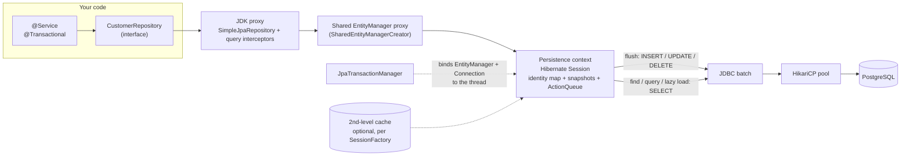

### Entity lifecycle states

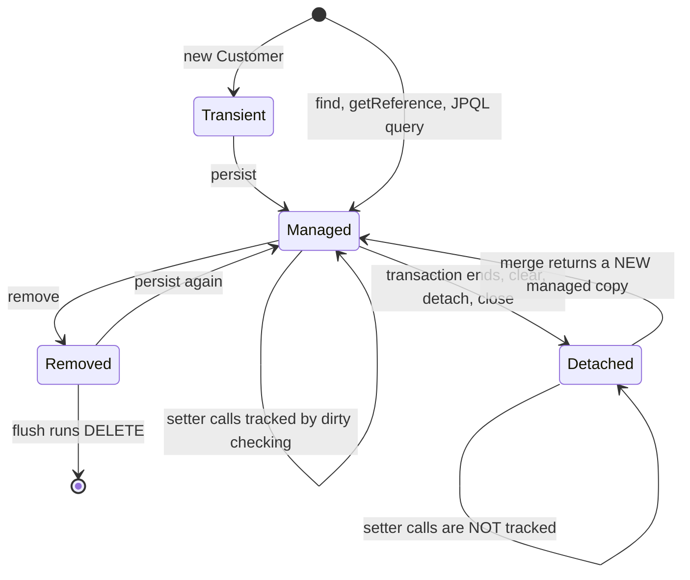

| State | In the persistence context? | Has a DB row? | Changes written at flush? |
|---|---|---|---|
| **Transient** (new) | No | No | No |
| **Managed** (persistent) | Yes | Yes, or will at flush | **Yes**, automatically |
| **Detached** | No (it was, once) | Yes | No. You need `merge()` to re-attach |
| **Removed** | Yes, scheduled for deletion | Until flush | DELETE at flush |

> **`merge()` does not re-attach the object you pass in.** It copies that object's state onto a *managed* instance (loading it if needed) and **returns** the managed one. The argument stays detached. `repository.save(detached)` calls `merge()`, so always use the *return value*: `order = orders.save(order)`.

### Persistence context vs second-level cache

| | First-level cache (persistence context) | Second-level cache |
|---|---|---|
| Scope | One `EntityManager` / `Session`, which in Spring means one transaction | The `SessionFactory`, shared by all sessions in the JVM (or a cluster with Hazelcast/Infinispan) |
| On by default | **Always on.** You can't disable it | **Off.** You need `hibernate-jcache` plus a provider and `@Cache`/`@Cacheable` per entity |
| Guarantees | Repeatable reads of the *same object* (identity), so `a == b` for the same id | Avoids SQL for `find()` by id and for cached collections |
| Bypassed by | JPQL/Criteria queries always run SQL, but return the *already-managed instance* for rows already in the context (lab: `jpqlQuery_alwaysHitsTheDatabase_butReturnsTheManagedInstance`) | JPQL queries (unless you also enable the **query cache**), bulk updates and native SQL |
| Risk | Memory growth in long transactions or batch loops: `flush()` + `clear()` every N rows | Stale data when other apps write the same tables. Use it only for read-mostly reference data |

---

## 3. How it works internally

### 3.1 How a repository interface becomes a bean

You write `interface CustomerRepository extends JpaRepository<Customer, Long>` with no implementation. At startup:

1. Boot's `DataJpaRepositoriesAutoConfiguration` enables JPA repositories (the equivalent of `@EnableJpaRepositories`). `JpaRepositoriesRegistrar` scans for interfaces that extend `Repository`.
2. For each interface it registers a **`JpaRepositoryFactoryBean`**, which is a `FactoryBean` (note 01). Its product is the repository proxy.
3. `JpaRepositoryFactory.getRepository()` builds a Spring AOP `ProxyFactory`:
   - **Target:** a `SimpleJpaRepository<Customer, Long>`, the real implementation of `save`, `findById`, `findAll`, `delete`, and so on.
   - **Interfaces:** your repository interface. The proxy is a **JDK dynamic proxy**.
   - **Advice chain:** `PersistenceExceptionTranslationInterceptor` (turns `PersistenceException` into Spring's `DataAccessException` hierarchy), `TransactionInterceptor` (from `TransactionalRepositoryProxyPostProcessor`), and a **`QueryExecutorMethodInterceptor`** that routes *your* methods to a `RepositoryQuery`.
4. For every method you declared, a `QueryLookupStrategy` (default `CREATE_IF_NOT_FOUND`) decides how to execute it, in this order:
   1. An `@Query` annotation, JPQL or `nativeQuery = true`.
   2. A named query `Customer.findByEmail` (from `@NamedQuery` or `orm.xml`).
   3. Otherwise it **derives** the query from the method name with `PartTree`: `findByNameStartingWithOrderByNameAsc` becomes `where name like ?1% order by name asc`. Spring Data JPA 4 generates a **JPQL string** for derived queries rather than a `CriteriaQuery` (source: Spring Data 2025.1 release notes, which report it ~3.5x faster).

   Derived queries and JPQL are **validated at startup**: a typo in a property name fails the context, not the request.
5. **AOT repositories (Spring Data 2025.1+):** with AOT processing (`spring-boot:process-aot`, native images), Spring Data generates the repository query code at build time instead of parsing method names at startup. It is enabled by default for AOT builds. Turn it off with `spring.aot.jpa.repositories.enabled=false`.

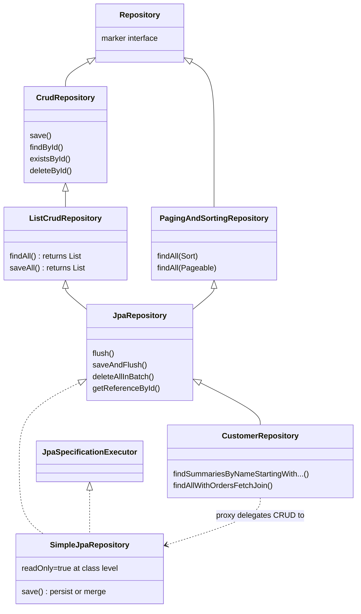

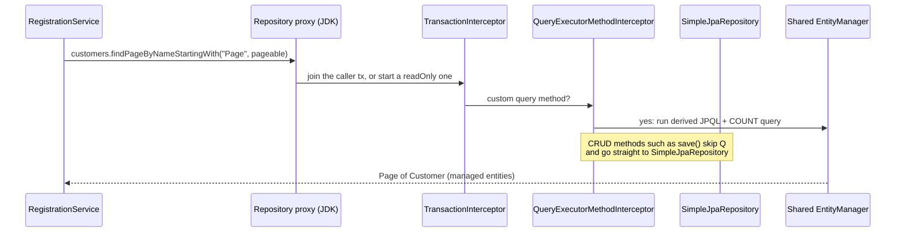

**`SimpleJpaRepository` facts worth knowing (verified with `javap` against spring-data-jpa 4.1.2):**
- The class is annotated **`@Transactional(readOnly = true)`**, and the write methods (`save`, `delete*`, `flush`) override it with plain `@Transactional`. A bare `repository.findAll()` called from a non-transactional method therefore runs in its own short read-only transaction, and the returned entities are **detached** the moment it returns.
- **`save()` = `persist()` or `merge()`**, decided by `JpaEntityInformation.isNew(entity)`:
  - With a `@Version` attribute of a **wrapper** type (`Long`), a `null` version means new.
  - Otherwise (no version, or a **primitive** `long` version, as in the lab), `null` id means new.
  - Implement `Persistable<ID>` to decide yourself. That's essential with **assigned ids** (UUIDs set in the constructor): without it, `save()` sees a non-null id, calls `merge()`, and Hibernate runs a pointless `SELECT` before the INSERT.
- `deleteById(id)` **loads** the entity first (so cascades and listeners run) and then removes it (from the Spring Data docs; unverified in the lab). `deleteAllInBatch()` issues one JPQL `DELETE` and skips cascades.
- `getReferenceById(id)` returns an uninitialised **proxy** without touching the DB. It is perfect for setting an FK (`order.setCustomer(customers.getReferenceById(7L))`), but if the row doesn't exist you get `EntityNotFoundException` later, on first access.

**`@Query` JPQL vs native:**

| | JPQL / HQL (`@Query("select c from Customer c ...")`) | Native (`@Query(value = "...", nativeQuery = true)`) |
|---|---|---|
| Written against | **Entity and field names** | Table and column names |
| Validated | At startup | Only when executed |
| Portable | Yes, via the dialect | No |
| Auto-flush before running | Only if the query touches tables with pending changes | In `AUTO` mode Hibernate flushes pending changes first, because it can't parse your SQL (lab: `nativeQuery_inAutoMode_flushesPendingChangesFirst`) |
| Hibernate filters (`@SoftDelete`, `@SQLRestriction`) | **Applied** | **Not applied**. The lab's `countIncludingSoftDeleted()` proves it |
| Paging | Count query derived automatically | Provide `countQuery` yourself for anything non-trivial |
| Use for | 95% of queries, DTO projections, fetch joins | Vendor features: `jsonb`, CTEs, window functions, `FOR UPDATE SKIP LOCKED` |

### 3.2 The persistence context, flush and dirty checking

The Hibernate `Session` keeps:
- An **identity map** of `EntityKey(type, id)` → entity. `find()` checks it first, so the lab's `sameIdInOneTransaction_returnsTheSameInstance_andHitsTheDatabaseOnce` sees **1** SQL statement for two lookups.
- A **loaded-state snapshot** (an array of column values) per managed entity.
- An **ActionQueue** of pending `EntityInsertAction`, `EntityUpdateAction`, `EntityDeleteAction` and collection actions.

**At flush** (`DefaultFlushEventListener`), Hibernate:
1. Cascades `PERSIST`/`MERGE` through associations.
2. Dirty-checks every managed entity by comparing its current state to the snapshot. That's O(number of managed entities), which is why huge persistence contexts get slow.
3. Executes the queue **in a fixed order**: inserts → updates → collection element removals → collection updates/inserts → **deletes last**. Classic gotcha: delete a row and insert a new one with the same unique key in one transaction, and the INSERT runs first and violates the constraint. The lab's `flushRunsInsertsBeforeDeletes_soReplacingAUniqueKeyFails` gets `duplicate key` from Postgres. Fix it with an explicit `flush()` right after the `remove()`.

**Flush modes:**

| Mode | When Hibernate flushes | Notes |
|---|---|---|
| `AUTO` (JPA and Hibernate default) | Before commit, and before any query whose tables have pending changes | The lab's `flushModeAuto_flushesBeforeAQuery_flushModeCommit_doesNot` shows the query seeing the unflushed insert |
| `COMMIT` (JPA) | Only at commit | Queries may return stale results. It's a performance knob for read-heavy units of work |
| `MANUAL` (Hibernate) | Only on explicit `flush()` | Spring sets this for **`@Transactional(readOnly = true)`**, which is why read-only transactions never write (lab: `readOnlyTransaction_neverFlushesChanges`) |
| `ALWAYS` (Hibernate) | Before every query | Rarely useful |

**SEQUENCE vs IDENTITY changes *when* the INSERT happens.** With `SEQUENCE`, `persist()` only needs an id from the pooled sequence (no INSERT yet). With `IDENTITY` the database generates the id, so Hibernate must run the INSERT **immediately inside `persist()`**. The lab proves both (`sequenceId_isAssignedOnPersist_butTheInsertWaitsForFlush`, `identityId_forcesAnImmediateInsertOnPersist`).

### 3.3 Fetching: N+1 and its four fixes

**N+1:** 1 query loads N parents, then touching a lazy association on each parent fires 1 more query **per parent**. It's invisible in code (`customer.getOrders().size()`) and deadly in production (100 rows on a page → 101 round-trips).

Lab numbers (5 customers × 2 orders, statements counted with `Statistics.getPrepareStatementCount()`):

| Approach | Code | Statements | Notes |
|---|---|---|---|
| Lazy `@OneToMany` in a loop | `findAll()` then `c.getOrders().size()` | **6** = 1 + 5 | The classic N+1 |
| Lazy `@ManyToOne` in a loop | `orders.findAll()` then `o.getCustomer().getName()` | **6** = 1 + 5 distinct customers | One query per *distinct* parent, because the identity map dedupes |
| `proxy.getId()` | `o.getCustomer().getId()` | **1** | The id sits in the FK column, so the proxy answers without SQL |
| **JOIN FETCH** | `select c from Customer c left join fetch c.orders` | **1** | Returns **5** customers, not 10 rows. Hibernate 6+ de-duplicates root entities; `DISTINCT` is no longer needed |
| **`@EntityGraph(attributePaths = "orders")`** | Same query, fetch plan as an annotation | **1** | Works on derived queries too: `findWithOrdersById` |
| **`@BatchSize(size = 5)`** on `PurchaseOrder.lines` | Touch lines of 10 orders | 1 + **2** collection fetches | Hibernate loads 5 collections per query with `where order_id = any (?)` |
| **`hibernate.default_batch_fetch_size=16`** | The same N+1 code as row 1 | **2** | A global `@BatchSize` for every lazy association and proxy. A good default in every app |
| `@Fetch(FetchMode.SUBSELECT)` | Re-runs the parent query as a subselect | 2 | Loads all collections for all parents of the original query |

**Choosing a fix:**
- A **specific use case** needs the association: use a JOIN FETCH or entity graph on *that* query.
- You **can't predict** access (e.g. templates, mappers): set `default_batch_fetch_size`. It turns every N+1 into roughly 1 + N/size, and you can't forget it.
- The screen needs **a few columns**: use a DTO projection (section 4), which loads no entities and has no N+1 at all.

**Fetch-join limits you must know:**
- **`MultipleBagFetchException`:** you can't join-fetch two `List` (bag) collections in one query, because the Cartesian product makes them ambiguous. Use `Set`, fetch the second collection in another query (in the same transaction the identity map stitches them together), or use batch fetching.
- **Pagination plus a collection fetch join:** before Hibernate 7.4, `setMaxResults` with a collection `join fetch` logged `HHH90003004` and paged **in memory** after loading every row. Hibernate 7.4 makes this "safe" (source: Hibernate 7.4 *What's New*), but a two-step "page the ids, then fetch by ids" query is still the most predictable pattern.
- `@ManyToOne` and `@OneToOne` are **EAGER by default** (JPA spec). An eager to-one doesn't just slow `find()`: every JPQL query that returns the entity triggers an extra SELECT per distinct parent, which is N+1 even if you never touch the association (unverified in the lab, because it keeps every association LAZY). **Always write `fetch = FetchType.LAZY`** on to-one associations.

> **Surprise found by the lab:** a LAZY `@ManyToOne` that points at a **`@SoftDelete` entity is loaded eagerly anyway.** Hibernate must know whether the target row is soft-deleted (and so should read as `null`), and a bare proxy can't answer that. `MappingFeaturesTest.lazyManyToOne_toASoftDeleteEntity_isLoadedEagerly` shows `Hibernate.isInitialized(line.getProduct())` is `true` straight after `find()`, while the plain `order.getCustomer()` stays an uninitialised proxy. The same is believed to apply to `@NotFound(IGNORE)` (unverified). Keep soft delete on entities that are mostly *roots*, or accept the extra SELECT.

### 3.4 Association mapping: owning side, `mappedBy`, cascades

**The owning side is the side that has the foreign key column. Hibernate only looks at the owning side when it writes SQL.**

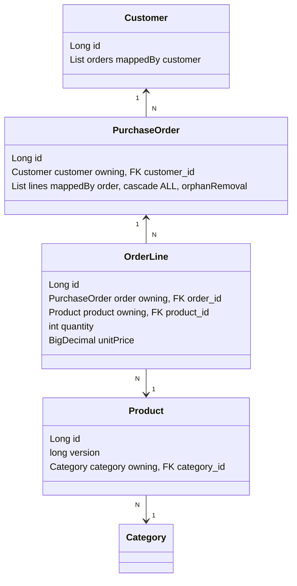

| Mapping | Default fetch | Who owns the FK | Gotcha |
|---|---|---|---|
| `@ManyToOne` | **EAGER** | Always the owner (`@JoinColumn`) | Always write `LAZY` |
| `@OneToMany(mappedBy = "x")` | LAZY | The inverse side. Changes only to this collection are **ignored** by SQL | Write helper methods that set both sides (`order.addLine(...)`) |
| `@OneToMany` **without** `mappedBy` (unidirectional) | LAZY | Hibernate creates a **join table**, or with `@JoinColumn` it inserts first and then UPDATEs the FK | Extra statements. Prefer a bidirectional mapping, or only the `@ManyToOne` side |
| `@OneToOne` | **EAGER** | The side with `@JoinColumn` | The **inverse** side can't be lazy without bytecode enhancement, because Hibernate must know whether it's null. Prefer `@MapsId` (shared primary key) |
| `@ManyToMany` | LAZY | The side without `mappedBy`. A join table | With a `List`, removing one element deletes **all** join rows and re-inserts the rest. Use `Set`. Once the link needs columns (quantity, price), make it an entity, like `OrderLine` |
| `@ElementCollection` | LAZY | A collection table owned by the entity | No identity, so whole-collection rewrites happen on change. Fine for small value sets |

**Cascade types** (`cascade = ...` propagates an `EntityManager` operation from parent to child):

| Cascade | Propagates | Use on |
|---|---|---|
| `PERSIST` | `persist()` | Parent → children created with it |
| `MERGE` | `merge()` | Parent → children edited in a detached graph |
| `REMOVE` | `remove()` | Parent → owned children. **Never** on `@ManyToOne` or `@ManyToMany`: deleting an order would delete the customer |
| `REFRESH`, `DETACH` | `refresh()`, `detach()` | Rarely |
| `ALL` | Everything above | True composition: `PurchaseOrder.lines` |

`SAVE_UPDATE` and `DELETE` (the Hibernate-specific cascade types) were **removed in Hibernate 7**.

**`orphanRemoval = true` vs `CascadeType.REMOVE`:** `REMOVE` deletes children only when the *parent* is deleted. `orphanRemoval` also deletes a child that is **removed from the collection** (lab: `orphanRemoval_deletesALineRemovedFromTheCollection`, no `delete()` call). Use it for composition only, where the child has no meaning without its parent.

**Inheritance strategies:**

| Strategy | Tables | Polymorphic query | Pros | Cons |
|---|---|---|---|---|
| `SINGLE_TABLE` (default) | One table plus a discriminator column | One SELECT, no joins | Fastest | Subclass columns must be nullable, and the table gets wide |
| `JOINED` | One per class, joined by PK | JOINs across all subclass tables | Normalised, allows NOT NULL | Slow for deep hierarchies, and inserts touch several tables |
| `TABLE_PER_CLASS` | One per concrete class | `UNION ALL` of all tables | No joins for a concrete type | Can't use IDENTITY, and polymorphic queries are slow |
| `@MappedSuperclass` | No table of its own. It only shares mappings | Not queryable as a type | Ideal for `id`/`createdAt`/`version` base classes | No polymorphic associations |

### 3.5 ID generation and JDBC batching

| Strategy | How the id is produced | Batching? | Use |
|---|---|---|---|
| `IDENTITY` | DB auto-increment, read back after the INSERT | **No.** Every `persist()` runs its own INSERT immediately | MySQL without sequences, or when you must. The lab: 40 audit rows = **40** statements |
| `SEQUENCE` + **pooled optimizer** | `nextval` with `INCREMENT BY 50` reserves 50 ids. Hibernate hands them out from memory | **Yes** | **The default choice on Postgres/Oracle.** The lab: 40 customers = ≤ **4** statements (1 nextval + 2 batches of 20) |
| `SEQUENCE` + `pooled-lo` | Same, but the sequence value is the *low* end of the block | Yes | Plays nicer with other apps inserting manually |
| `TABLE` | A row in a "hi/lo" table, updated under a row lock | Yes | Never: it's a serialisation point |
| `UUID` (JPA 3.1+) / `@UuidGenerator(style = VERSION_7)` | Generated in the JVM | Yes | Distributed id generation. **UUIDv7** is time-ordered, so B-tree inserts stay sequential. Random v4 UUIDs scatter index pages |

**Rules that bite:**
- `@SequenceGenerator(allocationSize = 50)` **must equal** the sequence's `INCREMENT BY`. Otherwise Hibernate refuses to start (with the default `hibernate.id.sequence.increment_size_mismatch_strategy=EXCEPTION`), or with `FIX` it silently generates duplicate ids if another app shares the sequence. The lab's Flyway script creates every sequence with `increment by 50` (the failure mode is unverified in the lab).
- Without an explicit generator, Hibernate 6+ uses **one sequence per entity** named `<entity>_SEQ`. Hibernate 5 used a single global `hibernate_sequence`, so old schemas break on upgrade (unverified in the lab, which declares every generator explicitly).
- Hibernate 7 rejects `strategy = SEQUENCE` paired with a `@TableGenerator` (and vice versa). The strategy and the generator annotation must match.

**Batching properties** (the lab sets all of them):

```properties
spring.jpa.properties.hibernate.jdbc.batch_size=20        # group up to 20 identical statements per round-trip
spring.jpa.properties.hibernate.order_inserts=true        # sort inserts by entity so batches aren't broken
spring.jpa.properties.hibernate.order_updates=true        # same for updates; also reduces deadlocks
# hibernate.jdbc.batch_versioned_data defaults to true: versioned UPDATEs are batched too
# Postgres driver: add ?reWriteBatchedInserts=true to the JDBC URL to turn a batch into multi-row INSERTs
```

Hibernate logs `HHH100501: Automatic JDBC statement batching enabled (maximum batch size 20)` at startup when it's on. Batching applies to `persist`/`merge`/dirty updates in a stateful `Session`. In Hibernate 7, `StatelessSession` ignores `jdbc.batch_size`; use `insertMultiple()` instead.

### 3.6 Transactions: the proxy, the manager and the thread

`@Transactional` is AOP (note 02). Boot's `TransactionAutoConfiguration` enables `@EnableTransactionManagement`, which registers a `BeanFactoryTransactionAttributeSourceAdvisor` with an `AnnotationTransactionAttributeSource` (reads the annotations) and a **`TransactionInterceptor`** (the advice).

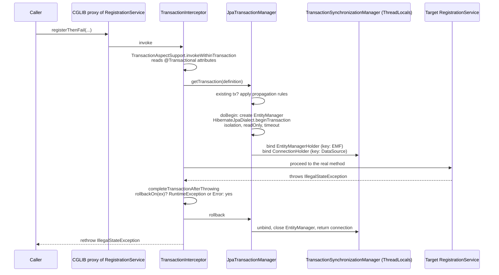

Key classes:
- **`PlatformTransactionManager`** (`getTransaction`, `commit`, `rollback`) is the abstraction. `AbstractPlatformTransactionManager` implements the propagation logic once. Subclasses `JpaTransactionManager`, `DataSourceTransactionManager` and `JtaTransactionManager` only do the `doBegin`/`doCommit`/`doRollback` work.
- **`TransactionSynchronizationManager`** holds `ThreadLocal`s: the bound resources (EntityManager, JDBC connection), the current transaction's name, its read-only flag and isolation level, and registered synchronizations (`@TransactionalEventListener` uses these). Because `JpaTransactionManager` also binds the **JDBC connection**, a `JdbcTemplate` in the same `@Transactional` method uses the **same connection and transaction** as JPA.
- **`SharedEntityManagerCreator`**: the `EntityManager` you inject is a thread-safe proxy. On each call it looks up the transaction-bound `EntityManager` (`EntityManagerFactoryUtils.doGetTransactionalEntityManager`). With no transaction it creates a throw-away one per call.
- **Thread confinement:** the context is per thread. Code inside `@Async`, `CompletableFuture.supplyAsync()` or a parallel stream runs **outside** your transaction.

**What `readOnly = true` actually does** with `JpaTransactionManager` + Hibernate (lab: `readOnlyTransaction_neverFlushesChanges`, `readOnlyTransaction_isAlsoReadOnlyInPostgres`):
1. The Hibernate session gets `FlushMode.MANUAL` and `setDefaultReadOnly(true)`. Entities are loaded **without snapshots** (less memory, no dirty checking) and are never flushed.
2. Spring calls `Connection.setReadOnly(true)`, and the Postgres driver turns that into a `READ ONLY` transaction. The database itself then rejects writes: the lab gets `ERROR: cannot execute INSERT in a read-only transaction`.
3. `TransactionSynchronizationManager.isCurrentTransactionReadOnly()` returns `true`. Routing DataSources use this to send reads to a replica (section 7.2).

It is **not** a guarantee that nothing can write: a `REQUIRES_NEW` call inside starts a separate read-write transaction.

#### All seven propagation types

| Propagation | Existing transaction | No transaction | Typical use |
|---|---|---|---|
| **`REQUIRED`** (default) | Join it | Start one | Almost everything |
| **`REQUIRES_NEW`** | **Suspend** it and start an independent one on a **second connection** | Start one | Audit logs and outbox rows that must survive a business rollback. The lab proves the inner commit survives |
| `SUPPORTS` | Join it | Run without one | Read helpers that work either way. Rarely right |
| `NOT_SUPPORTED` | Suspend it and run without one | Run without one | Slow calls (HTTP, file I/O) that shouldn't hold a DB connection |
| `MANDATORY` | Join it | **Throw** `IllegalTransactionStateException` | Methods that must be part of a caller's unit of work (lab: `mandatoryAndNever_enforceTheirPreconditions`) |
| `NEVER` | **Throw** | Run without one | Assert that nobody calls this inside a transaction (same lab test) |
| `NESTED` | Create a **JDBC savepoint** and roll back to it on failure | Start one | Works with `DataSourceTransactionManager`. `JpaTransactionManager` leaves `nestedTransactionAllowed=false` (the `AbstractPlatformTransactionManager` default), so you get `NestedTransactionNotSupportedException` (lab: `nested_isNotSupportedByJpaTransactionManager_byDefault`). Even when enabled, the JPA persistence context is **not** rolled back to the savepoint |

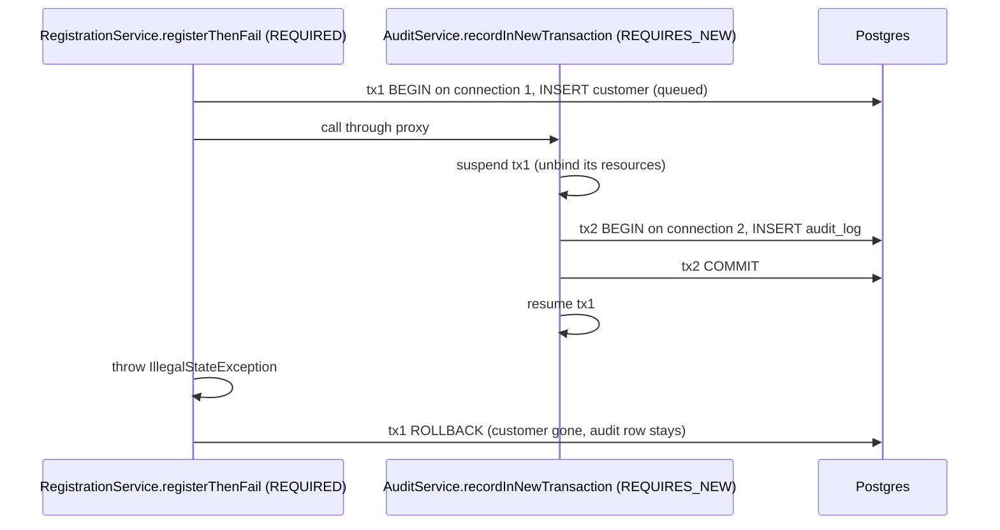

> **`REQUIRES_NEW` needs two connections at once.** With a pool of 10 and 10 concurrent requests that each hold connection 1 and wait for connection 2, the pool **deadlocks** until `connection-timeout` (reasoned from how the pool works, not reproduced in the lab). Size the pool for it, or write the audit row with an outbox/`AFTER_COMMIT` listener instead.

**`UnexpectedRollbackException`** (lab: `catchingAnInnerRequiredFailure_stillRollsBack_withUnexpectedRollbackException`): an inner `REQUIRED` method throws, so its interceptor marks the **shared** transaction *rollback-only*. The outer method catches the exception and returns normally, so the outer interceptor tries to commit and finds the rollback-only flag. Spring rolls back and throws `UnexpectedRollbackException: Transaction silently rolled back because it has been marked as rollback-only`. To recover from an inner failure, make the inner method `REQUIRES_NEW` (or `NESTED` with JDBC), or don't let it throw.

#### Rollback rules

- **Default:** roll back on `RuntimeException` and `Error`. **Commit on checked exceptions.** The idea is inherited from EJB: a checked exception is a "business outcome" that the caller is expected to handle. The lab's `checkedException_commitsByDefault` shows the row is committed even though the method threw.
- `@Transactional(rollbackFor = X.class)` / `noRollbackFor = Y.class` change it per method. Rules match by type hierarchy (the most specific rule wins).
- **Framework 6.2+ global switch:** `@EnableTransactionManagement(rollbackOn = RollbackOn.ALL_EXCEPTIONS)` rolls back on checked exceptions too, app-wide (`RollbackOn` verified present in spring-tx 7.0.10).
- An exception **caught inside** the method never reaches the interceptor, so there's no rollback unless you call `TransactionAspectSupport.currentTransactionStatus().setRollbackOnly()`.

#### Why `@Transactional` is silently ignored

| Case | Why | Lab proof |
|---|---|---|
| **Self-invocation** (`this.other()`) | The call never goes through the proxy | `selfInvocation_bypassesTheProxy`: `transactionalViaThis()` sees a transaction when called through the bean, but not when called from a sibling method |
| **`private` methods** | CGLIB can't override them, and a private method can only be reached via `this` anyway | |
| **`final` methods / `final` classes** | CGLIB can't override them | |
| **`protected` / package-private** | **Works since Framework 6.0** with class-based (CGLIB) proxies. "Public only" is outdated advice | `packagePrivateTransactionalMethod_isIntercepted` |
| Object created with `new` | Not a bean, so no proxy | |
| Called from `@PostConstruct` | The proxy doesn't exist yet (note 01) | |
| Checked exception thrown | Default rules commit | `checkedException_commitsByDefault` |
| Wrong transaction manager | Two `PlatformTransactionManager` beans and no qualifier | Use `@Transactional(transactionManager = "...")` |

Fixes for self-invocation: move the method into another bean (cleanest), inject `ObjectProvider<Self>`, or use `TransactionTemplate` for programmatic boundaries (the lab's `InventoryService` does this so the retry can wrap the transaction).

#### Isolation levels and the anomalies they allow

| Anomaly | Meaning |
|---|---|
| **Dirty read** | Read another transaction's uncommitted write |
| **Non-repeatable read** | Read the same row twice and get different values, because someone committed in between |
| **Phantom read** | Re-run a range query and get new rows |
| **Lost update** | Two transactions read, modify and write the same row, and one write silently overwrites the other |
| **Write skew** | Two transactions read overlapping data and write *different* rows, breaking an invariant (e.g. "at least one doctor on call") |

| Isolation | Dirty read | Non-repeatable | Phantom | Lost update | Write skew | Notes |
|---|---|---|---|---|---|---|
| `READ_UNCOMMITTED` | Possible | Possible | Possible | Possible | Possible | Postgres treats it as `READ COMMITTED` |
| **`READ_COMMITTED`** | No | Possible | Possible | Possible | Possible | **Postgres, Oracle and SQL Server default.** The lab's startup log shows `Isolation level: READ_COMMITTED` |
| `REPEATABLE_READ` | No | No | Possible per the SQL standard, **no in Postgres** (snapshot isolation) | No in Postgres (it throws a serialization error) | Possible | **MySQL InnoDB default** |
| `SERIALIZABLE` | No | No | No | No | No | Postgres uses SSI and throws `40001` serialization failures that you must retry |

`@Transactional(isolation = ...)` is applied per transaction by `HibernateJpaDialect` through the JDBC connection. In practice, keep `READ_COMMITTED` and prevent lost updates with **`@Version`** (optimistic) or **`SELECT ... FOR UPDATE`** (pessimistic).

### 3.7 Locking

**Optimistic locking (`@Version`)** assumes conflicts are rare. Every UPDATE becomes `UPDATE products SET ..., version = 1 WHERE id = ? AND version = 0`. If 0 rows match, someone else committed first: Hibernate throws `StaleObjectStateException` → JPA `OptimisticLockException` → Spring `ObjectOptimisticLockingFailureException`.

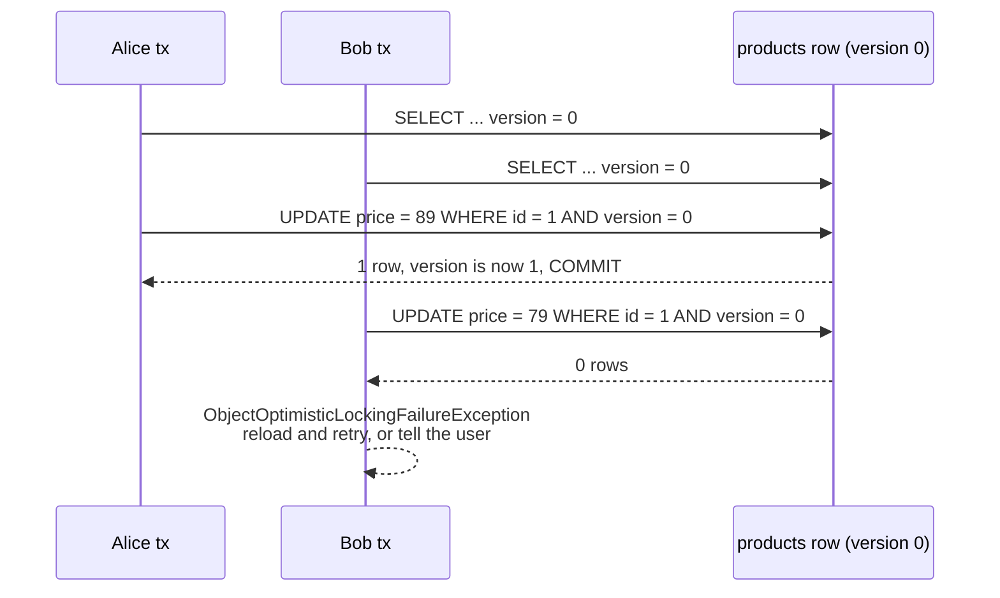

The lab's `savingAStaleCopy_throwsObjectOptimisticLockingFailureException` does exactly this with two detached copies. Alice's price survives, and the version is 1.

- The version can be `int`, `long`, `Integer`, `Long`, `short` or a timestamp. JPA 3.2 also allows `LocalDateTime` and `Instant`. Prefer a number: timestamps collide.
- **Never set the version yourself.** Do expose it in DTOs (as an ETag / `If-Match`, note 05) so that a *stale form submit* is detected across HTTP requests. That's the conflict `@Version` exists for.
- **Bulk JPQL updates don't bump the version** (lab: `modifyingQuery_withClearAutomatically_readsFreshState_butSkipsVersioning`) unless you write `update versioned Product p set ...` (HQL) or increment it in the query.
- `LockModeType.OPTIMISTIC_FORCE_INCREMENT` bumps the version of an aggregate root even when only a child changed.

**Pessimistic locking** takes a database row lock. Use it when conflicts are frequent or retries are expensive:

| `LockModeType` | Postgres SQL (dialect-dependent) | Blocks |
|---|---|---|
| `PESSIMISTIC_READ` | `FOR SHARE` | Writers |
| `PESSIMISTIC_WRITE` | **`FOR NO KEY UPDATE OF p1_0`** in Hibernate 7.4 (captured from the lab's SQL log). It is weaker than `FOR UPDATE`: it doesn't block inserts of child rows whose FK references this row | Writers and other lockers |
| `PESSIMISTIC_FORCE_INCREMENT` | `FOR UPDATE` plus a version bump | Same |
| Hint `jakarta.persistence.lock.timeout = 0` | `NOWAIT`: fail immediately | |
| Hint `-2` (Hibernate `LockOptions.SKIP_LOCKED`) | `SKIP LOCKED`: skip locked rows | The basis of DB-backed job queues |

```java
@Lock(LockModeType.PESSIMISTIC_WRITE)
@QueryHints(@QueryHint(name = "jakarta.persistence.lock.timeout", value = "0"))
Optional<Product> findLockedNoWaitById(Long id);
```

The lab's `pessimisticWriteLock_makesAConcurrentNoWaitLockFail` holds the row lock in one thread, and a NOWAIT attempt from another thread fails with `PessimisticLockingFailureException` (the SQL ends in `for no key update of p1_0 nowait`). Rules for pessimistic locks: keep transactions short, lock rows in a **consistent order** to avoid deadlocks, and never hold a lock across an HTTP call.

### 3.8 Open Session in View (OSIV)

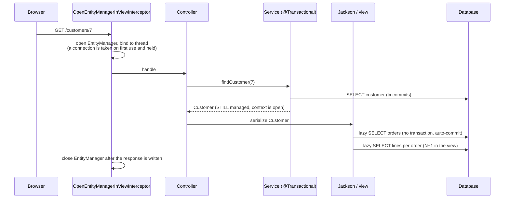

- **Boot 4.1 still defaults `spring.jpa.open-in-view=true`** (verified in `spring-boot-jpa` 4.1.2 metadata) and logs: *"spring.jpa.open-in-view is enabled by default. Therefore, database queries may be performed during view rendering. Explicitly configure spring.jpa.open-in-view to disable this warning"*.
- **Why disable it:**
  - A DB connection is held for the *whole* request, including JSON serialisation and slow clients, which shrinks your effective pool.
  - Lazy loads in the view run **outside any transaction** (auto-commit, one statement each). That causes hidden N+1, inconsistent reads, and no `readOnly` routing.
  - The service layer no longer defines what data a use case needs, so performance bugs move into templates and mappers.
- **With it off** (the lab and capstones), touching a lazy association after the service returns throws **`LazyInitializationException`**. The lab's `lazyCollection_outsideATransaction_throwsLazyInitializationException` proves it. That's a *good* failure: fix it by fetching what the use case needs (`@EntityGraph`, fetch join, or a DTO projection) inside the service. Don't fix it with `hibernate.enable_lazy_load_no_trans=true`, which opens a new session *per lazy load*.

### 3.9 HikariCP connection pool sizing

Boot's default pool is HikariCP (`spring.datasource.hikari.*`). Its defaults are `maximum-pool-size=10`, `minimum-idle` equal to max (a fixed-size pool), `connection-timeout=30s`, `idle-timeout=10min` and `max-lifetime=30min`.

- **Bigger is not better.** The database does the work: a Postgres server with 8 cores can only run about 8 queries truly in parallel. Hundreds of connections add context switching and lock contention. HikariCP's "About Pool Sizing" starting point is **`connections = (core_count × 2) + effective_spindle_count`** of the *database* server, and then you measure.
- **Little's law** for the app side: `pool size ≈ throughput (tx/s) × average connection hold time (s)`. At 500 tx/s × 10 ms you need about 5 connections. Keep transactions short instead of growing the pool.
- **Count across all instances.** 20 pods × 10 connections = 200 against Postgres's `max_connections` (default 100). Use PgBouncer (transaction pooling) or RDS Proxy when pods scale out.
- **Virtual threads** (note 12) remove the thread limit, so **the pool becomes the throttle**. 10,000 virtual threads will queue on 10 connections, which is the correct behaviour. Don't size the pool to the thread count.
- **Deadlock risk:** a request that needs two connections at once (`REQUIRES_NEW`, or an OSIV connection plus a new transaction) can starve the pool. The minimum safe size is `threads × (max simultaneous connections per request − 1) + 1`.
- Set `max-lifetime` a few seconds shorter than any DB, proxy or firewall idle timeout. Set `leak-detection-threshold` (e.g. `20s`) in non-prod to log stack traces of connections that are held too long.
- **Boot 4.1:** `spring.datasource.connection-fetch=lazy` wraps the pool in `LazyConnectionDataSourceProxy`, so a physical connection is taken only when the first SQL statement runs, not when the transaction begins (source: Boot 4.1 release notes).

---

## 4. Full worked code

The full source is in the lab. `./mvnw verify` runs **49 tests** against Postgres 16 in Testcontainers, and they're all green.

### 4.1 Entities: owning side, LAZY everywhere, safe `equals`/`hashCode`

```java
@Entity
@Table(name = "orders")                                   // ORDER is an SQL keyword
public class PurchaseOrder {

    @Id
    @GeneratedValue(strategy = GenerationType.SEQUENCE, generator = "orders_seq")
    @SequenceGenerator(name = "orders_seq", sequenceName = "orders_seq", allocationSize = 50)
    private Long id;

    @ManyToOne(fetch = FetchType.LAZY, optional = false)  // owning side: writes customer_id
    @JoinColumn(name = "customer_id")
    private Customer customer;

    @OneToMany(mappedBy = "order", cascade = CascadeType.ALL, orphanRemoval = true)
    @BatchSize(size = 5)                                  // lazy lines load 5 orders at a time
    private List<OrderLine> lines = new ArrayList<>();

    protected PurchaseOrder() { }                         // for JPA

    public PurchaseOrder(Customer customer) {
        this.customer = customer;
        this.placedAt = Instant.now();
        customer.addOrder(this);                          // keep both sides in sync in memory
    }

    public void addLine(Product product, int quantity) {
        lines.add(new OrderLine(this, product, quantity, product.getPrice()));
    }

    @Override public boolean equals(Object o) {
        if (this == o) return true;
        if (!(o instanceof PurchaseOrder other)) return false;  // instanceof: works with proxies
        return id != null && id.equals(other.getId());          // getId(): proxies have no field state
    }

    @Override public int hashCode() { return PurchaseOrder.class.hashCode(); } // constant: survives persist()
}
```

```java
@Entity
@Table(name = "products")
@SoftDelete                                               // delete = UPDATE products SET deleted = true
public class Product {
    @Id @GeneratedValue(strategy = GenerationType.SEQUENCE, generator = "products_seq")
    @SequenceGenerator(name = "products_seq", sequenceName = "products_seq", allocationSize = 50)
    private Long id;
    private int stock;
    @Version private long version;                        // optimistic lock
    @ManyToOne(fetch = FetchType.LAZY, optional = false) @JoinColumn(name = "category_id")
    private Category category;

    public void decrementStock(int quantity) {
        if (stock < quantity) throw new OutOfStockException(sku);
        stock -= quantity;                                // no save(): dirty checking writes it
    }
}

@Entity
@Table(name = "customers")
@EntityListeners(AuditingEntityListener.class)            // + @EnableJpaAuditing on the app class
public class Customer {
    @OneToMany(mappedBy = "customer") private List<PurchaseOrder> orders = new ArrayList<>();
    @CreatedDate      @Column(nullable = false, updatable = false) private Instant createdAt;
    @LastModifiedDate @Column(nullable = false)                    private Instant updatedAt;
}
```

**The `equals`/`hashCode` pitfall** (lab: `hashCodeFromGeneratedId_losesTheEntityInAHashSet`). `Tag` uses the "obvious" `Objects.hash(id)`. When it's added to a `HashSet` while transient, it's stored under `hash(null)`. `persist()` assigns the id, the hash changes, and `set.contains(tag)` returns **false** for the very same object. Hibernate's own collections (`Set<OrderLine>`) break the same way. The safe recipes are:
1. A **natural/business key** (`sku`, `email`) that never changes: `equals`/`hashCode` on it.
2. A **generated id** with a **constant `hashCode`** and id-equality only when the id is non-null, as above.
3. An id **assigned in the constructor** (UUIDv7): plain id-based equals, plus `Persistable` so `save()` persists instead of merging.

Never use Lombok `@Data`/`@EqualsAndHashCode` on entities. They include every field (including lazy collections, which triggers loads and `StackOverflowError` on bidirectional links) and generate `toString()` over lazy fields.

### 4.2 Flyway schema (Hibernate only validates)

```sql
create sequence products_seq increment by 50;            -- = allocationSize
create table products (
    id          bigint primary key,
    sku         varchar(40)    not null unique,
    price       numeric(12, 2) not null,
    stock       integer        not null check (stock >= 0), -- last line of defence against overselling
    version     bigint         not null,
    category_id bigint         not null references categories (id),
    deleted     boolean        not null default false       -- @SoftDelete column
);
create index products_category_idx on products (category_id); -- Postgres does NOT index FKs for you

create table audit_log (                                   -- IDENTITY on purpose: no batching
    id bigint generated by default as identity primary key, ...
);
```

```properties
spring.jpa.open-in-view=false
spring.jpa.hibernate.ddl-auto=validate
spring.jpa.properties.hibernate.jdbc.batch_size=20
spring.jpa.properties.hibernate.order_inserts=true
spring.jpa.properties.hibernate.order_updates=true
spring.jpa.properties.hibernate.generate_statistics=true   # lab only: tests count statements
```

### 4.3 Repositories: fetch plans, projections, paging, scrolling, locks, bulk updates

```java
public interface CustomerRepository extends JpaRepository<Customer, Long> {

    @Query("select c from Customer c left join fetch c.orders")      // no DISTINCT needed in Hibernate 6+
    List<Customer> findAllWithOrdersFetchJoin();

    @EntityGraph(attributePaths = "orders")
    @Query("select c from Customer c")
    List<Customer> findAllWithOrdersEntityGraph();

    @EntityGraph(attributePaths = "orders")
    Optional<Customer> findWithOrdersById(Long id);

    List<CustomerSummary> findSummariesByNameStartingWithOrderByNameAsc(String prefix); // interface projection
    List<CustomerView> findViewsByEmailEndingWithOrderByNameAsc(String domain);       // record projection

    Page<Customer>  findPageByNameStartingWith(String prefix, Pageable pageable);   // content + COUNT
    Slice<Customer> findSliceByNameStartingWith(String prefix, Pageable pageable);  // content only (size + 1)
    Window<Customer> findFirst2ByOrderByIdAsc(ScrollPosition position);            // keyset scrolling
}

public interface CustomerSummary { String getName(); String getEmail(); }   // proxy-backed
public record CustomerView(String name, String email) { }                  // constructor params = properties

public interface OrderRepository extends JpaRepository<PurchaseOrder, Long> {
    @Query("""
            select new dev.roadmap.jpa.order.OrderTotal(o.id, sum(l.unitPrice * l.quantity))
            from PurchaseOrder o join o.lines l
            group by o.id
            order by o.id""")
    List<OrderTotal> findTotals();                                          // aggregate straight into a record
}

public interface ProductRepository extends JpaRepository<Product, Long> {
    @Lock(LockModeType.PESSIMISTIC_WRITE)
    Optional<Product> findLockedById(Long id);                              // SELECT ... FOR UPDATE

    @Modifying
    @Query("update Product p set p.price = p.price * :factor")
    int applyPriceFactor(BigDecimal factor);                                // leaves managed entities stale

    @Modifying(flushAutomatically = true, clearAutomatically = true)
    @Query("update Product p set p.price = p.price * :factor")
    int applyPriceFactorAndClear(BigDecimal factor);

    @Query(value = "select count(*) from products", nativeQuery = true)
    long countIncludingSoftDeleted();                                       // native SQL ignores @SoftDelete
}
```

**Projections compared:**

| Kind | Declared as | SELECT narrowed? | Result | Use |
|---|---|---|---|---|
| Entity | `List<Customer>` | No, all columns | Managed entities, dirty-checked | When you'll modify them |
| **Closed interface** | `interface CustomerSummary { String getName(); }` | **Yes** | A proxy over a tuple (lab: `isNotInstanceOf(Customer.class)`) | Quick read-only views |
| Open interface | `@Value("#{target.name + ' ' + target.email}")` getter | **No.** The whole entity is loaded for SpEL | A proxy | Avoid for hot paths |
| **Class / record DTO** | `record CustomerView(String name, String email)` | **Yes** | Plain immutable objects | API responses and read models. Best default |
| Constructor expression | `select new pkg.OrderTotal(o.id, sum(...))` | Yes | Records with aggregates | Reports and CQRS reads |
| Dynamic | `<T> List<T> findByName(String n, Class<T> type)` | Depends on `T` | Caller picks | One query method, many views |

**Paging and the COUNT cost** (lab `QueryFeaturesTest`):
- `Page<T>` runs the content query (`LIMIT/OFFSET`) **plus** a `SELECT count(*)`. On a big table with filters, that COUNT can cost more than the page itself.
- Spring skips the COUNT when the total is obvious: a first page smaller than the page size, or a **partial last page** (`PageableExecutionUtils`). The lab sees **1** statement for page 3 of 5 rows.
- `Slice<T>` never counts. It fetches `size + 1` rows to know `hasNext()`. Use it for "load more" UIs.
- For a custom `@Query` with joins, supply `countQuery = "select count(c) from ..."`. The derived COUNT copies your joins and fetches, which can be slow or invalid.
- **`OFFSET` itself is O(offset)**: page 10,000 makes Postgres read and discard 200,000 rows. Use **keyset scrolling** for deep pagination:

```java
Window<Customer> window = customers.findFirst2ByOrderByIdAsc(ScrollPosition.keyset());
while (window.hasNext()) {
    window = customers.findFirst2ByOrderByIdAsc(window.positionAt(window.size() - 1)); // WHERE id > last id
}
```

The lab's `keysetScrolling_isStableWhenEarlierRowsAreDeleted` deletes a row *before* the cursor between two windows. Keyset still returns the next two rows, where `OFFSET 2` would silently skip one. `ScrollPosition.offset()` is also available, but keyset needs a **unique, stable sort** (add the id as a tie-breaker).

**Bulk updates:** `@Modifying` JPQL goes straight to the database. Managed entities in the current context keep their **old** values, and even `findById` returns the stale cached instance (lab: `modifyingQuery_bypassesThePersistenceContext`). `clearAutomatically = true` detaches everything afterwards (so unflushed changes are lost unless `flushAutomatically = true` too). Bulk updates also skip `@Version`, entity listeners (auditing) and cascades.

### 4.4 Services: propagation, rollback rules and the flash sale

```java
@Service
public class AuditService {
    @Transactional(propagation = Propagation.REQUIRES_NEW)   // survives the caller's rollback
    public void recordInNewTransaction(String message) { auditLogs.save(new AuditLog(message)); }

    @Transactional                                           // REQUIRED: shares the caller's fate
    public void recordInCallerTransaction(String message) { auditLogs.save(new AuditLog(message)); }
}

@Service
public class RegistrationService {
    @Transactional
    public void registerThenThrowChecked(String name, String email) throws RegistrationRejectedException {
        customers.save(new Customer(name, email));
        throw new RegistrationRejectedException(email);      // checked: the row is COMMITTED
    }

    @Transactional(rollbackFor = RegistrationRejectedException.class)
    public void registerThenThrowCheckedWithRollbackFor(...) throws RegistrationRejectedException { ... } // rolled back

    @Transactional
    public void rename(Long id, String newName) {
        customers.findById(id).orElseThrow().rename(newName); // no save(): dirty checking at commit
    }

    @Transactional(readOnly = true)
    public void renameInReadOnlyTransaction(Long id, String newName) {
        customers.findById(id).orElseThrow().rename(newName); // FlushMode.MANUAL: never written
    }

    public boolean selfInvocationRunsInTransaction() { return transactionalViaThis(); } // false: bypasses proxy

    @Transactional(propagation = Propagation.REQUIRES_NEW)
    public boolean transactionalViaThis() { return TransactionSynchronizationManager.isActualTransactionActive(); }
}
```

```java
@Service
public class InventoryService {

    public InventoryService(ProductRepository products, TransactionTemplate transaction) {
        this.products = products;
        this.transaction = transaction;
        this.retry = new RetryTemplate(RetryPolicy.builder()          // Framework 7 core retry
                .includes(ObjectOptimisticLockingFailureException.class)  // retry ONLY version conflicts
                .maxRetries(20).delay(Duration.ofMillis(5)).jitter(Duration.ofMillis(5))
                .build());
    }

    /** Optimistic: the retry wraps the WHOLE transaction. A failed context can't be reused. */
    public void reserveOptimistic(Long productId, int quantity) {
        retry.invoke(() -> transaction.executeWithoutResult(status ->
                products.findById(productId).orElseThrow().decrementStock(quantity)));
    }

    /** Pessimistic: SELECT ... FOR UPDATE queues the buyers on the row. */
    @Transactional
    public void reservePessimistic(Long productId, int quantity) {
        products.findLockedById(productId).orElseThrow().decrementStock(quantity);
    }
}
```

The lab's `LockingTest.flashSale_*` releases 10 buyer threads at the same instant against 5 items. Both strategies sell **exactly 5** and reject 5 with `OutOfStockException`, and the stock ends at 0.

### 4.5 How the tests count SQL

```java
@JpaSliceTest                                               // @DataJpaTest + Testcontainers Postgres
class NPlusOneTest {
    @BeforeEach
    void seed() {
        TestData.customersWithOrders(em.getEntityManager(), 5, 2);
        em.flush();
        em.clear();                                         // otherwise lazy loads are served from memory
        stats = em.getEntityManager().getEntityManagerFactory()
                  .unwrap(SessionFactory.class).getStatistics();
        stats.clear();
    }

    @Test
    void lazyCollection_inALoop_firesOneQueryPerParent() {
        List<Customer> all = customers.findAll();
        all.forEach(c -> c.getOrders().size());
        assertThat(stats.getPrepareStatementCount()).isEqualTo(1 + 5);
    }
}
```

`getPrepareStatementCount()` counts every JDBC statement, including lazy loads. `getQueryExecutionCount()` counts only JPQL/HQL queries and misses N+1 loads. For production, use **datasource-proxy** or **p6spy** to log and assert statement counts, or Hibernate's `hibernate.session.events.log.LOG_QUERIES_SLOWER_THAN_MS`.

**Test slices:** `@DataJpaTest` starts only the JPA infrastructure (entities, repositories, Flyway, `TestEntityManager`), shows SQL, and wraps **each test in a transaction that rolls back**. That's perfect for queries, but it *hides* commit behaviour: lazy loading always works inside it, `REQUIRES_NEW` and rollback rules can't be observed, and auditing timestamps update only on flush. The lab therefore puts transaction and locking tests in `@SpringBootTest` classes without a test transaction, and truncates tables before each test.

---

## 5. Gap fillers & niche details

- **`@Transactional` on the test class rolls back by default.** Add `@Commit` to keep data, or use `@SpringBootTest` without `@Transactional` (as the lab does) when you need real commits.
- **`@DataJpaTest` and Testcontainers:** with a `@ServiceConnection` container, the slice uses your Postgres. `@AutoConfigureTestDatabase` only swaps in an embedded database when there is no service connection. The lab needed no `replace = NONE`.
- **`flush()` ≠ commit.** Flush sends SQL inside the open transaction, and a later rollback still undoes it. You flush to see constraint violations early, or to get DB-generated values.
- **`saveAndFlush()`** is `save()` + `flush()`. Use it when you need the DB's verdict (unique constraint) at that line, not at commit time in the interceptor.
- **`saveAll()` loops `save()`.** It doesn't batch by itself; batching comes only from `hibernate.jdbc.batch_size` plus SEQUENCE ids.
- **Sessions and batch loops:** inserting 1M rows through one persistence context keeps 1M entities and snapshots in memory. Use `flush()` + `clear()` every `batch_size` rows, or a `StatelessSession`.
- **`@Transactional(timeout = 5)`** sets a JDBC query timeout for the remaining time. It doesn't interrupt Java code.
- **`spring.jpa.show-sql=true`** prints to stdout without parameters. Prefer `logging.level.org.hibernate.SQL=debug` plus `logging.level.org.hibernate.orm.jdbc.bind=trace` for bound values.
- **Dialect:** don't set `spring.jpa.database-platform` / `hibernate.dialect` for mainstream databases. Hibernate 6+ detects the version from JDBC metadata, and the old version-specific dialects (`PostgreSQL10Dialect`, ...) are gone.
- **Postgres doesn't index foreign keys automatically.** Every `@ManyToOne` FK used in joins or `ON DELETE` checks needs an index (the lab's Flyway script adds them).
- **`@Enumerated` defaults to `ORDINAL`.** Reordering the enum corrupts data, so always use `EnumType.STRING` (or JPA 3.2 `@EnumeratedValue` for a custom code).
- **`@Column(nullable = false)` is DDL metadata.** It doesn't validate at runtime; use Bean Validation `@NotNull` for that (Hibernate validates on pre-persist when Hibernate Validator is present).
- **`getReferenceById` vs `findById`:** `getReferenceById` = no SELECT, a proxy, and a deferred `EntityNotFoundException`. `findById` = SELECT now, `Optional`.
- **Detached entities and `toString()`:** logging an entity with a lazy collection in `toString()` outside a transaction throws `LazyInitializationException`, and inside one it causes surprise queries.
- **`@Formula("(select count(*) from orders o where o.customer_id = id)")`** is a read-only, SQL-computed attribute. It runs on every load, so use it with care.
- **`@DynamicUpdate`** (Hibernate) writes only changed columns. It's useful for wide tables and reduces conflicts with column-level triggers, but costs a statement cache miss per distinct column set.
- **`@Immutable`** entities are never dirty-checked. In Hibernate 7, HQL update/delete against them **throws** by default.
- **`hibernate.query.in_clause_parameter_padding=true`** pads `IN (?, ?, ?)` lists to powers of 2, so the DB's plan cache isn't flooded with one plan per list size.
- **Spring Data JPA 4:** single-result query methods use JPA 3.2 `getSingleResultOrNull()` internally, so there's no `NoResultException` under the hood. Specifications gained `PredicateSpecification`, `UpdateSpecification` and `DeleteSpecification`.
- **Type-safe property paths (Spring Data 2026.0):** `Sort.by(Person::getFirstName)` and `PropertyPath.of(Person::getAddress).then(Address::getCountry)` replace string property names.

**Flyway vs Liquibase:**

| | Flyway | Liquibase |
|---|---|---|
| Migration format | Plain SQL files `V1__init.sql`, plus Java migrations | XML/YAML/JSON/SQL *changesets*, database-agnostic |
| Ordering | Version number in the file name | Order in the changelog file |
| Rollback | Undo migrations are a paid feature. In practice you roll **forward** | Built-in `rollback` blocks per changeset |
| Drift detection | Checksum per applied script; `validate` fails if an applied file changed | Checksums too, plus `diff` / `diffChangeLog` against a live DB |
| Learning curve | Minimal: it's just SQL | Higher, but multi-vendor support is strong |
| Pick when | One database vendor and a team that knows SQL (most Spring Boot services) | Many vendors, or generated/diff-based changelogs |

Both run before JPA initialises (Boot orders them with a `DependsOn` post-processor on the `EntityManagerFactory`), so `ddl-auto=validate` sees the migrated schema. In **Boot 4 you need `spring-boot-starter-flyway`** (or `-liquibase`); the bare `flyway-core` dependency no longer triggers auto-configuration (source: Boot 4.0 migration guide). Postgres also needs `flyway-database-postgresql`. Never edit an applied migration; add a new one. For zero-downtime, use **expand → migrate → contract**: add a nullable column, deploy code that writes both, backfill, then drop the old column in a later release.

**Spring Data JDBC as an alternative:**

| | Spring Data JPA (Hibernate) | Spring Data JDBC |
|---|---|---|
| Persistence context, dirty checking | Yes | **No.** `save()` always issues SQL |
| Lazy loading, proxies | Yes | **No.** The aggregate is loaded completely, every time |
| Associations | Any graph | **Aggregates only (DDD).** References to other aggregates are by id (`AggregateReference`) |
| Saving a changed child collection | Diffs the collection | Deletes all children and re-inserts them |
| Caching | First- and second-level | None |
| Mental model | Powerful, many surprises | What you call is the SQL that runs |
| Use when | Rich domain, complex graphs, need locking and caching features | Small, well-bounded aggregates, CRUD microservices, teams burned by JPA magic |

---

## 6. Boot 4 / Framework 7 delta

Sources: [Spring Boot 4.0 Migration Guide](https://github.com/spring-projects/spring-boot/wiki/Spring-Boot-4.0-Migration-Guide), [Spring Boot 4.1 Release Notes](https://github.com/spring-projects/spring-boot/wiki/Spring-Boot-4.1-Release-Notes), [Spring Data 2025.1 Release Notes](https://github.com/spring-projects/spring-data-commons/wiki/Spring-Data-2025.1-Release-Notes), [Spring Data 2026.0 Release Notes](https://github.com/spring-projects/spring-data-commons/wiki/Spring-Data-2026.0-Release-Notes), [Hibernate ORM 7.0 Migration Guide](https://docs.hibernate.org/orm/7.0/migration-guide/migration-guide.html), [Hibernate 7.4 What's New](https://docs.hibernate.org/orm/7.4/whats-new/whats-new.html), [Jakarta Persistence 3.2](https://jakarta.ee/specifications/persistence/3.2/).

Versions this lab resolves with Boot 4.1.2: **Hibernate ORM 7.4.13.Final**, **Spring Data JPA 4.1.2**, Spring Framework 7.0.10, Flyway 12.4.0, Testcontainers 2.0.5.

| Change | Status | What it means for you |
|---|---|---|
| **Jakarta Persistence 3.2** + **Hibernate 7** (Boot 4.1 → Hibernate 7.4) | **Upgraded** | Hibernate is now **Apache License 2.0**. JPA 3.2 adds `EntityManagerFactory.runInTransaction`/`callInTransaction`, `getSingleResultOrNull()`, `FindOption`/`LockOption`, records as embeddables, `Instant`/`LocalDateTime` versions, `@EnumeratedValue`, `@CheckConstraint`, `union`/`intersect`/`except`/`||`/`cast`/`left`/`right`/`replace` in JPQL, and optional `name` on `@SequenceGenerator` |
| Modular starters | **Changed** | `spring-boot-starter-data-jpa` pulls in the modules `spring-boot-data-jpa`, `spring-boot-jpa`, `spring-boot-hibernate`, `spring-boot-jdbc` and `spring-boot-persistence`. Tests need **`spring-boot-starter-data-jpa-test`** |
| Test annotation packages | **Moved** | `org.springframework.boot.data.jpa.test.autoconfigure.DataJpaTest`, `org.springframework.boot.jpa.test.autoconfigure.TestEntityManager`, `org.springframework.boot.jdbc.test.autoconfigure.AutoConfigureTestDatabase` (from the lab's jars) |
| `@EntityScan` | **Moved** | `org.springframework.boot.persistence.autoconfigure.EntityScan` |
| `HibernatePropertiesCustomizer`, `HibernateJpaAutoConfiguration` | **Moved** | `org.springframework.boot.hibernate.autoconfigure.*` |
| `spring.dao.exceptiontranslation.enabled` | **Replaced** | `spring.persistence.exceptiontranslation.enabled` |
| Flyway / Liquibase | **Changed** | You need `spring-boot-starter-flyway` / `spring-boot-starter-liquibase`. The bare library no longer auto-configures |
| `hibernate-jpamodelgen` | **Replaced** | `hibernate-processor` (static metamodel and Jakarta Data generator) |
| `spring.datasource.connection-fetch=lazy` (4.1) | **New** | `LazyConnectionDataSourceProxy` around the pool: no connection until the first statement |
| `spring.jpa.bootstrap` (4.1) | **New** | Async background bootstrapping of the `EntityManagerFactory`. `bootstrap-mode=deferred` now requires an `AsyncTaskExecutor` |
| `spring.jpa.open-in-view` | **Unchanged** | Still `true` by default with a startup WARN. Set it to `false` |
| Spring Data JPA 4.0: derived queries | **Changed** | They generate JPQL strings instead of `CriteriaQuery`, which is faster. Report behaviour differences |
| Spring Data JPA 4.0: `QueryEnhancerSelector` | **Breaking** | Replaces `spring.data.jpa.query.native.parser`. Configure it with `@EnableJpaRepositories(queryEnhancerSelector = ...)` |
| Spring Data 4.0: AOT repositories | **New** | Query methods are generated at build time for AOT/native. Disable with `spring.aot.jpa.repositories.enabled=false` |
| Spring Data 4.0: Specifications | **New** | `PredicateSpecification`, `UpdateSpecification`, `DeleteSpecification`. The fluent `findBy(...)` can return a `Slice` without a count |
| Spring Data 4.0: vector search | **New** | `hibernate-vector` (pgvector), `SearchResults`, `Score`, `Similarity` |
| Spring Data 4.0: `ListenableFuture`, `@PersistenceConstructor` | **Removed** | Use `CompletableFuture` and `@PersistenceCreator` |
| Spring Data 4.1: type-safe property paths | **New** | `Sort.by(Person::getFirstName)`, `PropertyPath.of(...)`. Projection-typed *controller parameters* (web projections) need `@ProjectedPayload` |
| Hibernate 7: `Session.save/update/saveOrUpdate/delete/load` | **Removed** | Use `persist`/`merge`/`remove`/`getReference` (JPA names). `get` is deprecated for `find` |
| Hibernate 7: `@Where`, `@WhereJoinTable`, `@Proxy`, `@LazyToOne`, `@LazyCollection`, `@Loader`, `@Persister`, Hibernate `@OrderBy`/`@Table`/`@Index` | **Removed** | Use `@SQLRestriction`, `@SQLJoinTableRestriction`, `@SQLOrder`, the JPA annotations, or `@SoftDelete` |
| Hibernate 7: `CascadeType.SAVE_UPDATE`/`DELETE` | **Removed** | Use `PERSIST`/`MERGE`/`REMOVE` |
| Hibernate 7: stricter mappings | **Changed** | Conflicting annotations (`@Basic` + `@ManyToOne`), annotations on the wrong access type, mismatched generator types and converters on `@Id`/`@Version` now fail at startup |
| Hibernate 7: detached entities | **Changed** | `refresh()`/`lock()` on a detached entity fails. Cascading `persist` to a detached instance throws `EntityExistsException`. `@Id`/`@MapsId` associations no longer imply `cascade = PERSIST` |
| Hibernate 7: native query temporal types | **Changed** | Native queries return `java.time` types by default |
| Hibernate 7: entity scanning | **Changed** | Hibernate's own scanning needs `hibernate-scan-jandex`. **Spring Boot apps don't**, because Spring scans `@Entity` classes itself (the lab has no Jandex dependency and boots fine) |
| Hibernate 7.4: limit + collection fetch join | **Changed** | Now executed safely in SQL instead of in memory. `org.hibernate.limitInMemory` restores the old behaviour |
| Hibernate 7.4: `@Audited`/`@Temporal` state management | **Incubating** | Envers-compatible audit logging built into ORM. Watch it, but don't build on it yet |
| Framework 6.2+/7: `@EnableTransactionManagement(rollbackOn = ALL_EXCEPTIONS)` | **New** | Global "roll back on checked exceptions too" |
| `LazyConnectionDataSourceProxy.setReadOnlyDataSource` (present in Framework 7.0.10, verified with `javap`; introducing version unverified) | **New** | Built-in read-replica routing on `readOnly` transactions (section 7.2) |
| Framework 7: `org.springframework.core.retry.RetryTemplate`, `@Retryable` | **New** | Retry optimistic-lock conflicts without Spring Retry (the lab's `InventoryService`) |

> ⚠️ **Outdated advice still common in tutorials and Baeldung articles:**
> - "`@Transactional` only works on public methods": protected and package-private methods work with CGLIB proxies since Framework 6.0. The lab proves it.
> - `select distinct c from Customer c join fetch c.orders` to remove duplicates: Hibernate 6+ de-duplicates root entities automatically. The lab gets 5 customers without `DISTINCT`.
> - `session.save()`, `saveOrUpdate()`, `@Where(clause = "deleted = false")`: removed in Hibernate 7. Use `persist`/`merge`, `@SQLRestriction`, or `@SoftDelete`.
> - Setting `hibernate.dialect=org.hibernate.dialect.PostgreSQL10Dialect`: version-specific dialects are gone, and the dialect is auto-detected.
> - `hibernate_sequence` as the single shared sequence: Hibernate 6+ defaults to one `<entity>_SEQ` per entity.
> - `javax.persistence.*` imports: everything is `jakarta.persistence.*`.
> - `@DataJpaTest` with an embedded H2 database: use Testcontainers with `@ServiceConnection`. H2 hides Postgres behaviour (locks, `nextval` in read-only transactions, `jsonb`).
> - `@MockBean` on repositories: removed in Boot 4. Use `@MockitoBean`.
> - Routing replicas with only `AbstractRoutingDataSource` + `isCurrentTransactionReadOnly()`: without a lazy connection proxy, the connection is taken before the read-only flag is set (section 7.2).

---

## 7. Real-life architecture solutions

### 7.1 Flash sale: stock decrement with optimistic retry vs `SELECT ... FOR UPDATE`

**Problem:** 50,000 users hit "Buy" on 500 discounted consoles at 12:00:00. Every request decrements the same `products.stock` row. A naive read-modify-write (`stock = read(); write(stock - 1)`) produces **lost updates**, which means overselling.

**Solution options**, from simplest to most scalable:

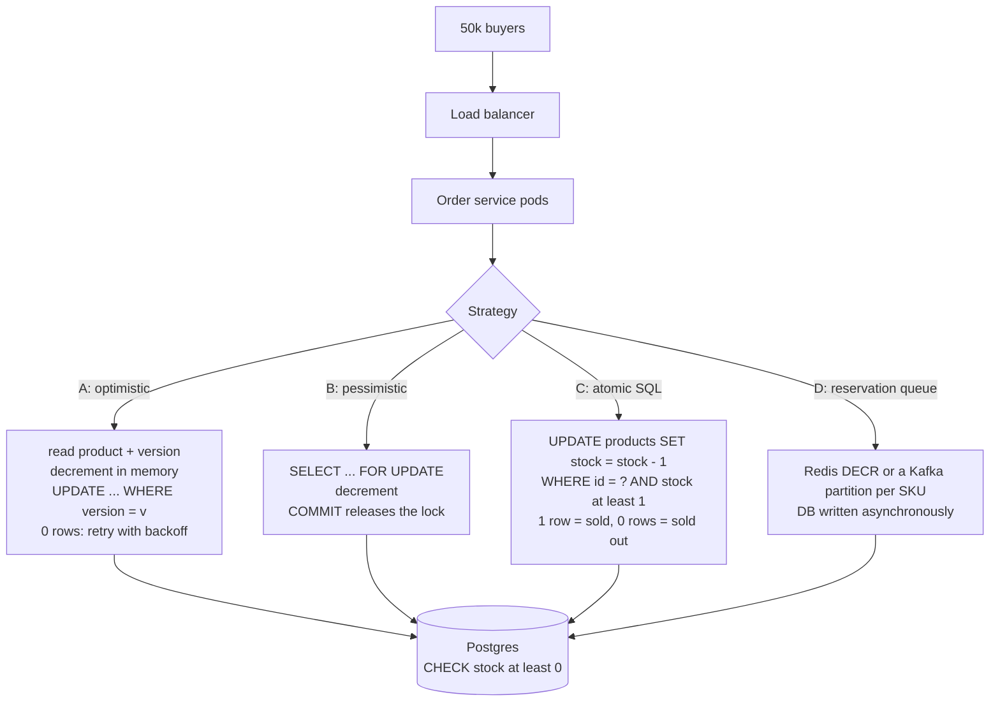

| Strategy | Throughput on one hot row | Failure mode | Best for |
|---|---|---|---|
| **A. `@Version` + retry** (lab `reserveOptimistic`) | Collapses under heavy contention: most attempts fail and retry, wasting DB work | Retries exhausted → error. Needs jittered backoff and a retry limit | Low or moderate contention: normal shopping, admin edits |
| **B. `PESSIMISTIC_WRITE`** (lab `reservePessimistic`) | One buyer at a time per row, with predictable queueing | Lock waits hold connections, so the pool drains. Use `lock.timeout` | Moderate contention where retries are expensive (payments, seat maps) |
| **C. Atomic conditional UPDATE** (`@Modifying` query) | High: a single statement and a very short row lock | Bypasses the persistence context, `@Version` and listeners | The **standard answer** for counters and stock |
| **D. Pre-allocated tokens in Redis/Kafka** | Very high, the DB is off the hot path | Eventual consistency, and reconciliation is needed | Massive drops (ticketing, sneaker launches) |

**Rules that apply to all of them:**
- Keep a database `CHECK (stock >= 0)` as the last line of defence (the lab's schema does).
- **Retry the whole transaction**, never just the flush. After an exception the persistence context is unusable, which is why the lab's `RetryTemplate` wraps `TransactionTemplate`, not the other way round.
- Retry *only* `ObjectOptimisticLockingFailureException`, never `OutOfStockException`.

**Trade-offs:** optimistic locking needs no locks and scales for reads, but it wastes work under contention. Pessimistic locking is simple and correct, but couples throughput to lock hold time and connection count. Atomic SQL is fastest, but moves logic into SQL.
**Who uses it:** every e-commerce checkout (B or C for stock), ticketing platforms (D, often with a virtual waiting room in front), and banking ledgers (B, with consistent lock ordering to avoid deadlocks).

### 7.2 Read replicas: routing `readOnly` transactions to a replica

**Problem:** product pages, search and reports produce 90% of DB load. The primary is CPU-bound, and scaling it vertically is expensive.

**Solution:** add one or more **streaming replicas** (Postgres physical replication, or Aurora/RDS read replicas), and route every `@Transactional(readOnly = true)` method to them automatically.

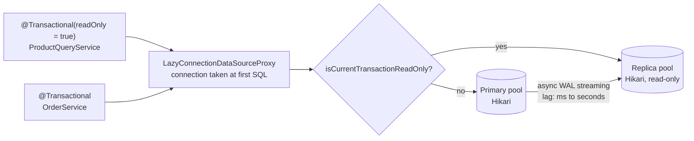

```java
@Bean
// primaryPool and replicaPool are your own @Bean HikariDataSource definitions (built from two
// @ConfigurationProperties prefixes). Defining any DataSource bean makes Boot's DataSourceAutoConfiguration back off.
@Primary
DataSource dataSource(DataSource primaryPool, DataSource replicaPool) {
    var proxy = new LazyConnectionDataSourceProxy(primaryPool);
    proxy.setReadOnlyDataSource(replicaPool);   // used when the tx is read-only (present in Framework 7.0.10)
    return proxy;
}
```

**Why the lazy proxy is essential:** `JpaTransactionManager.doBegin` asks for a connection *while starting* the transaction, before `TransactionSynchronizationManager` records the read-only flag. A plain `AbstractRoutingDataSource` that checks `isCurrentTransactionReadOnly()` therefore always sees `false` and routes everything to the primary (from Spring's javadoc rationale; unverified in the lab). `LazyConnectionDataSourceProxy` hands out a placeholder and picks the real target at the first SQL statement, when the flag is known. (Before `setReadOnlyDataSource` existed, the classic recipe was `AbstractRoutingDataSource` wrapped in `LazyConnectionDataSourceProxy`.)

**Trade-offs:**
- **Replication lag** breaks *read-your-writes*: a user saves a profile, the next GET goes to the replica, and the old value comes back. Mitigations: read from the primary for N seconds after a write (a session flag), route by endpoint rather than globally, or use synchronous replicas for critical reads.
- Two pools mean double the connection count to manage.
- A `REQUIRES_NEW` write inside a read-only flow correctly goes to the primary, but a missing `readOnly = true` silently sends reads there too. Make `readOnly` the default on query services.
- Aurora offers a reader *endpoint* that DNS-balances across replicas. Pair it with a short `max-lifetime` so new replicas get connections.

**Who uses it:** most read-heavy SaaS products and e-commerce catalogs. AWS Aurora (up to 15 replicas) and the Spring docs both present this exact pattern.

### 7.3 Audit trail and soft delete for compliance

**Problem:** finance and health regulations (SOX, HIPAA, PCI) require knowing **who changed what and when**, and records may not physically disappear. Support needs to "undelete" things. At the same time, GDPR's right to erasure demands that personal data *does* disappear.

**Solution, in layers:**

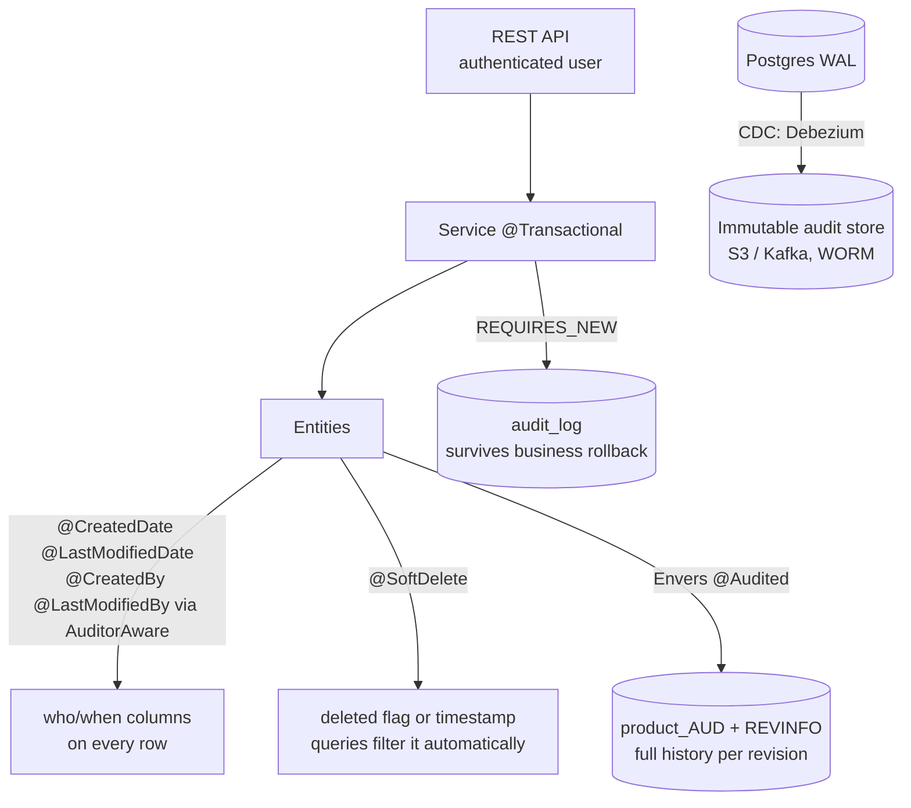

| Need | Tool | Notes |
|---|---|---|
| "Who created or changed this row, and when" | Spring Data auditing: `@CreatedDate`, `@LastModifiedDate`, `@CreatedBy`, `@LastModifiedBy`, plus an `AuditorAware<String>` bean that reads the `SecurityContext` | Only the **latest** change. The lab's `auditing_setsCreatedAndLastModifiedDates` proves the dates. Bulk JPQL updates skip it |
| Logical delete | Hibernate **`@SoftDelete`** (`strategy = DELETED`/`ACTIVE`/`TIMESTAMP`, default column `deleted`) | `remove()` becomes an UPDATE, and HQL, Criteria and `find()` filter it. **Native SQL does not.** A LAZY `@ManyToOne` *to* a soft-deleted type is loaded eagerly (both proven in the lab). Unique constraints need partial indexes (`WHERE deleted = false`) |
| Full version history | **Hibernate Envers** (`@Audited`) | Writes each changed entity to an `_AUD` table per revision, with a `REVINFO` row. `AuditReader` queries "as of revision N". It costs one extra INSERT per change, in the same transaction |
| Attempt log that survives failures | A `REQUIRES_NEW` audit service (the lab's `AuditService`) | Logs even rejected or failed operations. Watch the pool (two connections per request) |
| Tamper-proof, out-of-band trail | CDC (Debezium) from the WAL into Kafka or S3 Object Lock | Catches changes made *outside* the app (DBA scripts, other services) |

**GDPR vs soft delete:** a soft-deleted row is still personal data. Typical answers are **anonymise** in place (overwrite name/email, keep the financial facts), **crypto-shred** (encrypt PII with a per-user key and delete the key), and keep audit tables free of PII or give them a retention policy.

**Trade-offs:** soft delete grows tables forever (add partitioning or archiving), complicates unique constraints, and is easy to bypass with native SQL. Envers doubles write volume on audited tables.
**Who uses it:** banks and fintechs (Envers or CDC for every ledger change), healthcare record systems, and SaaS admin panels with a "trash" and restore.

### 7.4 CQRS read models with projections

**Problem:** the order details page needs data from 6 tables, the admin dashboard needs aggregates over millions of rows, and both run through rich JPA entities that were designed for *writes* (invariants, cascades, versioning). Loading entity graphs for reads causes N+1, over-fetching and lock contention.

**Solution:** separate the **command side** (entities, aggregates, `@Version`, transactions) from the **query side** (DTO projections, SQL views, or denormalised tables), as Command Query Responsibility Segregation.

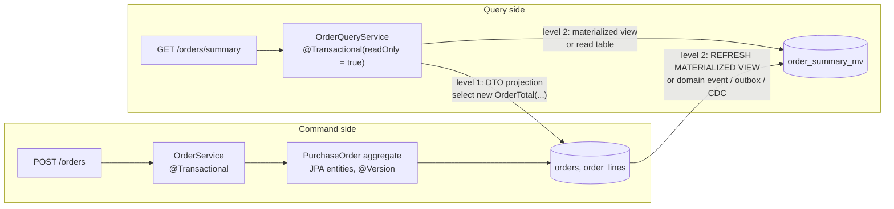

**Levels of CQRS, and you usually stop at level 1:**
1. **Same database, projection queries.** Reads use interface/record projections or `select new` (lab: `OrderTotal`, `CustomerView`). They load no entities, have no dirty checking and no N+1, and select exactly the needed columns. Combine with `readOnly = true` and replica routing (section 7.2).
2. **Same database, dedicated read tables or materialized views.** These are updated by `@TransactionalEventListener(AFTER_COMMIT)`, the transactional outbox (note 11), or a scheduled `REFRESH MATERIALIZED VIEW CONCURRENTLY`. Reads become a single-table SELECT.
3. **A separate read store** (Elasticsearch, Redis, a document DB) fed by Kafka/CDC. It is eventually consistent and lives in its own scaling domain.

**Trade-offs:** level 1 costs almost nothing. Levels 2 and 3 add **eventual consistency** (the UI must tolerate a stale read model), duplicated data and rebuild tooling (replaying events). Don't introduce level 3 for a CRUD app.
**Who uses it:** e-commerce order history and search (Elasticsearch read models), banking statements (precomputed balances), and dashboards everywhere (materialized views).

---

## 8. Pitfalls & debugging checklist

- [ ] **`LazyInitializationException: could not initialize proxy - no Session`** → a lazy association was touched after the transaction ended (OSIV is off, which is good). Fix: fetch it in the service with `@EntityGraph` or a fetch join, or return a DTO. Never use `enable_lazy_load_no_trans`.
- [ ] **Page is slow and the logs show hundreds of identical SELECTs** → N+1. Count statements (Hibernate `Statistics`, datasource-proxy), then add a fetch join or entity graph for that query, plus `default_batch_fetch_size` globally.
- [ ] **`MultipleBagFetchException`** → two `List` collections join-fetched together. Use `Set`, two queries, or batch fetching.
- [ ] **`HHH90003004: firstResult/maxResults specified with collection fetch; applying in memory`** (Hibernate < 7.4) → page ids first, then fetch by ids.
- [ ] **Changes not saved** → the entity is detached (loaded in another transaction, or the method isn't `@Transactional`), or the method is `readOnly = true`, or it was self-invoked. Check `TransactionSynchronizationManager.isActualTransactionActive()` in the debugger.
- [ ] **Changes saved that you didn't want** → dirty checking on a managed entity you mutated for display. Map to DTOs, or use `readOnly = true`.
- [ ] **`UnexpectedRollbackException: ... marked as rollback-only`** → an inner `REQUIRED` method threw and someone caught it. Let it propagate, or make the inner method `REQUIRES_NEW`.
- [ ] **Transaction didn't roll back on an exception** → it was a checked exception (add `rollbackFor`, or the global `rollbackOn`), or it was caught inside the method.
- [ ] **`ObjectOptimisticLockingFailureException`** under load → a genuine concurrent update. Retry the *whole* transaction for idempotent commands, or return 409 Conflict with the current version to the client.
- [ ] **`Schema-validation: missing table / wrong column type`** at startup → the Flyway script and entity disagree. Fix the migration (new version), never switch to `ddl-auto=update` in prod.
- [ ] **Startup fails on a sequence increment mismatch** → `allocationSize` ≠ `INCREMENT BY`. Align them.
- [ ] **Bulk insert is slow** → IDENTITY ids (no batching), `batch_size` not set, or `order_inserts` off. Check for `HHH100501` at startup and count statements.
- [ ] **`Connection is not available, request timed out after 30000ms`** → pool exhaustion. Look for long transactions, OSIV, `REQUIRES_NEW` nesting, or remote calls inside `@Transactional`. Enable `leak-detection-threshold`.
- [ ] **Unique constraint violation when replacing a child** (delete + insert with the same key) → Hibernate flushes inserts before deletes. `flush()` after the delete.
- [ ] **`@Modifying` update not visible** → the persistence context is stale. Use `clearAutomatically = true`, or `refresh()`.
- [ ] **`InvalidDataAccessApiUsageException: Executing an update/delete query`** → a `@Modifying` query without a transaction. The calling service needs `@Transactional`.
- [ ] **Soft-deleted rows appear in reports** → a native query. Add `WHERE deleted = false` yourself.
- [ ] **What SQL actually runs?** `logging.level.org.hibernate.SQL=debug`, `logging.level.org.hibernate.orm.jdbc.bind=trace`, `hibernate.generate_statistics=true` (dev only), and Postgres `pg_stat_statements` in production.

---

## 9. Interview questions

<details><summary>Q1. What is the difference between JPA, Hibernate and Spring Data JPA?</summary>

**JPA** (Jakarta Persistence 3.2) is a *specification*: annotations and interfaces (`EntityManager`, `@Entity`, JPQL) with no implementation. **Hibernate** is a JPA *provider*: it implements `EntityManager` with its `Session`, generates SQL, does dirty checking and caching, and adds extras (`@BatchSize`, `@SoftDelete`, HQL). **Spring Data JPA** sits on top: it generates repository implementations from interfaces (`SimpleJpaRepository` plus query derivation) and integrates with Spring transactions. Between them, **Spring ORM** provides `JpaTransactionManager`, the shared `EntityManager` proxy, and exception translation into `DataAccessException`.
</details>

<details><summary>Q2. How does a repository interface with no implementation work at runtime?</summary>

`JpaRepositoriesRegistrar` registers a `JpaRepositoryFactoryBean` for each repository interface. The factory creates a JDK proxy whose target is a `SimpleJpaRepository` (for CRUD methods), with advice for exception translation, transactions, and a `QueryExecutorMethodInterceptor` for custom methods. Each custom method is resolved at startup by the lookup strategy: `@Query` first, then a named query, then derivation from the method name with `PartTree`. Errors therefore fail at startup. `SimpleJpaRepository` is `@Transactional(readOnly = true)` at class level, and its write methods override that with `@Transactional`.
</details>

<details><summary>Q3. Explain the entity lifecycle states.</summary>

**Transient:** `new`, unknown to JPA. **Managed:** in a persistence context, and changes are tracked and flushed. **Detached:** it was managed, but the context closed (the transaction ended, or `clear`/`detach`), so changes are ignored and lazy loads fail. **Removed:** scheduled for DELETE at flush. `persist` makes a transient entity managed. `merge` copies a detached entity's state onto a managed instance and *returns* that instance (the argument stays detached). `remove` marks a managed entity for deletion.
</details>

<details><summary>Q4. What is dirty checking, and when is SQL actually executed?</summary>

When an entity is loaded, Hibernate stores a snapshot of its state. At **flush**, it compares every managed entity to its snapshot and generates UPDATEs for the differences, so you never call `update()`, and calling `save()` on a managed entity is redundant. Flush happens before commit, before queries that touch affected tables (`FlushModeType.AUTO`), or on an explicit `flush()`. The action queue runs inserts, then updates, then collection changes, and deletes last. In a `readOnly` Spring transaction the flush mode is `MANUAL`, so changes are never written.
</details>

<details><summary>Q5. What is the N+1 problem, and how do you detect and fix it?</summary>

Loading N parents with one query and then touching a lazy association on each fires N more queries. Detect it by counting statements (Hibernate `Statistics.getPrepareStatementCount()`, datasource-proxy or p6spy in tests), not by reading code. Fixes: a `JOIN FETCH` or `@EntityGraph` for that use case (1 query), `@BatchSize` / `hibernate.default_batch_fetch_size` as a global safety net (1 + N/size), `SUBSELECT` fetching, or a DTO projection that loads no entities at all. Watch for `MultipleBagFetchException` with two `List`s, and for pagination combined with a collection fetch join.
</details>

<details><summary>Q6. What are the default fetch types, and why should every association be LAZY?</summary>

`@ManyToOne` and `@OneToOne` are **EAGER** by default. `@OneToMany`, `@ManyToMany` and `@ElementCollection` are LAZY. An EAGER to-one is loaded on every `find` and causes an extra SELECT per distinct parent after every JPQL query, which is N+1 even if you never use it, and you can't turn EAGER off per query. LAZY plus an explicit fetch plan per use case (entity graph or fetch join) gives you control. One niche exception: a LAZY to-one pointing at an entity with `@SoftDelete` is still loaded eagerly, because Hibernate must know whether the target counts as deleted.
</details>

<details><summary>Q7. Owning side vs inverse side: what does mappedBy do?</summary>

The owning side is the one that maps the foreign key (`@ManyToOne` with `@JoinColumn`, or the `@ManyToMany` side without `mappedBy`). Hibernate writes the FK based **only** on the owning side. `mappedBy` marks the inverse side (`@OneToMany(mappedBy = "customer")`), which is a read-only mirror: adding an order only to `customer.getOrders()` writes nothing. Keep both sides in sync with helper methods. A unidirectional `@OneToMany` without `mappedBy` creates a join table (or extra UPDATEs with `@JoinColumn`).
</details>

<details><summary>Q8. Explain @Transactional internals. Why doesn't it work on self-invocation or private methods?</summary>

`@EnableTransactionManagement` registers an advisor whose `TransactionInterceptor` wraps bean methods in a proxy. On a call, `TransactionAspectSupport.invokeWithinTransaction` reads the attributes, calls `PlatformTransactionManager.getTransaction` (`JpaTransactionManager` creates an `EntityManager`, begins the transaction, and binds the `EntityManager` and JDBC connection to the thread via `TransactionSynchronizationManager`), invokes the method, and then commits or calls `completeTransactionAfterThrowing`. Self-invocation (`this.method()`) never reaches the proxy. Private and final methods can't be overridden by CGLIB. Protected and package-private methods **do** work since Framework 6.0 with class-based proxies.
</details>

<details><summary>Q9. List the propagation types. When would you use REQUIRES_NEW, and what is the risk?</summary>

`REQUIRED` (join or create), `REQUIRES_NEW` (suspend and create an independent transaction), `SUPPORTS`, `NOT_SUPPORTED`, `MANDATORY` (throw if none), `NEVER` (throw if one exists), and `NESTED` (a savepoint; not enabled by default with `JpaTransactionManager`). Use `REQUIRES_NEW` for audit or attempt logs that must persist even if the business transaction rolls back. Risks: it needs a **second connection** while the first is held, which can deadlock a small pool under load, and its commit is independent, so an outer rollback doesn't undo it.
</details>

<details><summary>Q10. Which exceptions roll back a transaction by default? What is UnexpectedRollbackException?</summary>

`RuntimeException` and `Error` roll back. **Checked exceptions commit.** Change that with `rollbackFor`/`noRollbackFor`, or globally with `@EnableTransactionManagement(rollbackOn = ALL_EXCEPTIONS)` (Framework 6.2+). `UnexpectedRollbackException` happens when an inner `REQUIRED` method throws (marking the shared transaction rollback-only), the outer method catches it and returns normally, and the commit then discovers the rollback-only flag.
</details>

<details><summary>Q11. Optimistic vs pessimistic locking, and how do isolation levels relate to lost updates?</summary>

**Optimistic** (`@Version`): no DB lock is held. Each UPDATE adds `WHERE version = ?` and increments it, so 0 rows means a conflict → `ObjectOptimisticLockingFailureException`. Retry the whole transaction or report a 409. It's best when conflicts are rare and for long "think time" edits across HTTP requests (expose the version as an ETag). **Pessimistic** (`@Lock(PESSIMISTIC_WRITE)` → `SELECT ... FOR NO KEY UPDATE` on Postgres with Hibernate 7.4) blocks other writers until commit. It's best when conflicts are frequent and retries are costly. It costs lock waits, held connections and deadlock risk, so keep transactions short and use `lock.timeout`/NOWAIT. For a single hot counter, an atomic `UPDATE ... SET stock = stock - 1 WHERE stock > 0` beats both.

**Isolation levels:** `READ_UNCOMMITTED` allows dirty reads. `READ_COMMITTED` (the Postgres/Oracle/SQL Server default) prevents dirty reads but allows non-repeatable reads, phantoms and lost updates. `REPEATABLE_READ` (the MySQL default; snapshot isolation in Postgres) prevents non-repeatable reads, and Postgres also prevents phantoms but allows write skew. `SERIALIZABLE` prevents everything, and Postgres SSI throws serialization failures you must retry. Most apps stay on READ COMMITTED and prevent lost updates with `@Version` or row locks rather than raising the isolation level.
</details>

<details><summary>Q12. What is Open Session in View, and why do we disable it?</summary>

`OpenEntityManagerInViewInterceptor` keeps the `EntityManager` open for the entire web request, so lazy associations can load during JSON serialisation or view rendering. Boot enables it by default and logs a warning. Problems: a connection is held for the whole request, lazy loads run outside transactions (auto-commit, N+1 hidden in the view layer), and data-access decisions leak out of the service layer. With `spring.jpa.open-in-view=false`, a lazy access after the service returns throws `LazyInitializationException`, which forces the service to fetch exactly what the use case needs or to return DTOs.
</details>

<details><summary>Q13. Why does IDENTITY disable batch inserts? Which ID strategy should you use?</summary>

With `IDENTITY` the database assigns the id during the INSERT, and Hibernate needs the id immediately to put the entity into the persistence context. So each `persist()` executes its own INSERT right away, and nothing can be grouped into a JDBC batch. `SEQUENCE` with a pooled optimizer (`allocationSize = 50` matching `INCREMENT BY 50`) fetches ids in blocks without inserting, so inserts are queued and sent in batches (`hibernate.jdbc.batch_size`, `order_inserts`). In the lab, 40 IDENTITY inserts take 40 statements and 40 SEQUENCE inserts take 4 or fewer. For distributed ids, UUIDv7 (`@UuidGenerator(style = VERSION_7)`) keeps inserts index-friendly.
</details>

<details><summary>Q14. How do you implement equals/hashCode on an entity?</summary>

Never base `hashCode` on a generated id: it changes when `persist()` assigns the id, so the entity gets lost in a `HashSet` (the lab proves `contains()` returns false for the same object). Options: use an immutable business key (`sku`, `email`); or use id-equality only when the id is non-null, plus a **constant** `hashCode` (`getClass()` or the entity class's hash); or assign a UUID in the constructor. Use `instanceof` and getters so Hibernate proxies compare correctly, and never use Lombok `@Data` on entities.
</details>

<details><summary>Q15. Page vs Slice vs Window (keyset): what does each cost?</summary>

`Page` runs the content query plus a `count(*)` (skipped when the total is obvious, e.g. a partial last page), so it's the right fit when the UI shows "page 3 of 120". `Slice` fetches `size + 1` rows and never counts, which suits infinite scroll. Both use `OFFSET`, which costs O(offset) and can skip or duplicate rows when data changes between requests. `Window` with `ScrollPosition.keyset()` filters `WHERE (sort keys) > (last seen)`. It costs the same at any depth and stays correct under inserts and deletes, but it needs a unique, stable sort and offers no "jump to page N".
</details>

---

## 10. Sources

- Spring Data JPA reference: [Repositories](https://docs.spring.io/spring-data/jpa/reference/repositories.html), [Query Methods](https://docs.spring.io/spring-data/jpa/reference/jpa/query-methods.html), [Projections](https://docs.spring.io/spring-data/jpa/reference/repositories/projections.html), [Scrolling](https://docs.spring.io/spring-data/jpa/reference/repositories/scrolling.html), [Locking](https://docs.spring.io/spring-data/jpa/reference/jpa/locking.html), [Auditing](https://docs.spring.io/spring-data/jpa/reference/auditing.html), [Transactionality](https://docs.spring.io/spring-data/jpa/reference/jpa/transactions.html)
- Spring Framework reference: [Transaction Management](https://docs.spring.io/spring-framework/reference/data-access/transaction.html), [Declarative transactions and rollback rules](https://docs.spring.io/spring-framework/reference/data-access/transaction/declarative/rolling-back.html), [Transaction propagation](https://docs.spring.io/spring-framework/reference/data-access/transaction/declarative/tx-propagation.html), [JPA integration](https://docs.spring.io/spring-framework/reference/data-access/orm/jpa.html), [`LazyConnectionDataSourceProxy`](https://docs.spring.io/spring-framework/docs/current/javadoc-api/org/springframework/jdbc/datasource/LazyConnectionDataSourceProxy.html), [Spring Framework 7.0 Release Notes](https://github.com/spring-projects/spring-framework/wiki/Spring-Framework-7.0-Release-Notes)
- Spring Boot: [Spring Boot 4.0 Migration Guide](https://github.com/spring-projects/spring-boot/wiki/Spring-Boot-4.0-Migration-Guide), [Spring Boot 4.1 Release Notes](https://github.com/spring-projects/spring-boot/wiki/Spring-Boot-4.1-Release-Notes), [SQL databases / JPA](https://docs.spring.io/spring-boot/reference/data/sql.html), [Database initialization (Flyway, Liquibase)](https://docs.spring.io/spring-boot/how-to/data-initialization.html), [Testcontainers service connections](https://docs.spring.io/spring-boot/reference/testing/testcontainers.html)
- Spring Data release notes: [2025.1](https://github.com/spring-projects/spring-data-commons/wiki/Spring-Data-2025.1-Release-Notes), [2026.0](https://github.com/spring-projects/spring-data-commons/wiki/Spring-Data-2026.0-Release-Notes)
- Hibernate: [ORM 7.0 Migration Guide](https://docs.hibernate.org/orm/7.0/migration-guide/migration-guide.html), [ORM 7.4 What's New](https://docs.hibernate.org/orm/7.4/whats-new/whats-new.html), [`@SoftDelete` javadoc](https://docs.hibernate.org/orm/7.0/javadocs/org/hibernate/annotations/SoftDelete.html), [User Guide](https://docs.hibernate.org/orm/7.4/userguide/html_single/Hibernate_User_Guide.html), [Envers](https://hibernate.org/orm/envers/)
- [Jakarta Persistence 3.2 specification](https://jakarta.ee/specifications/persistence/3.2/)
- HikariCP: [About Pool Sizing](https://github.com/brettwooldridge/HikariCP/wiki/About-Pool-Sizing)
- PostgreSQL: [Transaction Isolation](https://www.postgresql.org/docs/current/transaction-iso.html), [Explicit Locking](https://www.postgresql.org/docs/current/explicit-locking.html)
- Baeldung (3.x era; check against section 6): [Hibernate N+1](https://www.baeldung.com/spring-hibernate-n1-problem), [Transaction Propagation and Isolation](https://www.baeldung.com/spring-transactional-propagation-isolation), [Optimistic Locking in JPA](https://www.baeldung.com/jpa-optimistic-locking), [Pessimistic Locking in JPA](https://www.baeldung.com/jpa-pessimistic-locking), [Spring Data JPA Projections](https://www.baeldung.com/spring-data-jpa-projections), [Open Session in View](https://www.baeldung.com/spring-open-session-in-view), [Soft Delete](https://www.baeldung.com/spring-jpa-soft-delete)
- Oracle: [JDBC `Connection` (setReadOnly, isolation levels)](https://docs.oracle.com/en/java/javase/21/docs/api/java.sql/java/sql/Connection.html), [`java.util.concurrent.CountDownLatch`](https://docs.oracle.com/en/java/javase/21/docs/api/java.base/java/util/concurrent/CountDownLatch.html)
- Spring source to read: `JpaRepositoryFactory`, `SimpleJpaRepository`, `TransactionAspectSupport#invokeWithinTransaction`, `AbstractPlatformTransactionManager#handleExistingTransaction`, `JpaTransactionManager#doBegin`, `HibernateJpaDialect#beginTransaction`, `PageableExecutionUtils#getPage`
