# 07 — Spring Security 7: Filter Chains, JWT Resource Server, OAuth2 & Method Security

> **Lab:** [`labs/07-security-jwt`](https://github.com/sumit-mishra-itp/springboot-roadmap/tree/main/labs/07-security-jwt)
> **Capstone use:** every capstone API is a stateless JWT resource server. Login issues RS256 access tokens plus rotating refresh tokens. Ownership checks (`@PreAuthorize`) protect orders and carts, and service-to-service calls use client credentials.
> **Prereqs:** [01 Spring Core](../01-core/spring-core.md) (BeanPostProcessors, proxies), 02 AOP (self-invocation), 05 REST (ProblemDetail).

**Lab scope:** the lab drops JPA, Postgres, Flyway and Testcontainers on purpose. Users sit in an `InMemoryUserDetailsManager`, and documents and refresh tokens in `ConcurrentHashMap`s, so every test exercises security rather than persistence, and the build needs no Docker. Swapping in `JdbcUserDetailsManager` and a refresh-token table changes no security code (note 06 covers JPA).

Versions in this note: **Spring Boot 4.1.2 ships Spring Security 7.1.2** (checked with `mvnw dependency:list` in the lab). Every ordering and "what happens when" claim below is asserted by a lab test, unless it is marked *(unverified)* or *(not tested in the lab)*. Every 7.x claim is either sourced from the Spring Security reference ("What's New", migration guide) or checked against the 7.1.2 bytecode with `javap`.

---

## 1. What & why

Spring Security answers two questions for every request:

| Question | Name | Typical failure | Spring type |
|---|---|---|---|
| *Who are you?* | **Authentication** | **401 Unauthorized** (badly named: it means *unauthenticated*) | `Authentication`, `AuthenticationManager` |
| *Are you allowed to do this?* | **Authorization** | **403 Forbidden** | `AuthorizationManager` |

It also gives you protection against common attacks for free: CSRF, session fixation, clickjacking (`X-Frame-Options`), MIME sniffing, HSTS, cache-control headers on authenticated responses, and a request firewall (`StrictHttpFirewall`) that rejects path-traversal tricks such as `;`, `//` or `%2e%2e`.

**Before Spring Security:**

| Era | How apps secured themselves | Pain |
|---|---|---|
| Servlet spec `<security-constraint>` + JAAS realms | URL patterns in `web.xml`, users configured in the app server | Not portable between servers, coarse URL-only rules, no method or domain security |
| Hand-written `Filter` checking `session.getAttribute("user")` | Every team reinvented it | Session fixation, missing CSRF, inconsistent 401/403 handling, logic copied into every app |
| **Acegi Security (2003) → Spring Security 2.0 (2008)** | A chain of servlet filters wired as Spring beans | Pluggable authentication, URL + method + domain-object security, and a standard set of attack protections |

**When *not* to reach for (parts of) it:**
- **Don't write your own JWT filter or crypto.** Spring already ships a complete, tested resource server (section 3.9). Hand-rolled JWT filters are the most common security bug source in Spring tutorials.
- **Don't build your own identity provider** for a real product. Use Keycloak, Cognito, Auth0, Okta or Entra ID, or the Spring Authorization Server, which is part of Spring Security since 7.0. The lab's self-issued tokens are a learning device. That pattern is fine for a single monolith, and wrong once a second service needs to trust the tokens.
- **Don't rely on a gateway alone.** A gateway that validates tokens is good, but every service behind it should still validate the JWT (zero trust). Otherwise anyone who reaches the internal network can call it directly.

---

## 2. Mental model

The servlet container knows nothing about Spring beans, and Spring knows nothing about the container's filter list. Spring Security bridges them with **one** container filter that delegates to a bean, which picks **one** chain of security filters per request.

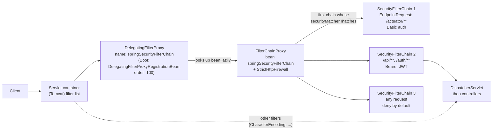

**Three levels, three jobs:**

| Level | Class | Why it exists |
|---|---|---|
| Servlet container | `DelegatingFilterProxy` | The container instantiates filters **before** the Spring context exists. The proxy is a plain filter that looks up the bean `springSecurityFilterChain` lazily, on first use |
| Spring bean | `FilterChainProxy` | The single entry point. It applies the `HttpFirewall`, chooses the chain, and **clears the `SecurityContext` in a `finally`** so nothing leaks to the next request on a pooled thread. Set a breakpoint in `FilterChainProxy.doFilterInternal` to debug any security problem |
| Per-request | `SecurityFilterChain` (`DefaultSecurityFilterChain`) | A `RequestMatcher` plus an ordered `List<Filter>`. **First match wins**, and a request that matches **no** chain gets **no** security at all |

The lab's `FilterChainOrderTest` proves this wiring. It checks that the registration bean `securityFilterChainRegistration` wraps a `DelegatingFilterProxy` named `springSecurityFilterChain`, that this bean name resolves to a `FilterChainProxy`, and that the four chains are ordered actuator → API → form demo → catch-all.

### The authentication type hierarchy

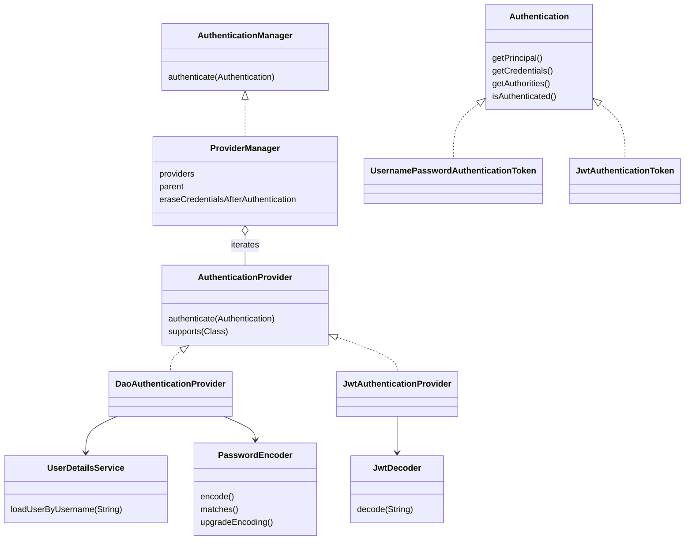

**One sentence to remember:** filters *extract* credentials from the request into an unauthenticated `Authentication`, the `AuthenticationManager` *verifies* them and returns an authenticated one, the filter stores it in the `SecurityContextHolder`, and `AuthorizationFilter` (last in the chain) *decides* using an `AuthorizationManager`.

---

## 3. How it works internally

### 3.1 The filter order: JWT API vs form login (proven, not recalled)

`FilterChainOrderTest` asserts `containsExactly` on each chain's filters from `FilterChainProxy.getFilterChains()`. These are the real Security 7.1.2 lists:

| # | JWT API chain (`apiChain`) | Form-login chain (test-only `formLoginDemoChain`) | Actuator chain (Basic) |
|---|---|---|---|
| 1 | `DisableEncodeUrlFilter` | `DisableEncodeUrlFilter` | `DisableEncodeUrlFilter` |
| 2 | `WebAsyncManagerIntegrationFilter` | `WebAsyncManagerIntegrationFilter` | `WebAsyncManagerIntegrationFilter` |
| 3 | `SecurityContextHolderFilter` | `SecurityContextHolderFilter` | `SecurityContextHolderFilter` |
| 4 | `HeaderWriterFilter` | `HeaderWriterFilter` | `HeaderWriterFilter` |
| 5 | `CorsFilter` | `CorsFilter` | `CorsFilter` |
| 6 | (no `CsrfFilter`: disabled) | **`CsrfFilter`** | `CsrfFilter` |
| 7 | `LogoutFilter` | `LogoutFilter` | `LogoutFilter` |
| 8 | `OAuth2ProtectedResourceMetadataFilter` | **`UsernamePasswordAuthenticationFilter`** | **`BasicAuthenticationFilter`** |
| 9 | **`BearerTokenAuthenticationFilter`** | `DefaultResourcesFilter` | `RequestCacheAwareFilter` |
| 10 | `RequestCacheAwareFilter` | `DefaultLoginPageGeneratingFilter` | `SecurityContextHolderAwareRequestFilter` |
| 11 | `SecurityContextHolderAwareRequestFilter` | `DefaultLogoutPageGeneratingFilter` | `AnonymousAuthenticationFilter` |
| 12 | `AnonymousAuthenticationFilter` | `RequestCacheAwareFilter` | `SessionManagementFilter` |
| 13 | `SessionManagementFilter` | `SecurityContextHolderAwareRequestFilter` | `ExceptionTranslationFilter` |
| 14 | `ExceptionTranslationFilter` | `AnonymousAuthenticationFilter` | `AuthorizationFilter` |
| 15 | `AuthorizationFilter` | `ExceptionTranslationFilter` | |
| 16 | | `AuthorizationFilter` | |

What each key filter does, in request order:

| Filter | Job |
|---|---|
| `DisableEncodeUrlFilter` | Stops `;jsessionid=` from being written into URLs, where it would leak through logs and `Referer` headers |
| `SecurityContextHolderFilter` | Loads the `SecurityContext` **lazily** from the `SecurityContextRepository` (session or request attribute) and clears it afterwards. It replaced `SecurityContextPersistenceFilter` as the default in 6.0. The old filter still ships in 7.1.2 but is deprecated (`@Deprecated` in the bytecode) |
| `HeaderWriterFilter` | `X-Content-Type-Options`, `X-Frame-Options: DENY`, `Cache-Control: no-store`, HSTS on HTTPS |
| `CorsFilter` | Answers CORS **preflight** `OPTIONS` requests *before* any authentication. A preflight never carries the `Authorization` header, so placing CORS later would turn every preflight into a 401 |
| `CsrfFilter` | Requires a CSRF token on state-changing requests when credentials are ambient (cookies) |
| `BearerTokenAuthenticationFilter` | Reads `Authorization: Bearer …`, calls the `AuthenticationManager` (→ `JwtAuthenticationProvider` → `JwtDecoder`), and on failure calls the **resource server's** entry point. With no header it does nothing and passes on |
| `UsernamePasswordAuthenticationFilter` | Handles `POST /login` form submissions |
| `RequestCacheAwareFilter` | After a login redirect, replays the request that was saved before the redirect to `/login`. Irrelevant (a no-op) for stateless APIs |
| `AnonymousAuthenticationFilter` | If nothing authenticated the request, it puts an `AnonymousAuthenticationToken` in the context, so "not logged in" is an explicit state |
| `ExceptionTranslationFilter` | Wraps everything after it in a try/catch and turns exceptions into 401 or 403 (section 3.5) |
| `AuthorizationFilter` | Runs your `authorizeHttpRequests` rules. It is **always last** |

> **Niche detail the test caught:** every `HttpSecurity` bean automatically applies `cors()` when a bean of type **`UrlBasedCorsConfigurationSource`** exists (`HttpSecurityConfiguration.applyCorsIfAvailable`). The lab first declared the `@Bean` method's return type as the *interface* `CorsConfigurationSource`. The type check then only saw the bean once it had been instantiated, so the actuator chain (built first) had **no** `CorsFilter` while later chains did. Declaring the concrete return type fixed it. This is the same "declare the most concrete `@Bean` return type" rule from note 01.

### 3.2 `SecurityContextHolder`: where "the current user" lives

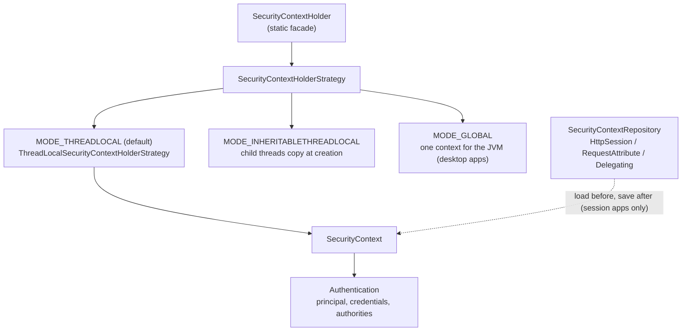

- **Default strategy:** `ThreadLocalSecurityContextHolderStrategy`, asserted by `SecurityContextPropagationTest.defaultStrategy_isThreadLocal`. Change it with the system property `spring.security.strategy` or `SecurityContextHolder.setStrategyName(...)`, or publish a `SecurityContextHolderStrategy` bean.
- **`SecurityContextRepository`** persists the context *between* requests:
  - `HttpSessionSecurityContextRepository` for session apps.
  - `RequestAttributeSecurityContextRepository` keeps it for the duration of one request, including error and async dispatches.
  - `DelegatingSecurityContextRepository` combines both, and is the default for form login.
  - A stateless JWT API re-authenticates **every request** from the bearer token, so nothing is persisted.
- **Explicit save (since 6.0).** `SecurityContextHolderFilter` only *loads*. Saving is the job of whoever authenticates. A custom login controller in a **session-based** app must call `securityContextRepository.saveContext(context, request, response)`, or the user is "logged out" on the next request. This is a classic 5.x → 6.x migration bug. The lab's `/auth/login` doesn't hit it because it returns tokens instead of creating a session.
- **Why it's empty in `@Async`, `CompletableFuture.supplyAsync`, or a thread pool:** the context is a `ThreadLocal`, and `@Async` just submits the call to an executor thread. `SecurityContextPropagationTest` shows it: a plain executor thread sees `null`, while `DelegatingSecurityContextExecutorService` copies the context in and clears it afterwards. The fixes, best first:
  1. Wrap the executor: `DelegatingSecurityContextAsyncTaskExecutor` (for `@Async`), `DelegatingSecurityContextExecutorService`, or `DelegatingSecurityContextRunnable`.
  2. Use Micrometer **context-propagation** (`ContextSnapshot`) if you already use it for tracing.
  3. Pass the data you need (user id, tenant) as **method arguments**. This is often the cleanest answer.
  4. *Avoid* `MODE_INHERITABLETHREADLOCAL` with pools. Pooled threads are created once, so they inherit whichever user created them, and then serve other users.

### 3.3 Authentication: `AuthenticationManager` → `ProviderManager` → providers

The lab's `/auth/login` calls the `AuthenticationManager` directly. That is the same path that `UsernamePasswordAuthenticationFilter` takes for form login:

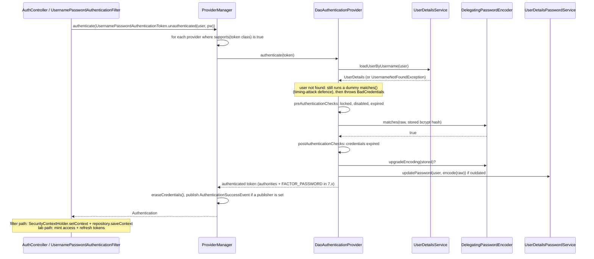

Things interviewers probe here:
- **`ProviderManager`** asks each `AuthenticationProvider` whether it `supports()` the token type. It tries them in order, and the first non-null result wins. If none succeeds, it asks its **parent** `AuthenticationManager`. Each `SecurityFilterChain` gets its own local `ProviderManager`, whose parent is the global one. *(From the reference docs, not tested in the lab.)* The user-not-found dummy hash check in the diagram is also from the docs and source, not a lab test.
- **`hideUserNotFoundExceptions`** (default `true`) turns `UsernameNotFoundException` into `BadCredentialsException`, so attackers can't enumerate users. The lab's wrong-password test asserts the detail is just `"Bad credentials"`.
- **Password upgrade on login.** `InMemoryUserDetailsManager` (and `JdbcUserDetailsManager`) implement `UserDetailsPasswordService`. With `provider.setUserDetailsPasswordService(users)`, a successful login re-hashes an outdated encoding. The lab's `legacy` user starts as `{noop}legacy-pass` and is `{bcrypt}…` after one login (`AuthFlowEndToEndTest.legacyPasswordHash_isUpgradedToBcrypt_onSuccessfulLogin`). This is how you migrate a million MD5 hashes without a password reset campaign.
- **Factor authorities (7.0+).** Authentication mechanisms now add a `FactorGrantedAuthority` that records *how* the user authenticated: `FACTOR_PASSWORD`, `FACTOR_OTT`, `FACTOR_WEBAUTHN`, `FACTOR_X509`, `FACTOR_BEARER`, and others. The lab asserts that a password login yields exactly `FACTOR_PASSWORD` + `ROLE_USER` (`passwordLogin_addsFactorPasswordAuthority_whichIsNotCopiedIntoTheToken`) and that a JWT-authenticated request carries exactly `[FACTOR_BEARER, ROLE_USER]`. This is why `AccessTokenIssuer` copies only `ROLE_*` authorities into the token. A factor describes the login, not a permission.
- **The bearer path** is the same pattern: `BearerTokenAuthenticationFilter` → `ProviderManager` → `JwtAuthenticationProvider` → `JwtDecoder.decode()` (signature + validators) → `JwtAuthenticationConverter` → `JwtAuthenticationToken`.

### 3.4 `AuthorizationFilter` and `AuthorizationManager`

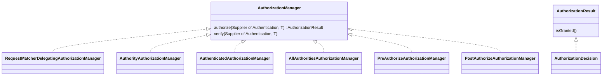

- `authorizeHttpRequests(...)` builds a `RequestMatcherDelegatingAuthorizationManager`, which is an ordered list of `(RequestMatcher, AuthorizationManager)` pairs. **The first matching rule wins**, so put specific rules before general ones and `anyRequest()` last.
- `hasRole("ADMIN")` is an `AuthorityAuthorizationManager` checking for `ROLE_ADMIN`. `hasAuthority("SCOPE_read")` checks the literal string. 7.0 adds `hasAllAuthorities(...)` (backed by `AllAuthoritiesAuthorizationManager`), which MFA rules use to require several factors.
- The `Authentication` is passed as a **`Supplier`**, so `permitAll()` rules never force the context to load. That is what makes the lazy `SecurityContextHolderFilter` pay off.
- **7.0 removed `AuthorizationManager#check`** in favour of `authorize`, which returns an `AuthorizationResult`. The 7.1.2 bytecode has only `authorize` and the default `verify`.
- `AuthorizationFilter` applies to **every dispatcher type** by default, including `ERROR` and `ASYNC`, and Boot registers the security filter for `async, error, forward, include, request` (`spring.security.filter.dispatcher-types`, from the Boot 4.1.2 configuration metadata). Consequence: when a controller fails and the container forwards to `/error`, *that* dispatch is authorized too. If `/error` isn't permitted, users see a 401 or 403 instead of the real error. The lab's catch-all chain permits `/error` and `denyAll()`s everything else.

### 3.5 `ExceptionTranslationFilter`: where 401 vs 403 is decided

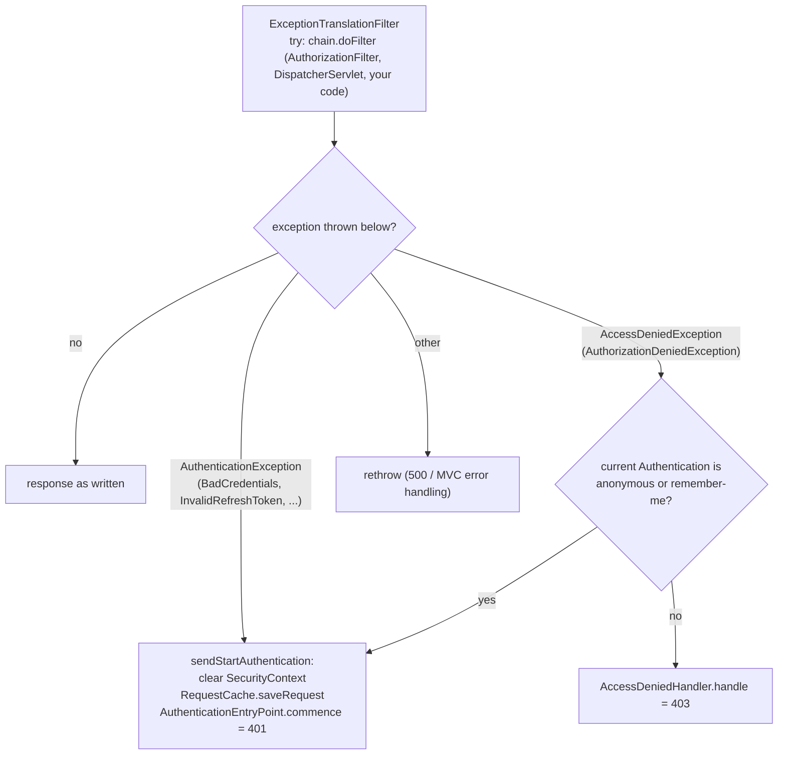

- It only catches exceptions thrown **after** it in the chain: by `AuthorizationFilter` and by everything downstream, including controllers and `@PreAuthorize` proxies. An invalid bearer token fails **earlier**, inside `BearerTokenAuthenticationFilter`, which calls the entry point configured on `oauth2ResourceServer(...)`. **That's why the lab wires the `ProblemDetail` handler twice** (`exceptionHandling` *and* `oauth2ResourceServer`). The e2e tests cover both paths: no token, and a garbage token, both give `application/problem+json`.
- Exceptions thrown inside controllers reach this filter as long as no `@ExceptionHandler` swallows them. The lab's `AuthService` throws `BadCredentialsException` and `InvalidRefreshTokenException` (both `AuthenticationException`s), and they come out as 401 `ProblemDetail` with **no** controller advice at all. A catch-all `@ExceptionHandler(Exception.class)` in your advice would turn them into 500s, so a common fix is to rethrow `AccessDeniedException` and `AuthenticationException` from such handlers.
- Default entry points: `BearerTokenAuthenticationEntryPoint` (401 + `WWW-Authenticate: Bearer error="invalid_token"…`), `BasicAuthenticationEntryPoint` (401 + `WWW-Authenticate: Basic realm="Realm", charset="UTF-8"` in 7.1, asserted by the e2e test), and `LoginUrlAuthenticationEntryPoint` (302 to `/login`, relative redirects by default since 7.0).

### 3.6 Session-based vs stateless

| | Session (form login, BFF) | Stateless (JWT resource server) |
|---|---|---|
| Where identity lives between requests | Server: `HttpSession`, and in Spring Session (Redis/JDBC) for clusters | Client: the token is re-sent and re-verified on every request |
| `SessionCreationPolicy` | `IF_REQUIRED` (default) | `STATELESS`: Spring Security never creates or uses a session |
| Logout / revocation | Invalidate the session: instant | Hard. Short TTL plus refresh rotation, a deny-list, or introspection (section 3.10) |
| CSRF | **Needed** (the cookie is ambient) | Not needed for header tokens |
| Horizontal scaling | Sticky sessions or a shared session store | Trivial: any node can verify a signature |
| Payload | Small cookie, a big server-side state | The token carries claims, so it can grow large (headers are limited to ~8 KB) |
| Best for | Server-rendered apps, and the **BFF in front of an SPA** | APIs consumed by other services, mobile apps, and SPAs via a BFF |

The lab asserts that a stateless login sends **no `Set-Cookie`** (`login_issuesTokens_withoutCreatingASession`). The four policies are `ALWAYS`, `IF_REQUIRED`, `NEVER` (won't create, but uses an existing one), and `STATELESS`.

### 3.7 Method security internals

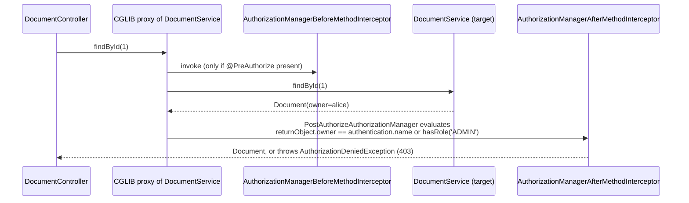

- `@EnableMethodSecurity` (replacing the deprecated `@EnableGlobalMethodSecurity`, which still ships in 7.1.2) registers one AOP **advisor per annotation type**. Each is an `AuthorizationManager{Before,After}MethodInterceptor` backed by `PreAuthorizeAuthorizationManager`, `PostAuthorizeAuthorizationManager`, `SecuredAuthorizationManager`, `Jsr250AuthorizationManager`, and the pre/post filter interceptors. `prePostEnabled` is on by default. `securedEnabled` and `jsr250Enabled` are opt-in.
- Interceptor order (`AuthorizationInterceptorsOrder`, read from bytecode): `PRE_FILTER` → `PRE_AUTHORIZE` → `SECURED` → `JSR250` → `SECURE_RESULT` (450) → `POST_AUTHORIZE` (500) → `POST_FILTER` (600). `@Transactional`'s advisor defaults to lowest precedence, so with both annotations on one method the security interceptors sit *outside* the transaction. A `@PostAuthorize` denial would then arrive after the commit, and the write would not be rolled back. *(This is derived from the advisor orders and is not tested in the lab, so treat it as unverified.)* Either way, keep `@PostAuthorize` on side-effect-free reads.
- SpEL is evaluated by `DefaultMethodSecurityExpressionHandler`. Root variables are `authentication`, `principal`, `returnObject` (post only), `filterObject` (filters), `#paramName` (needs `-parameters`, which Boot's parent POM sets), and `@beanName` bean references. The lab uses `@PreAuthorize("@documentGuard.isOwner(#id, authentication)")` so the rule lives in testable Java.
- **It is a proxy**, so everything from note 02 applies: self-invocation skips the check, as do `private` and `final` methods and objects created with `new`. `DocumentService.rename` calls `findById` internally, and that self-call does **not** re-apply `@PostAuthorize`.
- Newer method-security tools (6.3+; the classes are present in 7.1.2): `@AuthorizeReturnObject` wraps returned objects in authorization proxies, and `@HandleAuthorizationDenied` returns a masked value instead of throwing. You can also write meta-annotations with templated SpEL.

### 3.8 OAuth 2.0 and OpenID Connect in one picture

| OAuth role | What it is | Spring module / Boot starter |
|---|---|---|
| Resource owner | The user | n/a |
| **Client** | The app that wants to call an API *on behalf of* the user (or itself) | `spring-boot-starter-security-oauth2-client` (`oauth2Login()`, `OAuth2AuthorizedClientManager`) |
| **Authorization server** | Authenticates the user, issues tokens (Keycloak, Cognito, Okta, Auth0) | Spring Authorization Server, **part of Spring Security since 7.0**: `spring-boot-starter-security-oauth2-authorization-server` |
| **Resource server** | The API that validates tokens | `spring-boot-starter-security-oauth2-resource-server` (`oauth2ResourceServer()`). **This lab** |

**Authorization code + PKCE**, the only flow a user-facing app should use:

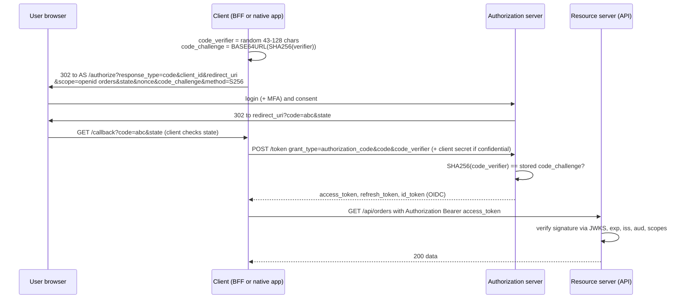

- **PKCE** binds the code to the client that started the flow. A stolen authorization `code` (from logs, history, or a malicious app on the same redirect scheme) is useless without the `code_verifier`. OAuth 2.1 makes it mandatory for **all** clients, and Spring Authorization Server enables PKCE by default since 7.0.
- **`state`** protects the redirect against CSRF. **`nonce`** (OIDC) binds the ID token to the session to prevent replay.
- **Client credentials:** no user is involved. The service authenticates as itself (`grant_type=client_credentials`, client id and secret, or `private_key_jwt`) and gets a token whose `sub` is the client. See section 7.4.
- **Gone:**
  - The **password grant** was removed from Spring Security 7.0 (What's New) and from OAuth 2.1.
  - The **implicit grant** (tokens in the URL fragment) is deprecated by the OAuth security BCP.
- **OpenID Connect** = OAuth 2.0 + identity:
  - The `openid` scope returns an **ID token**, a JWT *about the user* that is meant for the **client**, not for APIs.
  - It adds a `/userinfo` endpoint and discovery at `/.well-known/openid-configuration`, which tells clients the `jwks_uri`, endpoints and algorithms.
  - **Never send an ID token to an API as a bearer token.** Its audience is the client.

### 3.9 JWT: structure, signing, JWKs, validation

```text
eyJhbGciOiJSUzI1NiIsImtpZCI6IjIwMjYtMTEifQ . eyJpc3MiOiJodHRwOi8vbG9jYWxob3N0OjgwODAiLCJzdWIiOiJhbGljZSIs... . Nm2yb...
  header (base64url JSON)                      payload (base64url JSON claims)                                 signature
  {"alg":"RS256","kid":"2026-11"}              {"iss","sub","aud","exp","iat","jti","roles":["USER"]}         RSASSA(header.payload)
```

- **Not encrypted.** Anyone can base64-decode the payload, so never put PII or secrets in it. A **JWS** is signed. A **JWE** is encrypted, and rarely needed.
- **Registered claims:**
  - `iss`: issuer.
  - `sub`: subject.
  - `aud`: audience, meaning which API the token is for.
  - `exp` / `nbf` / `iat`: expiry, not-before, issued-at.
  - `jti`: the token id, used for deny-lists.
  - Scopes go in `scope`/`scp`. Roles are custom (`roles`, or Keycloak's `realm_access.roles`).

| Algorithm | Key | Who can verify | Use when |
|---|---|---|---|
| **HS256** (HMAC) | One shared secret | Only parties holding the secret, **who can therefore also mint tokens** | A single app that both issues and verifies. Use a secret of at least 256 bits |
| **RS256** (RSA) | Private key signs, public key verifies | Anyone with the public key (via a JWK set) | The default for IdPs and multi-service systems. The lab uses it |
| **ES256** (ECDSA P-256) | Same as RS256, with smaller keys and signatures | Same | Modern alternative. `NimbusJwtEncoder.withKeyPair(ECPublicKey, ECPrivateKey)` |

- **JWK set (JWKS):** the issuer publishes its public keys as JSON at `jwks_uri`, each with a `kid`. The token header names the `kid` that signed it. Resource servers cache the set and refetch on an unknown `kid`, which makes **key rotation** painless: publish the new key, start signing with it, and remove the old key after the longest token TTL.
- **Validation in Spring** (`NimbusJwtDecoder` + `OAuth2TokenValidator`s):
  - **Signature**, with the algorithm pinned by the key type. Nimbus rejects `alg: none`, and the decoder never "trusts the header" to switch from RS256 to HS256. That avoids the classic algorithm-confusion attack in which the attacker signs with the *public key* as an HMAC secret.
  - **`JwtTimestampValidator`**: `exp` and `nbf`, with a **60-second clock skew** by default. The lab's expired-token test uses a token that expired 8 minutes ago.
  - **`JwtTypeValidator`**: in 7.0 every `JwtValidators.createDefault*` includes `JwtTypeValidator.jwt()`, and `NimbusJwtDecoder.validateTypes` defaults to `false`, so the check isn't run twice (OAuth migration guide).
  - **`JwtIssuerValidator`** and **`JwtAudienceValidator`**: the lab adds both. Without `aud` validation, a valid token minted for the billing API also works on yours. The e2e test proves a wrong-`aud` token gets a 401.
- **Boot properties** (from the 4.1.2 configuration metadata) replace most of `JwtConfig` when the tokens come from an IdP:
  - `spring.security.oauth2.resourceserver.jwt.issuer-uri` (discovers the JWKS and validates `iss`)
  - `jwk-set-uri`, `audiences`, `jws-algorithms`, `public-key-location`
  - `authorities-claim-name`, `authority-prefix`, `authorities-claim-delimiter`, `principal-claim-name`
  - `authorities-claim-expressions`, for nested claims such as Keycloak roles
- **Why the hand-rolled `JwtFilter extends OncePerRequestFilter` is outdated.** It's the tutorial classic: jjwt, `request.getHeader("Authorization").substring(7)`, `SecurityContextHolder.getContext().setAuthentication(...)`. It typically:
  - skips `aud`/`iss`/`nbf` validation;
  - mishandles algorithm selection;
  - swallows exceptions and so returns 403 or 500 instead of `401 + WWW-Authenticate`;
  - runs on `permitAll` paths and breaks them;
  - forgets `SecurityContextHolderStrategy`;
  - can't consume a JWKS or rotate keys;
  - duplicates what `BearerTokenAuthenticationFilter` + `JwtDecoder` already do, with tests behind them.

  Since Spring Security 5.1, `oauth2ResourceServer(o -> o.jwt(...))` is the supported way, even for self-issued tokens (`NimbusJwtEncoder` for issuing, `NimbusJwtDecoder.withPublicKey`/`withSecretKey` for verifying).
- **Where the browser keeps tokens.** **Not `localStorage`/`sessionStorage`.** Any XSS (a compromised npm dependency, an injected script) can read them and send them home, and a token works from anywhere until it expires. `HttpOnly` cookies can't be read by JavaScript. The recommended pattern for SPAs is the **BFF** (section 7.2): the browser holds only an `HttpOnly; Secure; SameSite` session cookie, and the tokens stay on the server.

### 3.10 Opaque tokens vs JWT, and revocation

| | JWT (self-contained) | Opaque (reference) token |
|---|---|---|
| What the API receives | Signed claims | A random string |
| How the API validates it | Locally, signature + claims, with no network call | **Introspection** (RFC 7662): `POST /introspect` to the AS on every request (cache it!) |
| Revocation | Hard: valid until `exp` | Instant: the AS forgets it |
| Size / privacy | Large, claims are readable | Tiny, reveals nothing |
| Spring config | `oauth2ResourceServer(o -> o.jwt(...))` | `oauth2ResourceServer(o -> o.opaqueToken(...))` with `SpringOpaqueTokenIntrospector`, or the new **`RestClientOpaqueTokenIntrospector`** (7.1) |

**JWT revocation strategies, from cheapest to strongest:**
1. **Short access-token TTL** (5–15 min, the lab uses 5) plus **refresh-token rotation**. Revoking the refresh token or family kills access within one TTL.
2. **Re-check on refresh.** The lab re-reads the user's roles and `enabled` flag on every refresh, so a demoted or disabled user is cut off at the next refresh.
3. **Deny-list by `jti`** in Redis with TTL = remaining lifetime, checked by a custom `OAuth2TokenValidator`. This adds one lookup per request.
4. **Per-user token version or `iat` cut-off.** Store `tokensValidAfter` per user and reject tokens issued before it. This is "log out everywhere".
5. **Introspection / opaque tokens** for high-risk APIs (payments, admin).
6. **Rotate the signing key.** This is the nuclear option that logs out everyone.

### 3.11 CSRF, CORS and password storage

**CSRF** makes a victim's browser send a state-changing request to your site **with credentials the browser attaches automatically**: cookies, HTTP Basic, client certificates.
- **It matters** for any cookie-session app, including a BFF. The defences are:
  - the synchronizer token (`HttpSessionCsrfTokenRepository`, the default);
  - double-submit cookies (`CookieCsrfTokenRepository.withHttpOnlyFalse()` for SPAs);
  - `SameSite=Lax/Strict` cookies as defence in depth.
- Spring masks the token per request (`XorCsrfTokenRequestAttributeHandler`, the default since 6.0) against BREACH.
- 7.0 adds `http.csrf(csrf -> csrf.spa())`, a one-liner for the SPA setup (cookie repository plus a handler that accepts the raw header value).
- **It doesn't matter** for APIs authenticated *only* by a header token. A cross-site form can't set `Authorization: Bearer`. That's why the lab disables CSRF on `apiChain` and **keeps** it on the actuator chain: Basic credentials are cached and resent by browsers, so they are ambient.

**CORS** is a *browser* relaxation of the same-origin policy, not a server-side protection. Curl ignores it.
- A **preflight** `OPTIONS` (with `Origin`, `Access-Control-Request-Method` and `Access-Control-Request-Headers`) is sent for non-simple requests: methods other than GET, HEAD and POST, custom headers such as `Authorization`, or `Content-Type: application/json`.
- The server answers with `Access-Control-Allow-Origin`, `-Methods`, `-Headers` and `-Max-Age`.
- Rules:
  - `allowCredentials(true)` can't be combined with `*` origins (use `allowedOriginPatterns`).
  - List exact origins in production.
  - `CorsFilter` must run before authentication.
- The lab proves both cases: an allowed origin gets `Access-Control-Allow-Origin` with no token, and `https://evil.example` gets a 403 with no CORS headers.

**Password storage.** Use a slow, salted, adaptive hash: **bcrypt** (default cost 10, `$2a$10$`), **argon2id** (memory-hard, the OWASP first choice), scrypt, or PBKDF2 (FIPS). Never use MD5, SHA-x or reversible encryption.
- `DelegatingPasswordEncoder` stores `{id}hash`, so algorithms can change over time. `PasswordStorageTest` proves the `{bcrypt}$2a$10$` prefix, random salting, and `upgradeEncoding` for a `{noop}` hash.
- Gotchas:
  - bcrypt only uses the first **72 bytes** of the password.
  - A higher cost multiplies login CPU, so load-test it. The lab's e2e suite spends real time in bcrypt.
  - 7.0 adds Password4j-based encoders (`Argon2Password4jPasswordEncoder`, `BcryptPassword4jPasswordEncoder` and others).
  - `DaoAuthenticationProvider.setCompromisedPasswordChecker` (backed by `HaveIBeenPwnedRestApiPasswordChecker`) rejects breached passwords.

### 3.12 Multi-tenant and multiple issuers

One API trusted by several IdPs (a realm per tenant in Keycloak, or a Cognito pool per region):

```java
@Bean
SecurityFilterChain api(HttpSecurity http) {
    var resolver = JwtIssuerAuthenticationManagerResolver.fromTrustedIssuers(
            "https://idp.example.com/realms/acme",
            "https://idp.example.com/realms/globex");
    return http.authorizeHttpRequests(a -> a.anyRequest().authenticated())
               .oauth2ResourceServer(o -> o.authenticationManagerResolver(resolver))
               .build();
}
```

- The resolver reads the **unverified** `iss` claim *only* to pick a trusted issuer from the allow-list. It then verifies the signature against **that** issuer's JWKS. An untrusted `iss` is rejected before any network call. Don't build a resolver that fetches JWKS from whatever `iss` says (SSRF plus token forgery).
- Each issuer's `JwtDecoder` is created lazily and cached. For dynamic tenants, pass a `Predicate` or your own `AuthenticationManagerResolver<String>` backed by a tenant table.
- After authentication, put the tenant (from `iss` or a `tenant_id` claim) into your tenant context (note 01's routing `DataSource`) and **always** check that the resource's tenant matches the token's. Cross-tenant BOLA is the classic SaaS breach.

### 3.13 OWASP API Security Top 10 (2023) → Spring mapping

| # | Risk | Spring Security / Boot answer | In the lab |
|---|---|---|---|
| API1 | **Broken Object Level Authorization** (BOLA/IDOR) | Ownership checks in `@PreAuthorize`/`@PostAuthorize`, or a `PermissionEvaluator` / guard bean. Never trust the id in the URL | `DocumentGuard`, `@PostAuthorize returnObject.owner` |
| API2 | Broken Authentication | Resource-server validation (sig/exp/iss/aud), bcrypt/argon2, refresh rotation, MFA (7.0), login rate limiting | `JwtConfig`, `RefreshTokenStore` |
| API3 | Broken Object Property Level Authorization (mass assignment, over-exposure) | Record DTOs in and out, never entities. `@JsonView` or separate admin DTOs | `RenameRequest` has only `title` |
| API4 | Unrestricted Resource Consumption | Gateway rate limiting, Bucket4j, pagination limits, `server.tomcat.max-swallow-size`, request-size limits | (gateway, note 13) |
| API5 | Broken Function Level Authorization | URL rules plus method rules, deny by default, admin paths separated | `/api/admin/**` `hasRole`, `denyByDefaultChain` |
| API6 | Unrestricted Access to Sensitive Business Flows | Rate limits per user, CAPTCHA, step-up MFA (`AuthorizationManagerFactories.multiFactor()`) | |
| API7 | Server-Side Request Forgery | Allow-list outbound hosts. Never fetch user-supplied URLs (or JWKS from untrusted `iss`) | Issuer allow-list (3.12) |
| API8 | Security Misconfiguration | Explicit CORS origins, security headers (on by default), minimal actuator exposure, no stack traces | Actuator chain, CORS config |
| API9 | Improper Inventory Management | OpenAPI inventory, versioning, decommissioning old versions, no forgotten `/v1` | |
| API10 | Unsafe Consumption of APIs | Validate third-party responses, timeouts, TLS, treat partner data as untrusted | |

---

## 4. Full worked code

All of this is in the lab and exercised by `./mvnw verify` (38 tests, all green). Imports are omitted for brevity.

### 4.1 Three filter chains with the lambda DSL

```java
@Configuration(proxyBeanMethods = false)
public class ActuatorSecurityConfig {
    @Bean @Order(1)
    SecurityFilterChain actuatorChain(HttpSecurity http) {          // 7.x: build() no longer throws Exception
        return http
                .securityMatcher(EndpointRequest.toAnyEndpoint())    // follows management base-path changes
                .authorizeHttpRequests(a -> a
                        .requestMatchers(EndpointRequest.to("health")).permitAll()
                        .anyRequest().hasRole("ADMIN"))
                .httpBasic(withDefaults())
                .sessionManagement(s -> s.sessionCreationPolicy(SessionCreationPolicy.STATELESS))
                .build();                                             // CSRF left ON: Basic is ambient
    }
}

@Configuration(proxyBeanMethods = false)
@EnableMethodSecurity
public class SecurityConfig {

    @Bean @Order(2)
    SecurityFilterChain apiChain(HttpSecurity http, JwtAuthenticationConverter converter,
                                 ProblemDetailSecurityHandler problems) {
        return http
                .securityMatcher("/api/**", "/auth/**")
                .authorizeHttpRequests(a -> a
                        .requestMatchers(HttpMethod.POST, "/auth/login", "/auth/refresh").permitAll()
                        .requestMatchers("/api/admin/**").hasRole("ADMIN")
                        .anyRequest().authenticated())
                .oauth2ResourceServer(rs -> rs
                        .jwt(jwt -> jwt.jwtAuthenticationConverter(converter))
                        .authenticationEntryPoint(problems)          // bad/expired token
                        .accessDeniedHandler(problems))
                .exceptionHandling(e -> e
                        .authenticationEntryPoint(problems)          // no token
                        .accessDeniedHandler(problems))              // wrong role / @PreAuthorize
                .sessionManagement(s -> s.sessionCreationPolicy(SessionCreationPolicy.STATELESS))
                .csrf(csrf -> csrf.disable())                        // header tokens are not ambient
                .cors(withDefaults())
                .build();
    }

    @Bean @Order(Ordered.LOWEST_PRECEDENCE)                          // any-request chain MUST be last
    SecurityFilterChain denyByDefaultChain(HttpSecurity http, ProblemDetailSecurityHandler problems) {
        return http
                .authorizeHttpRequests(a -> a.requestMatchers("/error").permitAll().anyRequest().denyAll())
                .exceptionHandling(e -> e.authenticationEntryPoint(problems).accessDeniedHandler(problems))
                .sessionManagement(s -> s.sessionCreationPolicy(SessionCreationPolicy.STATELESS))
                .build();
    }

    @Bean                                                             // concrete type: see section 3.1
    UrlBasedCorsConfigurationSource corsConfigurationSource(AppSecurityProperties props) {
        CorsConfiguration cors = new CorsConfiguration();
        cors.setAllowedOrigins(props.allowedOrigins());               // http://localhost:5173
        cors.setAllowedMethods(List.of("GET", "POST", "PUT", "DELETE"));
        cors.setAllowedHeaders(List.of("Authorization", "Content-Type"));
        cors.setMaxAge(Duration.ofHours(1));
        UrlBasedCorsConfigurationSource source = new UrlBasedCorsConfigurationSource();
        source.registerCorsConfiguration("/**", cors);
        return source;
    }
}
```

### 4.2 Issuing and verifying tokens with Spring's own classes

```java
@Configuration(proxyBeanMethods = false)
@EnableConfigurationProperties(AppSecurityProperties.class)
public class JwtConfig {
    @Bean KeyPair jwtSigningKeyPair() throws NoSuchAlgorithmException {      // prod: load from KMS/Secrets Manager
        KeyPairGenerator g = KeyPairGenerator.getInstance("RSA");
        g.initialize(2048);
        return g.generateKeyPair();
    }

    @Bean JwtEncoder jwtEncoder(KeyPair kp) {                                 // 7.0 builder
        return NimbusJwtEncoder.withKeyPair((RSAPublicKey) kp.getPublic(), (RSAPrivateKey) kp.getPrivate()).build();
    }

    @Bean JwtDecoder jwtDecoder(KeyPair kp, AppSecurityProperties props) {
        NimbusJwtDecoder decoder = NimbusJwtDecoder.withPublicKey((RSAPublicKey) kp.getPublic()).build();
        decoder.setJwtValidator(JwtValidators.createDefaultWithValidators(   // + exp/nbf (60s skew) + typ
                new JwtIssuerValidator(props.issuer()),
                new JwtAudienceValidator(props.audience())));
        return decoder;
    }

    @Bean JwtAuthenticationConverter jwtAuthenticationConverter() {          // "roles":["ADMIN"] -> ROLE_ADMIN
        JwtGrantedAuthoritiesConverter roles = new JwtGrantedAuthoritiesConverter();
        roles.setAuthoritiesClaimName("roles");
        roles.setAuthorityPrefix("ROLE_");
        JwtAuthenticationConverter converter = new JwtAuthenticationConverter();
        converter.setJwtGrantedAuthoritiesConverter(roles);
        return converter;
    }
}

@Component
public class AccessTokenIssuer {
    // constructor omitted
    public String issue(String username, Collection<? extends GrantedAuthority> authorities) {
        Instant now = Instant.now();
        JwtClaimsSet claims = JwtClaimsSet.builder()
                .issuer(props.issuer()).audience(List.of(props.audience()))
                .subject(username).issuedAt(now).expiresAt(now.plus(props.accessTokenTtl()))
                .id(UUID.randomUUID().toString())
                .claim("roles", roles(authorities))     // only ROLE_*, never FACTOR_*
                .build();
        return encoder.encode(JwtEncoderParameters.from(claims)).getTokenValue();
    }
}
```

### 4.3 Login and refresh-token rotation with reuse detection

```java
@Bean
AuthenticationManager authenticationManager(InMemoryUserDetailsManager users, PasswordEncoder encoder) {
    DaoAuthenticationProvider provider = new DaoAuthenticationProvider(users);   // 7.x: UDS via constructor
    provider.setPasswordEncoder(encoder);                    // DelegatingPasswordEncoder: {bcrypt}
    provider.setUserDetailsPasswordService(users);           // upgrade {noop}/old hashes on login
    return new ProviderManager(provider);
}

@Service
public class AuthService {
    public TokenResponse login(String username, String password) {
        Authentication auth = authenticationManager.authenticate(
                UsernamePasswordAuthenticationToken.unauthenticated(username, password)); // BadCredentials -> 401
        return tokens(accessTokens.issue(auth.getName(), auth.getAuthorities()),
                      refreshTokens.startFamily(auth.getName()));
    }

    public TokenResponse refresh(String refreshToken) {
        RefreshTokenStore.Rotation rotation = refreshTokens.rotate(refreshToken);
        UserDetails user = users.loadUserByUsername(rotation.username());   // fresh roles, enabled check
        if (!user.isEnabled() || !user.isAccountNonLocked()) {
            throw new InvalidRefreshTokenException("Account is disabled or locked");
        }
        return tokens(accessTokens.issue(user.getUsername(), user.getAuthorities()), rotation.refreshToken());
    }
}

@Component
public class RefreshTokenStore {
    private record Entry(String familyId, String username, Instant expiresAt, boolean used) {}
    public record Rotation(String username, String refreshToken) {}

    private final Map<String, Entry> byHash = new ConcurrentHashMap<>();     // SHA-256(token) -> entry
    private final Set<String> revokedFamilies = ConcurrentHashMap.newKeySet();

    public String startFamily(String username) { return issue(UUID.randomUUID().toString(), username); }

    public synchronized Rotation rotate(String refreshToken) {               // atomic check-and-mark
        String hash = hash(refreshToken);
        Entry entry = byHash.get(hash);
        if (entry == null || revokedFamilies.contains(entry.familyId())) {
            throw new InvalidRefreshTokenException("Refresh token is invalid or revoked");
        }
        if (entry.used()) {                                                   // REUSE: someone has a copy
            revokedFamilies.add(entry.familyId());
            log.warn("Refresh token reuse detected for user {}, token family {} revoked",
                    entry.username(), entry.familyId());
            throw new InvalidRefreshTokenException("Refresh token reuse detected, all tokens of this login revoked");
        }
        if (entry.expiresAt().isBefore(Instant.now())) {
            throw new InvalidRefreshTokenException("Refresh token expired");
        }
        byHash.put(hash, new Entry(entry.familyId(), entry.username(), entry.expiresAt(), true));
        return new Rotation(entry.username(), issue(entry.familyId(), entry.username()));
    }
    // issue(): 32 random bytes from SecureRandom, base64url, store SHA-256 hash with expiry
}

public class InvalidRefreshTokenException extends AuthenticationException { /* -> 401 via entry point */ }
```

### 4.4 Method security against domain objects

```java
@Service
public class DocumentService {
    @PostAuthorize("returnObject.owner == authentication.name or hasRole('ADMIN')")
    public Document findById(long id) { /* load or 404 */ }

    @PreAuthorize("@documentGuard.isOwner(#id, authentication)")
    public Document rename(long id, String title) { /* ... */ }

    @PreAuthorize("hasRole('ADMIN')")                  // defence in depth behind the URL rule
    public void delete(long id) { repository.deleteById(id); }
}

@Component("documentGuard")
public class DocumentGuard {
    public boolean isOwner(long documentId, Authentication authentication) {
        return repository.findById(documentId)
                .map(d -> d.owner().equals(authentication.getName()))
                .orElse(false);                         // missing -> 403, so ids can't be probed
    }
}
```

### 4.5 401/403 as `ProblemDetail`

```java
@Component
public class ProblemDetailSecurityHandler implements AuthenticationEntryPoint, AccessDeniedHandler {
    private final JacksonJsonHttpMessageConverter converter = new JacksonJsonHttpMessageConverter(); // Jackson 3 + ProblemDetail mixin

    @Override
    public void commence(HttpServletRequest req, HttpServletResponse res, AuthenticationException ex) throws IOException {
        res.setHeader(HttpHeaders.WWW_AUTHENTICATE, "Bearer");                // RFC 6750
        write(req, res, HttpStatus.UNAUTHORIZED, ex.getMessage());
    }

    @Override
    public void handle(HttpServletRequest req, HttpServletResponse res, AccessDeniedException ex) throws IOException {
        write(req, res, HttpStatus.FORBIDDEN, "You do not have permission to access this resource");
    }

    private void write(HttpServletRequest req, HttpServletResponse res, HttpStatus status, String detail) throws IOException {
        ProblemDetail problem = ProblemDetail.forStatusAndDetail(status, detail);
        problem.setInstance(URI.create(req.getRequestURI()));
        res.setStatus(status.value());
        converter.write(problem, MediaType.APPLICATION_PROBLEM_JSON, new ServletServerHttpResponse(res));
    }
}
```

Example response from the e2e test:

```json
{"type":"about:blank","title":"Unauthorized","status":401,"detail":"Full authentication is required to access this resource","instance":"/api/documents/1"}
```

### 4.6 Testing security

```java
// Slice: real SecurityConfig + real (proxied) DocumentService, MockMvc.
@WebMvcTest(DocumentController.class)
@Import({SecurityConfig.class, JwtConfig.class, ProblemDetailSecurityHandler.class,
         DocumentService.class, DocumentGuard.class, DocumentRepository.class})
class DocumentControllerSecurityTest {
    @Test void jwtPostProcessor_owner_readsOwnDocument() throws Exception {
        mvc.perform(get("/api/documents/1")
                .with(jwt().jwt(t -> t.subject("alice"))
                           .authorities(new SimpleGrantedAuthority("ROLE_USER"))))   // converter is bypassed!
           .andExpect(status().isOk());
    }

    @Test @WithMockUser(username = "bob")
    void postAuthorize_deniesSomeoneElsesDocument() throws Exception {
        mvc.perform(get("/api/documents/1")).andExpect(status().isForbidden());
    }
}

// End to end: real server, real tokens.
@SpringBootTest(webEnvironment = RANDOM_PORT)
@AutoConfigureRestTestClient
class AuthFlowEndToEndTest {
    @Test void refresh_rotatesTokens_andReuseRevokesTheWholeFamily() {
        TokenResponse first = login("alice", "alice-pass");
        TokenResponse second = refresh(first.refreshToken());                  // 200, new pair
        client.post().uri("/auth/refresh").contentType(MediaType.APPLICATION_JSON)
                .body(new RefreshRequest(first.refreshToken()))
                .exchange().expectStatus().isUnauthorized();                    // reuse detected
        client.post().uri("/auth/refresh").contentType(MediaType.APPLICATION_JSON)
                .body(new RefreshRequest(second.refreshToken()))
                .exchange().expectStatus().isUnauthorized();                    // family revoked
    }
}

// Architecture proof: the exact filter order.
List<String> filters = context.getBean(FilterChainProxy.class).getFilterChains().get(1)
        .getFilters().stream().map(f -> f.getClass().getSimpleName()).toList();
assertThat(filters).containsExactly("DisableEncodeUrlFilter", /* ... */ "ExceptionTranslationFilter", "AuthorizationFilter");
```

---

## 5. Gap fillers & niche details

- **`hasRole("ADMIN")` vs `hasAuthority("ROLE_ADMIN")`**: these are identical. `hasRole` adds the `ROLE_` prefix, so in the URL DSL `hasRole("ROLE_ADMIN")` is rejected when the chain is built (`AuthorityAuthorizationManager` asserts the prefix is absent). In `@PreAuthorize` SpEL the prefix is tolerated. *(Neither is tested in the lab.)* Scopes from a standard JWT become `SCOPE_orders.read`, so use `hasAuthority("SCOPE_orders.read")`.
- **The `jwt()` test post-processor bypasses your `JwtDecoder` *and* your `JwtAuthenticationConverter`.** Claims you put on it are not mapped to roles. The default authority is `SCOPE_read`. Pass `.authorities(...)` explicitly, and test the converter end to end with real tokens, as the lab does.
- **`@WebMvcTest` doesn't load your `@Configuration` security classes.** Without `@Import`, you test Boot's *default* chain (everything authenticated, form login) and your tests pass for the wrong reason.
- **Boot's default security** (no `SecurityFilterChain` bean): everything is authenticated, with form login plus Basic, and a generated password is logged at startup. Defining **any** `SecurityFilterChain` bean switches the whole default chain off. A `UserDetailsService`, `AuthenticationManager` or `JwtDecoder` bean switches off the generated user.
- **Unmatched requests are unsecured.** If no chain's `securityMatcher` matches, `FilterChainProxy` applies no filters. Add a catch-all chain ordered last. Spring refuses to start if an any-request chain is *not* last ("A filter chain that matches any request has already been configured"). *(From the docs, not tested in the lab.)*
- **`/auth/**` must be in a chain.** The lab's API chain lists it explicitly. If login sat outside every chain, it would work but would get no CORS, headers or exception translation.
- **`permitAll()` still runs the filters.** A *malformed* bearer token on a `permitAll` URL still gets a 401 from `BearerTokenAuthenticationFilter`. Use a separate chain, or `web.ignoring()` (which is discouraged because it disables headers too), for truly public endpoints that might receive stale tokens.
- **`WebSecurityCustomizer.ignoring()`** skips Spring Security entirely: no security headers, no firewall. Prefer `permitAll()`. Spring logs a warning when you use `ignoring()` *(unverified)*.
- **Order of `requestMatchers` matters.** `anyRequest().authenticated()` placed before `/api/admin/**` would make the admin rule unreachable. Rules are evaluated top-down.
- **`requestMatchers(String)` uses `PathPatternRequestMatcher` in 7.x.** `AntPathRequestMatcher` and `MvcRequestMatcher` are gone (What's New 7.0, and absent from the 7.1.2 jar).
- **`SecurityContextHolder.getContext()` in a `@Scheduled` or Kafka listener** is empty. No request means no authentication. Use a service account context explicitly, or pass identity in the message.
- **Virtual threads** (`spring.threads.virtual.enabled=true`): the ThreadLocal strategy still works per request, because each request runs on its own virtual thread. The `@Async` propagation rules are the same.
- **`AuthenticationPrincipal`**: `@AuthenticationPrincipal Jwt jwt` in a controller injects the decoded token, and `@AuthenticationPrincipal(expression = "subject")` injects one field. That's cleaner than casting `SecurityContextHolder` results.
- **`@PreAuthorize` on an interface vs the class**: both work with the 6.x+ annotation resolution. Pick one place per method. Conflicting duplicates are an error rather than a merge.
- **Refresh tokens must not be JWTs signed with the access-token key.** The API would accept them as access tokens. The lab's opaque refresh token is rejected on `/api/me` (`refreshToken_isNotAcceptedAsAccessToken`).
- **Store refresh tokens hashed.** A database leak then yields nothing usable. Hash with SHA-256, not bcrypt: the tokens are already high-entropy, and you need fast lookups.
- **Rotation race**: two browser tabs refreshing at the same moment both present the same refresh token. One wins and the other triggers reuse detection, logging the user out. Auth0 offers a short **reuse grace period** for this, and the client can also serialize refreshes with a lock in the BFF.
- **Clock skew**: `JwtTimestampValidator` allows 60 seconds by default. A token that expired 30 seconds ago still **passes** (`tokenExpired30SecondsAgo_isStillAccepted_dueToDefaultClockSkew`), so the lab's "expired" test uses a token that is 8 minutes old.
- **`WWW-Authenticate` charset (7.1)**: `Basic realm="Realm", charset="UTF-8"`. Clients that parse the header strictly may need updating (gh-18755, asserted by the lab).
- **`@EnableMethodSecurity` + `@Transactional` + `@Async` on the same bean** means several advisors on one CGLIB proxy. The order is decided by advisor `Order`, so read `AuthorizationInterceptorsOrder` before stacking them.
- **Logging**: `logging.level.org.springframework.security=TRACE` prints every filter and every authorization decision per request. It's the fastest way to see "why 403". Never log the `Authorization` header or a request body that contains passwords. The lab's `LoginRequest.toString()` masks the password.
- **`DaoAuthenticationProvider` constructor**: in 7.x the `UserDetailsService` goes in through the constructor (`new DaoAuthenticationProvider(users)`). The 7.1.2 class has no no-arg constructor.
- **Actuator**: `EndpointRequest.toAnyEndpoint()` is better than `"/actuator/**"` because it follows `management.endpoints.web.base-path` and a separate management port.

---

## 6. Boot 4 / Framework 7 / Security 7 delta

**Sources:**
- [What's New in Spring Security 7.0](https://docs.spring.io/spring-security/reference/7.0/whats-new.html) and [What's New in 7.1](https://docs.spring.io/spring-security/reference/whats-new.html)
- [Migrating to 7](https://docs.spring.io/spring-security/reference/migration/index.html), with its [Authorization](https://docs.spring.io/spring-security/reference/migration/servlet/authorization.html) and [OAuth 2.0](https://docs.spring.io/spring-security/reference/migration/servlet/oauth2.html) pages
- [Spring Boot 4.0 Migration Guide](https://github.com/spring-projects/spring-boot/wiki/Spring-Boot-4.0-Migration-Guide)
- "bytecode" means checked with `javap` against the 7.1.2 jars

| Change | Status | Source | What it means for you |
|---|---|---|---|
| `and()` removed from the `HttpSecurity` DSL | **Removed** | What's New 7.0, bytecode | The lambda DSL is the only DSL. `http.csrf()` with no argument no longer exists either: only `csrf(Customizer)` remains |
| `authorizeRequests` removed | **Removed** | What's New 7.0, bytecode | Use `authorizeHttpRequests` (`AuthorizationManager`-based, lazy `Authentication`, all dispatcher types) |
| `AntPathRequestMatcher`, `MvcRequestMatcher` removed | **Removed** | What's New 7.0, bytecode | `PathPatternRequestMatcher` everywhere. `requestMatchers("/x/**")` does this for you |
| `AuthorizationManager#check` removed | **Removed** | What's New 7.0, bytecode | Implement `authorize(Supplier, T)` returning an `AuthorizationResult` |
| Access API (`AccessDecisionManager`, `AccessDecisionVoter`) moved to `spring-security-access` | **Moved** | Migration guide | Add that dependency only if you still use voters. Better: migrate to `AuthorizationManager` |
| `AbstractSecurityBuilder.build()` no longer declares `throws Exception` | **Changed** | bytecode | `SecurityFilterChain` bean methods don't need `throws Exception` (the lab's don't) |
| Multi-factor authentication: `FactorGrantedAuthority`, `@EnableMultiFactorAuthentication`, `AuthorizationManagerFactories.multiFactor()`, `hasAllAuthorities` | **New** | What's New 7.0, MFA docs | Every login adds a `FACTOR_*` authority. Rules can demand several factors, and the user is sent to the login page for the *missing* factor |
| `AllRequiredFactorsAuthorizationManager.anyOf`, `ConditionalAuthorizationManager`, `MultiFactorCondition.WEBAUTHN_REGISTERED` | **New in 7.1** | What's New 7.1 | Alternative factor sets, and MFA only for some users |
| One-time-token login (`oneTimeTokenLogin()`) | Existing (added in 6.4, *unverified*), now an MFA factor (`FACTOR_OTT`) | MFA docs | Magic-link login. As a second factor it pairs with password |
| `AuthorizationManagerFactory` | **New** | What's New 7.0 | One place to customise how `hasRole` and friends build managers. MFA uses it |
| `Authentication.Builder` | **New** | What's New 7.0 | Mutate or merge authentications (used to combine factors) |
| `http.csrf(c -> c.spa())` | **New** | What's New 7.0 | One-liner CSRF for SPAs (cookie repository + header handler) |
| Spring Authorization Server merged into Spring Security | **Moved** | What's New 7.0, Boot migration guide | Version follows `spring-security.version`. Starter: `spring-boot-starter-security-oauth2-authorization-server` |
| PKCE enabled by default in the Authorization Server | **Changed** | What's New 7.0 | Public *and* confidential clients must send `code_challenge` |
| Password grant removed | **Removed** | What's New 7.0 | Use authorization code + PKCE (users) or client credentials (services) |
| `NimbusJwtEncoder` builders: `withKeyPair(RSA or EC)`, `withSecretKey` | **New** | What's New 7.0, bytecode | No more hand-building `JWKSource` for self-issued tokens (the lab uses it) |
| `NimbusJwtDecoder` custom `JwkSource` | **New** | What's New 7.0 | Plug in Nimbus `JwkSourceBuilder` (caching, retries, failover) |
| `JwtTypeValidator.jwt()` in every `JwtValidators.createDefault*`, and `validateTypes` default `false` | **Changed** | OAuth migration | Remove any manual `JwtTypeValidator` / `validateTypes(false)` workaround |
| `NimbusJwtDecoder` JWKS fetch timeout 500 ms → 30 s | **Changed** | OAuth migration | Set your own `RestOperations` if you need fast failure |
| `BearerTokenAuthenticationFilter#setBearerTokenResolver` deprecated | **Deprecated** | OAuth migration | Configure `BearerTokenAuthenticationConverter` (the DSL does this for you) |
| `OAuth2ProtectedResourceMetadataFilter` in resource-server chains | **New** (7.x, release not pinned) | Observed in `FilterChainOrderTest`, documented in the 7.x reference | Serves RFC 9728 protected-resource metadata |
| `RestClientOpaqueTokenIntrospector` | **New in 7.1** | What's New 7.1 | `RestClient`-based introspection |
| `WWW-Authenticate` includes `charset` | **Changed in 7.1** | What's New 7.1, lab test | `Basic realm="Realm", charset="UTF-8"` |
| `PreFlightRequestFilter` support (CORS) | **New in 7.1** | What's New 7.1 | Not explored in the lab *(details unverified)* |
| Password4j encoders (Argon2, BCrypt, SCrypt, PBKDF2, Balloon) | **New** | What's New 7.0 | Alternative implementations via the Password4j library |
| Jackson 2 → 3: `SecurityJackson2Modules` → `SecurityJacksonModules` | **Changed** | Migration guide | Matters if you serialize `SecurityContext` (Spring Session JSON) |
| Default login page shows factors (`factor.type` / `factor.reason`); `LoginUrlAuthenticationEntryPoint` favours relative redirects | **Changed** | What's New 7.0 | Check absolute-URL assumptions behind proxies |
| Boot 4 starters renamed: `spring-boot-starter-security-oauth2-resource-server` / `-client` / `-authorization-server`, plus `-test` variants | **Renamed** | Boot migration guide | The old `spring-boot-starter-oauth2-*` names are deprecated. `@WithMockUser` needs `spring-boot-starter-security-test` |
| `spring.security.oauth2.resourceserver.jwt.authorities-claim-expressions` | **Present in Boot 4.1.2** | Boot config metadata | Map nested claims (e.g. Keycloak `realm_access.roles`) without code *(the release that introduced it is unverified)* |

> ⚠️ **Outdated advice still common in tutorials and Baeldung articles:**
> - `extends WebSecurityConfigurerAdapter`: removed in 6.0 (absent from the 7.1.2 jar). Declare `SecurityFilterChain` beans.
> - `.antMatchers()` / `.mvcMatchers()` / `.authorizeRequests()` / `.and()`: all removed. Use `requestMatchers` and lambdas.
> - `@EnableGlobalMethodSecurity(prePostEnabled = true)`: deprecated (still ships). Use `@EnableMethodSecurity`.
> - A hand-rolled `JwtAuthenticationFilter extends OncePerRequestFilter` with jjwt: use `oauth2ResourceServer().jwt()` (section 3.9).
> - "Store the JWT in `localStorage`": use a BFF with `HttpOnly` cookies.
> - `http.csrf().disable()` copied into session-based apps: only disable it for pure bearer-token APIs.
> - The Spring Security OAuth project (`@EnableAuthorizationServer`, `@EnableResourceServer`): end of life for years. Use the resource server support and Spring Authorization Server.
> - The password grant in demos ("POST username and password to /oauth/token"): removed.
> - `NoOpPasswordEncoder` / `{noop}` in anything but throwaway demos.

---

## 7. Real-life architecture solutions

### 7.1 Central identity provider + gateway token relay to microservices

**Problem:** twenty microservices each implement login, password storage and MFA differently. Users have a separate account per app, and an audit finds three different bcrypt cost factors and one SHA-1.

**Solution:** one **identity provider** (Keycloak, Amazon Cognito, Auth0, Okta or Entra ID) owns users, MFA and token issuing. The **API gateway** (Spring Cloud Gateway) is an OAuth2 *client* that runs the code + PKCE login, or a resource server that validates incoming bearer tokens, and **relays** the access token downstream (`TokenRelay` filter). Every microservice is a **resource server** that validates the JWT itself against the IdP's JWKS (`issuer-uri`) and enforces its own `aud`/scope/role rules.

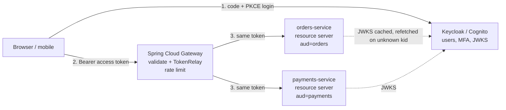

```yaml
# each service: no JwtConfig class needed
spring.security.oauth2.resourceserver.jwt:
  issuer-uri: https://idp.example.com/realms/shop       # discovers jwks_uri, validates iss
  audiences: orders-api
  authorities-claim-expressions: ...                     # e.g. realm_access.roles for Keycloak (Boot 4.1.2)
```

**Trade-offs:**
- **Pros:** single sign-on, one place for MFA and password policy, services never see passwords, and keys rotate centrally (JWKS + `kid`).
- **Cons:**
  - The IdP is a critical dependency. Cache the JWKS so a short IdP outage doesn't break validation of already-issued tokens.
  - Relaying the *user's* token to every hop gives each service the full power of the token. Use per-service audiences or **token exchange** (RFC 8693) for least privilege.
  - Keycloak's role-claim shape needs a custom converter or claim expressions.

**Who uses it:** practically every microservice shop. Keycloak is the common self-hosted choice. Cognito is the AWS-native option (capstones, note 16).

### 7.2 Backend-for-Frontend (BFF) for a single-page app

**Problem:** the React SPA keeps the access and refresh tokens in `localStorage`. A compromised npm package runs an XSS payload and exfiltrates refresh tokens, and the attacker gets weeks of account access from their own machine.

**Solution:** the SPA never sees a token. A small **BFF** (Spring Boot with `oauth2Login()` + Spring Session, or Spring Cloud Gateway with `TokenRelay`) is the confidential OAuth client. It runs code + PKCE, keeps the tokens **server-side** (session store, e.g. Redis), and gives the browser only an `HttpOnly; Secure; SameSite=Lax` session cookie. API calls go SPA → BFF (cookie) → API (bearer token added by the BFF).

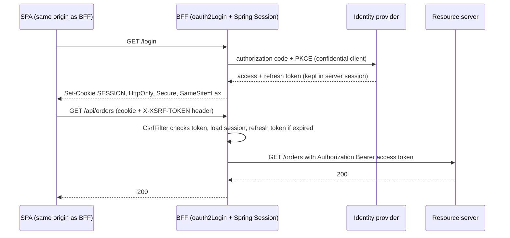

**Trade-offs:**
- **Pros:**
  - XSS can no longer *steal* tokens. It can still act within the page while it runs, so XSS remains bad but is bounded.
  - Refresh happens server-side.
  - Logout is real (kill the session).
  - Same-origin means no CORS.
- **Cons:**
  - You're back to cookies, so **CSRF protection is mandatory**. `csrf.spa()` (7.0) is the one-liner.
  - The BFF needs session storage and becomes stateful.
  - The BFF is one more hop to run.

**Who uses it:** recommended by the IETF *OAuth 2.0 for Browser-Based Apps* draft. Spring Cloud Gateway and Duende BFF implement it, and banks and fintechs use it for web apps.

### 7.3 Refresh-token rotation with reuse detection (the Auth0 model)

**Problem:** long-lived refresh tokens are bearer secrets. If one leaks (device theft, malware, logs), the thief silently mints access tokens for weeks, and you can't tell the thief from the user.

**Solution:** every refresh **rotates** the token, and the old one becomes "used". All tokens descending from one login form a **family**. If a *used* token is ever presented again, either the thief or the legitimate user holds a stale copy, so the server revokes the **whole family** and both must re-authenticate. This is exactly the lab's `RefreshTokenStore`, proven by `refresh_rotatesTokens_andReuseRevokesTheWholeFamily`.

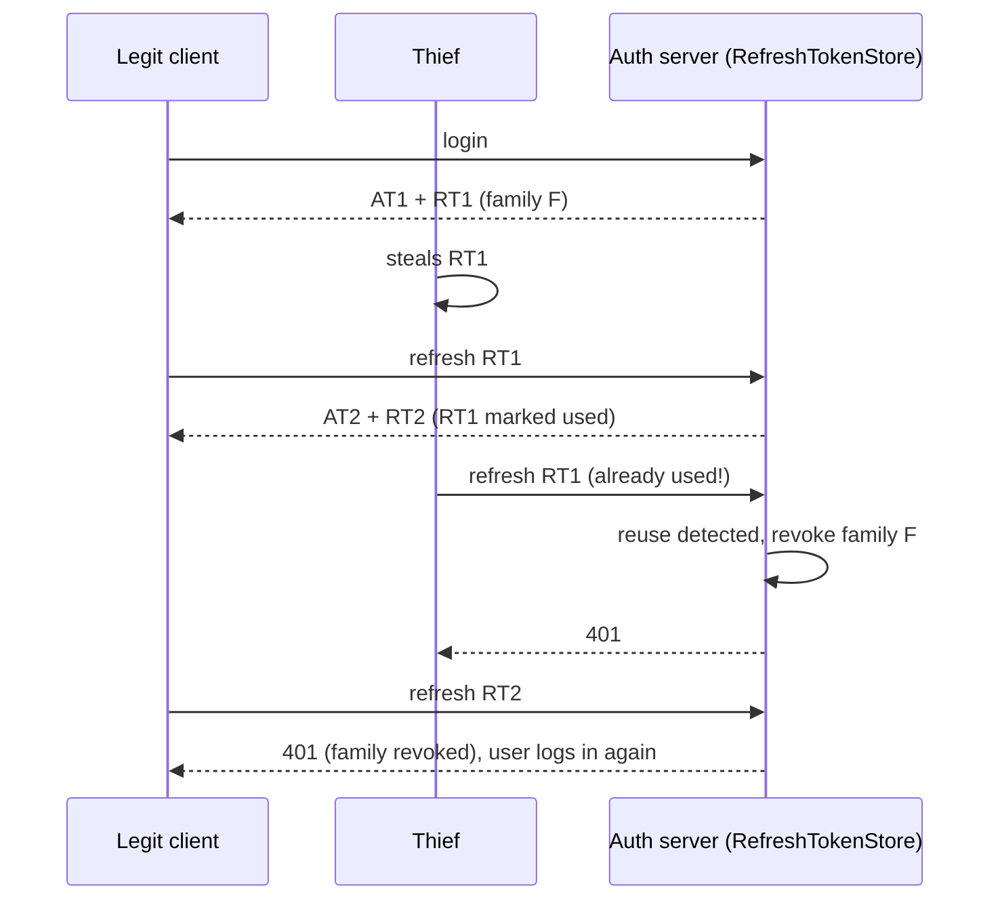

**Production details:**
- Store `hash(token)`, `family_id`, `user_id`, `expires_at`, `used_at` and `revoked` in a table or in Redis.
- Rotate atomically with `UPDATE … SET used_at = now() WHERE hash = ? AND used_at IS NULL`, and check that the row count is 1.
- Add an **absolute family lifetime**, for example 30 days. The lab's TTL is per token, so it slides.
- Offer a few seconds of reuse grace for concurrent tabs.
- Alert on reuse, because it's a security signal.
- Log out with "revoke family", and handle "log out everywhere" by revoking all of the user's families.

**Trade-offs:** a stateful lookup on every *refresh* (not on every API call), and concurrent-refresh UX issues. **Who uses it:** Auth0 ("Refresh Token Rotation" with automatic reuse detection), Okta, and Spring Authorization Server, which rotates with `reuseRefreshTokens(false)`. Whether SAS also revokes the family on reuse is *unverified*.

### 7.4 Service-to-service authentication with client credentials

**Problem:** the order service calls the inventory service from a Kafka consumer. No user is involved, so there is no user token to relay. Shared static API keys get copied into ten configs and never rotate.

**Solution:** each service is registered at the IdP as an OAuth **client** and obtains its own short-lived token with the **client credentials** grant. Spring's `OAuth2AuthorizedClientManager` caches the token and refreshes it before expiry. The `RestClient` adds it automatically through `OAuth2ClientHttpRequestInterceptor` or the 7.0 HTTP-service-client support (`@ClientRegistrationId`). The callee is a normal resource server that authorizes on **scopes**, e.g. `SCOPE_inventory.reserve`.

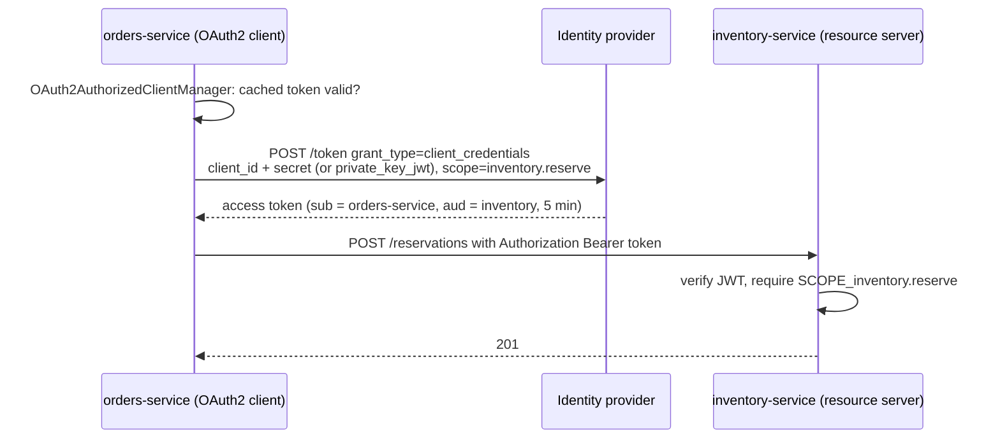

```yaml
spring.security.oauth2.client:
  registration.inventory:
    provider: idp
    client-id: orders-service
    client-secret: ${INVENTORY_CLIENT_SECRET}      # env var / Secrets Manager, never in git
    authorization-grant-type: client_credentials
    scope: inventory.reserve
  provider.idp.issuer-uri: https://idp.example.com/realms/shop
```

**Trade-offs:**
- **Pros:** short-lived, scoped, auditable credentials that rotate centrally.
- **Cons:**
  - The IdP sits on the path of internal calls. The token cache mitigates this.
  - The callee loses the *user* context. Use token exchange or pass the user id as data when it matters.
- **Alternatives:** mTLS with a service mesh (SPIFFE identities), or AWS IAM SigV4 between AWS services.

**Who uses it:** standard in OAuth-based platforms (Keycloak service accounts, Cognito "machine-to-machine" app clients, Auth0 M2M).

---

## 8. Pitfalls & debugging checklist

- [ ] **Everything returns 401, even `permitAll` URLs.** A stale `Authorization` header is being sent, and the bearer filter rejects it before authorization (`permitAllEndpoint_withMalformedBearerToken_isStillRejected`). Or the URL matched a different chain than you think. Turn on `logging.level.org.springframework.security=TRACE`.
- [ ] **403 instead of 401 for anonymous users.** Your chain has no authentication mechanism, so the fallback entry point (`Http403ForbiddenEntryPoint`) is used *(from the docs, not tested in the lab)*. Set an `authenticationEntryPoint`.
- [ ] **Custom 401 JSON only works for missing tokens, not expired ones.** You configured `exceptionHandling` but not `oauth2ResourceServer(o -> o.authenticationEntryPoint(...))`.
- [ ] **A 401/403 thrown in a controller turns into a 500.** A catch-all `@ExceptionHandler(Exception.class)` swallowed `AccessDeniedException` or `AuthenticationException` before `ExceptionTranslationFilter` saw them.
- [ ] **`hasRole('ADMIN')` never matches JWT users.** The authorities are `SCOPE_*`. Configure `JwtAuthenticationConverter` or `authorities-claim-name`/`authority-prefix`. Check what you really have with an `/api/me` endpoint, as the lab does.
- [ ] **Valid-looking token rejected.** Check, in order: clock skew beyond 60s, `iss` mismatch (trailing slash!, `http` vs `https`), `aud` missing, the `kid` not in the JWKS, or a wrong `typ` header (7.x validates `typ`).
- [ ] **CORS error in the browser, but curl works.** The preflight hits auth (the `CorsFilter` is missing from that chain), the origin isn't listed, or `allowCredentials` is combined with `*`. Check the `OPTIONS` response, not the `GET`.
- [ ] **POST/PUT get 403 in a session app.** That's CSRF. Send the token (`X-XSRF-TOKEN`) or check your SPA setup with `csrf.spa()`.
- [ ] **User logged out on the next request after a custom login.** The `SecurityContext` was never saved (explicit save since 6.0). Call `securityContextRepository.saveContext`.
- [ ] **`SecurityContextHolder` empty in `@Async`/executors.** It's a ThreadLocal. Wrap the executor with `DelegatingSecurityContext*`.
- [ ] **`@PreAuthorize` silently ignored.** `@EnableMethodSecurity` is missing, or the call is a self-invocation, a private/final method, or an object created with `new`.
- [ ] **`/error` page returns 401/403 instead of the real error.** The ERROR dispatch is secured too. `permitAll` `/error`.
- [ ] **Some requests bypass security entirely.** No chain matched them. Add a deny-by-default chain last.
- [ ] **Tests pass but prod is open.** `@WebMvcTest` ran without your `@Import`ed config, so it tested Boot's default chain.
- [ ] **Login slow under load.** bcrypt cost × requests per second. Measure, consider cost 10–12, and rate-limit `/auth/login`.
- [ ] **Refresh logs users out randomly.** Concurrent refreshes trigger reuse detection. Add a grace window, or serialize refreshes client-side.

---

## 9. Interview questions

<details><summary>Q1. Walk through what happens when a request hits a Spring Security protected endpoint.</summary>

Tomcat calls `DelegatingFilterProxy` (registered by Boot as `springSecurityFilterChain`, order -100), which delegates to the `FilterChainProxy` bean. `FilterChainProxy` runs the `HttpFirewall`, then picks the **first** `SecurityFilterChain` whose `securityMatcher` matches, and runs its filters in order:
1. `SecurityContextHolderFilter` lazily loads the context.
2. Headers and CORS run.
3. An authentication filter (`BearerTokenAuthenticationFilter`, `UsernamePasswordAuthenticationFilter`, `BasicAuthenticationFilter`) turns credentials into an `Authentication` via the `AuthenticationManager` and stores it in `SecurityContextHolder`.
4. `AnonymousAuthenticationFilter` fills in an anonymous token if nothing authenticated the request.
5. `ExceptionTranslationFilter` wraps the rest.
6. `AuthorizationFilter` evaluates the `authorizeHttpRequests` rules.

If the request is allowed, it reaches `DispatcherServlet`, where method-security proxies may check again. Afterwards `FilterChainProxy` clears the context.
</details>

<details><summary>Q2. Why does Spring Security need DelegatingFilterProxy AND FilterChainProxy?</summary>

The servlet container creates filters before the Spring `ApplicationContext` exists and knows nothing about beans. `DelegatingFilterProxy` is a plain servlet filter that lazily looks up a bean by name, which bridges the two lifecycles. `FilterChainProxy` is that bean. It gives Spring Security a single entry point that can:
- hold *several* chains with request matchers;
- apply the firewall;
- always clear the `SecurityContext`;
- serve as one place to debug.

All without registering dozens of filters in the container.
</details>

<details><summary>Q3. Authentication vs authorization, and 401 vs 403. Who decides which is returned?</summary>

Authentication establishes identity, and authorization decides access. `ExceptionTranslationFilter` decides. An `AuthenticationException`, or an `AccessDeniedException` for an **anonymous** (or remember-me) user, triggers the `AuthenticationEntryPoint`, which returns 401 with `WWW-Authenticate`, or a redirect to login. An `AccessDeniedException` for an authenticated user goes to the `AccessDeniedHandler`, which returns 403. A bad bearer token fails earlier, in `BearerTokenAuthenticationFilter`, which calls the resource server's entry point directly.
</details>

<details><summary>Q4. Explain AuthenticationManager, ProviderManager, AuthenticationProvider, UserDetailsService and PasswordEncoder.</summary>

- **`AuthenticationManager`** is the single-method contract `authenticate(Authentication)`.
- **`ProviderManager`** implements it by iterating `AuthenticationProvider`s that `supports()` the token type, falling back to a parent manager, erasing credentials, and publishing events.
- **`DaoAuthenticationProvider`** loads a `UserDetails` from a `UserDetailsService` and runs account checks (locked, disabled, expired). It verifies the password with a `PasswordEncoder`, optionally upgrades the hash via `UserDetailsPasswordService`, and hides user-not-found as bad credentials, with a dummy hash check against timing attacks.
- **`JwtAuthenticationProvider`** is the bearer equivalent: `JwtDecoder` plus `JwtAuthenticationConverter`.
</details>

<details><summary>Q5. Why is the SecurityContext empty inside an @Async method, and how do you fix it?</summary>

The default `SecurityContextHolderStrategy` is a `ThreadLocal`, and `@Async` runs the method on an executor thread that never had the context set. Fixes:
- Wrap the executor in `DelegatingSecurityContextAsyncTaskExecutor` (or the `ExecutorService`/`Runnable` variants), which copies the context in and clears it afterwards.
- Use Micrometer context propagation.
- Pass the needed identity as parameters.

Avoid `MODE_INHERITABLETHREADLOCAL` with thread pools, because pooled threads keep the context of whoever created them.
</details>

<details><summary>Q6. How do you implement JWT authentication in modern Spring, and why not write a JwtFilter?</summary>

Use the OAuth2 resource server: `http.oauth2ResourceServer(o -> o.jwt(...))` with a `JwtDecoder`. Either `issuer-uri` (JWKS discovery for an IdP) or `NimbusJwtDecoder.withPublicKey`/`withSecretKey` for self-issued tokens, with `NimbusJwtEncoder` to sign them. Map claims with a `JwtAuthenticationConverter`. The framework handles:
- header parsing (RFC 6750);
- signature verification with algorithm pinning;
- `exp`/`nbf` with clock skew, `typ`, and optional `iss`/`aud` validators;
- JWKS caching and key rotation;
- correct 401 + `WWW-Authenticate` responses;
- integration with `ExceptionTranslationFilter`.

Hand-rolled filters routinely miss several of these and break `permitAll` paths.
</details>

<details><summary>Q7. RS256 vs HS256, and what is a JWK set?</summary>

HS256 is an HMAC with one shared secret. Everyone who can verify can also forge, so it only suits a single app. RS256/ES256 sign with a private key and verify with a public key, so many services can verify and only the issuer can mint. A JWK set is the issuer's public keys published as JSON at `jwks_uri`, each with a `kid`. The JWT header names the `kid`, so verifiers pick the right key and keys can rotate without downtime. Pin algorithms and never accept `alg: none`. Never let a token's header switch you from RSA to HMAC, because that's the algorithm-confusion attack.
</details>

<details><summary>Q8. Describe the authorization code flow with PKCE. Why PKCE?</summary>

1. The client creates a random `code_verifier` and sends `code_challenge = BASE64URL(SHA-256(verifier))` with the `/authorize` redirect, along with `state` (and `nonce` for OIDC).
2. The user logs in at the authorization server, which redirects back with a short-lived `code`.
3. The client exchanges the code plus the `code_verifier` at `/token`.
4. The AS checks the hash and returns the tokens.

PKCE ensures that a stolen authorization code is useless to anyone who didn't start the flow. OAuth 2.1 requires it for all clients, and Spring Authorization Server enables it by default since 7.0. The implicit and password grants are gone. The password grant was removed from Spring Security 7.
</details>

<details><summary>Q9. Where should an SPA keep its tokens? Explain the BFF pattern.</summary>

Not in `localStorage`/`sessionStorage`, because any XSS can read and exfiltrate them. With a BFF, a server-side component acts as a confidential OAuth client, runs code + PKCE, and stores the tokens in its session. The browser gets only an `HttpOnly; Secure; SameSite` cookie. The BFF attaches the access token when proxying API calls and refreshes it server-side. The cost is that cookies are back, so CSRF protection is required (`csrf.spa()` in 7.0), and the BFF holds state.
</details>

<details><summary>Q10. JWT vs opaque tokens, and how do you revoke a JWT?</summary>

A JWT is self-contained and validated locally (fast, no network call), but it stays valid until `exp`. An opaque token is a random reference validated by introspection at the AS, so it can be revoked instantly but costs a network call per request (cache it). JWT revocation options:
- a short TTL with refresh-token rotation;
- re-checking user state on refresh;
- a `jti` deny-list in Redis until `exp`;
- a per-user "tokens valid after" timestamp;
- opaque tokens for high-risk APIs;
- signing-key rotation as the nuclear option.
</details>

<details><summary>Q11. How does refresh-token rotation with reuse detection work?</summary>

Each refresh invalidates the presented refresh token and issues a new one in the same *family* (one family per login). If an already-used token is presented again, somebody holds a copy, so the server revokes the whole family and every holder must log in again. Store only hashes, make check-and-mark atomic (a conditional `UPDATE` or a lock), add an absolute family lifetime, and consider a short grace period for concurrent refreshes. Refresh tokens should be opaque, or at least never accepted as access tokens. The lab tests exactly this sequence.
</details>

<details><summary>Q12. When do you need CSRF protection, and why is it safe to disable for a JWT API?</summary>

CSRF exploits credentials the browser sends automatically (cookies, HTTP Basic, client certs). A malicious site can make the victim's browser POST to your app *with* those credentials. Any cookie- or session-based app, including a BFF, needs CSRF tokens and/or `SameSite` cookies. An API that authenticates *only* via an `Authorization: Bearer` header set by JavaScript isn't vulnerable, because a cross-site page can't attach that header. If the "JWT" lives in a cookie, you need CSRF protection again.
</details>

<details><summary>Q13. How does @PreAuthorize work internally, and when is it silently skipped?</summary>

`@EnableMethodSecurity` registers advisors (`AuthorizationManagerBeforeMethodInterceptor` for `@PreAuthorize`, and the after-interceptor for `@PostAuthorize`). AOP wraps matching beans in proxies (CGLIB by default). Before or after the call, `PreAuthorizeAuthorizationManager`/`PostAuthorizeAuthorizationManager` evaluate the SpEL with `MethodSecurityExpressionHandler` (`authentication`, `#param`, `returnObject`, `@bean`). A denial throws `AuthorizationDeniedException`, which `ExceptionTranslationFilter` turns into a 403. Because it's a proxy, it's skipped for self-invocation, private and final methods, and objects created with `new`. `@PostAuthorize` runs *after* the method, so use it only for reads.
</details>

<details><summary>Q14. How do you support several identity providers (multi-tenant) in one resource server?</summary>

Use `JwtIssuerAuthenticationManagerResolver.fromTrustedIssuers(...)`, or a custom `AuthenticationManagerResolver`, in `oauth2ResourceServer(o -> o.authenticationManagerResolver(resolver))`. It peeks at the unverified `iss` *only* to select a trusted issuer from an allow-list, then validates the signature with that issuer's JWKS. The per-issuer decoders are cached. Never fetch keys from an arbitrary `iss`. Then enforce tenant isolation on every data access (resource tenant equals token tenant).
</details>

<details><summary>Q15. What changed in Spring Security 7?</summary>

- **Removed:** `and()` (the lambda DSL only) and `authorizeRequests`. `AntPathRequestMatcher`/`MvcRequestMatcher` were replaced by `PathPatternRequestMatcher`. `AuthorizationManager#check` was replaced by `authorize`. The OAuth2 password grant is gone.
- **Moved:** the Access API (`AccessDecisionManager`/voters) into `spring-security-access`.
- **New:**
  - built-in **MFA** (`FactorGrantedAuthority` such as `FACTOR_PASSWORD`/`FACTOR_BEARER`, `@EnableMultiFactorAuthentication`, `AuthorizationManagerFactories.multiFactor()`);
  - `AuthorizationManagerFactory`, `Authentication.Builder`, and `csrf.spa()`;
  - `NimbusJwtEncoder` builders and Password4j encoders;
  - Spring Authorization Server merged in, with PKCE on by default.
- **Changed:** JWT `typ` validation by default, and Jackson 3 modules.
- **7.1 adds:** `anyOf` factor sets, conditional MFA, `RestClientOpaqueTokenIntrospector`, and `charset` in `WWW-Authenticate`.

In Boot 4 the starters are renamed `spring-boot-starter-security-oauth2-*`.
</details>

---

## 10. Sources

- Spring Security reference:
  - [Servlet Architecture (DelegatingFilterProxy, FilterChainProxy, SecurityFilterChain)](https://docs.spring.io/spring-security/reference/servlet/architecture.html)
  - [Authentication Architecture](https://docs.spring.io/spring-security/reference/servlet/authentication/architecture.html)
  - [Persisting Authentication](https://docs.spring.io/spring-security/reference/servlet/authentication/persistence.html)
  - [Authorize HttpServletRequests](https://docs.spring.io/spring-security/reference/servlet/authorization/authorize-http-requests.html)
  - [Method Security](https://docs.spring.io/spring-security/reference/servlet/authorization/method-security.html)
  - [OAuth 2.0 Resource Server JWT](https://docs.spring.io/spring-security/reference/servlet/oauth2/resource-server/jwt.html)
  - [Multi-tenancy](https://docs.spring.io/spring-security/reference/servlet/oauth2/resource-server/multitenancy.html)
  - [Opaque Token](https://docs.spring.io/spring-security/reference/servlet/oauth2/resource-server/opaque-token.html)
  - [Protected Resource Metadata](https://docs.spring.io/spring-security/reference/servlet/oauth2/resource-server/protected-resource-metadata.html)
  - [MFA](https://docs.spring.io/spring-security/reference/servlet/authentication/mfa.html)
  - [CSRF](https://docs.spring.io/spring-security/reference/servlet/exploits/csrf.html)
  - [CORS](https://docs.spring.io/spring-security/reference/servlet/integrations/cors.html)
  - [Password Storage](https://docs.spring.io/spring-security/reference/features/authentication/password-storage.html)
  - [Concurrency support](https://docs.spring.io/spring-security/reference/features/integrations/concurrency.html)
  - [Testing OAuth 2.0](https://docs.spring.io/spring-security/reference/servlet/test/mockmvc/oauth2.html)
- [What's New in Spring Security 7.0](https://docs.spring.io/spring-security/reference/7.0/whats-new.html) · [What's New in 7.1](https://docs.spring.io/spring-security/reference/whats-new.html) · [Migrating to 7](https://docs.spring.io/spring-security/reference/migration/index.html) ([OAuth 2.0](https://docs.spring.io/spring-security/reference/migration/servlet/oauth2.html), [Authorization](https://docs.spring.io/spring-security/reference/migration/servlet/authorization.html))
- [Spring Boot 4.0 Migration Guide](https://github.com/spring-projects/spring-boot/wiki/Spring-Boot-4.0-Migration-Guide) · [Spring Boot reference: Security](https://docs.spring.io/spring-boot/reference/web/spring-security.html)
- Specs:
  - [RFC 6749 OAuth 2.0](https://www.rfc-editor.org/rfc/rfc6749)
  - [RFC 7636 PKCE](https://www.rfc-editor.org/rfc/rfc7636)
  - [RFC 6750 Bearer Token Usage](https://www.rfc-editor.org/rfc/rfc6750)
  - [RFC 7519 JWT](https://www.rfc-editor.org/rfc/rfc7519)
  - [RFC 7517 JWK](https://www.rfc-editor.org/rfc/rfc7517)
  - [RFC 7662 Introspection](https://www.rfc-editor.org/rfc/rfc7662)
  - [RFC 9728 Protected Resource Metadata](https://www.rfc-editor.org/rfc/rfc9728)
  - [RFC 9457 Problem Details](https://www.rfc-editor.org/rfc/rfc9457)
  - [OAuth 2.0 for Browser-Based Apps (BFF)](https://datatracker.ietf.org/doc/draft-ietf-oauth-browser-based-apps/)
  - [OpenID Connect Core](https://openid.net/specs/openid-connect-core-1_0.html)
- [OWASP API Security Top 10 (2023)](https://owasp.org/API-Security/editions/2023/en/0x11-t10/) · [OWASP Password Storage Cheat Sheet](https://cheatsheetseries.owasp.org/cheatsheets/Password_Storage_Cheat_Sheet.html) · [Auth0: Refresh Token Rotation](https://auth0.com/docs/secure/tokens/refresh-tokens/refresh-token-rotation)
- Baeldung (mostly 5.x/6.x era, so check against section 6): [Spring Security OAuth2 Resource Server](https://www.baeldung.com/spring-security-oauth-resource-server), [Spring Security Method Security](https://www.baeldung.com/spring-security-method-security), [Spring Security Filter Chain](https://www.baeldung.com/spring-security-filter-chain), [CSRF with Spring Security](https://www.baeldung.com/spring-security-csrf)
- Oracle / JDK: [`KeyPairGenerator`](https://docs.oracle.com/en/java/javase/21/docs/api/java.base/java/security/KeyPairGenerator.html), [`SecureRandom`](https://docs.oracle.com/en/java/javase/21/docs/api/java.base/java/security/SecureRandom.html), [`MessageDigest`](https://docs.oracle.com/en/java/javase/21/docs/api/java.base/java/security/MessageDigest.html), [`ThreadLocal`](https://docs.oracle.com/en/java/javase/21/docs/api/java.base/java/lang/ThreadLocal.html)
- Spring source to read: `FilterChainProxy#doFilterInternal`, `ExceptionTranslationFilter#handleSpringSecurityException`, `ProviderManager#authenticate`, `AbstractUserDetailsAuthenticationProvider#authenticate`, `BearerTokenAuthenticationFilter#doFilterInternal`, `HttpSecurityConfiguration#applyCorsIfAvailable`
