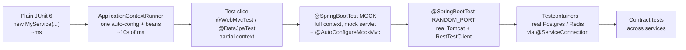
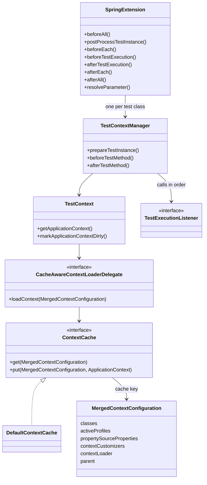
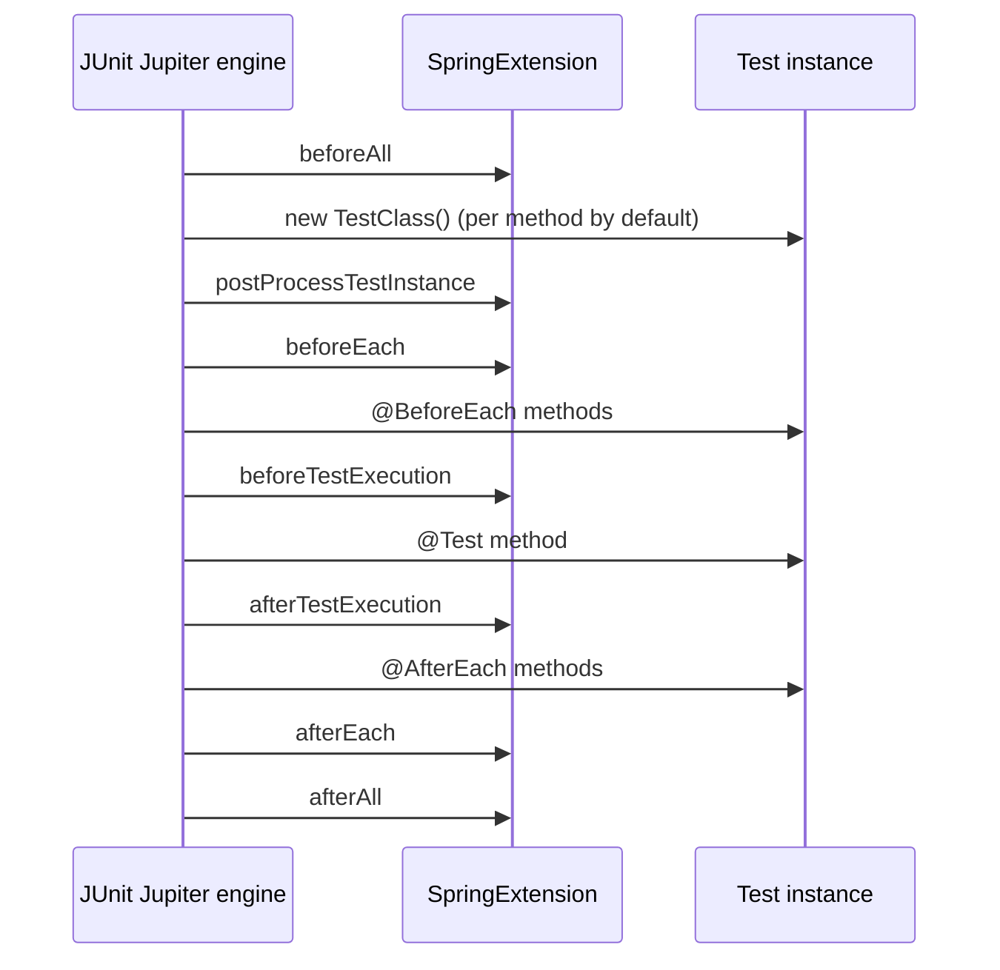
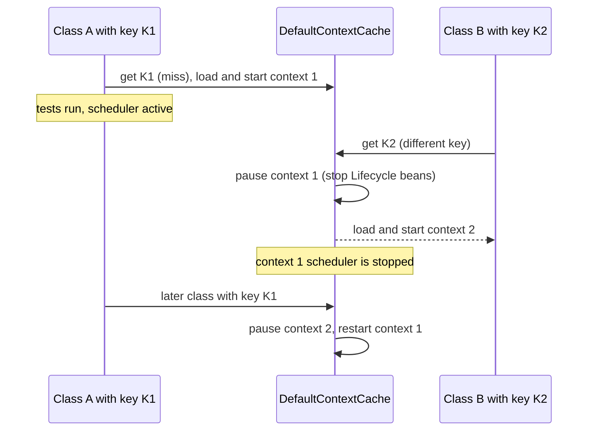
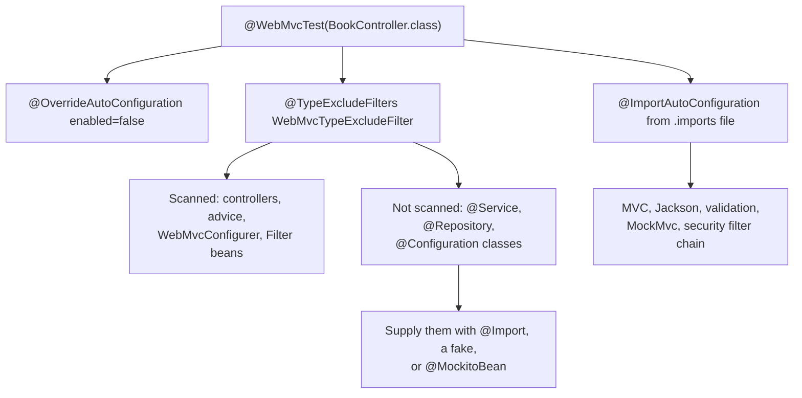
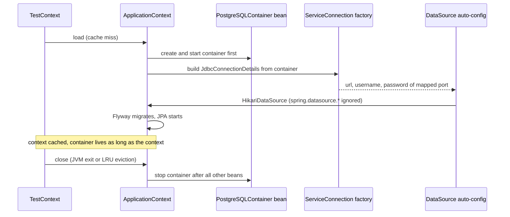
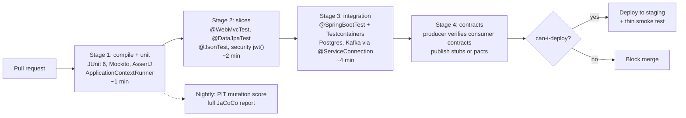
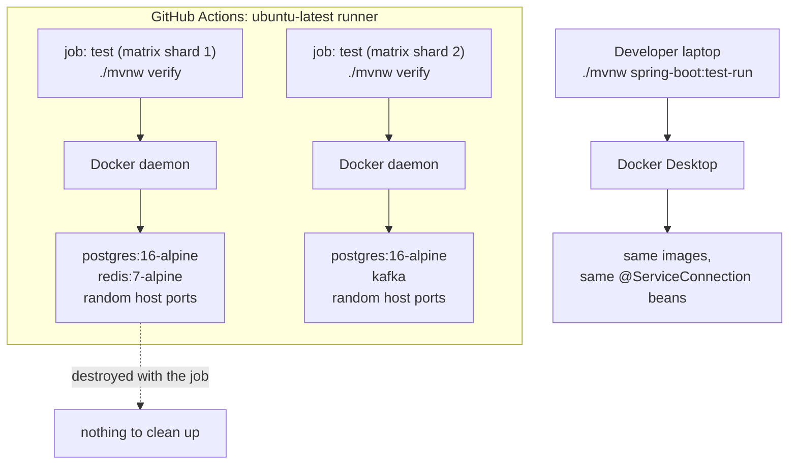
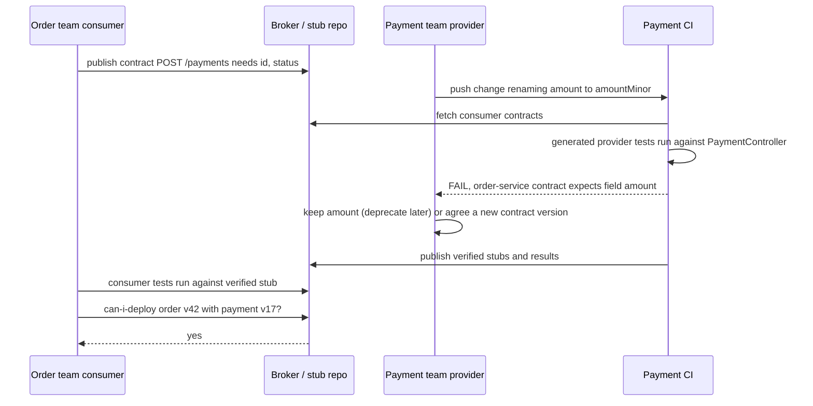

# 08 — Testing Spring Boot Applications: JUnit 6, the TestContext Cache, Slices & Testcontainers

> **Lab:** none — examples come from the tests in every lab (links inline)
> **Capstone use:** every capstone feature ships with tests at the cheapest level that proves it. Plain JUnit covers pricing rules, `@WebMvcTest` covers the order API contract, `@DataJpaTest` with Testcontainers Postgres covers repositories, and a few `@SpringBootTest` flows cover checkout end to end. Consumer-driven contracts guard the order → payment boundary.
> **Prereqs:** [01 Spring Core](../01-core/spring-core.md) (container, BeanPostProcessors), [03 Boot internals](../03-boot-internals/auto-configuration.md) (conditions, auto-config), [06 JPA](../06-data-jpa/jpa-hibernate.md) (transactions), [07 Security](../07-security/spring-security.md).

---

## 1. What & why

A test suite has one job: let you change code without fear. It does that only if it is **fast enough to run on every change**, **trustworthy** (it fails only when something is really broken), and **close enough to production** to catch the bugs that matter. Spring adds a twist: the expensive part of most tests is not the assertion but **starting an `ApplicationContext`**. A good Spring test strategy is mostly about choosing *how much* context each test needs, and about making sure contexts get reused.

**Every test in this repo's labs is the textbook for this note.** No new lab was built for it. Each example below links to a real, passing test.

### Pyramid vs trophy

| Model | Shape | Says | Fits Spring when… |
|---|---|---|---|
| **Test pyramid** (Mike Cohn) | Many unit tests, fewer integration tests, very few end-to-end | Unit tests are cheap, so write most of your tests there | The domain logic is rich (pricing, state machines, validation rules) |
| **Testing trophy** (Kent C. Dodds) | Static analysis at the base, a thick middle of *integration* tests, then a few unit and end-to-end tests | Most bugs live where components meet, so integration tests give the best confidence per minute | The service is mostly glue: controllers, JSON, SQL, security rules, caches |
| **Honeycomb** (Spotify, for microservices) | Mostly integration tests of one service against real infrastructure, few "implementation detail" unit tests, few cross-service tests | A microservice's risk is at its edges (HTTP in, DB/broker out) | A small CRUD-ish service with Testcontainers available |

Spring Boot apps usually end up **trophy-shaped**: Testcontainers and test slices make integration tests cheap, so the middle grows.

### What to test at each level (and where this repo does it)

| Level | Spring tool | What it proves | Example in the labs |
|---|---|---|---|
| Unit (no Spring) | JUnit 6, AssertJ, Mockito | Pure logic, concurrency of a class, observations | `IdempotencyStoreTest` (32 virtual threads race one key), `PricingObservationTest` |
| Plain container | `new AnnotationConfigApplicationContext(...)` | What the *core* container does with no Boot | [`LifecycleOrderTest`](https://github.com/sumit-mishra-itp/springboot-roadmap/blob/main/labs/01-core-ioc/src/test/java/dev/roadmap/coreioc/lifecycle/LifecycleOrderTest.java) (lab 01), [`PlainFrameworkProxyTest`](https://github.com/sumit-mishra-itp/springboot-roadmap/blob/main/labs/02-aop-logging/src/test/java/dev/roadmap/aop/payment/PlainFrameworkProxyTest.java) (lab 02) |
| Auto-config | `ApplicationContextRunner` | Conditions, back-off, property binding, in milliseconds | `GreetingAutoConfigurationTest`, `AsyncTest`, `ImportSchedulerTest` |
| Web slice | `@WebMvcTest` + `MockMvcTester`/`MockMvc` | Routing, JSON, validation, `ProblemDetail`, filters, security rules | `BookControllerTest`, `DocumentControllerSecurityTest` |
| Data slice | `@DataJpaTest` + Testcontainers | Mappings, queries, SQL count, Flyway scripts | `NPlusOneTest`, `QueryFeaturesTest` |
| Integration | `@SpringBootTest` (+ `@AutoConfigureMockMvc`) | Real transactions, caches, batch jobs across beans | `TransactionBehaviourTest`, `RedisIntegrationTest`, `ImportJobTest` |
| End to end (one service) | `@SpringBootTest(RANDOM_PORT)` + `RestTestClient` | Real HTTP, real filter chain, real tokens | `RestApiApplicationTests`, `AuthFlowEndToEndTest`, `TracePropagationTest` |
| Across services | Contract tests (Spring Cloud Contract, Pact) | Producer and consumer agree on the API | Concept only (section 7.3) |

**When *not* to write a given test:**
- Don't `@SpringBootTest` something a constructor call can test. `PricingObservationTest` needs no context at all: `TestObservationRegistry.create()` plus `new PricingService(registry)`.
- Don't test the framework. Asserting that `@GetMapping` maps a GET is waste. Asserting that *your* validation produces *your* `ProblemDetail` is not.
- Don't mock types you don't own (an `EntityManager`, a `RestClient`, a Redis template). Use the real thing in a container, or a slice.
- Don't chase 100% line coverage. Chase "every behavior a user or another service relies on has a test that fails when it breaks". Mutation testing (section 5.9) measures that better than coverage does.

---

## 2. Mental model

Picture a **ladder of realism**. Each rung adds infrastructure, so it costs more and proves more. Pick the lowest rung that can catch the bug you are worried about.



The second picture is **what happens when JUnit runs a Spring test class**. JUnit only knows about extensions. Spring plugs in through `SpringExtension`, which delegates to a `TestContextManager`. That manager asks a context loader for the `ApplicationContext`, and the loader looks in a **static, JVM-wide cache** first.



**The one sentence to remember:** two test classes share a context **only if their `MergedContextConfiguration` is equal**. Everything about keeping a suite fast follows from that.

---

## 3. How it works internally

### 3.1 The versions you are actually running

Read from `spring-boot-dependencies-4.1.2.pom` in `~/.m2`:

| Library | Version managed by Boot 4.1.2 | Notes |
|---|---|---|
| JUnit (Platform + Jupiter) | **6.0.3** | JUnit 6 uses **one version number** for Platform, Jupiter and Vintage, and requires **Java 17+**. The Vintage engine (JUnit 4 tests) is **deprecated**. The managed `junit.version` 4.13.2 exists only for legacy JUnit 4 code ([JUnit user guide](https://docs.junit.org/6.0.3/user-guide/index.html)) |
| Spring Framework (`spring-test`) | 7.0.10 | Framework 7 raised its baseline to JUnit 6 and deprecated its JUnit 4 support (`SpringRunner`, `SpringClassRule`, `SpringMethodRule`) ([7.0 release notes](https://github.com/spring-projects/spring-framework/wiki/Spring-Framework-7.0-Release-Notes)) |
| Mockito | 5.23.0 | |
| AssertJ | 3.27.7 | |
| Awaitility | 4.3.0 | |
| Testcontainers | 2.0.5 | Module artifacts are now `testcontainers-<module>`, e.g. `testcontainers-postgresql` in lab 06 |
| Spring Batch (`spring-batch-test`) | 6.0.6 | |
| Hamcrest / JSONassert / JsonPath | 3.0 / 1.5.3 / 2.10.0 | Used under the hood by `MockMvc` matchers and `bodyJson()` |

### 3.2 JUnit 6 essentials

**Lifecycle.** "JUnit creates a new instance of each test class before executing each test method" ([test instance lifecycle](https://docs.junit.org/6.0.3/writing-tests/test-instance-lifecycle.html)). So instance fields are fresh per test, which is why the labs can hold state in fields such as `private final IdempotencyStore store = new IdempotencyStore();` without leaking between tests. `@TestInstance(Lifecycle.PER_CLASS)` (or the property `junit.jupiter.testinstance.lifecycle.default=per_class`) creates one instance per class, and then `@BeforeAll`/`@AfterAll` may be non-static.



The diagram shows only callback names. Which Spring listener work happens in which callback (context loading, transactions, mock reset) is not shown because no lab test proves it (unverified). The callback interfaces are exactly what `SpringExtension` implements in `spring-test` 7.0.10 (checked with `javap`): `BeforeAllCallback, AfterAllCallback, TestInstancePostProcessor, BeforeEachCallback, AfterEachCallback, BeforeTestExecutionCallback, AfterTestExecutionCallback, ParameterResolver`. `ParameterResolver` is why the labs can use **constructor injection in tests**, for example `MetricsEndpointTest(@Autowired RestTestClient client, @Autowired MeterRegistry meterRegistry)` in [`MetricsEndpointTest`](https://github.com/sumit-mishra-itp/springboot-roadmap/blob/main/labs/10-observability/src/test/java/dev/roadmap/observability/orders/MetricsEndpointTest.java). The *order* of the arrows inside one phase follows the JUnit callback contract. The labs do not test it.

**Other essentials:**

| Feature | API | One-line use |
|---|---|---|
| Parameterized tests | `@ParameterizedTest` + `@ValueSource`, `@NullSource`, `@EmptySource`, `@NullAndEmptySource`, `@EnumSource`, `@MethodSource`, `@FieldSource`, `@CsvSource`, `@CsvFileSource`, `@ArgumentsSource` | One test method, many input rows. Name rows with `{0}`, `{arguments}`. `@ParameterizedClass` exists but is still **experimental** in 6.0.3 ([docs](https://docs.junit.org/6.0.3/writing-tests/parameterized-classes-and-tests.html)) |
| Nested tests | `@Nested` on a non-static inner class | Group "given X" scenarios. Inner classes share the outer fixture |
| Assumptions | `Assumptions.assumeTrue(...)`, `assumingThat(...)` | *Skip* (not fail) when the environment can't run the test, e.g. no Docker |
| Extensions | `@ExtendWith(...)`, `@RegisterExtension` | Plug in behavior. `SpringExtension`, `MockitoExtension`, `OutputCaptureExtension` are all extensions |
| Temp files | `@TempDir Path dir` | Fresh directory per test, deleted afterwards. Used by `ImportJobTest` and `ImportSchedulerTest` as the CSV inbox |
| Timeouts | `@Timeout(5)` | Fail a hung test instead of hanging CI |
| Display names | `@DisplayName`, or method names like `placesOrder_whenStockAvailable` | This repo uses behavior-named methods (CLAUDE.md) |

`OutputCaptureExtension` from Boot captures `System.out`/`System.err`, so a test can assert on log lines. [`TracePropagationTest`](https://github.com/sumit-mishra-itp/springboot-roadmap/blob/main/labs/10-observability/src/test/java/dev/roadmap/observability/tracing/TracePropagationTest.java) uses it to prove that structured ECS logs carry the trace id:

```java
@ExtendWith(OutputCaptureExtension.class)
class TracePropagationTest {
    @Test
    void structuredLogs_carryTheTraceAndSpanIds(CapturedOutput output) { ... }
}
```

### 3.3 AssertJ and Mockito, briefly but precisely

**AssertJ** is the assertion library of every lab. These idioms recur:

| Idiom | Where it's used |
|---|---|
| `assertThatThrownBy(() -> ...).isInstanceOf(...).hasMessageContaining(...)` | `TransactionBehaviourTest`, `LockingTest`, `IdempotencyStoreTest` |
| `catchThrowableOfType(RetryException.class, () -> ...)` to inspect the exception further | `RetryTemplateTest` (lab 02) |
| `extracting(Customer::getName).containsExactly(...)` | `QueryFeaturesTest`, `ImportJobTest` |
| `allSatisfy(p -> ...)`, `anySatisfy(...)` | `ImportJobTest`, `GreetingAutoConfigurationTest` |
| `.as("why this matters")` to label a failure | `AsyncTest`, `ImportSchedulerTest` |
| Domain AssertJ: `ApplicationContextAssert`, `MvcTestResultAssert`, `TestObservationRegistryAssert` | `GreetingAutoConfigurationTest`, `BookControllerTest`, `PricingObservationTest` |

**Mockito vocabulary** (Gerard Meszaros' test-double terms):

| Double | What it is | Mockito |
|---|---|---|
| Dummy | Passed but never used | `mock(Job.class)` in `ImportSchedulerTest`: the scheduler needs *a* `Job` bean |
| Stub | Returns canned answers | `when(repo.findById(1)).thenReturn(Optional.of(book))` |
| Mock | Stub + you verify interactions | `verify(gateway).charge(eq(order), any())` |
| Spy | Wraps a *real* object, stubs only some calls | `spy(realService)` or `@MockitoSpyBean` |
| Fake | Working but simplified implementation | The in-memory `BookRepository` that lab 05 imports instead of mocking |

[`ImportSchedulerTest`](https://github.com/sumit-mishra-itp/springboot-roadmap/blob/main/labs/12-batch-csv-import/src/test/java/dev/roadmap/batch/schedule/ImportSchedulerTest.java) uses a mock with `doAnswer` to *record* which thread each trigger ran on, rather than stubbing a return value:

```java
JobOperator jobOperator = mock(JobOperator.class);
doAnswer(call -> {
    JobParameters params = call.getArgument(1);
    threadByTrigger.put(params.getString("trigger"), Thread.currentThread().getName());
    return null;
}).when(jobOperator).start(any(Job.class), any(JobParameters.class));
```

The other Mockito tools you are expected to know:
- **Argument captors.** `ArgumentCaptor<Payment> captor = ArgumentCaptor.forClass(Payment.class); verify(gateway).charge(captor.capture()); assertThat(captor.getValue().amount())...` Use a captor when the argument is built *inside* the code under test and you need to assert on its fields. Prefer `argThat(...)` when a one-line predicate is enough. (Illustrative. No lab uses a captor.)
- **Strict stubs.** With `@ExtendWith(MockitoExtension.class)`, Mockito's default strictness is `STRICT_STUBS` (unverified against the `MockitoExtension` javadoc). A stubbing your test never uses fails with `UnnecessaryStubbingException`, and a stubbed call with different arguments is reported as a potential mismatch ([Mockito `Strictness` javadoc](https://javadoc.io/doc/org.mockito/mockito-core/latest/org.mockito/org/mockito/quality/Strictness.html)). This keeps tests honest as code changes. Use `lenient()` sparingly.
- **"Don't mock what you don't own."** If you mock `RestClient`, `EntityManager` or `StringRedisTemplate`, the test encodes *your guess* about how a library behaves. When the library behaves differently, the mock stays green and production breaks. Wrap the library in a small adapter you own, mock the adapter in unit tests, and test the adapter itself against the real thing: Testcontainers, `@RestClientTest` with `MockRestServiceServer`, or WireMock. Lab 05 follows the same idea in a smaller way. Its comment says importing the real in-memory store is "cheaper and more honest than mocking a map".

### 3.4 The TestContext framework: listeners and the context cache

`TestContextManager` runs a list of `TestExecutionListener`s. The defaults are registered in `META-INF/spring.factories` in `spring-test-7.0.10.jar`, listed below in **file order**. At runtime they are sorted by their `getOrder()` values, so the effective order may differ (unverified):

| # | Listener | Job |
|---|---|---|
| 1 | `ServletTestExecutionListener` | Sets up mock request/response for web contexts |
| 2 | `DirtiesContextBeforeModesTestExecutionListener` | Handles `@DirtiesContext(... BEFORE_...)` |
| 3 | `ApplicationEventsTestExecutionListener` | Records events for `@RecordApplicationEvents` |
| 4 | `BeanOverrideTestExecutionListener` | Injects `@MockitoBean`/`@MockitoSpyBean`/`@TestBean` fields |
| 5 | `DependencyInjectionTestExecutionListener` | `@Autowired` fields in the test instance |
| 6 | `MicrometerObservationRegistryTestExecutionListener` | Scopes the `ObservationRegistry` per test |
| 7 | `DirtiesContextTestExecutionListener` | Handles `@DirtiesContext(... AFTER_...)` |
| 8 | `CommonCachesTestExecutionListener` | Clears resource caches of the context after the class |
| 9 | `TransactionalTestExecutionListener` | Test-managed transaction: begin before, **roll back** after |
| 10 | `SqlScriptsTestExecutionListener` | `@Sql` scripts |
| 11 | `EventPublishingTestExecutionListener` | Publishes test lifecycle events into the context |
| 12 | `MockitoResetTestExecutionListener` | Resets mocks according to `MockReset` (after each test by default, unverified) |

Boot adds its own `ContextCustomizerFactory`s in `spring-boot-test` (imports, `@PropertyMapping`, type-exclude filters, and others). Every **context customizer** becomes part of the cache key.

**The cache key.** `DefaultCacheAwareContextLoaderDelegate` builds a `MergedContextConfiguration` from the test class. It looks up that configuration in `DefaultContextCache`, a static LRU map, and loads a new context **only on a miss**. The documented key parts are ([Context Caching](https://docs.spring.io/spring-framework/reference/testing/testcontext-framework/ctx-management/caching.html)):

- `locations`, `classes`, `contextInitializerClasses` and `contextLoader` (from `@ContextConfiguration`, or what `@SpringBootTest` and the slices derive for you);
- `contextCustomizers`: "this includes `@DynamicPropertySource` methods, bean overrides (such as `@TestBean`, `@MockitoBean`, `@MockitoSpyBean` etc.), as well as various features from Spring Boot's testing support";
- `parent` (`@ContextHierarchy`);
- `activeProfiles` (`@ActiveProfiles`);
- `propertySourceDescriptors` and `propertySourceProperties` (`@TestPropertySource`). Boot feeds `@SpringBootTest(properties = ...)` into the same inlined properties (unverified by a lab test, but lab 09 relies on identical `properties` sharing one context);
- `resourceBasePath` (`@WebAppConfiguration`).

**What is *not* in the key: JVM system properties and environment variables.** That is why lab 03's [`PropertyPrecedenceTest`](https://github.com/sumit-mishra-itp/springboot-roadmap/blob/main/labs/03-custom-starter/demo-app/src/test/java/dev/roadmap/demo/PropertyPrecedenceTest.java) deliberately avoids `@SpringBootTest`:

```java
/**
 * Uses plain SpringApplication runs: @SpringBootTest caches contexts and its cache key
 * ignores system properties, which would make a system-property test order-dependent.
 */
class PropertyPrecedenceTest {
```

**Proof from this repo: lab 06's `./mvnw test` log (run 2026-11-18).** Seven test classes and 49 tests started **three** contexts and **three** Postgres containers:

```text
Container postgres:16-alpine started ...           <- context 1 (@IntegrationTest)
Started LockingTest in 59.988 seconds
Tests run: 4  ... in dev.roadmap.jpa.catalog.LockingTest
Tests run: 14 ... in dev.roadmap.jpa.customer.TransactionBehaviourTest     <- cache HIT, no "Started"
Container postgres:16-alpine started ...           <- context 2 (@JpaSliceTest + @TestPropertySource)
Started DefaultBatchFetchSizeTest in 7.626 seconds
Container postgres:16-alpine started ...           <- context 3 (@JpaSliceTest)
Started MappingFeaturesTest in 9.998 seconds
Tests run: 6  ... in dev.roadmap.jpa.NPlusOneTest                         <- HIT
Tests run: 10 ... in dev.roadmap.jpa.PersistenceContextTest               <- HIT
Tests run: 10 ... in dev.roadmap.jpa.QueryFeaturesTest                    <- HIT
Tests run: 49, Failures: 0, Errors: 0, Skipped: 0
```

The three contexts come from three distinct keys:
1. [`@IntegrationTest`](https://github.com/sumit-mishra-itp/springboot-roadmap/blob/main/labs/06-jpa-deep-dive/src/test/java/dev/roadmap/jpa/IntegrationTest.java), a meta-annotation for `@SpringBootTest` + `@Import(TestcontainersConfiguration.class)`. `LockingTest` and `TransactionBehaviourTest` share it.
2. [`DefaultBatchFetchSizeTest`](https://github.com/sumit-mishra-itp/springboot-roadmap/blob/main/labs/06-jpa-deep-dive/src/test/java/dev/roadmap/jpa/DefaultBatchFetchSizeTest.java) adds one `@TestPropertySource`. Its own comment says it: "A different property set means a separate Spring context, hence its own container."
3. [`@JpaSliceTest`](https://github.com/sumit-mishra-itp/springboot-roadmap/blob/main/labs/06-jpa-deep-dive/src/test/java/dev/roadmap/jpa/JpaSliceTest.java), a meta-annotation for `@DataJpaTest` + `@Import(TestcontainersConfiguration.class)`. The four remaining classes share it.

The other things that create a new context:

| Cause | Why | Cure |
|---|---|---|
| A different set of `@MockitoBean`/`@MockitoSpyBean` fields | Bean overrides are context customizers. Even **field names** count: "Qualifiers, including the name of a field, are used to determine if a separate `ApplicationContext` needs to be created" ([`@MockitoBean` docs](https://docs.spring.io/spring-framework/reference/testing/annotations/integration-spring/annotation-mockitobean.html)) | Declare shared mocks once on a base class or a composed annotation such as `@MockitoBean(types = {...})`, and name fields consistently |
| Different `properties`, `@TestPropertySource`, `@ActiveProfiles` | Part of the key. Lab 03 has one class of each: [`TestPropertyPrecedenceTest`](https://github.com/sumit-mishra-itp/springboot-roadmap/blob/main/labs/03-custom-starter/demo-app/src/test/java/dev/roadmap/demo/TestPropertyPrecedenceTest.java) (`@SpringBootTest(properties)` + `@TestPropertySource`, and it proves the latter wins) and [`DevProfileSpringBootTest`](https://github.com/sumit-mishra-itp/springboot-roadmap/blob/main/labs/03-custom-starter/demo-app/src/test/java/dev/roadmap/demo/DevProfileSpringBootTest.java) (`@ActiveProfiles("dev")`), each with its own context | Agree on one property set per suite. Put per-test variation in data, not config |
| `@DirtiesContext` | Removes the context from the cache and closes it | Reset *state* instead (truncate tables, `flushAll`, `repository.reset()`) |
| `@DynamicPropertySource` methods in different classes | Each is a customizer | Use `@ServiceConnection` beans in one shared `@TestConfiguration` |
| A nested `@TestConfiguration` that is unique to a class | Changes `classes` | Fine when needed (lab 05, 07, 10 do it). Just know it costs a context |
| A different slice (`@WebMvcTest(A.class)` vs `@WebMvcTest(B.class)`) | Different bootstrapper and filters | Usually fine, because slices are small |

The labs show three ways of **keeping the count low**:
- **Meta-annotations.** `@JpaSliceTest` and `@IntegrationTest` in lab 06 give one key per kind of test.
- **An abstract base class.** [`RedisIntegrationTest`](https://github.com/sumit-mishra-itp/springboot-roadmap/blob/main/labs/09-redis-cache/src/test/java/dev/roadmap/cache/RedisIntegrationTest.java) explains: "Every test class extends this, so they all share ONE Spring context and ONE Redis container (identical configuration means the TestContext cache reuses the context)." It resets *state* in `@BeforeEach` with `flushAll` and `repository.reset()` instead of dirtying the context.
- **A targeted `@DirtiesContext`.** [`BookControllerTest`](https://github.com/sumit-mishra-itp/springboot-roadmap/blob/main/labs/05-rest-api/src/test/java/dev/roadmap/rest/book/BookControllerTest.java) uses `@DirtiesContext(methodMode = MethodMode.BEFORE_METHOD) // fresh, empty repository for exact counts` on only the two tests that need exact IDs, and pays for two extra slice contexts instead of dirtying the whole class.

**Size, logging, failure threshold.** The cache holds at most **32** contexts by default (`spring.test.context.cache.maxSize`) and evicts the least recently used one, closing it. Set the `org.springframework.test.context.cache` logger to `DEBUG` to see hit and miss statistics. A context that fails to load is not retried over and over: `spring.test.context.failure.threshold` defaults to `1`, so every later class with the same key fails immediately with an `IllegalStateException` that says the attempt "was preemptively skipped" ([failure threshold](https://docs.spring.io/spring-framework/reference/testing/testcontext-framework/ctx-management/failure-threshold.html)). **Look at the *first* failure in the report**, because the rest are echoes. All three constants are visible in `ContextCache` (`DEFAULT_MAX_CONTEXT_CACHE_SIZE = 32`, `MAX_CONTEXT_CACHE_SIZE_PROPERTY_NAME`, `CONTEXT_CACHE_PAUSE_PROPERTY_NAME`), checked with `javap -constants` on `spring-test-7.0.10.jar`.

### 3.5 Framework 7: context pausing

A cached context used to keep *running* while other test classes ran. Its `@Scheduled` tasks fired, its JMS or Kafka listeners consumed messages, and they could interfere with the test that was actually executing. Framework 7 adds **pausing** ([Context Pausing](https://docs.spring.io/spring-framework/reference/testing/testcontext-framework/ctx-management/context-pausing.html)):

> "As of Spring Framework 7.0, an `ApplicationContext` stored in the context cache may be *paused* when it is no longer actively in use and automatically *restarted* the next time the context is retrieved from the cache. Specifically, the latter will restart all auto-startup beans in the application context."

- Paused means every `Lifecycle`/`SmartLifecycle` bean is **stopped**: "JMS listener containers, scheduled tasks, and any other components in the context that implement `Lifecycle` or `SmartLifecycle`". A `SmartLifecycle` can opt out by returning `false` from `isPauseable()`.
- The JVM system property (or `SpringProperties`) is **`spring.test.context.cache.pause`**, case-insensitive, with one of three values:
  - `always`: pause every inactive context.
  - `on_context_switch` (**default since 7.0.3**): pause only when the next test needs a *different* context.
  - `never`: the Framework 6 behavior.
- The enum is `ContextCache.PauseMode { ALWAYS, ON_CONTEXT_SWITCH, NEVER }` (checked with `javap`).



Lab 12 hit this exact class of problem *before* pausing existed as a fix. Its integration test switches the scheduler off by property (`@SpringBootTest(properties = "importer.schedule.enabled=false")`) "so it can't launch jobs in the middle of a test" ([`ImportJobTest`](https://github.com/sumit-mishra-itp/springboot-roadmap/blob/main/labs/12-batch-csv-import/src/test/java/dev/roadmap/batch/importer/ImportJobTest.java)). Pausing protects *other* classes from a cached context's scheduler. It does not protect the test that is currently using the context, so the property switch is still needed. (That the lab's scheduler is paused while another context runs is inferred from the docs. No lab test observes the pause itself, so this is unverified.)

### 3.6 Framework 7: `SpringExtension` changes

From the [7.0 release notes](https://github.com/spring-projects/spring-framework/wiki/Spring-Framework-7.0-Release-Notes):
- `SpringExtension` "now uses a test-method scoped `ExtensionContext`." Custom `TestExecutionListener`s that relied on the class-scoped context can break. If `@Nested` classes misbehave, annotate the top-level class with `@SpringExtensionConfig(useTestClassScopedExtensionContext = true)`. Since 7.0.7 you can switch globally with `spring.test.extension.context.scope=test_class` (JVM property, `SpringProperties`, or a JUnit Platform configuration parameter).
- Listeners that override `prepareTestInstance` may need `testContext.getTestInstance().getClass()` instead of `getTestClass()`.
- Dependency injection now works into constructors and fields across `@Nested` hierarchies.
- Bean overrides (`@MockitoBean`, `@MockitoSpyBean`, `@TestBean`) can now target **non-singleton** beans. The overridden bean becomes a singleton.
- **`RestTestClient`** is new: a non-reactive twin of `WebTestClient` that can bind "to a live server, an MVC `@Controller` or the application context."
- JUnit 4 support (`SpringRunner` and friends) is deprecated.

### 3.7 `@SpringBootTest`: what it adds on top

`@SpringBootTest` is `@BootstrapWith(SpringBootTestContextBootstrapper.class)` + `@ExtendWith(SpringExtension.class)`. The bootstrapper:
1. Searches **up from the test's package** "until it finds a class annotated with `@SpringBootApplication` or `@SpringBootConfiguration`" and uses it as the configuration.
2. Creates the context with `SpringApplication`, so you get config data, profiles and auto-configuration. By default it does **not** call your `main` method. Set `useMainMethod = ALWAYS | WHEN_AVAILABLE` if `main` customizes the app.
3. Registers Boot's context customizers (type-exclude filters, `@Import`s, property mappings).

**`webEnvironment` modes** ([Boot testing reference](https://docs.spring.io/spring-boot/reference/testing/spring-boot-applications.html)):

| Mode | Server | Use with | Labs |
|---|---|---|---|
| `MOCK` (default) | None. Mock servlet environment. Falls back to a non-web context if no web stack is on the classpath | `@AutoConfigureMockMvc` → `MockMvc`/`MockMvcTester`, or `@AutoConfigureRestTestClient` (MockMvc as the server) | `RedisIntegrationTest` (`@AutoConfigureMockMvc`), `ImportJobTest`, `LockingTest` |
| `RANDOM_PORT` | Real embedded server on a free port, available as `local.server.port` | `@AutoConfigureRestTestClient` | `RestApiApplicationTests`, `AuthFlowEndToEndTest`, `MetricsEndpointTest`, `HealthProbesTest`, `TracePropagationTest` |
| `DEFINED_PORT` | Real server on `server.port` or 8080 | Rare: port clashes in CI | none |
| `NONE` | No web environment at all | Batch, CLI, messaging apps | none |

> ⚠️ "If your test is `@Transactional`, it rolls back the transaction at the end of each test method by default. However, as using this arrangement with either `RANDOM_PORT` or `DEFINED_PORT` implicitly provides a real servlet environment, the HTTP client and server run in separate threads and, thus, in separate transactions. Any transaction initiated on the server does not roll back in this case." That is why `RestApiApplicationTests` measures `totalBooks()` *before and after* instead of assuming an empty database.

**Boot 4: no free clients.** `@SpringBootTest` alone gives you no `MockMvc`, no `TestRestTemplate` and no `WebTestClient` ([migration guide](https://github.com/spring-projects/spring-boot/wiki/Spring-Boot-4.0-Migration-Guide)). Opt in explicitly:

| Client | Annotation (package verified with `jar tf` on 4.1.2 jars) | Module |
|---|---|---|
| `MockMvc`, `MockMvcTester` | `org.springframework.boot.webmvc.test.autoconfigure.AutoConfigureMockMvc` | `spring-boot-webmvc-test` |
| `RestTestClient` | `org.springframework.boot.resttestclient.autoconfigure.AutoConfigureRestTestClient` | `spring-boot-resttestclient` |
| `TestRestTemplate` (now `org.springframework.boot.resttestclient.TestRestTemplate`) | `org.springframework.boot.resttestclient.autoconfigure.AutoConfigureTestRestTemplate` | `spring-boot-resttestclient` **plus** `spring-boot-restclient`, which also turns on `RestClient.Builder` auto-config |
| `WebTestClient` | `org.springframework.boot.webtestclient.autoconfigure.AutoConfigureWebTestClient` | `spring-boot-webtestclient` |

### 3.8 How a test slice works

A slice is a `@SpringBootTest` with **auto-configuration switched off and component scanning filtered**, plus a curated list of auto-configs switched back on. `javap -v` on `@WebMvcTest` in `spring-boot-webmvc-test-4.1.2.jar` shows its meta-annotations:

- `@BootstrapWith(WebMvcTestContextBootstrapper.class)`
- `@ExtendWith(SpringExtension.class)`
- `@OverrideAutoConfiguration(enabled = false)`: full auto-configuration is disabled.
- `@TypeExcludeFilters(WebMvcTypeExcludeFilter.class)`: scanning keeps only web-layer types (`@Controller`, `@ControllerAdvice`, `WebMvcConfigurer`, `Filter`, and so on).
- `@ImportAutoConfiguration`: re-enables only what is listed in `META-INF/spring/org.springframework.boot.webmvc.test.autoconfigure.AutoConfigureWebMvc.imports` and `...AutoConfigureMockMvc.imports`, both inside the jar.



The labs prove both halves:
- Lab 05's [`BookControllerTest`](https://github.com/sumit-mishra-itp/springboot-roadmap/blob/main/labs/05-rest-api/src/test/java/dev/roadmap/rest/book/BookControllerTest.java) says the slice gives "controller + advice + WebMvcConfigurer + Filter beans, but no @Service/@Repository, so the real in-memory ones are imported". Lab 05's [`FilterInterceptorOrderTest`](https://github.com/sumit-mishra-itp/springboot-roadmap/blob/main/labs/05-rest-api/src/test/java/dev/roadmap/rest/web/FilterInterceptorOrderTest.java) relies on "Filter beans are part of the @WebMvcTest slice".
- Lab 07's [`DocumentControllerSecurityTest`](https://github.com/sumit-mishra-itp/springboot-roadmap/blob/main/labs/07-security-jwt/src/test/java/dev/roadmap/security/document/DocumentControllerSecurityTest.java) says "@WebMvcTest does not pick up @Configuration classes on its own, so the security config is imported explicitly."

The Boot docs give the general rule: "Test slices exclude `@Configuration` classes from scanning". So keep area-specific configuration *off* the `@SpringBootApplication` class, or every slice inherits it. One more rule: "Including multiple 'slices' by using several `@…Test` annotations in one test is not supported."

### 3.9 Bean overriding: `@MockitoBean`, `@MockitoSpyBean`, `@TestBean`

Boot's `@MockBean`/`@SpyBean` are **gone** in Boot 4 ("Spring Boot's `@MockBean` and `@SpyBean` support has been removed in this release"). The Framework's own bean-override mechanism replaces them ([Bean Overriding](https://docs.spring.io/spring-framework/reference/testing/testcontext-framework/bean-overriding.html)). A `BeanOverrideContextCustomizerFactory` (registered in `spring-test`'s `spring.factories`) finds override annotations and adds a customizer to the cache key. A `BeanOverrideBeanFactoryPostProcessor` (the docs call it `BeanOverrideFactoryPostProcessor`; the class in `spring-test-7.0.10.jar` has the longer name) then edits bean definitions before any bean is created.

| Annotation | Strategy | If no bean exists | AOP proxies |
|---|---|---|---|
| `@MockitoBean` | `REPLACE_OR_CREATE` (or `REPLACE` with `enforceOverride = true`) | Creates one | **None.** The mock is registered "directly as a manual singleton", so `@Transactional`, `@Cacheable`, `@PreAuthorize` and similar advice on that bean are gone |
| `@MockitoSpyBean` | `WRAP`. Needs "exactly one candidate bean" | Fails | **Kept.** The existing proxy "now wraps the override instance instead of the original bean" |
| `@TestBean` | `REPLACE_OR_CREATE`, backed by a static factory method in the test | Creates one | None |

Placement rules: on a field of the test class, its superclasses, or the enclosing class of a `@Nested` class. Or at type level with `types = {...}`, including in composed annotations. The Boot migration guide adds: allowed "as fields in test classes, but not in `@Configuration` classes". Mocks are reset by `MockitoResetTestExecutionListener` (12th in the listener table), after each test by default (`MockReset.AFTER`, unverified by a lab test).

The AOP row explains a lab 07 design choice. `DocumentControllerSecurityTest` imports the **real** `DocumentService`: "Method security needs the real proxied bean, so the service is imported, not mocked." A `@MockitoBean DocumentService` would have silently removed `@PreAuthorize`/`@PostAuthorize`, and the 403 tests would have failed for the wrong reason.

### 3.10 Testcontainers and `@ServiceConnection`



- **Containers as beans** (what every lab does): "Container beans are created and started before all other beans" and "stopped after the destruction of all other beans" ([Boot Testcontainers docs](https://docs.spring.io/spring-boot/reference/testing/testcontainers.html)). One container per cached context, which is why the context count above is also the container count.
- **`@ServiceConnection`** defines a `ConnectionDetails` bean (`JdbcConnectionDetails`, `DataRedisConnectionDetails`, ...) that the auto-config prefers over `spring.datasource.*`/`spring.data.redis.*`. For a `GenericContainer`, Boot can't tell the technology, so name it. Lab 09's [`TestcontainersConfiguration`](https://github.com/sumit-mishra-itp/springboot-roadmap/blob/main/labs/09-redis-cache/src/test/java/dev/roadmap/cache/TestcontainersConfiguration.java) does that: `@ServiceConnection(name = "redis") GenericContainer<?> redisContainer()`.
- **Static `@Container` fields with `@Testcontainers`** (the JUnit extension) stop the container "after the test class has run". "This can cause issues when used with Spring Boot tests, as Spring's TestContext Framework may cache the ApplicationContext beyond that point." The next class that reuses the cached context then talks to a dead port. Prefer beans, or `@ImportTestcontainers(MyContainers.class)`.
- **`@DynamicPropertySource`** is the older, more verbose alternative ("more flexible"). It is still needed for things that have no `ConnectionDetails`.
- Startup is `sequential` by default. Set `spring.testcontainers.beans.startup=parallel` to start several containers at once ([dev services docs](https://docs.spring.io/spring-boot/reference/features/dev-services.html)).

---

## 4. Full worked code

Each subsection quotes a **real, passing test** (trimmed with `...`) and links to the full file. Subsection 4.12 holds the few patterns no lab uses yet. Those snippets are marked *illustrative*.

### 4.1 Plain JUnit: concurrency without Spring

[`labs/05-rest-api/.../IdempotencyStoreTest.java`](https://github.com/sumit-mishra-itp/springboot-roadmap/blob/main/labs/05-rest-api/src/test/java/dev/roadmap/rest/idempotency/IdempotencyStoreTest.java) holds 32 virtual threads behind a `CountDownLatch`, releases them at once, and asserts that the action ran **exactly once**:

```java
/** Plain JUnit: the race is in the store, so no Spring context is needed to prove it. */
class IdempotencyStoreTest {

    private final IdempotencyStore store = new IdempotencyStore();

    @Test
    void concurrentRetriesWithSameKey_runTheActionExactlyOnce() throws Exception {
        var executions = new AtomicInteger();
        var start = new CountDownLatch(1);
        Callable<IdempotencyStore.Outcome<Integer>> retry = () -> {
            start.await();
            return store.execute("pay-42", "charge 10 USD", executions::incrementAndGet);
        };

        try (var executor = Executors.newVirtualThreadPerTaskExecutor()) {
            List<Future<IdempotencyStore.Outcome<Integer>>> futures =
                    IntStream.range(0, 32).mapToObj(i -> executor.submit(retry)).toList();
            start.countDown(); // release all 32 "client retries" at once
            ...
            assertThat(executions).hasValue(1);
            assertThat(outcomes).filteredOn(outcome -> !outcome.replayed()).hasSize(1);
        }
    }
```

The start-gate latch is the trick. Without it, threads start one by one and the race rarely happens, so the test would pass even with a broken store.

### 4.2 Observability without a context: `TestObservationRegistry`

[`labs/10-observability/.../PricingObservationTest.java`](https://github.com/sumit-mishra-itp/springboot-roadmap/blob/main/labs/10-observability/src/test/java/dev/roadmap/observability/orders/PricingObservationTest.java) (dependency `micrometer-observation-test`):

```java
/** Plain JUnit: TestObservationRegistry records observations without any Spring context, meter registry or tracer. */
class PricingObservationTest {

    private final TestObservationRegistry registry = TestObservationRegistry.create();
    private final PricingService pricing = new PricingService(registry);

    @Test
    void price_isObservedWithLowAndHighCardinalityKeyValues() {
        BigDecimal total = pricing.price("order-42", "gold", new BigDecimal("100"));

        assertThat(total).isEqualByComparingTo("90");
        assertThat(registry)
                .hasObservationWithNameEqualTo("orders.pricing")
                .that()
                .hasContextualNameEqualTo("price-order")
                .hasLowCardinalityKeyValue("tier", "gold")
                .hasHighCardinalityKeyValue("order.id", "order-42")
                .hasBeenStarted()
                .hasBeenStopped();
    }
}
```

This is possible only because `PricingService` takes the `ObservationRegistry` through its **constructor**. Constructor injection is a testability feature, not just a style rule.

### 4.3 Auto-configuration: `ApplicationContextRunner`

[`labs/03-custom-starter/.../GreetingAutoConfigurationTest.java`](https://github.com/sumit-mishra-itp/springboot-roadmap/blob/main/labs/03-custom-starter/greeting-spring-boot-autoconfigure/src/test/java/dev/roadmap/greeting/autoconfigure/GreetingAutoConfigurationTest.java) builds a tiny new context per test and asserts on it with AssertJ's `ApplicationContextAssert`. It covers every condition: the default bean, property binding, back-off when the user defines a bean, a missing class, a disabled property, and failing fast on invalid config.

```java
/**
 * ApplicationContextRunner builds a tiny, fresh context per test: no @SpringBootApplication,
 * no component scan, just the auto-configuration plus whatever each test adds.
 */
class GreetingAutoConfigurationTest {

    private final ApplicationContextRunner contextRunner = new ApplicationContextRunner()
            .withConfiguration(AutoConfigurations.of(GreetingAutoConfiguration.class));

    @Test
    void backsOff_whenUserDefinesGreetingService() {
        contextRunner.withUserConfiguration(UserGreetingConfig.class).run(context -> {
            assertThat(context).hasSingleBean(GreetingService.class);      // not two: the auto-config backed off
            assertThat(context).getBean("customGreeting").isSameAs(context.getBean(GreetingService.class));
        });
    }

    @Test
    void backsOff_whenLibraryClassIsMissing() {
        contextRunner.withClassLoader(new FilteredClassLoader(GreetingService.class)).run(context -> {
            assertThat(context).doesNotHaveBean(GreetingService.class);
            assertThat(context).doesNotHaveBean(GreetingProperties.class); // whole class skipped, not just the @Bean
        });
    }

    @Test
    void failsFast_whenTemplateIsInvalid() {
        contextRunner.withPropertyValues("greeting.template=Hello").run(context -> {
            assertThat(context).hasFailed();
            assertThat(context.getStartupFailure()).rootCause().isInstanceOf(BindValidationException.class)
                    .hasMessageContaining("must contain %s");
        });
    }
```

Runner contexts **bypass the TestContext cache entirely**. They are created and closed inside `run(...)`, so property variations are free. Lab 12 reuses the technique for runtime infrastructure. [`AsyncTest`](https://github.com/sumit-mishra-itp/springboot-roadmap/blob/main/labs/12-batch-csv-import/src/test/java/dev/roadmap/batch/async/AsyncTest.java) loads Boot's real `TaskExecutionAutoConfiguration`, and [`ImportSchedulerTest`](https://github.com/sumit-mishra-itp/springboot-roadmap/blob/main/labs/12-batch-csv-import/src/test/java/dev/roadmap/batch/schedule/ImportSchedulerTest.java) loads `TaskSchedulingAutoConfiguration` and flips `spring.threads.virtual.enabled` per test:

```java
private final ApplicationContextRunner runner = new ApplicationContextRunner()
        .withConfiguration(AutoConfigurations.of(TaskExecutionAutoConfiguration.class))
        .withUserConfiguration(AsyncConfig.class, ReportService.class, ReportGenerator.class)
        .withPropertyValues("spring.task.execution.mode=force", "spring.task.execution.thread-name-prefix=app-async-");
```

Variants: `WebApplicationContextRunner` (servlet) and `ReactiveWebApplicationContextRunner` (reactive).

### 4.4 Web slice: `@WebMvcTest` + `MockMvcTester`

[`labs/05-rest-api/.../BookControllerTest.java`](https://github.com/sumit-mishra-itp/springboot-roadmap/blob/main/labs/05-rest-api/src/test/java/dev/roadmap/rest/book/BookControllerTest.java) (`spring-boot-starter-webmvc-test`). `MockMvcTester` is the AssertJ flavor of MockMvc, added in Framework 6.2. Its `bodyJson()` gives JSON-path and lenient JSON comparison:

```java
@WebMvcTest(BookController.class)
@Import({BookService.class, BookRepository.class, IdempotencyStore.class})
class BookControllerTest {

    @Autowired
    MockMvcTester mvc;

    @Test
    void create_returns201WithLocationEtagAndBody() {
        MvcTestResult result = post(EFFECTIVE_JAVA);

        assertThat(result).hasStatus(HttpStatus.CREATED);
        long id = idFrom(result);
        assertThat(result).headers()
                .hasValue("Location", "http://localhost/api/books/" + id)
                .hasValue("ETag", "\"1\""); // Spring adds the quotes that RFC 9110 requires
        assertThat(result).bodyJson().extractingPath("$.title").isEqualTo("Effective Java");
    }

    @Test
    void create_withInvalidBody_returnsProblemDetailWithFieldErrors() {
        MvcTestResult result = post("""
                {"title":"","isbn":"978-0-13-468599-2","price":-1}""");

        assertThat(result).hasStatus(HttpStatus.BAD_REQUEST).hasContentType(MediaType.APPLICATION_PROBLEM_JSON);
        assertThat(result).bodyJson().isLenientlyEqualTo("""
                { "type": "https://api.roadmap.dev/problems/validation-error", "status": 400, ... }""");
    }

    @Test
    @DirtiesContext(methodMode = MethodMode.BEFORE_METHOD) // fresh, empty repository for exact counts
    void list_returnsOffsetPage() { ... }
```

`MockMvcTester` doesn't throw checked exceptions and never needs `andExpect` chains. Lab 07 still uses classic `MockMvc` with Hamcrest matchers (4.5). Both are injected by the slice. `MockMvcTester` also works under `@SpringBootTest` + `@AutoConfigureMockMvc`, as lab 09's [`RateLimitTest`](https://github.com/sumit-mishra-itp/springboot-roadmap/blob/main/labs/09-redis-cache/src/test/java/dev/roadmap/cache/ratelimit/RateLimitTest.java) shows.

### 4.5 Security slice: `jwt()` and `@WithMockUser`

[`labs/07-security-jwt/.../DocumentControllerSecurityTest.java`](https://github.com/sumit-mishra-itp/springboot-roadmap/blob/main/labs/07-security-jwt/src/test/java/dev/roadmap/security/document/DocumentControllerSecurityTest.java) (`spring-boot-starter-security-test`, `spring-boot-starter-security-oauth2-resource-server-test`):

```java
@WebMvcTest(DocumentController.class)
@Import({ SecurityConfig.class, JwtConfig.class, ProblemDetailSecurityHandler.class,
        DocumentService.class, DocumentGuard.class, DocumentRepository.class })
class DocumentControllerSecurityTest {

    @Autowired
    MockMvc mvc;

    @Test
    void anonymous_gets401ProblemDetail() throws Exception {
        mvc.perform(get("/api/documents/1"))
                .andExpect(status().isUnauthorized())
                .andExpect(header().string(HttpHeaders.WWW_AUTHENTICATE, "Bearer"));
    }

    /**
     * jwt() skips the JwtDecoder AND our JwtAuthenticationConverter: it builds a JwtAuthenticationToken directly.
     * Claims you set are NOT converted to roles, so the authorities are passed explicitly.
     */
    @Test
    void jwtPostProcessor_owner_readsOwnDocument() throws Exception {
        mvc.perform(get("/api/documents/1")
                        .with(jwt().jwt(token -> token.subject("alice"))
                                .authorities(new SimpleGrantedAuthority("ROLE_USER"))))
                .andExpect(status().isOk());
    }

    @Test
    @WithMockUser(username = "bob")
    void postAuthorize_deniesSomeoneElsesDocument() throws Exception {
        mvc.perform(get("/api/documents/1")).andExpect(status().isForbidden());
    }
```

Two levels of security testing, and why you need both:
- **Slice with `jwt()`/`@WithMockUser`.** It is fast, but it **skips token decoding and claim-to-role conversion**, so it tests the *authorization rules*.
- **End to end with real tokens.** [`AuthFlowEndToEndTest`](https://github.com/sumit-mishra-itp/springboot-roadmap/blob/main/labs/07-security-jwt/src/test/java/dev/roadmap/security/auth/AuthFlowEndToEndTest.java) logs in, gets a real token, and proves that the converter mapped `"roles":["USER"]` to `ROLE_USER`. It also proves that Security 7 added `FACTOR_BEARER`: `assertThat(me.authorities()).containsExactly("FACTOR_BEARER", "ROLE_USER")`.

### 4.6 Data slice: `@DataJpaTest` against real Postgres

[`JpaSliceTest`](https://github.com/sumit-mishra-itp/springboot-roadmap/blob/main/labs/06-jpa-deep-dive/src/test/java/dev/roadmap/jpa/JpaSliceTest.java) and [`TestcontainersConfiguration`](https://github.com/sumit-mishra-itp/springboot-roadmap/blob/main/labs/06-jpa-deep-dive/src/test/java/dev/roadmap/jpa/TestcontainersConfiguration.java):

```java
/**
 * @DataJpaTest = JPA beans only, Flyway runs, and every test method runs in a transaction that is ROLLED BACK.
 * One shared annotation means one cached Spring context, so one Postgres container for all slice tests.
 */
@Target(ElementType.TYPE)
@Retention(RetentionPolicy.RUNTIME)
@DataJpaTest
@Import(TestcontainersConfiguration.class)
public @interface JpaSliceTest {
}

/** A real Postgres per Spring test context. @ServiceConnection replaces spring.datasource.* with its URL. */
@TestConfiguration(proxyBeanMethods = false)
public class TestcontainersConfiguration {

	@Bean
	@ServiceConnection
	PostgreSQLContainer postgresContainer() {          // Testcontainers 2: org.testcontainers.postgresql, no <?>
		return new PostgreSQLContainer(DockerImageName.parse("postgres:16-alpine"));
	}
}
```

A slice test that **counts SQL statements**, from [`NPlusOneTest`](https://github.com/sumit-mishra-itp/springboot-roadmap/blob/main/labs/06-jpa-deep-dive/src/test/java/dev/roadmap/jpa/NPlusOneTest.java):

```java
@JpaSliceTest
class NPlusOneTest {

    @Autowired TestEntityManager em;
    @Autowired CustomerRepository customers;
    private Statistics stats;

    @BeforeEach
    void seed() {
        TestData.customersWithOrders(em.getEntityManager(), CUSTOMERS, ORDERS_EACH);
        em.flush();
        em.clear();          // empty the first-level cache, or every "lazy load" would be served from memory
        stats = TestData.statistics(em.getEntityManager());
        stats.clear();
    }

    @Test
    void lazyCollection_inALoop_firesOneQueryPerParent() {
        List<Customer> all = customers.findAll();               // 1 query
        int orderCount = all.stream().mapToInt(c -> c.getOrders().size()).sum(); // +1 query PER customer

        assertThat(orderCount).isEqualTo(CUSTOMERS * ORDERS_EACH);
        assertThat(stats.getPrepareStatementCount()).isEqualTo(1 + CUSTOMERS);
    }
```

Two things to notice:
- `em.flush(); em.clear();` is the most important line in any JPA test. Without it, reads come from the persistence context and the test proves nothing about SQL.
- Lab 06 passes with `@DataJpaTest` + `@ServiceConnection` Postgres and **no** `@AutoConfigureTestDatabase(replace = NONE)`. Older tutorials say that annotation is mandatory. In this lab, the service connection is used as is. Why no embedded replacement kicks in is unverified: it may simply be that no embedded database is on the classpath.

`@DataJpaTest` rolls back after each test. `@IntegrationTest` (`@SpringBootTest`, no test transaction) **commits for real**. Its Javadoc says: "every service call commits or rolls back for real, through the real @Transactional proxies. Tests must clean up committed rows themselves." Use the slice for queries and mappings, and the full context when the *transaction boundary itself* is under test (propagation and rollback rules in [`TransactionBehaviourTest`](https://github.com/sumit-mishra-itp/springboot-roadmap/blob/main/labs/06-jpa-deep-dive/src/test/java/dev/roadmap/jpa/customer/TransactionBehaviourTest.java), optimistic and pessimistic locking in [`LockingTest`](https://github.com/sumit-mishra-itp/springboot-roadmap/blob/main/labs/06-jpa-deep-dive/src/test/java/dev/roadmap/jpa/catalog/LockingTest.java)).

### 4.7 End to end over HTTP: `RANDOM_PORT` + `RestTestClient`

[`labs/05-rest-api/.../RestApiApplicationTests.java`](https://github.com/sumit-mishra-itp/springboot-roadmap/blob/main/labs/05-rest-api/src/test/java/dev/roadmap/rest/RestApiApplicationTests.java):

```java
/**
 * End to end over real HTTP on embedded Tomcat. In Boot 4, @SpringBootTest no longer gives you a client, so
 * @AutoConfigureRestTestClient provides RestTestClient (the blocking twin of WebTestClient) bound to the random port.
 */
@SpringBootTest(webEnvironment = SpringBootTest.WebEnvironment.RANDOM_PORT)
@AutoConfigureRestTestClient
class RestApiApplicationTests {

    @Autowired
    RestTestClient client;

    @Test
    void retriedPostWithIdempotencyKey_createsExactlyOneBook() {
        long before = totalBooks();
        String key = UUID.randomUUID().toString();

        BookResponse first = createWithKey(key);
        BookResponse retry = createWithKey(key); // e.g. the client timed out and retried

        assertThat(retry).isEqualTo(first);
        assertThat(totalBooks()).isEqualTo(before + 1);
    }

    private long totalBooks() {
        return client.get().uri("/api/books").exchange()
                .expectStatus().isOk()
                .expectBody(PageResponse.class)
                .returnResult().getResponseBody().totalElements();
    }

    @TestConfiguration(proxyBeanMethods = false)
    static class ThreadProbeConfig { ... }   // test-only beans, added to (not replacing) the app config
```

The nested `@TestConfiguration` is **added to** the application's configuration. A nested plain `@Configuration` would *replace* it (Boot docs).

### 4.8 Shared integration base + Awaitility (Redis)

[`RedisIntegrationTest`](https://github.com/sumit-mishra-itp/springboot-roadmap/blob/main/labs/09-redis-cache/src/test/java/dev/roadmap/cache/RedisIntegrationTest.java) is the abstract base for lab 09:

```java
@SpringBootTest(properties = {
        "app.cache.ttl.quotes=1s",
        "app.rate-limit.limit=3",
        "app.rate-limit.window=2s"})
@AutoConfigureMockMvc
@Import(TestcontainersConfiguration.class)
public abstract class RedisIntegrationTest {

    @Autowired
    protected StringRedisTemplate redis;

    @Autowired
    protected ProductRepository repository;

    @BeforeEach
    void startFromEmptyRedis() {
        redis.execute((RedisCallback<Void>) connection -> {
            connection.serverCommands().flushAll();
            return null;
        });
        repository.reset();
    }
}
```

Its subclass [`CacheExpiryTest`](https://github.com/sumit-mishra-itp/springboot-roadmap/blob/main/labs/09-redis-cache/src/test/java/dev/roadmap/cache/catalog/CacheExpiryTest.java) waits for a TTL **without `Thread.sleep`**:

```java
service.quote(1, "EUR");
assertThat(repository.calls()).isEqualTo(1);

await().atMost(Duration.ofSeconds(3))
        .until(() -> !redis.hasKey("catalog:quotes::SimpleKey [1, EUR]"));

service.quote(1, "EUR");
assertThat(repository.calls()).isEqualTo(2);
```

Awaitility polls the condition and returns **as soon as** it holds, so the test is both faster and less flaky than a fixed sleep. The same pattern appears in `RateLimitTest` (window expiry), `TracePropagationTest` (spans exported asynchronously), `AsyncTest` (an async exception handler), and `ImportSchedulerTest` (cron triggers).

### 4.9 Observability: turning metrics and tracing back on

[`MetricsEndpointTest`](https://github.com/sumit-mishra-itp/springboot-roadmap/blob/main/labs/10-observability/src/test/java/dev/roadmap/observability/orders/MetricsEndpointTest.java), [`HealthProbesTest`](https://github.com/sumit-mishra-itp/springboot-roadmap/blob/main/labs/10-observability/src/test/java/dev/roadmap/observability/health/HealthProbesTest.java), [`TracePropagationTest`](https://github.com/sumit-mishra-itp/springboot-roadmap/blob/main/labs/10-observability/src/test/java/dev/roadmap/observability/tracing/TracePropagationTest.java):

```java
/**
 * Boot 4: @AutoConfigureMetrics replaces Boot 3's @AutoConfigureObservability for metrics.
 * Without it, @SpringBootTest keeps only an in-memory registry and /actuator/prometheus does not exist
 */
@SpringBootTest(webEnvironment = WebEnvironment.RANDOM_PORT)
@AutoConfigureRestTestClient
@AutoConfigureMetrics
class MetricsEndpointTest { ... }

// HealthProbesTest has neither annotation, and proves the default:
@Test
void prometheusEndpoint_isAbsentInTests_withoutAutoConfigureMetrics() {
    client.get().uri("/actuator/prometheus").exchange().expectStatus().isNotFound();
}

// TracePropagationTest: capture finished spans in memory
@SpringBootTest(webEnvironment = WebEnvironment.RANDOM_PORT, properties = {
        "logging.structured.format.console=ecs",
        "management.opentelemetry.tracing.export.schedule-delay=50ms" })
@AutoConfigureRestTestClient
@AutoConfigureTracing
@ExtendWith(OutputCaptureExtension.class)
class TracePropagationTest {

    @TestConfiguration(proxyBeanMethods = false)
    static class SpanCapture {
        @Bean
        InMemorySpanExporter inMemorySpanExporter() {
            return InMemorySpanExporter.create();   // Boot adds every SpanExporter bean to the SdkTracerProvider
        }
    }
```

The lesson: **Boot deliberately leaves metric export and span export off in tests.** `@AutoConfigureMetrics` and `@AutoConfigureTracing` switch them back on, and the lab proves both the "off" state (`HealthProbesTest`) and the "on" state.

### 4.10 Spring Batch: `@SpringBatchTest` + `JobOperatorTestUtils`

[`labs/12-batch-csv-import/.../ImportJobTest.java`](https://github.com/sumit-mishra-itp/springboot-roadmap/blob/main/labs/12-batch-csv-import/src/test/java/dev/roadmap/batch/importer/ImportJobTest.java):

```java
@SpringBootTest(properties = "importer.schedule.enabled=false")
@SpringBatchTest
@Import(TestcontainersConfiguration.class)
class ImportJobTest {

    @Autowired JobOperatorTestUtils jobOperatorTestUtils;   // the single Job bean is injected into it
    @Autowired JobRepositoryTestUtils jobRepositoryTestUtils;
    @Autowired JdbcClient jdbc;

    @TempDir Path inbox;

    @BeforeEach
    void cleanDatabase() {
        jdbc.sql("TRUNCATE bank_transaction").update();
        jobRepositoryTestUtils.removeJobExecutions();
    }

    @Test
    void importsEveryValidRow_onePartitionPerFile_thenCleansUp() throws Exception {
        writeCsv("a.csv", validRows(1, 25));
        writeCsv("b.csv", validRows(26, 15));

        JobExecution execution = jobOperatorTestUtils.startJob(params().toJobParameters());

        assertThat(execution.getStatus()).isEqualTo(BatchStatus.COMPLETED);
        assertThat(rowCount()).isEqualTo(40);
        ...
        // 25 items with chunk size 10 = 3 chunk transactions (10, 10, 5)
        assertThat(partitions).extracting(StepExecution::getCommitCount).contains(3L);
    }

    // Not returning StepExecution on purpose: @SpringBatchTest treats such methods as step-scope factories.
    private static BatchStatus stepStatus(JobExecution execution, String name) { ... }
```

In `spring-batch-test` 6.0.6, `JobOperatorTestUtils` **extends** `JobLauncherTestUtils`, and `JobLauncherTestUtils` is marked `@Deprecated` (checked with `javap -v`). It is not a rename, but the old class is on its way out. The trailing comment in the test is a real gotcha found while building the lab.

### 4.11 Local development with the same containers: `TestXxxApplication`

[`TestJpaDeepDiveApplication`](https://github.com/sumit-mishra-itp/springboot-roadmap/blob/main/labs/06-jpa-deep-dive/src/test/java/dev/roadmap/jpa/TestJpaDeepDiveApplication.java) (labs 09 and 12 have the same file):

```java
public class TestJpaDeepDiveApplication {

	public static void main(String[] args) {
		SpringApplication.from(JpaDeepDiveApplication::main).with(TestcontainersConfiguration.class).run(args);
	}
}
```

Run it from the IDE, or with `./mvnw spring-boot:test-run` (Gradle: `bootTestRun`). The real app starts against the *same* container beans that the tests use, so there is no separate `docker-compose.yml` to keep in sync ([dev services docs](https://docs.spring.io/spring-boot/reference/features/dev-services.html)). Lab 12's README uses exactly this: `./mvnw spring-boot:test-run   # runs the app against a Testcontainers Postgres`. With DevTools, add `@RestartScope` to the container `@Bean` so restarts keep the container and its data.

### 4.12 Patterns no lab uses yet (illustrative)

These snippets follow the documented APIs but are **not** in the repo. They have not been compiled or run here.

**`@MockitoBean` in a web slice**: the classic use, when the service is slow, remote, or irrelevant to the HTTP contract under test:

```java
@WebMvcTest(OrderController.class)
class OrderControllerTest {

    @Autowired MockMvcTester mvc;
    @MockitoBean OrderService orders;          // replaces (or creates) the bean in the slice context

    @Test
    void returns404ProblemDetail_whenOrderIsMissing() {
        given(orders.find(42L)).willThrow(new OrderNotFoundException(42L));

        assertThat(mvc.get().uri("/orders/42"))
                .hasStatus(HttpStatus.NOT_FOUND)
                .bodyJson().extractingPath("$.title").isEqualTo("Order not found");
    }
}
```

**Parameterized, nested, and assumptions** (JUnit 6):

```java
class ShippingFeeTest {

    @ParameterizedTest(name = "{0} kg to {1} costs {2}")
    @CsvSource({ "0.5, DOMESTIC, 4.99", "2.0, DOMESTIC, 7.99", "2.0, EU, 14.99" })
    void feeByWeightAndZone(BigDecimal kg, Zone zone, BigDecimal expected) {
        assertThat(ShippingFee.of(kg, zone)).isEqualByComparingTo(expected);
    }

    @Nested
    class WhenCartIsAboveFreeShippingThreshold {
        @Test
        void feeIsZero() { ... }
    }

    @Test
    void runsOnlyWithDocker() {
        assumeTrue(DockerClientFactory.instance().isDockerAvailable(), "Docker not available");
        ...
    }
}
```

**A Mockito captor with strict stubs:**

```java
@ExtendWith(MockitoExtension.class)
class CheckoutServiceTest {

    @Mock PaymentGateway gateway;
    @Captor ArgumentCaptor<ChargeRequest> charge;
    @InjectMocks CheckoutService checkout;

    @Test
    void chargesTheOrderTotalInMinorUnits() {
        given(gateway.charge(any())).willReturn(new ChargeResult("ch_1"));

        checkout.pay(new Order(42L, new BigDecimal("19.99"), "EUR"));

        verify(gateway).charge(charge.capture());
        assertThat(charge.getValue().amountMinor()).isEqualTo(1999);
    }
}
```

**`StepVerifier` with virtual time** (`reactor-test`). The rules come from the [Reactor reference](https://projectreactor.io/docs/core/release/reference/testing.html):
- Create the publisher **inside** the supplier.
- Start with `expectSubscription()`, because `expectNoEvent` counts the subscription as an event.
- `verify()` returns the *real* elapsed `Duration`.

```java
@Test
void retriesWithBackoff_inVirtualTime() {
    StepVerifier.withVirtualTime(() -> client.fetchPrice("SKU-1")      // created lazily, inside the supplier
                    .retryWhen(Retry.backoff(3, Duration.ofSeconds(1))))
            .expectSubscription()
            .thenAwait(Duration.ofMinutes(1))                              // advances the virtual clock, no real wait
            .expectNext(new Price("SKU-1", new BigDecimal("9.99")))
            .verifyComplete();
}
```

**Slice and test-annotation packages.** These were checked with `jar tf` on the 4.1.2 jars in `~/.m2`, except `@RestClientTest`, whose `spring-boot-restclient-test` jar isn't downloaded locally:

| Annotation | Package | Module | Gives you |
|---|---|---|---|
| `@WebMvcTest`, `@AutoConfigureMockMvc` | `org.springframework.boot.webmvc.test.autoconfigure` | `spring-boot-webmvc-test` | MVC infra, `MockMvc`, `MockMvcTester` |
| `@WebFluxTest` | `org.springframework.boot.webflux.test.autoconfigure` | `spring-boot-webflux-test` | WebFlux infra, `WebTestClient` |
| `@DataJpaTest` | `org.springframework.boot.data.jpa.test.autoconfigure` | `spring-boot-data-jpa-test` | Entities, repositories, rollback |
| `TestEntityManager` | `org.springframework.boot.jpa.test.autoconfigure` | `spring-boot-jpa-test` (a *different* module) | Test helper around `EntityManager` |
| `@JdbcTest`, `@AutoConfigureTestDatabase` | `org.springframework.boot.jdbc.test.autoconfigure` | `spring-boot-jdbc-test` | `DataSource`, `JdbcTemplate`, `JdbcClient` |
| `@DataR2dbcTest` | `org.springframework.boot.data.r2dbc.test.autoconfigure` | `spring-boot-data-r2dbc-test` | `R2dbcEntityTemplate`, reactive repositories |
| `@DataRedisTest` | `org.springframework.boot.data.redis.test.autoconfigure` | `spring-boot-data-redis-test` | `@RedisHash` repositories |
| `@JsonTest` | `org.springframework.boot.test.autoconfigure.json` | `spring-boot-test-autoconfigure` | `JacksonTester`, `JsonContent` assertions |
| `@RestClientTest` | (not verified locally) | `spring-boot-restclient-test` (per Boot docs) | `RestClient.Builder`, `MockRestServiceServer` |
| `@AutoConfigureMetrics` | `org.springframework.boot.micrometer.metrics.test.autoconfigure` | `spring-boot-micrometer-metrics-test` | Real meter registries in tests |
| `@AutoConfigureTracing` | `org.springframework.boot.micrometer.tracing.test.autoconfigure` | `spring-boot-micrometer-tracing-test` | Span export in tests |
| `@ServiceConnection` | `org.springframework.boot.testcontainers.service.connection` | `spring-boot-testcontainers` | `ConnectionDetails` from a container |
| `@SpringBootTest`, `@TestConfiguration`, `ApplicationContextRunner` | `org.springframework.boot.test.context` (+ `.runner`) | `spring-boot-test` | Core Boot test support |
| `@MockitoBean`, `@MockitoSpyBean` | `org.springframework.test.context.bean.override.mockito` | `spring-test` | Bean overrides |
| `MockMvcTester` / `RestTestClient` | `org.springframework.test.web.servlet.assertj` / `.client` | `spring-test` | Clients |

---

## 5. Gap fillers & niche details

### 5.1 Modular test starters: what each lab declares

The migration guide says test starters "bring in `spring-boot-starter-test` transitively". Declare one per technology under test. From the labs' `pom.xml` files:

| Lab | Test dependencies |
|---|---|
| 05 REST | `spring-boot-starter-webmvc-test`, `spring-boot-starter-validation-test` |
| 06 JPA | `spring-boot-starter-data-jpa-test`, `spring-boot-starter-flyway-test`, `spring-boot-starter-validation-test`, `spring-boot-testcontainers`, `testcontainers-junit-jupiter`, `testcontainers-postgresql` |
| 07 Security | `spring-boot-starter-security-test`, `spring-boot-starter-security-oauth2-resource-server-test`, `spring-boot-starter-webmvc-test`, `spring-boot-starter-actuator-test`, `spring-boot-starter-validation-test` |
| 09 Redis | `spring-boot-starter-data-redis-test`, `spring-boot-starter-cache-test`, `spring-boot-starter-webmvc-test`, `spring-boot-starter-validation-test`, `spring-boot-testcontainers`, `testcontainers-junit-jupiter` |
| 10 Observability | `spring-boot-starter-opentelemetry-test`, `spring-boot-starter-actuator-test`, `spring-boot-starter-webmvc-test`, `micrometer-observation-test`, `opentelemetry-sdk-testing` |
| 12 Batch | `spring-boot-starter-batch-jdbc-test`, `spring-boot-starter-flyway-test`, `spring-boot-testcontainers`, `testcontainers-junit-jupiter`, `testcontainers-postgresql` |

The migration guide also warns that `@WithMockUser`/`@WithUserDetails` "now need `spring-boot-starter-security-test` to work properly".

### 5.2 Silent no-ops and defaults that bite

- **A `@Transactional` test with `RANDOM_PORT` does not roll back server-side work.** The client and server run on different threads (Boot docs, quoted in 3.7).
- **`@DataJpaTest` rollback hides flush-time errors.** If you never `flush()`, constraint violations never reach the database. Lab 06's `PersistenceContextTest` asserts `assertThatThrownBy(em::flush)` for exactly this reason.
- **`@MockitoBean` removes AOP.** Mocking a `@Transactional`/`@Cacheable`/`@PreAuthorize` bean removes that behavior (3.9). Use `@MockitoSpyBean` to keep the proxy, or import the real bean as lab 07 does.
- **System properties are not in the cache key** (3.4, `PropertyPrecedenceTest`). A test that calls `System.setProperty` and uses `@SpringBootTest` can get a cached context built *before* the property was set.
- **`@SpringBootTest` doesn't run your `main`.** Customizations in `main` are skipped unless `useMainMethod` is set.
- **Self-invocation in tests follows the production rules.** `AsyncTest.selfInvocation_bypassesTheProxy_andRunsOnTheCallerThread` and lab 02's [`SelfInvocationTest`](https://github.com/sumit-mishra-itp/springboot-roadmap/blob/main/labs/02-aop-logging/src/test/java/dev/roadmap/aop/selfinvocation/SelfInvocationTest.java) prove it.
- **A scheduler in a full context** fires during the tests that use that context. Turn it off by property, as `ImportJobTest` does. Framework 7 pausing only protects *other* classes.
- **Every lab's surefire output prints** "Mockito is currently self-attaching to enable the inline-mock-maker. This will no longer work in future releases of the JDK." Mockito's documentation tells you to register Mockito as a `-javaagent` in the Surefire `argLine`. The labs haven't done this yet, so it is a known future break, not a current failure.
- **`@TestConfiguration` on a top-level class is not scanned.** You must `@Import` it, which is what every lab's `TestcontainersConfiguration` relies on. A *nested* `@TestConfiguration` is picked up automatically. The Boot docs add an ordering detail: "An imported `@TestConfiguration` is processed earlier than an inner-class `@TestConfiguration`".
- **`@WebMvcTest` and a `@Bean WebMvcConfigurer` inside a `@Configuration`.** The slice excludes `@Configuration` classes, so that configurer silently disappears. The Boot docs' fix is to make it a `@Component`.
- **An explicit `@ComponentScan` on the main class** disables the slice's type-exclude filters, so `@DataJpaTest` starts picking up your services (Boot docs).
- **A context that failed once fails everywhere.** Read the *first* stack trace in the report. The rest are the failure threshold's "preemptively skipped" echoes (3.4).

### 5.3 Test data builders

Lab 06's [`TestData`](https://github.com/sumit-mishra-itp/springboot-roadmap/blob/main/labs/06-jpa-deep-dive/src/test/java/dev/roadmap/jpa/TestData.java) is a minimal *object mother*: static factory methods that persist realistic graphs, shared by slice tests (`TestEntityManager`) and integration tests (`EntityManager` in a `TransactionTemplate`):

```java
/** Seed helpers shared by slice tests (TestEntityManager) and integration tests (EntityManager in a TransactionTemplate). */
public final class TestData {

    public static Product product(EntityManager em, String sku, String price, int stock) {
        var category = new Category("category-" + sku);
        em.persist(category);
        var product = new Product(sku, "Product " + sku, new BigDecimal(price), stock, category);
        em.persist(product);
        return product;
    }

    /** {@code customerCount} customers, each with {@code ordersEach} orders of one line. Returns the customers. */
    public static List<Customer> customersWithOrders(EntityManager em, int customerCount, int ordersEach) { ... }
```

When objects get many optional fields, move to a **builder with valid defaults**, so each test states only what matters to it:

```java
// illustrative
Order order = anOrder().withStatus(PAID).withLine(aLine().sku("SKU-1").qty(2)).build();
```

Rules:
- Defaults must be *valid*.
- Use unique values (sequences, `UUID`) for unique columns, so tests don't collide in a shared database.
- Never share mutable builder instances between tests.

### 5.4 Flaky tests: causes and cures

| Cause | Symptom | Cure (lab example) |
|---|---|---|
| `Thread.sleep` for async work | Passes locally, fails on a slow CI runner | Awaitility `await().atMost(...).until(...)` (`CacheExpiryTest`, `TracePropagationTest`) |
| Races that rarely happen | Concurrency bug never reproduces | A start-gate `CountDownLatch` releasing N threads at once (`IdempotencyStoreTest`, lab 06 `LockingTest`, lab 09 `StampedeTest`) |
| Shared state between tests | Order-dependent failures | Reset state in `@BeforeEach` (`flushAll`, `TRUNCATE`, `removeJobExecutions`) rather than `@DirtiesContext` |
| Exact IDs or counts in a shared store | Off by N after another test inserts | Measure before and after (`RestApiApplicationTests.totalBooks()`), or a dirtied context for the rare test that needs exact ids (`BookControllerTest`) |
| Time and time zones | Fails at midnight or in another zone | Inject a `Clock`. Pin zones (`importer.schedule.zone=UTC` in `ImportSchedulerTest`) |
| Background jobs in a cached context | Random extra rows or log lines | Disable by property (`ImportJobTest`). Framework 7 pausing for other classes |
| Static `@Container` + cached context | `Connection refused` in a *later* class | Containers as `@Bean`s (every lab) |
| Fixed ports | `Address already in use` | `RANDOM_PORT`, never `DEFINED_PORT` in CI |
| Unordered results | An order assertion fails sometimes | `containsExactlyInAnyOrder` (`ImportJobTest`'s partitions) |
| Timing assertions | A gap check fails on a loaded machine | Assert a lower bound with headroom (`ImportSchedulerTest` checks `>= 190` ms for a 200 ms task) |

Treat a flaky test as a bug. If you must quarantine it, use a JUnit `@Tag("flaky")` that the main run excludes, *and* open a ticket. Never just add retries.

### 5.5 CI: parallel test execution

There are two kinds of parallelism, and they have very different safety profiles.

**1. JUnit Jupiter in-JVM parallelism** is opt-in, through `junit-platform.properties` ([JUnit docs](https://docs.junit.org/6.0.3/writing-tests/parallel-execution.html)):

```properties
# default false
junit.jupiter.execution.parallel.enabled=true
# methods within a class stay sequential...
junit.jupiter.execution.parallel.mode.default=same_thread
# ...but classes run concurrently
junit.jupiter.execution.parallel.mode.classes.default=concurrent
# dynamic = factor x available cores (default factor 1.0)
junit.jupiter.execution.parallel.config.strategy=dynamic
```

`@Execution(SAME_THREAD)`, `@ResourceLock("db")` and `@Isolated` opt specific classes out. Spring's own docs say: "Do not run tests in parallel if the tests" use `@DirtiesContext`, use `@MockitoBean`/`@MockitoSpyBean`, use `@TestMethodOrder` (unless whole classes run in parallel), or "change the state of shared services or systems such as a database, message broker, filesystem, and others" ([Parallel Test Execution](https://docs.spring.io/spring-framework/reference/testing/testcontext-framework/parallel-test-execution.html)). By that list, **labs 05, 06, 09 and 12 are unsafe for in-JVM parallelism**. They use `@DirtiesContext`, `TRUNCATE`, `flushAll` or a shared repository counter against state that every class in the JVM shares.

**2. Process-level parallelism** means Surefire/Failsafe `forkCount`, or splitting the suite across CI jobs. Each fork has its **own** context cache and its **own** containers, so shared state can't leak between forks. The cost is that each fork starts its own contexts. This is reasoning, not something a lab proves (unverified): for Spring suites with Testcontainers, a small `forkCount` with `reuseForks=true` is usually the safer speed-up, and sharding test classes across CI jobs is the next step.

The order of operations for a slow suite:
1. Count contexts (`DEBUG` on `org.springframework.test.context.cache`) and merge keys.
2. Push tests down the ladder (runner, slice).
3. Only then parallelize.

### 5.6 Coverage with JaCoCo

JaCoCo instruments bytecode through a Java agent. Its `prepare-agent` goal sets the Surefire `argLine`, and its `report` goal writes HTML/XML after the tests. Gotchas:
- If you also set `argLine` yourself (for example for the Mockito agent in 5.2), you must keep JaCoCo's value (`@{argLine} ...`), or its agent is silently dropped and the report shows 0%.
- Coverage proves code *ran*, not that it was *checked*. A test without assertions still yields 100%.
- Gate pull requests on coverage of **changed lines** rather than a global percentage.

No lab configures JaCoCo yet, so these plugin details come from general practice and are unverified in this repo.

### 5.7 Contract testing (concept)

> **Boot 4 status:** Spring Cloud Contract is **not part of the Spring Cloud 2025.1 release train**. Its last release is 5.0.3. Spring Initializr now offers **Stubborn Contract** (`sh.stubborn`), which its docs call the official continuation of Spring Cloud Contract 5.x. The concepts below are the same in both, but check the artifact names before you add the dependency (verified 2026-11-19; see note 14).

| | Spring Cloud Contract | Pact |
|---|---|---|
| Who writes the contract | The **producer** (Groovy/YAML/Kotlin DSL in the producer repo), driven by consumer pull requests | The **consumer**: its tests record interactions into a pact file |
| What the producer runs | Generated JUnit tests (MockMvc/RestAssured) against its controllers | The Pact verifier replays the pact against the running provider |
| What the consumer gets | A **stub jar** (WireMock mappings) via Stub Runner | A mock server during consumer tests |
| Sharing | Maven repository (the stubs jar) | Pact Broker / PactFlow, with `can-i-deploy` checks |
| Best for | All-JVM, Spring-heavy organizations | Polyglot organizations with many consumers |

A contract test checks the **shape and meaning of one interaction** (request → response) in isolation. It does not prove the two services work together in a real environment. It replaces most cross-service end-to-end tests, but not a thin smoke test after deployment.

### 5.8 Mutation testing with PIT (concept)

PIT changes your bytecode in small ways (`>` becomes `>=`, a method returns `null`, a call is removed), then runs the tests that cover that line. A **surviving mutant** means no test noticed the change: the line is *covered but not tested*. The result is a "mutation score". PIT is slow, so run it on changed classes in pull requests or nightly, not on every build. Spring context tests slow it down further, so it pays off most on the plain-JUnit layer.

---

## 6. Boot 4 / Framework 7 delta

| Area | Boot 3.x / Framework 6.x | Boot 4.1 / Framework 7 | Source |
|---|---|---|---|
| JUnit | JUnit 5 (Platform 1.x, Jupiter 5.x) | **JUnit 6.0.3**, one version for everything, Java 17+, Vintage deprecated | Boot 4.1.2 BOM, JUnit user guide |
| JUnit 4 in Spring | `SpringRunner` supported | `SpringRunner`, `SpringClassRule`, `SpringMethodRule` **deprecated** | Framework 7.0 release notes |
| Mocks in context | Boot `@MockBean`/`@SpyBean` (deprecated in 3.4) | **Removed.** Use Framework `@MockitoBean`/`@MockitoSpyBean`. `MockitoTestExecutionListener` removed | Boot 4.0 migration guide |
| Overrides on non-singletons | Not supported | Supported (the bean becomes a singleton) | Framework 7.0 release notes |
| MockMvc in `@SpringBootTest` | Auto-configured | **Not provided.** Add `@AutoConfigureMockMvc`. HtmlUnit settings move to `@AutoConfigureMockMvc(htmlUnit = @HtmlUnit(...))` | Migration guide |
| `TestRestTemplate` / `WebTestClient` with `RANDOM_PORT` | Auto-configured | **Not provided.** `@AutoConfigureTestRestTemplate` (class moved to `org.springframework.boot.resttestclient`) or `@AutoConfigureWebTestClient` | Migration guide |
| Blocking HTTP test client | `TestRestTemplate` | **`RestTestClient`** (new in Framework 7) + `@AutoConfigureRestTestClient` | Release notes, Boot docs |
| Test dependencies | One `spring-boot-starter-test` | **Modular** `spring-boot-starter-<tech>-test`, each pulling in `spring-boot-starter-test` | Migration guide |
| Slice packages | `org.springframework.boot.test.autoconfigure.web.servlet.WebMvcTest`, etc. | Per-module packages, e.g. `org.springframework.boot.webmvc.test.autoconfigure.WebMvcTest` | `jar tf` on 4.1.2 jars |
| Observability in tests | `@AutoConfigureObservability` | `@AutoConfigureMetrics` + `@AutoConfigureTracing` | Lab 10, migration guide |
| `@PropertyMapping` | `org.springframework.boot.test.autoconfigure.properties` | `org.springframework.boot.test.context` | Migration guide |
| Context cache | Cached contexts keep running | **Pausing** (`spring.test.context.cache.pause`, default `on_context_switch` since 7.0.3) | Framework docs |
| `SpringExtension` | Class-scoped `ExtensionContext` | **Method-scoped** by default. `@SpringExtensionConfig` / `spring.test.extension.context.scope` to revert | Release notes |
| Testcontainers | 1.x, `org.testcontainers.containers.PostgreSQLContainer<?>`, artifact `postgresql` | **2.x** (2.0.5), `org.testcontainers.postgresql.PostgreSQLContainer`, artifact `testcontainers-postgresql` | Lab 06 compiles against it |
| Spring Batch tests | `JobLauncherTestUtils` | `JobOperatorTestUtils` (the old class is deprecated) | `javap` on `spring-batch-test` 6.0.6, lab 12 |

**⚠️ Outdated advice still common in tutorials and Baeldung articles:**
- "Use `@MockBean`." It no longer compiles on Boot 4.
- "`@SpringBootTest(webEnvironment = RANDOM_PORT)` gives you a `TestRestTemplate`/`WebTestClient` to autowire." Not any more: the context fails with a missing bean.
- "`@DataJpaTest` always needs `@AutoConfigureTestDatabase(replace = NONE)` with Testcontainers." Lab 06 runs Postgres slices without it.
- "Declare containers as `static @Container` fields." This works, but it fights the context cache (3.10). Boot's docs now prefer container **beans**.
- "Use `@DynamicPropertySource` for Testcontainers." `@ServiceConnection` replaced it for all supported technologies.
- "Use H2 for repository tests." Dialect differences (JSONB, `SKIP LOCKED`, sequences) make such tests lie. Lab 06's `LockingTest` uses `NOWAIT` row locks that need real Postgres.
- Imports such as `org.springframework.boot.test.autoconfigure.web.servlet.*` and `org.springframework.boot.test.mock.mockito.*` are 3.x.

---

## 7. Real-life architecture solutions

### 7.1 Test strategy for one microservice, as a CI pipeline

**Problem.** An order service with HTTP in, Postgres and Kafka out, and a payment service as a downstream dependency. The team wants every pull request checked in under ten minutes, with high confidence that a merge won't break production or its consumers.

**Solution.** Run the cheap layers first and fail fast. Every stage uses the techniques from this note.



- Stage 1 and 2 tests are plain Surefire tests. Stage 3 is a separate Failsafe execution (`*IT`) or a JUnit tag, so it can run on a runner with Docker.
- Each stage gets a context budget. A CI check fails the build when the number of `Started ... in` lines in stage 3 goes above, say, 5. That keeps the cache discipline from section 3.4 enforced rather than hoped for.

**Trade-offs.**
- Slices can miss wiring bugs that only the full context shows. Stage 3 exists for that.
- Contract tests need organizational buy-in: producers must run consumer contracts in *their* pipeline.
- Splitting Surefire and Failsafe adds build configuration, but it lets stage 1 run without Docker.

**Who uses it.** This staged shape (fast unit and slice gates, then container-backed integration, then contract verification) is the common pattern in Spring-heavy organizations that run Spring Cloud Contract or PactFlow. The stage times above are illustrative, not measured.

### 7.2 Ephemeral environments: Testcontainers in CI (GitHub Actions)

**Problem.** Shared "integration" databases in CI drift, collide between parallel builds, and need cleanup. Developers can't reproduce a CI failure locally.

**Solution.** Every build creates its own throwaway infrastructure with Testcontainers. GitHub-hosted Ubuntu runners include a Docker daemon (unverified), so `./mvnw verify` works unchanged. Locally, the same container beans back `spring-boot:test-run` (4.11), so "works on my machine" and CI use identical images.



A minimal workflow (illustrative, not in this repo):

```yaml
name: ci
on: [pull_request]
jobs:
  test:
    runs-on: ubuntu-latest
    strategy:
      matrix:
        lab: [05-rest-api, 06-jpa-deep-dive, 09-redis-cache, 12-batch-csv-import]
    steps:
      - uses: actions/checkout@v4
      - uses: actions/setup-java@v4
        with: { distribution: temurin, java-version: '21', cache: maven }
      - run: ./mvnw -B verify
        working-directory: labs/${{ matrix.lab }}
```

Ryuk, Testcontainers' cleanup sidecar, removes containers even if the JVM crashes, so nothing leaks between jobs (unverified). **Don't enable container reuse in CI.** Testcontainers' own docs say "Reusable containers are not suited for CI usage", and the feature is "still an experimental feature". Reuse needs `withReuse(true)` *plus* `testcontainers.reuse.enable=true` in `~/.testcontainers.properties`, and is meant for developer laptops ([reuse docs](https://java.testcontainers.org/features/reuse/)).

**Trade-offs.**
- Image pulls cost time. Pin small tags (`-alpine`), and consider a registry mirror or cache.
- One container per context means context discipline directly drives Docker cost: lab 06 needs three Postgres containers for 49 tests (3.4).
- Matrix sharding multiplies runner minutes but shortens wall-clock time.

**Who uses it.** Testcontainers-in-CI is the default at many JVM shops, for example Spring's own projects and companies running Atomic Jar's (now Docker's) Testcontainers Cloud for heavier pipelines.

### 7.3 Contract testing between order and payment services

**Problem.** The order service calls the payment service's `POST /payments`. The payment team renames `amount` to `amountMinor`. Both teams' unit and integration tests stay green, because each mocks the other, and production breaks at the first checkout.

**Solution (consumer-driven contracts).**
1. The **order** team (the consumer) writes down what it needs: the request it sends and the fields it reads from the response. Nothing more.
2. The **payment** team (the provider) runs those contracts as tests in *its* pipeline against its real controllers. With Spring Cloud Contract they are generated MockMvc tests. With Pact, the verifier replays the interactions.
3. The order team's tests run against the published **stub** (WireMock) or Pact mock server instead of a hand-written mock, so both sides test against the same artifact.
4. Before deploying either service, `can-i-deploy` (Pact Broker) or the stub version check (Spring Cloud Contract) confirms that the versions in production are compatible.



**Trade-offs.**
- Contracts cover *syntax and agreed examples*, not business semantics such as "a declined card returns 402". Add those as explicit examples.
- Contracts that are too detailed couple teams. Consumers should state only the fields they read (Postel's law).
- Both teams need the broker or stub repository and the pipeline discipline, which is an organizational cost.
- Spring Cloud Contract fits an all-Spring shop. Pact fits polyglot consumers (a React frontend, a Go service).

**Who uses it.** Pact started at realestate.com.au. Spring Cloud Contract grew out of the Spring Cloud team's own needs and is used by banks and retailers with large JVM estates. Teams usually adopt contracts *after* a production incident like the one above.

---

## 8. Pitfalls & debugging checklist

- [ ] **The suite got slow after adding one test** → a new context key (a different `@MockitoBean` set, properties, or profile) → turn on `DEBUG` for `org.springframework.test.context.cache`, count `Started ... in` lines, and merge keys with a meta-annotation or base class (lab 06, lab 09).
- [ ] **Every class after one failure reports `IllegalStateException ... preemptively skipped`** → the failure threshold (default 1) → fix the *first* failure. The rest are echoes.
- [ ] **`No qualifying bean of type MockMvc`/`TestRestTemplate`/`WebTestClient` under `@SpringBootTest`** → Boot 4 no longer auto-provides them → add `@AutoConfigureMockMvc` / `@AutoConfigureRestTestClient` / `@AutoConfigureTestRestTemplate`.
- [ ] **`@WebMvcTest` cannot find a slice annotation or its auto-config** → the module's test starter is missing → add `spring-boot-starter-webmvc-test` (and its siblings for other technologies).
- [ ] **`cannot find symbol MockBean`** → removed in Boot 4 → `@MockitoBean` from `org.springframework.test.context.bean.override.mockito`.
- [ ] **A security test returns 200 where 403 was expected** → you `@MockitoBean`-ed the secured service, so the method-security proxy is gone → import the real bean (lab 07) or use `@MockitoSpyBean`.
- [ ] **A `jwt()` test passes but production rejects the same user** → `jwt()` skips your `JwtAuthenticationConverter` → add one end-to-end test with a real token (`AuthFlowEndToEndTest`).
- [ ] **`Connection refused` to Postgres/Redis in the second test class** → a static `@Container` was stopped by the JUnit extension while the cached context lived on → declare containers as `@Bean` + `@ServiceConnection`.
- [ ] **A JPA test sees no SQL or no constraint violation** → reads come from the persistence context and the rollback hides errors → `flush()` + `clear()` before the act or assert step (`NPlusOneTest`, `PersistenceContextTest`).
- [ ] **Data written in a `RANDOM_PORT` test survives into the next test** → the server-side transaction is separate from the test's → clean up explicitly, or assert relative counts (`totalBooks()`).
- [ ] **Random extra job runs or rows during an integration test** → a scheduler in the cached context → disable it by property (`importer.schedule.enabled=false`).
- [ ] **`/actuator/prometheus` returns 404 in tests** → Boot disables export in tests → `@AutoConfigureMetrics` (`HealthProbesTest` vs `MetricsEndpointTest`).
- [ ] **No spans captured** → span export is off in tests → `@AutoConfigureTracing` + an `InMemorySpanExporter` bean, and await the batch export (`TracePropagationTest`).
- [ ] **A system-property test passes alone and fails in the suite** → system properties are not in the cache key → use plain `SpringApplication` runs (`PropertyPrecedenceTest`) or `@TestPropertySource`.
- [ ] **A test passes locally and fails in CI** → `Thread.sleep`, time zones, fixed ports or shared state → Awaitility, a `Clock`, `RANDOM_PORT`, reset in `@BeforeEach` (5.4).
- [ ] **The build log says "Mockito is currently self-attaching"** → dynamic agent loading → add Mockito as a `-javaagent` in Surefire's `argLine`, and keep JaCoCo's `@{argLine}` (5.6).

---

## 9. Interview questions

<details><summary>Q1. How does the Spring TestContext framework decide whether two test classes share an ApplicationContext?</summary>

It builds a `MergedContextConfiguration` for each class and uses it as the key into a static, JVM-wide `DefaultContextCache`. The key contains:
- the configuration classes and locations;
- the context initializers;
- the context loader;
- the parent context;
- active profiles;
- `@TestPropertySource` locations and inlined properties;
- the resource base path;
- every `ContextCustomizer`, which includes `@MockitoBean`/`@MockitoSpyBean`/`@TestBean` overrides, `@DynamicPropertySource` methods and Boot's customizers.

If the keys are equal, the context is reused. JVM system properties and environment variables are *not* part of the key. The cache holds 32 contexts by default and evicts the least recently used one. In lab 06, seven classes and 49 tests started only three contexts.
</details>

<details><summary>Q2. Why can @MockitoBean make a test suite slow, and how do you avoid it?</summary>

Each bean override is a context customizer, so a different set of mocked beans (even a different *field name*, which acts as a fallback qualifier) is a different cache key. That means a new context, and with Testcontainers often a new container. Avoid it as follows:
- Declare shared mocks once, on a base class or in a composed annotation (`@MockitoBean(types = {...})`).
- Name mock fields consistently.
- Prefer slices that need few mocks.
- Prefer real lightweight collaborators where possible: lab 05 imports the in-memory repository instead of mocking it.
</details>

<details><summary>Q3. What replaced @MockBean in Boot 4, and how does it differ?</summary>

`@MockBean`/`@SpyBean` were removed. Spring Framework's `@MockitoBean`/`@MockitoSpyBean` replace them.
- `@MockitoBean` uses the `REPLACE_OR_CREATE` strategy: it creates the bean if none exists. Set `enforceOverride = true` to require an existing bean.
- `@MockitoSpyBean` uses `WRAP` and needs exactly one candidate bean.
- They can be used on test-class fields (including superclasses and enclosing classes of `@Nested`) or at type level with `types`. They cannot be used in `@Configuration` classes.
- A `@MockitoBean` is registered as a manual singleton, so it has **no AOP proxy**. A spy keeps the existing proxy.
- Since Framework 7, overrides also work on non-singleton beans.
</details>

<details><summary>Q4. Explain the @SpringBootTest webEnvironment modes and their transaction semantics.</summary>

- `MOCK` (default): no server, a mock servlet environment. Combine it with `@AutoConfigureMockMvc`.
- `RANDOM_PORT`: a real embedded server on a free port.
- `DEFINED_PORT`: a real server on `server.port` or 8080.
- `NONE`: no web environment.

A `@Transactional` test method rolls back at the end. With a *real* server, though, the HTTP request runs on a server thread in its own transaction, which commits and is not rolled back. So `RANDOM_PORT` tests must clean up or assert relative counts, as lab 05's `RestApiApplicationTests.totalBooks()` does.
</details>

<details><summary>Q5. What does Boot 4 change for MockMvc, TestRestTemplate and WebTestClient in @SpringBootTest?</summary>

None of them is provided automatically any more:
- Add `@AutoConfigureMockMvc` for `MockMvc`/`MockMvcTester`.
- Add `@AutoConfigureTestRestTemplate` for `TestRestTemplate`, which moved to `org.springframework.boot.resttestclient` and also needs `spring-boot-restclient`.
- Add `@AutoConfigureWebTestClient` for `WebTestClient`.

The recommended blocking client is the new Framework 7 `RestTestClient` with `@AutoConfigureRestTestClient`. It can target a live server, a controller, or the context via MockMvc. Labs 05, 07 and 10 use it with `RANDOM_PORT`.
</details>

<details><summary>Q6. How does a test slice like @WebMvcTest work internally?</summary>

It is a composed annotation with these parts:
- `@BootstrapWith(WebMvcTestContextBootstrapper)`;
- `@ExtendWith(SpringExtension)`;
- `@OverrideAutoConfiguration(enabled = false)`, which turns off all auto-configuration;
- `@TypeExcludeFilters(WebMvcTypeExcludeFilter)`, which restricts scanning to web components such as controllers, advice, `WebMvcConfigurer` and `Filter`;
- `@ImportAutoConfiguration`, which re-enables only the auto-configs listed in the module's `META-INF/spring/...AutoConfigureWebMvc.imports` and `...AutoConfigureMockMvc.imports`.

`@Service`, `@Repository` and `@Configuration` classes are not loaded. You supply them with `@Import`, fakes, or `@MockitoBean`, as labs 05 and 07 do.
</details>

<details><summary>Q7. When would you use ApplicationContextRunner instead of @SpringBootTest?</summary>

When testing auto-configuration or a small set of infrastructure beans. It creates a fresh, tiny context per `run(...)`, without component scanning and without the TestContext cache. That makes property, classpath (`FilteredClassLoader`) and user-bean variations cheap, and it gives AssertJ assertions such as `hasSingleBean`, `doesNotHaveBean` and `hasFailed`. Examples:
- Lab 03 tests every condition of its starter this way.
- Lab 12 tests `@Async` and `@Scheduled` against Boot's real `TaskExecutionAutoConfiguration`/`TaskSchedulingAutoConfiguration` in milliseconds.
</details>

<details><summary>Q8. How do you use Testcontainers with Spring Boot, and why are container beans preferred over static @Container fields?</summary>

Declare the container as a `@Bean` with `@ServiceConnection` in a top-level `@TestConfiguration`, and `@Import` it into tests. Boot then creates a `ConnectionDetails` bean that overrides `spring.datasource.*` or the equivalent properties. Container beans start before all other beans and stop after them, so they live exactly as long as the cached context.

Static `@Container` fields are stopped by the JUnit extension after the test class. The cached context outlives the container, so a later class that reuses the context hits a dead port. For a `GenericContainer`, give `@ServiceConnection(name = "redis")`, as lab 09 does.
</details>

<details><summary>Q9. What is context pausing in Spring Framework 7?</summary>

A cached context that is not in use can be paused: all `Lifecycle`/`SmartLifecycle` beans are stopped, such as schedulers and message listener containers. It is restarted when a test retrieves it again. This stops background work in idle cached contexts from interfering with other tests.
- Control it with the `spring.test.context.cache.pause` property: `always`, `on_context_switch` (the default since 7.0.3) or `never`.
- A `SmartLifecycle` bean can opt out with `isPauseable() = false`.
</details>

<details><summary>Q10. How do you test JWT-secured endpoints at different levels?</summary>

- **Slice level.** Use `@WebMvcTest` with the real `SecurityConfig` imported, plus `jwt()` or `@WithMockUser`. This tests URL and method authorization rules quickly. But `jwt()` builds a `JwtAuthenticationToken` directly, skipping the `JwtDecoder` and your `JwtAuthenticationConverter`, so you must pass authorities explicitly.
- **End-to-end level.** Use `RANDOM_PORT`, log in, and send real bearer tokens. This proves decoding and claim-to-role mapping, and that no session is created.

Also import the real secured service rather than mocking it, or the method-security proxy disappears. Lab 07 does all of this.
</details>

<details><summary>Q11. Mock vs stub vs spy vs fake, and what does "don't mock what you don't own" mean?</summary>

- A stub returns canned answers.
- A mock also verifies interactions.
- A spy wraps a real object and overrides selected calls.
- A fake is a working, simplified implementation, such as an in-memory repository.

"Don't mock what you don't own": mocking a third-party API (`RestClient`, `EntityManager`, a Redis template) encodes your *assumptions* about it, which the mock can never falsify. Wrap the library in your own adapter, mock the adapter in unit tests, and test the adapter itself against the real thing (Testcontainers, `MockRestServiceServer`, WireMock).
</details>

<details><summary>Q12. How do you test asynchronous behavior without flakiness?</summary>

- Never `Thread.sleep`. Use Awaitility: `await().atMost(Duration.ofSeconds(5)).until(condition)`. It polls and returns as soon as the condition holds (labs 09, 10, 12).
- For races, line threads up behind a start-gate `CountDownLatch` and release them together (lab 05 `IdempotencyStoreTest`, lab 06 `LockingTest`).
- For reactive code, use `StepVerifier.withVirtualTime(() -> publisher)` and `thenAwait(...)`. Create the publisher inside the supplier, and start with `expectSubscription()` before `expectNoEvent`.
- For time-based logic, inject a `Clock`.
</details>

<details><summary>Q13. Can you run Spring integration tests in parallel?</summary>

JUnit Jupiter supports opt-in in-JVM parallelism (`junit.jupiter.execution.parallel.enabled=true`, with class and method modes). Spring's docs say not to use it for tests that use `@DirtiesContext`, `@MockitoBean`/`@MockitoSpyBean`, or `@TestMethodOrder`, or that change shared state such as a database or broker. That rules out most integration suites, including labs 05, 06, 09 and 12.

The safer option is process-level parallelism: Surefire `forkCount`, or CI sharding. Each fork has its own context cache and containers. First, though, cut the number of contexts and push tests down to slices.
</details>

<details><summary>Q14. What is consumer-driven contract testing, and how does it differ from end-to-end testing?</summary>

The consumer states the interactions it relies on. The provider runs those contracts as tests in its own pipeline. The consumer tests against stubs generated from the *verified* contract (Spring Cloud Contract stub jars, or Pact mock servers with a broker and `can-i-deploy`). This catches breaking API changes, such as a renamed field, before deployment, without standing up both services.

End-to-end tests check that deployed services work together, but they are slow, flaky, and hard to debug. Contracts replace most of them. A thin post-deploy smoke test stays.
</details>

<details><summary>Q15. Coverage is 90%. Is the suite good? How would you know?</summary>

Not necessarily. Coverage shows which lines *executed*, not which behaviors are *asserted*. A test with no assertions still yields coverage. Mutation testing (PIT) seeds small bugs and checks whether any test fails. Surviving mutants show code that is covered but not tested.

Better signals are:
- the mutation score on core logic;
- diff coverage on pull requests;
- the flaky-test rate;
- how often production bugs had no failing test.
</details>

---

## 10. Sources

- Spring Framework reference: [Testing](https://docs.spring.io/spring-framework/reference/testing.html), [Context Caching](https://docs.spring.io/spring-framework/reference/testing/testcontext-framework/ctx-management/caching.html), [Context Pausing](https://docs.spring.io/spring-framework/reference/testing/testcontext-framework/ctx-management/context-pausing.html), [Context Failure Threshold](https://docs.spring.io/spring-framework/reference/testing/testcontext-framework/ctx-management/failure-threshold.html), [Bean Overriding](https://docs.spring.io/spring-framework/reference/testing/testcontext-framework/bean-overriding.html), [`@MockitoBean`](https://docs.spring.io/spring-framework/reference/testing/annotations/integration-spring/annotation-mockitobean.html), [Parallel Test Execution](https://docs.spring.io/spring-framework/reference/testing/testcontext-framework/parallel-test-execution.html)
- Spring Boot reference: [Testing Spring Boot Applications](https://docs.spring.io/spring-boot/reference/testing/spring-boot-applications.html), [Testcontainers](https://docs.spring.io/spring-boot/reference/testing/testcontainers.html), [Development-time services (`spring-boot:test-run`)](https://docs.spring.io/spring-boot/reference/features/dev-services.html)
- [Spring Framework 7.0 Release Notes](https://github.com/spring-projects/spring-framework/wiki/Spring-Framework-7.0-Release-Notes) · [Spring Boot 4.0 Migration Guide](https://github.com/spring-projects/spring-boot/wiki/Spring-Boot-4.0-Migration-Guide)
- JUnit: [User guide 6.0.3](https://docs.junit.org/6.0.3/user-guide/index.html), [Test instance lifecycle](https://docs.junit.org/6.0.3/writing-tests/test-instance-lifecycle.html), [Parameterized tests](https://docs.junit.org/6.0.3/writing-tests/parameterized-classes-and-tests.html), [Parallel execution](https://docs.junit.org/6.0.3/writing-tests/parallel-execution.html)
- Reactor: [Testing with `StepVerifier`](https://projectreactor.io/docs/core/release/reference/testing.html) · Testcontainers: [Reusable containers](https://java.testcontainers.org/features/reuse/) · Mockito: [`Strictness`](https://javadoc.io/doc/org.mockito/mockito-core/latest/org.mockito/org/mockito/quality/Strictness.html)
- Baeldung: [Testing in Spring Boot](https://www.baeldung.com/spring-boot-testing), [Spring Boot Testcontainers](https://www.baeldung.com/spring-boot-built-in-testcontainers), [Awaitility](https://www.baeldung.com/awaitility-testing), [Spring Cloud Contract](https://www.baeldung.com/spring-cloud-contract). Most are 3.x-era: they use `@MockBean` and an auto-provided `TestRestTemplate`, so check them against section 6.
- Oracle / JDK: [`CountDownLatch`](https://docs.oracle.com/en/java/javase/21/docs/api/java.base/java/util/concurrent/CountDownLatch.html), [`Executors.newVirtualThreadPerTaskExecutor`](https://docs.oracle.com/en/java/javase/21/docs/api/java.base/java/util/concurrent/Executors.html#newVirtualThreadPerTaskExecutor())
- Spring source to read: `DefaultCacheAwareContextLoaderDelegate`, `DefaultContextCache`, `MergedContextConfiguration`, `SpringBootTestContextBootstrapper`, `BeanOverrideBeanFactoryPostProcessor`, `ServiceConnectionContextCustomizer`
