# 09 — Caching & Redis

> **Lab:** [`labs/09-redis-cache`](https://github.com/sumit-mishra-itp/springboot-roadmap/tree/main/labs/09-redis-cache)
> **Capstone use:** product-catalog cache-aside with TTL jitter, the API rate limiter, the session store for the stateless web tier, and the "top sellers" sorted-set leaderboard.
> **Prereqs:** 01 Spring Core (proxies, lifecycle), 02 AOP (self-invocation), 06 JPA (transactions).

---

## 1. What & why

A **cache** keeps a copy of expensive-to-get data closer to the code that needs it, so you trade *freshness* for *latency and load*. In a typical Spring service the expensive thing is a database query, a remote HTTP call, or a computation. A Redis `GET` takes about 0.2–1 ms on the same network. A Postgres query that joins five tables takes 5–50 ms, and a third-party API call can take 100+ ms.

**Before the Spring cache abstraction (Spring 3.1, 2011):**

| Era | How people cached | Pain |
|---|---|---|
| Hand-rolled | `if (map.containsKey(id)) return map.get(id); ... map.put(id, v)` in every service method | Caching logic tangled with business logic, no TTL, unbounded memory, no thread safety |
| Ehcache / JCache APIs directly | `cache.get(key)` / `cache.put(key, value)` calls in the service | Vendor lock-in. Swapping Ehcache for Redis meant rewriting every call site |
| **Spring cache abstraction** | `@Cacheable` on the method. A proxy does the lookup, and a `CacheManager` picks the provider | Declarative, provider-agnostic, testable. But it is *AOP*, so all the proxy gotchas apply |

**Redis** ("REmote DIctionary Server", 2009) is an in-memory data-structure server. It is the de facto distributed cache, and it also serves as a rate limiter, session store, lock service, leaderboard, pub/sub bus and lightweight queue.

**When *not* to cache:**
- **Data that must be exactly current**, such as an account balance used to authorise a payment or stock decremented at checkout. Read it from the source of truth inside the transaction.
- **Data with a low hit ratio.** If every key is read once (an audit log, a one-off report), a cache only adds latency and memory.
- **Before you have measured.** A missing index or an N+1 query (note 06) is a bug a cache hides. Fix the query first.
- **Highly personalised responses** where the key space explodes (per-user × per-filter × per-page).
- **When a local in-process cache is enough.** A single instance, or data that tolerates per-node staleness, doesn't need Redis's network hop or the operational cost of running Redis.

---

## 2. Mental model

The cache abstraction is **two layers**. On top is *AOP*: a proxy intercepts annotated methods and decides whether the body runs. Below it is an *SPI*: `CacheManager` → `Cache` maps the decision onto a concrete store. Redis is just one `Cache` implementation.

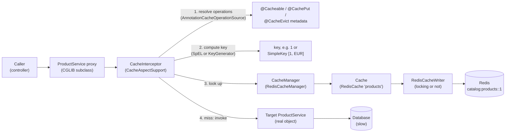

**Read path (cache-aside via `@Cacheable`):** compute the key, `GET`, and on a hit return without running the method. On a miss, run the method, `SET` the result with a TTL, and return it.
**Write path:** update the DB, then either *evict* (`@CacheEvict`, the next read reloads) or *overwrite* (`@CachePut`, the next read hits).

### The abstraction's type hierarchy

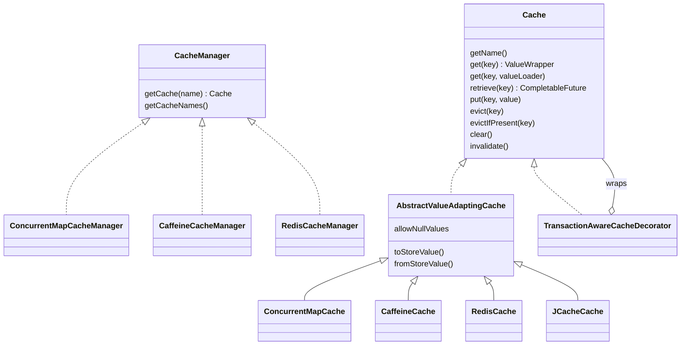

`AbstractValueAdaptingCache` is where **null handling** lives. When `allowNullValues` is true, a `null` result is stored as the `NullValue.INSTANCE` sentinel and turned back into `null` on read. That is how a *miss* can be cached (section 5).

---

## 3. How it works internally

### 3.1 Bootstrapping: what `@EnableCaching` registers

`@EnableCaching` → `CachingConfigurationSelector` → (proxy mode) `ProxyCachingConfiguration`, which registers three infrastructure beans:

| Bean | Role |
|---|---|
| `AnnotationCacheOperationSource` | Parses `@Cacheable`/`@CachePut`/`@CacheEvict`/`@Caching`/`@CacheConfig` into `CacheOperation` objects (via `SpringCacheAnnotationParser`). Results are cached per method |
| `CacheInterceptor` | The `MethodInterceptor`. All the logic lives in its superclass `CacheAspectSupport` |
| `BeanFactoryCacheOperationSourceAdvisor` | Pointcut ("does this method have cache operations?") + advice (the interceptor) |

`AutoProxyRegistrar` makes sure an auto-proxy creator exists. That BPP wraps every bean that matches an advisor in **one** proxy, during `postProcessAfterInitialization` (note 01, section 3.3). If `@Transactional` and `@Cacheable` sit on the same bean, there is one proxy with **two advisors**, ordered by their `order` attribute.

**Boot's part:** `CacheAutoConfiguration` (module `spring-boot-cache`, package `org.springframework.boot.cache.autoconfigure`) only runs when there is a `CacheAspectSupport` bean, so **without `@EnableCaching` nothing happens and every annotation is silently ignored**. It then picks a provider. With `spring.cache.type` unset, it tries Generic → JCache → Hazelcast → Couchbase → Infinispan → Redis → Caffeine → Cache2k → Simple (`ConcurrentMapCacheManager`). It backs off entirely when you declare your own `CacheManager` bean, as the lab does.

### 3.2 One `@Cacheable` call, step by step

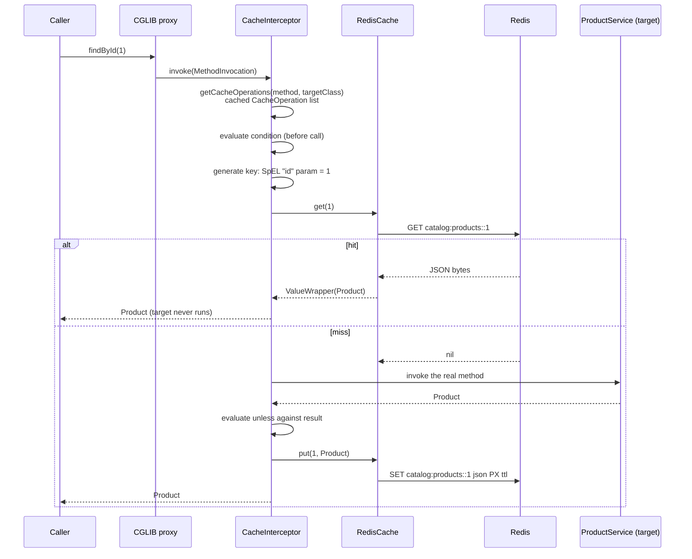

The execution order inside `CacheAspectSupport.execute(...)`:

1. `@CacheEvict(beforeInvocation = true)` operations run.
2. `@Cacheable` lookups run, in declaration order. The **first** hit wins.
3. On a total miss, the collected `@Cacheable` operations become pending puts.
4. On a miss, or if any `@CachePut` is present, the **method runs**. `@CachePut` always runs the method.
5. `unless` is evaluated against `#result` and pending puts are applied.
6. `@CacheEvict` (default, after invocation) operations run. They only run if the method returned normally.

**Evict mechanics (verified from `AbstractCacheInvoker` bytecode, Framework 7):** `doEvict(cache, key, immediate)` calls `Cache.evictIfPresent(key)` when `immediate` is true and `Cache.evict(key)` otherwise. `immediate` is `beforeInvocation`. The `Cache.evict` Javadoc allows a *deferred* eviction, while `evictIfPresent` must be immediate. On Spring Data Redis 4.x with Lettuce this distinction is real (section 6).

### 3.3 Keys: `KeyGenerator`, `SimpleKey`, SpEL

With no `key` attribute, `SimpleKeyGenerator` is used:

| Method parameters | Key |
|---|---|
| none | `SimpleKey.EMPTY` |
| exactly one | the parameter itself (so `findById(1L)` is key `1`) |
| two or more | `new SimpleKey(params...)`, using `equals`/`hashCode` over all params |

Redis keys are strings, so `RedisCache` converts the key with its `ConversionService`, falling back to `toString()`. The lab's `quote(1, "EUR")` is stored at **`catalog:quotes::SimpleKey [1, EUR]`** (asserted in `CacheBehaviourTest`). That is readable but fragile: renaming or reordering parameters silently changes every key. **For distributed caches, always give an explicit `key`.**

SpEL root objects available in `key`, `condition` and `unless`:

| Expression | Meaning |
|---|---|
| `#id`, `#p0`, `#a0` | Parameter by name (needs `-parameters`, which Boot's parent POM sets) or by index |
| `#root.methodName`, `#root.method`, `#root.target`, `#root.targetClass`, `#root.args`, `#root.caches` | Invocation metadata |
| `#result` | The return value. Only in `unless`, `@CachePut.key` and after-invocation `@CacheEvict`. For `Optional` returns it is the *unwrapped* value |
| `@beanName` | A bean reference, e.g. `key = "@tenantKeys.of(#id)"` |

A custom `KeyGenerator` bean (`@Cacheable(keyGenerator = "tenantAwareKeyGenerator")`) is the clean way to prepend a tenant id or locale to *every* key. `key` and `keyGenerator` are mutually exclusive.

### 3.4 `sync = true` and what it really does on Redis

`sync = true` makes `CacheAspectSupport` skip the get-then-put dance and call **`Cache.get(key, Callable valueLoader)`** instead. The `Cache` implementation is responsible for making concurrent callers wait. The framework enforces these rules at the **first invocation** (the messages are in `CacheAspectSupport$CacheOperationContexts`):
- "A sync=true operation cannot be combined with other cache operations"
- "Only one sync=true operation is allowed"
- "A sync=true operation is restricted to a single cache"
- "A sync=true operation does not support the unless attribute"

What each provider does with `get(key, loader)`:

| Provider | Stampede protection |
|---|---|
| `ConcurrentMapCache` | `ConcurrentHashMap.computeIfAbsent`, so one load per key per JVM |
| `CaffeineCache` | Caffeine's atomic `get(key, mappingFunction)`, so one load per key per JVM |
| `RedisCache` (Spring Data Redis 4.x), **non-locking writer (Boot's default)** | **None.** `RedisCache.get(key, loader)` is not `synchronized` (bytecode flags: `ACC_PUBLIC` only), and the writer just does GET, load, SET. **The lab proves 8 concurrent misses run the loader 8 times** (`StampedeTest.cacheGetWithLoader_onBootsDefaultNonLockingWriter_doesNotCollapseMisses`) |
| `RedisCache` with a **locking** writer | Collapsed **across all JVMs**: one load (`StampedeTest.syncTrue_withLockingWriter_collapsesConcurrentMissesIntoOneLoad`). But the lock is a single key **per cache** (`<cacheName>~lock`), not per entry, so a slow miss on key 2 also stalls a **hit** on key 1 (`StampedeTest.lockingWriter_aLoadInProgressBlocksHitsOnOtherKeysOfTheSameCache`) |

> **Niche detail many tutorials get wrong:** in Spring Data Redis 2.x/3.x `RedisCache.get(key, loader)` was `synchronized` (one load per JVM). That's where the folklore "`sync=true` works on Redis" comes from. In 4.1.2 it isn't. Either turn on `enableLocking()`, accepting cache-wide serialization, or use a per-key mechanism (section 5.5).

### 3.5 The proxy and `@Transactional`: ordering

`@EnableCaching(order = …)` and `@EnableTransactionManagement(order = …)` both default to `Ordered.LOWEST_PRECEDENCE` (Javadoc). When both advisors have the same order, the relative nesting is not something to rely on (unverified: not proven by the lab, which has no transaction manager). **Set it explicitly.** The lower order value is the outer advice.

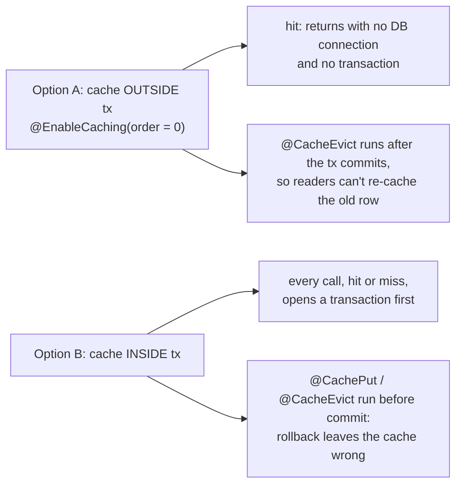

Option A is almost always what you want. If you can't control the order, for example because the cache operations sit on a repository called inside a service transaction, use **`RedisCacheManager.builder(...).transactionAware()`** (or wrap a cache in `TransactionAwareCacheDecorator`). That defers `put`/`evict` until `afterCommit` of the current Spring transaction and drops them on rollback.

### 3.6 Spring Data Redis under the hood

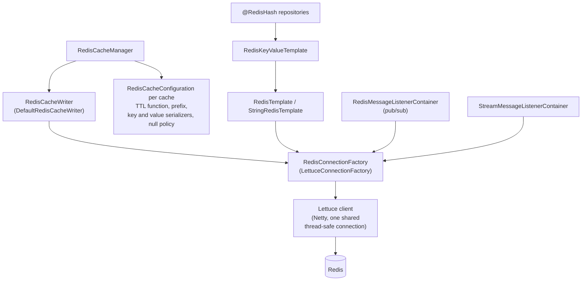

- **`RedisCacheConfiguration` defaults:** key serializer `StringRedisSerializer`, value serializer `JdkSerializationRedisSerializer`, prefix `cacheName::`, null values allowed, no TTL (entries never expire!).
- **Boot's auto-configured `RedisCacheManager`** (verified from the `spring-boot-cache` 4.1.2 bytecode) uses `RedisCacheManager.builder(connectionFactory)`, which is the **non-locking** writer, and `JdkSerializationRedisSerializer` with the app class loader. It applies `spring.cache.redis.time-to-live`, `key-prefix`, `use-key-prefix`, `cache-null-values` and `enable-statistics`, and `spring.cache.cache-names` as initial caches. To tweak it without replacing it, declare a `RedisCacheConfiguration` bean (used as the defaults) and/or a `RedisCacheManagerBuilderCustomizer` (e.g. `builder.withCacheConfiguration("products", ...)`).
- **`TtlFunction`** (`RedisCacheWriter.TtlFunction`, since 3.2) computes a TTL per entry from `(key, value)`. The lab uses it for TTL **jitter**.
- **`enableTimeToIdle()`** switches reads to `GETEX`, which resets the TTL on each read. It needs Redis ≥ 6.2. Plain `RedisTemplate` reads don't reset it.
- **`clear()` / `allEntries = true`** uses `KEYS pattern` + `DEL` by default, and `KEYS` blocks Redis on big keyspaces. Use `BatchStrategies.scan(1000)`.
- **Statistics** (`enableStatistics()`) are local hit/miss counters per `RedisCache`. Boot's `RedisCacheMetrics` exposes them through Micrometer as `cache.gets{result=hit|miss}` and related metrics.

---

## 4. Full worked code

The full source is in the lab, and `./mvnw verify` runs 19 tests against a Testcontainers `redis:7-alpine`.

### 4.1 The cache manager: per-cache TTL, jitter, prefix, Jackson 3 JSON, locking writer

```java
@Validated
@ConfigurationProperties("app.cache")
public record CatalogCacheProperties(
        @NotEmpty Map<String, Duration> ttl,
        @DecimalMin("0.0") @DecimalMax("0.5") double jitter) {
}
```

```properties
app.cache.ttl.products=10m
app.cache.ttl.skus=1h
app.cache.ttl.skus-negative=30s
app.cache.ttl.quotes=5s
app.cache.jitter=0.1
```

```java
@Configuration(proxyBeanMethods = false)
@EnableCaching
public class CacheConfig {

    @Bean
    RedisCacheManager cacheManager(RedisConnectionFactory connectionFactory, CatalogCacheProperties properties) {
        RedisCacheWriter writer = RedisCacheWriter.create(connectionFactory, writerConfig -> writerConfig
                .immediateWrites()                                   // 4.x: Lettuce writes are async otherwise
                .enableLocking(lock -> lock.lockTimeout(TtlFunction.just(Duration.ofSeconds(5))))
                .batchStrategy(BatchStrategies.scan(1000)));          // SCAN, not KEYS, on clear()

        RedisCacheConfiguration defaults = RedisCacheConfiguration.defaultCacheConfig()
                .prefixCacheNameWith("catalog:")                     // key = catalog:products::1
                .serializeValuesWith(SerializationPair.fromSerializer(jsonSerializer()));

        RedisCacheManager.RedisCacheManagerBuilder builder = RedisCacheManager.builder(writer)
                .cacheDefaults(defaults)
                .disableCreateOnMissingCache()                       // typo in a cache name -> no cache, not a TTL-less one
                .enableStatistics();
        properties.ttl().forEach((cacheName, ttl) ->
                builder.withCacheConfiguration(cacheName, defaults.entryTtl(jittered(ttl, properties.jitter()))));
        return builder.build();
    }

    static GenericJacksonJsonRedisSerializer jsonSerializer() {
        return GenericJacksonJsonRedisSerializer.builder()
                .enableDefaultTyping(BasicPolymorphicTypeValidator.builder()   // tools.jackson.databind.jsontype
                        .allowIfSubType("dev.roadmap.cache.")
                        .build())
                .enableSpringCacheNullValueSupport()
                .build();
    }

    static TtlFunction jittered(Duration base, double jitter) {
        long maxExtraMillis = (long) (base.toMillis() * jitter);
        return (key, value) -> base.plusMillis(ThreadLocalRandom.current().nextLong(maxExtraMillis + 1));
    }
}
```

What lands in Redis for `findById(1)` (asserted in `SerializationTest`):

```text
> GET catalog:products::1
{"@class":"dev.roadmap.cache.catalog.Product","id":1,"sku":"BOOK-001","name":"Effective Java",...}
> PTTL catalog:products::1
(integer) 634512        <- 10 min + up to 10% jitter
```

### 4.2 The service: every annotation attribute in one place

```java
@Service
public class ProductService {

    private final ProductRepository repository;   // slow fake DB with a call counter

    public ProductService(ProductRepository repository) { this.repository = repository; }

    @Cacheable(cacheNames = PRODUCTS, key = "#id", sync = true)               // stampede protection
    public Product findById(long id) {
        return repository.findById(id).orElseThrow(() -> new ProductNotFoundException(id));
    }

    @Cacheable(cacheNames = SKUS, key = "#sku.toUpperCase()", unless = "#result == null")
    public Product findBySku(String sku) { return repository.findBySku(sku).orElse(null); }

    @Cacheable(cacheNames = SKUS_NEGATIVE, key = "#sku.toUpperCase()")       // caches the miss (NullValue)
    public Product findBySkuCachingMisses(String sku) { return repository.findBySku(sku).orElse(null); }

    @Cacheable(cacheNames = QUOTES, condition = "#currency == 'EUR' or #currency == 'USD'")  // SimpleKey [id, currency]
    public PriceQuote quote(long id, String currency) { /* ... */ }

    @CacheEvict(cacheNames = PRODUCTS, key = "#id")                           // delete-after-write
    public Product updatePrice(long id, long priceCents) { /* load, change, save */ }

    @Caching(put = @CachePut(cacheNames = PRODUCTS, key = "#id"),
             evict = @CacheEvict(cacheNames = SKUS, key = "#result.sku()"))
    public Product rename(long id, String name) { /* load, change, save */ }

    public String priceLabel(long id) {
        Product product = findById(id);    // this.findById: bypasses the proxy, always hits the DB
        return product.name() + ": " + product.priceCents() / 100.0;
    }
}
```

### 4.3 Rate limiter on plain Redis ops

```java
@Component
public class RedisRateLimiter {

    @SuppressWarnings("rawtypes")
    private static final RedisScript<List> INCREMENT_WITH_TTL = RedisScript.of("""
            local count = redis.call('INCR', KEYS[1])
            if count == 1 then redis.call('PEXPIRE', KEYS[1], ARGV[1]) end
            return {count, redis.call('PTTL', KEYS[1])}
            """, List.class);

    private final StringRedisTemplate redis;
    private final RateLimitProperties properties;   // limit + window

    public RedisRateLimiter(StringRedisTemplate redis, RateLimitProperties properties) { /* assign */ }

    public Decision tryAcquire(String clientId) {
        List<?> result = redis.execute(INCREMENT_WITH_TTL, List.of("rate:" + clientId),
                String.valueOf(properties.window().toMillis()));
        long count = (Long) result.get(0);
        long ttlMillis = (Long) result.get(1);
        return new Decision(count <= properties.limit(), Duration.ofMillis(Math.max(ttlMillis, 0)));
    }

    public record Decision(boolean allowed, Duration retryAfter) {}
}
```

A `HandlerInterceptor` calls it for `/products/**` and throws `RateLimitExceededException`. The `@RestControllerAdvice` maps that to **429** with a `Retry-After` header and a `ProblemDetail` body. Exceptions from `preHandle` still reach the advice, because `preHandle` runs inside `DispatcherServlet.doDispatch`'s try block.

### 4.4 A distributed lock (not in the lab; shown for section 5.7)

```java
public Optional<String> tryLock(String resource, Duration ttl) {
    String token = UUID.randomUUID().toString();                              // owner identity
    Boolean ok = redis.opsForValue().setIfAbsent("lock:" + resource, token, ttl); // SET key token NX PX ttl
    return Boolean.TRUE.equals(ok) ? Optional.of(token) : Optional.empty();
}

private static final RedisScript<Long> RELEASE = RedisScript.of("""
        if redis.call('GET', KEYS[1]) == ARGV[1] then return redis.call('DEL', KEYS[1]) end
        return 0
        """, Long.class);

public void unlock(String resource, String token) {                            // compare-and-delete, atomically
    redis.execute(RELEASE, List.of("lock:" + resource), token);
}
```

### 4.5 Tests: one context, one container

```java
@SpringBootTest(properties = {"app.cache.ttl.quotes=1s", "app.rate-limit.limit=3", "app.rate-limit.window=2s"})
@AutoConfigureMockMvc
@Import(TestcontainersConfiguration.class)
public abstract class RedisIntegrationTest {      // every test class extends this, so the context is shared
    @Autowired protected StringRedisTemplate redis;
    @Autowired protected ProductRepository repository;

    @BeforeEach
    void startFromEmptyRedis() {
        redis.execute((RedisCallback<Void>) c -> { c.serverCommands().flushAll(); return null; });
        repository.reset();
    }
}

@TestConfiguration(proxyBeanMethods = false)
public class TestcontainersConfiguration {
    @Bean
    @ServiceConnection(name = "redis")             // GenericContainer + name => Redis connection details
    GenericContainer<?> redisContainer() {
        return new GenericContainer<>(DockerImageName.parse("redis:7-alpine")).withExposedPorts(6379);
    }
}
```

`StampedeTest` in short:

```java
CountDownLatch start = new CountDownLatch(1);
// 8 pool threads: start.await(); service.findById(2);
start.countDown();
assertThat(repository.calls()).isEqualTo(1);     // locking writer + sync = true
```

---

## 5. Gap fillers & niche details

### 5.1 Annotation gotchas
- **Self-invocation** (`this.findById()`) bypasses the proxy, so there's no caching (`CacheBehaviourTest.selfInvocation_bypassesTheCachingProxy`). The same goes for `private` and `final` methods, objects created with `new`, and calls from `@PostConstruct` (the proxy doesn't exist yet, see note 01). Fix it by moving the cached method to another bean.
- **`condition` vs `unless`:** `condition` is evaluated *before* the call and can veto both the lookup and the put. `unless` is evaluated *after* and vetoes only the put. `#result` is only available in `unless`.
- **`@CachePut` always runs the method.** Never put `@Cacheable` and `@CachePut` for the same key on the same method.
- **`@CachePut` key must match the `@Cacheable` key**, both in name and in the *type* used. `key = "#id"` with `long id` and `key = "#product.id"` with `Long` both stringify to `1` on Redis, but on `ConcurrentMapCache` an `Integer 1` and a `Long 1L` are different keys.
- **`Optional` return values are unwrapped:** an empty `Optional` is cached as null, and `#result` refers to the inner value.
- **`@CacheConfig(cacheNames = "products")`** at class level removes repetition. It sets defaults only.
- **Exceptions are never cached.** If the method throws, nothing is put, and after-invocation evicts are skipped.
- **Cache errors fail the call by default.** If Redis is down, `@Cacheable` throws. Implement `CachingConfigurer.errorHandler()` (a `CacheErrorHandler` that logs) to **fail open** and fall back to the DB. That is usually right for a cache, but watch the DB load.
- **Mutable cached objects:** `ConcurrentMapCache`/Caffeine return the *same instance*, so a caller mutating it corrupts the cache. Redis returns a fresh copy. Cache records.

### 5.2 Serialization
- **Boot's default Redis value serializer is JDK serialization.** Values must implement `Serializable`, the bytes are opaque in `redis-cli`, they break on class changes (`serialVersionUID`), and JDK deserialization of untrusted bytes is a gadget-chain risk.
- **`GenericJacksonJsonRedisSerializer` has default typing OFF** (Spring Data Redis 4.x). Without `enableDefaultTyping(...)`, a cached record reads back as `LinkedHashMap` and the caller gets a `ClassCastException` on the first *hit*, not the first miss. Tests that only exercise misses miss this bug.
- **Restrict polymorphic typing** with a `PolymorphicTypeValidator` allow-list. `enableUnsafeDefaultTyping()` exists, and the name is the warning.
- **`enableSpringCacheNullValueSupport()`** is needed so `NullValue` (cached misses) serializes.
- **Typed alternative:** `JacksonJsonRedisSerializer<>(Product.class)` per cache. It writes no `@class`, so the JSON is smaller and has no typing risk, but you need one cache configuration per value type.
- **Rolling deployments:** v2 of the app may read v1's JSON. Add fields compatibly, or version the prefix (`catalog:v2:`) so a deploy starts with a cold, clean namespace.

### 5.3 Providers: local vs distributed

| Provider | Where data lives | Eviction | Strengths | Weaknesses |
|---|---|---|---|---|
| `ConcurrentMapCacheManager` (Boot "simple") | JVM heap | **None, no TTL** | Zero dependencies, tests | Unbounded growth. Never use in prod |
| **Caffeine** | JVM heap | Size/weight-based (W-TinyLFU), `expireAfterWrite`/`Access`, `refreshAfterWrite` | ~nanosecond hits, excellent hit ratio, async refresh | Per-node copy: N nodes = N stale copies, and memory × N |
| **Redis** | Separate server(s) | TTL per key + `maxmemory-policy` | Shared by all nodes, survives deploys, rich data structures | Network hop (~0.5 ms), serialization cost, another system to run |
| **Hazelcast** | Partitioned across app nodes (embedded) or a cluster | TTL, max-size policies | Data grid with **near cache**, entry processors, no separate server in embedded mode | JVM-heavy, membership/split-brain operations |
| JCache (JSR-107: Ehcache 3, Infinispan) | Varies | Varies | Standard API | Annotation set differs slightly (`@CacheResult`) |

**Near cache / two-level (L1 + L2):** a small local Caffeine L1 in front of Redis L2. The L1 absorbs the hottest keys with no network hop. The hard part is **L1 invalidation**: on a write, publish the key on a Redis pub/sub channel (or use Redis 6 **client-side caching**, `CLIENT TRACKING`, where the server pushes invalidations), and every node evicts its L1 copy. Keep the L1 TTL short (seconds) as a safety net for lost messages. Hazelcast and Redisson (`RLocalCachedMap`) provide this built in.

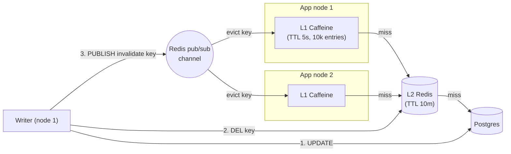

### 5.4 Cache patterns

| Pattern | Who loads / writes | Consistency | Notes |
|---|---|---|---|
| **Cache-aside** (lazy loading) | App: read cache, on miss read DB and populate. On write: DB, then evict | Eventual, with a race window (5.6) | What `@Cacheable` + `@CacheEvict` implement. The most common pattern |
| **Read-through** | The *cache* loads from the DB on a miss via a loader the app registered | Same as cache-aside | Caffeine `LoadingCache`, JCache `CacheLoader`. With Spring `sync=true` the method is effectively the loader |
| **Write-through** | Write goes to the cache, which synchronously writes the DB | Strong-ish (both updated before ack) | Write latency = cache + DB. `@CachePut` on a save method approximates it |
| **Write-behind** (write-back) | Write goes to the cache, and the cache flushes to the DB asynchronously in batches | Weak. **Data loss** if the cache dies before flushing | High write throughput (counters, view counts). Hazelcast `MapStore` with write-delay, Redis + a periodic flush job |
| **Refresh-ahead** | Cache reloads hot entries *before* they expire | Fresh for hot keys | Caffeine `refreshAfterWrite` serves the old value while reloading asynchronously. Avoids misses on hot keys entirely |

### 5.5 Stampede, penetration, avalanche

| Problem | What happens | Remedies |
|---|---|---|
| **Stampede / thundering herd / dog-piling** | A hot key expires, and 1,000 concurrent requests all miss and hit the DB | `sync=true`: per-JVM on Caffeine, and **only with a locking writer on Redis** (section 3.4). A per-key Redis lock (`SET lock:key NX PX`) where losers wait or serve stale. Refresh-ahead. **Probabilistic early expiration** (XFetch): each reader recomputes early with probability rising as expiry nears, `now - delta * beta * ln(rand()) >= expiry`, so one reader refreshes before the herd arrives |
| **Penetration** | Requests for keys that **don't exist** (bots, scans of random ids) always miss and always hit the DB | **Null caching** with a short TTL (`skus-negative`, 30 s, in the lab). A **Bloom filter** of valid ids in front (RedisBloom `BF.EXISTS` or Guava in-process): "definitely not present" rejects the request without touching the cache or DB. Input validation (ids must match a format) |
| **Avalanche** | Many keys expire **at the same moment** (bulk warm-up, or a fixed TTL set at deploy), or the cache cluster dies, and the DB is flooded | **TTL jitter** (`app.cache.jitter=0.1` in the lab). Staggered warm-up. Multi-level cache. Redis HA (Sentinel/Cluster). Circuit breaker or bulkhead on the DB call (note 14). Fail-open with rate limiting |

### 5.6 Invalidation and the classic race

> "There are only two hard things in Computer Science: cache invalidation and naming things." (Phil Karlton)

**Why "evict, then update DB" is wrong:** after the evict, a reader can miss, read the *old* row, and re-cache it *before* the update commits. The stale value then lives for a whole TTL.

**"Update DB, then evict" (delete-after-write) is the standard, but it still has a rare race:**

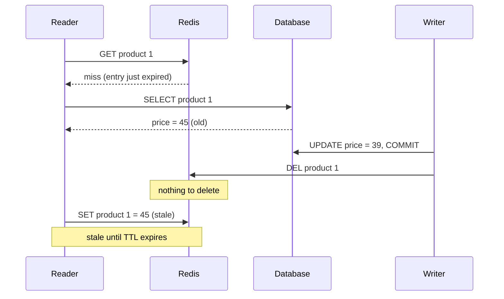

It needs a slow reader whose DB read finishes *before* the write commits but whose `SET` lands *after* the `DEL`. That's rare, but at scale it happens. Mitigations, from cheapest:

1. **Always set a TTL.** The TTL is the upper bound on staleness. Never cache without one.
2. **Delayed double delete:** `DEL`, commit, then `DEL` again after a delay longer than a typical read+set (e.g. 500 ms, via a scheduled task or a delayed queue). This catches the racing `SET`.
3. **Evict after commit,** not inside the transaction (cache advisor *outside* the tx advisor, or `transactionAware()`). Evicting inside the tx lets a reader re-cache the *uncommitted-old* value before the commit.
4. **Versioned writes:** store `{version, value}` and only `SET` if the version is newer (a Lua compare-and-set), or use the row's `@Version` in the key.
5. **CDC-driven invalidation:** Debezium tails the DB's WAL/binlog and evicts keys from the change stream (note 11). This catches writes from *any* writer, including other services and SQL scripts.

**`@CachePut` (update the cache) vs `@CacheEvict` (delete):** two concurrent writers with put can leave the cache holding the *older* write (W1 writes the DB, W2 writes the DB, W2 puts, W1 puts). Delete is idempotent and order-independent, so **prefer evict**. Use put only when the write path is single-writer or versioned.

### 5.7 Distributed locks

- **`SET key token NX PX ttl`** is atomic acquire-with-expiry. The old `SETNX` then `EXPIRE` pattern leaks locks if the client dies between the two commands.
- **Release with compare-and-delete in Lua** (section 4.4). A plain `DEL` can release a lock someone else acquired after yours expired.
- **The TTL is a lease, not a guarantee.** A GC pause or network stall longer than the TTL means two holders. **Fencing tokens** fix this: the lock service hands out a monotonically increasing number, and the protected resource rejects writes carrying an older token.
- **The Redlock controversy:** Redlock acquires the lock on a majority of N independent Redis masters. Martin Kleppmann ("How to do distributed locking", 2016) argued it depends on timing assumptions (bounded clock drift, pauses, network delay) and offers no fencing token, so it is unsafe for correctness-critical locks. Salvatore Sanfilippo (antirez) replied that the assumptions are reasonable in practice. **Rule of thumb:** a Redis lock is fine for *efficiency* (avoid doing work twice). For *correctness* (two holders = corruption), use a consensus system (ZooKeeper, etcd) or DB row locks, plus fencing.
- **Redisson** `RLock` is a reentrant lock with a **watchdog** that keeps extending the lease while the holder is alive (default `lockWatchdogTimeout` 30 s) and pub/sub-based waiting instead of spinning. It also has `RFencedLock`.
- **ShedLock** `@SchedulerLock(name = "nightlyExport", lockAtMostFor = "10m", lockAtLeastFor = "1m")` ensures a `@Scheduled` job runs on one node only. It has a Redis provider (and JDBC, Mongo...). It doesn't queue: other nodes just skip the run.

### 5.8 Rate-limiting algorithms

| Algorithm | Redis implementation | Behaviour |
|---|---|---|
| **Fixed window** | `INCR rate:{client}:{window}` + `PEXPIRE` on first hit (the lab, in one Lua script) | Cheapest, O(1). Allows up to **2 × limit** around a boundary (limit at 0:59 and again at 1:00) |
| **Sliding window log** | ZSET per client: `ZADD now`, `ZREMRANGEBYSCORE 0 (now - window)`, `ZCARD` | Exact. Memory is O(requests in window) per client |
| **Sliding window counter** | Two fixed-window counters, weighted: `prev * (1 - elapsed/window) + current` | Close approximation at O(1). Cloudflare uses this |
| **Token bucket** | Hash `{tokens, last_refill}`. A Lua script refills `rate * elapsed` up to capacity, then takes 1 | Allows bursts up to capacity and a smooth average rate. Spring Cloud Gateway's `RedisRateLimiter` (`replenishRate`, `burstCapacity`), Bucket4j |
| **Leaky bucket** | Queue drained at a fixed rate | Smooths output and adds queueing latency. Common in traffic shaping |

Always do check-and-increment **atomically** in one Lua script, because two round trips race. Decide fail-open vs fail-closed when Redis is down. Return `429` with `Retry-After` (and optionally `RateLimit-*` headers).

### 5.9 Redis fundamentals

**Data structures and their classic uses:**

| Type | Commands | Use case |
|---|---|---|
| String | `GET/SET/INCR/SETEX/SET NX PX` | Cache entries, counters, rate limits, locks |
| Hash | `HSET/HGET/HINCRBY` | An object's fields (a session, a cart) without re-serializing the whole object |
| List | `LPUSH/RPOP/BLMOVE` | Simple queues, recent-activity feeds (`LTRIM` to cap) |
| Set | `SADD/SISMEMBER/SINTER` | Tags, unique visitors, "users who liked X" |
| Sorted set (ZSET) | `ZADD/ZINCRBY/ZREVRANGE/ZRANK` | **Leaderboards**, priority queues, sliding-window rate limits, delayed jobs (score = run-at time) |
| Bitmap / HyperLogLog | `SETBIT/BITCOUNT`, `PFADD/PFCOUNT` | Daily-active flags per user id. Approximate unique counts in 12 KB |
| Geo | `GEOADD/GEOSEARCH` | "Stores near me" |
| Stream | `XADD/XREADGROUP/XACK` | Append-only log with consumer groups, a lightweight Kafka (note 11) |
| Pub/Sub | `PUBLISH/SUBSCRIBE` | Fire-and-forget broadcast (cache invalidation). **No persistence**: offline subscribers miss messages |

- **Single-threaded command execution:** one thread executes commands, so every command, and every Lua script, is **atomic** with no locks. Throughput comes from in-memory data plus I/O multiplexing (epoll). Since Redis 6, optional **I/O threads** parallelize socket reads and writes, but execution stays single-threaded. Consequence: **one slow command blocks everyone**. Never run `KEYS *`, a big `SMEMBERS`/`HGETALL`, or a long Lua script in prod. Use `SCAN`/`HSCAN`, and watch `SLOWLOG`.
- **Persistence:** **RDB** is point-in-time snapshots (`fork()` + copy-on-write). It is compact and fast to restart, but you lose data since the last snapshot. **AOF** is an append-only log of writes with `appendfsync always|everysec|no` (`everysec` loses up to about 1 s) and periodic rewrite. Redis 7 uses multi-part AOF. Production usually enables both. A *pure cache* can disable persistence entirely.
- **Eviction (`maxmemory-policy`)** when `maxmemory` is reached: `noeviction` (the default, where writes **error**), `allkeys-lru`, `allkeys-lfu`, `volatile-lru`, `volatile-lfu`, `volatile-ttl`, `allkeys-random`, `volatile-random`. For a cache use `allkeys-lru` or `allkeys-lfu`. The `volatile-*` policies only consider keys **with a TTL**: if nothing has a TTL they behave like `noeviction`. Expiry is lazy (on access) plus active sampling, so expired keys don't vanish at the exact millisecond.
- **Replication:** asynchronous primary → replicas. A failover can lose the last acknowledged writes. `WAIT n timeout` gives *best-effort* synchronous acknowledgement.
- **Pipelining:** send many commands without waiting for each reply, which saves N-1 round trips. It is not atomic (use `MULTI/EXEC` or Lua for that). In Spring: `redisTemplate.executePipelined((RedisCallback<Object>) c -> { ... return null; })`.
- **Transactions:** `MULTI/EXEC` queues commands and runs them atomically, but there's **no rollback** if one fails. `WATCH` adds optimistic check-and-set. In practice Lua scripts are simpler.

**Sentinel vs Cluster:**

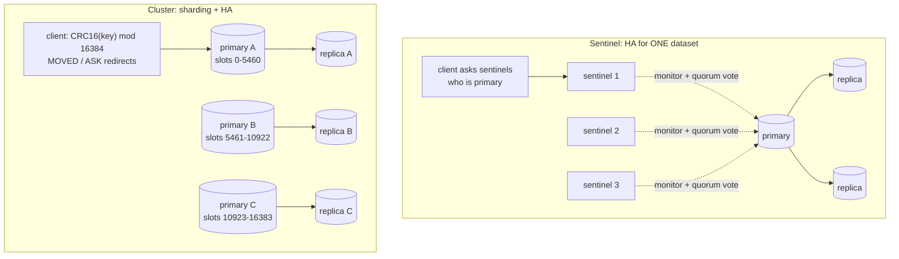

| | Sentinel | Cluster |
|---|---|---|
| Scales writes | No (one primary) | Yes (16384 hash slots across primaries) |
| Multi-key ops | Anything | Only if all keys share a slot. Use **hash tags**: `{user:42}:cart` and `{user:42}:profile` land in the same slot |
| Spring config | `spring.data.redis.sentinel.master`, `.nodes` | `spring.data.redis.cluster.nodes`, `.max-redirects` |
| Lua scripts | Any keys | All `KEYS[]` in one slot |

Boot 4.0 added `spring.data.redis.masterreplica.nodes` for static primary/replica setups (Lettuce only), e.g. managed Redis with a fixed reader endpoint.

**Lettuce vs Jedis:**

| | Lettuce (Boot default) | Jedis |
|---|---|---|
| I/O | Netty, non-blocking. Sync, async and reactive APIs | Blocking sockets |
| Thread safety | One connection shared by all threads (multiplexed) | A connection per thread, so you need a pool (`spring.data.redis.jedis.pool.*`) |
| Reactive (`ReactiveRedisTemplate`) | Yes | No |
| Pooling | Optional (`spring.data.redis.lettuce.pool.*`, needs `commons-pool2`). Only useful for blocking ops (`BLPOP`) or transactions | Required |
| Cluster topology refresh | `spring.data.redis.lettuce.cluster.refresh.adaptive=true` | Built in |

Switch to Jedis by excluding `lettuce-core` from `spring-boot-starter-data-redis` and adding `redis.clients:jedis`.

### 5.10 Spring Data Redis beyond the cache

- **`RedisTemplate<K, V>` vs `StringRedisTemplate`:** Boot auto-configures both. The default `RedisTemplate<Object, Object>` uses **JDK serialization for keys too**, so keys look like `\xac\xed\x00\x05t\x00\x03foo` in `redis-cli`. Use `StringRedisTemplate`, or define your own `RedisTemplate<String, Product>` with `StringRedisSerializer` keys and `JacksonJsonRedisSerializer` values. Operations: `opsForValue()`, `opsForHash()`, `opsForList()`, `opsForSet()`, `opsForZSet()`, `opsForStream()`, `opsForGeo()`, `opsForHyperLogLog()`.
- **Repositories:** `@RedisHash(value = "carts", timeToLive = 3600)` with `CrudRepository<Cart, String>`. Each entity is stored as a Hash, `@Indexed` fields keep secondary-index Sets, and `@TimeToLive` sets per-entity expiry. **Trap:** index sets aren't cleaned when the hash expires unless keyspace events are enabled (`@EnableRedisRepositories(enableKeyspaceEvents = ON_STARTUP)` + `notify-keyspace-events Ex`), so phantom ids accumulate. Fine for simple keyed lookups. Don't treat it as a query engine.
- **Pub/Sub:** `RedisMessageListenerContainer` + a `MessageListener` per `ChannelTopic`/`PatternTopic`. Use it for L1 cache invalidation and websocket fan-out. Delivery is at-most-once.
- **Streams (briefly):** `StreamMessageListenerContainer` with consumer groups (`XREADGROUP`), `XACK` and pending-entry lists give at-least-once processing with replay, a lightweight alternative to Kafka for one service's work queue.

### 5.11 Session store with Spring Session

Add `spring-boot-starter-session-data-redis`. Boot auto-configures `RedisSessionRepository` and a `SessionRepositoryFilter` that wraps `HttpServletRequest` so `request.getSession()` reads and writes Redis instead of Tomcat memory.

- Keys: `spring:session:sessions:<id>` (a Hash of attributes, `creationTime`, `lastAccessedTime`, `maxInactiveInterval`). The namespace is set by `spring.session.data.redis.namespace`.
- `spring.session.data.redis.repository-type=default|indexed`: `indexed` adds the principal-name index (`FindByIndexNameSessionRepository`), which you need for "log out all my sessions" and Spring Security's concurrent-session control, plus expiry events.
- `flush-mode=on-save` (default) or `immediate`. `save-mode=on-set-attribute` (default) writes only changed attributes, so **mutating an object you got from the session without calling `setAttribute` again is lost**.
- Session attributes are serialized (JDK by default). Configure a `springSessionDefaultRedisSerializer` bean for JSON.
- `server.servlet.session.timeout` sets the TTL.
- REST APIs with JWT (note 07) don't need this. It's for server-side sessions: classic MVC apps, OAuth2 login flows (`oauth2Login` keeps the authorization request in the session), and BFF gateways.

---

## 6. Boot 4 / Framework 7 delta

Sources: [Spring Boot 4.0 Migration Guide](https://github.com/spring-projects/spring-boot/wiki/Spring-Boot-4.0-Migration-Guide), [Spring Boot 4.0 Release Notes](https://github.com/spring-projects/spring-boot/wiki/Spring-Boot-4.0-Release-Notes), [Spring Data Redis: Upgrading from 3.x to 4.x](https://docs.spring.io/spring-data/redis/reference/4.0/upgrading.html), [Spring Framework 7.0 Release Notes](https://github.com/spring-projects/spring-framework/wiki/Spring-Framework-7.0-Release-Notes). Items marked *bytecode* were verified by `javap` against the 4.1.2 jars in the lab's classpath.

| Change | Status | What it means for you |
|---|---|---|
| Modular starters: `spring-boot-starter-cache` / `spring-boot-starter-cache-test`, `spring-boot-starter-data-redis` / `-data-redis-test` (and `-data-redis-reactive`), modules `spring-boot-cache`, `spring-boot-data-redis` | **New** | Add the `*-test` starter of each technology under test. Initializr does this for you |
| Auto-config packages moved: `org.springframework.boot.cache.autoconfigure` (`CacheProperties`, `RedisCacheManagerBuilderCustomizer`, `CacheManagerCustomizer`), `org.springframework.boot.data.redis.autoconfigure` | **Changed** (*bytecode*) | Fix imports in customizers |
| Redis properties/details classes renamed to `DataRedisProperties`, `DataRedisConnectionDetails`, `DataRedisAutoConfiguration` | **Changed** (*bytecode*) | Code that injected `RedisProperties` / `RedisConnectionDetails` must be updated. Property keys stay `spring.data.redis.*` |
| Spring Session properties: `spring.session.redis.*` is now **`spring.session.data.redis.*`**. Starter `spring-boot-starter-session-data-redis`. Spring Session 4.0 | **Renamed** | Old keys are silently ignored. Run `spring-boot-properties-migrator` once to find them |
| `spring.data.redis.masterreplica.nodes` (static primary/replica, Lettuce only) | **New** | Managed Redis with fixed reader/writer endpoints |
| Lettuce observability: Boot configures Lettuce's own `MicrometerTracing` instead of `MicrometerCommandLatencyRecorder`. Spring Data Redis removed its Lettuce observability adapter | **Changed** | Redis spans and metrics come from Lettuce natively |
| **Jackson 3 serializers:** `GenericJacksonJsonRedisSerializer`, `JacksonJsonRedisSerializer`, `JacksonHashMapper`, `JacksonObjectReader/Writer` (package `org.springframework.data.redis.serializer`, using `tools.jackson.databind`). The `*Jackson2*` versions are **deprecated for removal** | **New / Deprecated** | `RedisSerializer.json()` is now Jackson 3 |
| `GenericJacksonJsonRedisSerializer` **does not enable default typing** (`GenericJackson2JsonRedisSerializer` did) | **Changed** | Call `builder().enableDefaultTyping(validator)`, or records come back as `LinkedHashMap`. Jackson 3 JSON may differ from Jackson 2's, so keep the Jackson 2 serializer to *read* old entries during migration, or version your key prefix |
| `RedisCacheWriter`: with a reactive-capable factory (Lettuce) the default writer does **async** `put`/`evict`/`clear`, which may complete after the method returns. `evictIfPresent`/`invalidate` stay synchronous. Opt out with `RedisCacheWriter.create(cf, c -> c.immediateWrites())` | **Changed** | A plain `@CacheEvict` (after invocation, so `Cache.evict`) may not have landed when the next read arrives. The lab uses `immediateWrites()` |
| `RedisCacheConfiguration.getTtl()` removed → `getTtlFunction().getTimeToLive(key, value)`. `RedisCacheManager` constructor parameter order changed | **Removed / Changed** | Fix custom cache managers |
| `RedisCache.get(key, loader)` is not `synchronized`, so `sync = true` needs a locking writer to collapse misses | **Behaviour** (*bytecode* + `StampedeTest`) | See section 3.4 |
| `StringRedisTemplate` callbacks no longer receive `StringRedisConnection` | **Changed** | Use `opsForValue()` etc., or the binary `RedisConnection` |
| JSpecify nullability. `RedisSerializer.serialize` must return non-null (empty array for null) | **Changed** | Custom serializers |
| Testcontainers 2.0. `@ServiceConnection` Redis supports `GenericContainer` named `redis` (or image `redis/redis-stack`), plus `com.redis:testcontainers-redis` `RedisContainer`/`RedisStackContainer` | **Changed** (*bytecode*: `RedisContainerConnectionDetailsFactory`) | Use `@ServiceConnection(name = "redis")` on a `GenericContainer`, as Initializr generates |
| Jackson 2 support deprecated in Framework 7 (auto-detection to be disabled in 7.1, removed in 7.2) | **Deprecated** | Move custom `ObjectMapper` code to `tools.jackson.*` |
| Lettuce 7.5.2 in Boot 4.1.2 (Boot 4.0 shipped 6.8). Jedis 6.2 in Boot 4.0 | **Upgraded** | The version comes from the lab's resolved classpath |

> ⚠️ **Outdated advice still common in tutorials and Baeldung articles:**
> - `new GenericJackson2JsonRedisSerializer()` and `com.fasterxml.jackson.databind.ObjectMapper` in Redis config. That's the deprecated Jackson 2 path.
> - "`sync = true` prevents the stampede on Redis" without a locking writer. False on Spring Data Redis 4.x (section 3.4).
> - `spring.session.redis.namespace` and similar. Renamed to `spring.session.data.redis.*`.
> - `RedisCacheManager.create(cf)` with no TTL. Entries never expire.
> - `SETNX` then `EXPIRE` for locks. Not atomic. Use `SET NX PX`.
> - `@MockBean CacheManager` in tests. `@MockBean` is removed. And caching tests should use a real Redis via Testcontainers anyway.

---

## 7. Real-life architecture solutions

### 7.1 E-commerce: product catalog cache-aside in front of Postgres, with TTL jitter

**Problem:** product detail pages make up 90% of traffic, reads outnumber writes about 1000:1, and the Postgres replica CPU spikes during sales. A flash sale starts at 10:00, every node warms the same keys at 09:59, and they all expire at 10:09.

**Solution:** cache-aside with `@Cacheable(sync = true)` on the read path, `@CacheEvict` after commit on the write path, TTL 10 min **+ 0–10% jitter** so warm-up expiries spread out, negative caching for unknown SKUs, and CDC (Debezium) for writes that bypass the service (the merchant's bulk price import). Optional Caffeine L1 for the top 1,000 SKUs.

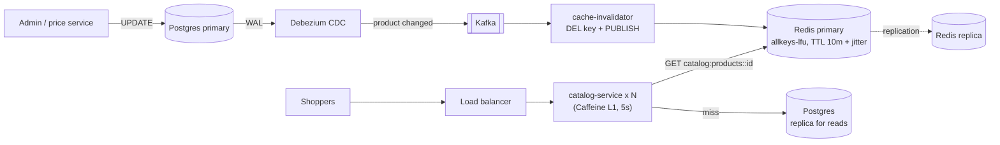

**Trade-offs:**
- Up to a TTL (or the race window) of staleness on prices. The *cart and checkout* must re-read the price from the DB inside the transaction.
- CDC adds infrastructure, but it catches every writer.
- `allkeys-lfu` keeps hot SKUs under memory pressure.

**Who uses it:** practically every large storefront (Shopify, Flipkart, Zalando catalog services) and product-information APIs.

### 7.2 A Redis rate limiter at the API gateway

**Problem:** a public API needs per-API-key quotas (e.g. 100 req/s with bursts to 200) enforced consistently across 20 gateway instances, and a noisy client must not take down the backends.

**Solution:** a token bucket in Redis, executed as one Lua script per request and keyed by API key or client id. **Spring Cloud Gateway** ships it as `RequestRateLimiter` with `RedisRateLimiter(replenishRate, burstCapacity, requestedTokens)` and a `KeyResolver` bean. Over limit means `429` plus `X-RateLimit-Remaining`.

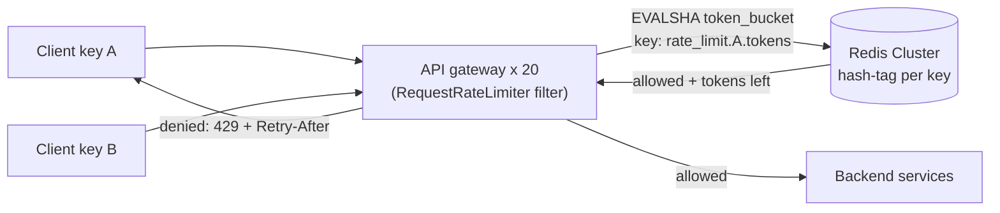

**Trade-offs:**
- One Redis round trip per request, about 0.5 ms.
- If Redis is down, choose **fail-open** (availability; Spring Cloud Gateway allows the request) or **fail-closed** (protection).
- Hot keys for huge tenants can be sharded per gateway node with a local pre-check.
- Fixed window is cheaper but bursty at boundaries.

**Who uses it:** Spring Cloud Gateway, Kong (`rate-limiting` plugin with the Redis policy), Envoy's global rate-limit service (backed by Redis), GitHub's and Stripe's API rate limits (Stripe has written about Redis-backed token buckets).

### 7.3 A session store for horizontally scaled, stateless app nodes

**Problem:** a server-rendered app, or an OAuth2-login BFF, keeps `HttpSession` state. With sticky sessions, a node restart or scale-in logs users out, and the load is uneven.

**Solution:** Spring Session with Redis. Nodes hold no session state, so any node can serve any request. The `SESSION` cookie carries only the id. Use `repository-type=indexed` for "sign out everywhere".

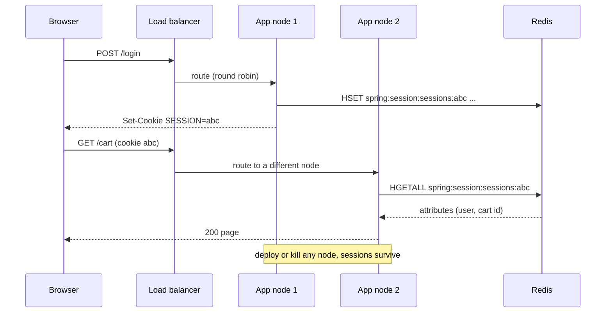

**Trade-offs:**
- A Redis hit on every request (pipelined, small).
- Redis becomes critical: losing it logs everyone out, so use Sentinel/replicas and AOF.
- Session size discipline: store ids, not object graphs.
- For pure APIs, stateless JWT (note 07) avoids the store entirely, but makes revocation harder.

**Who uses it:** enterprise portals, banking web apps, Spring Cloud Gateway as an OAuth2 BFF (token relay keeps tokens in the session), and Kubernetes deployments with rolling updates.

### 7.4 Gaming: a real-time leaderboard with sorted sets

**Problem:** show the global top 100 and "my rank" for 10 million players, updated on every match. A SQL `ORDER BY score LIMIT 100` plus `COUNT(*) WHERE score > mine` doesn't hold up at that write rate.

**Solution:** one ZSET per board and season. `ZINCRBY lb:season-12 50 player:42` on each match. `ZREVRANGE lb:season-12 0 99 WITHSCORES` for the top 100. `ZREVRANK lb:season-12 player:42` for "my rank". All are O(log N). Tie-break by encoding time into the score (`score * 1e10 + (MAX_TS - ts)`). Persist match results to the DB asynchronously, and rebuild the ZSET from the DB if Redis is lost.

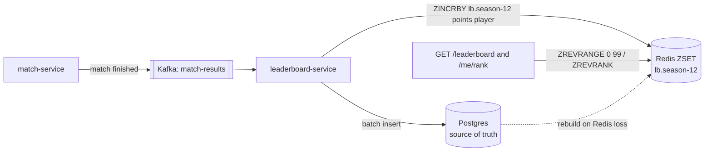

```java
redis.opsForZSet().incrementScore("lb:season-12", "player:42", 50);
Set<ZSetOperations.TypedTuple<String>> top = redis.opsForZSet().reverseRangeWithScores("lb:season-12", 0, 99);
Long rank = redis.opsForZSet().reverseRank("lb:season-12", "player:42");   // 0-based
```

**Trade-offs:**
- Memory is about 100 B per member, so 10 M players is about 1 GB per board. Use per-region or per-friend-group boards for scale.
- One ZSET lives in one Cluster slot, so a single huge board can't be sharded and a hot key needs read replicas.
- Weekly or seasonal boards rotate by key name and expire old ones with a TTL.

**Who uses it:** mobile and online games, fitness apps (Strava-style segment boards), Q&A and coding-contest ranking, "trending" lists (score = decayed popularity).

---

## 8. Pitfalls & debugging checklist

- [ ] **`@Cacheable` does nothing.** There's no `@EnableCaching`, or it's a self-call, a private or final method, an object created with `new`, or a call from `@PostConstruct`. Check `AopUtils.isAopProxy(bean)`, and turn on `logging.level.org.springframework.cache=TRACE` to see "Computed cache key ... / Cache entry for key ... found in cache".
- [ ] **`ClassCastException: LinkedHashMap cannot be cast to Product` on a cache hit.** The Jackson 3 generic serializer is running without default typing. Use `enableDefaultTyping(validator)` or a typed `JacksonJsonRedisSerializer`.
- [ ] **`SerializationException ... DefaultSerializer requires a Serializable payload`.** Boot's default JDK serializer is in use. Switch to JSON (or implement `Serializable`).
- [ ] **Keys look like `\xac\xed\x00\x05...` in `redis-cli`.** That's the default `RedisTemplate` with JDK key serialization. Use `StringRedisTemplate`.
- [ ] **Entries never expire.** No TTL is configured (`defaultCacheConfig()` has none). Set `spring.cache.redis.time-to-live` or `entryTtl`, and check with `PTTL key`.
- [ ] **`Cannot find cache named 'x'`.** `disableCreateOnMissingCache()` is set, or `spring.cache.cache-names` is fixed, and the annotation names an unlisted cache. Usually a typo.
- [ ] **Stale value right after an update.** Check the eviction ordering (evict inside the tx, or evict before the write), the async writer on 4.x (no `immediateWrites()` with plain `@CacheEvict`), a `@CachePut` key that doesn't match the `@Cacheable` key, or a writer outside the service (SQL script). Fix with evict-after-commit, matching keys, CDC, and delayed double delete.
- [ ] **DB spikes every N minutes.** Synchronized expiry (avalanche). Add TTL jitter.
- [ ] **DB spikes when a hot key expires.** Stampede. Use `sync = true` + a locking writer, a per-key lock, or refresh-ahead.
- [ ] **Latency on cache hits jumps under load (locking writer).** A slow load holds the cache-wide `<cache>~lock`. Split hot caches, speed up the loader, or switch to per-key locking.
- [ ] **`OOM command not allowed when used memory > 'maxmemory'`.** `maxmemory-policy` is `noeviction` (the default), or every key lacks a TTL under a `volatile-*` policy.
- [ ] **Redis CPU at 100% / latency spikes.** `KEYS *` (including `@CacheEvict(allEntries = true)` with the default batch strategy), big values, or a long Lua script. Check `SLOWLOG GET 10` and `redis-cli --bigkeys`, and use `BatchStrategies.scan(n)`.
- [ ] **`CROSSSLOT Keys in request don't hash to the same slot`** on a Cluster. Multi-key command or Lua script across slots. Use hash tags `{...}`.
- [ ] **Sessions lost or attributes not saved.** An attribute object was mutated without calling `setAttribute` again (`save-mode=on-set-attribute`), or old `spring.session.redis.*` keys are still used in Boot 4.
- [ ] **Test pollution between test classes.** Flush Redis in `@BeforeEach`, and keep one shared context/container (identical annotations) so tests don't start N containers.

---

## 9. Interview questions

<details><summary>Q1. How does @Cacheable work internally?</summary>

`@EnableCaching` registers `AnnotationCacheOperationSource`, `CacheInterceptor` and `BeanFactoryCacheOperationSourceAdvisor`. The auto-proxy creator wraps matching beans in a (CGLIB, by default) proxy after initialization. On a call, `CacheInterceptor` (via `CacheAspectSupport.execute`) resolves the cached `CacheOperation`s, evaluates `condition`, computes the key (SpEL `key` or the `KeyGenerator`), and asks `CacheManager.getCache(name).get(key)`. On a hit it returns without invoking the target. On a miss it invokes the target, evaluates `unless` against `#result`, and `put`s the value. Because it's a proxy, self-invocation, private/final methods and `new`-created objects aren't cached.
</details>

<details><summary>Q2. What is the default cache key? Why is it risky with Redis?</summary>

`SimpleKeyGenerator`: no params gives `SimpleKey.EMPTY`, one param is the param itself, and multiple params give `SimpleKey(params)`. On Redis the key is stringified, e.g. `quotes::SimpleKey [1, EUR]`. It's fragile: reordering or adding a parameter changes all keys, two methods sharing a cache with the same args collide, and type differences (`Integer` vs `Long`) can matter for local caches. Always give an explicit `key` SpEL or a custom `KeyGenerator`, e.g. to add a tenant id.
</details>

<details><summary>Q3. condition vs unless?</summary>

`condition` is evaluated before the method runs, and if false the cache is bypassed entirely (no lookup, no put). `unless` is evaluated after the method runs, can reference `#result`, and only vetoes the put. `unless = "#result == null"` is the common way to avoid caching misses. `sync = true` doesn't support `unless`.
</details>

<details><summary>Q4. What does sync = true do, and does it protect against a stampede on Redis?</summary>

It makes the interceptor call `Cache.get(key, valueLoader)` so the cache implementation can let only one caller load while the others wait. Caffeine and `ConcurrentMapCache` do this per JVM (`computeIfAbsent`). On Spring Data Redis 4.x, `RedisCache.get(key, loader)` isn't synchronized. With Boot's default non-locking writer, 8 concurrent misses run the loader 8 times (proven in the lab). With `RedisCacheWriter.create(cf, c -> c.enableLocking())` misses collapse to one load across all JVMs, but the lock is per *cache* (`products~lock`), so a slow load also stalls hits on other keys. Restrictions: `sync` can't be combined with `unless`, multiple caches, or other cache operations on the method.
</details>

<details><summary>Q5. Explain cache-aside, read-through, write-through, write-behind and refresh-ahead.</summary>

- **Cache-aside:** the app reads the cache, and on a miss loads from the DB and populates the cache. On write it updates the DB and evicts. This is `@Cacheable` + `@CacheEvict`.
- **Read-through:** the cache itself loads on a miss via a registered loader (Caffeine `LoadingCache`, JCache `CacheLoader`).
- **Write-through:** writes go to the cache, which synchronously writes the DB, so both are updated before acknowledging.
- **Write-behind:** the cache acknowledges and flushes to the DB asynchronously in batches. It's fast, but can lose data.
- **Refresh-ahead:** hot entries are reloaded before expiry (Caffeine `refreshAfterWrite`), so readers never see the miss.
</details>

<details><summary>Q6. Update the DB then delete the cache, or delete then update? What race remains?</summary>

Update the DB, then delete. Delete-first lets a concurrent reader re-cache the old value before the update commits. Delete-after-write still has a rare race: a reader misses, reads the old row, the writer commits and deletes, then the reader `SET`s the stale value. Mitigations: always set a TTL (it bounds the staleness), delayed double delete (delete again after about 500 ms), evict after commit (cache advice outside the transaction, or `transactionAware()`), versioned compare-and-set, or CDC-based invalidation. Prefer evict over put, because concurrent puts can leave the older value.
</details>

<details><summary>Q7. Stampede vs penetration vs avalanche, and how do you handle each?</summary>

- **Stampede:** a hot key expires and many concurrent misses hit the DB. Handle it with `sync`/locks (single-flight), refresh-ahead, or probabilistic early expiration.
- **Penetration:** lookups for non-existent keys always miss. Handle it with null caching with a short TTL, a Bloom filter in front, and input validation.
- **Avalanche:** many keys expire at once, or the cache goes down. Handle it with TTL jitter, staggered warm-up, Redis HA, multi-level caching, and DB circuit breakers or rate limits.
</details>

<details><summary>Q8. Why is Redis single-threaded yet fast, and what does that imply?</summary>

Data is in memory, commands are simple, and one event loop with I/O multiplexing avoids locking and context switches. Redis 6+ can offload socket I/O to threads, but command execution remains single-threaded. Implications: every command and Lua script is atomic (great for counters, locks and rate limits), and one slow command (`KEYS *`, a huge `HGETALL`, a long script) blocks all clients. Use `SCAN` and watch `SLOWLOG`.
</details>

<details><summary>Q9. RDB vs AOF? Which eviction policy for a cache?</summary>

RDB takes periodic fork-based snapshots: compact and fast to restart, but you lose writes since the last snapshot. AOF logs every write with `appendfsync everysec` (about 1 s of loss), and gets bigger and is rewritten periodically. Production stores often use both. A pure cache can skip persistence. The `maxmemory-policy` default is `noeviction`, where writes fail when full. For caches use `allkeys-lru` or `allkeys-lfu`. `volatile-*` policies only evict keys with a TTL.
</details>

<details><summary>Q10. Sentinel vs Cluster?</summary>

Sentinel provides HA for a single primary dataset: sentinels monitor it, vote on a quorum, promote a replica, and tell clients the new primary. It doesn't scale writes. Cluster shards the keyspace into 16384 hash slots across several primaries (each with replicas), handles failover itself, and clients follow `MOVED`/`ASK` redirects. Multi-key operations and Lua scripts must stay within one slot, so use hash tags like `{user:42}`. Replication is asynchronous in both, so a failover can lose recent writes.
</details>

<details><summary>Q11. Lettuce vs Jedis?</summary>

Lettuce (Boot's default) is Netty-based and non-blocking. One connection is thread-safe and shared, and it offers sync, async and reactive APIs, so it is required for `ReactiveRedisTemplate`. Pooling is optional and only useful for blocking commands or transactions. Jedis uses blocking sockets and one connection per thread, so it needs a pool. It's simple and fast, but has no reactive API. Switch to it by excluding `lettuce-core` and adding `jedis`.
</details>

<details><summary>Q12. How do you build a distributed lock on Redis, and what's the Redlock debate?</summary>

`SET lock:res <random token> NX PX <ttl>` to acquire atomically with a lease. Release with a Lua compare-and-delete so you never delete someone else's lock. The TTL means a paused holder can lose the lock while still working, so correctness requires fencing tokens checked by the resource. Redlock acquires the lock on a majority of N independent masters. Kleppmann argued it relies on timing assumptions and lacks fencing, and antirez countered. Use Redis locks for efficiency. For correctness use consensus (ZooKeeper, etcd) or DB locks plus fencing. Libraries: Redisson (`RLock` with a watchdog lease extension) and ShedLock (single-node `@Scheduled` execution).
</details>

<details><summary>Q13. Compare rate-limiting algorithms and how you'd implement one in Redis.</summary>

- **Fixed window:** `INCR` + `EXPIRE` on the first hit, atomically in Lua. Cheap, but allows 2× bursts at boundaries.
- **Sliding log:** a ZSET of timestamps (`ZADD`, `ZREMRANGEBYSCORE`, `ZCARD`). Exact, but memory-heavy.
- **Sliding window counter:** a weighted current plus previous window. O(1) and accurate enough.
- **Token bucket:** a hash of tokens plus the last refill, refilled in Lua. Allows bursts up to capacity with a steady rate. Spring Cloud Gateway's `RedisRateLimiter` uses it.

Always make check-and-update atomic, decide fail-open vs fail-closed, and return 429 with `Retry-After`.
</details>

<details><summary>Q14. How do @Transactional and @Cacheable interact on the same method?</summary>

Both are advisors on one proxy. Both `@EnableCaching` and `@EnableTransactionManagement` default to `LOWEST_PRECEDENCE`, so set their `order` explicitly. With caching outside (lower order value), cache hits don't open a transaction, and evicts run after commit, so readers can't re-cache uncommitted-old data. With caching inside, puts and evicts happen before commit, and a rollback leaves the cache inconsistent. If you can't control the order, `RedisCacheManager.builder().transactionAware()` (`TransactionAwareCacheDecorator`) defers put/evict to after commit.
</details>

<details><summary>Q15. What changed for Redis caching in Boot 4 / Spring Data Redis 4?</summary>

- Jackson 3 serializers: `GenericJacksonJsonRedisSerializer` and `JacksonJsonRedisSerializer`, with the Jackson 2 versions deprecated. The generic one no longer enables default typing.
- With Lettuce, the cache writer does async put/evict unless `immediateWrites()` is set.
- `getTtl()` was replaced by `TtlFunction`.
- `RedisCache.get(key, loader)` isn't synchronized, so `sync` needs a locking writer.
- Boot's modular `spring-boot-cache` / `spring-boot-data-redis` modules and `*-test` starters, with renamed `DataRedisProperties` / `DataRedisConnectionDetails`.
- `spring.session.redis.*` was renamed to `spring.session.data.redis.*`.
- `spring.data.redis.masterreplica.nodes`.
- Lettuce-native observability.
- Testcontainers 2.
</details>

---

## 10. Sources

- Spring Framework reference: [Cache Abstraction](https://docs.spring.io/spring-framework/reference/integration/cache.html), [Declarative annotation-based caching](https://docs.spring.io/spring-framework/reference/integration/cache/annotations.html), [`CacheAspectSupport` Javadoc](https://docs.spring.io/spring-framework/docs/current/javadoc-api/org/springframework/cache/interceptor/CacheAspectSupport.html), [`@EnableCaching` Javadoc](https://docs.spring.io/spring-framework/docs/current/javadoc-api/org/springframework/cache/annotation/EnableCaching.html), [`TransactionAwareCacheDecorator`](https://docs.spring.io/spring-framework/docs/current/javadoc-api/org/springframework/cache/transaction/TransactionAwareCacheDecorator.html)
- Spring Boot reference: [Caching](https://docs.spring.io/spring-boot/reference/io/caching.html), [Working with NoSQL: Redis](https://docs.spring.io/spring-boot/reference/data/nosql.html#data.nosql.redis), [Testcontainers service connections](https://docs.spring.io/spring-boot/reference/testing/testcontainers.html), [Docker Compose support](https://docs.spring.io/spring-boot/reference/features/dev-services.html)
- [Spring Boot 4.0 Migration Guide](https://github.com/spring-projects/spring-boot/wiki/Spring-Boot-4.0-Migration-Guide) · [Spring Boot 4.0 Release Notes](https://github.com/spring-projects/spring-boot/wiki/Spring-Boot-4.0-Release-Notes) · [Spring Framework 7.0 Release Notes](https://github.com/spring-projects/spring-framework/wiki/Spring-Framework-7.0-Release-Notes)
- Spring Data Redis: [Redis Cache](https://docs.spring.io/spring-data/redis/reference/redis/redis-cache.html), [Upgrading from 3.x to 4.x](https://docs.spring.io/spring-data/redis/reference/4.0/upgrading.html), [Redis Repositories](https://docs.spring.io/spring-data/redis/reference/repositories.html), [Pub/Sub](https://docs.spring.io/spring-data/redis/reference/redis/pubsub.html), [Streams](https://docs.spring.io/spring-data/redis/reference/redis/redis-streams.html)
- Spring Session: [Redis](https://docs.spring.io/spring-session/reference/configuration/redis.html) · Spring Cloud Gateway: [RequestRateLimiter](https://docs.spring.io/spring-cloud-gateway/reference/spring-cloud-gateway-server-webflux/gatewayfilter-factories/requestratelimiter-factory.html)
- Redis docs: [Data types](https://redis.io/docs/latest/develop/data-types/), [Persistence](https://redis.io/docs/latest/operate/oss_and_stack/management/persistence/), [Key eviction](https://redis.io/docs/latest/develop/reference/eviction/), [Pipelining](https://redis.io/docs/latest/develop/use/pipelining/), [Cluster spec](https://redis.io/docs/latest/operate/oss_and_stack/reference/cluster-spec/), [Distributed locks](https://redis.io/docs/latest/develop/use/patterns/distributed-locks/), [Client-side caching](https://redis.io/docs/latest/develop/reference/client-side-caching/)
- Martin Kleppmann, [How to do distributed locking](https://martin.kleppmann.com/2016/02/08/how-to-do-distributed-locking.html) · antirez, [Is Redlock safe?](http://antirez.com/news/101) · Vattani et al., *Optimal Probabilistic Cache Stampede Prevention* (VLDB 2015)
- Baeldung: [A Guide to Caching in Spring](https://www.baeldung.com/spring-cache-tutorial), [Spring Boot Cache with Redis](https://www.baeldung.com/spring-boot-redis-cache), [Introduction to Spring Data Redis](https://www.baeldung.com/spring-data-redis-tutorial), [Spring Session with Redis](https://www.baeldung.com/spring-session) (3.x era. They use `GenericJackson2JsonRedisSerializer` and `spring.session.redis.*`, see section 6)
- Spring source to read: `CacheAspectSupport#execute`, `AbstractCacheInvoker#doEvict`, `SimpleKeyGenerator`, `RedisCache#get(Object, Callable)`, `DefaultRedisCacheWriter#get`, `org.springframework.boot.cache.autoconfigure.RedisCacheConfiguration`
- Oracle: [`ConcurrentHashMap#computeIfAbsent`](https://docs.oracle.com/en/java/javase/21/docs/api/java.base/java/util/concurrent/ConcurrentHashMap.html#computeIfAbsent(K,java.util.function.Function)), [`ThreadLocalRandom`](https://docs.oracle.com/en/java/javase/21/docs/api/java.base/java/util/concurrent/ThreadLocalRandom.html), [Java Object Serialization security](https://docs.oracle.com/en/java/javase/21/core/java-serialization-filters.html)
