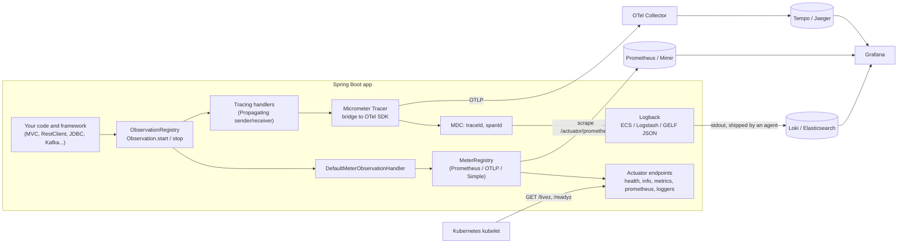
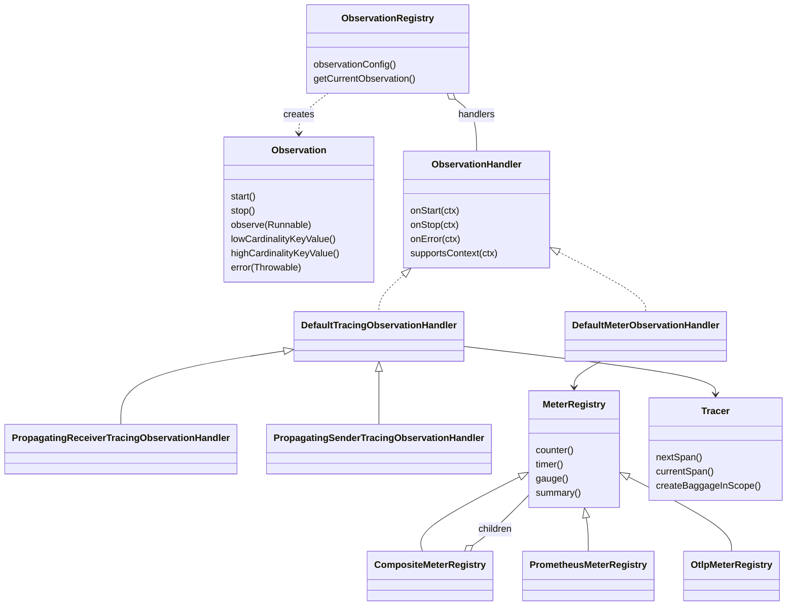
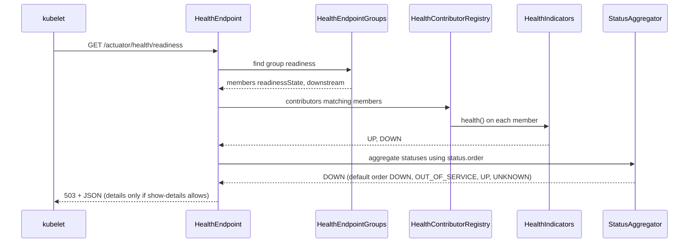
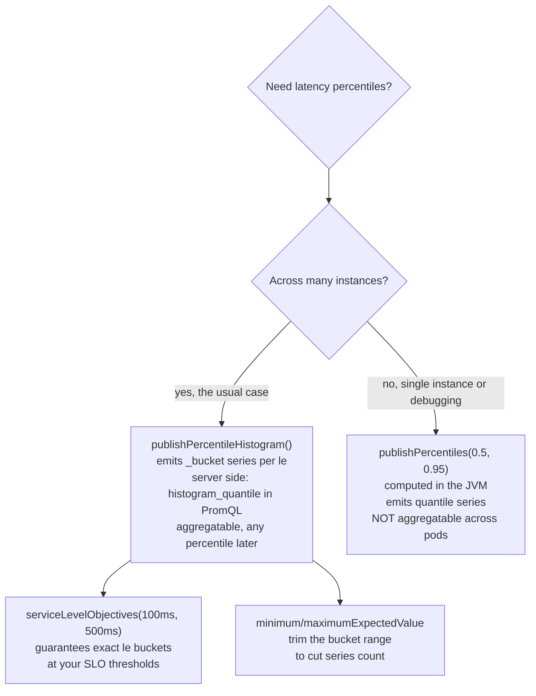
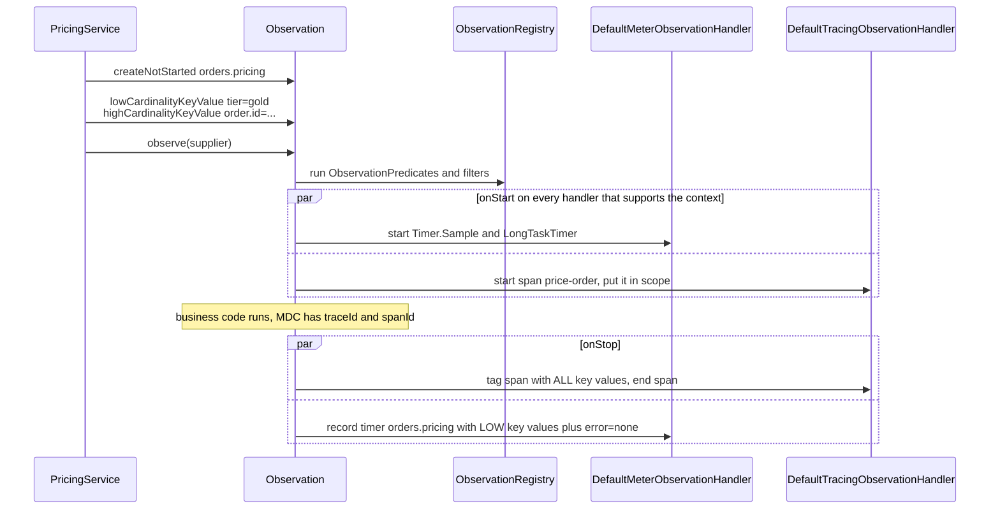
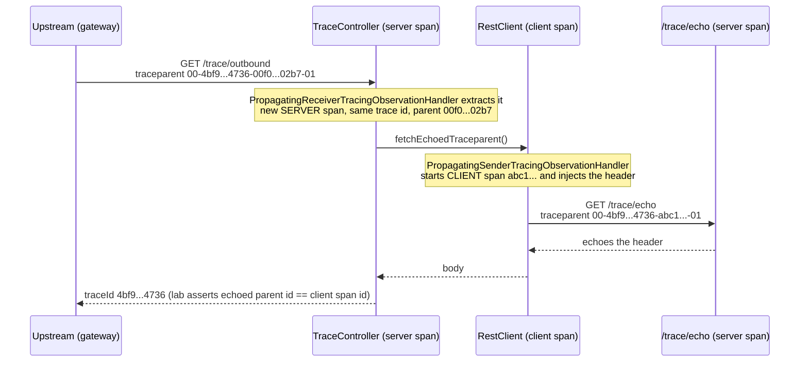
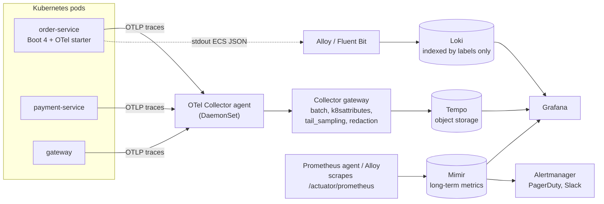
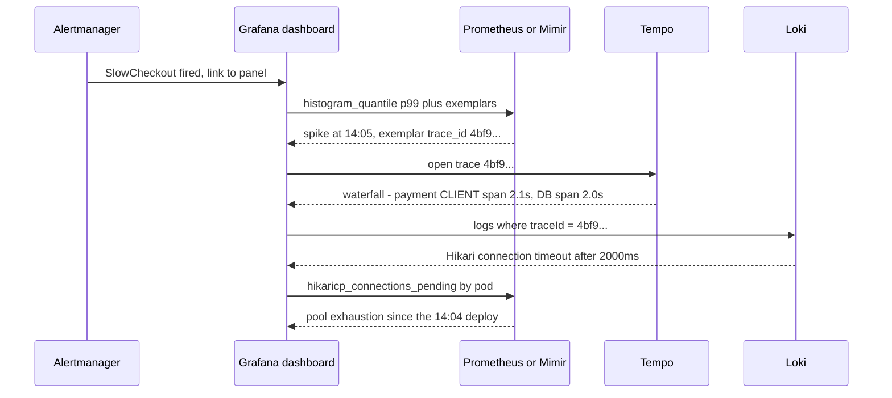
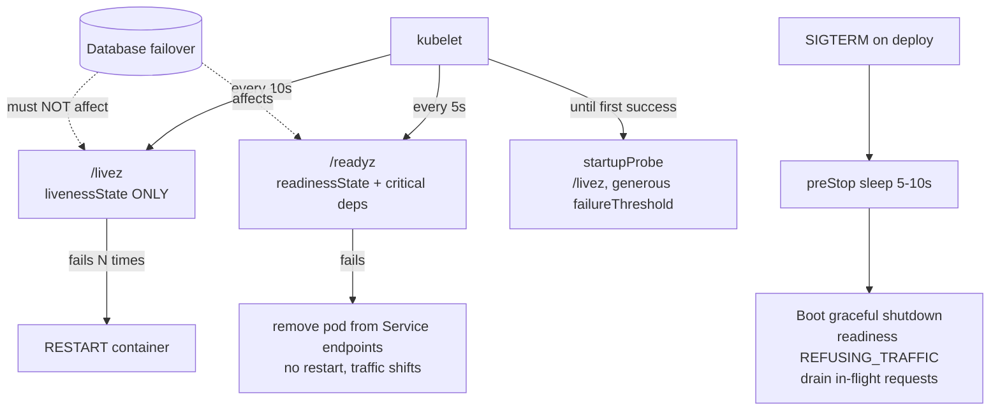

# 10 — Observability: Actuator, Micrometer & OpenTelemetry

> **Lab:** [`labs/10-observability`](https://github.com/sumit-mishra-itp/springboot-roadmap/tree/main/labs/10-observability)
> **Capstone use:** every capstone service exposes probes, Prometheus metrics, and OTLP traces with ECS JSON logs. The order flow is traced end to end across the gateway, the order service and the payment service, and SLO alerts fire on checkout latency and error rate.
> **Prereqs:** 02 AOP (the `@Timed`/`@Observed` aspects are proxies), 03 Boot internals (auto-configuration), 05 REST APIs, 07 Security (securing actuator).

---

## 1. What & why

**Monitoring** answers questions you knew to ask in advance: "is CPU above 80%?". **Observability** is the ability to answer *new* questions about a running system from the outside, without shipping new code, such as "why are checkouts from the mobile app in eu-west slow since 14:05?". You get it by emitting rich, correlated telemetry.

**The signals:**

| Signal | What it is | Answers | Cost profile | Spring tooling |
|---|---|---|---|---|
| **Metrics** | Numeric aggregates over time, keyed by name and tags (`http_server_requests_seconds_count{uri="/orders",status="500"}`) | "Is something wrong? How much? Since when?" | Cheap and constant per series. Cost grows with **cardinality** (the number of unique tag combinations), not traffic | Micrometer (`MeterRegistry`), Prometheus/OTLP export |
| **Traces** | A tree of timed **spans** for one request as it crosses threads and services | "*Where* is the time going? Which hop failed?" | Grows with traffic, so it is **sampled** | Micrometer Tracing + OpenTelemetry (or Brave) |
| **Logs** | Discrete timestamped events with context | "*Why* did this specific request fail?" | Grows with traffic and verbosity | SLF4J + Logback, structured JSON, MDC |
| **Profiles** (the "fourth pillar") | Continuous CPU, allocation and lock profiles sampled in production | "*Which line of code* is burning CPU?" | Low overhead (around 1–2%) with sampling profilers | JFR, async-profiler, Grafana Pyroscope, OTel profiling (still maturing) |

**Correlation is the point.** Each pillar alone is weak. The power comes from jumping between them:
- A metric spike carries an **exemplar** (a sample trace id) → open the **trace** → see the slow span → filter **logs** by `traceId` → read the exception.
- Profiles can be linked to spans ("span profiles"), which takes you from "this span is slow" to "this method is hot".

**Before Spring Boot Actuator and Micrometer:**

| Era | How apps were observed | Pain |
|---|---|---|
| JMX + JConsole | MBeans per app server | Hierarchical names, no tags, firewall pain, pull only |
| Vendor agents (APM) | Bytecode agents from AppDynamics, New Relic, Dynatrace | Expensive, proprietary formats, vendor lock-in |
| Dropwizard Metrics / Spring Boot 1.x metrics | Hierarchical names such as `requests.orders.500.count` | No dimensions: you can't slice by status *and* uri without a new metric for each combination |
| Zipkin/Brave + Sleuth | Sleuth auto-instrumented Spring apps | Tracing only, separate from metrics. Sleuth was **discontinued** after Boot 2.x |
| **Micrometer (Boot 2+), Observation API (Boot 3+), OTel starter (Boot 4)** | Dimensional metrics, one instrumentation API for metrics and traces, a vendor-neutral wire format (OTLP) | Instrument once and export anywhere |

**When *not* to add more:**
- Don't create a custom metric for something a trace already answers for one request ("how long did *this* call take"). Use metrics for aggregates.
- Don't put user ids, order ids or emails in metric tags (section 5). They belong in spans and logs.
- Don't trace 100% of traffic on a high-throughput service. Head sampling of 1–10% plus tail sampling for errors in the collector is the norm.
- A small internal batch job may need only logs and one success/failure metric pushed at the end.

---

## 2. Mental model

There is **one instrumentation call** in your code or the framework (an `Observation`). **Handlers** turn it into several signals, and **exporters** ship each signal to its backend. Actuator is the HTTP/JMX window onto the app's own state.



**Key types and how they relate:**



(The tracing handlers really are generic over the context type. They are written without generics here for Mermaid.)

**Three rules to remember:**
1. **Low-cardinality** key values go to metrics *and* spans. **High-cardinality** key values go to spans only. The lab proves `order.id` is a span attribute and never a Prometheus label.
2. Propagation happens only through **instrumented clients**: the auto-configured `RestClient.Builder`, `RestTemplateBuilder` and `WebClient.Builder`. `RestClient.create()` propagates nothing.
3. Actuator is an *operations API*. Expose only what you need, and secure it like any other API.

---

## 3. How it works internally

### 3.1 Actuator: endpoints, exposure, access

An **endpoint** is a bean annotated `@Endpoint(id = "...")` (or `@WebEndpoint`, `@JmxEndpoint`) with `@ReadOperation` / `@WriteOperation` / `@DeleteOperation` methods. Boot discovers them (`EndpointDiscoverer`) and adapts them to each technology:
- **Web:** `WebMvcEndpointHandlerMapping` registers `/actuator/{id}` handler mappings directly. They aren't `@Controller`s, which is why `/actuator/**` doesn't appear in your own `@RequestMapping` scanning.
- **JMX:** endpoints are exported as MBeans under `org.springframework.boot:type=Endpoint`.

Two orthogonal switches decide whether you can reach an endpoint:

| Switch | Property | Effect |
|---|---|---|
| **Access** (since 3.4, replacing `enabled`) | `management.endpoints.access.default`, `management.endpoint.<id>.access` = `none` / `read-only` / `unrestricted`, capped by `management.endpoints.access.max-permitted` | Inaccessible endpoints are **removed from the context entirely**. `read-only` drops `@WriteOperation`s (e.g. you can read loggers but not change them). By default everything is `unrestricted` except `shutdown` and `heapdump` |
| **Exposure** | `management.endpoints.web.exposure.include` / `.exclude`, `management.endpoints.jmx.exposure.*` | Which accessible endpoints get a URL. **Default for web and JMX: `health` only.** `exclude` beats `include`. `*` means all (quote it in YAML: `"*"`) |

**Key endpoints:**

| Endpoint | Use | Notes |
|---|---|---|
| `health` (+ `/health/{group}`, `/health/{component}`) | LB checks, Kubernetes probes | `show-details`/`show-components` default to `never`. Status maps to HTTP: `DOWN`/`OUT_OF_SERVICE` give **503**, `UP`/`UNKNOWN` give 200 |
| `info` | Build, git, Java, OS, process, `info.*` | Only `build` and `git` contributors are on by default. `env`, `java`, `os`, `process` and `ssl` need `management.info.<id>.enabled=true` |
| `metrics`, `metrics/{name}?tag=k:v` | Ad-hoc inspection of meters | Human debugging, not for scraping |
| `prometheus` | Scrape target | Needs `micrometer-registry-prometheus`. Supports exemplars when tracing is present |
| `loggers`, `loggers/{name}` | Read and change log levels **at runtime** | `POST {"configuredLevel":"DEBUG"}`. `null` resets to inherited. Children inherit (proven in the lab) |
| `env`, `configprops` | Effective configuration | Values are **always sanitized** (`******`) unless `show-values=when-authorized`/`always` |
| `beans`, `conditions`, `mappings`, `startup` | Wiring and auto-config debugging | `startup` needs `BufferingApplicationStartup` |
| `threaddump`, `heapdump` | Stuck threads, memory leaks | `heapdump` is restricted by default and can leak secrets from memory |
| `scheduledtasks`, `caches`, `flyway`, `liquibase`, `httpexchanges`, `sessions`, `quartz`, `auditevents` | Feature-specific | Most need a backing bean (e.g. an `HttpExchangeRepository`) |
| `shutdown` | Graceful shutdown over HTTP | Restricted by default. Leave it that way |

**Security:**
- If Spring Security is on the classpath and you define **no** `SecurityFilterChain`, Boot secures every actuator endpoint except `/health`.
- Once you define your own chain, actuator security is **your** job. Use a dedicated chain matched by `EndpointRequest.toAnyEndpoint()` (it follows `base-path` changes), permit `health`, and require an ops role for the rest (see lab 07's `ActuatorSecurityConfig`).
- Write operations (`loggers` POST, `shutdown`) get 403 under CSRF protection with the default security setup.

**Management port.** `management.server.port=8081` moves actuator to a separate connector, which is useful when only the cluster network may reach it. `management.server.base-path` and `management.endpoints.web.base-path` (default `/actuator`) change paths. If probes run on the management port and the main connector deadlocks, the probe still answers "UP". That's why `management.endpoint.health.probes.add-additional-paths=true` also serves `/livez` and `/readyz` on the **main** port, so the probe exercises the same Tomcat that serves users.

### 3.2 Health: indicators, aggregation, groups



- A `HealthIndicator` bean named `downstreamHealthIndicator` gets the id **`downstream`** (the suffix is stripped). In Boot 4, `Health`, `HealthIndicator` and `Status` live in **`org.springframework.boot.health.contributor`** (the new `spring-boot-health` module).
- Auto-configured indicators include `db`, `diskspace`, `ping`, `redis`, `mongodb`, `rabbit`, `elasticsearch`, `ssl`, plus `livenessState` and `readinessState`. Turn them all off with `management.health.defaults.enabled=false`.
- **Aggregation:** the worst status wins, using `management.endpoint.health.status.order` (default `DOWN, OUT_OF_SERVICE, UP, UNKNOWN`). A custom HTTP mapping (`status.http-mapping.*`) replaces the defaults for `DOWN` and `OUT_OF_SERVICE`, so re-declare them.
- **Groups** (`management.endpoint.health.group.<name>.include/exclude/show-details/roles/additional-path`) are named subsets with their own URL and settings. Startup **fails** if a group includes an unknown member, unless `validate-group-membership=false`.
- Indicators slower than 10 s are logged (`management.endpoint.health.logging.slow-indicator-threshold`).

### 3.3 Availability state and Kubernetes probes

`ApplicationAvailability` holds two states that change on lifecycle events:

| Phase | `LivenessState` | `ReadinessState` | Server |
|---|---|---|---|
| Starting | `BROKEN` | `REFUSING_TRAFFIC` | not started |
| Context refreshed (`ApplicationStartedEvent`) | `CORRECT` | `REFUSING_TRAFFIC` | started, runners still running |
| `ApplicationReadyEvent` | `CORRECT` | `ACCEPTING_TRAFFIC` | serving |
| Graceful shutdown | `CORRECT` | `REFUSING_TRAFFIC` | finishing in-flight requests |

- **Boot 4: probes are on by default everywhere.** Earlier versions enabled them only when Kubernetes was detected. The `liveness` and `readiness` groups contain **only** `livenessState` / `readinessState` unless you add more.
- You can flip the state yourself: `AvailabilityChangeEvent.publish(ctx, ReadinessState.REFUSING_TRAFFIC)`, e.g. while a cache warms or a circuit is open. The lab proves this makes readiness `OUT_OF_SERVICE` (503) while liveness stays 200. `LivenessState.BROKEN` says "restart me", so use it only for truly unrecoverable internal state.

### 3.4 Micrometer: registries, meters, naming

**Dimensional metrics:** a meter is identified by **name + tags**. `orders.placed{channel=web}` and `orders.placed{channel=mobile}` are two time series of one metric, so you query across them (`sum by (channel)`).

**Meter types:**

| Type | Use | Prometheus output (from the lab) |
|---|---|---|
| `Counter` | Monotonic count of events | `orders_placed_total{channel="web",...} 1.0` |
| `Timer` | Count, total time and max of short operations | `orders_checkout_seconds_count`, `_sum`, `_max`, and `_bucket{le=...}` if histograms are on |
| `LongTaskTimer` | In-flight duration of long operations (sampled while running) | `orders_pricing_active_seconds_count` |
| `Gauge` | Current value sampled at scrape time (queue size, pool usage) | `orders_in_flight 0.0` |
| `DistributionSummary` | Distribution of non-time values (payload size, amount) | `orders_amount_usd_count/_sum/_max`, `{quantile="0.95"}` |
| `FunctionCounter` / `FunctionTimer` / `TimeGauge` | Wrap a value another library already counts | |

**Registries:**
- Boot creates one registry per `micrometer-registry-*` on the classpath (Prometheus, OTLP, Datadog...). With **more than one**, it wraps them in a `CompositeMeterRegistry` marked `@Primary`. With **exactly one**, the `MeterRegistry` bean *is* that registry. The lab proves this: with OTLP export off, the bean is `PrometheusMeterRegistry`.
- `SimpleMeterRegistry` (in memory) is the fallback when no other registry is active. Tests get it by default.
- Boot also adds its registries to the global `Metrics.globalRegistry` unless `management.metrics.use-global-registry=false`. Never use the static `Metrics.counter(...)` in Spring code: `MeterFilter` beans are bound only to the Spring-managed registry.

**Naming conventions.** You name meters in dot notation (`orders.checkout`). Each registry's `NamingConvention` renders that name: Prometheus uses snake_case, adds `_seconds` for timers (the base unit), adds `_total` for counters, and appends a summary's `baseUnit` (`orders.amount` with base unit `usd` becomes `orders_amount_usd`).

**Customization points**, all auto-bound when declared as beans:

| Bean | Purpose |
|---|---|
| `MeterFilter` | Deny/accept, rename tags, cap cardinality (`maximumAllowableTags`), configure distribution statistics per meter |
| `MeterRegistryCustomizer<T>` (Boot 4 package: `org.springframework.boot.micrometer.metrics.autoconfigure`) | `registry.config().commonTags(...)` per registry type |
| `MeterBinder` | Register meters that depend on other beans (e.g. a queue size gauge) at the right time |
| Properties | `management.metrics.tags.*` (common tags), `management.metrics.enable.<prefix>=false`, `management.metrics.distribution.percentiles-histogram.<prefix>`, `.slo.<prefix>`, `.percentiles.<prefix>`, `.minimum-expected-value.<prefix>`, `.maximum-expected-value.<prefix>` |

### 3.5 Percentiles vs histograms vs SLO buckets



- **Client-side percentiles** (`quantile` labels) can't be averaged: the p95 of pod A averaged with the p95 of pod B is *not* the fleet p95. They are also computed over a decaying window you can't change after the fact.
- **Histograms** (`_bucket{le="..."}`) are cumulative counters, so `sum by (le)` across pods is valid, and `histogram_quantile(0.99, ...)` gives a real fleet p99. The cost is more series: Micrometer's default bucket set produces dozens of `le` buckets per tag combination.
- **SLO buckets** add exact boundaries. With `le="0.5"` you can compute "fraction of requests under 500 ms" *exactly*: `rate(..._bucket{le="0.5"}[5m]) / rate(..._count[5m])`. That ratio *is* your latency SLI. The lab's checkout timer shows `le="0.1"` and `le="0.5"`.
- `management.metrics.distribution.percentiles-histogram.http.server.requests=true` turns histograms on for the built-in HTTP metric.

### 3.6 The Observation API

Before Boot 3, metrics (Micrometer) and tracing (Sleuth) instrumented the same code twice. The **Observation API** (`micrometer-observation`) is one instrumentation point with pluggable handlers.



- `Observation.createNotStarted(name, registry)` returns a **no-op** if the registry is no-op, or if an `ObservationPredicate` rejects it, so instrumentation is free to leave in.
- `observe(...)` = start, open scope, run, record any error, stop. Do it manually as `start()`, `openScope()`, `try/finally stop()` when you need it across callbacks.
- Boot auto-registers `ObservationPredicate`, `GlobalObservationConvention`, `ObservationFilter` and `ObservationHandler` beans on the registry. `management.observations.key-values.*` adds low-cardinality key values to every observation. `management.observations.enable.<prefix>=false` disables observations by name prefix.
- **What one observation produces** (proven in the lab): a timer `orders.pricing{tier, error}`, a long-task timer `orders.pricing.active`, and a span named after the `contextualName`, carrying `tier` and `order.id`.
- **`ObservationConvention`** decouples naming from instrumentation. Spring's own instrumentation (`ServerRequestObservationConvention` for `http.server.requests`) can be replaced or extended by declaring a `GlobalObservationConvention` bean, e.g. to add a tenant tag.

**Annotations.** With `management.observations.annotations.enabled=true` and AspectJ on the classpath (`spring-boot-starter-aspectj`), Boot registers aspects for `@Observed`, `@Timed`, `@Counted`, `@MeterTag` and `@NewSpan`. They are **proxy-based** (note 02), so self-invocation, `private` methods and `new` objects are not observed. The lab's tags show what each adds: `@Timed` adds `class`, `method`, `exception`; `@Counted` adds `result`; `@Observed` adds `class`, `method`, `error`. Which should you use? `@Observed` or the programmatic `Observation` API is the recommended way for new code, because it gives a metric *and* a span. Use `@Timed`/`@Counted` when you deliberately want a metric only.

### 3.7 Tracing: spans, context, propagation, sampling

- A **trace** is the whole request tree, identified by a 16-byte **trace id**. A **span** is one timed operation (8-byte span id) with a parent id, a kind (`SERVER`, `CLIENT`, `PRODUCER`, `CONSUMER`, `INTERNAL`), attributes, events and a status.
- **Context** is "the current span", held in a thread-local scope. **Context propagation** moves it:
  - **across threads:** `ContextPropagatingTaskDecorator`, `spring.task.execution.propagate-context=true`, `spring.reactor.context-propagation=auto`;
  - **across processes:** headers.
- **W3C Trace Context** (the default) uses the header `traceparent: 00-<32 hex trace id>-<16 hex parent span id>-<flags>`. Flag `01` means sampled. `tracestate` carries vendor data. **B3** (`X-B3-TraceId`...) is Zipkin's legacy format. Select with `management.tracing.propagation.type` (and `.consume`/`.produce` to accept several).
- **Baggage** is key-value context that travels with the trace (`baggage` header), e.g. `tenant=acme`. Create it with `tracer.createBaggageInScope("tenant", "acme")`. Allow it over the wire with `management.tracing.baggage.remote-fields=tenant`, and copy it into MDC with `management.tracing.baggage.correlation.fields=tenant`. Baggage is sent on **every** downstream call, so keep it small and never put secrets in it.
- **Sampling:**
  - **Head sampling** is decided at the root and inherited downstream through the sampled flag. Boot's default probability is **0.1** (`management.tracing.sampling.probability`). The OTel sampler is `parent-based-trace-id-ratio` (`management.opentelemetry.tracing.sampler`): if the parent was sampled, so are you.
  - **Tail sampling** is decided after the trace completes, in the **collector** (keep all errors and slow traces, plus 1% of the rest). It needs all spans of a trace to reach the same collector instance (load-balancing exporter by trace id).



### 3.8 OpenTelemetry and OTLP, and how Boot 4 wires it

**OpenTelemetry (OTel)** is the CNCF standard for telemetry. It has an **API** (what instrumentation calls), an **SDK** (sampling, processors, exporters), **semantic conventions** (standard attribute names such as `http.request.method`), the **OTLP** wire protocol (protobuf over gRPC on 4317 or HTTP on 4318), and the **Collector**.

In Boot, **Micrometer is the API you code against**, and OTel is the engine and the wire format:
- `spring-boot-starter-opentelemetry` (new in Boot 4) brings:
  - `spring-boot-opentelemetry`, which provides the `OpenTelemetry` SDK bean and a `Resource` with `service.name` and so on;
  - `spring-boot-micrometer-tracing-opentelemetry`, with `micrometer-tracing-bridge-otel`, which makes the Micrometer `Tracer` delegate to the OTel SDK;
  - `opentelemetry-exporter-otlp`, for spans;
  - `micrometer-registry-otlp`, for metrics over OTLP.
- **Traces** are exported by `OtlpTracingAutoConfiguration`. Set `management.opentelemetry.tracing.export.otlp.endpoint` (e.g. `http://collector:4318/v1/traces`). `management.opentelemetry.tracing.export.schedule-delay` controls the batch span processor.
- **Metrics** stay **Micrometer**. Boot does *not* create an OTel `SdkMeterProvider`. Push them with `OtlpMeterRegistry` (`management.otlp.metrics.export.url`, `.step`), or turn that off (`management.otlp.metrics.export.enabled=false`, as the lab does) and let Prometheus scrape.
- **Logs:** Boot configures an `SdkLoggerProvider` and OTLP log export (`OtlpLoggingAutoConfiguration`), but it does **not bridge** Logback into it out of the box. You add the OTel Logback appender yourself, or (more common) ship JSON stdout with an agent.
- **Env vars:** Boot maps a subset of the standard `OTEL_*` variables to properties: `OTEL_SERVICE_NAME`, `OTEL_RESOURCE_ATTRIBUTES`, `OTEL_EXPORTER_OTLP_ENDPOINT` (Boot appends `/v1/traces`), `OTEL_TRACES_SAMPLER(_ARG)`, `OTEL_PROPAGATORS`, `OTEL_SDK_DISABLED`... Disable the mapping with `management.opentelemetry.map-environment-variables=false`. `management.opentelemetry.resource-attributes.*` wins over the env vars.

### 3.9 Logging: MDC, correlation, structured JSON

- The tracing handler writes `traceId` and `spanId` into the SLF4J **MDC** (a thread-local map) when a span is in scope. Boot's default console pattern includes a correlation block `[<traceId>-<spanId>]` (the lab's plain output shows `[4bf92f35...-9e3fe524...]`). Customize it with `logging.pattern.correlation`.
- **Structured logging** (Boot 3.4+): `logging.structured.format.console` / `.file` = `ecs` | `logstash` | `gelf`, or the class name of your own `StructuredLogFormatter`. **Every MDC entry becomes a JSON field.** The lab captured this ECS line:

```json
{"@timestamp":"2026-11-18T16:46:52.743602700Z","log":{"level":"INFO","logger":"dev.roadmap.observability.orders.OrderService"},"process":{"pid":35412,"thread":{"name":"http-nio-auto-1-exec-5"}},"service":{"name":"observability","node":{}},"message":"Order placed id=61887ccd-... channel=web total=45.00","traceId":"4bf92f3577b34da6a3ce929d0e0e4736","spanId":"0a70a0935aa9504f","ecs":{"version":"8.11"}}
```

  Note the keys are the raw MDC names `traceId`/`spanId`, **not** ECS's `trace.id`/`span.id`. If your backend expects ECS names, `logging.structured.json.rename.*` is the documented knob (the exact output for a dotted target name is unverified here).
- Tune the JSON with `logging.structured.json.include/exclude/rename/add`, or a `StructuredLoggingJsonMembersCustomizer`. `logging.structured.ecs.service.name/version/environment/node-name` default from `spring.application.*`.
- **Log levels at runtime:** `POST /actuator/loggers/{name}` with `{"configuredLevel":"DEBUG"}`. It changes the running `LoggingSystem` on **this instance only**, so in a fleet you hit every pod or use a config server refresh. It is reset by a restart. Secure it, because DEBUG logs can leak data.

---

## 4. Full worked code

All of this is in the lab and exercised by its 17 tests.

### 4.1 Dependencies (Boot 4)

```xml
<dependency><groupId>org.springframework.boot</groupId><artifactId>spring-boot-starter-actuator</artifactId></dependency>
<dependency><groupId>org.springframework.boot</groupId><artifactId>spring-boot-starter-opentelemetry</artifactId></dependency>
<dependency><groupId>org.springframework.boot</groupId><artifactId>spring-boot-starter-webmvc</artifactId></dependency>
<dependency><groupId>org.springframework.boot</groupId><artifactId>spring-boot-starter-restclient</artifactId></dependency> <!-- RestClient.Builder -->
<dependency><groupId>org.springframework.boot</groupId><artifactId>spring-boot-starter-aspectj</artifactId></dependency>    <!-- @Timed/@Observed -->
<dependency><groupId>io.micrometer</groupId><artifactId>micrometer-registry-prometheus</artifactId><scope>runtime</scope></dependency>
<!-- tests -->
<dependency><groupId>org.springframework.boot</groupId><artifactId>spring-boot-starter-actuator-test</artifactId><scope>test</scope></dependency>
<dependency><groupId>org.springframework.boot</groupId><artifactId>spring-boot-starter-opentelemetry-test</artifactId><scope>test</scope></dependency>
<dependency><groupId>io.micrometer</groupId><artifactId>micrometer-observation-test</artifactId><scope>test</scope></dependency>
<dependency><groupId>io.opentelemetry</groupId><artifactId>opentelemetry-sdk-testing</artifactId><scope>test</scope></dependency>
```

### 4.2 Configuration

```properties
management.endpoints.web.exposure.include=health,info,metrics,prometheus,loggers
management.endpoint.health.show-details=always          # lab only: when-authorized in prod
management.endpoint.health.show-components=always
management.endpoint.health.group.liveness.include=livenessState
management.endpoint.health.group.readiness.include=readinessState,downstream
management.endpoint.health.probes.add-additional-paths=true   # /livez and /readyz on the main port
management.info.java.enabled=true
management.info.env.enabled=true
info.app.team=platform
management.observations.annotations.enabled=true
management.metrics.tags.region=local
management.otlp.metrics.export.enabled=false            # scrape, don't push
management.tracing.sampling.probability=1.0             # lab only: the default is 0.1

# application-otel.properties
management.opentelemetry.tracing.export.otlp.endpoint=http://localhost:4318/v1/traces
logging.structured.format.console=ecs
```

### 4.3 Health indicator and info contributor

```java
import org.springframework.boot.health.contributor.Health;          // Boot 4 package
import org.springframework.boot.health.contributor.HealthIndicator;

@Component
public class DownstreamHealthIndicator implements HealthIndicator {   // id = "downstream"
    private final AtomicBoolean reachable = new AtomicBoolean(true);

    @Override
    public Health health() {
        if (!reachable.get()) {
            return Health.down().withDetail("gateway", "payments").withDetail("reason", "connection refused").build();
        }
        return Health.up().withDetail("gateway", "payments").build();
    }
    public void markReachable(boolean value) { reachable.set(value); }
}

@Component
public class ObservabilityInfoContributor implements InfoContributor {  // org.springframework.boot.actuate.info
    @Override
    public void contribute(Info.Builder builder) {
        builder.withDetail("observability", Map.of("tracing", "opentelemetry, W3C traceparent", /* ... */));
    }
}
```

### 4.4 Every meter type

```java
@Service
public class OrderService {
    private final AtomicInteger inFlight = new AtomicInteger();   // strong reference for the gauge
    private final Timer checkoutTimer;
    private final DistributionSummary amountSummary;

    public OrderService(MeterRegistry meterRegistry, PricingService pricing, FraudCheck fraudCheck) {
        Gauge.builder("orders.in.flight", inFlight, AtomicInteger::get).register(meterRegistry);
        this.checkoutTimer = Timer.builder("orders.checkout")
                .publishPercentileHistogram()
                .serviceLevelObjectives(Duration.ofMillis(100), Duration.ofMillis(500))
                .register(meterRegistry);
        this.amountSummary = DistributionSummary.builder("orders.amount")
                .baseUnit("usd").publishPercentiles(0.5, 0.95).register(meterRegistry);
        // ...
    }

    public Order place(OrderRequest request) {
        return checkoutTimer.record(() -> doPlace(request));     // inside: Counter.builder("orders.placed").tag("channel", ...)
    }

    @Timed(value = "orders.lookup")
    @Counted(value = "orders.lookup.calls")
    public Optional<Order> find(String id) { return Optional.ofNullable(orders.get(id)); }
}

@Bean   // cardinality guard
MeterFilter capOrderChannels() {
    return MeterFilter.maximumAllowableTags("orders.placed", "channel", 5, MeterFilter.deny());
}
```

### 4.5 Observation API and `@Observed`

```java
public BigDecimal price(String orderId, String tier, BigDecimal amount) {
    return Observation.createNotStarted("orders.pricing", observationRegistry)
            .contextualName("price-order")
            .lowCardinalityKeyValue("tier", tier)
            .highCardinalityKeyValue("order.id", orderId)
            .observe(() -> applyDiscount(tier, amount));
}

@Component
public class FraudCheck {
    @Observed(name = "orders.fraud.check", contextualName = "fraud-check")
    public boolean isSuspicious(BigDecimal amount) { return amount.compareTo(new BigDecimal("10000")) > 0; }
}
```

### 4.6 Propagation through `RestClient`

```java
@Component
class SelfCallClient {
    private final RestClient restClient;
    SelfCallClient(RestClient.Builder builder) { this.restClient = builder.build(); }  // instrumented builder

    String fetchEchoedTraceparent() {
        String base = ServletUriComponentsBuilder.fromCurrentContextPath().toUriString();
        return restClient.get().uri(base + "/trace/echo").retrieve().body(String.class);
    }
}
```

### 4.7 Tests: the Boot 4 way

```java
@SpringBootTest(webEnvironment = RANDOM_PORT)
@AutoConfigureRestTestClient
@AutoConfigureMetrics          // Boot 4: without it there is no Prometheus registry (404 on /actuator/prometheus)
class MetricsEndpointTest { /* scrape and assert orders_placed_total, orders_checkout_seconds_bucket{le="0.1"}, ... */ }

@SpringBootTest(webEnvironment = RANDOM_PORT, properties = "logging.structured.format.console=ecs")
@AutoConfigureRestTestClient
@AutoConfigureTracing          // Boot 4: re-enables span export and propagation
@ExtendWith(OutputCaptureExtension.class)
class TracePropagationTest {
    @TestConfiguration(proxyBeanMethods = false)
    static class SpanCapture {
        @Bean InMemorySpanExporter inMemorySpanExporter() { return InMemorySpanExporter.create(); }
    }
    // send traceparent 00-4bf9...-00f0...-01, assert the same trace id, the echoed header's parent == CLIENT span id,
    // SERVER/CLIENT/SERVER spans exported, and the ECS line has "traceId":"4bf9..."
}

class PricingObservationTest {   // no Spring at all
    TestObservationRegistry registry = TestObservationRegistry.create();
    // assertThat(registry).hasObservationWithNameEqualTo("orders.pricing").that()
    //     .hasLowCardinalityKeyValue("tier", "gold").hasHighCardinalityKeyValue("order.id", "order-42").hasBeenStopped();
}
```

---

## 5. Gap fillers & niche details

- **Tag cardinality is the number-one metrics outage.** Series count = product of distinct values across tags. `user_id` (1M) × `uri` (50) × `status` (5) = 250M series, which will take down Prometheus. Rules:
  - Bounded enums only: `status`, `method`, `outcome`, `region`, `tier`.
  - **Never** ids, emails, raw URLs, exception messages, timestamps.
  - Spring uses the URI **template** (`uri="/orders/{id}"`), never the raw path. The lab asserts this. A request to an unknown path does not leak its raw path either. In the lab, `GET /no/such/path/123` is tagged `uri="/**"` with `status="404"`, because MVC's static-resource handler matches `/**` first. (Without that handler, Boot falls back to `UNKNOWN`, `NOT_FOUND` or `REDIRECTION`.) Never "fix" that by tagging the raw path.
  - Guard client-supplied values with `MeterFilter.maximumAllowableTags` (the lab caps 50 attacker values at 5 series) or map them to an enum.
  - High-cardinality data goes into **span attributes** (`highCardinalityKeyValue`) and logs.
- **Gauges hold a weak reference.** `registry.gauge("x", new AtomicInteger())` without keeping the returned object will read `NaN` after GC. Keep the state in a field, or use `Gauge.builder(...).strongReference(true)`.
- **Registering a meter is idempotent.** `Counter.builder(name).tags(...).register(registry)` returns the existing meter on later calls. It's cheap-ish but involves a map lookup, so cache meters with static tags in fields.
- **Same name, different tag *keys*** is rejected by Prometheus. Micrometer refuses (or drops) the second registration with a warning. Keep a metric's tag key set constant.
- **`Timer.record` vs `LongTaskTimer`:** a normal timer reports only *after* completion, so a 10-minute hung job is invisible until it ends. A long-task timer reports active duration at every scrape. Every Observation creates both (the `.active` suffix).
- **Max is a decaying window.** `_max` is the max over the last step (about 1–2 minutes), not since startup.
- **Prometheus exemplars** (a trace id attached to a bucket sample) need tracing present, sampled spans (`management.tracing.exemplars.include`), and an OpenMetrics scrape. Grafana links them to Tempo via `exemplarTraceIdDestinations` (see the lab's `compose/grafana/datasources.yaml`).
- **Probe groups only show their components once configured.** With `show-components=always` on the endpoint, an *unconfigured* `liveness` group still returned no `components`. Declaring `management.endpoint.health.group.liveness.include=livenessState` made them appear. (Observed while building the lab: the first run of `HealthProbesTest` failed on exactly this.)
- **The root `/actuator/health` aggregates everything**, including the DB. Never point a liveness probe at it. The lab proves the root returns 503 while `/livez` returns 200.
- **Health checks run on the request thread**, so a hanging DB check makes the probe time out. Keep indicators fast and bounded. Boot logs slow indicators after 10 s.
- **`/actuator/info` is empty by default** (no `info.*`, no Java) until you enable contributors or add `build-info` (`spring-boot-maven-plugin` `build-info` goal) and `git.properties` (`git-commit-id-maven-plugin`).
- **`management.endpoints.web.exposure.include=*`** in production exposes `env`, `heapdump` (memory with secrets) and `threaddump`. List endpoints explicitly.
- **MDC across threads.** `@Async`, `CompletableFuture.supplyAsync` and virtual-thread executors lose the trace context unless decorated: `spring.task.execution.propagate-context=true` for Boot's executor, or `ContextPropagatingTaskDecorator` / `ContextSnapshotFactory` for your own. For Reactor, use `spring.reactor.context-propagation=auto`.
- **Instrumented builders only.** `RestClient.create()`, `new RestTemplate()` and `WebClient.create()` produce clients with no `ObservationRegistry`: no client span, no `traceparent`, no `http.client.requests` metric. Inject the builder.
- **Sampling ≠ logging.** An unsampled request (incoming flag `00`) keeps its trace id: the lab proves the outgoing `traceparent` carries the same id with flag `00`, and the ECS log line still has `"traceId"`. Logs stay correlatable even when spans are not recorded.
- **Duplicate observations.** Annotating an already-instrumented method (a controller method, a Spring Data repository) with `@Observed` produces two observations. Use an `ObservationPredicate` or drop the annotation.
- **Disable noisy observations** by prefix: `management.observations.enable.spring.security=false` removes the many Security filter-chain spans.
- **`http.server.requests` has an `error` tag** in addition to `exception`. The Observation-based instrumentation tags `error="none"` on success (visible on every Observation timer in the lab).
- **Graceful shutdown** is on by default (since Boot 3.4). On SIGTERM, readiness flips to `REFUSING_TRAFFIC`, new requests are rejected, and in-flight ones get `spring.lifecycle.timeout-per-shutdown-phase` (default 30 s) to finish.
- **Logback in tests initializes once per JVM.** A later cached test context with different `logging.*` properties doesn't reconfigure it. The lab gives each test class its own JVM (`reuseForks=false`) so the ECS test sees JSON.

---

## 6. Boot 4 / Framework 7 delta

Sources: [Spring Boot 4.0 Release Notes](https://github.com/spring-projects/spring-boot/wiki/Spring-Boot-4.0-Release-Notes), the [Spring Boot 4.0 Migration Guide](https://github.com/spring-projects/spring-boot/wiki/Spring-Boot-4.0-Migration-Guide), and the [Boot reference: tracing](https://docs.spring.io/spring-boot/reference/actuator/tracing.html) / [observability](https://docs.spring.io/spring-boot/reference/actuator/observability.html) / [testing](https://docs.spring.io/spring-boot/reference/testing/spring-boot-applications.html). Versions are read from the lab's dependency tree.

| Change | Status | What it means for you |
|---|---|---|
| **`spring-boot-starter-opentelemetry`** (+ `-test`) | **New** | One starter for the OTel SDK, the Micrometer→OTel tracing bridge, and OTLP exporters for traces and metrics. It replaces hand-assembling `micrometer-tracing-bridge-otel` + `opentelemetry-exporter-otlp` |
| Modular actuator/observability: `spring-boot-health`, `spring-boot-micrometer-metrics`, `-observation`, `-tracing`, `-tracing-brave`, `-tracing-opentelemetry`, `spring-boot-opentelemetry`, `spring-boot-zipkin`; starters `spring-boot-starter-micrometer-metrics`, `spring-boot-starter-zipkin` | **Changed** | Packages moved, e.g. `org.springframework.boot.health.contributor.HealthIndicator`, `org.springframework.boot.micrometer.metrics.autoconfigure.MeterRegistryCustomizer` |
| **`@AutoConfigureObservability` is gone** → `@AutoConfigureMetrics` (`spring-boot-micrometer-metrics-test`) and `@AutoConfigureTracing` (`spring-boot-micrometer-tracing-test`) | **Changed** | Confirmed by listing the 4.1.2 test jars, and proven by the lab: without them, `/actuator/prometheus` is 404, and spans are local-only with **no `traceparent` read or written** |
| `management.tracing.enabled` → **`management.tracing.export.enabled`**; `@ConditionalOnEnabledTracing` → `@ConditionalOnEnabledTracingExport` | **Renamed** | The test customizer sets `management.tracing.export.enabled=false` |
| Liveness/readiness probes **enabled by default** (not only on Kubernetes) | **Changed** | `/actuator/health/liveness` and `/readiness` always exist. Turn them off with `management.endpoint.health.probes.enabled=false` |
| `@MeterTag` on `@Counted`/`@Timed` (SpEL `ValueExpressionResolver`), `@ObservationKeyValue` support | **New** | Tag annotated metrics from method arguments |
| Auto-configured `RestClient.Builder` moved to `spring-boot-starter-restclient` (migration guide starters table; `RestClientAutoConfiguration` and `RestClientObservationAutoConfiguration` live in `spring-boot-restclient-4.1.2.jar`) | **Changed** | Without that starter there is no builder bean, so there is no propagation |
| `ScheduledTasksObservabilityAutoConfiguration` → `ScheduledTasksObservationAutoConfiguration` | **Renamed** | Matters only if you excluded it by name |
| OTel + **Zipkin** auto-configuration | **Deprecated, removed in 4.2** | Export OTLP and let the collector fan out to Zipkin if needed |
| `logging.console.enabled` | **New** | `false` disables console logging (e.g. when logging only to OTLP or a file) |
| SSL health: `WILL_EXPIRE_SOON` dropped; expiring chains are listed under `expiringChains` | **Changed** | Alert on the detail, not the status |
| MongoDB management properties use `mongodb` (`management.health.mongodb.enabled`) | **Renamed** | |
| Actuator endpoint parameters: optional parameters use JSpecify `@Nullable` | **Changed** | Only for custom `@Endpoint`s |
| Versions in Boot 4.1.2 | | Micrometer **1.17.2**, Micrometer Tracing **1.7.2**, OpenTelemetry SDK **1.62.0**, Prometheus client **1.7.0** |

> ⚠️ **Outdated advice still common in tutorials and Baeldung articles:**
> - **Spring Cloud Sleuth**: discontinued. Use Micrometer Tracing (Boot 3+).
> - `@AutoConfigureObservability` in tests: removed in Boot 4. Use `@AutoConfigureMetrics` / `@AutoConfigureTracing`.
> - Hand-wiring `micrometer-tracing-bridge-otel` + `opentelemetry-exporter-otlp` or `-zipkin`: use `spring-boot-starter-opentelemetry`.
> - `management.tracing.enabled`: now `management.tracing.export.enabled`.
> - `management.endpoint.<id>.enabled`: replaced by `.access` (since 3.4).
> - Declaring `TimedAspect` / `ObservedAspect` beans by hand: set `management.observations.annotations.enabled=true` instead.
> - `logstash-logback-encoder` + a custom `logback-spring.xml` just for JSON: Boot's `logging.structured.format.*` does it with one property.
> - `spring-boot-starter-aop`: in Boot 4 it is `spring-boot-starter-aspectj`.
> - `micrometer-registry-prometheus-simpleclient` / `io.prometheus.client.*`: Micrometer now uses the Prometheus 1.x client (`io.micrometer.prometheusmetrics.PrometheusMeterRegistry`).

---

## 7. Real-life architecture solutions

### 7.1 The LGTM stack behind an OpenTelemetry Collector

**Problem:** forty services, three languages, and a vendor APM bill that grows with every host. Each team ships telemetry differently, and switching vendors means re-instrumenting everything.

**Solution:** every service emits **OTLP** (traces, optionally metrics and logs) to an **OpenTelemetry Collector** running as a DaemonSet agent per node, which feeds a gateway pool. The collector batches, retries, redacts PII, enriches with Kubernetes metadata (`k8sattributes`), tail-samples, and fans out to **Tempo** (traces), **Mimir** or Prometheus (metrics) and **Loki** (logs). **Grafana** queries all of them and links between them. Metrics can be scraped (Prometheus model) or pushed (OTLP). Logs usually go stdout → agent (Alloy, Fluent Bit) → Loki.



**Trade-offs:**
- **Pros:** vendor-neutral (swap Tempo for Jaeger or a SaaS by changing the collector's exporter, with no app redeploy). Cheap object-storage backends. The collector absorbs backend outages. Tail sampling keeps 100% of errors at 5% of the volume.
- **Cons:** you operate the stack (Mimir and Loki are distributed systems). Loki indexes only labels, so a high-cardinality label there is the same mistake as in Prometheus. Collector gateways need trace-id-aware load balancing for tail sampling.

**Who uses it:** the Grafana Labs reference architecture. Many teams leaving Datadog or New Relic for cost reasons run this stack, and cloud vendors' managed variants (Amazon Managed Prometheus/Grafana + X-Ray via ADOT, Grafana Cloud) take the same shape. The lab's `compose.yaml` is a single-node miniature (collector → Tempo, Prometheus, Grafana).

### 7.2 From a metric spike to the guilty log line

**Problem:** at 14:05 the checkout p99 alert fires. The dashboard shows *that* latency rose, but not *why*.

**Solution:** design the signals so each one hands you the key to the next.
1. The `SlowCheckout` alert (`histogram_quantile(0.99, sum by (le) (rate(orders_checkout_seconds_bucket[5m]))) > 0.5`) links to a Grafana panel.
2. The histogram panel shows **exemplars**: dots carrying a `trace_id`. Click one in the slow band.
3. Tempo opens the trace: `POST /orders` 2.3 s, of which the `payment-service` CLIENT span is 2.1 s, and inside it the DB span is 2.0 s.
4. "Logs for this span" jumps to Loki with `{service="payment-service"} | json | traceId="4bf9..."`, which shows `HikariPool-1 - Connection is not available, request timed out after 2000ms`.
5. Metrics confirm the cause: `hikaricp_connections_pending` rose at 14:04 after a deploy that halved `maximum-pool-size`.



**Prerequisites this note's lab sets up:** histograms on the timer, tracing with a high enough sample rate (or tail sampling that keeps slow traces), `traceId` in JSON logs, and Grafana datasources linked (`exemplarTraceIdDestinations`, trace-to-logs).
**Trade-offs:** exemplars only point at *sampled* traces, so at 1% head sampling the slow outlier may not have a trace. That is the argument for tail sampling. Logs must carry `traceId` as a parsed field, not inside the message text.
**Who uses it:** this is the standard SRE incident workflow at most companies on Grafana, Datadog ("APM → logs"), Honeycomb or Elastic Observability. The backend changes, but the metric → trace → log chain is the same.

### 7.3 Kubernetes probes and the database-in-liveness trap

**Problem:** a team adds the `db` health indicator to the **liveness** probe "so Kubernetes restarts us if the DB is unreachable". The database fails over for 40 seconds. Every pod's liveness fails at once, Kubernetes **restarts all of them**, they all cold-start and stampede the recovering database with connection storms, and a 40-second blip becomes a 15-minute outage.

**Solution:** liveness answers "is *this process* broken beyond self-repair?" (deadlock, corrupted state), so it uses only `livenessState`. **Readiness** answers "should *this pod* get traffic now?". It may include critical dependencies, and failing it only removes the pod from the Service endpoints, with no restart. Add a **startup probe** for slow starts instead of a long liveness `initialDelaySeconds`. Pair this with graceful shutdown and a `preStop` sleep so the endpoints controller removes the pod before Tomcat stops accepting.



```yaml
livenessProbe:  { httpGet: { path: /livez,  port: 8080 }, periodSeconds: 10, failureThreshold: 3 }
readinessProbe: { httpGet: { path: /readyz, port: 8080 }, periodSeconds: 5,  failureThreshold: 2 }
startupProbe:   { httpGet: { path: /livez,  port: 8080 }, periodSeconds: 5,  failureThreshold: 30 }
lifecycle: { preStop: { sleep: { seconds: 10 } } }   # or exec sleep on older clusters
terminationGracePeriodSeconds: 45                     # > preStop + timeout-per-shutdown-phase
```

**Trade-offs:**
- Including a shared DB in **readiness** also has a failure mode. If the DB is down, *all* pods go unready, the Service has no endpoints, and clients get connection errors instead of a fast 503 from your app with a fallback. Many teams include only dependencies a pod can be individually unhealthy about (its local cache warm-up, its own connection pool), and handle shared-dependency failures with circuit breakers (note 13) and degraded responses.
- The lab proves the split: with `downstream` DOWN, `/readyz` returns 503 while `/livez` returns 200.

**Who uses it:** it is in Spring Boot's own docs and Kubernetes' guidance. Post-mortems of "restart storm" outages repeatedly name liveness probes that check dependencies as the root cause.

---

## 8. Pitfalls & debugging checklist

- [ ] **`/actuator/prometheus` is 404**:
  - not in `management.endpoints.web.exposure.include`;
  - `micrometer-registry-prometheus` is missing;
  - in a Boot 4 test, `@AutoConfigureMetrics` is missing.
- [ ] **Trace id is never propagated downstream**:
  - the client was built with `RestClient.create()` or `new RestTemplate()`: inject the builder;
  - `spring-boot-starter-restclient` is missing (Boot 4);
  - in a test, `@AutoConfigureTracing` is missing;
  - propagation types differ (`w3c` vs `b3`) between services.
- [ ] **Logs show `[-]` or no traceId**:
  - work moved to another thread without context propagation: decorate the executor;
  - tracing isn't on the classpath;
  - the log came from a thread outside any request (startup, scheduler without an observation).
- [ ] **Traces in Tempo or Jaeger are only 10% of requests**. The default `management.tracing.sampling.probability` is 0.1.
- [ ] **No spans reach the collector**:
  - wrong endpoint path: `/v1/traces` is required for HTTP, and Boot appends it only when mapping `OTEL_EXPORTER_OTLP_ENDPOINT`;
  - gRPC/HTTP port mix-up (4317 vs 4318);
  - `management.tracing.export.enabled=false`.
- [ ] **Prometheus memory explodes or the scrape is huge**. A high-cardinality tag (`user_id`, raw path). Find it with `topk(10, count by (__name__)({__name__=~".+"}))` and add a `MeterFilter`.
- [ ] **Gauge shows `NaN`**. Its state object was garbage-collected (weak reference).
- [ ] **Percentiles look wrong after `avg()`**. You averaged client-side quantiles. Switch to histograms and `histogram_quantile`.
- [ ] **`@Timed`/`@Observed` records nothing**:
  - `management.observations.annotations.enabled` isn't set;
  - `spring-boot-starter-aspectj` is missing;
  - it's a self-invocation, or a `private`/`final` method.
- [ ] **All pods restarted during a DB outage**. A DB or external check is in liveness (section 7.3).
- [ ] **502/connection resets during deploys**. No `preStop` delay, so the pod stops accepting before the endpoints update. Or `terminationGracePeriodSeconds` is shorter than the shutdown timeout.
- [ ] **Health endpoint slow or timing out**. A blocking indicator (remote ping without a timeout). Check the slow-indicator warnings in the log.
- [ ] **`/actuator/env` shows `******`**. That's by design: values are sanitized. Use `show-values=when-authorized` with roles. Don't use `always` in production.
- [ ] **403 on `POST /actuator/loggers`**. CSRF on the actuator chain. Use a stateless Basic/JWT chain with an explicit CSRF decision.
- [ ] **Changed a log level, but some pods still log at INFO**. `/actuator/loggers` is per instance.

---

## 9. Interview questions

<details><summary>Q1. What are the three pillars of observability, and how do you correlate them?</summary>

Metrics (cheap aggregates for detection and alerting), traces (per-request causal timing across services, for localization) and logs (discrete events with detail, for explanation). Profiles are often called the fourth. Correlation comes from shared identifiers. The trace id is put into the MDC, so every log line carries `traceId`/`spanId`. Metrics carry exemplars (sample trace ids on histogram buckets). Common resource attributes (`service.name`, `deployment.environment`) are shared by all signals. In an incident you go from metric spike → exemplar → trace → logs filtered by trace id.
</details>

<details><summary>Q2. Which actuator endpoints are exposed by default, and how do you secure them?</summary>

Over HTTP and JMX, only `health` is exposed by default. Exposure (`management.endpoints.web.exposure.include`) decides URLs. Access (`management.endpoint.<id>.access` = none/read-only/unrestricted, since 3.4) decides whether the endpoint exists at all and whether write operations are allowed. `shutdown` and `heapdump` are restricted by default. To secure them, use a dedicated `SecurityFilterChain` matched by `EndpointRequest.toAnyEndpoint()`: permit `health` (and maybe `info`) and require an ops role for the rest. Optionally move actuator to `management.server.port` on an internal network. Never expose `*` publicly: `heapdump` and `env` leak secrets.
</details>

<details><summary>Q3. Explain liveness vs readiness. Why shouldn't liveness check the database?</summary>

Liveness means "this process is broken, restart it". Readiness means "don't route traffic to me right now". Boot backs them with `LivenessState` and `ReadinessState` and exposes them as health groups (on by default in Boot 4). If liveness includes a shared dependency such as the DB, a DB blip fails liveness on *every* pod at once. Kubernetes restarts them all, and the cold starts stampede the recovering DB, which is a cascading failure. A dependency outage should at most affect readiness, or better, be handled with circuit breakers and degraded responses. Use a startup probe for slow boots.
</details>

<details><summary>Q4. What happens to readiness during graceful shutdown?</summary>

On SIGTERM, Boot (graceful shutdown is on by default) sets readiness to `REFUSING_TRAFFIC`, so the readiness group returns `OUT_OF_SERVICE`/503. The web server stops accepting new requests and gives in-flight ones up to `spring.lifecycle.timeout-per-shutdown-phase` to finish. Because endpoint propagation in Kubernetes is asynchronous, add a `preStop` sleep so the pod leaves the Service endpoints before Tomcat stops accepting. `terminationGracePeriodSeconds` must exceed preStop plus the shutdown timeout.
</details>

<details><summary>Q5. Explain Micrometer's architecture: MeterRegistry, the composite registry, dimensional metrics.</summary>

Micrometer is a vendor-neutral facade, like SLF4J for metrics. You create meters (Counter, Timer, Gauge, DistributionSummary, LongTaskTimer) on a `MeterRegistry`. Each backend has a registry implementation (Prometheus, OTLP, Datadog...) with its own naming convention and push/pull model. Boot creates one registry per backend on the classpath and wraps several in a `CompositeMeterRegistry` (with exactly one, the bean is that registry itself). Meters are dimensional: name plus tags, so one metric has many series you can slice and aggregate. `MeterFilter`s can rename, deny, cap tags and configure histograms. `MeterBinder`s register meters for other components.
</details>

<details><summary>Q6. Percentiles vs histograms: which would you use for a fleet-wide p99 SLO?</summary>

Histograms. `publishPercentiles` computes quantiles inside each JVM over a decaying window. You can't aggregate them across instances (averaging p99s is mathematically wrong), and you can't pick a different percentile later. `publishPercentileHistogram` emits cumulative `_bucket{le}` counters, which can be summed across pods and queried with `histogram_quantile(0.99, sum by (le)(rate(...[5m])))`. Add `serviceLevelObjectives(...)` buckets at your SLO thresholds so "% of requests under 500 ms" is exact. Trim the bucket range with min/max expected values to control series count.
</details>

<details><summary>Q7. What is the Observation API, and why does it exist?</summary>

It's Micrometer's single instrumentation abstraction (Boot 3+). You start and stop an `Observation` with a name, a contextual name, and low/high-cardinality key values. Registered `ObservationHandler`s react: `DefaultMeterObservationHandler` records a timer and a long-task timer using the low-cardinality keys, and the tracing handlers create a span with all keys and propagate context. So you instrument once and get metrics *and* traces, instead of the old Micrometer + Sleuth double instrumentation. Spring Framework instruments MVC, WebFlux, RestClient, JMS, scheduling and more with it. You customize through `ObservationConvention`, `ObservationFilter`, `ObservationPredicate` and `management.observations.*` properties.
</details>

<details><summary>Q8. What's the difference between low- and high-cardinality key values? Give examples.</summary>

Low-cardinality values come from a small bounded set (`method`, `status`, `outcome`, `tier`, `region`). They become metric tags and span attributes. High-cardinality values are unbounded (`order.id`, `user.id`, full URL). They are added only to spans, because every distinct tag value creates a new time series, and unbounded ones exhaust the metrics backend's memory. Spring tags HTTP metrics with the URI *template*, not the raw path, for this reason. Guard any client-controlled tag with `MeterFilter.maximumAllowableTags`.
</details>

<details><summary>Q9. How does a trace id travel from service A to service B?</summary>

A's server instrumentation extracts the incoming `traceparent` (or starts a new trace) and puts the span in scope. When A calls B through an *instrumented* client (from the auto-configured `RestClient.Builder`, `WebClient.Builder` or `RestTemplateBuilder`), `PropagatingSenderTracingObservationHandler` creates a CLIENT span and the propagator injects `traceparent: 00-<traceId>-<clientSpanId>-<flags>`. B's receiver handler extracts it and creates a SERVER span with the same trace id and the client span as its parent. Across threads, the context moves through context-propagation (`ContextSnapshot`, task decorators). Over messaging, it moves as Kafka or JMS headers.
</details>

<details><summary>Q10. Head vs tail sampling: what's Boot's default?</summary>

Head sampling decides at the root span and propagates the decision through the sampled flag. It's cheap, but blind to outcome. Boot's default probability is 0.1 (10%), with OTel's `parent-based-trace-id-ratio` sampler, so children honor the parent's decision. Tail sampling is done in the OTel Collector after a trace completes: you can keep all errors and slow traces and a small share of the rest. It costs buffering and needs trace-aware load balancing. Many teams combine a high head rate in the app with tail sampling in the collector.
</details>

<details><summary>Q11. Micrometer Tracing bridge vs the OpenTelemetry Java agent: when would you pick each?</summary>

**Micrometer Tracing with the OTel bridge** (Boot's `spring-boot-starter-opentelemetry`) uses Spring's built-in Observation instrumentation, configured via Spring properties. One API gives metrics and traces, it is native-image friendly with no bytecode manipulation, and it is supported by the Spring team. It covers only what Spring and Micrometer instrument; for other libraries (raw JDBC, some clients) you add instrumentation.

**The OTel Java agent** (`-javaagent:opentelemetry-javaagent.jar`) instruments hundreds of libraries automatically with zero code and is configured with `OTEL_*` env vars. It's good for polyglot platform teams and legacy apps. The costs: startup overhead, no GraalVM native image, possible duplicate spans or metrics if Spring's observations are also active, and version coupling to the libraries it patches.

There is also the community **OTel Spring Boot starter** (from OTel, not Spring). Don't run the agent and Boot's tracing together without disabling one of them.
</details>

<details><summary>Q12. How do you get structured JSON logs with trace ids in Boot, and change log levels at runtime?</summary>

Set `logging.structured.format.console=ecs` (or `logstash`, `gelf`, or a custom `StructuredLogFormatter`). Boot 3.4+ writes JSON, and every MDC entry, including the `traceId` and `spanId` that tracing puts there, becomes a field. Tune it with `logging.structured.json.*`. For runtime levels, `POST /actuator/loggers/com.acme {"configuredLevel":"DEBUG"}`. It changes the live `LoggingSystem` on that instance only and doesn't survive a restart. Reset it with `null`. Secure the endpoint.
</details>

<details><summary>Q13. Explain RED and USE, and how they map to Spring metrics.</summary>

- **RED** (for request-driven services): Rate, Errors, Duration. All three come from `http_server_requests_seconds` (`_count` rate, `outcome="SERVER_ERROR"` ratio, histogram buckets for latency), and likewise `http.client.requests` for dependencies.
- **USE** (for resources): Utilization, Saturation, Errors. Examples: CPU (`process_cpu_usage`), pools (`hikaricp_connections_active` vs `_max`, `hikaricp_connections_pending` for saturation, `executor_*`, `tomcat_threads_busy`), memory and GC (`jvm_memory_used_bytes`, `jvm_gc_pause_seconds`).

Dashboards are typically RED per endpoint on top and USE per resource below.
</details>

<details><summary>Q14. What are SLIs, SLOs and error budgets? Write an alert.</summary>

An **SLI** is a measured ratio of good events, e.g. "requests under 500 ms and not 5xx / all requests". An **SLO** is the target over a window, e.g. 99.9% over 30 days. The **error budget** is 1 − SLO (0.1%, about 43 minutes a month). Spend it on releases, and freeze risky changes when it's exhausted. Alert on **burn rate** rather than raw thresholds. For example, page if the 1-hour error ratio exceeds 14.4× the budget rate *and* the 5-minute one also does (multi-window, multi-burn-rate), which catches fast burns quickly without flapping. A simple Prometheus rule: `sum(rate(http_server_requests_seconds_count{outcome="SERVER_ERROR"}[5m])) / sum(rate(http_server_requests_seconds_count[5m])) > 0.05` with `for: 5m`. Alert on symptoms users feel, not on causes like CPU.
</details>

<details><summary>Q15. What changed for observability in Spring Boot 4?</summary>

- A new `spring-boot-starter-opentelemetry` (OTel SDK, Micrometer bridge, OTLP exporters).
- Modular `spring-boot-health` / `-micrometer-*` / `-opentelemetry` modules with new packages (e.g. `org.springframework.boot.health.contributor`).
- Tests use `@AutoConfigureMetrics` and `@AutoConfigureTracing` instead of the removed `@AutoConfigureObservability`. Without them, there is no Prometheus endpoint, and tracing doesn't propagate or export.
- `management.tracing.enabled` was renamed to `management.tracing.export.enabled`.
- Liveness/readiness probes are on by default.
- `@MeterTag` works on `@Timed`/`@Counted`.
- The RestClient builder lives in `spring-boot-starter-restclient`.
- OTel + Zipkin auto-configuration is deprecated, with removal in 4.2.
- Versions: Micrometer 1.17 / Tracing 1.7 in Boot 4.1.
</details>

---

## 10. Sources

- Spring Boot reference: [Actuator endpoints](https://docs.spring.io/spring-boot/reference/actuator/endpoints.html), [Metrics](https://docs.spring.io/spring-boot/reference/actuator/metrics.html), [Observability](https://docs.spring.io/spring-boot/reference/actuator/observability.html), [Tracing](https://docs.spring.io/spring-boot/reference/actuator/tracing.html), [Loggers](https://docs.spring.io/spring-boot/reference/actuator/loggers.html), [Logging and structured logging](https://docs.spring.io/spring-boot/reference/features/logging.html), [Graceful shutdown](https://docs.spring.io/spring-boot/reference/web/graceful-shutdown.html), [Testing: metrics, tracing, observations](https://docs.spring.io/spring-boot/reference/testing/spring-boot-applications.html)
- [Spring Boot 4.0 Release Notes](https://github.com/spring-projects/spring-boot/wiki/Spring-Boot-4.0-Release-Notes) · [Spring Boot 4.0 Migration Guide](https://github.com/spring-projects/spring-boot/wiki/Spring-Boot-4.0-Migration-Guide)
- Spring Framework reference: [Observability support](https://docs.spring.io/spring-framework/reference/integration/observability.html)
- Micrometer: [Concepts](https://docs.micrometer.io/micrometer/reference/concepts.html), [Observation API](https://docs.micrometer.io/micrometer/reference/observation.html), [Micrometer Tracing](https://docs.micrometer.io/tracing/reference/), [Prometheus registry](https://docs.micrometer.io/micrometer/reference/implementations/prometheus.html)
- OpenTelemetry: [Concepts](https://opentelemetry.io/docs/concepts/), [Collector](https://opentelemetry.io/docs/collector/), [Sampling](https://opentelemetry.io/docs/concepts/sampling/), [Java agent](https://opentelemetry.io/docs/zero-code/java/agent/) · [W3C Trace Context](https://www.w3.org/TR/trace-context/) · [W3C Baggage](https://www.w3.org/TR/baggage/)
- Prometheus: [Histograms and summaries](https://prometheus.io/docs/practices/histograms/), [Alerting rules](https://prometheus.io/docs/prometheus/latest/configuration/alerting_rules/) · Google SRE book: [Service Level Objectives](https://sre.google/sre-book/service-level-objectives/), [Alerting on SLOs](https://sre.google/workbook/alerting-on-slos/)
- Kubernetes: [Configure liveness, readiness and startup probes](https://kubernetes.io/docs/tasks/configure-pod-container/configure-liveness-readiness-startup-probes/)
- Baeldung: [Spring Boot Actuator](https://www.baeldung.com/spring-boot-actuators), [Micrometer](https://www.baeldung.com/micrometer), [Observability with Spring Boot 3](https://www.baeldung.com/spring-boot-3-observability) (3.x era; uses `@AutoConfigureObservability`, which Boot 4 removed; see section 6)
- Oracle / JDK: [JDK Flight Recorder (`jfr`)](https://docs.oracle.com/en/java/javase/21/docs/specs/man/jfr.html), [`java.lang.management`](https://docs.oracle.com/en/java/javase/21/docs/api/java.management/java/lang/management/package-summary.html) (what Micrometer's JVM binders read)
