# 11 — Messaging with Apache Kafka

> **Lab:** [`labs/11-kafka`](https://github.com/sumit-mishra-itp/springboot-roadmap/tree/main/labs/11-kafka)
> **Capstone use:** order → inventory → payment events in the e-commerce capstone. The order service writes a transactional outbox, a relay publishes `OrderPlaced` keyed by `orderId`, an idempotent inventory consumer reserves stock, and poison events go to a DLT.
> **Prereqs:** note 06 (JPA and `@Transactional`), note 12 (`@Scheduled`, `CompletableFuture`), and note 10 (tracing), for the observation section.

---

## 1. What & why

**Apache Kafka** is a distributed, partitioned, replicated **commit log**. Producers append records to the end of a log. Consumers read it at their own pace, each tracking its own position (the *offset*). Records are **not deleted when they are read**. They stay until retention removes them, so many independent consumers can read the same stream, and a consumer can *replay* history.

**What people did before it, and why it hurt:**

| Approach | How services exchanged data | Pain |
|---|---|---|
| Point-to-point REST calls | Service A calls B, C and D synchronously when an order is placed | Temporal coupling: if D is down, A fails. Fan-out latency adds up. A must know every downstream service |
| Classic message brokers (JMS, ActiveMQ, RabbitMQ queues) | The broker pushes a message to one consumer and deletes it on ack | No replay. A new consumer only sees messages from now on. Throughput is limited by per-message bookkeeping on the broker |
| Shared database or "integration table" polling | Everyone reads everyone's tables | Schema coupling, lock contention, and no clear ownership |
| Nightly ETL / file drops | Batch exports between systems | Hours of latency, and failures are found the next morning |
| **Kafka (LinkedIn, 2011)** | Append-only, partitioned log. Consumers pull and track their own offsets | Durable, replayable, horizontally scalable (millions of msgs/s), with ordering per partition and many independent readers |

**What you get:** decoupling in time (a consumer can be down for hours and then catch up), fan-out (any number of consumer groups), replay (reset offsets to reprocess after a bug fix), ordering per key, and throughput from sequential disk I/O, batching, and zero-copy `sendfile`.

**When *not* to use Kafka:**
- **Request/response with a user waiting.** Use HTTP or gRPC. `ReplyingKafkaTemplate` exists, but it is a niche tool (see §3.6).
- **Low-volume task queues that need per-message ack, priorities, delayed delivery, or routing by header.** RabbitMQ or SQS fit better. Kafka 4.x share groups ("Queues for Kafka") are narrowing this gap but were early access in 4.0.
- **A tiny system with one producer and one consumer.** A database table, or an in-process `ApplicationEvent` (note 01), is simpler. Kafka is a distributed system you must operate, or pay someone to operate (MSK, Confluent Cloud).
- **Huge payloads** (videos, PDFs). The default max message size is about 1 MB. Store the blob in S3 and send a reference (the "claim check" pattern).
- **Strict global ordering across all events.** You only get order *within a partition*. One partition means one consumer thread, which means no scaling.

---

## 2. Mental model

Think of a **topic** as a set of append-only files (**partitions**). Each file is replicated to several machines (**brokers**). A **producer** picks the file from the record's key and appends to its end. A **consumer group** is a team of readers that splits the files between them, so each partition has exactly one reader in the group, and each reader remembers how far it got (its **committed offset**). A different group reads the same files independently.

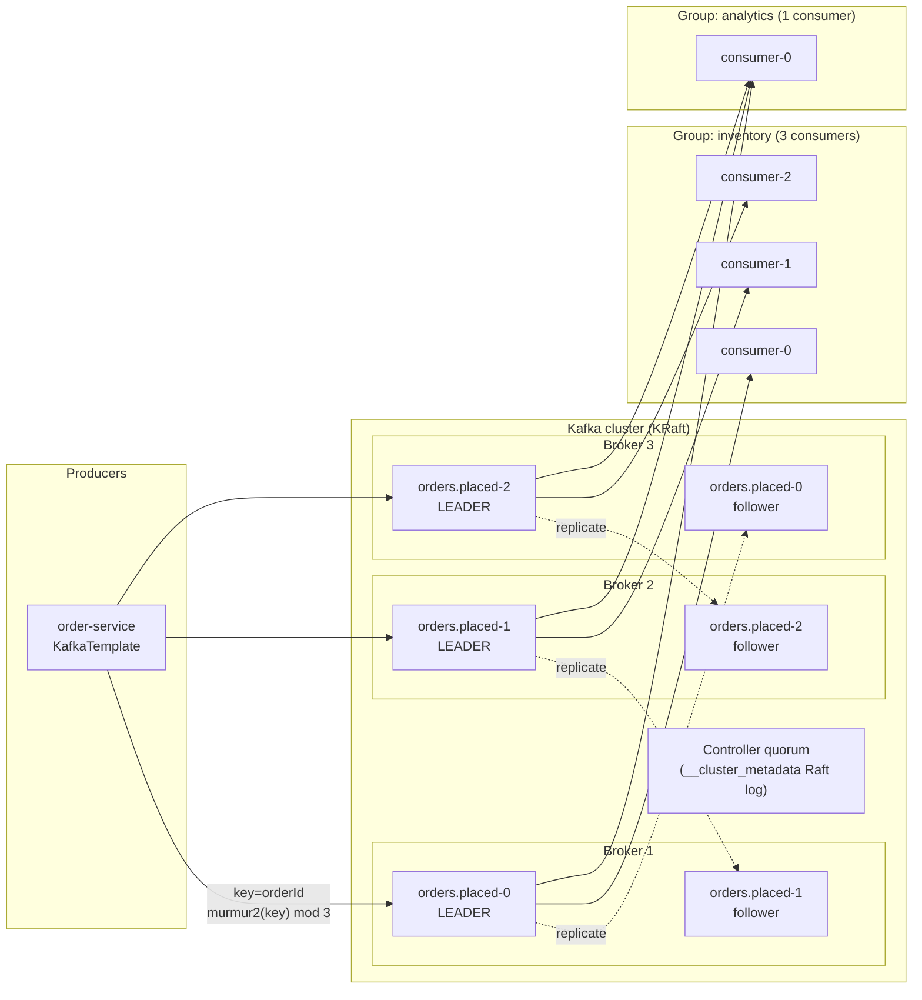

**The rules that fall out of this picture:**

| Rule | Consequence |
|---|---|
| A partition is read by **at most one consumer per group** | The maximum useful parallelism of a group equals the partition count. A 4th consumer on a 3-partition topic sits idle |
| Order is guaranteed **only within a partition** | Key by the entity whose events must stay in order (the `orderId`), not by a random value |
| Offsets are per **(group, partition)** | Two groups never interfere. "Replay" means resetting one group's offsets |
| Producers write only to the partition **leader** | Followers exist for durability and failover, not for read scaling (except with KIP-392 follower fetching, which is rack-aware) |
| Records are immutable and kept by **time/size or by key** | Retention is a topic setting, not a consumer action |

### Spring Kafka's main types

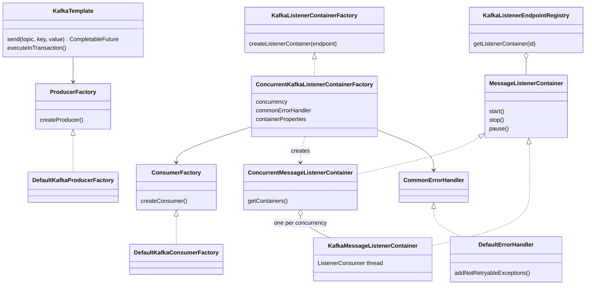

---

## 3. How it works internally

### 3.1 Brokers, partitions, replicas and the ISR

- A **broker** is one Kafka server process. A **cluster** is a set of brokers.
- A **topic** has N **partitions**. Each partition has a **replication factor** (RF), usually 3. One replica is the **leader**, and the others are **followers** that fetch from the leader, much like consumers do.
- The **ISR** (in-sync replicas) is the set of replicas that have caught up to the leader within `replica.lag.time.max.ms` (30 s by default). A follower that falls behind is dropped from the ISR, and rejoins when it catches up.
- **LEO** (log end offset) is the next offset a replica will write. The **high watermark (HW)** is the highest offset copied to *every* ISR member. **Consumers can only read up to the HW**, so they never see a record that could vanish in a failover.
- **`min.insync.replicas`** (a topic or broker setting, default 1) is the minimum ISR size for an `acks=all` write to succeed. With RF=3 and `min.insync.replicas=2`, you survive one broker loss with no data loss and no write outage. If the ISR shrinks to 1, `acks=all` producers get `NotEnoughReplicasException`.

**Leader election.** When a leader's broker dies, the controller picks a new leader **from the ISR**. `unclean.leader.election.enable=false` (the default) forbids electing an out-of-sync replica. That trades availability for no data loss: the partition stays offline until an ISR member returns. Setting it to `true` brings the partition back sooner, but it silently truncates records the old leader had acked. Kafka 4.x KRaft also tracks an **ELR** (eligible leader replicas, KIP-966), which lets a clean leader be found more often after an unclean shutdown (unverified: which 4.x release enables it by default).

### 3.2 KRaft: no more ZooKeeper

Kafka 4.0 is "the first major release to operate entirely without Apache ZooKeeper". Cluster metadata (topics, partitions, ISR, configs, ACLs) lives in an internal Raft-replicated log, **`__cluster_metadata`**, managed by a **controller quorum** (3 or 5 controller nodes, or "combined" broker+controller nodes in small clusters). The *active controller* is the Raft leader. Brokers replicate the metadata log and apply it locally.

| ZooKeeper era | KRaft |
|---|---|
| A separate ZooKeeper ensemble to run, secure, and monitor | One system: the controllers are Kafka processes |
| Controller failover reloaded all metadata from ZK (slow with many partitions) | The standby controllers already have the log in memory, so failover is near-instant |
| Practical limit around 200k partitions per cluster | Millions of partitions |
| `--zookeeper` CLI flags | `--bootstrap-server` everywhere. The ZK flags are gone |

For Spring this means: `EmbeddedKafkaZKBroker` is removed in Spring Kafka 4.0, `@EmbeddedKafka` lost its `zookeeperPort`-style attributes, and Testcontainers' `org.testcontainers.kafka.KafkaContainer` runs Apache Kafka in KRaft mode.

### 3.3 The log on disk: segments, retention and compaction

Each partition is a directory such as `orders.placed-0/` containing **segments**:

```
00000000000000000000.log        # the records (batches), appended sequentially
00000000000000000000.index      # sparse offset -> byte position index
00000000000000000000.timeindex  # sparse timestamp -> offset index
00000000000000052311.log        # next segment, named after its first (base) offset
...
leader-epoch-checkpoint
```

- Only the **active** (last) segment is written to. A segment rolls when it reaches `segment.bytes` (1 GiB) or `segment.ms` (7 days).
- Retention works **per closed segment**, never per record. With `cleanup.policy=delete` (the default), a whole segment is deleted once its newest record is older than `retention.ms` (7 days by default), or when the partition exceeds `retention.bytes` (-1, unlimited, by default). Records can therefore live longer than `retention.ms`.
- **`cleanup.policy=compact`** keeps **at least the latest record per key**. A background cleaner thread rewrites closed segments and drops older values of the same key. A record with a **null value is a tombstone**: it deletes the key, and is itself removed after `delete.retention.ms` (1 day). `min.compaction.lag.ms` guarantees a minimum time before a record can be compacted. `min.cleanable.dirty.ratio` (0.5) controls how eagerly the cleaner runs.
- `cleanup.policy=compact,delete` compacts **and** expires old keys, which is useful for "latest state, but forget customers inactive for a year".
- Compaction **keeps offsets**. A compacted log just has gaps, so consumers must never assume `offset + 1` exists.
- Kafka's own `__consumer_offsets` and `__transaction_state` are compacted topics. So is Kafka Streams' changelog for a `KTable`.

**Tiered storage** (KIP-405, production-ready since 3.9, unverified) can offload closed segments to S3, so brokers keep only the hot tail on local disk.

### 3.4 The producer pipeline

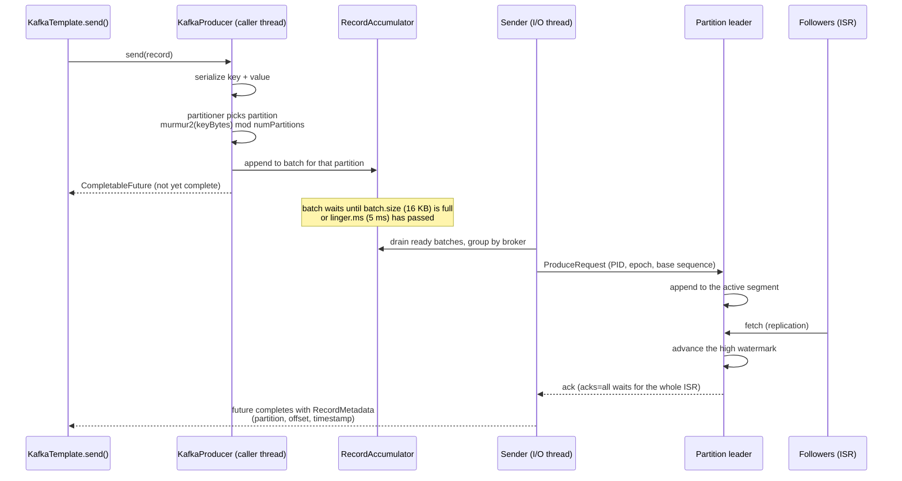

- **Partitioner.** With a key, the partition is `toPositive(murmur2(keyBytes)) % numPartitions`. The lab test `PartitionOrderingTest` recomputes it and checks it matches the broker's answer. With a **null key**, since Kafka 3.3 (KIP-794), the producer uses a "sticky" partition, filling a batch for one partition before moving on, weighted towards faster brokers. It no longer round-robins per record. **Adding partitions changes `mod numPartitions`**, so existing keys move to new partitions and per-key order breaks across the change.
- **Batching.** `batch.size` (16384 bytes) is the per-partition batch cap. `linger.ms` is how long to wait for a batch to fill. The default became **5 ms in Kafka 4.0** (KIP-1030), up from 0. The lab's `kafka-clients` 4.2.2 reports `linger.ms=5` as the default. `compression.type` (`lz4` or `zstd`) compresses whole batches, so bigger batches compress better.
- **`acks`.** `0` is fire-and-forget. `1` waits for the leader only, and loses data if the leader dies before followers copy the record. `all` (or `-1`) waits for the whole ISR, subject to `min.insync.replicas`. **`all` has been the default since Kafka 3.0.**
- **Idempotence** (`enable.idempotence=true`, also the default since 3.0). The broker gives each producer a **PID** and an epoch. Each batch carries a **sequence number** per partition. The leader drops a batch whose sequence it has already written (a retry after a lost ack) and rejects a gap. This gives exactly-once *writes per partition per producer session*, with ordering preserved even when `max.in.flight.requests.per.connection` is up to 5. It does **not** dedupe across producer restarts (a new PID) or across the app calling `send()` twice.
- **`delivery.timeout.ms`** (120 s) is the upper bound for a `send()` to succeed, retries included. `retries` defaults to `Integer.MAX_VALUE`, so this timeout is the real limit.
- **`max.block.ms`** (60 s) is how long `send()` itself may **block the caller**, while fetching metadata or waiting for buffer space (`buffer.memory`, 32 MB). This surprises people who think `send()` is always non-blocking.

### 3.5 Transactions (and what they do not cover)

A **transactional producer** (`transactional.id` set) can write to several partitions and commit consumer offsets **atomically**:

1. `initTransactions()` registers the `transactional.id` with the **transaction coordinator** (a broker, chosen by hashing the id onto `__transaction_state`). This bumps the **epoch** and fences any older producer with the same id, the "zombie" left over from a crashed instance.
2. `beginTransaction()`, then sends. The partitions are registered with the coordinator.
3. `sendOffsetsToTransaction(offsets, groupMetadata)` adds the consumer's offsets to the transaction. This is the consume-transform-produce loop.
4. `commitTransaction()` makes the coordinator write **commit markers** into every involved partition.

Consumers with **`isolation.level=read_committed`** only read up to the **LSO** (last stable offset) and skip aborted records. The default is `read_uncommitted`. Kafka 4.0 completed phase 2 of KIP-890 (transaction version 2), which "reduces the chances of 'zombie transactions' during producer failures".

**In Spring:** set `spring.kafka.producer.transaction-id-prefix=tx-`. Boot then creates a `KafkaTransactionManager`, the `KafkaTemplate` becomes transactional, and **every `send()` must run inside a transaction**, either `@Transactional("kafkaTransactionManager")` or `kafkaTemplate.executeInTransaction(...)`. Otherwise it throws `IllegalStateException: No transaction is in process`. If you set `spring.kafka.template.allow-non-transactional=true`, plain sends are allowed again. With a transactional producer, a listener container runs each delivery inside a Kafka transaction and sends the consumed offsets to it.

**The lab does not use it on purpose.** A Kafka transaction and a database transaction are **two different resources**. Spring cannot commit them atomically: there is no XA. The old `ChainedKafkaTransactionManager` was deprecated for that reason. "Commit DB, then commit Kafka" can still lose or duplicate. The **outbox** (§7.1) is the pattern that actually makes "DB change + event" atomic, and it needs only an idempotent producer.

### 3.6 The consumer: groups, rebalancing, offsets and lag

**Group membership.** Every consumer in a group sends heartbeats to the **group coordinator** (the broker leading that group's `__consumer_offsets` partition). When members join or leave, or the subscribed topics' partitions change, the group **rebalances**.

| Protocol | How it works | Downtime |
|---|---|---|
| Classic **eager** (Range, RoundRobin, Sticky assignors) | Every member revokes **all** its partitions, rejoins, and a leader member computes a new assignment | Stop-the-world for the whole group |
| Classic **cooperative** (`CooperativeStickyAssignor`) | Members keep the partitions they still own. Only the moved ones are revoked, over two rounds | Only the moved partitions pause |
| **KIP-848 "consumer" protocol** (GA in Kafka 4.0) | The **broker** computes the assignment incrementally. There is no group-wide sync barrier. Session timeout and heartbeat interval become broker-side settings | Minimal. Opt in with `group.protocol=consumer` |

The kafka-clients 4.2.2 defaults (printed from `ConsumerConfig.configDef()`) are `group.protocol=classic` and `partition.assignment.strategy=[RangeAssignor, CooperativeStickyAssignor]`. That list means "eager Range now, upgradable to cooperative with a rolling restart that removes Range". **Set `CooperativeStickyAssignor` alone**, or move to `group.protocol=consumer`. **Static membership** (`group.instance.id`) lets a restarting pod reclaim its partitions within `session.timeout.ms` (45 s) without triggering a rebalance, which is ideal for Kubernetes rolling deploys.

**The two timeouts people confuse:**
- `session.timeout.ms` (45 s) and `heartbeat.interval.ms` (3 s): a background thread sends heartbeats. Missing them means the **process** is dead.
- `max.poll.interval.ms` (**300000**, 5 minutes): the maximum time between two `poll()` calls. If your listener takes longer to process one poll's records (`max.poll.records`, 500), the consumer **leaves the group** even though it is alive. Its partitions are reassigned, its offset commit fails (`CommitFailedException`), and the same records are processed again by someone else. Fix it by lowering `max.poll.records`, making processing faster, or raising the interval.

**Offsets and commit strategies.** The committed offset is the **next** offset to read, stored in `__consumer_offsets`.

| Strategy | Semantics | Risk |
|---|---|---|
| `enable.auto.commit=true` (the plain client default, every `auto.commit.interval.ms`=5 s, on `poll()`) | Commits whatever was *returned* by the last poll | A crash after the commit but before processing loses records. A crash before the commit reprocesses them |
| Commit **after** processing (Spring's default) | At-least-once | Duplicates after a crash or rebalance, so make consumers idempotent |
| Commit **before** processing | At-most-once | Data loss on a crash |
| Offsets inside a Kafka transaction (`sendOffsetsToTransaction`) | Exactly-once for Kafka → Kafka | Only Kafka writes are covered |
| Offsets stored in **your DB**, in the same transaction as the side effect, and `seek()` on assignment | Effectively exactly-once into that DB | More code. A `ConsumerSeekAware` listener restores positions |

Spring's container sets `enable.auto.commit=false` unless you set it, and commits for you according to the **`AckMode`**:

| `AckMode` | When the container commits |
|---|---|
| `BATCH` (default) | After the listener has handled **all** records returned by one `poll()` |
| `RECORD` | After each record |
| `TIME` / `COUNT` / `COUNT_TIME` | After `ackTime` has passed or `ackCount` records were handled, checked between records |
| `MANUAL` | The listener calls `Acknowledgment.acknowledge()`. The acks are queued and committed at the end of the batch |
| `MANUAL_IMMEDIATE` | `acknowledge()` commits synchronously, right away, on the consumer thread |

With `MANUAL`, `Acknowledgment.nack(Duration)` re-seeks the current record and sleeps, which is a simple "retry later". Spring Kafka 4.1 adds a per-listener `@KafkaListener(ackMode = "...")` override.

**Lag** = log end offset − committed offset, per partition. It is *the* consumer health metric. Rising lag means consumers are slower than producers. Watch it with `kafka-consumer-groups.sh --describe --group inventory`, Burrow, or the client metric `records-lag-max`. A lag that stays flat but non-zero on one partition usually means a stuck record (a poison message in blocking retries).

### 3.7 Delivery semantics: what "exactly once" really covers

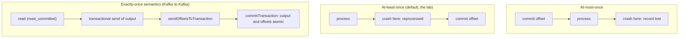

- **EOS covers the Kafka read → process → Kafka write loop**: output records and consumed offsets commit atomically, and `read_committed` readers never see aborted output. Kafka Streams gives it with one setting, `processing.guarantee=exactly_once_v2`.
- **EOS does *not* cover side effects outside Kafka**: a DB insert, an HTTP call, or an email. If the transaction aborts after your listener called the payment API, the API call has still happened. The record will be redelivered and the API called again.
- **For DB side effects, the practical answer is at-least-once plus an idempotent consumer.** Store the processed event ids in the same DB transaction as the side effect (the lab's `processed_message` table), or make the write naturally idempotent (an upsert, or `UPDATE ... WHERE version = ?`). This is "effectively once".
- **Producer idempotence ≠ end-to-end exactly-once.** It only removes duplicates caused by *producer retries within one session*.

### 3.8 Ordering guarantees

| Scenario | Ordered? |
|---|---|
| Same key, same partition, one producer, idempotence on | **Yes**, even with up to 5 in-flight requests. This is proven by `PartitionOrderingTest` on the producer and the consumer side |
| Idempotence off, `retries` above 0, `max.in.flight` above 1 | **No**. A failed batch retried after a later batch succeeded is written out of order |
| Same key, after partitions are added | **No** across the change. The key maps to a new partition |
| Different keys | No ordering between them, by design |
| Consumer with `concurrency=3` | Yes per partition, because each partition is owned by exactly one thread |
| Consumer that hands records to a thread pool | **No**. You broke it yourself. Use a per-key executor (as the Confluent Parallel Consumer does) if you need it |
| `@RetryableTopic` (non-blocking retries) | **No**. A failed record moves to a retry topic while later records with the same key carry on |
| `DefaultErrorHandler` (blocking retries, the lab) | Yes. The partition does not move past the failing record until it is retried or recovered |

### 3.9 Spring Kafka internals: from `@KafkaListener` to a polling thread

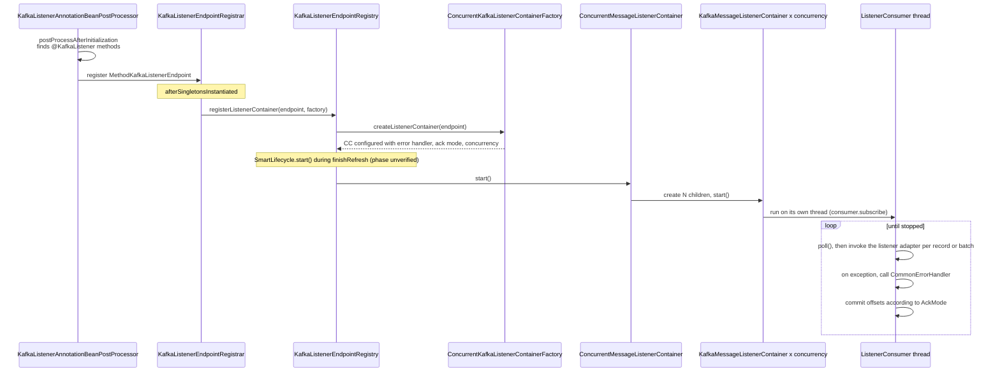

- **`KafkaAutoConfiguration`** (in Boot 4's `spring-boot-kafka` module) builds `DefaultKafkaProducerFactory`, `DefaultKafkaConsumerFactory`, `KafkaTemplate`, `KafkaAdmin` (which creates `NewTopic` beans at startup), and, when a `transaction-id-prefix` is set, a `KafkaTransactionManager`.
- **`KafkaAnnotationDrivenConfiguration`** builds the `kafkaListenerContainerFactory` (a `ConcurrentKafkaListenerContainerFactory`) through `ConcurrentKafkaListenerContainerFactoryConfigurer`. Its constructor takes `ObjectProvider`s for `RecordMessageConverter`, `RecordFilterStrategy`, `BatchMessageConverter`, `KafkaAwareTransactionManager`, `ConsumerAwareRebalanceListener`, **`CommonErrorHandler`**, `AfterRollbackProcessor`, `RecordInterceptor`, `BatchInterceptor`, and `KafkaListenerObservationConvention` (checked with `javap` against 4.1.2). **Declare one of those as a bean and Boot wires it into the factory.** That is how the lab's `DefaultErrorHandler` bean takes effect.
- **`ConcurrentMessageListenerContainer`** creates `concurrency` **`KafkaMessageListenerContainer`** children. Each owns one `KafkaConsumer` (not thread-safe) and one thread (`ListenerConsumer`). The lab test `listenerConcurrency_startsOneConsumerPerPartition` shows 3 children with 1 partition each.
- **The listener adapter** (`RecordMessagingMessageListenerAdapter`) converts the `ConsumerRecord` into your method parameters: the payload, `@Header(KafkaHeaders.RECEIVED_PARTITION)`, `@Payload`, `Acknowledgment`, `ConsumerRecord`, or `Consumer`.
- **Lifecycle control:** `KafkaListenerEndpointRegistry.getListenerContainer("inventory")` lets you `pause()`, `resume()`, `stop()`, or `start()` a listener (for example, pause while a downstream system is down). `@KafkaListener(autoStartup = "false")` keeps it stopped until you start it.
- **Batch listeners:** `factory.setBatchListener(true)` or `spring.kafka.listener.type=batch` delivers `List<OrderPlaced>` or `ConsumerRecords`. Error handling then works per batch. Throw `BatchListenerFailedException(index)` to tell `DefaultErrorHandler` which record failed, so the earlier ones are committed and the failed one is retried and recovered.

**Error handling, in order of what happens:**

1. **Deserialization.** Without `ErrorHandlingDeserializer`, a bad payload makes `poll()` itself throw, before your code runs, on every poll, forever. With it, the failure becomes a `DeserializationException` in a header, the listener is skipped, and the error handler sees it.
2. **`DefaultErrorHandler`** (the `CommonErrorHandler` default since 2.8; it replaced `SeekToCurrentErrorHandler`). On a failure it **re-seeks** the failed record and the rest of that poll, so they are fetched again. It retries per the `BackOff` (`FixedBackOff`, or `ExponentialBackOffWithMaxRetries`), and when retries are exhausted it calls the **`ConsumerRecordRecoverer`**, then commits past the record.
   - **Not-retryable exceptions** go to the recoverer at once. The defaults include `DeserializationException`, `MessageConversionException`, `ConversionException`, `MethodArgumentResolutionException`, `NoSuchMethodException`, and `ClassCastException`. Add your own with `addNotRetryableExceptions(...)`. The lab adds `InsufficientStockException` and proves it is recovered after exactly 1 attempt.
   - By default the back-off **suspends the consumer thread**, so the failing partition, and every other partition owned by that thread, is blocked. Keep the total back-off well below `max.poll.interval.ms`. For longer delays, the docs suggest `ContainerPausingBackOffHandler`, which **pauses** the container instead of sleeping, so `poll()` keeps running and the consumer stays in the group.
3. **`DeadLetterPublishingRecoverer`** publishes the failed record to **`<topic>-dlt`** on the **same partition number**, so the DLT needs at least as many partitions. The value and key stay unchanged, and it adds diagnostic headers: `kafka_dlt-exception-fqcn`, `kafka_dlt-exception-message`, `kafka_dlt-exception-stacktrace`, `kafka_dlt-original-topic`, `-partition`, `-offset`, `-timestamp`, and `-consumer-group`. A custom destination resolver `(record, ex) -> TopicPartition` can route by exception type. **Many tutorials say `<topic>.DLT`.** The lab first declared `orders.placed.DLT`, and the run logged "Destination resolver returned non-existent partition orders.placed-dlt-2". The current docs confirm `<originalTopic>-dlt`.

**Blocking retries vs `@RetryableTopic` (non-blocking):**

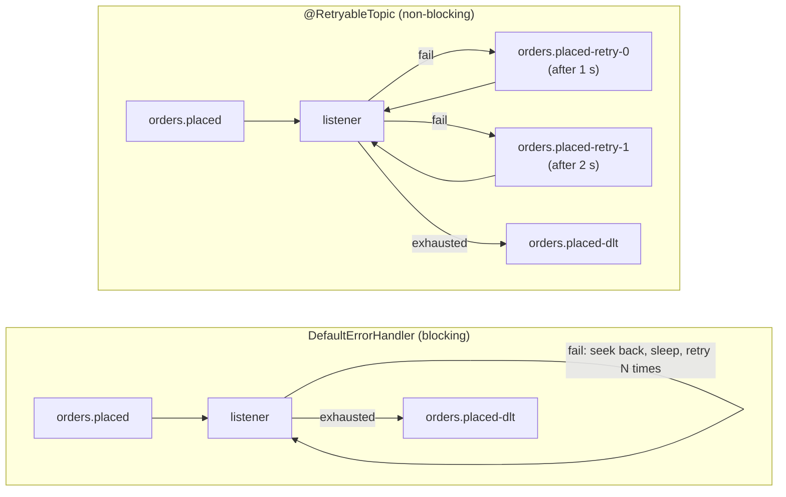

| | `DefaultErrorHandler` + DLT | `@RetryableTopic` |
|---|---|---|
| Partition progress during retries | Blocked | Continues. The failed record is parked on a retry topic |
| Per-key order | **Kept** | **Broken**. Later events for the same key overtake the retried one |
| Long back-offs (minutes) | Bad: they block the partition and threaten `max.poll.interval.ms` | Fine. Retry-topic consumers pause their partitions until each record's due time |
| Extra topics | `-dlt` only | `-retry-N` (or one `-retry` topic with `SINGLE_TOPIC` same-interval reuse) plus `-dlt`, auto-created |
| Config | One `CommonErrorHandler` bean | `@RetryableTopic(attempts = "4", backOff = @BackOff(delay = 1000, multiplier = 2), exclude = ...)` and a `@DltHandler` method, or a `RetryTopicConfiguration` bean |
| Use when | Order matters (order lifecycle, account balance) | Independent events (emails, notifications, enrichment) with slow, flaky dependencies |

**The lab picks `DefaultErrorHandler`**, because order events are keyed by `orderId` and an `OrderCancelled` must never overtake its `OrderPlaced`.

**`ReplyingKafkaTemplate`** does request/reply over Kafka. It sends with `KafkaHeaders.REPLY_TOPIC` and a `CORRELATION_ID` header. The `@KafkaListener` returns a value with `@SendTo`, and the template completes a `RequestReplyFuture` when the reply with the same correlation id arrives on its own reply-topic consumer. It is useful for scatter-gather (`AggregatingReplyingKafkaTemplate`) or when Kafka is the only allowed transport. It is a poor substitute for HTTP: you get a reply-topic consumer per instance, a timeout per request, and no back-pressure.

**Observation and tracing.** Set `spring.kafka.template.observation-enabled=true` and `spring.kafka.listener.observation-enabled=true`. Both properties exist on Boot 4.1.2's `KafkaProperties.Template` and `.Listener`, checked with `javap`. `KafkaTemplate` then creates a `spring.kafka.template` observation, and the container creates a `spring.kafka.listener` observation per record. With Micrometer Tracing (note 10) on the classpath, the **trace context is propagated in the record headers** (W3C `traceparent`), so a trace runs from the HTTP request, through the relay's send, to the consumer. Customize tags with `KafkaTemplateObservationConvention` and `KafkaListenerObservationConvention` beans. The listener convention is also auto-wired into the factory. Without these flags you still get the native client **metrics** (`kafka.consumer.*`, `kafka.producer.*`) through `KafkaMetricsAutoConfiguration`.

> Gotcha for the outbox: the relay sends from a scheduler thread, so the trace of the original HTTP request is gone by then. To keep one trace end to end, store `traceparent` in an outbox column and restore it on send. Debezium's outbox router can do the same with a tracing column.

### 3.10 Schema evolution: Avro, Protobuf and Schema Registry

JSON with a `__TypeId__` header (the lab) works between teams that release together. At scale, producers and consumers deploy independently for years, so a **contract** is needed.

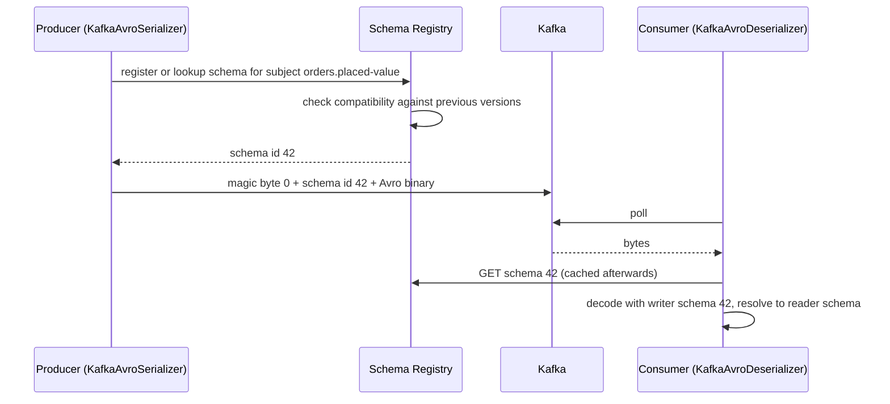

- **Avro** is compact binary with no field names on the wire. The reader resolves the *writer's* schema against its own *reader* schema. A field with a `default` can be added or removed safely.
- **Protobuf** uses numbered fields. Never reuse a field number. Unknown fields are skipped, so it is naturally forward and backward compatible if you follow the rules.
- **JSON Schema** is supported too, but it is verbose and weaker at evolution.
- **Compatibility modes** (Confluent Schema Registry, checked per subject):

| Mode | A new schema must be able to... | Safe changes | Deploy order |
|---|---|---|---|
| `BACKWARD` (default) | read data written with the **previous** schema | Delete fields, add optional fields (with defaults) | **Consumers first** |
| `FORWARD` | have its data read by the **previous** schema | Add fields, delete optional fields | **Producers first** |
| `FULL` | both of the above | Add or delete optional fields only | Either order |
| `*_TRANSITIVE` | as above, against **all** earlier versions, not just the last | | |
| `NONE` | no check | Anything (dangerous) | |

- The subject naming strategy is `TopicNameStrategy` by default (`<topic>-value`). `RecordNameStrategy` allows several event types on one topic.
- **Alternatives:** Apicurio Registry, AWS Glue Schema Registry, or a "schema in a shared jar" plus consumer-driven contract tests (Spring Cloud Contract, Pact).

### 3.11 Kafka vs RabbitMQ vs SQS/SNS, and Spring Cloud Stream

| | Kafka | RabbitMQ | SQS / SNS (note 16) |
|---|---|---|---|
| Model | Partitioned log, consumers pull and keep offsets | Smart broker: exchanges route to queues and push to consumers | Managed queue (SQS) plus pub/sub fan-out (SNS → SQS) |
| Retention | Time, size, or compaction. **Replay** is possible | Removed on ack (Streams plugin aside) | Up to 14 days, removed on delete. No replay |
| Ordering | Per partition | Per queue (with one consumer) | FIFO queues per message group. Standard queues are best-effort |
| Routing | By topic and key only | Rich routing: direct, topic, headers, fanout | SNS filter policies |
| Throughput | Very high (sequential I/O, batching) | High, but per-message bookkeeping limits it | Effectively unlimited for standard queues, but you pay per request |
| Per-message features | Weak (no per-message ack, no delay, no priority). Share groups (KIP-932) add per-record acks | Per-message ack, TTL, priority, delayed exchange, DLX | Visibility timeout, delay, DLQ with `maxReceiveCount` |
| Ops | Heavy, unless managed (MSK, Confluent Cloud) | Medium | None |
| Pick it for | Event streaming, event sourcing, CDC, analytics fan-out, replay | Task queues, RPC, complex routing | AWS-native decoupling with zero ops |

**Spring Cloud Stream** is a binder abstraction. You write `java.util.function` beans (`Supplier`, `Function`, `Consumer`), bind them to destinations in YAML (`spring.cloud.stream.bindings.reserve-in-0.destination=orders.placed`), and swap the binder (Kafka, RabbitMQ, Kinesis, Pub/Sub) without code changes. It gives you consumer groups, partitioning, and DLQ settings in one vocabulary. The cost is a lowest-common-denominator API: Kafka-specific features (seek, transactions with a DB, retry topics, `ConsumerSeekAware`) need binder-specific properties or are awkward. **Use plain Spring Kafka when Kafka is your strategic platform. Use Spring Cloud Stream when portability across brokers matters more.**

### 3.12 Kafka Streams in brief

Kafka Streams is a **library**, not a cluster. It runs inside your app and reads, transforms, and writes Kafka topics with a DSL: `KStream` (every event), `KTable` (latest value per key, backed by a compacted changelog topic and a local RocksDB **state store**), joins, windowed aggregations, and `exactly_once_v2`. Scaling works like a consumer group: more instances share the input partitions as **tasks**, and the state moves with them, restored from the changelog. Spring Boot auto-configures a `StreamsBuilderFactoryBean` when `@EnableKafkaStreams` is present and `spring.kafka.streams.application-id` is set. In Boot 4, customize it with Spring Kafka's `StreamsBuilderFactoryBeanConfigurer`. Boot's old `StreamBuilderFactoryBeanCustomizer` was removed. A typical use is "count orders per SKU per minute" or "join payments with orders" without a separate Flink or Spark cluster.

---

## 4. Full worked code

The complete project is in the lab. Below are the parts that carry the lessons, excerpted (constructors, imports and loggers omitted).

### 4.1 Configuration (`application.properties`)

```properties
spring.jpa.open-in-view=false
spring.jpa.hibernate.ddl-auto=validate
spring.mvc.problemdetails.enabled=true

# Producer: Jackson 3 serializer, acks=all, idempotence (both already defaults since Kafka 3.0)
spring.kafka.producer.key-serializer=org.apache.kafka.common.serialization.StringSerializer
spring.kafka.producer.value-serializer=org.springframework.kafka.support.serializer.JacksonJsonSerializer
spring.kafka.producer.acks=all
spring.kafka.producer.properties.enable.idempotence=true
spring.kafka.producer.properties.linger.ms=5
# A logical type token in the __TypeId__ header instead of a Java class name
spring.kafka.producer.properties.spring.json.type.mapping=orderPlaced:dev.roadmap.kafka.order.OrderPlaced

# Consumer: ErrorHandlingDeserializer wraps the JSON deserializer
spring.kafka.consumer.auto-offset-reset=earliest
spring.kafka.consumer.key-deserializer=org.apache.kafka.common.serialization.StringDeserializer
spring.kafka.consumer.value-deserializer=org.springframework.kafka.support.serializer.ErrorHandlingDeserializer
spring.kafka.consumer.properties.spring.deserializer.value.delegate.class=org.springframework.kafka.support.serializer.JacksonJsonDeserializer
spring.kafka.consumer.properties.spring.json.type.mapping=orderPlaced:dev.roadmap.kafka.order.OrderPlaced

# Listener container: one thread per partition, commit after each poll's records are handled
spring.kafka.listener.concurrency=3
spring.kafka.listener.ack-mode=batch

lab.outbox.poll-interval=1s
lab.kafka.retry.interval=1s
lab.kafka.retry.max-retries=2
```

### 4.2 Order + outbox in one transaction

```java
public record OrderPlaced(UUID eventId, UUID orderId, String sku, int quantity, Instant occurredAt) {
	public static final String TOPIC = "orders.placed";
}

@Service
public class OrderService {
	// constructor injection of OrderRepository, OutboxRepository, tools.jackson.databind.json.JsonMapper

	@Transactional
	public UUID placeOrder(PlaceOrderRequest request) {
		var order = orders.save(new Order(request.sku(), request.quantity()));
		var event = new OrderPlaced(UUID.randomUUID(), order.getId(), order.getSku(), order.getQuantity(),
				Instant.now());
		outbox.save(new OutboxEvent("Order", order.getId(), "OrderPlaced", OrderPlaced.TOPIC,
				jsonMapper.writeValueAsString(event)));
		return order.getId();
	}
}
```

```sql
create table outbox_event (
    id uuid primary key, aggregate_type varchar(64) not null, aggregate_id uuid not null,
    event_type varchar(128) not null, topic varchar(255) not null, payload text not null,
    created_at timestamptz not null, sent_at timestamptz
);
create index outbox_event_unsent_idx on outbox_event (created_at) where sent_at is null;
```

### 4.3 The polling relay (`KafkaTemplate` + `CompletableFuture`)

```java
public interface OutboxRepository extends JpaRepository<OutboxEvent, UUID> {
	@Query(value = """
			select * from outbox_event
			where sent_at is null
			order by created_at
			limit :limit
			for update skip locked""", nativeQuery = true)
	List<OutboxEvent> lockUnsent(int limit);
}

@Component
class OutboxRelay {
	@Scheduled(fixedDelayString = "${lab.outbox.poll-interval}")
	@Transactional
	public void publishPending() {
		var batch = outbox.lockUnsent(BATCH_SIZE);
		if (batch.isEmpty()) {
			return;
		}
		var acks = batch.stream().map(this::send).toArray(CompletableFuture[]::new);
		CompletableFuture.allOf(acks).orTimeout(10, TimeUnit.SECONDS).join(); // throws, so the tx rolls back
		var now = Instant.now();
		batch.forEach(event -> event.markSent(now));
	}

	private CompletableFuture<SendResult<String, Object>> send(OutboxEvent row) {
		var event = jsonMapper.readValue(row.getPayload(), OrderPlaced.class);
		return kafka.send(row.getTopic(), row.getAggregateId().toString(), event) // key = orderId
			.whenComplete((result, ex) -> {
				if (ex != null) {
					log.warn("Send failed for order {}, will retry on the next poll", row.getAggregateId(), ex);
					return;
				}
				var meta = result.getRecordMetadata();
				log.debug("Sent order {} to {}-{}@{}", row.getAggregateId(), meta.topic(), meta.partition(), meta.offset());
			});
	}
}
```

Since Spring Kafka 3.0, `send()` returns a `CompletableFuture<SendResult<K, V>>`. `ListenableFuture` is gone. Never call `.get()` per record inside a loop, because that serializes every round trip and defeats batching. Send them all, then wait once.

### 4.4 The idempotent consumer

```java
@KafkaListener(id = "inventory", groupId = "inventory", topics = OrderPlaced.TOPIC)
void onOrderPlaced(OrderPlaced event, @Header(KafkaHeaders.RECEIVED_PARTITION) int partition,
		@Header(KafkaHeaders.OFFSET) long offset) {
	inventory.reserve(event); // no try/catch: errors must reach the DefaultErrorHandler
}

@Service
public class InventoryService {
	@Transactional
	public boolean reserve(OrderPlaced event) {
		if (!markProcessed(event.eventId())) {
			log.info("Duplicate event {} ignored", event.eventId());
			return false;
		}
		int updated = jdbc.sql("update stock set available = available - :qty where sku = :sku and available >= :qty")
			.param("qty", event.quantity())
			.param("sku", event.sku())
			.update();
		if (updated == 1) {
			return true;
		}
		throw skuExists(event.sku()) ? new InsufficientStockException(event.sku(), event.quantity())
				: new SkuNotFoundException(event.sku());
	}

	private boolean markProcessed(UUID eventId) {
		return jdbc
			.sql("insert into processed_message (event_id, processed_at) values (:id, now()) on conflict do nothing")
			.param("id", eventId)
			.update() == 1;
	}
}
```

`JdbcClient` runs in the same transaction as JPA: `JpaTransactionManager` exposes its JDBC connection to `DataSource`-based code. The lab test `notRetryableException_isDeadLetteredOnFirstFailure_andRollsBackTheProcessedMarker` proves the marker insert is rolled back when the stock update fails.

### 4.5 Error handler, DLT and topics

```java
@Configuration(proxyBeanMethods = false)
public class KafkaConfig {
	public static final int PARTITIONS = 3;
	public static final String ORDERS_DLT = OrderPlaced.TOPIC + "-dlt";

	@Bean
	NewTopic ordersTopic() {
		return TopicBuilder.name(OrderPlaced.TOPIC).partitions(PARTITIONS).replicas(1).build();
	}

	@Bean
	NewTopic ordersDeadLetterTopic() {
		return TopicBuilder.name(ORDERS_DLT).partitions(PARTITIONS).replicas(1).build();
	}

	@Bean // Boot wires a single CommonErrorHandler bean into the listener container factory
	DefaultErrorHandler kafkaErrorHandler(KafkaTemplate<Object, Object> template, RetryProperties retry) {
		var recoverer = new DeadLetterPublishingRecoverer(template);
		var handler = new DefaultErrorHandler(recoverer,
				new FixedBackOff(retry.interval().toMillis(), retry.maxRetries()));
		handler.addNotRetryableExceptions(InsufficientStockException.class);
		return handler;
	}
}

@Validated
@ConfigurationProperties("lab.kafka.retry")
public record RetryProperties(@NotNull Duration interval, @PositiveOrZero long maxRetries) {}
```

### 4.6 The same thing with `@RetryableTopic` (not used in the lab)

```java
@RetryableTopic(attempts = "4",
		backOff = @BackOff(delayString = "1s", multiplier = 2, maxDelayString = "30s"),
		exclude = InsufficientStockException.class,
		autoCreateTopics = "true", numPartitions = "3", replicationFactor = "3")
@KafkaListener(id = "email", topics = "orders.placed", groupId = "email")
void sendConfirmation(OrderPlaced event) {
	mailer.send(event); // a flaky SMTP server must not block other customers' emails
}

@DltHandler
void onDeadLetter(OrderPlaced event, @Header(KafkaHeaders.RECEIVED_TOPIC) String topic) {
	log.error("Gave up on {} from {}", event.orderId(), topic);
}
```

`@BackOff` is Spring Kafka 4's annotation. It replaced Spring Retry's `@Backoff`, which disappeared along with the Spring Retry dependency.

### 4.7 Manual acknowledgment (for reference)

```java
// spring.kafka.listener.ack-mode=manual_immediate
@KafkaListener(topics = "payments", groupId = "ledger")
void onPayment(PaymentCaptured payment, Acknowledgment ack) {
	ledger.post(payment);
	ack.acknowledge();                 // commit this offset now
	// or: ack.nack(Duration.ofSeconds(5)) to re-seek this record and retry it after 5 s
}
```

### 4.8 Tests (Testcontainers 2, `@ServiceConnection`, Awaitility)

```java
@TestConfiguration(proxyBeanMethods = false)
public class TestcontainersConfiguration {
	@Bean
	@ServiceConnection // ApacheKafkaContainerConnectionDetailsFactory sets spring.kafka.bootstrap-servers
	KafkaContainer kafkaContainer() { // org.testcontainers.kafka.KafkaContainer (KRaft)
		return new KafkaContainer(DockerImageName.parse("apache/kafka-native:4.2.2"));
	}

	@Bean
	@ServiceConnection
	PostgreSQLContainer postgresContainer() { // org.testcontainers.postgresql.PostgreSQLContainer
		return new PostgreSQLContainer(DockerImageName.parse("postgres:16-alpine"));
	}
}

@Test
void poisonEvent_isRetriedThenDeadLettered() {
	var event = orderPlaced(uniqueSku(), 1); // no stock row: SkuNotFoundException, retryable
	kafka.send(OrderPlaced.TOPIC, event.orderId().toString(), event);

	var deadLetter = awaitDeadLetter(event.eventId());
	verify(inventory, times(3)).reserve(argThat(e -> e.eventId().equals(event.eventId()))); // 1 + 2 retries
	assertThat(header(deadLetter, KafkaHeaders.DLT_EXCEPTION_FQCN)).isEqualTo(ListenerExecutionFailedException.class.getName());
	assertThat(header(deadLetter, KafkaHeaders.DLT_EXCEPTION_CAUSE_FQCN)).isEqualTo(SkuNotFoundException.class.getName());
	assertThat(header(deadLetter, KafkaHeaders.DLT_ORIGINAL_TOPIC)).isEqualTo(OrderPlaced.TOPIC);
}
```

All test classes extend one `IntegrationTest` base class (the same `@SpringBootTest` properties and the same `@MockitoSpyBean`), so they share **one** cached context. A second context would start a second `inventory` group member that steals partitions. That is the classic "message never arrived" flake in Kafka integration tests.

---

## 5. Gap fillers & niche details

- **`auto.offset.reset` only applies when the group has no committed offset** (or the offset is out of range). Changing it to `earliest` on an existing group does nothing. The plain-client default is `latest`, so a brand-new group misses everything produced before its first assignment. That is the classic flaky-test cause. The lab sets `earliest`.
- **The `__TypeId__` header leaks class names.** By default `JacksonJsonSerializer` writes the producer's fully qualified class name, and the consumer must have that exact class and trust its package. Use `spring.json.type.mapping=token:class` on both sides (the lab does), or turn type headers off and set `spring.json.value.default.type`. Non-Spring consumers simply ignore the header.
- **Trusted packages.** `JacksonJsonDeserializer` refuses to instantiate classes from untrusted packages (a deserialization-gadget defence). Mapped types are trusted. Otherwise set `spring.json.trusted.packages`. Never set `*` on a topic that untrusted producers can write to.
- **`ErrorHandlingDeserializer` is not optional in production.** Without it, one malformed record makes `poll()` throw before your listener is called, on every poll, forever.
- **`DeserializationException` is never retried**. It is in `DefaultErrorHandler`'s default not-retryable list. The DLT record then holds the **raw bytes**, so the DLT producer needs a byte-array-capable serializer, such as a `DelegatingByTypeSerializer` with `byte[]` mapped to `ByteArraySerializer`. The lab's JSON-only DLT template would re-encode raw bytes as a JSON string (unverified for this edge case).
- **The DLT header that holds your exception.** The listener's exception reaches the error handler wrapped in a `ListenerExecutionFailedException`. `kafka_dlt-exception-fqcn` names the wrapper, and **`kafka_dlt-exception-cause-fqcn` names your exception**. The lab asserts the cause header.
- **Not-retryable classification walks the cause chain**, so `addNotRetryableExceptions(InsufficientStockException.class)` works even though the exception arrives wrapped.
- **Concurrency above the partition count is wasted.** Boot's `spring.kafka.listener.concurrency` is a *maximum*. Extra child containers get no partitions and sit idle, and they still hold a consumer and a thread. In Kubernetes, `pods × concurrency` should be ≤ partitions.
- **Every thread you add to a consumer group can trigger a rebalance.** Deploying 10 pods one by one with eager assignment gives 10 stop-the-world rebalances. Use cooperative-sticky, static membership, or `group.protocol=consumer`.
- **`@KafkaListener(id = "x")` also sets the `group.id`** unless you also set `groupId` or `idIsGroup = false`. Renaming the id then silently creates a new group, which re-reads from `auto.offset.reset` (unverified: the lab sets both `id` and `groupId`).
- **The container commits offsets for records your listener *skipped*** with a `RecordFilterStrategy`, and for records recovered to the DLT. "Handled" includes "handed to the recoverer". The DLT part is proven by the lab, because the poison record is not redelivered after recovery. The filter part is unverified.
- **`KafkaTemplate.send()` can block** for up to `max.block.ms` (60 s) while fetching metadata for a new topic or when `buffer.memory` is full. Never call it from a reactive event loop. Use reactor-kafka or move it to a bounded elastic thread.
- **`KafkaAdmin` creates topics at startup but never shrinks partitions or changes RF.** Increasing partitions is allowed (`TopicBuilder ... partitions(6)`), but remember it remaps keys (§3.4). In production, many teams disable auto-creation (`auto.create.topics.enable=false` on brokers) and own topics in Terraform or GitOps.
- **Record headers are bytes.** Spring maps them to `MessageHeaders` with `JsonKafkaHeaderMapper` (the Jackson 3 one, new in 4.0). Spring Kafka 4.0 added multi-value header support.
- **`spring.kafka.listener.async-acks`** lets a `MANUAL` listener acknowledge out of order (for example from another thread), while the container commits only contiguous offsets.
- **Batch error handling has a 4.1 trap.** `FailedBatchProcessor` (the batch half of `DefaultErrorHandler`) does **not** reset its retry state when the exception type changes, while the record processor does. Call `setResetStateOnExceptionChange(true)` for consistent behaviour.
- **The idempotence fence.** Checked with `jshell` against kafka-clients 4.2.2: `max.in.flight.requests.per.connection=6` throws `ConfigException` ("must be set to at most 5") whether idempotence is explicit or only the default. `acks=1` with idempotence left at its default builds a producer (idempotence is quietly dropped), but `acks=1` with an explicit `enable.idempotence=true` throws ("Must set acks to all in order to use the idempotent producer"). This is one more reason to state both settings, as the lab does.
- **`linger.ms` in tests.** The default became 5 ms in Kafka 4.0. Latency-sensitive code with tight assertions may notice. Set it to 0 if you need it.

---

## 6. Boot 4 / Framework 7 delta

| Area | Boot 3.x / Spring Kafka 3.x | Boot 4.1.2 / Spring Kafka 4.1.2 |
|---|---|---|
| Versions | Spring Kafka 3.x, kafka-clients 3.x | **Spring Kafka 4.1.2, kafka-clients 4.2.2** (from `mvn dependency:list` on Boot 4.1.2). Spring Kafka 4.0 is based on Apache Kafka client 4.0 |
| Starter / module | `spring-kafka` plus `KafkaAutoConfiguration` in `spring-boot-autoconfigure` | `spring-boot-starter-kafka` (module `spring-boot-kafka`, package `org.springframework.boot.kafka.autoconfigure`). The test companion is **`spring-boot-starter-kafka-test`** (brings `spring-kafka-test` and Awaitility) |
| JSON | `JsonSerializer`, `JsonDeserializer`, `JsonSerde`, `JsonMessageConverter`, `DefaultKafkaHeaderMapper` (Jackson 2) | **`JacksonJsonSerializer`, `JacksonJsonDeserializer`, `JacksonJsonSerde`, `JacksonJsonMessageConverter`, `JsonKafkaHeaderMapper`** (Jackson 3, `tools.jackson.databind.json.JsonMapper`). All Jackson 2 classes are **deprecated**, "will be removed in a future major version" |
| Retry | Spring Retry: `@Backoff`, `BackOffPolicy`, `BinaryExceptionClassifier` | **Spring Framework 7 core retry.** `@RetryableTopic(backOff = @BackOff(...))` with Duration strings (`delayString = "2s"`) and placeholders. `ExceptionMatcher` replaces `BinaryExceptionClassifier`. `RetryingDeserializer` recovery gets a `RetryException`. `uniformRandomBackoff` is deprecated in favour of jitter |
| Boot retry properties | `spring.kafka.retry.topic.backoff.random` | **Removed**, replaced by `spring.kafka.retry.topic.backoff.jitter` |
| Spring Retry dependency management | Managed by Boot | **Removed.** If you still use Spring Retry yourself, give it an explicit version |
| ZooKeeper | `EmbeddedKafkaZKBroker`, `@EmbeddedKafka(zookeeperPort = ...)`, `EmbeddedKafkaRule` | **All removed.** KRaft only: `EmbeddedKafkaKraftBroker`. `@EmbeddedKafka` lost `kraft`, `zookeeperPort`, `zkConnectionTimeout`, and `zkSessionTimeout` |
| Rebalance protocol | Classic only | **KIP-848 `group.protocol=consumer` supported** (Spring Kafka 4.0). GA in Kafka 4.0, but opt-in, because the client default is still `classic` |
| Queues | — | **Share consumers (KIP-932, "Kafka Queues")**, early access in 4.0. In 4.1 they get `ShareAckMode` (`EXPLICIT`, `MANUAL`, `IMPLICIT`), `ShareConsumerRecordRecoverer` (ACCEPT, RELEASE, REJECT), and `ShareAcknowledgment.renew()` (KIP-1222, Kafka 4.2) |
| Ack mode per listener | Factory-wide only | **`@KafkaListener(ackMode = "...")`** (4.1) |
| Retry topics | `RetryTopicConfigurationBuilder` defaulted to `MULTIPLE_TOPICS` | Defaults to **`SINGLE_TOPIC`** for same-interval retries (4.1), matching `@RetryableTopic` |
| Kafka Streams | Boot's `StreamBuilderFactoryBeanCustomizer` | **Removed.** Use Spring Kafka's `StreamsBuilderFactoryBeanConfigurer` (`Ordered`, default 0). 4.1 adds `RecoveringProcessingExceptionHandler`, `RecoveringProductionExceptionHandler` (KIP-1034), and `groupProtocol` (KIP-1071) |
| Removed APIs | `sendOffsetsToTransaction(offsets, String groupId)` | Removed. Use the `ConsumerGroupMetadata` overload |
| `KafkaAdmin` | Retried the cluster-id lookup on every call | `clusterIdRetryInterval` (5 min default, 4.1) |
| Testcontainers | 1.x artifact `kafka`, with `org.testcontainers.containers.KafkaContainer` (Confluent image) or `org.testcontainers.kafka.KafkaContainer` | **Testcontainers 2.0.5**: the artifact is renamed **`testcontainers-kafka`**. Its jar holds `org.testcontainers.kafka.KafkaContainer` (for `apache/kafka` and **`apache/kafka-native`**, KRaft), `org.testcontainers.kafka.ConfluentKafkaContainer` (for `confluentinc/cp-kafka`), and the legacy `org.testcontainers.containers.KafkaContainer`, which is still there. Prefer the `org.testcontainers.kafka` ones. Boot's `@ServiceConnection` support comes from `ApacheKafkaContainerConnectionDetailsFactory`, `ConfluentKafkaContainerConnectionDetailsFactory`, and `RedpandaContainerConnectionDetailsFactory` (all in `spring-boot-kafka-4.1.2.jar`) |
| Apache Kafka 4.0 (the client and broker underneath) | ZooKeeper or KRaft. `linger.ms` default 0 | KRaft only. **Clients and Streams need Java 11, brokers need Java 17.** `linger.ms` default **5** (checked against the kafka-clients 4.2.2 `ProducerConfig` defaults). KIP-890 phase 2 is done. Clients 4.0 need brokers 2.1 or newer |

**⚠️ Outdated advice still common in tutorials and Baeldung articles:**
- `JsonSerializer` / `JsonDeserializer` / `spring.json.trusted.packages=*` with `com.fasterxml.jackson.databind.ObjectMapper`. Boot 4 uses Jackson 3 (`tools.jackson.*`), and the Spring Kafka classes are now `JacksonJson*`.
- `ListenableFuture` callbacks (`addCallback`) on `send()`. Removed in 3.0. Use `CompletableFuture.whenComplete`.
- `SeekToCurrentErrorHandler`, `ErrorHandler`, `BatchErrorHandler`, `ConcurrentKafkaListenerContainerFactory.setErrorHandler(...)`. Removed in 3.0. Use `DefaultErrorHandler` as a `CommonErrorHandler`.
- `ChainedKafkaTransactionManager` to "make DB + Kafka atomic". Deprecated, and it never was atomic. Use the outbox.
- `@RetryableTopic(backoff = @Backoff(delay = 1000))`. Now `backOff = @BackOff(...)`.
- Docker Compose files and tests with a `zookeeper` service, and `@EmbeddedKafka(zookeeperPort=...)`. ZooKeeper is gone in Kafka 4.
- "Set `enable.idempotence=true` and `acks=all` for safety." These have been the defaults since Kafka 3.0. The real advice is "don't turn them off, and set `min.insync.replicas=2`".
- "`DeadLetterPublishingRecoverer` sends to `<topic>.DLT`." The current default is `<topic>-dlt`, as this lab proved.

---

## 7. Real-life architecture solutions

### 7.1 Transactional outbox: polling relay vs CDC with Debezium

**Problem.** The order service must update its database **and** tell the world. Writing to the DB and calling `kafkaTemplate.send()` is a **dual write**. If the send happens after the commit and the process crashes in between, the event is lost forever. If the send happens before the commit and the commit fails, consumers react to an order that does not exist. No local transaction spans both.

**Solution.** Write the event into an `outbox` table **in the same local transaction** as the business change. A separate process moves outbox rows to Kafka. Delivery becomes at-least-once, and consumers dedupe on the event id.

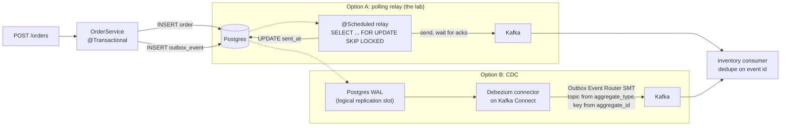

| | Polling relay | CDC (Debezium) |
|---|---|---|
| Moving parts | Just your app | Kafka Connect cluster, Debezium connector, replication slot |
| Latency | Poll interval (100 ms to seconds) | Sub-second, push-based from the WAL |
| DB load | A query every poll. Needs the partial index on unsent rows | Reads the WAL. No queries against your tables |
| Ordering | `ORDER BY created_at` per batch. Multiple relay instances with `SKIP LOCKED` can reorder **across** batches, so use one relay per partition key range, or a single active relay, if strict order matters | Commit order from the WAL, the true order |
| Cleanup | You delete or archive sent rows | Insert-and-delete in the same transaction is fine. Debezium still sees the insert in the WAL, and the table stays empty |
| Failure modes | Relay down means a growing outbox (alert on age of the oldest unsent row) | Connector down means the **WAL grows on the DB server** (alert on replication slot lag, or the disk fills) |
| Duplicates | Yes, if an ack arrives but `UPDATE sent_at` fails | Yes, after a connector restart from its last committed offset |

**Who uses it:** Debezium's outbox router is used widely (Red Hat, Zalando, and others). Shopify, Wix, and many banks run outbox tables. Polling relays are common in smaller services and are the default in frameworks such as Eventuate Tram.

**Trade-off summary:** start with polling (zero infrastructure, as in the lab). Move to CDC when you have many services with outboxes, need sub-second latency, or the polling queries show up in your DB metrics.

### 7.2 Saga: choreography vs orchestration for order → payment → inventory

**Problem.** Placing an order touches three services, each with its own database. There is no distributed transaction (2PC is unavailable across Kafka and microservice DBs, and it would couple availability). The business still needs "all or nothing".

**Solution: a saga.** A sequence of local transactions, each publishing an event. If a step fails, **compensating transactions** semantically undo the earlier steps: refund the payment, release the stock.

**Choreography**: every service reacts to events, and there is no central brain.

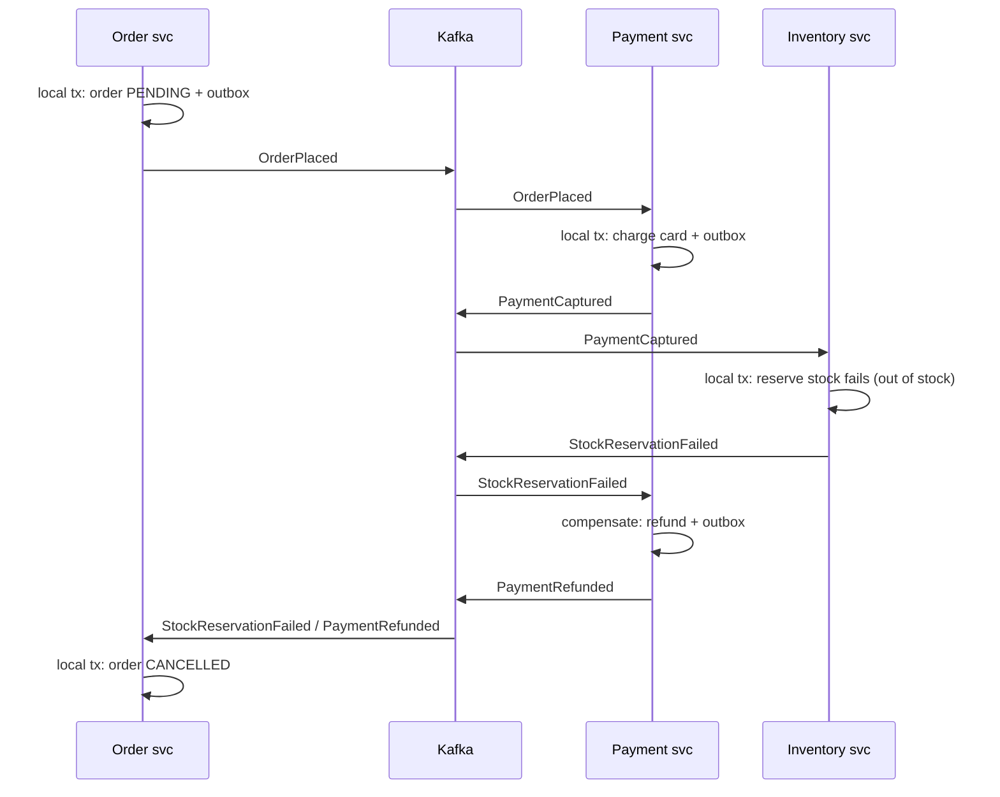

**Orchestration**: one saga orchestrator (a state machine) sends commands and waits for replies.

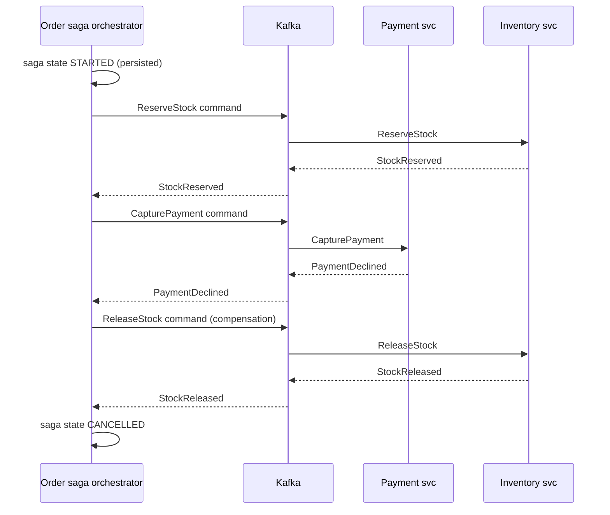

| | Choreography | Orchestration |
|---|---|---|
| Coupling | Services know each other's events | Services know only their own commands. The orchestrator knows the flow |
| Visibility | The flow is implicit and spread across services. You need tracing to see it | Explicit state machine, one place to see "where is order 42?" |
| Adding a step | Touch several services | Change the orchestrator |
| Risk | Cyclic event chains, "who compensates what" confusion | The orchestrator is a central component that must be HA (but it is just a service with a DB) |
| Good for | 2–4 steps, stable flows | Longer flows, timeouts, human steps, frequent changes |

**Rules that apply to both:** each step is a local transaction + outbox (§7.1). Each handler is idempotent, because the saga *will* see duplicates. Compensations must be idempotent and **commutative with late messages** (a `ReleaseStock` may arrive before the `ReserveStock` it undoes, so record "released" and make the later reserve a no-op). Order the steps to reduce compensation: reserve stock (cheap to undo) before capturing payment (expensive to undo).

**Who uses it:** Uber (Cadence, then Temporal, for orchestration), Netflix (Conductor), and Axon- and Eventuate-based systems in banking. Choreography is common in e-commerce flows at Zalando and in many Kafka-centric shops.

### 7.3 Event sourcing and audit log with compacted topics

**Problem.** Regulators or the business need a full, tamper-evident history of every change (an account ledger, order lifecycle, or price changes). Several services also need the **current** state of each entity without calling its owner.

**Solution.** Use two topics per aggregate:

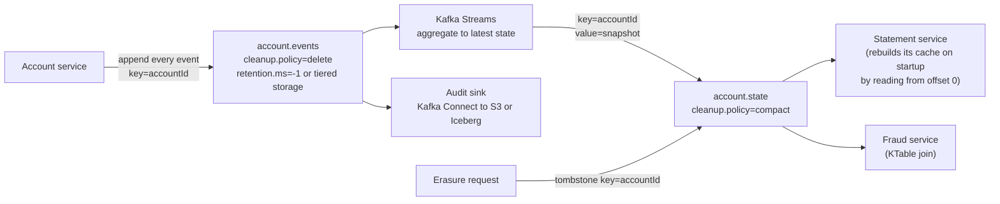

- `account.events` is the **immutable history**: infinite retention, or tiered storage to S3. Replaying it rebuilds any projection after a bug fix.
- `account.state` is **compacted**, holding the latest snapshot per key. A new service bootstraps by reading it from the beginning, and its size is bounded by the *number of keys*, not the number of events.
- **Tombstones** (null value) remove a key from the compacted topic. For GDPR, the immutable event log needs **crypto-shredding**: encrypt personal data with a per-user key and delete the key.
- Per-key ordering (key = `accountId`) is what makes the replay deterministic.

**Trade-offs.** Kafka is not an event store with optimistic concurrency per stream. You cannot say "append only if the stream version is 41". Single-writer per key (one partition, one consumer) or a DB-backed event store (EventStoreDB, Axon Server, or Postgres plus outbox) solves that. Compaction is asynchronous, so readers can still see old values of a key until the cleaner runs.

**Who uses it:** the *New York Times* stores every article since 1851 in a single-partition compacted log ("Publishing Pipeline"). LinkedIn built Kafka for activity and audit streams. Banks use it for ledger replication, and Confluent's "Kafka as system of record" customers use the same pattern.

### 7.4 Retry topics, DLT handling and redrive at scale (Uber)

**Problem.** At Uber's scale (trillions of messages a day), blocking retries in the main consumer would stall whole partitions behind one bad record. Dropping failed messages loses money. Retrying forever piles up load on a struggling dependency.

**Solution.** Uber's published design (the "Building Reliable Reprocessing and Dead Letter Queues with Apache Kafka" engineering blog): failed messages are re-published to a **chain of retry topics with increasing delays**, each consumed by its own consumer group that waits until the message's due time. After the last retry they go to a **DLQ topic**, where they stay until an engineer fixes the cause and **redrives** them back into the pipeline. Spring Kafka's `@RetryableTopic` implements the same design.

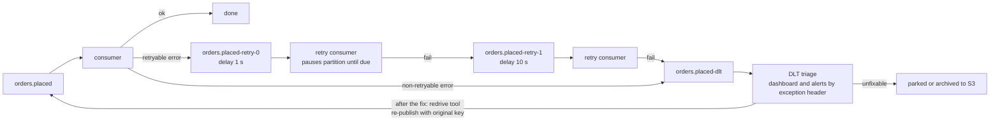

**Running a DLT in production:**
- **Alert on the DLT, not on errors.** DLT growth (records/minute and age of the oldest record) is a page. One stack trace in the logs is not.
- **Group by `kafka_dlt-exception-cause-fqcn`** and the original topic. Most DLT incidents are one bug producing thousands of copies.
- **Redrive tool:** a small admin endpoint or job that reads the DLT from a chosen offset range, optionally filters by header, and re-publishes to the original topic **with the original key**, so ordering per key is restored for new events. The consumer must be idempotent, because some redriven records may have succeeded later through another path.
- **Ordering caveat:** redriving an old `OrderPlaced` after a newer `OrderCancelled` for the same key has already been processed is a business bug. Either use blocking retries for ordered flows (the lab), or make handlers check aggregate versions and drop stale events.
- **Retention:** keep the DLT longer than the main topic (for example 30 days), so an incident over a long weekend can still be redriven.
- **Poison-pill protection on the DLT consumer itself:** a DLT listener should never throw back into the DLT. Log, store, and commit.

**Who uses it:** Uber (blog above), Robinhood and DoorDash (similar retry and DLQ topologies), and every Spring Kafka user of `@RetryableTopic`. AWS SQS offers the same concept natively with `maxReceiveCount` and DLQ redrive (note 16).

---

## 8. Pitfalls & debugging checklist

- [ ] **Messages "disappear" in tests** → a second Spring context (different `@MockitoBean` or properties) or a leftover consumer is in the same group and owns the partitions → share one context (one base class), or use unique group ids per test.
- [ ] **A new consumer group sees nothing** → `auto.offset.reset=latest` (the default) and the group has no offsets yet → `earliest` for new groups, or seek explicitly.
- [ ] **The same records are processed again and again; log shows `CommitFailedException` or "consumer poll timeout has expired"** → processing a poll's records exceeded `max.poll.interval.ms` → lower `max.poll.records`, speed up processing, or raise the interval. Never block a listener on a slow HTTP call without a timeout.
- [ ] **One partition's lag grows while the others are at 0** → a poison record in blocking retries, or a hot key → check the error handler logs and the DLT. For a hot key, re-key (with care for ordering) or split the work.
- [ ] **`SerializationException` loop on startup, the listener never invoked** → no `ErrorHandlingDeserializer` → wrap the deserializer.
- [ ] **`IllegalArgumentException: The class '...' is not in the trusted packages`** → the type header names a class from another package → `spring.json.type.mapping` or `spring.json.trusted.packages`.
- [ ] **DLT publish logs "Destination resolver returned non-existent partition"** → the DLT topic is missing or has fewer partitions than the source → create `<topic>-dlt` with at least as many partitions. Check you used `-dlt`, not `.DLT`.
- [ ] **Duplicates in the database** → at-least-once delivery without an idempotent consumer → a processed-message table in the same transaction, or a natural-key upsert.
- [ ] **`No transaction is in process; possible solutions: run the template operation within the scope of a template.executeInTransaction()`** → `transaction-id-prefix` is set and you sent outside a transaction → wrap the send, set `spring.kafka.template.allow-non-transactional=true`, or remove the prefix.
- [ ] **`NotEnoughReplicasException`** → the ISR is smaller than `min.insync.replicas` with `acks=all` → a broker is down or lagging. Check under-replicated partitions.
- [ ] **Out-of-order events for one entity** → no key or the wrong key, partitions were added, `@RetryableTopic` was used for an ordered flow, or the listener hands work to a thread pool → key by the entity id and use blocking retries.
- [ ] **Constant rebalancing ("Attempt to heartbeat failed since group is rebalancing")** → slow processing, frequent deploys with eager assignment, or too-short session timeouts → cooperative-sticky or `group.protocol=consumer`, static membership, and fix the slow listener.
- [ ] **The outbox table grows without limit** → the relay is down or failing (check its logs), or sent rows are never cleaned up → alert on the oldest unsent `created_at`, and archive or delete sent rows on a schedule.
- [ ] **`KafkaTemplate.send()` hangs for 60 s** → the topic does not exist and auto-creation is off, or the broker is unreachable (`max.block.ms`) → check `bootstrap-servers`, topic existence, and `advertised.listeners` (the classic Docker networking issue).

**Debugging tools:** `kafka-consumer-groups.sh --bootstrap-server localhost:9092 --describe --group inventory` (lag per partition and owner), `kafka-console-consumer.sh --topic orders.placed-dlt --from-beginning --property print.headers=true`, `kafka-get-offsets.sh`, `logging.level.org.springframework.kafka=DEBUG`, `spring.kafka.listener.log-container-config=true`, and the Kafka UI (kafbat/kafka-ui) or Redpanda Console.

---

## 9. Interview questions

<details><summary>Q1. How does Kafka differ from a traditional message queue like RabbitMQ?</summary>

Kafka is a **distributed, partitioned, replicated log**. Records are appended and kept for a retention period (or compacted by key), whatever has been read. Consumers *pull* and track their own **offsets**, so any number of consumer groups read the same data independently and can **replay** it. RabbitMQ is a **smart broker**: exchanges route messages to queues, the broker pushes them to consumers, and it deletes a message once it is acked. Rabbit offers per-message features (priorities, TTL, delayed delivery, rich routing). Kafka offers throughput, retention, replay, and per-partition ordering at scale. Choose Kafka for event streaming, CDC, and fan-out to many consumers. Choose RabbitMQ (or SQS) for task queues and complex routing.
</details>

<details><summary>Q2. What is a partition, and how does Kafka decide which partition a record goes to?</summary>

A partition is an ordered, append-only log, and the unit of parallelism, ordering, and replication. With a key, the default partitioner computes `toPositive(murmur2(keyBytes)) % numPartitions`, so the same key always goes to the same partition while the partition count is unchanged. The lab test recomputes this and matches the broker's answer. With a null key, Kafka 3.3+ uses a sticky partitioner: it fills a batch for one partition, then switches. Adding partitions changes the modulus and remaps keys, which breaks per-key ordering across the change.
</details>

<details><summary>Q3. Explain the ISR, the high watermark and `min.insync.replicas`.</summary>

Each partition has a leader and followers. The **ISR** is the set of replicas caught up with the leader (within `replica.lag.time.max.ms`). The **high watermark** is the highest offset replicated to all ISR members, and consumers can only read up to it. With `acks=all`, the leader acknowledges a write only once the whole ISR has it, **and** the ISR has at least `min.insync.replicas` members. Otherwise the producer gets `NotEnoughReplicasException`. RF=3 with `min.insync.replicas=2` survives one broker failure with no data loss and no write outage. Leaders are only elected from the ISR unless `unclean.leader.election.enable=true`, which trades durability for availability.
</details>

<details><summary>Q4. What does `enable.idempotence` do, and what does it not do?</summary>

The broker assigns the producer a **PID** and an epoch, and every batch carries a per-partition **sequence number**. If a retry resends a batch whose ack was lost, the leader sees the duplicate sequence and drops it. A gap is rejected, which keeps ordering intact even with up to 5 in-flight requests. It has been on by default since Kafka 3.0, together with `acks=all`. It does **not** dedupe across producer restarts (a new PID), across two calls to `send()` by your code, or anything on the consumer side. End-to-end deduplication still needs transactions (Kafka to Kafka) or idempotent consumers.
</details>

<details><summary>Q5. At-most-once, at-least-once, exactly-once: how do you get each, and what does Kafka's EOS really cover?</summary>

**At-most-once**: commit the offset before processing, so a crash loses the record. **At-least-once**: process, then commit, so a crash reprocesses it. This is Spring's default (offsets are committed after the listener returns, per the `AckMode`). **Exactly-once (EOS)**: a transactional producer writes its outputs and `sendOffsetsToTransaction` in one Kafka transaction, and downstream readers use `read_committed`. EOS covers **only the Kafka-to-Kafka loop**. A database write, an HTTP call, or an email inside the listener is not rolled back when the Kafka transaction aborts. For external side effects you use at-least-once plus **idempotent consumers** (a processed-id table in the same DB transaction, or upserts), which gives "effectively once".
</details>

<details><summary>Q6. What is the transactional outbox pattern, and why not just call `kafkaTemplate.send()` after saving?</summary>

Saving and sending is a **dual write** across two systems with no shared transaction. A crash after the commit loses the event, and a send before a failed commit publishes a phantom event. The outbox writes the event into an `outbox` table **in the same local DB transaction** as the business change, so both commit or neither does. A relay (a `@Scheduled` poller with `FOR UPDATE SKIP LOCKED`, or Debezium CDC reading the WAL) publishes the rows to Kafka and marks them sent. Delivery is at-least-once, so consumers must be idempotent. The lab proves that a rollback leaves neither row, and that the relay plus the consumer reserve stock end to end.
</details>

<details><summary>Q7. How do you make a Kafka consumer idempotent?</summary>

Give every event a unique id (`eventId`). In the **same database transaction** as the side effect, insert that id into a `processed_message` table with a primary key. If the insert affects 0 rows (`INSERT ... ON CONFLICT DO NOTHING` in Postgres), it is a duplicate, so skip it. If the side effect fails, the transaction rolls back the marker too, and the redelivery is processed again. Don't catch a duplicate-key exception inside the transaction, because Postgres aborts the whole transaction after a failed statement. Alternatives are natural idempotency (upsert by business key, or `UPDATE ... WHERE version = n`) or storing consumer offsets in the same DB.
</details>

<details><summary>Q8. What happens during a consumer group rebalance, and how do you minimize its impact?</summary>

When members join or leave, or partitions change, the group reassigns partitions. With the classic **eager** protocol, every member revokes all its partitions and processing stops group-wide until the new assignment. **Cooperative sticky** revokes only the partitions that move, over two rounds. **KIP-848** (`group.protocol=consumer`, GA in Kafka 4.0, opt-in) moves assignment to the broker and makes it fully incremental. Other ways to reduce impact: **static membership** (`group.instance.id`) so restarts within `session.timeout.ms` don't rebalance, keeping processing well within `max.poll.interval.ms`, and committing offsets in `onPartitionsRevoked`. Spring's container already commits pending offsets on revocation (unverified).
</details>

<details><summary>Q9. `session.timeout.ms` vs `max.poll.interval.ms`: what is the difference?</summary>

`session.timeout.ms` (45 s) is liveness. A background heartbeat thread proves the **process** is alive. `max.poll.interval.ms` (5 min) is progress. If your code does not call `poll()` again within it, because processing one batch of up to `max.poll.records` (500) took too long, the consumer proactively leaves the group even though it is alive. Its partitions go to someone else, its commit fails with `CommitFailedException`, and the records are processed twice. Fix it by processing faster, lowering `max.poll.records`, or raising the interval. Also keep `DefaultErrorHandler` back-offs short, because they block the poll loop.
</details>

<details><summary>Q10. `DefaultErrorHandler` vs `@RetryableTopic`: when do you use which?</summary>

`DefaultErrorHandler` retries **in place (blocking)**. It re-seeks the failed record, sleeps per the `BackOff`, and after the retries calls a recoverer such as `DeadLetterPublishingRecoverer`, which publishes to `<topic>-dlt` on the same partition. Not-retryable exceptions (deserialization errors, your business rejections) go straight to the recoverer. It **preserves per-key order**, but it blocks the partition, so back-offs must be short. `@RetryableTopic` retries **non-blocking**: the failed record is re-published to retry topics with growing delays while the main partition keeps flowing, and ends in a `-dlt` topic handled by a `@DltHandler`. It suits independent events with slow dependencies, but **breaks ordering**. The lab uses `DefaultErrorHandler`, because order events must stay ordered.
</details>

<details><summary>Q11. What does `ConcurrentKafkaListenerContainerFactory` create, and what does `concurrency` actually mean?</summary>

For each `@KafkaListener`, the factory creates a `ConcurrentMessageListenerContainer`. That container creates `concurrency` child `KafkaMessageListenerContainer`s. Each child owns one `KafkaConsumer` and one thread, which polls and invokes your listener. All children are in the same group, so Kafka splits the partitions between them. Concurrency is capped by the partition count: with 3 partitions and concurrency 5, two children are idle. The lab test shows 3 children with exactly 1 partition each. Containers are registered in `KafkaListenerEndpointRegistry` (a `SmartLifecycle`), which starts them late in the context refresh and lets you pause, resume, or stop them by id.
</details>

<details><summary>Q12. How does Kafka guarantee ordering, and how can you accidentally lose it?</summary>

Ordering is guaranteed **only within a partition**. Use the entity id as the key, so all of its events go to one partition and are consumed by one thread. You lose ordering by: using no key or a random key, adding partitions (keys remap), disabling idempotence with retries and more than one in-flight request, using `@RetryableTopic` (a retried record is overtaken), handing records to a thread pool inside the listener, or redriving old DLT records after newer events were processed. Consumers that must be robust anyway should check an aggregate version and drop stale events.
</details>

<details><summary>Q13. What is log compaction, and when would you use a compacted topic?</summary>

With `cleanup.policy=compact`, Kafka keeps at least the **latest value per key** and a background cleaner removes older ones. A null value is a **tombstone** that deletes the key after `delete.retention.ms`. Offsets are preserved (with gaps). Use it for "current state" topics: entity snapshots, configuration, a KTable changelog, `__consumer_offsets` itself, or a lookup table that new services bootstrap from by reading from the beginning. Pair it with an infinite-retention event topic when you need the full history (event sourcing or audit).
</details>

<details><summary>Q14. How do you evolve event schemas without breaking consumers?</summary>

Use a schema format with evolution rules (Avro or Protobuf) and a **Schema Registry**. The producer registers the schema and sends a schema id with each record. The consumer fetches the writer's schema and resolves it against its own. The registry enforces a **compatibility mode** per subject. `BACKWARD` (the default) means new readers can read old data: delete fields or add fields with defaults, and upgrade consumers first. `FORWARD` means old readers can read new data: add fields, and upgrade producers first. `FULL` means both. `*_TRANSITIVE` checks all past versions. With JSON (like the lab), you rely on discipline: only add optional fields, never rename or change types, use tolerant readers (ignore unknown properties), and run contract tests.
</details>

<details><summary>Q15. What changed for Kafka in Spring Boot 4 / Spring Kafka 4?</summary>

Spring Kafka 4.x is built on the Apache Kafka 4 clients (Boot 4.1.2 ships Spring Kafka 4.1.2 and kafka-clients 4.2.2). **ZooKeeper support is removed** (`EmbeddedKafkaZKBroker` is gone, KRaft only). **Jackson 3** classes replace the Jackson 2 ones, which are deprecated: `JacksonJsonSerializer`/`Deserializer`, `JacksonJsonMessageConverter`, and `JsonKafkaHeaderMapper`. **Spring Retry was replaced by Framework 7's core retry**, so `@RetryableTopic` uses `@BackOff` instead of `@Backoff`, and Boot's `spring.kafka.retry.topic.backoff.random` became `...jitter`. The **KIP-848** rebalance protocol and **share consumers** (Kafka Queues) are supported. 4.1 adds a per-listener `ackMode`. Boot moved Kafka into the `spring-boot-kafka` module with `spring-boot-starter-kafka` and `-kafka-test`. Testcontainers 2 uses `testcontainers-kafka` with `org.testcontainers.kafka.KafkaContainer` (for example on `apache/kafka-native`) and `@ServiceConnection`.
</details>

---

## 10. Sources

- Spring for Apache Kafka reference: [What's new in 4.1](https://docs.spring.io/spring-kafka/reference/whats-new.html), [What's new in 4.0](https://docs.spring.io/spring-kafka/reference/4.0/whats-new.html), [Handling exceptions, DefaultErrorHandler and DeadLetterPublishingRecoverer](https://docs.spring.io/spring-kafka/reference/kafka/annotation-error-handling.html), [Non-blocking retries](https://docs.spring.io/spring-kafka/reference/retrytopic.html), [Transactions](https://docs.spring.io/spring-kafka/reference/kafka/transactions.html), [Observation](https://docs.spring.io/spring-kafka/reference/kafka/micrometer.html)
- Spring Boot: [Messaging: Apache Kafka support](https://docs.spring.io/spring-boot/reference/messaging/kafka.html), [Testcontainers service connections](https://docs.spring.io/spring-boot/reference/testing/testcontainers.html), [Spring Boot 4.0 Migration Guide](https://github.com/spring-projects/spring-boot/wiki/Spring-Boot-4.0-Migration-Guide)
- Apache Kafka: [Documentation (design, replication, compaction, configs)](https://kafka.apache.org/documentation/), [Apache Kafka 4.0.0 release announcement](https://kafka.apache.org/blog/2025/03/18/apache-kafka-4.0.0-release-announcement/), [KIP-848](https://cwiki.apache.org/confluence/display/KAFKA/KIP-848%3A+The+Next+Generation+of+the+Consumer+Rebalance+Protocol), [KIP-932](https://cwiki.apache.org/confluence/display/KAFKA/KIP-932%3A+Queues+for+Kafka), [KIP-1030](https://cwiki.apache.org/confluence/display/KAFKA/KIP-1030%3A+Change+constraints+and+default+values+for+various+configurations)
- Testcontainers: [Kafka module](https://java.testcontainers.org/modules/kafka/)
- Debezium: [Outbox Event Router](https://debezium.io/documentation/reference/stable/transformations/outbox-event-router.html)
- Confluent: [Schema evolution and compatibility](https://docs.confluent.io/platform/current/schema-registry/fundamentals/schema-evolution.html)
- Uber Engineering: [Building Reliable Reprocessing and Dead Letter Queues with Apache Kafka](https://www.uber.com/blog/reliable-reprocessing/)
- microservices.io: [Transactional outbox](https://microservices.io/patterns/data/transactional-outbox.html), [Saga](https://microservices.io/patterns/data/saga.html)
- Baeldung: [Intro to Apache Kafka with Spring](https://www.baeldung.com/spring-kafka) (3.x-era: `JsonSerializer`, Jackson 2), [Spring Kafka retryable topics](https://www.baeldung.com/spring-retry-kafka-consumer), [Dead letter queue with Spring Kafka](https://www.baeldung.com/kafka-spring-dead-letter-queue) (check the DLT name: it is now `-dlt`)
- Oracle / JDK docs: [`CompletableFuture`](https://docs.oracle.com/en/java/javase/21/docs/api/java.base/java/util/concurrent/CompletableFuture.html), [`java.time.Duration`](https://docs.oracle.com/en/java/javase/21/docs/api/java.base/java/time/Duration.html)
