# 12 — Async, Scheduling, Spring Batch & Virtual Threads

> **Lab:** [`labs/12-batch-csv-import`](https://github.com/sumit-mishra-itp/springboot-roadmap/tree/main/labs/12-batch-csv-import)
> **Capstone use:** the nightly settlement/statement import (Spring Batch, restartable), the clustered schedulers that trigger it (ShedLock), `@Async` order-confirmation emails, and the report endpoint that fans out to several downstream services on virtual threads.
> **Prereqs:** [01 Spring Core](../01-core/spring-core.md) (`BeanPostProcessor`, events), [02 AOP](../02-aop/spring-aop.md) (proxies, self-invocation), [06 JPA](../06-data-jpa/jpa-hibernate.md) (transactions are thread-bound), basic `java.util.concurrent`.

---

## 1. What & why

This note covers four tools for running work **outside the request thread**. People confuse them all the time, so the first job is to keep them apart:

| Tool | Answers the question | Unit of work | Survives a crash? |
|---|---|---|---|
| **`@Async`** | "Do this *now*, but don't make the caller wait" | One method call on another thread | **No.** A queued task is lost on restart |
| **`@Scheduled`** | "Do this *at a time* or *every N*" | One method call, triggered by a clock | Nothing to survive: the next tick just runs again |
| **Spring Batch** | "Process *millions of records* reliably, and pick up where you stopped if it dies" | A Job of Steps of chunks, with state in a DB | **Yes.** That is the whole point |
| **Virtual threads** | "Block on I/O cheaply, with thousands of concurrent tasks" | Any `Runnable` | Not a reliability tool. It is a cheaper *thread* |

**Before Spring had these:**

| Era | How it was done | Pain |
|---|---|---|
| Raw threads | `new Thread(() -> sendEmail()).start()` in a servlet | Unbounded threads, no pooling, nothing shut them down on redeploy, and exceptions vanished |
| `ExecutorService` by hand | A static pool per class | Every team rolled its own sizing and shutdown, with no MDC or security context propagation |
| `java.util.Timer` / cron + shell scripts | `crontab` calling `java -jar import.jar` | No retry, no restart point, no visibility into "how far did last night's run get?" |
| EJB timers / Quartz | Heavy XML and a separate scheduler schema | Powerful but heavyweight for "every 5 minutes" |
| Hand-written ETL loops | `while (rs.next()) { ... commit every 1000 }` | Hand-rolled commit intervals, restart bookkeeping and skip logic, and each copy had different bugs |

**When *not* to use them:**
- **Don't use `@Async` for anything that must not be lost**, like "charge the card" or "send the payment instruction". A JVM restart drops the in-memory queue. Use a transactional outbox plus a broker (note 11), or a Batch/persistent job.
- **Don't use `@Scheduled` in a horizontally scaled app without a lock.** Every pod fires (section 7.2).
- **Don't use Spring Batch for low-latency, per-event work.** A Kafka consumer reacts in milliseconds, while a batch reacts at the next window (section 7.4).
- **Don't use virtual threads for CPU-bound work.** They don't add cores. Use a bounded platform pool or a `ForkJoinPool`.

---

## 2. Mental model

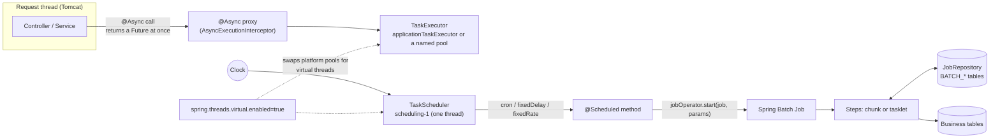

- **`@Async` and `@Scheduled` are both "a proxy or post-processor plus an executor".** The annotation only says *what*. The executor bean says *on which threads*, and that's where all the tuning lives.
- **Spring Batch is a state machine persisted in a database.** Every chunk commits business data *and* the step's progress (the read count, the ExecutionContext) in the same transaction. That's why it can restart exactly at the last committed chunk.
- **Virtual threads change the executor, not the programming model.** You keep writing blocking code, and the JVM parks the virtual thread instead of an OS thread while it waits on I/O.

---

## 3. How it works internally

### 3.1 `@Async`: from annotation to another thread

`@EnableAsync` imports `ProxyAsyncConfiguration`, which registers **`AsyncAnnotationBeanPostProcessor`**. In `postProcessAfterInitialization` (the same moment AOP proxies are created, see note 01 §3.3) it wraps every bean that has an `@Async` method in a proxy. The proxy's advice is an **`AnnotationAsyncExecutionInterceptor`**.

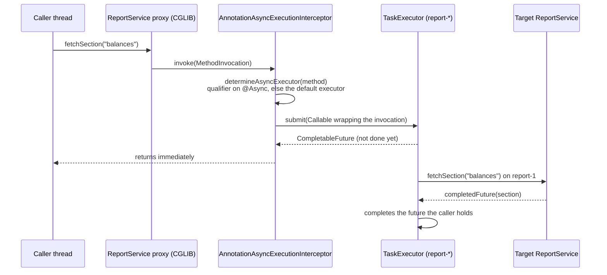

**Executor resolution order** (`AsyncExecutionAspectSupport.determineAsyncExecutor`):

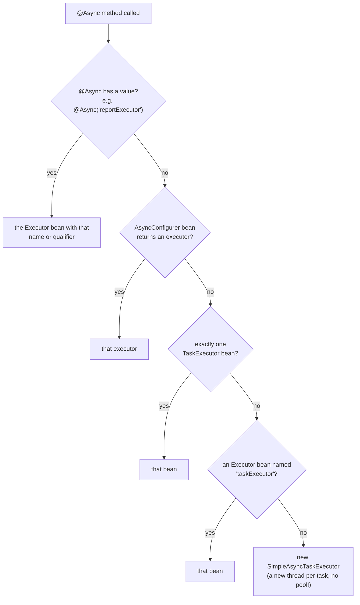

Spring Boot plugs into this chain. It auto-configures **`applicationTaskExecutor`**, and (as seen in the Boot 4.1.2 jar) also wraps any user `AsyncConfigurer` so that its `null` executor falls back to `applicationTaskExecutor`. That wrapper is `TaskExecutorConfigurations.AsyncConfigurerWrapperConfiguration`, a `BeanPostProcessor`. The lab's `AsyncConfig` relies on it: it overrides only the exception handler, and plain `@Async` still lands on Boot's pool (proven by `AsyncTest`).

**Return types:**

| Return type | Caller gets | Exceptions go to |
|---|---|---|
| `void` | nothing | The **`AsyncUncaughtExceptionHandler`**. The default, `SimpleAsyncUncaughtExceptionHandler`, only *logs*. Lab: `voidAsyncFailure_goesToTheAsyncUncaughtExceptionHandler` |
| `Future<T>` / `CompletableFuture<T>` | A future that completes when the method finishes | The future (`get()` throws `ExecutionException`, `join()` throws `CompletionException`) |
| `ListenableFuture<T>` | Removed in Framework 7. Use `CompletableFuture` | |
| Any other type, e.g. `String` | **`null`**. The real value is discarded | |

Return `CompletableFuture.completedFuture(value)` from the method body. The proxy hands the caller its *own* future and completes it with yours.

**What does NOT cross the thread boundary:**
- **Transactions.** `TransactionSynchronizationManager` is `ThreadLocal`-based. The async method runs outside the caller's transaction, and if it's `@Transactional` itself it starts a *new* one. It can't see the caller's uncommitted rows, a classic bug: "the async email can't find the order". Fix it with `@TransactionalEventListener(AFTER_COMMIT)` + `@Async`, or publish after commit.
- **`SecurityContext`.** `SecurityContextHolder` uses a `ThreadLocal` strategy by default. Wrap the executor with Spring Security's `DelegatingSecurityContextAsyncTaskExecutor`, or use a `TaskDecorator` that calls `DelegatingSecurityContextRunnable.wrap(...)`.
- **MDC / tracing context.** Use a `TaskDecorator` (§3.3), or Boot's `spring.task.execution.propagate-context=true`, which registers Framework's `ContextPropagatingTaskDecorator` (Micrometer context-propagation) for observation and tracing context.
- **`RequestContextHolder` / request-scoped beans.** The request may be finished by the time the task runs. Copy the values you need into method arguments.

**The self-invocation trap.** `this.currentExecution()` inside the same bean calls the raw target, not the proxy, so it runs **synchronously on the caller thread** (lab: `selfInvocation_bypassesTheProxy_andRunsOnTheCallerThread`). The fixes are the same as for `@Transactional` (note 02): move the method to another bean, or inject `ObjectProvider<Self>`. `@Async` on a `private` method also does nothing.

### 3.2 Boot's task execution and scheduling auto-configuration

`TaskExecutionAutoConfiguration` and `TaskSchedulingAutoConfiguration` (package `org.springframework.boot.autoconfigure.task`):

| | Executor (`applicationTaskExecutor`) | Scheduler (`taskScheduler`) |
|---|---|---|
| Default type | `ThreadPoolTaskExecutor` | `ThreadPoolTaskScheduler` |
| With virtual threads | `SimpleAsyncTaskExecutor` with virtual threads | `SimpleAsyncTaskScheduler` with virtual threads |
| Default size | **8 core threads**, keep-alive 60 s, core threads may time out | **1 thread** |
| Default queue | Unbounded, so `max-size` is ignored | n/a |
| Thread names | `task-` | `scheduling-` |
| Builder you can reuse | `ThreadPoolTaskExecutorBuilder` / `SimpleAsyncTaskExecutorBuilder` | `ThreadPoolTaskSchedulerBuilder` / `SimpleAsyncTaskSchedulerBuilder` |
| Backs off when | You define **any `Executor` bean**, unless `spring.task.execution.mode=force` | You define a `TaskScheduler` / `ScheduledExecutorService` bean |

Properties worth knowing (`spring.task.*`, verified against the Boot 4.1.2 metadata):

```properties
spring.task.execution.mode=auto|force                # force: keep applicationTaskExecutor even if you declare your own Executor
spring.task.execution.pool.core-size=8
spring.task.execution.pool.max-size=                 # ignored while the queue is unbounded
spring.task.execution.pool.queue-capacity=           # unbounded by default
spring.task.execution.pool.keep-alive=60s
spring.task.execution.pool.allow-core-thread-timeout=true
spring.task.execution.pool.shutdown.accept-tasks-after-context-close=false
spring.task.execution.shutdown.await-termination=false
spring.task.execution.shutdown.await-termination-period=
spring.task.execution.thread-name-prefix=task-
spring.task.execution.propagate-context=false         # ContextPropagatingTaskDecorator
spring.task.execution.simple.concurrency-limit=       # for the virtual-thread SimpleAsyncTaskExecutor
spring.task.execution.simple.reject-tasks-when-limit-reached=
spring.task.scheduling.pool.size=1
spring.task.scheduling.thread-name-prefix=scheduling-
spring.task.scheduling.simple.concurrency-limit=
spring.threads.virtual.enabled=false
spring.main.keep-alive=false                          # virtual threads are daemon threads, see 3.5
```

**`mode=force`** (Boot docs): the auto-configured executor "will be used automatically for all integrations, even if a custom Executor bean is registered, including those marked as `@Primary`". It is also used for plain `@EnableAsync` work, and then "the only way to override the Executor for regular tasks is by registering an `AsyncConfigurer` bean". The lab needs this: it declares its own `reportExecutor`, and without `force` Boot's executor would back off, so `spring.threads.virtual.enabled` would no longer affect `@Async`.

Boot's executor also serves **Spring MVC async request processing** (`Callable`), WebFlux blocking calls, WebSocket channels, GraphQL `Callable`s, the JPA bootstrap executor, and background bean initialization. That is one more reason not to let it back off silently.

### 3.3 `TaskDecorator`: carrying `ThreadLocal`s across threads

A `TaskDecorator` wraps every `Runnable` *at submission time*. `decorate()` runs **on the caller thread**, so that's where you snapshot context. The returned `Runnable` runs on the worker.

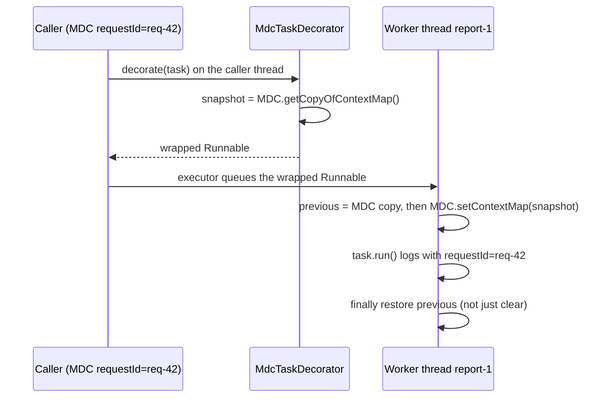

- **Boot auto-applies `TaskDecorator` beans** to the auto-configured executor and scheduler. Since Boot 4.0, several beans are combined into a `CompositeTaskDecorator`, ordered by `@Order`. The lab proves the single-bean case on both the platform pool and virtual threads.
- **Your own `ThreadPoolTaskExecutor` gets nothing automatically.** Call `setTaskDecorator(...)` yourself, or build it from Boot's `ThreadPoolTaskExecutorBuilder`, which carries the decorator and the `spring.task.execution.*` defaults.
- **Restore, don't clear.** With `CallerRunsPolicy`, the "worker" can be the caller itself, and `MDC.clear()` in `finally` would wipe the caller's context.
- `MdcTaskDecoratorTest` proves the core claim: on a pool thread the MDC is **null without the decorator** and present with it, and the reused thread is clean again afterwards.

### 3.4 `@Scheduled`: triggers, threads and overlap

`@EnableScheduling` registers **`ScheduledAnnotationBeanPostProcessor`**. After the context refreshes, it hands each annotated method to a `ScheduledTaskRegistrar` as a `CronTask`, `FixedDelayTask` or `FixedRateTask`, and they all run on **one `TaskScheduler`**.

**Spring cron has 6 fields**, with seconds first. Unix cron has 5.

```text
 ┌──────────── second (0-59)
 │ ┌────────── minute (0-59)
 │ │ ┌──────── hour (0-23)
 │ │ │ ┌────── day of month (1-31)
 │ │ │ │ ┌──── month (1-12 or JAN-DEC)
 │ │ │ │ │ ┌── day of week (0-7 or MON-SUN, 0 and 7 are Sunday)
 0 0 2 * * *        every day at 02:00:00
```

- Special characters: `*`, `?`, `,`, `-` (range), `/` (step), `L` (last day of month or week), `nW` (nearest weekday), `LW`, and `d#n` (the n-th weekday of the month, e.g. `MON#1`).
- Macros: `@yearly`, `@monthly`, `@weekly`, `@daily`/`@midnight`, `@hourly`.
- `zone = "Europe/London"` resolves the cron in that time zone. Without it the server's default zone is used, which is a DST trap.
- `cron = "-"` (`Scheduled.CRON_DISABLED`) **disables** the trigger. `@Scheduled(cron = "${job.cron:-}")` lets you switch a job off per environment.
- `CronSyntaxTest` proves the 6-field format, the rejection of 5-field cron, `@daily`, `L`, `MON-FRI`, `MON#1` and `"-"`.

**fixedDelay vs fixedRate:**

| | `fixedDelay = 5000` | `fixedRate = 5000` |
|---|---|---|
| Interval measured | From the **end** of the previous run to the next **start** | From **start** to **start** |
| A run takes longer than the interval | The next run is still 5 s after the end | On `ThreadPoolTaskScheduler`, whatever its pool size, the next run is **late, not concurrent**. It starts as soon as the previous run ends. On the virtual-thread `SimpleAsyncTaskScheduler` it **overlaps** |
| Use for | Polling an inbox or a queue: "rest between runs" | Heartbeats and metrics: "N times per minute" |

`initialDelay` delays the first run, and `timeUnit` defaults to milliseconds. `fixedDelayString = "PT1M"` accepts ISO-8601 durations and `${...}` placeholders.

**The single-thread default bites twice:**
1. A slow job blocks *every other* `@Scheduled` method in the app. The lab's `ImportSchedulerTest` shows cron and fixedDelay both running on `scheduling-1`, and a 50 ms `fixedRate` task that takes 200 ms never overlaps itself (the starts are about 200 ms apart).
2. To run *different* triggers in parallel, raise `spring.task.scheduling.pool.size`. One `fixedRate` task still never overlaps **itself**: `ScheduledThreadPoolExecutor.scheduleAtFixedRate` runs late executions late, never concurrently. The lab proves this with a pool of 4. A task overlaps itself only when every tick gets a fresh thread, either with `@Async` on the scheduled method or on the virtual-thread `SimpleAsyncTaskScheduler`, which the lab also proves (`maxConcurrent > 1`).

With virtual threads, `SimpleAsyncTaskScheduler` uses "a single scheduler thread but firing up a new thread for every scheduled task execution (except for fixed-delay tasks which all operate on a single scheduler thread)" (Framework reference). The Framework recommends fixed rates and cron triggers in that mode.

`@Scheduled` methods must be `void` and take no arguments. They may also return a reactive `Publisher` or be Kotlin `suspend` functions. An exception from a repeating task is **logged and swallowed**, and the next tick runs anyway.

**Clustered duplicates.** Three pods means three schedulers, so the nightly import runs three times. There are three ways to fix it:
- **ShedLock**: a lock row per task in a shared DB, Redis or Mongo (section 7.2).
- **A DB advisory lock** you take yourself (`pg_try_advisory_lock`).
- **Quartz in clustered mode**: a JDBC job store where one node fires each trigger, with misfire handling and persistence.

Or run the job outside the app entirely: a Kubernetes `CronJob`.

### 3.5 Virtual threads in Boot

A **virtual thread** (JEP 444, final in Java 21) is a `Thread` scheduled by the JVM onto a small pool of *carrier* platform threads. When it blocks on I/O, the JVM unmounts it, and the carrier runs another one. Creating one costs about as much as an object, not 1 MB of stack and an OS thread.

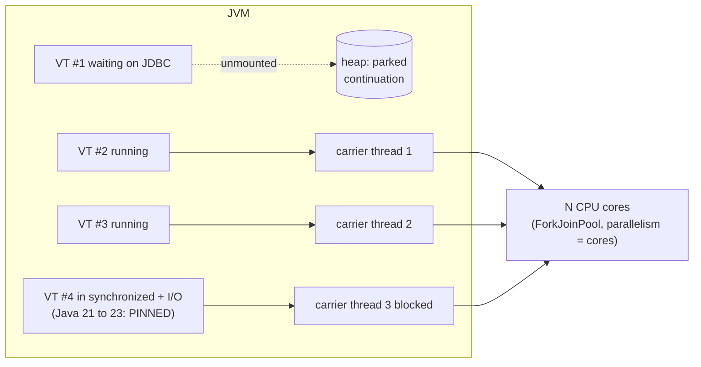

**What `spring.threads.virtual.enabled=true` switches** (Java 21+):
- `applicationTaskExecutor` becomes a `SimpleAsyncTaskExecutor` that uses virtual threads. **Pool properties no longer apply**, and `spring.task.execution.simple.concurrency-limit` is the only throttle. Proven by `AsyncTest` (`isVirtual()` is true).
- The scheduler becomes a `SimpleAsyncTaskScheduler` on virtual threads.
- The embedded web server's request threads (Tomcat, Jetty) and the messaging listener containers that Boot configures also switch (from the Boot 3.2 release notes, unverified here).
- Boot 4.0: auto-configured JDK `HttpClient`-based HTTP clients use virtual threads.
- **It does NOT touch executors you build yourself.** `AsyncTest` proves that the lab's `reportExecutor` stays on platform threads with the flag on.

**Pinning** is when a virtual thread can't unmount, so it holds its carrier while it blocks:
- **Java 21–23:** blocking inside a `synchronized` block or method, or in `Object.wait()`, pins. Pinning plus slow I/O plus few carriers can starve the whole app. Older JDBC drivers, connection pools and logging appenders used `synchronized` heavily. Find pinning with the JFR event `jdk.VirtualThreadPinned`.
- **Java 24+:** [JEP 491](https://openjdk.org/jeps/491) lets virtual threads unmount inside `synchronized` and `Object.wait()`. Native and foreign calls still pin (unverified detail). Boot.s docs reportedly strongly recommend **Java 24 or later** for virtual threads, although 21 is the minimum (unverified wording).

**Virtual threads are daemon threads.** An app whose only non-daemon work was a scheduler pool (no web server) can exit right after startup. Set `spring.main.keep-alive=true`.

**When not to use them:**
- **CPU-bound work** (hashing, image resizing, big in-memory sorts). There are only as many carriers as cores, so this adds scheduling overhead for nothing.
- **Code that relies on a pool as a throttle.** With a pool of 10, a downstream sees at most 10 calls. With virtual threads it can see 10,000. Protect the downstream with a semaphore, `@ConcurrencyLimit` (Framework 7) or a bulkhead. The DB connection pool becomes the real limit, and threads now queue on `HikariPool.getConnection()`.
- **Heavy `ThreadLocal` caches** (one per thread times a million threads). Prefer `ScopedValue`.
- **Java 21–23 with `synchronized` around blocking I/O** in hot paths.

### 3.6 Spring Batch architecture

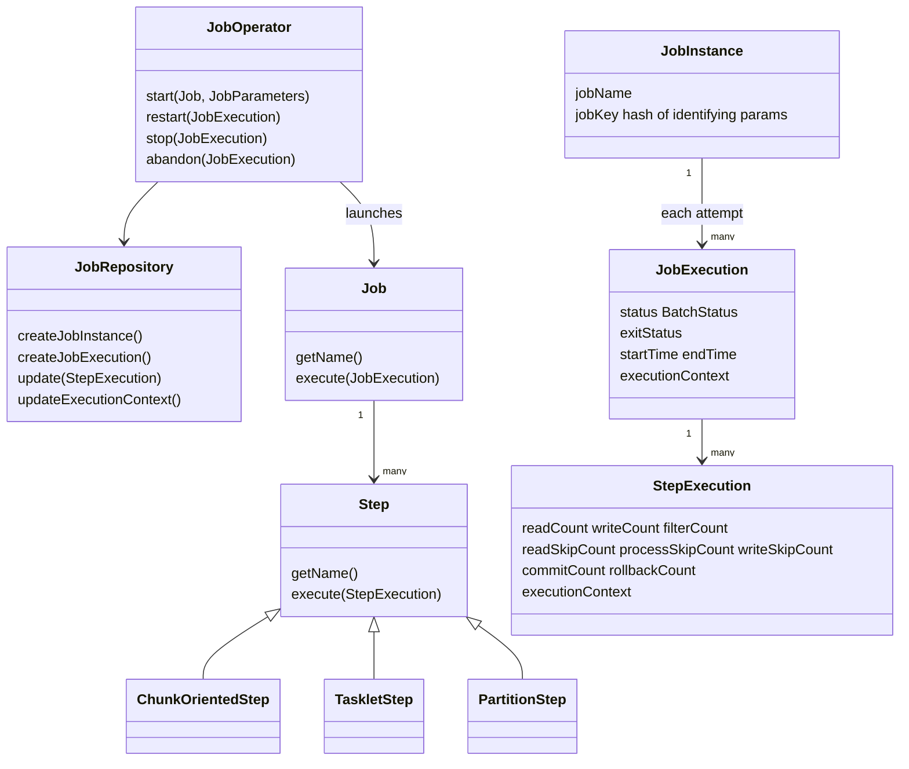

**The vocabulary** that interviews probe:

| Term | Meaning | Example |
|---|---|---|
| `Job` | The definition: an ordered flow of steps | `transactionImportJob` |
| `JobParameters` | The inputs. **Identifying** ones define *which* instance this is, non-identifying ones are informational | `input.files`, `run.id` (identifying). `trigger`, `chaos.crash-on-id` (non-identifying) |
| `JobInstance` | Job name + hash of the identifying parameters (`BATCH_JOB_INSTANCE.JOB_KEY`). A *logical run*: "the import of 2026-11-17" | One row per distinct parameter set |
| `JobExecution` | One *attempt* at a `JobInstance`. A failed instance gets a second execution on restart | `failed.getId() != restarted.getId()`, but the same instance (lab) |
| `StepExecution` | One attempt at one step inside a `JobExecution`, with all the counters | `importFileStep:partition0` |
| `ExecutionContext` | A persisted key/value map per step execution (and per job execution) | `transactionReader.read.count = 20` |
| `BatchStatus` vs `ExitStatus` | `BatchStatus` is the framework's lifecycle enum (`STARTING`, `STARTED`, `COMPLETED`, `FAILED`, `STOPPED`, `ABANDONED`...). `ExitStatus` is a free-text exit code you can customise and branch on | The listener returns `COMPLETED WITH SKIPS` |

**Rules that follow from this:**
- Launching with identifying parameters of a **COMPLETED** instance throws `JobInstanceAlreadyCompleteException`. That's why schedulers add a unique `run.id`.
- Launching with the identifying parameters of a **FAILED** or **STOPPED** instance **is a restart**. The lab's `restartResumesFromTheLastCommittedChunk_withoutDuplicates` does exactly this: same `input.files` and `run.id`, minus the non-identifying crash flag.
- On restart, steps that already COMPLETED are **skipped** (unless `allowStartIfComplete(true)`), and the failed step resumes from its last saved `ExecutionContext`.
- A running execution blocks a second start of the same instance (`JobExecutionAlreadyRunningException`).

### 3.7 The chunk loop, transactions and restart

A chunk-oriented step reads items one by one until it has `chunkSize` of them, processes each one, writes the whole chunk, and **commits once**. Each chunk transaction covers three things:
- the business writes;
- the updated `StepExecution` counters;
- the updated `ExecutionContext` (e.g. the reader's position).

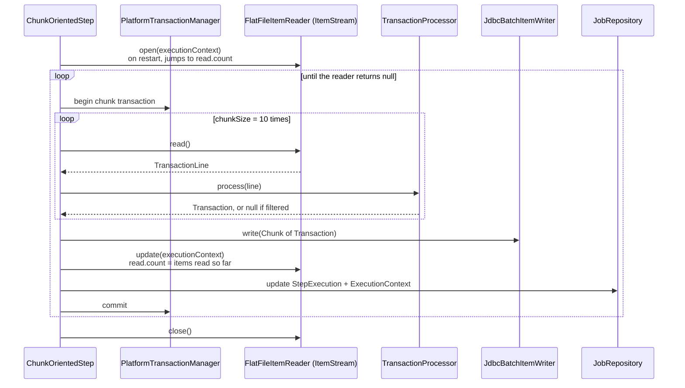

**Restart walkthrough** (exactly what the lab test does with 35 rows and a crash on item 25):

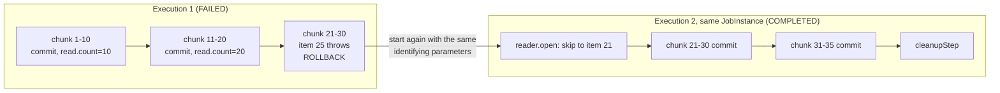

The lab asserts 20 committed rows from that file after run 1, then 35 distinct rows from it, a `readCount` of 15 on the resumed step, and the same `JobInstance` id. A second, clean file in the same run is a COMPLETED partition, and the restart does not run it again.

**Why restart is safe:** the business rows and `read.count = 20` were committed *atomically*. If the writer were non-transactional (a REST call, a file, a Kafka send), a crash between the write and the commit would replay those items on restart. Writers to non-transactional resources must be **idempotent**: an upsert, a natural-key unique constraint (the lab's PK on the bank's transaction id), or an idempotency key.

**What makes an `ItemReader` restartable:** it must implement `ItemStream` (`open`/`update`/`close`) and save its position in the `ExecutionContext`. `FlatFileItemReader` and `JdbcPagingItemReader` do. `JdbcCursorItemReader` saves a row count and re-skips that many rows. Readers need a unique `name` because their keys are prefixed with it. A reader declared as a `@StepScope` bean must return the **concrete type** (`FlatFileItemReader`, not `ItemReader`), or the scoped proxy hides `ItemStream` and Batch never calls `open()`.

### 3.8 Fault tolerance: filter, skip, retry

| Outcome | How you trigger it | Counter | Chunk rolled back? (Batch 6. Write skip is not exercised by the lab) |
|---|---|---|---|
| **Filter** | The processor returns `null` | `filterCount` | No. This is normal flow |
| **Read skip** | The reader throws a skippable exception (`FlatFileParseException`) | `readSkipCount` | No |
| **Process skip** | The processor throws a skippable exception | `processSkipCount` | **No**: `rollbackCount == 0` in `skipsUnreadableAndInvalidRows...` |
| **Write skip** | The writer throws a skippable exception. Batch must then find the bad item by re-writing one by one ("scanning") | `writeSkipCount` | Yes for the failed chunk write |
| **Retry** | A retryable exception (`TransientDataAccessException`) | none if it eventually succeeds | **No**: `rollbackCount == 0`, and the step took more than 900 ms because of the default 1 s back-off |
| **Skip limit exceeded** | The 11th skip with `skipLimit(10)` | | The step and job FAIL. Proven by `failsTheJob_whenTheSkipLimitIsExceeded` |
| **Fatal** | Any other exception | | The chunk rolls back and the step FAILS, so the job is restartable |

In **Batch 5** (`FaultTolerantChunkProcessor`), a process skip rolled the chunk back and **re-processed** the surviving items. That's why processors had to be idempotent and why `processorNonTransactional()` existed. Batch 6's new `ChunkOrientedStep` handles the skip or retry around the single item. The lab's `rollbackCount == 0` assertions document that difference. Keep processors side-effect free anyway, because write-skip scanning still replays items.

Batch 6 builds retry on **Framework 7's core retry** (`org.springframework.core.retry.RetryPolicy`), not the Spring Retry library. Use `.retry(Class...)` with `.retryLimit(n)`, or pass a full `RetryPolicy` with back-off via `.retryPolicy(...)`. Skip is built on `SkipPolicy`: `.skip(...)` with `.skipLimit(n)`, or a custom `.skipPolicy(...)`, e.g. "skip at most 1% of items".

### 3.9 Scaling a step

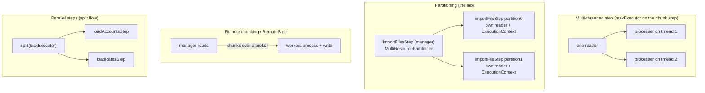

| Technique | How | Restartable? | Use when |
|---|---|---|---|
| **Multi-threaded step** | `.taskExecutor(...)` on the chunk step | Classic (Batch 5): **no**. Threads share one reader, so the saved count is meaningless and you set `saveState(false)`. Batch 6 docs say the new model keeps read and write on the main thread and runs the processor concurrently, behind a bounded queue (unverified in the lab) | The processor is the bottleneck (enrichment calls) and restart isn't critical |
| **Partitioning** (local) | `partitioner(name, Partitioner)` plus `.taskExecutor(...)`. Each partition is a full `StepExecution` | **Yes**, per partition. Completed partitions are not re-run (proven by the restart test) | Data splits naturally: per file, per ID range, per branch. **The lab's choice** |
| **Remote partitioning** | The same, but a `PartitionHandler` sends `StepExecution` IDs to worker JVMs over messaging. Workers share the JobRepository | Yes | One JVM isn't enough |
| **Remote chunking / Batch 6 `RemoteStep`** | The manager reads, workers process and write. Batch 6 also adds local chunking (`ChunkTaskExecutorItemWriter`) | Needs care: the manager tracks chunks | Processing and writing are expensive and reading is cheap |
| **Parallel steps** | `FlowBuilder.split(taskExecutor)` | Yes | Independent steps (load accounts *and* load FX rates) |

The lab uses partitioning because each worker owns its own `FlatFileItemReader` and `ExecutionContext`. Proof: logs show `importFileStep:partition0` and `:partition1` running on `partition-*` threads, and the restart test resumes the failed partition from item 21.

---

## 4. Full worked code

Everything below is in the lab and exercised by `./mvnw verify`: **24 tests, all green**.

### 4.1 Dependencies and properties

```xml
<dependency>
  <groupId>org.springframework.boot</groupId>
  <artifactId>spring-boot-starter-batch-jdbc</artifactId>   <!-- JDBC JobRepository. Plain -batch is in-memory/resourceless -->
</dependency>
<dependency><groupId>org.springframework.boot</groupId><artifactId>spring-boot-starter-flyway</artifactId></dependency>
<dependency><groupId>org.flywaydb</groupId><artifactId>flyway-database-postgresql</artifactId></dependency>
<dependency><groupId>org.postgresql</groupId><artifactId>postgresql</artifactId><scope>runtime</scope></dependency>
<!-- test: spring-boot-starter-batch-jdbc-test (brings spring-batch-test), spring-boot-testcontainers, testcontainers-postgresql -->
```

```properties
spring.batch.job.enabled=false                 # don't run the Job at startup, the scheduler launches it
spring.batch.jdbc.initialize-schema=never      # the default "embedded" never creates tables on Postgres. Flyway V1 does
spring.task.execution.mode=force               # keep applicationTaskExecutor despite our reportExecutor bean
spring.task.execution.thread-name-prefix=app-async-
spring.task.execution.pool.core-size=4
spring.task.execution.pool.max-size=16
spring.task.execution.pool.queue-capacity=200  # bounded, so max-size actually means something
spring.task.execution.shutdown.await-termination=true
spring.threads.virtual.enabled=false
importer.inbox=file:./inbox/*.csv
importer.schedule.cron=0 0 2 * * *
importer.schedule.zone=Europe/London
importer.schedule.inbox-poll=PT1M
```

### 4.2 The job: partitioned chunk step plus cleanup tasklet

```java
@Configuration(proxyBeanMethods = false)          // NO @EnableBatchProcessing: it would turn Boot's batch auto-config off
public class ImportJobConfig {

    @Bean
    Job transactionImportJob(JobRepository jobRepository, Step importFilesStep, Step cleanupStep) {
        return new JobBuilder("transactionImportJob", jobRepository)
                .start(importFilesStep).next(cleanupStep).build();
    }

    @Bean   // manager: one StepExecution per file
    Step importFilesStep(JobRepository jobRepository, Step importFileStep, MultiResourcePartitioner filePartitioner) {
        var partitionExecutor = new SimpleAsyncTaskExecutor("partition-");
        partitionExecutor.setConcurrencyLimit(4);
        return new StepBuilder("importFilesStep", jobRepository)
                .partitioner("importFileStep", filePartitioner)
                .step(importFileStep)
                .taskExecutor(partitionExecutor)
                .build();
    }

    @Bean   // worker: Batch 6 chunk(int) returns a ChunkOrientedStepBuilder
    Step importFileStep(JobRepository jobRepository, PlatformTransactionManager transactionManager,
                        FlatFileItemReader<TransactionLine> transactionReader, TransactionProcessor transactionProcessor,
                        JdbcBatchItemWriter<Transaction> transactionWriter) {
        return new StepBuilder("importFileStep", jobRepository)
                .<TransactionLine, Transaction>chunk(10)
                .transactionManager(transactionManager)
                .reader(transactionReader).processor(transactionProcessor).writer(transactionWriter)
                .faultTolerant()
                .skip(FlatFileParseException.class, InvalidTransactionException.class).skipLimit(10)
                .retry(TransientDataAccessException.class).retryLimit(3)
                .listener(new ImportStepListener())
                .build();
    }

    @Bean @JobScope
    MultiResourcePartitioner filePartitioner(@Value("#{jobParameters['input.files']}") String inputFiles) throws IOException {
        var partitioner = new MultiResourcePartitioner();          // puts "fileName" into each partition's context
        partitioner.setResources(RESOLVER.getResources(inputFiles));
        return partitioner;
    }

    @Bean @StepScope          // concrete return type, so the scoped proxy still exposes ItemStream
    FlatFileItemReader<TransactionLine> transactionReader(@Value("#{stepExecutionContext['fileName']}") Resource file) {
        return new FlatFileItemReaderBuilder<TransactionLine>()
                .name("transactionReader").resource(file).linesToSkip(1)
                .delimited().names("id", "accountId", "amount", "currency", "bookedOn")
                .targetType(TransactionLine.class)                    // records are mapped by constructor
                .build();
    }

    @Bean
    JdbcBatchItemWriter<Transaction> transactionWriter(DataSource dataSource) {
        return new JdbcBatchItemWriterBuilder<Transaction>()
                .dataSource(dataSource)
                .sql("INSERT INTO bank_transaction (id, account_id, amount, currency, booked_on) "
                   + "VALUES (:id, :accountId, :amount, :currency, :bookedOn)")
                .itemSqlParameterSourceProvider(SimplePropertySqlParameterSource::new)   // works with records
                .build();
    }

    @Bean
    Step cleanupStep(JobRepository jobRepository, PlatformTransactionManager tm, Tasklet deleteImportedFiles) {
        return new StepBuilder("cleanupStep", jobRepository).tasklet(deleteImportedFiles, tm).build();
    }

    @Bean @StepScope
    Tasklet deleteImportedFiles(@Value("#{jobParameters['input.files']}") String inputFiles) {
        return (contribution, chunkContext) -> {
            for (Resource file : RESOLVER.getResources(inputFiles)) Files.deleteIfExists(file.getFile().toPath());
            return RepeatStatus.FINISHED;
        };
    }
}
```

### 4.3 Processor (filter vs skip) and listener

```java
public class TransactionProcessor implements ItemProcessor<TransactionLine, Transaction> {
    private static final Set<String> SUPPORTED_CURRENCIES = Set.of("EUR", "GBP", "USD", "INR");

    @Override
    public Transaction process(TransactionLine line) {
        if (!SUPPORTED_CURRENCIES.contains(line.currency()))
            throw new InvalidTransactionException("unsupported currency " + line.currency());  // -> process SKIP
        BigDecimal amount = parseAmount(line);                                                // bad number -> SKIP
        if (amount.signum() == 0) return null;                                                // -> FILTER
        return new Transaction(line.id(), line.accountId(), amount, line.currency(), parseDate(line));
    }
}

public class ImportStepListener implements StepExecutionListener, SkipListener<TransactionLine, Transaction> {
    @Override
    public ExitStatus afterStep(StepExecution step) {
        log.info("{}: read={} written={} filtered={} skipped(read/process/write)={}/{}/{} commits={} rollbacks={}", ...);
        boolean completedWithSkips = step.getExitStatus().getExitCode().equals("COMPLETED") && step.getSkipCount() > 0;
        return completedWithSkips ? new ExitStatus("COMPLETED WITH SKIPS") : step.getExitStatus();
    }
    @Override public void onSkipInRead(Throwable t) { log.warn("skipped unreadable line: {}", t.getMessage()); }
    @Override public void onSkipInProcess(TransactionLine line, Throwable t) { log.warn("skipped {}: {}", line.id(), t.getMessage()); }
}
```

The listener instance is shared by every partition thread, so it is **stateless**. Registering it once with `.listener(...)` gets it both the step and the skip callbacks (the log shows the `onSkipIn*` warnings).

### 4.4 Scheduling the job

```java
@Component
@EnableScheduling
@ConditionalOnBooleanProperty("importer.schedule.enabled")   // tests switch it off
public class ImportScheduler {

    @Scheduled(cron = "${importer.schedule.cron}", zone = "${importer.schedule.zone}")
    public void nightlyImport() throws Exception { launch("cron"); }

    @Scheduled(fixedDelayString = "${importer.schedule.inbox-poll}")
    public void pollInbox() throws Exception { launch("inbox-poll"); }

    private void launch(String trigger) throws Exception {
        if (new PathMatchingResourcePatternResolver().getResources(inbox).length == 0) return;
        JobParameters params = new JobParametersBuilder()
                .addString("input.files", inbox)
                .addString("run.id", UUID.randomUUID().toString())   // identifying: a new JobInstance per run
                .addString("trigger", trigger, false)                // non-identifying
                .toJobParameters();
        jobOperator.start(transactionImportJob, params);             // Batch 6: JobOperator, not JobLauncher
    }
}
```

### 4.5 `@Async`, the custom pool, the decorator and composition

```java
@Configuration(proxyBeanMethods = false)
@EnableAsync
public class AsyncConfig {
    @Bean MdcTaskDecorator mdcTaskDecorator() { return new MdcTaskDecorator(); }   // Boot applies it to applicationTaskExecutor

    @Bean
    ThreadPoolTaskExecutor reportExecutor(MdcTaskDecorator mdcTaskDecorator) {
        var executor = new ThreadPoolTaskExecutor();
        executor.setThreadNamePrefix("report-");
        executor.setCorePoolSize(4);
        executor.setMaxPoolSize(8);
        executor.setQueueCapacity(50);
        executor.setRejectedExecutionHandler(new ThreadPoolExecutor.CallerRunsPolicy());
        executor.setTaskDecorator(mdcTaskDecorator);               // NOT automatic for your own executors
        executor.setWaitForTasksToCompleteOnShutdown(true);
        executor.setAwaitTerminationSeconds(30);
        return executor;
    }

    @Bean
    AsyncConfigurer asyncConfigurer(AsyncFailureHandler handler) {
        return new AsyncConfigurer() {                              // executor stays null, so Boot fills in applicationTaskExecutor
            @Override public AsyncUncaughtExceptionHandler getAsyncUncaughtExceptionHandler() { return handler; }
        };
    }
}

@Service
public class ReportService {
    @Async("reportExecutor")
    public CompletableFuture<Report.Section> fetchSection(String name) throws InterruptedException {
        Thread.sleep(100);                                          // a slow downstream call
        if (name.startsWith("broken")) throw new IllegalStateException("downstream for " + name + " is down");
        return CompletableFuture.completedFuture(new Report.Section(name, "data for " + name, ExecutionInfo.current()));
    }

    @Async public CompletableFuture<ExecutionInfo> currentExecution() { return completedFuture(ExecutionInfo.current()); }
    @Async public void audit(String event) { if (event.isBlank()) throw new IllegalArgumentException("blank"); }
    public CompletableFuture<ExecutionInfo> currentExecutionViaSelfCall() { return currentExecution(); }  // TRAP: synchronous
}

@Service
public class ReportGenerator {
    public Report generate(List<String> names) throws InterruptedException {
        List<CompletableFuture<Report.Section>> sections = new ArrayList<>();
        for (String name : names) {
            sections.add(reportService.fetchSection(name)
                    .orTimeout(2, TimeUnit.SECONDS)
                    .exceptionally(failure -> Report.Section.unavailable(name)));
        }
        return CompletableFuture.allOf(sections.toArray(CompletableFuture[]::new))
                .thenApply(done -> new Report(sections.stream().map(CompletableFuture::join).toList()))
                .join();                                            // sections run concurrently on distinct report-* threads (proven)
    }
}
```

**`CompletableFuture` composition cheat-sheet:**

| Need | Method |
|---|---|
| Transform the result | `thenApply(fn)` |
| Chain another async call that returns a future | `thenCompose(fn)` (flatMap, avoids a nested future of a future) |
| Combine two independent futures | `a.thenCombine(b, (x, y) -> ...)` |
| Wait for all / the first | `allOf(...)` (returns `Void`, so `join()` each one afterwards) / `anyOf(...)` |
| Fallback | `exceptionally(fn)`, `handle((value, error) -> ...)`, `exceptionallyCompose` (Java 12+) |
| Timeout | `orTimeout(d, unit)` fails with `TimeoutException`. `completeOnTimeout(value, d, unit)` substitutes a value |
| Choose the thread | the `...Async(fn, executor)` variants. Without an executor, `*Async` uses `ForkJoinPool.commonPool()`, which is a bad place for blocking I/O |

Non-async `thenApply` runs **on whichever thread completes the future**: the `report-*` worker, or the caller if the future is already done.

### 4.6 Tests (the shape of each proof)

```java
@SpringBootTest(properties = "importer.schedule.enabled=false")
@SpringBatchTest                                   // registers JobOperatorTestUtils + JobRepositoryTestUtils
@Import(TestcontainersConfiguration.class)         // postgres:16-alpine with @ServiceConnection
class ImportJobTest {
    @Test
    void restartResumesFromTheLastCommittedChunk_withoutDuplicates() throws Exception {
        writeCsv("statement.csv", validRows(1, 35));
        writeCsv("other-branch.csv", validRows(101, 12));   // a second, clean partition
        JobParametersBuilder identifying = params();       // getUniqueJobParameters() + input.files

        JobExecution failed = jobOperatorTestUtils.startJob(new JobParametersBuilder(identifying.toJobParameters())
                .addString("chaos.crash-on-id", "T0025", false).toJobParameters());
        assertThat(failed.getStatus()).isEqualTo(BatchStatus.FAILED);
        assertThat(rowCount()).isEqualTo(32);              // 20 from the crashed file + 12 from the clean one

        JobExecution restarted = jobOperatorTestUtils.startJob(identifying.toJobParameters());
        assertThat(restarted.getJobInstance().getId()).isEqualTo(failed.getJobInstance().getId());
        assertThat(workerSteps(restarted)).hasSize(1);      // the COMPLETED partition is not re-run
        assertThat(workerSteps(restarted).getFirst().getReadCount()).isEqualTo(15);
        assertThat(rowCount()).isEqualTo(47);
    }
}

// No database needed: Boot's real auto-configuration in a millisecond context
new ApplicationContextRunner()
        .withConfiguration(AutoConfigurations.of(TaskExecutionAutoConfiguration.class))
        .withUserConfiguration(AsyncConfig.class, ReportService.class, ReportGenerator.class)
        .withPropertyValues("spring.task.execution.mode=force", "spring.threads.virtual.enabled=true")
        .run(ctx -> assertThat(ctx.getBean(ReportService.class).currentExecution().join().virtual()).isTrue());
```

> **Lab gotcha:** `@SpringBatchTest`'s `StepScopeTestExecutionListener` treats **any test-class method that returns `StepExecution`** as a step-scope factory and tries to call it. A private helper `StepExecution stepNamed(JobExecution, String)` broke every test with "Could not create step execution from method". Helpers must return something else.

---

## 5. Gap fillers & niche details

- **`@Async` on a class** makes every public method async. **`@Async` on an interface method** works with JDK proxies, but Framework 7 defaults everything to CGLIB.
- **`@EnableAsync(mode = AdviceMode.ASPECTJ)`** weaves the advice into the class, so self-invocation and private methods work. It needs load-time or compile-time weaving and is rarely worth it.
- **`@Async` + `@Transactional` on the same method:** the async proxy runs first and hops threads, then the transaction starts on the worker thread. That works. `@Transactional` on the *caller* does not extend into the async method.
- **`@Async` inside a `@PostConstruct`** runs synchronously, because the proxy doesn't exist yet (note 01 §3.3).
- **An unbounded queue hides overload.** The default `ThreadPoolTaskExecutor` queue is `Integer.MAX_VALUE`. Under load, tasks pile up in memory, latency explodes, and `max-size` never kicks in. Bound the queue and pick a rejection policy:
  - `AbortPolicy` (the default): throws `TaskRejectedException`;
  - `CallerRunsPolicy`: natural back-pressure;
  - `DiscardOldestPolicy`.
- **Pool growth order:** core threads, then the queue, then extra threads up to max, then rejection. Many people expect "grow to max first, then queue". `ThreadPoolExecutor` does the opposite.
- **Graceful shutdown:** `setWaitForTasksToCompleteOnShutdown(true)` plus `setAwaitTerminationSeconds(n)` on your own pools, or `spring.task.execution.shutdown.await-termination=true` for Boot's. Without them, in-flight async work is interrupted on `SIGTERM`.
- **`@Scheduled` on a prototype or lazy bean:** Boot's `ScheduledBeanLazyInitializationExcludeFilter` keeps `@Scheduled` beans eager even with `spring.main.lazy-initialization=true`.
- **`@Scheduled` methods with arguments** fail at startup. Everything comes from fields or injected beans.
- **`@Scheduled` + `@Transactional`** on the same method is fine because it's a proxied bean method. The scheduler calls through the proxy.
- **`SchedulingConfigurer`** gives programmatic triggers, e.g. a cron read from the DB at each tick with `Trigger`/`CronTrigger`.
- **Spring Batch `JobParameters` types:** any type with a registered converter (`String`, `Long`, `Double`, `LocalDate`, `LocalDateTime`...). Only identifying parameters go into the `JOB_KEY` hash.
- **`RunIdIncrementer` in Batch 6** lives in `org.springframework.batch.core.job.parameters`. With an incrementer on the job, "any additional parameters supplied by the user will be ignored with a warning" (Batch 6 migration guide) when the framework computes the next instance. The lab avoids the incrementer and puts its own `run.id` in instead, so `input.files` can't be dropped.
- **`@StepScope` / `@JobScope`** create a proxy whose target is built *per step or job execution*. That's how `#{jobParameters[...]}` and `#{stepExecutionContext[...]}` late binding works. A `@StepScope` bean used outside a step fails with "No context holder available for step scope".
- **`ExecutionContext` is serialized** (Jackson or Java serialization depending on the configured serializer) into `BATCH_STEP_EXECUTION_CONTEXT`. Keep it tiny: counters and keys, never item lists. `SHORT_CONTEXT` is 2,500 characters, and longer contexts spill into `SERIALIZED_CONTEXT`.
- **Chunk size is a trade-off.** Bigger chunks mean fewer commits and faster runs, but longer transactions, more re-work after a crash, and bigger rollbacks. 100–1,000 is typical for DB writes. The lab uses 10 so the restart arithmetic is visible.
- **`JdbcBatchItemWriter.assertUpdates(true)`** (the default) fails if a statement updated 0 rows, which matters for UPDATE-based writers.
- **`FlatFileItemReader` is not thread-safe.** Wrap it in `SynchronizedItemStreamReader` if you must share it.
- **Stopping a job gracefully:** `jobOperator.stop(execution)` sets a flag that the step checks between chunks. The status becomes `STOPPED`, and the job is restartable. `abandon()` marks it as never-restart.
- **Metadata grows forever.** Purge old `BATCH_*` rows with a scheduled SQL job, or the job explorer queries slow down.

---

## 6. Boot 4 / Framework 7 delta

Sources:
- [Spring Batch 6.0 migration guide](https://github.com/spring-projects/spring-batch/wiki/Spring-Batch-6.0-Migration-Guide)
- [What's new in Spring Batch 6](https://docs.spring.io/spring-batch/reference/whatsnew.html)
- [Spring Boot 4.0 migration guide](https://github.com/spring-projects/spring-boot/wiki/Spring-Boot-4.0-Migration-Guide) and [Boot 4.0 release notes](https://github.com/spring-projects/spring-boot/wiki/Spring-Boot-4.0-Release-Notes)
- [Framework 7.0 release notes](https://github.com/spring-projects/spring-framework/wiki/Spring-Framework-7.0-Release-Notes)
- Lab jars: spring-batch 6.0.6, Boot 4.1.2, Framework 7.0.10.

**Spring Batch 6 (shipped with Boot 4):**

| Change | What it means |
|---|---|
| **`JobLauncher` deprecated**. `JobOperator` now *extends* `JobLauncher` | Launch with `jobOperator.start(job, params)`. Boot auto-configures the `JobOperator`, so there's no separate `JobLauncher` bean. `JobOperator` also gained object-based `restart(JobExecution)`, `stop(JobExecution)`, `abandon(JobExecution)` and `recover(JobExecution)`. The old `long`-id/`String`-name methods are deprecated |
| **`JobRepository` extends `JobExplorer`** | The `JobExplorer` bean is deprecated. Query executions from the repository |
| **Resourceless repository by default** in `@EnableBatchProcessing` / `DefaultBatchConfiguration` (`ResourcelessJobRepository`, introduced in 5.2) | No DB, no restart. Opt into a DB with `@EnableJdbcJobRepository` / `@EnableMongoJobRepository`, or `JdbcDefaultBatchConfiguration` / `MongoDefaultBatchConfiguration` |
| **Boot starter split** | `spring-boot-starter-batch` runs in memory ("Spring Batch can now operate without a database"). **`spring-boot-starter-batch-jdbc`** gives the JDBC JobRepository (Initializr id `batch-jdbc`), and there is also `batch-data-mongodb`. Picking the plain starter silently loses restartability |
| **`@EnableBatchProcessing` makes Boot back off**, including schema initialization | It was never required with Boot, and now it actively turns auto-configuration off. Don't add it "because the tutorial did" |
| **Package moves** | `Job`, `JobExecution`, `JobInstance` → `o.s.batch.core.job`. `JobParameters*`, `RunIdIncrementer` → `o.s.batch.core.job.parameters`. `Step`, `StepExecution`, `StepContribution` → `o.s.batch.core.step`. Listeners → `o.s.batch.core.listener`. **All of `spring-batch-infrastructure` → `o.s.batch.infrastructure.*`** (`ItemReader`, `ExecutionContext`, `Chunk`, `RepeatStatus`, `FlatFileItemReader`...). `BatchStatus`, `ExitStatus`, `JobOperator`, `JobRepository` and `StepBuilder` stayed where they were (verified in the jar) |
| **New `ChunkOrientedStep`** via `StepBuilder.chunk(int)` → `ChunkOrientedStepBuilder` | `chunk(int, PlatformTransactionManager)` and `chunk(CompletionPolicy, PlatformTransactionManager)` are **deprecated** (the legacy `SimpleStepBuilder`/`FaultTolerantStepBuilder` path stays for the 6.x line). The transaction manager is optional. Skips and retries are handled per item without a chunk rollback (proven) |
| **Retry on Framework 7 core retry** | Spring Retry is gone from Batch, and Boot 4 removed dependency management for `spring-retry` |
| **New concurrency model** | A producer-consumer model with a bounded internal queue for multi-threaded steps. Local chunking (`ChunkTaskExecutorItemWriter`) and `RemoteStep` |
| **`JobParameter` is a record**. Entity ids are `long`. `BATCH_JOB_SEQ` was renamed `BATCH_JOB_INSTANCE_SEQ` | Migrate the schema by hand. Executions **launched with v5 can't be restarted with v6**, so drain failed jobs before upgrading |
| **Testing:** `JobOperatorTestUtils` (extends the old `JobLauncherTestUtils`), `startJob()`, `startStep()`, `getUniqueJobParameters()`, `JobRepositoryTestUtils.removeJobExecutions()` | `@SpringBatchTest` registers both. JUnit 4 support is gone (the testing reference) or deprecated (the migration guide). The two docs disagree |
| Qualifiers `@BatchDataSource`, `@BatchTransactionManager`, `@BatchTaskExecutor` (available in 4.1.2. Not all are new in Boot 4) | Point Batch at a dedicated DataSource, transaction manager or executor without redefining everything |

**Task execution, scheduling and virtual threads:**

| Change | Status |
|---|---|
| `ListenableFuture` (and its `@Async` support) **removed** in Framework 7 | Use `CompletableFuture` |
| Global CGLIB proxy default applied to `@Async` too (Framework 7) | `@Proxyable` opts out |
| `spring.task.execution.mode=force` (documented for 4.1.2. The release that introduced it is unverified) | Keeps `applicationTaskExecutor` for every integration even when you declare your own `Executor` |
| Multiple `TaskDecorator` beans → `CompositeTaskDecorator`, ordered by `@Order` (Boot 4.0) | The 4.0 release notes call multiple-bean support new |
| User `AsyncConfigurer` wrapped so a `null` executor falls back to `applicationTaskExecutor` | `AsyncConfigurerWrapperConfiguration`, seen in the Boot 4.1.2 jar and proven by `AsyncTest`. The release that introduced it is unverified |
| `spring.task.execution.propagate-context` → `ContextPropagatingTaskDecorator` | Carries Micrometer observation context into `@Async` |
| Virtual threads: Boot strongly recommends Java 24+ | JEP 491 removed `synchronized` pinning |
| `spring.threads.virtual.enabled` also switches JDK `HttpClient`-based clients (Boot 4.0) | |

> ⚠️ **Outdated advice still common in tutorials and Baeldung articles:**
> - `@EnableBatchProcessing` on every Boot batch app: in Boot 4 it **disables** the auto-configuration.
> - `JobBuilderFactory` / `StepBuilderFactory`: removed in Batch 5. Use `new JobBuilder(name, jobRepository)`.
> - `jobLauncher.run(job, params)`: deprecated. Use `jobOperator.start(job, params)`.
> - `.chunk(10, transactionManager)`: deprecated in Batch 6. Use `.chunk(10).transactionManager(tm)`.
> - Imports like `org.springframework.batch.item.ItemReader`: now `org.springframework.batch.infrastructure.item.ItemReader`.
> - `JobLauncherTestUtils.launchJob()`: use `JobOperatorTestUtils.startJob()`.
> - `spring.batch.initialize-schema`: deprecated since Boot 2.5. Use `spring.batch.jdbc.initialize-schema`, or better, Flyway.
> - `AsyncResult` / `ListenableFuture` return types: gone.
> - "Use `-Djdk.tracePinnedThreads`": that flag was removed with JEP 491 (unverified). Use JFR's `jdk.VirtualThreadPinned`.

---

## 7. Real-life architecture solutions

### 7.1 Nightly bank-statement / settlement ETL with restartability

**Problem:** every night, the card processor or the bank drops settlement files (one per acquirer or branch) on SFTP. They must be loaded into the ledger before 06:00 for reconciliation. The data volume is millions of rows. Some rows are malformed, and the job must never double-post money. If the job dies at 03:40, the on-call engineer must be able to re-run it without manual cleanup.

**Solution:** the lab's job, at production scale:

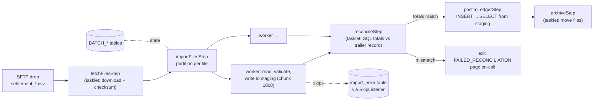

- The files land in a **staging table** first, then go to the ledger in one set-based SQL statement. The restartable, skip-tolerant part stays separate from the money-moving part, and the posting step is idempotent (`INSERT ... ON CONFLICT DO NOTHING` on the settlement reference).
- Identifying parameters: `businessDate`. Running the same date twice is refused (`JobInstanceAlreadyCompleteException`), and a failed date is restarted with the same parameters.
- Skipped rows go to an error table from the `SkipListener`. A skip *policy* caps them at a percentage, not an absolute count, so a corrupt file fails fast.
- The `ExitStatus` drives the flow: `.on("FAILED_RECONCILIATION").fail()`.

**Trade-offs:** the batch window is a hard deadline. Partition size and chunk size decide whether you make it. The staging table doubles the writes but buys atomic posting. The JobRepository becomes operational data that needs dashboards (Spring Cloud Data Flow, or simple SQL over `BATCH_STEP_EXECUTION`).

**Who uses it:** banks and payment processors for end-of-day settlement, insurers for policy renewals, telecoms for billing runs (CDR rating), and payroll systems.

### 7.2 Clustered scheduler with ShedLock

**Problem:** the app runs as 3 Kubernetes replicas. `@Scheduled(cron = "0 0 2 * * *")` fires on **all three**, so the import runs three times. That causes duplicate emails, triple load, and possibly duplicate postings.

**Solution:** [ShedLock](https://github.com/lukas-krecan/ShedLock) puts a lock row per task in a shared store. The first node to update the row wins, and the others skip that tick.

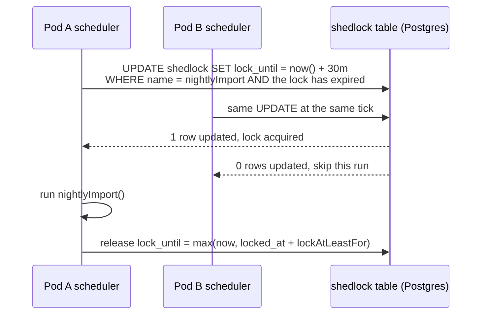

```java
// pom: net.javacrumbs.shedlock:shedlock-spring + shedlock-provider-jdbc-template (not in the lab)
@Configuration
@EnableSchedulerLock(defaultLockAtMostFor = "PT30M")
class SchedulerLockConfig {
    @Bean LockProvider lockProvider(DataSource ds) {
        return new JdbcTemplateLockProvider(JdbcTemplateLockProvider.Configuration.builder()
                .withJdbcTemplate(new JdbcTemplate(ds)).usingDbTime().build());
    }
}

@Scheduled(cron = "${importer.schedule.cron}", zone = "${importer.schedule.zone}")
@SchedulerLock(name = "nightlyImport", lockAtMostFor = "PT2H", lockAtLeastFor = "PT1M")
public void nightlyImport() { ... }
// Flyway: CREATE TABLE shedlock(name VARCHAR(64) PRIMARY KEY, lock_until TIMESTAMP, locked_at TIMESTAMP, locked_by VARCHAR(255));
```

- `lockAtMostFor`: if the holder dies, the lock expires after this long. Set it **longer than the slowest run**, or a second node starts while the first is still working.
- `lockAtLeastFor`: holds the lock for a minimum time, so a fast task on node A can't finish before node B's clock ticks and run again (clock skew).
- `usingDbTime()` uses the DB clock, not the pods' clocks.

**Alternatives:**
- **Quartz clustered JDBC job store:** misfire handling, persistent triggers and per-trigger history. It's heavier.
- **Kubernetes `CronJob`:** the job runs as its own pod, and the app pods have no scheduler at all. Set `concurrencyPolicy: Forbid`.
- **Leader election** (Spring Cloud Kubernetes or Spring Integration `LockRegistryLeaderInitiator`): only the leader runs schedulers.
- **Spring Batch's own guard:** the same `JobInstance` can't run twice concurrently. That only helps if the identifying parameters are deterministic, e.g. a `businessDate` rather than a random `run.id`.

**Trade-offs:** ShedLock is "at most once per tick", not a distributed job queue. A missed tick (all pods down) is simply missed. There's no misfire catch-up, unlike Quartz.

**Who uses it:** almost every Spring shop that runs schedulers on more than one replica. ShedLock is the de facto standard.

### 7.3 Fanning out I/O calls with virtual threads: report generator

**Problem:** a "customer 360" report or statement PDF needs data from 6–20 downstream services (accounts, cards, loans, KYC, FX rates, rewards). Each takes 50–300 ms. Called sequentially, that's 2+ seconds. A platform-thread pool of 20 limits throughput to 20 concurrent sub-calls across *all* users.

**Solution:** fan out with one virtual thread per downstream call, give each a timeout and a fallback, then fan in. The total latency is the slowest call.

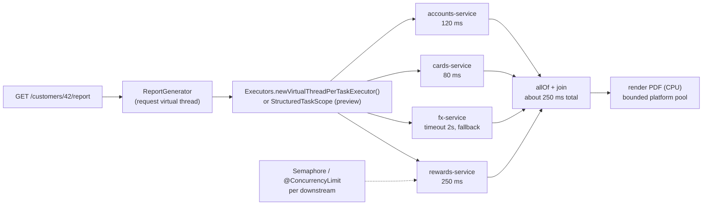

```java
try (var executor = Executors.newVirtualThreadPerTaskExecutor()) {
    var accounts = CompletableFuture.supplyAsync(() -> accountsClient.get(id), executor).orTimeout(2, SECONDS);
    var cards    = CompletableFuture.supplyAsync(() -> cardsClient.get(id), executor).orTimeout(2, SECONDS);
    var fx       = CompletableFuture.supplyAsync(() -> fxClient.rates(), executor)
                                    .completeOnTimeout(FxRates.cached(), 500, MILLISECONDS);
    return accounts.thenCombine(cards, Report::of).thenCombine(fx, Report::withFx).join();
}
```

The lab does the same with `@Async` + `CompletableFuture` (`ReportGenerator`: the sections run concurrently on distinct `report-*` threads). With `spring.threads.virtual.enabled=true`, plain `@Async` uses virtual threads too.

**Trade-offs:**
- Virtual threads remove the *thread* bottleneck but not the *downstream* one. Add per-downstream concurrency limits, or you DDoS your own services.
- Keep CPU work (PDF rendering) on a bounded platform pool.
- On Java 21–23, audit `synchronized` blocks in HTTP and JDBC client code.
- Pass the MDC and trace context explicitly, or use context-propagation.

**Who uses it:** BFF and aggregation layers in banking apps, e-commerce product pages (price + stock + reviews + recommendations), and travel search (fan out to N suppliers).

### 7.4 Moving a batch to an event-driven design

**Problem:** the nightly import means data is up to 24 hours stale. Fraud detection, the customer's "available balance" and notifications all want it *now*. The 2-hour batch window also keeps shrinking as volume grows.

**Solution:** have the source publish each transaction as an event. Consumers process incrementally, and the batch survives only for reconciliation and backfills.

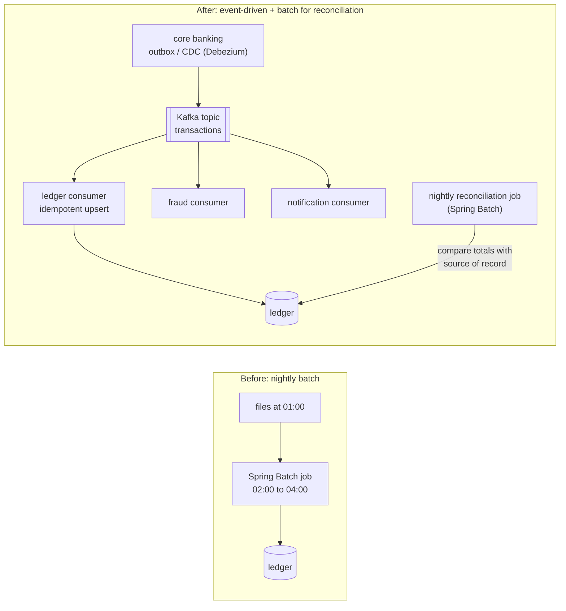

| | Spring Batch | Event streaming (Kafka) |
|---|---|---|
| Latency | Hours (the next window) | Milliseconds to seconds |
| Unit | A bounded dataset (file, table snapshot) | An unbounded stream |
| Restart | `JobRepository` + `ExecutionContext` | Consumer offsets + idempotent consumers |
| Bad records | Skip policy + error table | Dead-letter topic |
| Ordering and totals | Easy: you see the whole file, so you can check trailer totals | Per partition only. Global totals need windowing |
| Ops | Window scheduling, reruns by date | Lag monitoring, rebalancing, schema evolution |
| Best for | Files from partners, regulatory reports, reconciliation, backfills, migrations | Real-time reactions, many independent consumers |

**Migration path:**
1. Keep the batch, and also emit events from it (a writer that publishes to Kafka through an outbox).
2. Build consumers that read those events.
3. Switch the source to CDC or an outbox so events flow in real time.
4. Shrink the batch to reconciliation: does the sum of events equal the partner's file?

**Trade-offs:** streaming needs idempotent consumers, ordering design (partition by account id) and new operational skills. You usually still need a batch for partner files and month-end reports. The two are complementary, not either/or.

**Who uses it:** banks moving from end-of-day to real-time balances, retailers moving from nightly inventory sync to real-time stock, and any company adopting CDC with Debezium (note 11).

---

## 8. Pitfalls & debugging checklist

- [ ] **`@Async` method runs on the caller thread**:
  - it's a self-invocation;
  - the method is `private`;
  - `@EnableAsync` is missing;
  - it's called from `@PostConstruct`;
  - the object was created with `new`.

  To check, log `Thread.currentThread().getName()`.
- [ ] **`@Async` creates a new thread per call (threads named `SimpleAsyncTaskExecutor-N`)**. No executor was found. You defined two `TaskExecutor` beans, so neither is unique, and none is named `taskExecutor`. Qualify `@Async("name")`, or use an `AsyncConfigurer`.
- [ ] **`spring.threads.virtual.enabled=true` has no effect on `@Async`**. You declared your own `Executor` bean, so Boot's executor backed off. Use `spring.task.execution.mode=force`, or build your executor with virtual threads (`SimpleAsyncTaskExecutor.setVirtualThreads(true)`).
- [ ] **`@Async` exceptions vanish**. The method is `void` and the default handler only logs. Return `CompletableFuture`, or register an `AsyncUncaughtExceptionHandler`.
- [ ] **The async task can't see the data the caller just saved**. The caller's transaction hasn't committed yet. Use `@TransactionalEventListener(phase = AFTER_COMMIT)` + `@Async`.
- [ ] **Logs from async threads have no request id or trace id**. There's no `TaskDecorator` on that executor. Boot applies decorator beans only to *its* executor.
- [ ] **`@Scheduled` task runs late, or not at all**. Another scheduled task is hogging the single `scheduling-1` thread. Take a thread dump, or raise `spring.task.scheduling.pool.size`.
- [ ] **Cron never fires, or fires at the wrong hour**: a 5-field Unix cron (startup error), a missing `zone`, or a DST transition (02:30 doesn't exist on spring-forward day).
- [ ] **Job runs N times in production**. N replicas, each with a scheduler. Add ShedLock or use a K8s `CronJob`.
- [ ] **`JobInstanceAlreadyCompleteException`**. You launched with the same identifying parameters as a completed run. Add `run.id` or a date.
- [ ] **Batch tables missing on Postgres** (`relation "batch_job_instance" does not exist`). `spring.batch.jdbc.initialize-schema` defaults to `embedded`. Set `always`, or add the schema to Flyway.
- [ ] **Job runs at startup with empty parameters and fails**. Boot runs the single `Job` bean on startup. Set `spring.batch.job.enabled=false`, or `spring.batch.job.name` if you have several jobs.
- [ ] **Restart starts from row 1 and duplicates data**. The reader isn't `ItemStream`-registered: the `@StepScope` bean returns the `ItemReader` interface, `saveState(false)` is set, or the reader has no `name`. Or the writer isn't idempotent.
- [ ] **Restart re-runs a step that already completed**. `allowStartIfComplete(true)` is set on it. Or the parameters changed, so it's a *new* instance, not a restart.
- [ ] **"No context holder available for step scope"**. A `@StepScope` bean was used outside a running step, e.g. injected into a singleton and called at startup.
- [ ] **Batch beans ignored after adding `@EnableBatchProcessing`**. Boot's auto-configuration backed off (Boot 4). Remove the annotation.
- [ ] **No restart after a crash, and nothing appears in `BATCH_*`**. You used `spring-boot-starter-batch` (in-memory) instead of `-batch-jdbc`.
- [ ] **App with only virtual-thread schedulers exits immediately**. Virtual threads are daemon threads. Set `spring.main.keep-alive=true`.
- [ ] **Throughput collapses with virtual threads on Java 21**. Pinning from `synchronized` around I/O. Check the JFR `jdk.VirtualThreadPinned` events, then upgrade to Java 24+ or replace `synchronized` with `ReentrantLock`.

---

## 9. Interview questions

<details><summary>Q1. How does @Async work under the hood?</summary>

`@EnableAsync` registers `AsyncAnnotationBeanPostProcessor`. In `postProcessAfterInitialization`, it wraps beans that have `@Async` methods in a proxy whose advice is `AnnotationAsyncExecutionInterceptor`. On a call, the interceptor resolves an executor and submits the invocation as a `Callable`:
1. the `@Async` qualifier;
2. otherwise `AsyncConfigurer.getAsyncExecutor()`;
3. otherwise a unique `TaskExecutor` bean;
4. otherwise a bean named `taskExecutor`;
5. otherwise a new `SimpleAsyncTaskExecutor`, a fresh thread per call (proven by `withoutAnyExecutorBean_asyncFallsBackToSimpleAsyncTaskExecutor_aNewThreadPerCall`).

It then returns immediately: a future for `Future`/`CompletableFuture` methods, or nothing for `void`. Because it's proxy-based, self-invocation, `private` methods and calls from `@PostConstruct` are not async.
</details>

<details><summary>Q2. What happens to an exception thrown in an @Async method?</summary>

If the method returns `CompletableFuture`/`Future`, the exception completes the future exceptionally. `get()` throws `ExecutionException`, `join()` throws `CompletionException`, and you can recover with `exceptionally`/`handle`. If the method is `void`, nobody can receive it, so it goes to the `AsyncUncaughtExceptionHandler`. The default `SimpleAsyncUncaughtExceptionHandler` only logs it. Register your own via `AsyncConfigurer.getAsyncUncaughtExceptionHandler()` to count, alert or dead-letter.
</details>

<details><summary>Q3. Does @Transactional or the SecurityContext propagate into an @Async method?</summary>

No. Both are bound to the thread through `ThreadLocal`s (`TransactionSynchronizationManager`, `SecurityContextHolder`). The async method runs outside the caller's transaction and can't see its uncommitted rows. If it's `@Transactional` itself, it starts its own. For security, use `DelegatingSecurityContextAsyncTaskExecutor` or a `TaskDecorator` that wraps with `DelegatingSecurityContextRunnable`. For "do X after the save", use `@TransactionalEventListener(AFTER_COMMIT)` with `@Async`.
</details>

<details><summary>Q4. What is a TaskDecorator and when do you need one?</summary>

It's a hook on an executor that wraps every submitted `Runnable`. `decorate()` runs on the submitting thread, so it can snapshot `ThreadLocal` state (MDC, security, locale, tenant) and restore it on the worker thread around `run()`. It should restore the worker's previous state afterwards, not just clear it, because with `CallerRunsPolicy` the worker can be the caller. Boot applies `TaskDecorator` beans to its auto-configured executor and scheduler, combining several into a `CompositeTaskDecorator` in Boot 4. You must set it yourself on executors you build. `spring.task.execution.propagate-context=true` adds Micrometer's `ContextPropagatingTaskDecorator`.
</details>

<details><summary>Q5. fixedRate vs fixedDelay vs cron? Can a scheduled task overlap with itself?</summary>

- `fixedDelay` measures from the end of one run to the start of the next.
- `fixedRate` measures start to start.
- `cron` fires at calendar times. Spring cron has 6 fields with seconds first, and supports `L`, `W`, `#`, macros, a `zone`, and `"-"` to disable.

On Boot's default scheduler (one thread), a `fixedRate` run that takes longer than the rate makes the next run late, not concurrent. The lab proves a 50 ms rate with a 200 ms task never overlaps, even with `pool.size=4`. Overlap happens only when each tick gets a new thread: `@Async` on the method, or virtual threads (`SimpleAsyncTaskScheduler`), which the lab also proves. Also, all `@Scheduled` methods share that one thread by default, so one slow task delays all the others.
</details>

<details><summary>Q6. You run 3 replicas. How do you stop a @Scheduled job running 3 times?</summary>

Take a distributed lock per execution. ShedLock is the common choice: `@SchedulerLock(name, lockAtMostFor, lockAtLeastFor)` backed by a JDBC, Redis or Mongo lock table. `lockAtMostFor` covers a dead holder, and `lockAtLeastFor` covers clock skew between fast nodes. The alternatives:
- Quartz in clustered JDBC mode, with misfire handling and persistent triggers;
- leader election;
- moving the trigger out of the app, e.g. a Kubernetes `CronJob` with `concurrencyPolicy: Forbid`.

Spring Batch adds a second guard: the same `JobInstance` can't run concurrently, and a completed instance can't run again, as long as the identifying parameters are deterministic (a business date).
</details>

<details><summary>Q7. What does spring.threads.virtual.enabled=true change, and when shouldn't you use virtual threads?</summary>

On Java 21+ it switches Boot's `applicationTaskExecutor` to a virtual-thread `SimpleAsyncTaskExecutor`, where pool properties no longer apply, and the scheduler to `SimpleAsyncTaskScheduler`. It also switches the embedded web server's request handling, Boot-configured messaging listeners and JDK `HttpClient`-based clients. It doesn't change executors you build yourself.

Avoid virtual threads for:
- CPU-bound work, since the carriers are limited to the cores;
- code that relied on pool size as a throttle for a downstream;
- heavy `ThreadLocal` caches;
- on Java 21–23, `synchronized` sections around blocking I/O, because they pin the carrier. JEP 491 fixed that in Java 24, which is why Boot recommends 24+.

Virtual threads are daemon threads, so set `spring.main.keep-alive=true` for apps with no other non-daemon thread.
</details>

<details><summary>Q8. Explain JobInstance vs JobExecution vs StepExecution.</summary>

- A `JobInstance` is a logical run: the job name plus the hash of its identifying `JobParameters`, e.g. "the import for 2026-11-17".
- A `JobExecution` is one attempt at that instance. A failed instance that is restarted gets a second `JobExecution` under the same instance.
- A `StepExecution` is one attempt at one step inside a `JobExecution`. It holds the read/write/filter/skip/commit/rollback counters and its own persisted `ExecutionContext`.

Launching completed identifying parameters again throws `JobInstanceAlreadyCompleteException`. Launching failed ones restarts the instance.
</details>

<details><summary>Q9. How does Spring Batch make a restart continue from the last committed chunk without duplicates?</summary>

Each chunk runs in one transaction that commits three things:
- the writer's business writes;
- the step's updated counters;
- the reader's position, which an `ItemStream` reader saves into the step `ExecutionContext` (e.g. `transactionReader.read.count`).

These go to the JobRepository atomically. If item 25 fails, chunk 21–30 rolls back, and the context still says 20. On restart, with the same identifying parameters, completed steps are skipped and the reader's `open()` repositions to item 21. The lab asserts 20 rows after the crash, a `readCount` of 15 on restart, and 35 distinct rows. Writers to non-transactional systems must still be idempotent.
</details>

<details><summary>Q10. Skip vs retry vs filter in a chunk step?</summary>

- **Filter:** the processor returns `null`. The item is dropped as a normal outcome (`filterCount`).
- **Skip:** a declared skippable exception is thrown, and the item is dropped and counted (`readSkipCount`/`processSkipCount`/`writeSkipCount`) up to a skip limit or `SkipPolicy`. Exceeding the limit fails the step.
- **Retry:** a declared retryable (transient) exception makes Batch re-attempt the operation up to the retry limit with back-off. If the retries are exhausted, the item can still be skipped if it's also skippable.

In Batch 6 retry uses Framework 7 core retry, and the new `ChunkOrientedStep` skips or retries the item without rolling back the chunk. The lab shows `rollbackCount == 0`, where Batch 5 rolled back and re-processed the chunk.
</details>

<details><summary>Q11. Multi-threaded step vs partitioning vs remote chunking: which would you pick?</summary>

- **Multi-threaded step:** one step with a `taskExecutor`. It's simple, but readers are shared, and classically it isn't restartable (`saveState(false)`). Batch 6's new model keeps reading and writing on one thread and parallelises the processor.
- **Partitioning:** a manager step splits the data (per file, per ID range) into partitions, each a full `StepExecution` with its own reader and context. It's restartable per partition and can be local (thread pool) or remote (workers over messaging).
- **Remote chunking:** the manager reads and sends chunks to workers that process and write. Use it when processing or writing dominates.
- **Parallel steps:** independent steps run in a `split` flow.

For a restartable file import, pick partitioning (the lab's choice).
</details>

<details><summary>Q12. What changed for Spring Batch in Boot 4 / Batch 6?</summary>

- `JobLauncher` is deprecated: `JobOperator` extends it, so use `jobOperator.start(job, params)`.
- `JobRepository` extends `JobExplorer`.
- `@EnableBatchProcessing`/`DefaultBatchConfiguration` default to a resourceless repository. Opt into a DB with `@EnableJdbcJobRepository`.
- In Boot, `spring-boot-starter-batch` is in-memory, and `spring-boot-starter-batch-jdbc` is needed for a DB repository.
- `@EnableBatchProcessing` still makes Boot's auto-config back off.
- Packages moved: `core.job`, `core.step`, `core.job.parameters`, and `infrastructure.*` for all item and repeat APIs.
- `chunk(int).transactionManager(tm)` builds the new `ChunkOrientedStep`, and the `chunk(int, tm)` form is deprecated.
- Retry is on Framework 7 core retry.
- `JobParameter` is a record, and `BATCH_JOB_SEQ` became `BATCH_JOB_INSTANCE_SEQ`.
- v5 executions can't be restarted on v6.
- Tests use `JobOperatorTestUtils.startJob()`.
</details>

<details><summary>Q13. Your @Async pool is configured with max-size 50 but only ever uses 8 threads. Why?</summary>

`ThreadPoolExecutor` grows beyond the core size only when the queue is full, and the default queue capacity is unbounded (`Integer.MAX_VALUE`). So it stays at the core size (Boot's default is 8) while tasks pile up in the queue. Set a bounded `queue-capacity`, and choose a rejection policy for when both the queue and max are full. `CallerRunsPolicy` gives back-pressure, and the default `AbortPolicy` throws `TaskRejectedException`.
</details>

<details><summary>Q14. When would you choose Spring Batch over a Kafka streaming consumer, and vice versa?</summary>

Choose **Batch** for bounded datasets with a natural window:
- partner files, regulatory and month-end reports, migrations, backfills, reconciliation;
- cases where you need whole-dataset checks (trailer totals), restart-by-date semantics, and throughput over latency.

Choose **streaming** when consumers must react within seconds:
- fraud, balances, notifications;
- cases where many independent consumers need the same events.

Streaming brings offsets, idempotent consumers, dead-letter topics and lag monitoring in place of the JobRepository. Mature systems use both: events for real time, and batch for reconciliation and partner files.
</details>

<details><summary>Q15. How do you compose several CompletableFutures with a timeout and fallbacks, and on which thread do the callbacks run?</summary>

Start all calls first, then compose:
- `thenCombine` for two results;
- `allOf(...)` plus `join()` on each for N results;
- `thenCompose` to chain dependent async calls;
- per call, `orTimeout`/`completeOnTimeout` and `exceptionally`/`handle` for fallbacks.

Non-`Async` callbacks run on the thread that completes the future (the worker), or immediately on the caller if it's already complete. `*Async` variants without an executor use `ForkJoinPool.commonPool()`, which must not be used for blocking I/O, so pass an executor (a virtual-thread executor is ideal for I/O).
</details>

---

## 10. Sources

- Spring Framework reference: [Task Execution and Scheduling](https://docs.spring.io/spring-framework/reference/integration/scheduling.html) (`@Async`, `@Scheduled`, cron expressions, `TaskDecorator`, `SimpleAsyncTaskScheduler`), [Framework 7.0 Release Notes](https://github.com/spring-projects/spring-framework/wiki/Spring-Framework-7.0-Release-Notes)
- Spring Boot reference: [Task Execution and Scheduling](https://docs.spring.io/spring-boot/reference/features/task-execution-and-scheduling.html), [Virtual threads in SpringApplication](https://docs.spring.io/spring-boot/reference/features/spring-application.html), [Spring Batch](https://docs.spring.io/spring-boot/reference/io/spring-batch.html), [How-to: Batch Applications](https://docs.spring.io/spring-boot/how-to/batch.html), [Application properties](https://docs.spring.io/spring-boot/appendix/application-properties/index.html)
- [Spring Boot 4.0 Migration Guide](https://github.com/spring-projects/spring-boot/wiki/Spring-Boot-4.0-Migration-Guide) · [Boot 4.0 Release Notes](https://github.com/spring-projects/spring-boot/wiki/Spring-Boot-4.0-Release-Notes) · [Boot 4.1 Release Notes](https://github.com/spring-projects/spring-boot/wiki/Spring-Boot-4.1-Release-Notes)
- Spring Batch: [What's new in 6.0](https://docs.spring.io/spring-batch/reference/whatsnew.html), [6.0 Migration Guide](https://github.com/spring-projects/spring-batch/wiki/Spring-Batch-6.0-Migration-Guide), [Configuring infrastructure](https://docs.spring.io/spring-batch/reference/job/configuring-infrastructure.html), [Configuring skip](https://docs.spring.io/spring-batch/reference/step/chunk-oriented-processing/configuring-skip.html), [Retry](https://docs.spring.io/spring-batch/reference/step/chunk-oriented-processing/retry-logic.html), [Scaling and parallel processing](https://docs.spring.io/spring-batch/reference/scalability.html), [Unit testing](https://docs.spring.io/spring-batch/reference/testing.html)
- ShedLock: [github.com/lukas-krecan/ShedLock](https://github.com/lukas-krecan/ShedLock)
- Baeldung (Boot 2/3 era; check against section 6): [@Async in Spring](https://www.baeldung.com/spring-async), [The @Scheduled annotation](https://www.baeldung.com/spring-scheduled-tasks), [Guide to ShedLock](https://www.baeldung.com/shedlock-spring), [Introduction to Spring Batch](https://www.baeldung.com/introduction-to-spring-batch) (uses the removed builder factories), [Spring Batch partitioner](https://www.baeldung.com/spring-batch-partitioner), [Virtual threads in Spring 6](https://www.baeldung.com/spring-6-virtual-threads)
- Oracle / OpenJDK: [JEP 444 Virtual Threads](https://openjdk.org/jeps/444), [JEP 491 Synchronize Virtual Threads without Pinning](https://openjdk.org/jeps/491), [Virtual threads guide (Java 21)](https://docs.oracle.com/en/java/javase/21/core/virtual-threads.html), [`CompletableFuture`](https://docs.oracle.com/en/java/javase/21/docs/api/java.base/java/util/concurrent/CompletableFuture.html), [`ThreadPoolExecutor`](https://docs.oracle.com/en/java/javase/21/docs/api/java.base/java/util/concurrent/ThreadPoolExecutor.html)
- Spring source to read: `AsyncExecutionAspectSupport#determineAsyncExecutor`, `ScheduledAnnotationBeanPostProcessor`, `TaskExecutorConfigurations` (Boot), `ChunkOrientedStep`, `MultiResourcePartitioner`, `FlatFileItemReader#update`
