# 13 — Reactive Spring: WebFlux, Reactor & R2DBC

> **Lab:** [`labs/13-webflux`](https://github.com/sumit-mishra-itp/springboot-roadmap/tree/main/labs/13-webflux)
> **Capstone use:** a live order-status / price feed over Server-Sent Events, the API gateway in front of the services (Spring Cloud Gateway is built on WebFlux), and `WebClient` in any edge service that fans out to many downstreams. The CRUD services themselves stay on Spring MVC with virtual threads (section 1).
> **Prereqs:** Spring Core (01), REST APIs (05), Data JPA (06, for the contrast with R2DBC), virtual threads (12).

---

## 1. What & why

**Reactive programming** treats data as **asynchronous streams with backpressure**. Instead of a thread calling a method and *waiting* for the result, you describe a pipeline (a recipe), and the runtime pushes values through it as they become ready. No thread sits blocked while the database or a downstream service is thinking.

**The problem it solved (2013 to 2020):** the classic Servlet model is *thread-per-request*. Every in-flight request holds a platform thread (about 1 MB of stack, plus a context switch on every block). A service calling a slow downstream with 200 ms latency at 5,000 requests per second needs about 1,000 threads parked in `socket.read()`. Tomcat's default pool is 200, so requests queue, latency explodes, and adding threads costs memory. Event-loop servers (Netty, Node.js) serve the same load with a handful of threads, because a thread never waits: it registers a callback and moves on.

| Era | Model | Pain |
|---|---|---|
| Servlet 2.x / Spring MVC | One platform thread per request, blocking I/O | Threads are expensive. High-latency fan-out needs huge pools |
| Callbacks, `Future`, `CompletableFuture` | Async, but composition is manual | Callback hell, no backpressure, no standard cancellation |
| RxJava 1 (2013) | Observables | Not interoperable, backpressure bolted on later |
| **Reactive Streams 1.0 (2015)** | 4 interfaces with `request(n)` backpressure, adopted into the JDK as `java.util.concurrent.Flow` (Java 9) | Interop between Reactor, RxJava 2+, Akka Streams, Mutiny |
| **Spring 5 (2017)** | Spring WebFlux on Reactor and Netty, R2DBC later (2019) | A whole second stack: controllers, clients, data access |
| **Java 21 (2023)** | Virtual threads: blocking code that is as cheap as an event loop for I/O | Removes the *main* reason most teams adopted reactive |

**Where reactive still wins in 2026:**
- **Streaming**: SSE, WebSocket, and NDJSON feeds to tens of thousands of long-lived connections, where data arrives over time and backpressure matters.
- **Gateways and proxies** that do almost no work per request but hold many connections open (Spring Cloud Gateway).
- **Fan-out/aggregation** with rich composition: timeouts, retries, racing, hedging, and cancellation propagating to every branch.
- Systems that are **already** end-to-end non-blocking (reactive drivers for Mongo, Cassandra, Redis, Kafka, R2DBC).

**When *not* to use it.** This is the default answer for most new services:
- **Plain CRUD over JDBC/JPA.** Use Spring MVC with `spring.threads.virtual.enabled=true`. You keep JPA, lazy loading, `@Transactional`, simple stack traces, and `ThreadLocal`-based libraries, and you get almost all the scalability.
- **The team doesn't know Reactor.** One `block()`, one forgotten `subscribe()`, or one blocking call on the event loop turns a reactive service into a slower and harder-to-debug MVC service.
- **CPU-bound work.** Reactive gives no speedup there. It only helps when threads would otherwise *wait*.
- **A blocking dependency you can't replace** (a JDBC-only database, a legacy SDK). You end up wrapping everything in `boundedElastic`, which is a thread pool with extra steps.

The debugging cost is real. Stack traces show Reactor internals instead of your call chain, breakpoints jump between threads, and "nothing happened" bugs (no subscriber) produce no error at all.

---

## 2. Mental model

Think of a reactive pipeline as a **plumbing diagram drawn on paper**. Calling `Flux.just(1,2,3).map(...).filter(...)` *draws* the pipes (this is **assembly time**). No water flows until someone opens the tap at the end: `subscribe()` (this is **subscription time**). Then the subscriber asks the source for *n* items (`request(n)`), and data flows downstream only as fast as it was requested. That last part is **backpressure**.

### 2.1 The Reactive Streams contract

Four interfaces (in `org.reactivestreams`, mirrored by `java.util.concurrent.Flow`) are the whole spec:

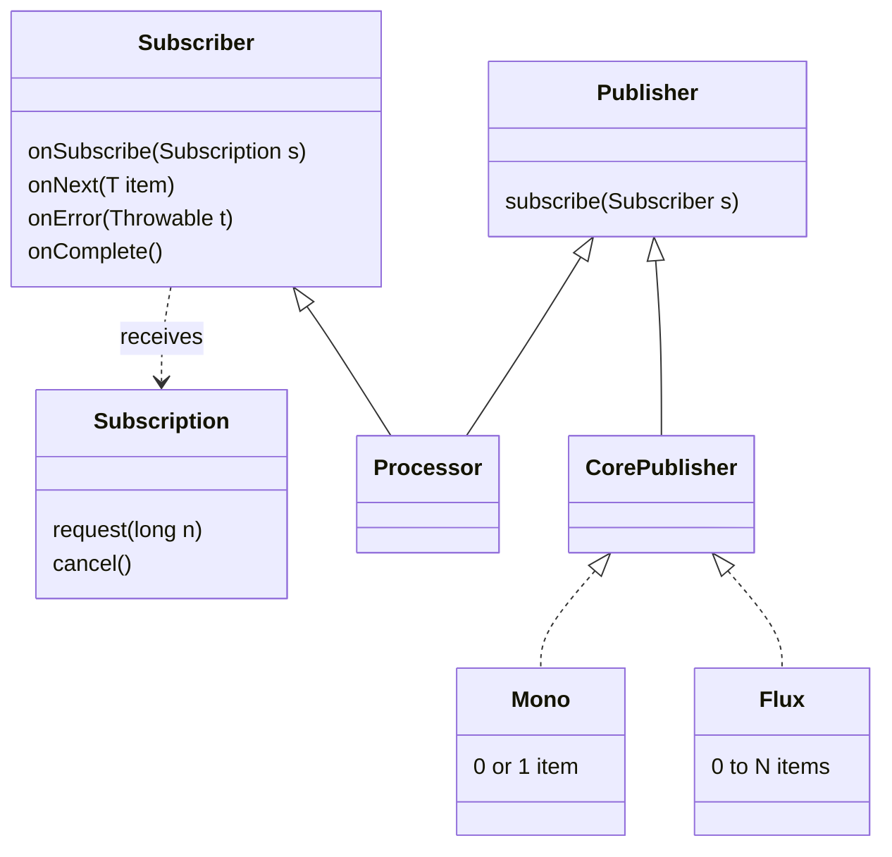

The protocol, with `request(n)` as the backpressure signal flowing **upstream**:

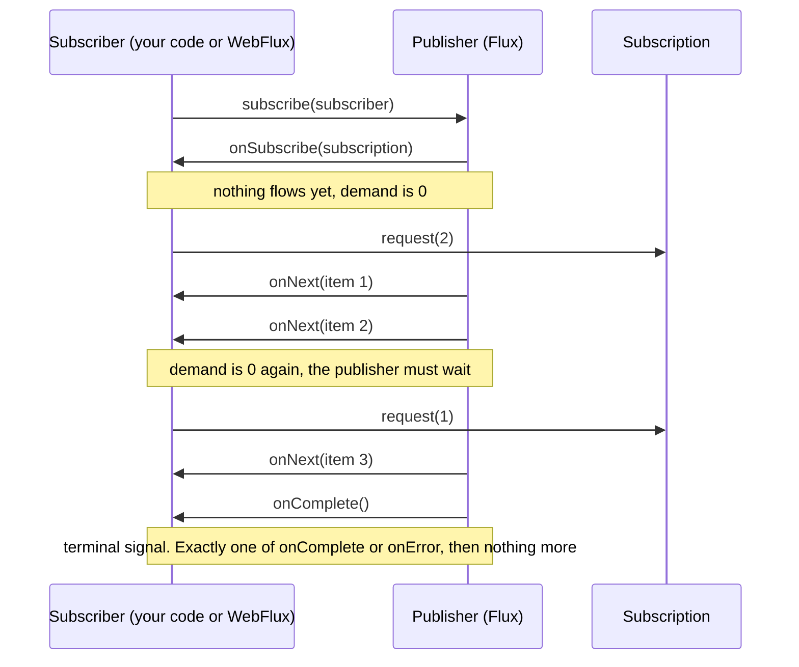

Rules that interviewers probe (from the spec):
- Signals are **serial**: `onNext` is never called concurrently for one subscriber.
- `onNext` count is never more than the total requested. `request(Long.MAX_VALUE)` means "unbounded", which switches backpressure off.
- After `onError` or `onComplete`, nothing else is signalled. **An error terminates the sequence.**
- `cancel()` must eventually stop the flow. This is how an HTTP client disconnect stops a database query in WebFlux.
- `null` is never allowed as a value.

The lab's `BackpressureTest` watches the requests: `blockLast()` sends a single `request(Long.MAX_VALUE)`, while `limitRate(10)` sends `request(10)` and then `request(8)` repeatedly (it replenishes at 75%).

### 2.2 Mono vs Flux

| | `Mono<T>` | `Flux<T>` |
|---|---|---|
| Items | 0 or 1, then complete or error | 0..N (possibly infinite), then complete or error |
| Use for | One HTTP response, one row, "done" signal (`Mono<Void>`) | Result sets, streams, SSE events, messages |
| Imperative cousin | `CompletableFuture<T>` / `Optional<T>` | `Stream<T>` / `Iterable<T>`, but push-based and async |
| Convert | `flux.next()`, `flux.collectList()` | `mono.flux()`, `mono.flatMapMany(...)` |

### 2.3 Assembly time vs subscription time

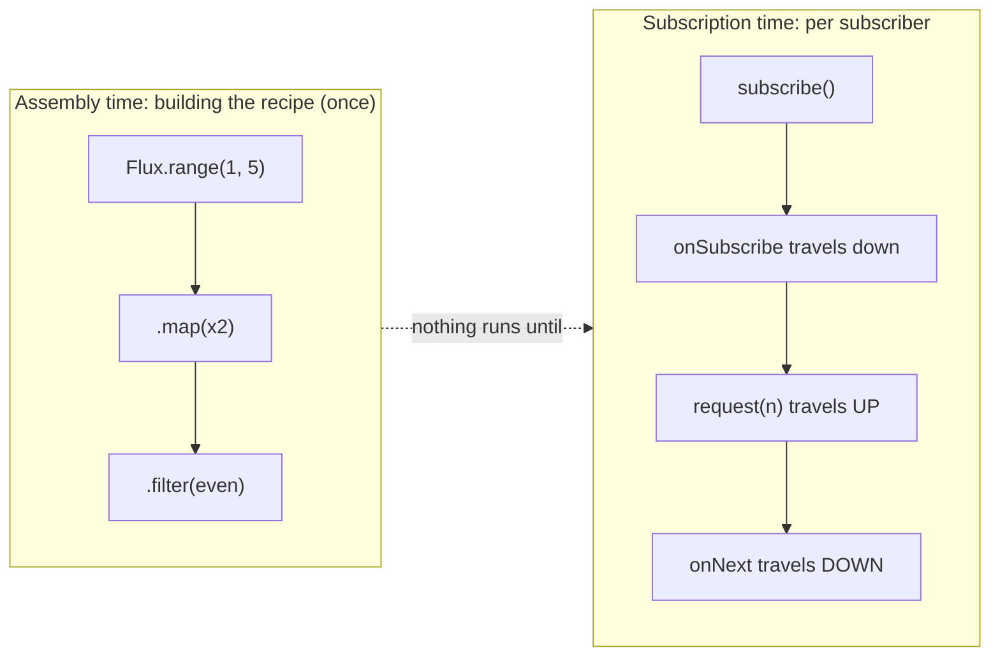

The lab proves three consequences:
1. `Mono.fromCallable(work)` runs `work` **once per subscriber**, and zero times if nobody subscribes (`nothingHappensUntilSubscribe_...`).
2. `Mono.just(expensive())` runs `expensive()` **immediately, at assembly**, because it is a plain Java argument (`monoJust_evaluatesItsArgumentAtAssemblyTime`).
3. `switchIfEmpty(fallback())` builds the fallback Mono **even when it isn't used**. Wrap it: `switchIfEmpty(Mono.defer(this::fallback))` (`switchIfEmpty_buildsItsFallbackEagerly_unlessDeferred`).

### 2.4 Cold vs hot

| | Cold | Hot |
|---|---|---|
| Starts | On every `subscribe()`, from the beginning | Independently of subscribers, or on the first one |
| Each subscriber gets | Its own full sequence | Only what is emitted *after* it subscribed |
| Examples | `Flux.range`, `Mono.fromCallable`, `WebClient` calls, R2DBC queries | `Sinks.many().multicast()`, `share()`, `publish().autoConnect()`, mouse events, a price ticker |

Turning cold into hot (or shared):
- **`share()`** = `publish().refCount()`. One upstream subscription, shared by everyone currently subscribed. Late subscribers miss earlier elements. It cancels upstream when the last subscriber leaves.
- **`cache()`** replays everything (or the last N) to late subscribers, so it is "hot with memory". On a `Mono`, it caches **errors too**: one failed downstream call is replayed forever. Use `cache(ttlForValue, ttlForError, ttlForEmpty)` instead.
- **`Sinks`** are the programmatic way to push into a hot Flux: `Sinks.many().multicast().directBestEffort()`, `.onBackpressureBuffer()`, `Sinks.many().replay().limit(n)`, `Sinks.one()`.

Lab: `share_isHot_lateSubscribersMissEarlierElements_andUpstreamRunsOnce` subscribes late at t=1.5 s and gets only `[1, 2]`, with one upstream subscription. Without `share()`, the late subscriber gets `[0, 1, 2]` from its own timer, and there are two upstream subscriptions.

---

## 3. How it works internally

### 3.1 The WebFlux stack vs the Servlet stack

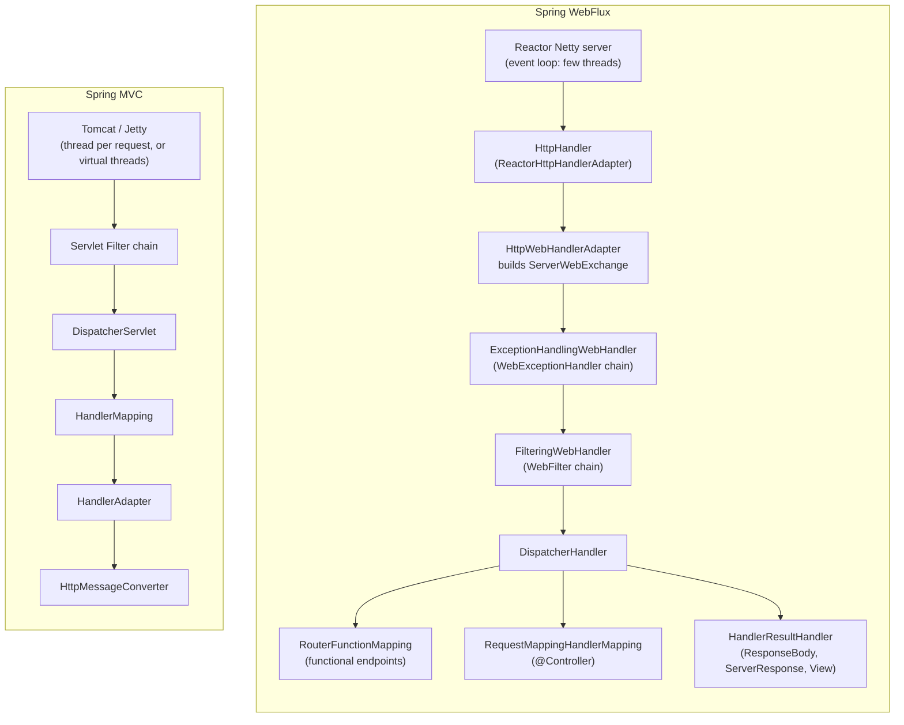

| | Spring MVC | Spring WebFlux |
|---|---|---|
| Server | Tomcat or Jetty (Servlet 6.1). Undertow was dropped in Boot 4 | Reactor Netty (default), or Tomcat/Jetty through the Servlet non-blocking adapter |
| Core contract | `Servlet` API, `HttpServletRequest` | `HttpHandler`, `ServerWebExchange` (immutable request, response, attributes) |
| Front controller | `DispatcherServlet` | `DispatcherHandler` |
| Filters | `jakarta.servlet.Filter`, `OncePerRequestFilter` | `WebFilter` (returns `Mono<Void>`) |
| Error handling | `@ControllerAdvice`, `HandlerExceptionResolver` | `@ControllerAdvice` (annotated controllers only) **plus** the `WebExceptionHandler` chain (everything) |
| Body conversion | `HttpMessageConverter` (blocking streams) | `HttpMessageReader`/`Writer` on top of `Encoder`/`Decoder` of `DataBuffer` (non-blocking) |
| Per-request state | `ThreadLocal` (`RequestContextHolder`, `SecurityContextHolder`, MDC) | Reactor `Context` (`ReactiveSecurityContextHolder`, exchange attributes) |
| Data access | JDBC, JPA | R2DBC, reactive Mongo, Cassandra, Redis |
| HTTP client | `RestClient` | `WebClient` |
| Boot app context | `ServletWebServerApplicationContext` | `ReactiveWebServerApplicationContext` |

Boot picks WebFlux only if `spring-boot-starter-webmvc` is **absent**. If both are on the classpath, MVC wins, and `WebClient` still works as a client inside an MVC app. Force it with `spring.main.web-application-type=reactive`.

### 3.2 A request through `DispatcherHandler`

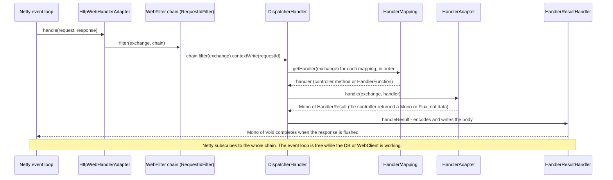

The key insight: **your controller runs once, quickly, and returns a recipe.** WebFlux subscribes to it. The actual database call happens later, when the response writer requests data. If any element of the chain blocks, it blocks a Netty event-loop thread, and every other connection on that loop stalls.

### 3.3 Threading: Netty event loop, Schedulers, `publishOn` vs `subscribeOn`

Reactor Netty starts one event-loop thread per CPU core (`reactor-http-nio-N`). Each loop multiplexes thousands of connections. There is no thread per request.

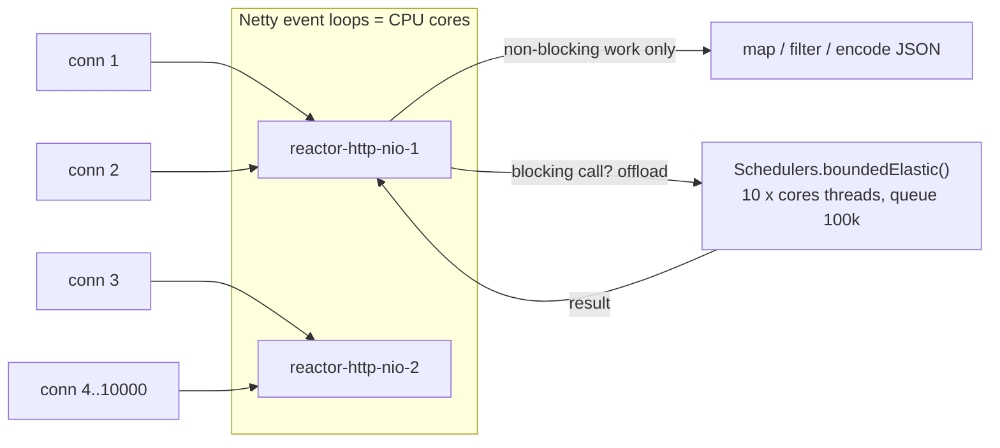

| Scheduler | Threads | Use for |
|---|---|---|
| `Schedulers.parallel()` | One per core | CPU-bound, short, non-blocking work. Default for `delayElement`, `interval`, `timeout` |
| `Schedulers.boundedElastic()` | Up to 10 × cores, created on demand and evicted after 60 s idle, with a bounded task queue | **Wrapping blocking calls** (JDBC, file I/O, legacy SDKs) |
| `Schedulers.single()` | One reusable thread | Ordered low-volume work |
| `Schedulers.immediate()` | The current thread | Tests, no-op |
| `Schedulers.fromExecutorService(...)` | Yours | Bridging an existing pool, or a virtual-thread executor |

**`subscribeOn` vs `publishOn`:**
- `subscribeOn(s)` decides on which thread the **subscription (and therefore the source)** runs. It affects the whole chain upstream of the first `publishOn`, and **its position in the chain doesn't matter**. Only the one closest to the source takes effect.
- `publishOn(s)` switches the thread for **everything below it** (downstream signals). Its position matters, and several of them are fine.

```text
Mono.just("x")
    .doOnNext(a)                       // runs on boundedElastic   (subscribeOn moved the source)
    .publishOn(Schedulers.parallel())
    .doOnNext(b)                       // runs on parallel         (publishOn moved everything below)
    .subscribeOn(Schedulers.boundedElastic())
```

The lab's `subscribeOn_movesTheSource_publishOn_movesEverythingBelowIt` asserts exactly these thread names.

**The pattern for a blocking call** (lab `FxRateService`):

```java
Mono.fromCallable(() -> blockingLookup(currency))   // lazy: nothing runs at assembly
    .subscribeOn(Schedulers.boundedElastic());       // the call parks a boundedElastic thread, never the event loop
```

`FxRateServiceTest` asserts that the value arrives on a `boundedElastic-*` thread and that `Schedulers.isInNonBlockingThread()` is false there.

**BlockHound** (`io.projectreactor.tools:blockhound`) is a Java agent that instruments blocking JDK methods (`Thread.sleep`, socket reads, `Object.wait`...) and **throws** if they run on a thread marked non-blocking (Netty event loops, `parallel`). Install it in tests with `BlockHound.install()` to catch accidental blocking. On JDK 13+ it needs `-XX:+AllowRedefinitionToAddDeleteMethods`.

### 3.4 The operator cheat sheet (marble-style)

Read each line left to right as time. `|` is completion, `X` is an error.

| Operator | Marble | Notes |
|---|---|---|
| `map(f)` | `1-2-3-\|` to `f1-f2-f3-\|` | Synchronous 1:1 transform. Never do I/O here |
| `filter(p)` | `1-2-3-4-\|` to `--2---4-\|` | |
| `flatMap(f)` | `3-1-2-\|`, inners take n×100 ms, gives `1-2-3-\|` after 300 ms | Subscribes to inners **eagerly and concurrently** (default concurrency 256). Output is in **completion order** |
| `concatMap(f)` | same input gives `3-1-2-\|` after 600 ms | One inner at a time. Keeps order. Total time is the sum |
| `flatMapSequential(f)` | same input gives `3-1-2-\|` after 300 ms | Concurrent like `flatMap`, buffers results to emit in **source order** |
| `switchMap(f)` | new value cancels the previous inner | Type-ahead search |
| `zip(a, b)` | `a: --1-----\|`, `b: ----A---\|` gives `----[1,A]\|` | Waits for one value from each, so latency is the max. **If any source is empty, the result is empty** |
| `merge(a, b)` | interleaves by arrival time | All sources subscribed at once |
| `concat(a, b)` | all of `a`, then all of `b` | `b` is subscribed only after `a` completes |
| `switchIfEmpty(m)` / `defaultIfEmpty(v)` | `\|` to `m` / `v-\|` | The argument is built eagerly. Use `Mono.defer` |
| `take(n)` / `takeUntil` / `takeWhile` | cancels upstream after the condition | Turns infinite into finite |
| `buffer(n)` / `window(n)` / `bufferTimeout(n, d)` | groups into `List` / `Flux` | Batching for bulk inserts |
| `onErrorResume(f)` | `1-2-X` to `1-2-fallback-\|` | Swaps in a new publisher. The original sequence is **over** |
| `onErrorReturn(v)` | `1-2-X` to `1-2-v-\|` | |
| `onErrorMap(f)` | `X(IOException)` to `X(DomainException)` | Translate infrastructure errors |
| `retryWhen(spec)` | `X` to resubscribe after delay | Re-runs the **whole upstream** |
| `timeout(d)` | no signal within `d` gives `X(TimeoutException)` | Cancels upstream |
| `doOnNext` / `doOnError` / `doFinally` | side-effect peeks | Logging and metrics. Never put business logic here |
| `then()` / `thenReturn(v)` | ignores values, keeps completion | `Mono<Void>` endpoints |
| `limitRate(n)` | `request(n)` then `request(0.75n)` | Turns an unbounded request into batches |

The lab proves the `flatMap` / `concatMap` / `flatMapSequential` rows with virtual time (`StepVerifier.withVirtualTime`), so the tests take milliseconds, not seconds.

**Choosing between the three "maps":**
- Order doesn't matter, throughput does: `flatMap` (cap it: `flatMap(f, 16)`, or you can open 256 concurrent DB connections or HTTP calls).
- Order matters, or the inner uses a shared single resource (one transaction connection): `concatMap`. The lab's `PriceService.importAll` uses `concatMap` inside a transaction.
- Order matters and you want concurrency: `flatMapSequential`. The trade-off is memory, because it buffers early finishers.

### 3.5 Backpressure in practice

Backpressure works end-to-end only if every hop speaks it. Reactor Netty translates `request(n)` into TCP flow control (it stops reading from the socket). R2DBC drivers translate it into cursor fetching. But many real sources **can't be slowed down**: a market data feed, UI events, a message listener. Then you choose what to lose:

| Operator | When the subscriber is slower than the producer |
|---|---|
| `onBackpressureBuffer()` | Unbounded buffer. Risks an OOM |
| `onBackpressureBuffer(n)` | Bounded. **Fails with an overflow error** when full (lab: `..._defaultStrategy_failsWithOverflow`) |
| `onBackpressureBuffer(n, onDropped, DROP_OLDEST / DROP_LATEST)` | Bounded and lossy. The lab keeps 8, 9, 10 of 1..10 |
| `onBackpressureDrop()` | Drops anything not requested |
| `onBackpressureLatest()` | Keeps only the newest. Ideal for prices: a stale tick is worthless |
| `limitRate(n)` | Not a strategy. It *shapes* demand into batches |
| `sample(d)` / `throttleFirst` equivalents | Time-based thinning |

Note that `onBackpressureBuffer` itself requests **unbounded** from upstream and absorbs the difference. The lab's SSE feed gives each client its own `onBackpressureBuffer(256, DROP_OLDEST)`, so one slow mobile client can't hurt the others.

### 3.6 Error handling and retries

In Reactor, **an error is a terminal signal**. `Flux.just(1, 2, 0, 4).map(n -> 10 / n).onErrorResume(e -> Flux.just(-1))` emits `10, 5, -1` and completes. Element 4 is never processed. To skip only the bad element, recover **inside** the `flatMap`, per element (lab: `recoveringInsideFlatMap_skipsOnlyTheFailedElement`). Avoid `onErrorContinue`: it relies on operator support and has surprising semantics.

The lab's `QuoteClient` shows the order that matters:

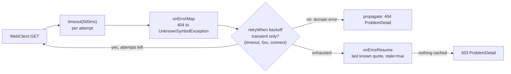

- **`timeout` before `retryWhen`** gives each attempt its own timeout. After `retryWhen`, one timeout would cover all attempts.
- **`onErrorMap` before `retryWhen`**, and the retry filter excludes the domain exception, so a 404 is **never retried** (lab: `notFound_isMappedToADomainError_andNeverRetried` sees exactly 1 call).
- `Retry.backoff(maxAttempts, firstBackoff)` doubles the delay (with 50% jitter by default) and, when exhausted, throws `RetryExhaustedException` wrapping the last error. Detect it with `Exceptions.isRetryExhausted(e)`. Customize with `.onRetryExhaustedThrow(...)`.
- **Retry re-subscribes.** Everything upstream re-runs, including `Mono.defer` and the HTTP request. Retrying a non-idempotent POST can charge a card twice.
- Virtual time makes this testable: `StepVerifier.withVirtualTime(() -> flaky.retryWhen(Retry.backoff(3, 1s).jitter(0)))` retries at t=1 s and t=3 s, and the test completes instantly.

**HTTP error rendering.** A `@RestControllerAdvice` only sees exceptions from **annotated controllers**. Errors from functional endpoints and `WebFilter`s go straight to the `WebExceptionHandler` chain. Boot registers `DefaultErrorWebExceptionHandler` at order `-1`. The lab adds one `ProblemDetailExceptionHandler implements WebExceptionHandler` at order `-2`, which renders any `ErrorResponse` (`ResponseStatusException`, `WebExchangeBindException`, `HandlerMethodValidationException`, and custom `ErrorResponseException` subclasses) as `application/problem+json`, and passes everything else on. That way **both styles produce the same RFC 9457 body** (lab: `functionalRouteError_isRenderedByTheGlobalWebExceptionHandler`). This is a deliberate deviation from the repo's "one `@RestControllerAdvice`" rule, because an advice can't see functional-endpoint errors.

### 3.7 Reactor `Context` vs `ThreadLocal`

A `ThreadLocal` assumes one request equals one thread. In WebFlux a single request hops between event-loop, `parallel`, and `boundedElastic` threads, and one thread interleaves thousands of requests. A `ThreadLocal` set at the start of a request is **gone after the first hop**, or worse, it leaks into another request (lab: `plainThreadLocal_isLostAfterAThreadHop`).

The **Reactor `Context`** is an immutable map attached to the *subscription*, not the thread:
- Write it with `contextWrite(ctx -> ctx.put(k, v))`. It is visible to operators **upstream** of that call, because the context travels from the subscriber up to the source at subscription time (lab: `reactorContext_isVisibleOnlyUpstreamOfContextWrite`). That's why a `WebFilter` writes it *after* `chain.filter(exchange)`: everything in the chain is upstream.
- Read it with `Mono.deferContextual(ctx -> ...)` or `transformDeferredContextual`.
- Spring uses it for `ReactiveSecurityContextHolder`, R2DBC transactions (`TransactionalOperator`), and Micrometer observations.

**Bridging to `ThreadLocal` libraries (MDC, tracing):** Micrometer's **context-propagation** library defines `ThreadLocalAccessor`s registered in a global `ContextRegistry`. Reactor uses them to copy Context values into `ThreadLocal`s around operator callbacks:
- **Limited mode** (Boot's default, `spring.reactor.context-propagation=limited`): restoration happens only inside `handle()` and `tap()`.
- **Automatic mode** (`spring.reactor.context-propagation=auto`, which calls `Hooks.enableAutomaticContextPropagation()`): restoration happens around **all** operators across thread boundaries. It applies only to subscriptions made after the hook is enabled, so enable it at startup.

The lab's `RequestIdFilter` registers an accessor for the `requestId` key and writes the id into the Context. With `auto` mode, every log line carries it through `%X{requestId}`. `automaticContextPropagation_restoresMdcFromTheContext_onEveryThread` proves the MDC is set on the `boundedElastic` thread after `publishOn`.

> **Second lab finding: the `@WebFluxTest` slice leaves out `ReactorAutoConfiguration`** (its imports list is `MessageSourceAutoConfiguration`, `WebFluxAutoConfiguration`, `ErrorWebFluxAutoConfiguration`, `CodecsAutoConfiguration`, `ValidationAutoConfiguration`). So `spring.reactor.context-propagation=auto` is **not applied** in a slice test, and log lines showed `[rid=]` until the test added `@ImportAutoConfiguration(ReactorAutoConfiguration.class)`. `requestId_reachesTheMdc_inLogLinesWrittenOnAnotherThread` now asserts `[rid=abc-123]` on a log line written on a `boundedElastic` thread.

> **Niche detail the lab found:** Micrometer's `Slf4jThreadLocalAccessor("requestId")` does **not** map a Context key named `requestId` to the MDC. It stores a *map* of MDC entries under its own key, `cp.slf4j`. Register a per-key accessor instead: `ContextRegistry.getInstance().registerThreadLocalAccessor("requestId", () -> MDC.get("requestId"), v -> MDC.put("requestId", v), () -> MDC.remove("requestId"))`. The first version of the test failed with `null` until this was fixed.

### 3.8 R2DBC: what you get and what you lose

R2DBC is a reactive SPI for SQL databases (`io.r2dbc.spi.ConnectionFactory`, `Connection`, `Statement`, `Result`). Spring Data R2DBC adds `R2dbcEntityTemplate`, `DatabaseClient`, and `ReactiveCrudRepository`.

| | JPA / Hibernate | Spring Data R2DBC |
|---|---|---|
| Entity state | Managed entities in a persistence context | Plain objects. **No** persistence context |
| Dirty checking | Yes | **No**. You call `save()`, which issues one INSERT or UPDATE |
| Lazy loading, associations | `@OneToMany`, `@ManyToOne`, proxies | **None.** No relationships. Compose queries yourself (`flatMap`, `zip`, or a join query) |
| Caching | First-level cache, optional second level | None |
| Schema generation | `ddl-auto` | None. Use Flyway or Liquibase (over JDBC) or `spring.sql.init` |
| Paging | `Page<T>` with a COUNT | Return `Flux<T>` with a `Pageable` (LIMIT/OFFSET). No automatic COUNT |
| Transactions | `@Transactional` with `JpaTransactionManager` | `@Transactional` on methods **returning `Mono`/`Flux`** with `R2dbcTransactionManager`, or the programmatic `TransactionalOperator` |
| Optimistic locking | `@Version` | `@Version` (supported) |
| Records as entities | No (needs a no-arg constructor and proxies) | Yes. `save()` returns a **new** instance with the generated id (lab: `savingARecord_returnsANewInstanceCarryingTheGeneratedId`) |

**Transactions** are bound to the Reactor Context, not a `ThreadLocal`:

```java
public Flux<PriceResponse> importAll(List<PriceRequest> batch) {
    return Flux.fromIterable(batch)
            .map(r -> Price.newPrice(r.symbol(), r.amount()))
            .concatMap(repository::save)          // one connection, one statement at a time
            .map(PriceResponse::from)
            .as(transactional::transactional);    // TransactionalOperator: commit on complete, rollback on error or cancel
}
```

The lab's `transactionalOperator_rollsBackTheWholeBatch_whenOneRowFails` inserts one valid row, then one that violates `CHECK (amount > 0)`. The error is a `DataIntegrityViolationException`, and the count afterwards is 0.

Gotchas: `@Transactional` on a reactive method only works if the method *returns* the publisher, and the work happens inside it. A `subscribe()` inside the method escapes the transaction. **Cancellation rolls back**: the lab's `cancellingMidTransaction_rollsBackWhatWasAlreadyInserted` cancels a 3-row import after the first row is saved, and the count stays 0 (checked with Awaitility `during`, so a late commit would fail the test). In Boot, Flyway with R2DBC still needs JDBC (section 4.2).

### 3.9 `WebClient` vs `RestClient`

| | `WebClient` (spring-webflux) | `RestClient` (spring-web, Framework 6.1+) |
|---|---|---|
| Style | Fluent, returns `Mono`/`Flux` | Fluent, returns values (blocking) |
| Runs on | Reactor Netty by default (also Jetty, JDK HttpClient, Apache HttpComponents 5) | JDK HttpClient, Apache, Jetty, Reactor Netty, `SimpleClientHttpRequestFactory` |
| Streaming | Natural: `bodyToFlux`, SSE, NDJSON | `InputStream` |
| Composition | `zip`, `timeout`, `retryWhen`, cancellation | Plain Java, or virtual threads plus `StructuredTaskScope` (preview) or `CompletableFuture` |
| Best in | WebFlux apps, gateways, streaming consumers | **MVC apps, especially with virtual threads**. The default choice in 2026 |
| Boot 4 starter | `spring-boot-starter-webclient` | `spring-boot-starter-restclient` |
| Declarative | `@HttpExchange` interfaces work with both, now configured through `@ImportHttpServices` (Framework 7) | same |

Calling `webClient...block()` inside an MVC app is acceptable (on a request thread, ideally a virtual one). Calling `block()` **inside a reactive pipeline** on a Netty thread throws `IllegalStateException: block()/blockFirst()/blockLast() are blocking, which is not supported in thread reactor-http-nio-...`.

### 3.10 Kotlin coroutines

Spring supports `suspend fun` controller methods and `Flow<T>` return types on WebFlux (and `suspend` in MVC too). Coroutines read like blocking code but are non-blocking underneath. They bridge to Reactor through `kotlinx-coroutines-reactor` (`mono { }`, `awaitSingle()`, `asFlow()`). For Kotlin teams this removes most of the readability tax of operator chains. Framework 7 adds automatic context propagation for coroutines through `PropagationContextElement` (section 6).

---

## 4. Full worked code

All of this is in the lab. `./mvnw verify` runs 46 tests, all green.

### 4.1 Dependencies (Boot 4)

```xml
<dependency><groupId>org.springframework.boot</groupId><artifactId>spring-boot-starter-webflux</artifactId></dependency>
<dependency><groupId>org.springframework.boot</groupId><artifactId>spring-boot-starter-webclient</artifactId></dependency>  <!-- WebClient.Builder bean: separate in Boot 4 -->
<dependency><groupId>org.springframework.boot</groupId><artifactId>spring-boot-starter-data-r2dbc</artifactId></dependency>
<dependency><groupId>org.springframework.boot</groupId><artifactId>spring-boot-starter-flyway</artifactId></dependency>     <!-- pulls starter-jdbc -->
<dependency><groupId>org.flywaydb</groupId><artifactId>flyway-database-postgresql</artifactId></dependency>
<dependency><groupId>io.micrometer</groupId><artifactId>context-propagation</artifactId></dependency>
<dependency><groupId>org.postgresql</groupId><artifactId>postgresql</artifactId><scope>runtime</scope></dependency>       <!-- JDBC, for Flyway only -->
<dependency><groupId>org.postgresql</groupId><artifactId>r2dbc-postgresql</artifactId><scope>runtime</scope></dependency>
<!-- tests -->
<dependency><groupId>org.springframework.boot</groupId><artifactId>spring-boot-starter-webflux-test</artifactId><scope>test</scope></dependency>
<dependency><groupId>org.springframework.boot</groupId><artifactId>spring-boot-starter-data-r2dbc-test</artifactId><scope>test</scope></dependency> <!-- brings reactor-test -->
<dependency><groupId>org.testcontainers</groupId><artifactId>testcontainers-r2dbc</artifactId><scope>test</scope></dependency>
```

### 4.2 Why Flyway runs over JDBC, and what Boot does about it

Flyway has no R2DBC support. The lab keeps the `postgresql` JDBC driver at runtime scope and lets `spring-boot-starter-flyway` bring `spring-boot-starter-jdbc`. In tests, `@ServiceConnection` on the `PostgreSQLContainer` produces **both** an R2DBC `ConnectionFactory` (because `testcontainers-r2dbc` is present) and JDBC connection details. Boot's `DataSourceAutoConfiguration` is conditional on there being **no** `io.r2dbc.spi.ConnectionFactory`, so no Hikari pool is created. The lab asserts that no `DataSource` bean exists, and the test log shows Flyway connecting over `jdbc:postgresql://...`, migrating, and then Netty starting. Outside Testcontainers, set `spring.flyway.url/user/password` next to `spring.r2dbc.*`. The alternative, `spring.sql.init` with `schema.sql` over R2DBC, has no versioning and is only fine for demos.

### 4.3 Annotated controller with SSE

```java
@RestController
@RequestMapping("/prices")
public class PriceController {
    private final PriceService prices;
    public PriceController(PriceService prices) { this.prices = prices; }

    @PostMapping
    public Mono<ResponseEntity<PriceResponse>> record(@Valid @RequestBody PriceRequest request) {
        return prices.record(request)
                .map(saved -> ResponseEntity.created(URI.create("/prices/" + saved.id())).body(saved));
    }

    @GetMapping("/{id}")
    public Mono<PriceResponse> find(@PathVariable long id) { return prices.find(id); }

    @GetMapping   // constraints on params trigger built-in method validation, no @Validated needed
    public Flux<PriceResponse> history(@RequestParam @Pattern(regexp = "[A-Z]{1,10}") String symbol,
                                       @RequestParam(defaultValue = "0") @Min(0) int page,
                                       @RequestParam(defaultValue = "20") @Min(1) @Max(100) int size) {
        return prices.history(symbol, page, size);
    }

    @GetMapping(path = "/stream", produces = MediaType.TEXT_EVENT_STREAM_VALUE)
    public Flux<ServerSentEvent<PriceResponse>> stream(@RequestParam @Pattern(regexp = "[A-Z]{1,10}") String symbol) {
        return prices.stream(symbol);
    }
}
```

### 4.4 The fan-out feed (hot sink, per-client backpressure, heartbeats)

```java
@Component
public class PriceFeed {
    private final Sinks.Many<PriceResponse> sink = Sinks.many().multicast().directBestEffort();

    void publish(PriceResponse price) {
        sink.emitNext(price, Sinks.EmitFailureHandler.busyLooping(Duration.ofMillis(100)));
    }

    Flux<ServerSentEvent<PriceResponse>> stream(String symbol) {
        Flux<ServerSentEvent<PriceResponse>> prices = sink.asFlux()
                .filter(p -> p.symbol().equals(symbol))
                .onBackpressureBuffer(256, dropped -> log.debug("dropped {}", dropped.id()), BufferOverflowStrategy.DROP_OLDEST)
                .map(p -> ServerSentEvent.builder(p).id(String.valueOf(p.id())).event("price").build());
        Flux<ServerSentEvent<PriceResponse>> heartbeats = Flux.interval(Duration.ZERO, Duration.ofSeconds(15))
                .map(t -> ServerSentEvent.<PriceResponse>builder().comment("heartbeat").build());
        return Flux.merge(prices, heartbeats);
    }
}
```

Why each piece is there:
- **`directBestEffort()`** rather than `share()` or `multicast().onBackpressureBuffer()`: those pace every subscriber to the slowest one. `directBestEffort` drops elements only for the subscriber that has no demand.
- **`emitNext` with `busyLooping`**: `tryEmitNext` fails with `FAIL_NON_SERIALIZED` when two request threads emit at the same moment. Sinks are not thread-safe for concurrent producers.
- **The immediate heartbeat** gets the headers and a first frame to the client at once (the lab's SSE test relies on `exchange()` returning before any price exists) and keeps proxies and load balancers from closing idle connections.
- **`merge`** subscribes to the price stream first, so the client is listening before it sees anything.

### 4.5 Functional endpoints and the BFF `zip`

```java
@Configuration(proxyBeanMethods = false)
public class QuoteRoutes {
    @Bean
    RouterFunction<ServerResponse> quoteRouter(QuoteHandler handler) {
        return RouterFunctions.route()
                .GET("/quotes/{symbol}", handler::quote)
                .GET("/downstream/quotes/{symbol}", handler::simulatedDownstream)
                .build();
    }
}

@Component
public class QuoteHandler {
    public Mono<ServerResponse> quote(ServerRequest request) {
        String symbol = request.pathVariable("symbol");
        String currency = request.queryParam("currency").orElse("USD");
        return Mono.zip(quotes.fetch(symbol), fx.usdTo(currency), (q, rate) -> ConvertedQuote.of(q, currency, rate))
                .doOnNext(c -> log.info("Quote {} in {} stale={}", symbol, currency, c.stale()))   // MDC carries requestId
                .flatMap(c -> ServerResponse.ok().bodyValue(c));
    }

    public Mono<ServerResponse> simulatedDownstream(ServerRequest request) {
        // ... Mono.delay(randomLatency).then(ServerResponse.ok().bodyValue(quote))   a timer, not a sleeping thread
    }
}
```

Annotated vs functional: both run on the same `DispatcherHandler`. Functional endpoints are explicit (routing is code you can test, compose with `.nest()`, `.filter()` and `.before()`), have no reflection, and suit small services and native images. Annotated controllers are familiar and get `@ControllerAdvice`, validation via `@Valid`, and argument resolvers for free. Teams usually pick one style per service.

### 4.6 WebClient with timeout, retry, and fallback

```java
public Mono<Quote> fetch(String symbol) {
    return webClient.get().uri("/quotes/{symbol}", symbol)
            .retrieve()
            .bodyToMono(DownstreamQuote.class)
            .map(DownstreamQuote::toQuote)
            .timeout(properties.timeout())
            .onErrorMap(WebClientResponseException.NotFound.class, e -> new UnknownSymbolException(symbol))
            .retryWhen(Retry.backoff(properties.maxRetries(), properties.firstBackoff()).filter(QuoteClient::isTransient))
            .doOnNext(q -> lastKnown.put(symbol, q))
            .onErrorResume(Exceptions::isRetryExhausted, e -> fallback(symbol, e));
}

private static boolean isTransient(Throwable e) {
    return e instanceof TimeoutException
        || e instanceof WebClientRequestException
        || e instanceof WebClientResponseException r && r.getStatusCode().is5xxServerError();
}
```

`QuoteClientTest` runs this against the JDK's built-in `com.sun.net.httpserver.HttpServer` (no extra dependency), whose replies can be made slow or failing:
- 503, 503, then 200 succeeds after 3 calls.
- 404 maps to a domain error after exactly 1 call.
- A 1 s reply against a 200 ms timeout fails 3 attempts, then serves the cached quote with `stale=true`.
- Nothing cached gives a 503.

### 4.7 Request id in the Context, MDC in the logs

```java
@Component
public class RequestIdFilter implements WebFilter {
    private static final Pattern SAFE_ID = Pattern.compile("[A-Za-z0-9-]{1,64}");   // it goes into logs

    public RequestIdFilter() {
        ContextRegistry.getInstance().registerThreadLocalAccessor("requestId",
                () -> MDC.get("requestId"), v -> MDC.put("requestId", v), () -> MDC.remove("requestId"));
    }

    @Override
    public Mono<Void> filter(ServerWebExchange exchange, WebFilterChain chain) {
        String incoming = exchange.getRequest().getHeaders().getFirst("X-Request-Id");
        String id = incoming != null && SAFE_ID.matcher(incoming).matches() ? incoming : UUID.randomUUID().toString();
        exchange.getResponse().getHeaders().set("X-Request-Id", id);
        return chain.filter(exchange).contextWrite(Context.of("requestId", id));
    }
}
```

```properties
spring.reactor.context-propagation=auto
logging.pattern.level=%5p [rid=%X{requestId:-}]
```

### 4.8 Tests

```java
// Operators, with virtual time: 600 ms of delays verified instantly
StepVerifier.withVirtualTime(() -> Flux.just(3, 1, 2).concatMap(n -> Mono.just(n).delayElement(Duration.ofMillis(n * 100L))))
        .expectSubscription()
        .thenAwait(Duration.ofMillis(300)).expectNext(3)
        .expectNoEvent(Duration.ofMillis(99))
        .thenAwait(Duration.ofMillis(1)).expectNext(1)
        .thenAwait(Duration.ofMillis(200)).expectNext(2)
        .verifyComplete();

// Web slice: controllers, WebFilters, WebExceptionHandlers. RouterFunction @Configuration must be imported.
@WebFluxTest
@Import({QuoteRoutes.class, QuoteHandler.class})
class ApiWebLayerTest {
    @Autowired WebTestClient client;
    @MockitoBean PriceService prices;
    @MockitoBean QuoteClient quotes;
    @MockitoBean FxRateService fx;
    // ... client.post().uri("/prices").bodyValue(...).exchange().expectStatus().isBadRequest()
    //         .expectHeader().contentType(MediaType.APPLICATION_PROBLEM_JSON)
}

// Full stack: real Netty + Postgres. Boot 4: @SpringBootTest no longer gives you a WebTestClient by itself.
@SpringBootTest(webEnvironment = SpringBootTest.WebEnvironment.RANDOM_PORT)
@AutoConfigureWebTestClient   // org.springframework.boot.webtestclient.autoconfigure
@Import(TestcontainersConfiguration.class)
class PriceIntegrationTest {
    @Test
    void sseStream_pushesNewPricesToConnectedClients() {
        Flux<ServerSentEvent<PriceResponse>> events = client.get().uri("/prices/stream?symbol=SSE")
                .accept(MediaType.TEXT_EVENT_STREAM).exchange()
                .expectStatus().isOk()
                .returnResult(new ParameterizedTypeReference<ServerSentEvent<PriceResponse>>() { })
                .getResponseBody();

        StepVerifier.create(events.filter(e -> e.data() != null))   // skip heartbeat comments
                .then(() -> service.record(new PriceRequest("SSE", new BigDecimal("7.5"))).block())
                .assertNext(e -> assertThat(e.data().amount()).isEqualByComparingTo("7.5"))
                .thenCancel()                                       // SSE never completes by itself
                .verify(Duration.ofSeconds(10));
    }
}
```

---

## 5. Gap fillers & niche details

- **`subscribe()` inside a controller or service is almost always a bug.** It detaches work from the request: errors are lost, the transaction and Context are lost, and cancellation no longer propagates. Return the publisher instead.
- **`block()` in a test is fine. In production reactive code it is a bug**, and on a Netty thread it throws `IllegalStateException`.
- **Never return `null` from `map`.** It throws an NPE. Use `handle((v, sink) -> ...)` or `mapNotNull` to drop values.
- **`Mono<Void>` endpoints**: `then()` keeps only completion. `thenReturn(v)` emits a value after completion. `Mono.empty()` from a controller gives 200 with an empty body, not 404. Use `switchIfEmpty(Mono.error(...))`.
- **`Mono.error(new X(...))` builds the exception eagerly.** `Mono.error(() -> new X(...))` builds it only when needed, which matters when it captures a stack trace in a hot path.
- **`doOnError` doesn't handle the error**, it only peeks. The error still propagates.
- **`flatMap`'s default concurrency is 256** (`Queues.SMALL_BUFFER_SIZE`). Against a DB pool of 10, that's 246 queued acquisitions. Pass a concurrency argument.
- **`Schedulers.boundedElastic()` caps at 10 × CPU cores threads** with a bounded queue of 100,000 tasks per thread. If a blocking dependency is slow, you can still saturate it. That's when reactive code wrapping blocking calls is worse than plain virtual threads.
- **`Flux.interval` runs on `Schedulers.parallel()`** and errors with `OverflowException` ("Could not emit tick") if the downstream can't keep up. Add `onBackpressureDrop()`.
- **`cache()` caches errors**, as the lab proves. A transient downstream failure gets frozen forever.
- **`zip` with an empty `Mono` completes empty, silently** (lab: `zip_withAnEmptySource_completesEmpty`). This is a common source of "the endpoint returns 200 with no body" bugs. Use `defaultIfEmpty` on optional branches.
- **`share()` with a synchronous source** completes before the second subscriber arrives, so the second one re-triggers the source. Hot only means something with time-based or truly async sources.
- **Debugging**: `Hooks.onOperatorDebug()` records assembly stack traces (very expensive, dev only). `checkpoint("description")` adds a cheap marker to error traces. `ReactorDebugAgent` (`reactor-tools`) instruments at load time with low overhead. Use `log()` on an operator to print every signal (`onSubscribe`, `request(n)`, `onNext`, `cancel`). `spring.reactor.stacktrace-mode.enabled` is **deprecated** in Boot 4.1 metadata.
- **WebFlux has no `RequestContextHolder`** and no `HttpServletRequest`. Inject `ServerWebExchange` or `ServerHttpRequest` into controller methods.
- **`@RequestBody Mono<T>` vs `@RequestBody T`**: both work. `Mono<T>` lets you start the pipeline before the body is fully read, and `@Valid` on it defers validation errors into the Mono.
- **Max in-memory body size** for decoding is 256 KB by default (`spring.codec.max-in-memory-size`). Bigger JSON fails with `DataBufferLimitException`.
- **SSE needs `produces = TEXT_EVENT_STREAM_VALUE`** (or the client's `Accept`). Returning `Flux<T>` with `application/json` buffers the whole list. Use `application/x-ndjson` for streaming JSON lines.
- **Client disconnect cancels the subscription.** Cancellation travels upstream to the R2DBC query or WebClient call, and a transactional pipeline rolls back on cancel (proven in the lab). Use `doOnCancel` / `doFinally(SignalType.CANCEL)` to log it.
- **Spring Security on WebFlux** is a different API: `SecurityWebFilterChain`, `ServerHttpSecurity`, `ReactiveSecurityContextHolder`, `@EnableWebFluxSecurity`, `ReactiveUserDetailsService`. MVC security config doesn't apply.
- **R2DBC connection pool** is `r2dbc-pool` (`spring.r2dbc.pool.*`, enabled by default when on the classpath). The default max size is 10.
- **Jackson 3 fails on missing primitives by default.** The lab's first version decoded the downstream JSON straight into `Quote(String, BigDecimal, boolean stale)`, and WebClient failed with `MismatchedInputException: Cannot map null into type boolean (set DeserializationFeature.FAIL_ON_NULL_FOR_PRIMITIVES ...)`. The fix was to keep a separate wire record for the downstream contract.

---

## 6. Boot 4 / Framework 7 delta

Sources: [Spring Framework 7.0 Release Notes](https://github.com/spring-projects/spring-framework/wiki/Spring-Framework-7.0-Release-Notes), [Spring Boot 4.0 Migration Guide](https://github.com/spring-projects/spring-boot/wiki/Spring-Boot-4.0-Migration-Guide), [Spring Boot 4.0 Release Notes](https://github.com/spring-projects/spring-boot/wiki/Spring-Boot-4.0-Release-Notes), [Spring Boot 4.1 Release Notes](https://github.com/spring-projects/spring-boot/wiki/Spring-Boot-4.1-Release-Notes).

| Change | Status | What it means for you |
|---|---|---|
| **`WebClient` auto-config split out**: `spring-boot-starter-webclient` / `-test` (and `spring-boot-starter-restclient` for `RestClient`) | **Changed** (Boot 4 modular starters) | `spring-boot-starter-webflux` no longer pulls the `WebClient.Builder` auto-config. The lab's dependency tree showed no `spring-boot-webclient` module until the starter was added |
| Test starters `spring-boot-starter-webflux-test`, `spring-boot-starter-data-r2dbc-test`, `spring-boot-starter-r2dbc-test` | **New** | `@WebFluxTest` lives in `org.springframework.boot.webflux.test.autoconfigure`. `@AutoConfigureWebTestClient` lives in `org.springframework.boot.webtestclient.autoconfigure` (module `spring-boot-webtestclient`) |
| `@SpringBootTest` no longer provides a `WebClient` or `TestRestTemplate` | **Changed** | Add `@AutoConfigureWebTestClient` for `WebTestClient` (the lab does) |
| **Undertow removed** (server and WebFlux/WebSocket adapters) | **Removed** | Undertow doesn't support Servlet 6.1. WebFlux runs on Reactor Netty, Tomcat, or Jetty |
| **Netty 4.2** baseline (Framework 7) | **Changed** | The lab resolves Netty 4.2.19, Reactor Netty 1.3.8, Reactor Core 3.8.8 (Reactor BOM 2025.0.x) |
| **API versioning** in MVC and WebFlux, `spring.webflux.apiversion.*` properties, and client-side support in `WebClient`/`RestClient`/`WebTestClient` | **New** | First-class versioning by header, path, query param, or media type. `ApiVersionResolver`, `ApiVersionParser`, and `ApiVersionDeprecationHandler` beans customize it |
| **HTTP Service Clients**: `@ImportHttpServices(group = ..., types = ...)` and Boot auto-config with properties | **New** | Declarative `@HttpExchange` interfaces backed by `WebClient` or `RestClient`, configured per group |
| `@Retryable` / `@ConcurrencyLimit` in spring-context (`org.springframework.resilience.annotation`), enabled with `@EnableResilientMethods` | **New** | `@Retryable` "automatically adapts to reactive methods with a reactive return type". It is not auto-enabled by Boot. For fine control (filters, fallback), the explicit `retryWhen` in this lab is still clearer |
| Context propagation for **Kotlin coroutines** via `PropagationContextElement` | **New** | Traces and MDC follow coroutines like they follow Reactor |
| **Jackson 3** is the default codec (`tools.jackson.*`). Jackson 2 support is deprecated | **Changed** | WebFlux `JacksonJsonEncoder`/`Decoder`. Defaults changed. The lab hit `FAIL_ON_NULL_FOR_PRIMITIVES` (section 5) |
| **Gson codecs for WebFlux** (`GsonEncoder`, `GsonDecoder`) | **New** | `GsonDecoder` cannot decode to `Flux`. The encoder supports NDJSON |
| `ListenableFuture` removed | **Removed** | Use `CompletableFuture`, or `Mono.fromFuture` |
| Reactor client: `RestClient` with `ReactorClientHttpRequestFactory` honors proxy system properties. Boot 4.1 configures `proxyWithSystemProperties()` on `ReactorClientHttpConnectorBuilder` too | **Changed** | `http.proxyHost` and similar now apply to Reactor-based clients |
| Reactive Pulsar client and auto-config | **Removed** (Boot 4) | Use the imperative Pulsar client |
| "Names of several reactive auto-configuration classes have been updated" | **Changed** (Boot 4) | Update any `exclude = ...` lists |
| `spring.reactor.context-propagation` (`auto` / `limited`, default `limited`) | Unchanged, verified in Boot 4.1.2 metadata | `spring.reactor.stacktrace-mode.enabled` is deprecated |
| Boot 4.1: context propagation to `@Async` methods, `spring.webflux.default-html-escape`, gRPC server support (Netty or Servlet) | **New** | gRPC is a strong alternative for internal streaming between services |

> ⚠️ **Outdated advice still common in tutorials and Baeldung articles:**
> - "Use WebFlux for scalability." With Java 21 virtual threads, blocking MVC code scales for I/O-bound CRUD. Reactive is a tool for streaming and fan-out, not the default.
> - `RestTemplate` for blocking calls and `WebClient...block()` in MVC apps: use `RestClient`.
> - `Schedulers.elastic()`: removed in Reactor 3.5. Use `boundedElastic()`.
> - `EmitterProcessor`, `ReplayProcessor`, `DirectProcessor`: deprecated and removed. Use `Sinks`.
> - Undertow as a reactive server: gone in Boot 4.
> - `Hooks.onOperatorDebug()` in production: it is far too expensive. Use `checkpoint()` or the `ReactorDebugAgent`.
> - Copying MDC with a custom `Subscriber` hook (the old Sleuth approach): use Micrometer context-propagation with `spring.reactor.context-propagation=auto`.
> - `com.fasterxml.jackson.databind` imports in custom codecs: Jackson 3 uses `tools.jackson.*`.
> - `@SpringBootTest` plus `@Autowired WebTestClient` without `@AutoConfigureWebTestClient`: fails in Boot 4.

---

## 7. Real-life architecture solutions

### 7.1 Streaming price or notification feed to many clients (SSE / WebSocket fan-out)

**Problem:** a trading or betting app pushes price ticks (or order-status updates) to 50,000 browsers and mobile apps. Each client holds a long-lived connection and wants only its symbols. With thread-per-connection, 50,000 idle connections means 50,000 threads, even if each is a cheap virtual thread, plus per-connection buffering logic.

**Solution:** a few WebFlux nodes behind a load balancer. Each node consumes the market feed once (Kafka, Redis pub/sub, or a vendor socket) into one **hot sink**, and every SSE or WebSocket connection is a filtered view of it, with its **own bounded buffer** that drops stale ticks for slow clients.

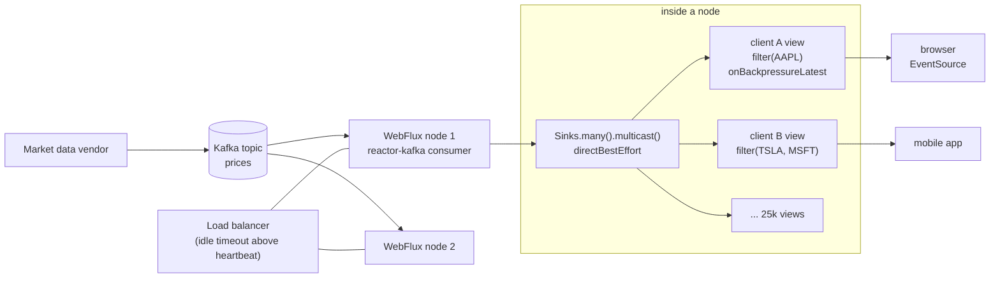

**Trade-offs:**
- **SSE** is one-way, plain HTTP, auto-reconnects with `Last-Event-ID` (send `id:` on each event), and passes through proxies. **WebSocket** is bidirectional but needs sticky handling and its own protocol (STOMP or custom).
- Each node only knows its own clients, so the feed must be broadcast to all nodes (Kafka consumer groups per node, or Redis pub/sub), not partitioned.
- You need heartbeats, an LB idle timeout above the heartbeat period, and connection-draining on deploy (clients reconnect).
- **Drop, don't buffer**: for prices, `onBackpressureLatest()` is correct because an old tick is worthless. For notifications that must not be lost, persist them and let the client catch up from `Last-Event-ID`.

**Who uses it:** brokerages and crypto exchanges for tickers, sports-betting odds, ride-hailing driver locations, and CI dashboards for live build logs. The lab's `PriceFeed` is the in-node half of this design.

### 7.2 API gateway on reactive: Spring Cloud Gateway

**Problem:** 40 microservices need one edge with routing, auth (JWT validation), rate limiting, CORS, request/response rewriting, and retries. The gateway does almost no CPU work per request but holds many connections open while waiting on slow backends.

**Solution:** **Spring Cloud Gateway** (server WebFlux flavor) is a WebFlux application on Reactor Netty. Each route is a predicate plus a chain of `GatewayFilter`s, executed as a reactive pipeline. Waiting on a backend costs no thread, so a few event loops proxy tens of thousands of concurrent requests. Rate limiting uses Redis reactively (`RequestRateLimiter` with a token bucket), and resilience comes from the Spring Cloud CircuitBreaker filter.

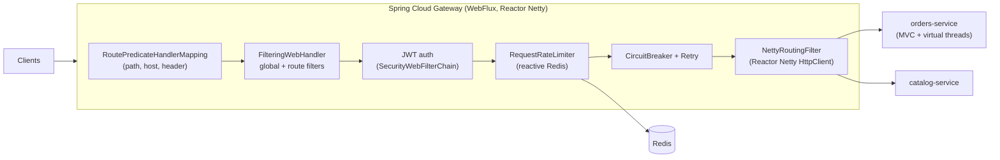

**Why reactive here:** the gateway's work is pure I/O relay with streaming bodies (it must not buffer a 1 GB upload), and it needs end-to-end cancellation when a client disconnects. This is the textbook reactive workload.

**Trade-offs:**
- Custom filters must be non-blocking. One blocking JDBC lookup in a filter stalls the whole gateway.
- Debugging filter chains is harder than debugging servlet filters.
- Spring Cloud also ships **Gateway Server MVC** (Servlet-based, works nicely with virtual threads). Since Spring Cloud 2025.0 the starters are named `spring-cloud-starter-gateway-server-webflux` and `spring-cloud-starter-gateway-server-webmvc`, and the WebFlux properties moved under `spring.cloud.gateway.server.webflux.*`. Choose MVC if your team and filters are blocking-friendly and you don't need streaming.

**Who uses it:** Spring-based platforms at banks, retailers, and telcos as the edge gateway. Netflix's Zuul 2 moved to Netty-based async I/O for the same reasons.

### 7.3 Aggregator / BFF calling 5 services concurrently: `Mono.zip` vs virtual threads

**Problem:** a product page BFF needs product, price, stock, reviews, and recommendations from 5 services. Called sequentially at about 80 ms each, that's 400 ms. Called concurrently, it's about 80 ms (the slowest). Optional parts (reviews, recommendations) must not fail the page, and the whole call needs a deadline.

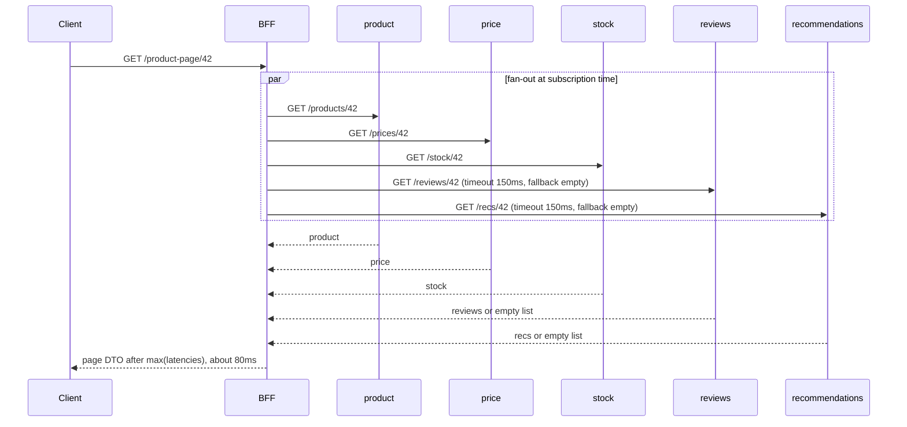

**Reactive version** (`WebClient` + `Mono.zip`):

```java
Mono<ProductPage> page(long id) {
    return Mono.zip(
            catalog.product(id),
            pricing.price(id),
            inventory.stock(id),
            reviews.top(id).timeout(Duration.ofMillis(150)).onErrorReturn(List.of()).defaultIfEmpty(List.of()),   // optional: degrade, never empty
            recs.forProduct(id).timeout(Duration.ofMillis(150)).onErrorReturn(List.of()).defaultIfEmpty(List.of()))
        .map(t -> new ProductPage(t.getT1(), t.getT2(), t.getT3(), t.getT4(), t.getT5()))
        .timeout(Duration.ofMillis(500));   // overall deadline; cancels every in-flight call
}
```

**Virtual-thread version** (`RestClient` on Java 21, Spring MVC with `spring.threads.virtual.enabled=true`):

```java
ProductPage page(long id) throws Exception {
    try (var executor = Executors.newVirtualThreadPerTaskExecutor()) {
        var product = executor.submit(() -> catalog.product(id));
        var price   = executor.submit(() -> pricing.price(id));
        var stock   = executor.submit(() -> inventory.stock(id));
        var reviews = executor.submit(() -> orEmpty(() -> this.reviews.top(id)));   // RestClient with a 150 ms read timeout
        var recs    = executor.submit(() -> orEmpty(() -> this.recs.forProduct(id)));
        return new ProductPage(product.get(500, MILLISECONDS), price.get(500, MILLISECONDS), stock.get(500, MILLISECONDS),
                               reviews.get(), recs.get());
    }   // close() waits for all tasks. StructuredTaskScope (a preview API in Java 21) adds cancel-on-failure
}
```

**Trade-offs:**

| | `Mono.zip` + `WebClient` | Virtual threads + `RestClient` |
|---|---|---|
| Readability | Operator chain, tuple accessors | Plain sequential-looking Java |
| Cancellation | Automatic: a timeout or client disconnect cancels all branches | Manual. Unfinished futures keep running unless you cancel them, or use `StructuredTaskScope` |
| Debugging | Reactor stack traces | Normal stack traces, normal debugger |
| Per-call memory | Tiny | A few KB per virtual thread, still cheap |
| Libraries | Need reactive clients | Any blocking client works (JDBC, SDKs) |
| Empty-result trap | `zip` silently completes empty | No equivalent trap |

**Who uses it:** BFF layers for web and mobile apps (e-commerce product pages, banking dashboards). Netflix popularized the API aggregation pattern. Today, an MVC + virtual-thread BFF is the simpler default, and the reactive version earns its place when the BFF also streams or already runs in a reactive gateway. The lab's `QuoteHandler.quote` is a two-way version of this `zip`.

### 7.4 Decision: reactive or MVC with virtual threads?

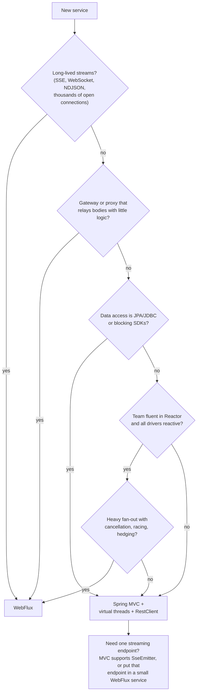

---

## 8. Pitfalls & debugging checklist

- [ ] **Endpoint returns 200 with an empty body.** A `Mono` completed empty: `zip` with an empty branch, a `findById` miss, a `filter` that dropped everything. Add `switchIfEmpty(Mono.error(...))` or `defaultIfEmpty`.
- [ ] **Nothing happens, no error, no log.** Nobody subscribed. You built a pipeline and dropped it (for example, a `repository.save(x)` whose result isn't returned or chained). Return or chain every publisher.
- [ ] **Throughput collapses under load, event-loop threads at 100% or stuck.** Something blocks a `reactor-http-nio-*` thread: JDBC, `Thread.sleep`, a blocking SDK, `block()`, synchronized I/O, heavy logging appenders. Find it with BlockHound in tests or a thread dump. Offload with `subscribeOn(boundedElastic())` or replace the client.
- [ ] **`IllegalStateException: block()/blockFirst()/blockLast() are blocking, which is not supported in thread reactor-http-nio-N`.** You called `block()` on an event-loop thread. Compose instead.
- [ ] **A 404 or 400 from the downstream is retried 3 times.** The retry has no `filter`. Retry only transient errors (timeouts, connect errors, 5xx, 429), and map client errors first.
- [ ] **A timeout covers all retries instead of each one.** `timeout` sits after `retryWhen`. Move it before.
- [ ] **A failed call is cached forever.** `Mono.cache()` caches errors. Use `cache(ttlValue, ttlError, ttlEmpty)` or `cacheInvalidateIf`.
- [ ] **MDC or trace id is missing in logs after a WebClient call.** Missing `io.micrometer:context-propagation`, `spring.reactor.context-propagation` still `limited`, or no `ThreadLocalAccessor` registered for that key (and `Slf4jThreadLocalAccessor` uses its own `cp.slf4j` key). In a `@WebFluxTest`, `ReactorAutoConfiguration` is not part of the slice, so the property is ignored there.
- [ ] **`@ControllerAdvice` doesn't catch errors from `RouterFunction` routes or `WebFilter`s.** It only applies to annotated controllers. Use a `WebExceptionHandler` (order below `-1`) or `RouterFunctions.route().onError(...)`.
- [ ] **`@Transactional` reactive method doesn't roll back.** The method subscribes internally, or the work escapes the returned publisher, or it uses a blocking `PlatformTransactionManager` with no `ReactiveTransactionManager` present.
- [ ] **R2DBC "connection acquisition timed out".** `flatMap` with default concurrency 256 against a pool of 10, or a connection held by a stream that is never cancelled. Cap concurrency, size `spring.r2dbc.pool.max-size`.
- [ ] **SSE client receives nothing until much later, or the proxy cuts it after 60 s.** No initial event or heartbeat. Response buffering in Nginx (`X-Accel-Buffering: no`). LB idle timeout below the heartbeat period.
- [ ] **`OverflowException: Could not emit tick`.** `Flux.interval` with a slow subscriber. Add an `onBackpressure*` strategy.
- [ ] **`Sinks.EmissionException: FAIL_NON_SERIALIZED`.** Concurrent `tryEmitNext`/`emitNext` without a retrying failure handler. Use `emitNext(v, EmitFailureHandler.busyLooping(...))` or serialize producers.
- [ ] **`DataBufferLimitException: Exceeded limit on max bytes to buffer`.** The body is above 256 KB. Raise `spring.codec.max-in-memory-size` or stream it.
- [ ] **Stack trace shows only Reactor internals.** Add `checkpoint("loading quote")`, enable `ReactorDebugAgent`, or temporarily `Hooks.onOperatorDebug()` in dev. Add `.log()` to see the signals.

---

## 9. Interview questions

<details><summary>Q1. What are the four Reactive Streams interfaces, and how does backpressure work?</summary>

`Publisher` (`subscribe`), `Subscriber` (`onSubscribe`, `onNext`, `onError`, `onComplete`), `Subscription` (`request(n)`, `cancel()`), and `Processor` (both a Subscriber and a Publisher). After subscribing, the subscriber receives a `Subscription` and must call `request(n)` before any data flows. The publisher may emit at most the total requested. That demand signal flowing upstream is backpressure: a slow consumer simply requests less. `request(Long.MAX_VALUE)` means unbounded. Signals are serial, `null` is forbidden, and `onError`/`onComplete` are terminal. Java 9 copied the interfaces into `java.util.concurrent.Flow`.
</details>

<details><summary>Q2. Mono vs Flux, and what is the difference between assembly time and subscription time?</summary>

`Mono` emits 0 or 1 item, `Flux` emits 0..N, and both then complete or error. Assembly time is when you chain operators: you build an immutable description, and nothing executes. Subscription time is when `subscribe()` is called: the subscription travels to the source, demand travels up, and data travels down. Consequences: `Mono.fromCallable` runs per subscriber, `Mono.just(expensive())` runs `expensive()` at assembly, and `switchIfEmpty(fallback())` builds its fallback eagerly unless wrapped in `Mono.defer`. The lab proves all three.
</details>

<details><summary>Q3. flatMap vs concatMap vs flatMapSequential?</summary>

`flatMap` subscribes to inner publishers eagerly (default concurrency 256) and emits in completion order: fastest throughput, no ordering. `concatMap` subscribes to one inner at a time and waits for it to complete: it keeps order but total time is the sum. `flatMapSequential` subscribes eagerly but buffers results and emits them in source order: concurrency plus order, at the cost of memory. In the lab, inners delayed 300/100/200 ms give `1,2,3` after 300 ms, `3,1,2` after 600 ms, and `3,1,2` after 300 ms respectively.
</details>

<details><summary>Q4. publishOn vs subscribeOn?</summary>

`subscribeOn` chooses the thread on which the subscription happens, so it moves the *source* and everything up to the first `publishOn`. Its position in the chain doesn't matter, and only the one closest to the source wins. `publishOn` switches the thread for all signals *below* it, so its position matters and you can use several. Typical use: `Mono.fromCallable(blockingCall).subscribeOn(Schedulers.boundedElastic())` to keep blocking work off the event loop.
</details>

<details><summary>Q5. Why must you never block the Netty event loop, and how do you call a blocking API from WebFlux?</summary>

Reactor Netty runs roughly one event-loop thread per core, each serving thousands of connections. Blocking one of them stalls every connection on that loop, so throughput collapses to a handful of concurrent requests. Wrap the blocking call lazily in `Mono.fromCallable(...)` and add `.subscribeOn(Schedulers.boundedElastic())`, which is a bounded pool (10 × cores) meant for blocking work. Use BlockHound in tests to detect accidental blocking. If most of your calls are blocking, WebFlux is the wrong choice: use MVC with virtual threads.
</details>

<details><summary>Q6. Cold vs hot publishers? What do share() and cache() do?</summary>

A cold publisher starts its work for each subscriber, from the beginning (HTTP calls, DB queries). A hot publisher emits regardless of subscribers, and late subscribers miss earlier data (sinks, tickers). `share()` (`publish().refCount()`) makes a cold source hot and shared: one upstream subscription while at least one subscriber exists. `cache()` makes it replay: the first subscriber triggers the work, and later subscribers get the stored signals, including errors. The lab proves that late `share()` subscribers miss elements and that `cache()` replays an error forever.
</details>

<details><summary>Q7. How do you do retries properly in Reactor?</summary>

Use `retryWhen(Retry.backoff(n, firstDelay))` with a `filter` for transient errors only (timeouts, connection errors, 5xx, 429). Put `timeout` before `retryWhen` so each attempt gets its own deadline, and map non-retryable errors with `onErrorMap` before it. Exhaustion throws `RetryExhaustedException` (check with `Exceptions.isRetryExhausted`), which you can turn into a fallback with `onErrorResume`. Remember that retry resubscribes and re-runs the whole upstream, so only retry idempotent operations. Test it with `StepVerifier.withVirtualTime` so backoff delays don't slow the build.
</details>

<details><summary>Q8. How does error handling differ between Reactor and try/catch?</summary>

An error is a terminal signal. After `onError`, the sequence is over, so `onErrorResume` *replaces* the rest of the sequence rather than continuing it. `onErrorReturn` gives a fallback value, `onErrorMap` translates the type, and `doOnError` only peeks. To skip a single bad element, recover inside the `flatMap` for that element. In WebFlux, `@ControllerAdvice` handles errors from annotated controllers only. A `WebExceptionHandler` handles everything, including functional endpoints and filters, which is why the lab uses one global `WebExceptionHandler` producing ProblemDetail.
</details>

<details><summary>Q9. Reactor Context vs ThreadLocal? How does MDC logging work in WebFlux?</summary>

A `ThreadLocal` is tied to a thread, but a reactive request hops threads and threads interleave requests, so a `ThreadLocal` is lost or leaks. The Reactor `Context` is an immutable map tied to the subscription. You write it with `contextWrite` (visible upstream of the call) and read it with `deferContextual`. To keep `ThreadLocal`-based libraries working (MDC, tracing), Micrometer's context-propagation library registers `ThreadLocalAccessor`s, and with `spring.reactor.context-propagation=auto` (`Hooks.enableAutomaticContextPropagation()`) Reactor restores those `ThreadLocal`s from the Context around every operator. The default `limited` mode restores them only in `handle` and `tap`.
</details>

<details><summary>Q10. What does WebFlux look like inside, compared with Spring MVC?</summary>

Netty receives the request. `ReactorHttpHandlerAdapter` adapts it to Spring's `HttpHandler`, and `HttpWebHandlerAdapter` creates a `ServerWebExchange`, runs the `WebExceptionHandler` and `WebFilter` chains, and calls `DispatcherHandler`. That finds a handler through `HandlerMapping`s (`RouterFunctionMapping`, `RequestMappingHandlerMapping`), invokes it through a `HandlerAdapter`, and writes the returned publisher with a `HandlerResultHandler`, using `Encoder`/`Decoder` codecs. MVC has the same shape with `DispatcherServlet`, servlet filters, and blocking `HttpMessageConverter`s, and its per-request state lives in `ThreadLocal`s.
</details>

<details><summary>Q11. What can't R2DBC do that JPA can? How do transactions work?</summary>

No persistence context, no dirty checking, no lazy loading, no relationships or cascades, no schema generation, and no `Page` with an automatic COUNT. You save explicitly and compose related queries yourself. Transactions use `R2dbcTransactionManager`, either declaratively (`@Transactional` on a method returning the publisher) or programmatically with `TransactionalOperator.transactional(flux)`. The transaction is bound to the Reactor Context, not a `ThreadLocal`, and it rolls back on error *or cancellation*. Flyway still needs a JDBC driver.
</details>

<details><summary>Q12. WebClient vs RestClient: which do you choose in 2026?</summary>

In a Spring MVC app, especially with virtual threads, use `RestClient`: synchronous, simple, and it scales because blocking a virtual thread is cheap. Use `WebClient` in WebFlux apps, for streaming responses (`bodyToFlux`, SSE), and when you need reactive composition with cancellation across many concurrent calls. Both back `@HttpExchange` interfaces. In Boot 4 they come from separate starters (`spring-boot-starter-webclient`, `spring-boot-starter-restclient`).
</details>

<details><summary>Q13. When should you NOT use reactive?</summary>

For typical CRUD services on JDBC/JPA, when the team isn't fluent in Reactor, for CPU-bound work, or when key dependencies are blocking. Java 21 virtual threads give blocking code the I/O scalability that was reactive's main selling point, while keeping simple stack traces, `ThreadLocal`s, JPA, and the debugger. Reactive still wins for long-lived streaming (SSE/WebSocket), gateways and proxies, and complex fan-out with cancellation. The debugging and onboarding costs are real and continuous.
</details>

<details><summary>Q14. How do you handle a slow SSE client when broadcasting to thousands?</summary>

Use a hot source that doesn't let one subscriber slow the others: `Sinks.many().multicast().directBestEffort()` drops elements only for subscribers without demand, whereas `share()`/`publish()` paces everyone to the slowest. Give each client its own bounded strategy: `onBackpressureLatest()` for prices, or `onBackpressureBuffer(n, DROP_OLDEST)`. Add heartbeats to keep proxies from closing the connection, send event ids so clients can resume with `Last-Event-ID`, and broadcast the feed to every node, because each node only owns its own connections.
</details>

<details><summary>Q15. How do you test reactive code?</summary>

Use `StepVerifier` from reactor-test: `expectNext`, `expectError`, `verifyComplete`, `thenRequest` for backpressure, `thenCancel` for infinite streams, and `withVirtualTime` with `thenAwait` for delays and retries without waiting. Use `TestPublisher` to emit on demand. For HTTP, use `@WebFluxTest` with `WebTestClient` (slice) and `@SpringBootTest(RANDOM_PORT)` with `@AutoConfigureWebTestClient` (Boot 4) for the full stack. Use Testcontainers with `@ServiceConnection` for R2DBC (`testcontainers-r2dbc` provides the R2DBC connection details). Test SSE by taking `returnResult(...).getResponseBody()` into a `StepVerifier` and cancelling.
</details>

---

## 10. Sources

- Spring Framework reference: [Web on Reactive Stack](https://docs.spring.io/spring-framework/reference/web/webflux.html), [DispatcherHandler](https://docs.spring.io/spring-framework/reference/web/webflux/dispatcher-handler.html), [Functional Endpoints](https://docs.spring.io/spring-framework/reference/web/webflux-functional.html), [WebClient](https://docs.spring.io/spring-framework/reference/web/webflux-webclient.html), [Error Responses / ProblemDetail](https://docs.spring.io/spring-framework/reference/web/webflux/ann-rest-exceptions.html), [Reactive transactions](https://docs.spring.io/spring-framework/reference/data-access/transaction/programmatic.html), [HTTP Interface Clients](https://docs.spring.io/spring-framework/reference/integration/rest-clients.html#rest-http-interface), [Kotlin coroutines](https://docs.spring.io/spring-framework/reference/languages/kotlin/coroutines.html)
- [Spring Framework 7.0 Release Notes](https://github.com/spring-projects/spring-framework/wiki/Spring-Framework-7.0-Release-Notes) · [Spring Boot 4.0 Migration Guide](https://github.com/spring-projects/spring-boot/wiki/Spring-Boot-4.0-Migration-Guide) · [Spring Boot 4.0 Release Notes](https://github.com/spring-projects/spring-boot/wiki/Spring-Boot-4.0-Release-Notes) · [Spring Boot 4.1 Release Notes](https://github.com/spring-projects/spring-boot/wiki/Spring-Boot-4.1-Release-Notes)
- Spring Boot reference: [Reactive Web Applications](https://docs.spring.io/spring-boot/reference/web/reactive.html), [SQL Databases: R2DBC](https://docs.spring.io/spring-boot/reference/data/sql.html#data.sql.r2dbc), [Database initialization with Flyway](https://docs.spring.io/spring-boot/how-to/data-initialization.html), [Testcontainers service connections](https://docs.spring.io/spring-boot/reference/testing/testcontainers.html)
- Spring Data R2DBC: [reference](https://docs.spring.io/spring-data/relational/reference/r2dbc.html)
- Project Reactor: [reference guide](https://projectreactor.io/docs/core/release/reference/), [Context-Propagation Support](https://docs.spring.io/projectreactor/reactor-core/docs/3.7.x/reference/html/advanced-contextPropagation.html), [Which operator do I need?](https://projectreactor.io/docs/core/release/reference/apdx-operatorChoice.html), [BlockHound](https://github.com/reactor/BlockHound)
- Spring blog: [Context Propagation with Project Reactor, parts 1 to 3](https://spring.io/blog/2023/03/28/context-propagation-with-project-reactor-1-the-basics), [What's new in reactor-core 3.6.0](https://spring.io/blog/2023/10/31/what-new-is-coming-in-reactor-core-3-6-0), [Spring Cloud 2025.0.0 (Northfields)](https://spring.io/blog/2025/05/29/spring-cloud-2025-0-0-is-abvailable)
- Micrometer: [Context Propagation](https://docs.micrometer.io/context-propagation/reference/purpose.html)
- [Reactive Streams specification](https://github.com/reactive-streams/reactive-streams-jvm/blob/master/README.md#specification) · [Spring Cloud Gateway reference](https://docs.spring.io/spring-cloud-gateway/reference/)
- Baeldung (3.x era, verify against section 6): [Intro to Spring WebFlux](https://www.baeldung.com/spring-webflux), [flatMap vs concatMap](https://www.baeldung.com/java-reactor-flatmap-vs-map), [Spring WebClient](https://www.baeldung.com/spring-5-webclient), [Spring Data R2DBC](https://www.baeldung.com/spring-data-r2dbc), [Server-Sent Events in Spring](https://www.baeldung.com/spring-server-sent-events), [Testing Reactive Streams with StepVerifier](https://www.baeldung.com/reactive-streams-step-verifier-test-publisher)
- Oracle: [`java.util.concurrent.Flow`](https://docs.oracle.com/en/java/javase/21/docs/api/java.base/java/util/concurrent/Flow.html), [Virtual Threads (JEP 444)](https://docs.oracle.com/en/java/javase/21/core/virtual-threads.html), [`StructuredTaskScope` (preview in 21)](https://docs.oracle.com/en/java/javase/21/docs/api/java.base/java/util/concurrent/StructuredTaskScope.html), [`com.sun.net.httpserver.HttpServer`](https://docs.oracle.com/en/java/javase/21/docs/api/jdk.httpserver/com/sun/net/httpserver/HttpServer.html)
