# 14 — Microservices & Spring Cloud

> **Lab:** capstone 2, [`projects/02-microservices-platform`](https://github.com/sumit-mishra-itp/springboot-roadmap/tree/main/projects/02-microservices-platform). This note has no separate lab. The code in section 4.1 was compiled and tested in a throwaway Boot 4.1.2 + Spring Cloud 2025.1.4 project, with 4/4 tests green.
>
> **Capstone use:**
> - the `gateway`: JWT validation, routing and rate limiting;
> - the `config-server`;
> - `@HttpExchange` clients between `order-service` and `payment-service`, guarded by Resilience4j circuit breakers;
> - the Kafka saga with outbox;
> - the Kubernetes manifests.
>
> **Prereqs:**
> - 05 REST APIs;
> - 07 Security (JWT, OAuth2 client);
> - 08 Testing;
> - 10 Observability (tracing);
> - 11 Messaging with Kafka (outbox, sagas);
> - 13 Reactive helps for the WebFlux gateway.

---

## 1. What & why

A **microservice** is a small service that you can deploy independently. It owns one business capability **and its data**, and it talks to other services only over the network: HTTP, gRPC, or messages.

The point is not "small code". The point is **independent deployability**. Team A can ship `payment-service` on Tuesday without coordinating with team B's `catalog-service` release train.

**The three architectures you must be able to compare:**

| | Monolith | Modular monolith | Microservices |
|---|---|---|---|
| Deployable units | 1 | 1 | Many (one per service) |
| Module boundaries | Package conventions, which often erode | **Enforced** in one codebase (Spring Modulith, ArchUnit, Java modules) | Enforced by the network |
| Calls between modules | In-process method call (ns) | In-process call or in-process event | Network call (ms). It can fail or time out |
| Transactions | One ACID database transaction | One ACID transaction, or events after commit | **No distributed ACID.** Use sagas, outbox and eventual consistency |
| Data | One schema | One database, with one schema *per module* by convention | **Database per service** |
| Scaling | Whole app | Whole app | Per service (scale only `search-service` on Black Friday) |
| Team scaling | Painful past about 2 teams in one codebase | Good up to many teams, if the boundaries hold | Best: each team owns its service end to end |
| Ops cost | Lowest | Low | **High:** discovery, config, tracing, retries, versioning, Kubernetes, and on-call per service |
| Refactoring a boundary | Easy (IDE refactor) | Easy | Hard (API versioning, data migration across services) |

**Good reasons to split:**
- **Different teams** need to release independently. Conway's law says the architecture copies the org chart, so design both together.
- **Different scaling or availability profiles.** Image resizing needs 40 CPU-heavy pods. The admin back office needs one.
- **Different technology or compliance needs.** For PCI scope, isolating card handling in one small `payment-service` shrinks the audit surface.
- **Fault isolation.** A memory leak in recommendations must not take down checkout.

**Bad reasons to split:**
- "It's modern."
- "The codebase is messy." A distributed mess is worse.
- "We want to use Kubernetes."
- A team of 4 developers.

Martin Fowler's *MonolithFirst* advice still holds. Start with a well-modularized monolith. Find the real boundaries, then extract the modules that earn it.

### 1.1 The cost: the eight fallacies of distributed computing

Peter Deutsch and colleagues at Sun listed the assumptions every newcomer makes. Every one of them is false.

| Fallacy | What really happens | What you add because of it |
|---|---|---|
| 1. The network is reliable | Packets drop, connections reset, and pods restart mid-request | Timeouts, retries with backoff, idempotency keys |
| 2. Latency is zero | Each hop costs 1 to 50 ms, and fan-outs multiply the tail latency (p99) | Fewer hops, parallel API composition, caching, async calls |
| 3. Bandwidth is infinite | Chatty APIs and huge JSON payloads saturate links | Coarse-grained APIs, pagination, compression |
| 4. The network is secure | Traffic between services (east-west traffic) can be sniffed or spoofed | mTLS (service mesh), JWT relay, client credentials |
| 5. Topology doesn't change | Pods get new IPs on every deploy | Service discovery (Kubernetes DNS or Eureka). Never hard-code IPs |
| 6. There is one administrator | Many teams, many clusters, many clouds | A config server or ConfigMaps, GitOps, clear ownership |
| 7. Transport cost is zero | Serialization CPU, egress bills, NAT gateway charges | Efficient formats; colocate chatty services |
| 8. The network is homogeneous | A mix of HTTP/1.1, HTTP/2, gRPC, proxies and ALBs | Standard protocols, `traceparent` headers, a gateway at the edge |

People often add a ninth: **"versioning is free"**. Every API you expose is a contract that other teams deploy against (section 5.2).

### 1.2 Finding the boundary: DDD bounded contexts

Domain-Driven Design (DDD) tells you where to split. A **bounded context** is a part of the domain where every term has *one* meaning. "Product" means a different thing in each context:
- In *Catalog*, it means price, stock and title.
- In *Shipping*, it means weight and dimensions.
- In *Ordering*, it means a SKU line with a frozen price.

One shared `Product` model for all three becomes a "god entity" that couples everything.

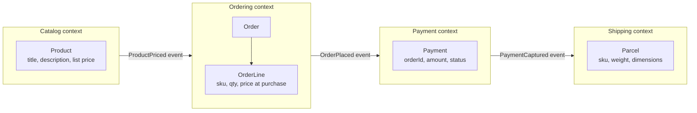

**Rules of thumb:**
- A bounded context maps to **one service at most**. At first it is fine, and common, for one service to own several small contexts.
- Contexts talk through a published contract, either an API or an event. Each side uses an **anti-corruption layer** to translate the other side's model into its own.
- Never share entity classes across services in a "common" jar. That brings back the monolith's coupling and adds a deploy dependency.
- If two services must always change and deploy together, you split one context in the wrong place. That is a **distributed monolith**, the worst of both worlds.

### 1.3 Database per service

Each service owns its tables. No other service reads them, not even with a "read-only" user.

| Pattern | Verdict | Why |
|---|---|---|
| Shared database, shared tables | ❌ Anti-pattern | Every schema change becomes a cross-team release, and services are coupled through SQL that nobody sees |
| Shared server, a separate schema per service | ✅ OK to start | Cheap. Enforce it with database users that can see only their own schema |
| A separate database per service | ✅ Best isolation | Independent scaling and technology choice: Postgres for orders, Redis for sessions, OpenSearch for search |

There are two costs:
- **Joins across services** become API calls or local read models (section 3.8).
- **Transactions across services** become sagas (section 3.7).

**When *not* to use microservices:**
- **One team, one product, and an unclear domain.** Build a modular monolith with **Spring Modulith** (section 5.8) instead. Modulith:
  - checks module boundaries in a test;
  - publishes events between modules through a transactional event registry, which works like an in-process outbox;
  - lets you extract a module into a service later.
- **No platform.** That means no CI/CD per service, no central logs or tracing, and no on-call rotation. Microservices without automation multiply outages.
- **Strong consistency across entities is the core of the domain**, such as a ledger that must balance after every write. Keep it in one service and one database.

---

## 2. Mental model

Think of a microservice platform as **a city**:
- The **gateway** is the city gate. It is the single entrance, checks passports (JWTs), and controls traffic (rate limits).
- **Service discovery** is the phone book.
- **Config** is the city's rulebook, posted on a board that everyone reads.
- **Circuit breakers** are the fuses in each house. One short circuit does not black out the street.
- **Tracing** is the parcel tracking number. It follows a request through every building.
- The **message broker** is the postal service. It carries anything that does not need an answer right now.

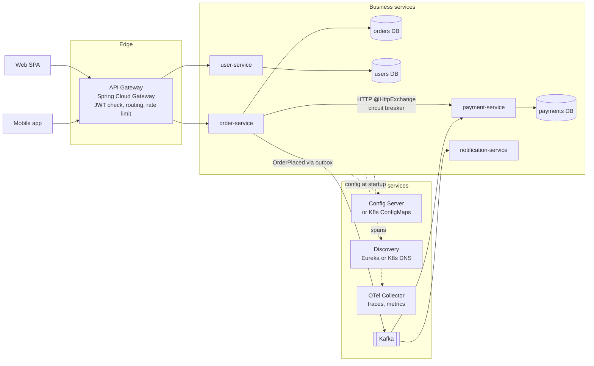

### 2.1 Sync vs async communication

| | Synchronous (HTTP or gRPC request-response) | Asynchronous (events or commands over a broker) |
|---|---|---|
| Coupling in time | Both sides must be up **now** | The producer doesn't care whether the consumer is down. The broker buffers |
| Latency the user sees | The sum of the call chain | Only the local write. The rest happens later |
| Failure handling | Timeouts, retries, circuit breakers, fallbacks | Retries, dead-letter topics, idempotent consumers |
| Consistency | Can read the latest state, if the callee is up | Eventually consistent |
| Good for | Queries the user waits for (price, stock check) and commands that need an immediate yes or no (authorize a card) | State changes that others react to (`OrderPlaced`), long workflows, fan-out to many consumers |
| Spring tool | `RestClient` + `@HttpExchange`, `WebClient` | Spring Kafka, Spring Cloud Stream (note 11) |

**Rule:** use sync for reads the user is waiting for, and async to propagate state changes.

A long **synchronous chain** (A calls B calls C calls D) multiplies the chance of failure, because availability multiplies along the chain. Four services at 99.9% each give 99.6% for the whole chain. Each extra hop also adds its own p99 latency.

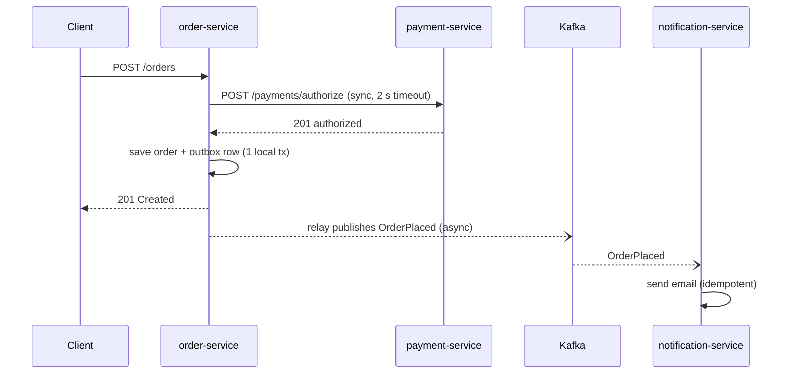

### 2.2 The Spring Cloud toolbox (release train 2025.1.4 "Oakwood")

Spring Cloud is a **release train**: a BOM (`spring-cloud-dependencies`) that pins compatible versions of many independent projects. You import the BOM once, then add starters without versions.

**2025.1.x supports Boot 4.0.x, and Boot 4.1.x from 2025.1.2 on** (spring.io/projects/spring-cloud). Initializr generates `2025.1.4` for Boot 4.1.2.

| Need | Project (version in the 2025.1.4 BOM) | Starter | Initializr id |
|---|---|---|---|
| API gateway, servlet stack | Gateway 5.0.4 | `spring-cloud-starter-gateway-server-webmvc` | `cloud-gateway` |
| API gateway, reactive stack | Gateway 5.0.4 | `spring-cloud-starter-gateway-server-webflux` | `cloud-gateway-reactive` |
| Circuit breaker abstraction + Resilience4j | CircuitBreaker 5.0.3 | `spring-cloud-starter-circuitbreaker-resilience4j` | `cloud-resilience4j` |
| Client-side load balancing | Commons 5.0.4 | `spring-cloud-starter-loadbalancer` | `cloud-loadbalancer` |
| Eureka client and server | Netflix 5.0.3 | `spring-cloud-starter-netflix-eureka-client` / `-server` | `cloud-eureka` / `cloud-eureka-server` |
| Config server and client | Config 5.0.6 | `spring-cloud-config-server` / `spring-cloud-starter-config` | `cloud-config-server` / `cloud-config-client` |
| Broadcast refresh | Bus 5.0.4 | `spring-cloud-bus` plus a Kafka or Rabbit binder | `cloud-bus` |
| Declarative HTTP client (legacy) | OpenFeign 5.0.4 | `spring-cloud-starter-openfeign` | `cloud-feign` |
| Kubernetes-native discovery and config | Kubernetes 5.0.4 | `spring-cloud-starter-kubernetes-client-*` | none |
| Messaging abstraction | Stream 5.0.4 | `spring-cloud-stream` plus a binder | `cloud-stream` |
| Consul, Zookeeper, Vault, Function, Task | 5.0.x | various | various |

The versions come from the `spring-cloud-dependencies-2025.1.4.pom` published on Maven Central. **Spring Cloud Contract is no longer in the train's BOM** (section 6).

---

## 3. How it works internally

### 3.1 Spring Cloud Gateway

A gateway is a **reverse proxy with a programmable pipeline**. For each request, it:
1. finds the first **route** whose **predicates** all match;
2. runs that route's **filters**. Pre-filters change the outgoing request, and post-filters change the response;
3. proxies the request to the route's **URI**.

**There are two server variants, plus a library mode:**

| | Server **WebFlux** | Server **Web MVC** |
|---|---|---|
| Stack | Reactor Netty, non-blocking (note 13) | Servlet (Tomcat), blocking. Works well with virtual threads |
| Starter | `spring-cloud-starter-gateway-server-webflux` | `spring-cloud-starter-gateway-server-webmvc` |
| Property prefix | `spring.cloud.gateway.server.webflux.*` | `spring.cloud.gateway.server.webmvc.*` |
| Route model | A `RouteLocator` (`RouteLocatorBuilder` DSL), or YAML with `predicates`/`filters`. Plus `GatewayFilter` / `GlobalFilter` | A `RouterFunction<ServerResponse>` built with `GatewayRouterFunctions.route()`, or YAML. This is plain Spring MVC functional routing |
| Filters | `GatewayFilter` factories: `StripPrefix`, `RequestRateLimiter`, `TokenRelay`, `CircuitBreaker`, `Retry` | `HandlerFilterFunction`s and before/after functions: `BeforeFilterFunctions.stripPrefix`, `Bucket4jFilterFunctions.rateLimit`, `TokenRelayFilterFunctions.tokenRelay`, `CircuitBreakerFilterFunctions.circuitBreaker` |
| Rate limiter | `RequestRateLimiter` with **Redis** (`spring-boot-starter-data-redis-reactive`) | `RateLimiter` filter with **Bucket4j** |
| Pick it when | Very high concurrency, streaming or WebSockets, and the team knows Reactor | The team knows MVC and wants blocking code and simple debugging, and virtual threads cover concurrency |

The library mode is **Proxy Exchange** (`spring-cloud-gateway-proxyexchange-webmvc` / `-webflux`). You add a `ProxyExchange` parameter to a controller method to write proxy endpoints by hand. It is a library, not a standalone gateway.

**How a Web MVC gateway request flows:**
- Routes are ordinary `RouterFunction` beans. `DispatcherServlet` finds them through `RouterFunctionMapping`, like any functional endpoint (note 05).
- `HandlerFunctions.http()` is the proxy handler.
- The `uri(...)` before-filter stores the target URI as a request attribute. The handler then streams the request to that URI.

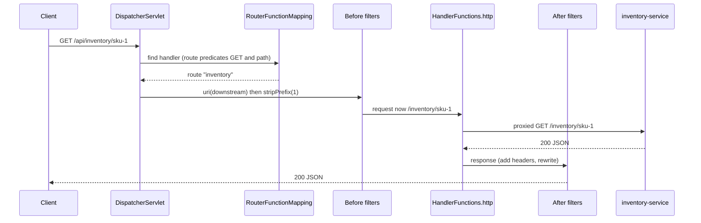

**Predicates** decide *whether* a route matches:
- `Path`, `Method`, `Host`, `Header`, `Query`, `Cookie`, `RemoteAddr`;
- `Weight`, for canary releases (send 5% to v2);
- `Before` / `After` / `Between`, for time windows.

**Filters** decide *what happens* to a matched request:

| Purpose | Filters |
|---|---|
| Rewrite paths | `StripPrefix`, `RewritePath`, `PrefixPath` |
| Change headers | `AddRequestHeader`, `RemoveRequestHeader` |
| Resilience | `CircuitBreaker`, `Retry` |
| Security | `TokenRelay` |
| Limits | `RequestSize`, the rate limiter |
| Discovery | `LoadBalancer`, which resolves `lb://service-id` |

**Rate limiting.** Both variants use the **token bucket** algorithm:
- A bucket holds up to *capacity* tokens and refills at a fixed rate.
- Each request takes one token.
- When the bucket is empty, the request is rejected with `429 Too Many Requests`.
- The *key* decides whose bucket a request uses: per user (principal), per API key, or per client IP.

**WebFlux with Redis:**
- The settings are:
  - `redis-rate-limiter.replenishRate`: tokens added per second;
  - `burstCapacity`: the bucket size (0 blocks everything);
  - `requestedTokens`: the cost per request, default 1.
- The default `KeyResolver` is `PrincipalNameKeyResolver`. If no key is found, the request is **denied** (`spring.cloud.gateway.filter.request-rate-limiter.deny-empty-key`).
- Redis runs the bucket math atomically in a Lua script, so all gateway replicas share one bucket per key.

**Web MVC with Bucket4j:**
- Configure it with `rateLimit(c -> c.setCapacity(100).setPeriod(Duration.ofMinutes(1)).setKeyResolver(...))`.
- You can set the key resolver **only in the Java DSL**.
- A missing key is denied with **403**.
- The backend is a Bucket4j `AsyncProxyManager` bean. The docs show a Caffeine one, which is local to a single node.
- For a limit across the whole cluster, you would plug in one of Bucket4j's distributed `ProxyManager`s, such as its Redis integrations. This is *(unverified with the gateway)*.

**Token relay.** This is the **BFF token-handler pattern**:
1. At the edge, the user logs in through OAuth2. The gateway is an OAuth2 *client* (`spring-boot-starter-oauth2-client`).
2. The `TokenRelay` filter takes the logged-in user's access token from the `OAuth2AuthorizedClientService`.
3. It forwards the token downstream as `Authorization: Bearer ...`.
4. Downstream services are resource servers that validate the JWT (note 07).

The browser holds only a session cookie and never sees the token.

**Forwarded headers.** Since the 2025.0 fixes, the gateway **does not process** `X-Forwarded-*` and `Forwarded` headers by default. Behind a load balancer, set `spring.cloud.gateway.server.webflux.trusted-proxies` (or `...server.webmvc.trusted-proxies`) to a regex that matches the trusted proxy addresses. Otherwise, downstream services see the gateway as the client.

### 3.2 Service discovery and client-side load balancing

**The problem:** `order-service` must call `payment-service`. Payment runs as 3 pods, and their IPs change on every deploy.

**Option A, a registry (Eureka):**
1. Each instance *registers* itself with the Eureka server at startup and sends a heartbeat every 30 s.
2. Clients *fetch* the registry, as a delta every 30 s, and cache it.
3. A client-side load balancer picks an instance for each call.

**Option B, platform DNS (Kubernetes):**
1. A Kubernetes `Service` named `payment-service` gets a stable DNS name (`payment-service.shop.svc.cluster.local`) and a virtual IP.
2. `kube-proxy` (iptables or IPVS) or the CNI spreads connections across the *ready* pods. Readiness probes decide which pods are ready.
3. The client just calls `http://payment-service`.

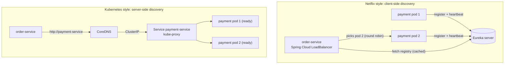

**Why most Kubernetes shops skip Eureka:**
- Kubernetes already *is* a registry. Its endpoints come from readiness probes, which know more than a heartbeat does: the pod is up *and* ready.
- Eureka is one more stateful server to run, secure and upgrade.
- Eureka is stale for 30 to 90 s: the heartbeat, the client cache and the LoadBalancer cache add up. During that window, clients call dead pods.
- Non-Java services (Node, Go) get DNS for free, but would need a Eureka client.
- A service mesh (Istio, Linkerd) adds mTLS, retries and outlier detection *below* the app, in any language.

Eureka still makes sense on VMs, on ECS without Cloud Map, or in mixed setups where some services run outside the cluster.

**Spring Cloud LoadBalancer internals.**
- The abstraction is `ReactiveLoadBalancer<ServiceInstance>`.
- The default implementation is **`RoundRobinLoadBalancer`**. The other built-in one is `RandomLoadBalancer`.
- Instances come from a chain of `ServiceInstanceListSupplier` decorators:

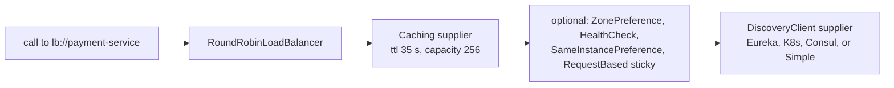

- **Blocking clients** get a load-balancer interceptor. Put `@LoadBalanced` on a `RestTemplate` or `RestClient.Builder` bean. The host part of `http://payment-service/...` is then treated as a service id.
- **HTTP service groups** are new in Commons 5.0. `LoadBalancerRestClientHttpServiceGroupConfigurer` load-balances `@HttpExchange` clients. Whether a group is load-balanced depends on `spring.http.serviceclient.<group>.base-url`:

| `base-url` | Load-balanced? |
|---|---|
| Unset | Yes. It becomes `http://<groupName>`, so the group name must equal the service id |
| Uses the `lb://` scheme | Yes |
| A plain `http://...` URL | No. This is what you want on Kubernetes, where the Service does the balancing |

- If the `DiscoveryClient` already caches (Eureka does), disable the LoadBalancer cache with `spring.cloud.loadbalancer.cache.enabled=false`. Otherwise one stale cache sits on top of another.

### 3.3 Spring Cloud Config

**Config Server** is a Spring Boot app that serves configuration over HTTP from a backend:
- **git**, the default and the best practice, because it gives you audit history and PR review;
- a filesystem, Vault, JDBC or Redis;
- AWS: S3, Parameter Store, Secrets Manager.

The URL shape is `/{application}/{profile}/{label}`. The *label* is a git branch, tag or commit.

**Config client:** add `spring-cloud-starter-config` and import the server like any other config source. This is the Boot 2.4+ style, and it is still current:

```yaml
spring:
  application:
    name: order-service          # becomes {application}
  config:
    import: "optional:configserver:http://config-server:8888"
```

The server merges these files, each overriding the one before it:
1. `application.yml`
2. `application-{profile}.yml`
3. `order-service.yml`
4. `order-service-{profile}.yml`

These property sources rank **above** the jar's own `application.yml`, so the central repo wins.

`optional:` lets the app start when the server is down. Remove it in production if starting with stale defaults is worse than failing.

**Refresh without restart:**

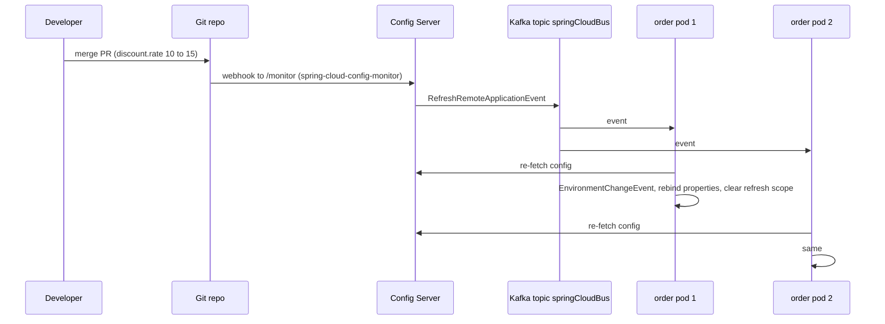

On a refresh, `ContextRefresher` does this inside each app:
1. It rebuilds the `Environment` from the property sources and compares the old and new values.
2. It publishes an **`EnvironmentChangeEvent`** listing the changed keys. `ConfigurationPropertiesRebinder` reacts by **re-binding `@ConfigurationProperties` beans in place**. That only works for **JavaBean-style** classes with setters. A throwaway Boot 4.1.2 + Spring Cloud 2025.1.4 test called `ContextRefresher.refresh()` after changing three properties and observed:
   - a JavaBean-style `@ConfigurationProperties` class: **new value**, same instance;
   - a **record** `@ConfigurationProperties`: **old value**, same instance. It is constructor-bound and immutable, so the rebinder can't change it;
   - a plain `@Value` field on a singleton: **old value**;
   - a `@Value` field on a `@RefreshScope` bean: **new value**.

   The repo convention is records for config, so treat records as **fixed until restart**. Use a JavaBean-style class for the few values that must hot-refresh.
3. It calls `RefreshScope.refreshAll()`. Beans annotated with **`@RefreshScope`** are scoped proxies (note 02). The refresh drops the cached target, so the *next* method call creates a new instance with the new `@Value`s. Use it for beans that build something expensive from config at construction time, such as a client with a URL baked in.

There are two ways to trigger a refresh:
- **One instance:** `POST /actuator/refresh`.
- **Every instance:** use **Spring Cloud Bus**. `POST /actuator/busrefresh` on any one instance broadcasts the refresh over Kafka or RabbitMQ.

**Config Server vs Kubernetes vs AWS:**

| | Spring Cloud Config | Kubernetes ConfigMaps / Secrets | AWS Parameter Store / Secrets Manager ([note 16](../16-aws/aws-spring.md)) |
|---|---|---|---|
| Source of truth | A git repo | YAML manifests (GitOps with Argo CD or Flux) | The AWS service |
| History and audit | Git log | Git, if you use GitOps | Parameter versions, CloudTrail |
| Secrets | `{cipher}` encrypted values, or a Vault backend | Secrets are only base64-encoded. Encrypt etcd, or use External Secrets or Sealed Secrets | KMS-encrypted and IAM-scoped. Secrets Manager adds rotation |
| How the app reads it | `spring.config.import=configserver:` | Env vars, mounted files (`spring.config.import=configtree:/etc/config/`), or Spring Cloud Kubernetes | `spring.config.import=aws-parameterstore:` (Spring Cloud AWS) |
| Live refresh | `/actuator/refresh` or Bus | Mounted files update. Env vars need a pod restart, usually a rolling restart | Spring Cloud AWS reload, or a restart |
| Extra infra | A config server, which must be highly available | None | None (managed) |
| Best fit | VMs, mixed platforms, Netflix-era stacks | Anything on Kubernetes | Anything on AWS (ECS, EKS, Lambda) |

On Kubernetes, most teams treat config as **immutable per deploy**. You change the ConfigMap in git, and Argo CD rolls the pods. That gives up hot refresh in exchange for reproducibility: every pod runs exactly the config of its revision.

### 3.4 Resilience4j: the fault-tolerance toolkit

Resilience4j is a lightweight library. It replaced Netflix Hystrix, which has been in maintenance mode since 2018. Each pattern is a separate module that **decorates** a `Supplier`, `Callable`, `Function` or reactive type.

**Circuit breaker.**
- It counts call outcomes in a **sliding window**. The window is either count-based (the last N calls) or time-based (the last N seconds).
- It *opens* when the **failure rate** or the **slow-call rate** in the window reaches a threshold.
- While open, it fails fast with `CallNotPermittedException`. The caller gets an instant fallback instead of a thread blocked for 30 s.

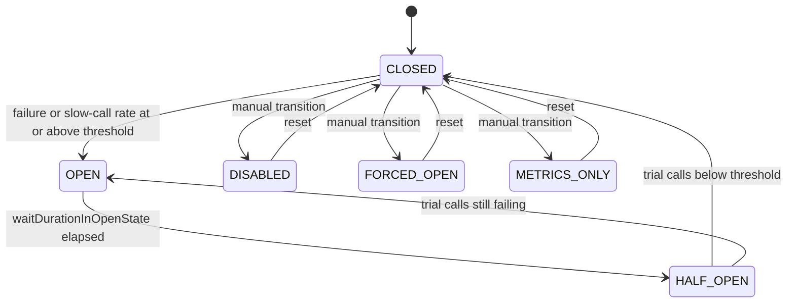

| State | What it does |
|---|---|
| **CLOSED** | Calls flow, and their outcomes are recorded. It can only open after `minimumNumberOfCalls` calls are recorded |
| **OPEN** | Every call is rejected immediately with `CallNotPermittedException`. Route it to the fallback. `automaticTransitionFromOpenToHalfOpenEnabled` is optional |
| **HALF_OPEN** | Lets `permittedNumberOfCallsInHalfOpenState` trial calls through. If they succeed, it closes. If they fail, it opens again |
| **DISABLED** | Operator override: always allow |
| **FORCED_OPEN** | Operator override: always reject |
| **METRICS_ONLY** | Operator override: record, but never trip. Useful during incidents and for dark launches |

Resilience4j's defaults are worth knowing, because they surprise people:

| Setting | Default | Meaning |
|---|---|---|
| `slidingWindowType` / `slidingWindowSize` | COUNT_BASED / 100 | The last 100 calls |
| `minimumNumberOfCalls` | 100 | No decision until 100 calls are recorded, so a test with 5 failures never trips it. Lower it |
| `failureRateThreshold` | 50 (percent) | |
| `slowCallDurationThreshold` / `slowCallRateThreshold` | 60 s / 100 (percent) | Slow calls effectively never count unless you lower these |
| `waitDurationInOpenState` | 60 s | |
| `permittedNumberOfCallsInHalfOpenState` | 10 | |
| `recordExceptions` / `ignoreExceptions` | Every exception counts as a failure | Ignore 4xx business errors. A 404 doesn't mean the server is sick |

**The other patterns:**

| Pattern | Protects against | Key settings (defaults) | Notes |
|---|---|---|---|
| **Retry** | Transient failures, such as a reset connection or a 503 during a deploy | `maxAttempts` 3, `waitDuration` 500 ms. Exponential backoff with jitter via `IntervalFunction` | Retry **only idempotent** operations, or ones with an idempotency key. Retrying a timed-out `POST /payments` can double-charge |
| **Bulkhead** | One slow dependency exhausting all threads | Semaphore: `maxConcurrentCalls` 25, `maxWaitDuration` 0. Thread pool: core and max size, queue capacity | Named after ship compartments. Gives each dependency its own concurrency budget |
| **RateLimiter** | Overloading a downstream, or exceeding a third-party quota | `limitForPeriod` 50 per `limitRefreshPeriod` 500 ns, `timeoutDuration` 5 s | A client-side limit. The gateway's limit protects *you* from your clients |
| **TimeLimiter** | Hanging calls | `timeoutDuration` **1 s**, `cancelRunningFuture` true | Works on `CompletableFuture` and reactive types. Synchronous code still needs real socket timeouts |

**Order of decoration.** When you stack Resilience4j's annotations, its Spring aspects apply in this order (from the Resilience4j docs):

```
Retry ( CircuitBreaker ( RateLimiter ( TimeLimiter ( Bulkhead ( yourCall ) ) ) ) )
```

Read it from the outside in:
- **Retry is outermost**, so the circuit breaker sees and counts every retry attempt.
- When the breaker opens, the retry gets `CallNotPermittedException`. Configure Retry to ignore that exception, or it keeps retrying for nothing.
- **Bulkhead is innermost**, so the circuit breaker records a bulkhead rejection as a failure.

To change the order, set the `resilience4j.<module>.<module>AspectOrder` properties (a higher value means higher priority), or build the chain yourself with `Decorators.ofSupplier(...)`.

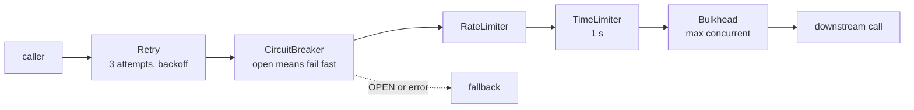

**Spring Cloud CircuitBreaker** is a thin *abstraction* over Resilience4j, Sentinel or Spring Retry. You call `CircuitBreakerFactory.create("payment").run(supplier, throwable -> fallback)`.

With `spring-cloud-starter-circuitbreaker-resilience4j`:
- You get a `Resilience4JCircuitBreakerFactory`. It wraps each call in a **CircuitBreaker plus a TimeLimiter**.
- It also wraps each call in a **Bulkhead**, but only if `resilience4j-bulkhead` is on the classpath. The starter does **not** bring it in: the proof project's dependency tree had no `resilience4j-bulkhead`.
- When a bulkhead is present, the default is `FixedThreadPoolBulkhead`. Set `spring.cloud.circuitbreaker.resilience4j.enableSemaphoreDefaultBulkhead=true` for a semaphore bulkhead. Semaphores are the natural choice with virtual threads, where a thread pool per dependency makes little sense. (That is guidance, not a framework default.)
- Properties under `resilience4j.circuitbreaker.instances.<id>` and `resilience4j.timelimiter.instances.<id>` **beat** `Customizer<Resilience4JCircuitBreakerFactory>` beans.
- The Gateway's `CircuitBreaker` filter and the `@HttpExchange` fallback support (section 3.5) both go through this factory.

**Framework 7 `@Retryable` vs Resilience4j.** Spring Framework 7 adds basic resilience to the **core** (`spring-context`):
- `@Retryable` and `@ConcurrencyLimit`, in `org.springframework.resilience.annotation`;
- `@EnableResilientMethods` to activate them. Boot does **not** auto-enable it;
- a programmatic `RetryTemplate`, in `org.springframework.core.retry`.

| | Framework 7 `@Retryable` / `@ConcurrencyLimit` | Resilience4j |
|---|---|---|
| Dependency | None (spring-context) | The resilience4j modules, plus Spring Cloud CircuitBreaker |
| Retry | Yes: max attempts, delay, jitter, multiplier, include/exclude exceptions, reactive return types | Yes, and richer: result predicates, events, metrics |
| Bulkhead-like | `@ConcurrencyLimit` caps concurrent calls to a method | Semaphore and thread-pool bulkheads |
| Circuit breaker | **No** | Yes |
| Rate limiter, time limiter | No | Yes |
| Metrics | No built-in Micrometer meters | `resilience4j_circuitbreaker_state`, call counts and more, via Micrometer |
| Use when | You need "retry this flaky call 3 times" in a monolith or a simple service | Calls cross a network boundary in production, and you need fail-fast and fallbacks |

### 3.5 HTTP interface clients: `@HttpExchange` and HTTP service groups

You declare a Java interface, and Spring generates the implementation. It is the same idea as Spring Data repositories or Feign:

```java
@HttpExchange("/api/inventory")
public interface InventoryClient {
    @GetExchange("/{sku}")
    Stock stock(@PathVariable String sku);
}
```

**Internals (Framework 6+):**
1. `HttpServiceProxyFactory` creates a JDK dynamic proxy.
2. Each method is parsed once into an `HttpServiceMethod`. It holds the HTTP method, the URL template and an argument resolver for each parameter: `@PathVariable`, `@RequestParam`, `@RequestHeader`, `@RequestBody`, `@CookieValue`, `URI` and others.
3. At call time, the method's arguments become an `HttpRequestValues`.
4. The values go to an **`HttpExchangeAdapter`**:
   - `RestClientAdapter`: blocking, the usual choice with virtual threads;
   - `WebClientAdapter`: reactive;
   - `RestTemplateAdapter`.
5. The return type decides how the exchange runs: `T` (the body), `ResponseEntity<T>`, `HttpHeaders`, `void`, or `Mono`/`Flux` with WebClient.

**Framework 7 and Boot 4: HTTP service groups.** Before this, you hand-wrote one `HttpServiceProxyFactory` bean and one proxy bean per interface. Framework 7 adds an **HTTP service registry**:
- `@ImportHttpServices` registers the proxies as beans and organizes them into **groups**.
- All clients in a group share one configured `RestClient.Builder`, with its base URL, timeouts and headers.
- Boot 4 auto-configures the groups from properties.

```java
@SpringBootApplication
@ImportHttpServices(group = "inventory", types = InventoryClient.class)   // or basePackages = "...client"
public class CheckoutApplication { ... }
```

```yaml
spring:
  http:
    clients:
      connect-timeout: 1s            # applies to every HTTP client
    serviceclient:
      inventory:                     # the group name
        base-url: http://inventory-service
        read-timeout: 2s
```

- Interfaces without a group go into the group named `default`.
- If properties can't express what you need, declare a `RestClientHttpServiceGroupConfigurer` bean (`WebClientHttpServiceGroupConfigurer` for reactive). It receives the groups: `groups.forEachClient((group, builder) -> ...)`.
- Boot 4 has modular starters. The `RestClient` auto-configuration is in **`spring-boot-starter-restclient`** (Initializr id `spring-restclient`).

**What Spring Cloud adds to groups (2025.1):**
- **Load balancing:** `LoadBalancerRestClientHttpServiceGroupConfigurer` (section 3.2).
- **Circuit breaker:** `CircuitBreakerRestClientHttpServiceGroupConfigurer`. When you declare fallbacks with **`@HttpServiceFallback`** on a configuration class, it wraps every `@HttpExchange` call in a Spring Cloud CircuitBreaker:
  - The fallback class is a plain `public` class.
  - Its methods match the interface methods **by name and parameter types**. A method can also take a **`Throwable` first**, which receives the cause.
  - Precedence: first a fallback for the service *and* the group, then one for the service in any group, then a catch-all.
  - Turn the integration off with `spring.cloud.circuitbreaker.http-services.enabled=false`.
  - The section 4.1 proof shows the fallback `stock(Throwable cause, String sku)` taking over when the downstream returns 500.

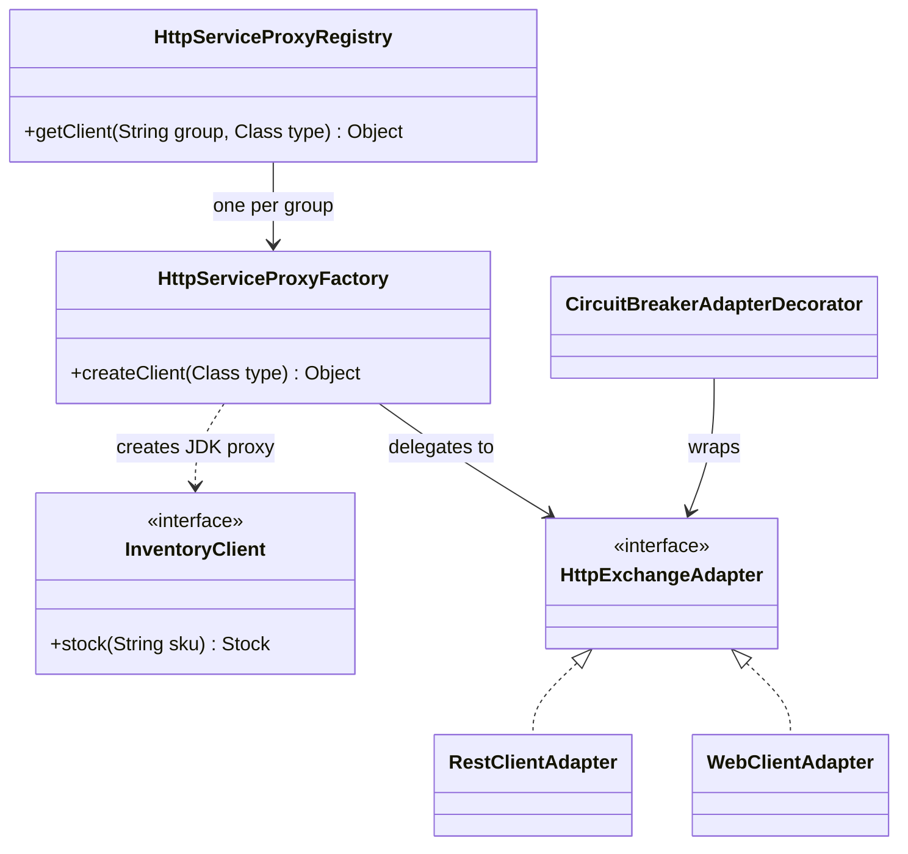

**`@HttpExchange` vs OpenFeign:**

| | `@HttpExchange` (Spring Framework) | Spring Cloud OpenFeign |
|---|---|---|
| Status | A core feature under active development | **Feature-complete since 2022.0**: bug fixes and small community PRs only. Its docs say "We suggest migrating over to Spring HTTP Service Clients" |
| Transport | `RestClient` or `WebClient`, with all their interceptors, observability, SSL bundles and Boot properties | Feign's own `Client`, wrapping Apache HC5, OkHttp or `HttpURLConnection` |
| Reactive | Yes (`Mono`/`Flux` with WebClient) | No. Feign is blocking |
| Annotations | `@GetExchange`, `@PostExchange` and so on. A `@RestController` can implement the same interface on the server side | Spring MVC annotations (`@GetMapping`) on a `@FeignClient` |
| Config | `spring.http.serviceclient.<group>.*` plus group configurers | `spring.cloud.openfeign.client.config.<name>.*` |
| Load balancing + circuit breaker | Spring Cloud configurers (group name = service id, `@HttpServiceFallback`) | `@FeignClient(name=..., fallback=...)`, `spring.cloud.openfeign.circuitbreaker.enabled` |
| Tracing | Automatic, through the instrumented `RestClient.Builder` (note 10) | Through Feign's Micrometer capability |

**Verdict:** new code uses `@HttpExchange`. Keep Feign only in existing services until you migrate them.

### 3.6 Distributed tracing across services

Each request gets a **trace id**. Each hop creates a **span**, with its own span id and a parent id. The context crosses the network in the W3C **`traceparent`** header: `00-<trace-id>-<span-id>-<flags>`.

In Boot 4, Micrometer Tracing (with the OpenTelemetry bridge) instruments:
- the auto-configured `RestClient.Builder` and `WebClient.Builder`;
- the gateway;
- Kafka templates and listeners.

So **an `@HttpExchange` client that Boot builds propagates the trace automatically**. A client you build yourself with `RestClient.create()` does not.

Logs get `traceId` and `spanId` through MDC correlation. From a Grafana Tempo trace, you can jump to the Loki logs of every service involved. See [note 10](../10-observability/observability.md) for setup, sampling and baggage.

Spring Cloud Sleuth is gone. Its last line is 3.1.x, for Boot 2.

### 3.7 Data consistency: sagas, outbox, idempotency

With a database per service, "place order, charge card, reserve stock" can't be one ACID transaction. Modern systems avoid two-phase commit (XA) for three reasons:
- Every participant must support it.
- It holds locks across the network.
- The coordinator is a single point of failure.

The alternative is a **saga**: a sequence of **local** transactions. Every step has a **compensating** action that undoes its effect in business terms, such as a refund or a stock release.

| | Choreography | Orchestration |
|---|---|---|
| How | Each service reacts to the other services' events | A central orchestrator (`OrderSaga`) sends commands and tracks state |
| Coupling | Low, but the flow is implicit and spread over many services | The flow is explicit, in one place |
| Good for | 2 to 4 steps | Many steps, branching, timeouts (Temporal, Camunda, or a hand-written state machine) |

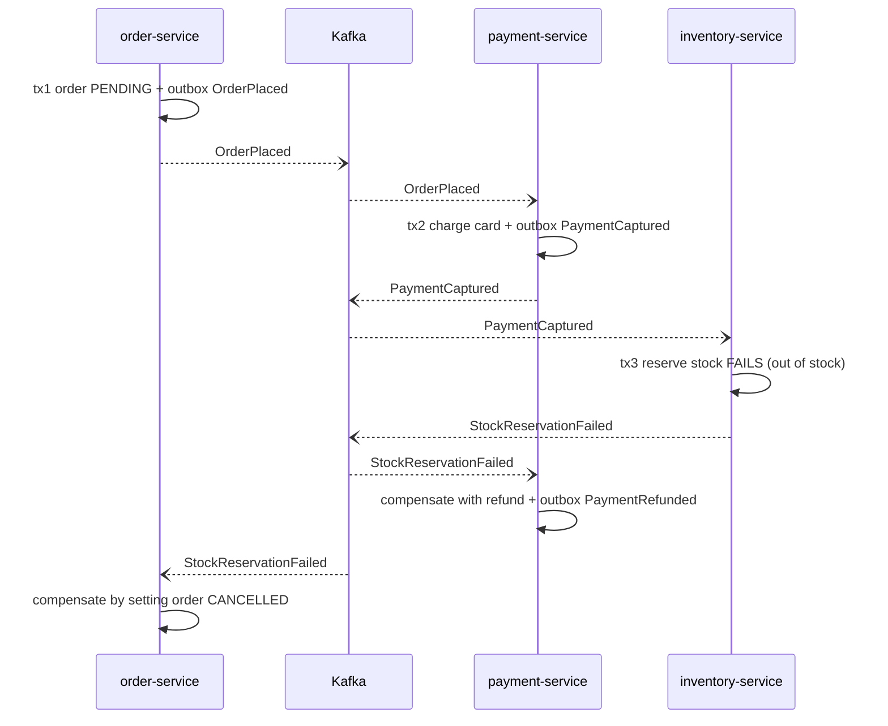

**Three building blocks make sagas safe.**

**1. Transactional outbox.** You can't atomically "write to my database *and* publish to Kafka", because either step can fail after the other one succeeds. Instead:
- Write the business row *and* an `outbox` row in **one local transaction**.
- A relay publishes the outbox rows to Kafka and marks them as sent. The relay is either a polling publisher or CDC, such as Debezium reading the write-ahead log (WAL).
- This gives **at-least-once** delivery.

Spring Modulith's event publication registry is the in-process version of the same idea.

**2. Idempotent consumers.** At-least-once delivery means duplicates *will* arrive, for example after a relay crashes just after publishing, or after a consumer rebalance.
- **For messages:** store the processed message ids (`processed_messages(message_id PK)`) in the same transaction as the side effect, and skip ids you have already seen.
- **For HTTP:** clients send an **`Idempotency-Key`** header, and the server stores each key with its response. Note 05's lab has an `IdempotencyStore` proven under 32 concurrent retries.

**3. Eventual consistency in the UX.** The order shows `PENDING` until the saga completes. Design the API and the UI for that: return `202 Accepted` with a status URL, or push updates over WebSocket or SSE.

The full Kafka mechanics are in [note 11](../11-messaging-kafka/kafka.md): retries, the dead-letter topic (DLT), exactly-once semantics and the outbox relay.

### 3.8 Querying across services: API composition vs CQRS

| | API composition | CQRS read model |
|---|---|---|
| How | A composer (the gateway, a BFF, or a service) calls several services **in parallel** and joins the results in memory | Services publish events. A query service builds a **denormalized view** (`order_summary`, a search index) in its own store |
| Freshness | Real time | Eventually consistent (milliseconds to seconds) |
| Availability | Fails or degrades if any source is down, so use fallbacks | Reads keep working when the sources are down |
| Cost | Simple, no extra store | An extra store, event handlers, and tooling to rebuild or replay the view |
| Use for | An order details page (order + payment + shipment) | "My orders" lists with filters, search, dashboards, reports across services |

Run the composer's calls in parallel:
- **With virtual threads**, write plain blocking code in a `StructuredTaskScope` or an executor (note 12).
- **In WebFlux**, use `Mono.zip` (note 13).

---

## 4. Full worked code

Section 4.1 is **compiled and tested**. It ran in a throwaway Boot 4.1.2 + Spring Cloud 2025.1.4 project generated by Initializr with `web,cloud-gateway,cloud-resilience4j,spring-restclient`. Sections 4.2 to 4.8 are *illustrative*. They show the shapes that capstone 2 builds out, sourced from the reference docs but not compiled here.

### 4.1 Proof: gateway route + `@HttpExchange` client + circuit-breaker fallbacks (verified)

**What it proves:**
- A Web MVC gateway route strips a prefix and proxies the request.
- An `@HttpExchange` client, registered by `@ImportHttpServices` and configured only by `spring.http.serviceclient.*`, calls *through* that gateway.
- A failing downstream (HTTP 500) triggers the `@HttpServiceFallback`, with zero circuit-breaker configuration.
- The gateway's `CircuitBreaker` filter, also with zero configuration, lets a 200 ms call through but cuts a 1.5 s call and forwards it to a fallback. Spring Cloud CircuitBreaker's **default TimeLimiter is active**: Resilience4j's documented default is 1 s, and this test bounds it between 0.2 s and 1.5 s.

To keep the proof self-contained, one app plays three roles: the downstream "services", the gateway, and the client.

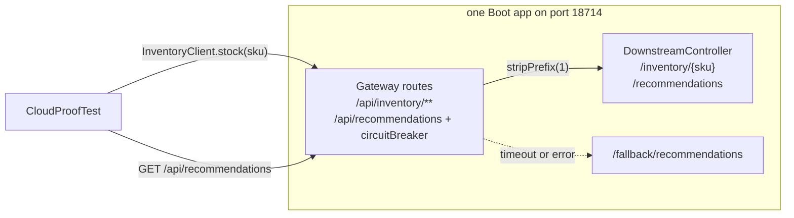

`pom.xml` dependencies, as generated by Initializr, with versions managed by the Boot parent and the `spring-cloud-dependencies` 2025.1.4 BOM:

```xml
<dependency><groupId>org.springframework.boot</groupId><artifactId>spring-boot-starter-webmvc</artifactId></dependency>
<dependency><groupId>org.springframework.boot</groupId><artifactId>spring-boot-starter-restclient</artifactId></dependency>
<dependency><groupId>org.springframework.cloud</groupId><artifactId>spring-cloud-starter-gateway-server-webmvc</artifactId></dependency>
<dependency><groupId>org.springframework.cloud</groupId><artifactId>spring-cloud-starter-circuitbreaker-resilience4j</artifactId></dependency>
<!-- test: spring-boot-starter-webmvc-test, spring-boot-starter-restclient-test -->
```

The application registers the HTTP service group:

```java
package dev.roadmap.cloudproof;

import org.springframework.boot.SpringApplication;
import org.springframework.boot.autoconfigure.SpringBootApplication;
import org.springframework.web.service.registry.ImportHttpServices;

@SpringBootApplication
@ImportHttpServices(group = "inventory", types = InventoryClient.class)
public class CloudproofApplication {
    public static void main(String[] args) {
        SpringApplication.run(CloudproofApplication.class, args);
    }
}
```

The client and its DTO:

```java
public record Stock(String sku, int quantity) {}

@HttpExchange("/api/inventory")            // goes through the gateway route
public interface InventoryClient {
    @GetExchange("/{sku}")
    Stock stock(@PathVariable String sku);
}
```

The fallback is a plain public class. The `@HttpServiceFallback` annotation sits on a configuration class:

```java
import org.springframework.cloud.client.circuitbreaker.httpservice.HttpServiceFallback;

public class InventoryFallback {
    // Same name and parameters as InventoryClient.stock, preceded by the failure cause
    public Stock stock(Throwable cause, String sku) {
        return new Stock(sku, 0);   // degrade: "unknown stock" instead of a 500 to the user
    }

    @Configuration
    @HttpServiceFallback(value = InventoryFallback.class, group = "inventory")
    static class Config {}
}
```

The gateway routes use the Web MVC server's Java DSL. Every static import below was checked with `javap` against `spring-cloud-gateway-server-webmvc-5.0.4.jar`:

```java
import static org.springframework.cloud.gateway.server.mvc.filter.BeforeFilterFunctions.stripPrefix;
import static org.springframework.cloud.gateway.server.mvc.filter.BeforeFilterFunctions.uri;
import static org.springframework.cloud.gateway.server.mvc.filter.CircuitBreakerFilterFunctions.circuitBreaker;
import static org.springframework.cloud.gateway.server.mvc.handler.GatewayRouterFunctions.route;
import static org.springframework.cloud.gateway.server.mvc.handler.HandlerFunctions.http;

@Configuration
class GatewayRoutes {
    @Bean
    RouterFunction<ServerResponse> inventoryRoute(@Value("${downstream.url}") String downstream) {
        return route("inventory")
                .GET("/api/inventory/**", http())
                .before(uri(downstream))
                .before(stripPrefix(1))              // /api/inventory/x  becomes  /inventory/x
                .build();
    }

    @Bean
    RouterFunction<ServerResponse> recommendationsRoute(@Value("${downstream.url}") String downstream) {
        return route("recommendations")
                .GET("/api/recommendations", http())
                .before(uri(downstream))
                .before(stripPrefix(1))
                .filter(circuitBreaker("recommendations", URI.create("forward:/fallback/recommendations")))
                .build();
    }
}
```

A controller stands in for the downstream services. In the capstone these are separate apps:

```java
@RestController
class DownstreamController {
    @GetMapping("/inventory/{sku}")
    Stock stock(@PathVariable String sku) {
        if (sku.startsWith("broken")) throw new IllegalStateException("inventory down");  // becomes a 500
        return new Stock(sku, 7);
    }

    @GetMapping("/recommendations")
    List<String> recommendations(@RequestParam(defaultValue = "0") long delayMs) throws InterruptedException {
        Thread.sleep(delayMs);                       // simulate a slow dependency
        return List.of("socks", "hat");
    }

    @GetMapping("/fallback/recommendations")
    List<String> noRecommendations() {
        return List.of();                            // checkout still renders, just without the carousel
    }
}
```

`application.properties`:

```properties
spring.application.name=cloudproof
server.port=18714
downstream.url=http://localhost:${server.port}
spring.http.serviceclient.inventory.base-url=http://localhost:${server.port}
```

The test:

```java
@SpringBootTest(webEnvironment = SpringBootTest.WebEnvironment.DEFINED_PORT)
class CloudProofTest {

    private final RestClient http = RestClient.create("http://localhost:18714");
    private final InventoryClient inventoryClient;

    CloudProofTest(@Autowired InventoryClient inventoryClient) {   // constructor injection in tests (note 08)
        this.inventoryClient = inventoryClient;
    }

    @Test
    void gatewayRoute_stripsPrefixAndForwards() {
        Stock stock = http.get().uri("/api/inventory/sku-1").retrieve().body(Stock.class);
        assertThat(stock).isEqualTo(new Stock("sku-1", 7));
    }

    @Test
    void httpExchangeClient_callsThroughGateway() {
        assertThat(inventoryClient.stock("sku-2")).isEqualTo(new Stock("sku-2", 7));
    }

    @Test
    void httpExchangeClient_fallsBack_whenDownstreamFails() {
        assertThat(inventoryClient.stock("broken-1")).isEqualTo(new Stock("broken-1", 0));
    }

    @Test
    void gatewayCircuitBreaker_fallsBack_whenDownstreamSlowerThanDefaultTimeLimiter() {
        var list = new ParameterizedTypeReference<List<String>>() {};
        assertThat(http.get().uri("/api/recommendations?delayMs=200").retrieve().body(list))
                .containsExactly("socks", "hat");
        assertThat(http.get().uri("/api/recommendations?delayMs=1500").retrieve().body(list))
                .isEmpty();                          // cut by the default TimeLimiter, fallback served
    }
}
```

```
[INFO] Tests run: 4, Failures: 0, Errors: 0, Skipped: 0, Time elapsed: 26.12 s -- in dev.roadmap.cloudproof.CloudProofTest
[INFO] Tests run: 4, Failures: 0, Errors: 0, Skipped: 0
[INFO] BUILD SUCCESS
```

What to notice:
- **The `InventoryClient` has no implementation, no factory bean and no `RestClient` wiring.** `@ImportHttpServices` and one property did all of it.
- **The fallback needed no `resilience4j.*` configuration.** Adding `spring-cloud-starter-circuitbreaker-resilience4j` and `@HttpServiceFallback` was enough. That convenience is also a trap: the default TimeLimiter applies to *every* call through the gateway's `circuitBreaker` filter. A healthy service that takes 1.5 s to answer gets fallbacks out of the box. Size `resilience4j.timelimiter.instances.<id>.timeoutDuration` deliberately (4.4).
- **The proof binds `downstream.url` with `@Value`** to stay short. The capstone binds it with a `@ConfigurationProperties` record, per the repo conventions. The test is shown with constructor injection. The compiled run injected the same bean through an `@Autowired` field, which behaves identically.
- **The test uses a fixed port (`DEFINED_PORT`)** because the route URI and the client base URL are built from `server.port` at startup. With `RANDOM_PORT`, `local.server.port` is unknown at that moment. In real tests, the downstream is a WireMock server or a Testcontainers app with its own port.

### 4.2 WebFlux gateway in YAML: routes, Redis rate limiting, token relay (illustrative)

```yaml
spring:
  cloud:
    gateway:
      server:
        webflux:
          trusted-proxies: "10\\.0\\.\\d+\\.\\d+"      # ALB subnet; X-Forwarded-* ignored otherwise
          default-filters:
            - TokenRelay=                              # forward the logged-in user's access token
          routes:
            - id: orders
              uri: lb://order-service                   # needs spring-cloud-starter-loadbalancer + a DiscoveryClient
              predicates:
                - Path=/api/orders/**
              filters:
                - StripPrefix=1
                - name: RequestRateLimiter
                  args:
                    redis-rate-limiter.replenishRate: 10   # tokens per second
                    redis-rate-limiter.burstCapacity: 20   # bucket size
                    redis-rate-limiter.requestedTokens: 1
                    key-resolver: "#{@principalKeyResolver}"
                - name: CircuitBreaker
                  args:
                    name: orders
                    fallbackUri: forward:/fallback/orders
            - id: catalog-canary
              uri: http://catalog-v2
              predicates:
                - Path=/api/catalog/**
                - Weight=catalog, 5                     # 5% canary
            - id: catalog-stable
              uri: http://catalog-v1
              predicates:
                - Path=/api/catalog/**
                - Weight=catalog, 95
  data:
    redis:
      host: redis
```

```java
@Configuration
class RateLimitConfig {
    @Bean
    KeyResolver principalKeyResolver() {
        // A real key, never a query parameter the client controls
        return exchange -> exchange.getPrincipal().map(Principal::getName);
    }
}
```

This needs the dependencies `spring-cloud-starter-gateway-server-webflux`, `spring-boot-starter-data-redis-reactive`, `spring-boot-starter-oauth2-client` (for `TokenRelay`) and `spring-cloud-starter-circuitbreaker-reactor-resilience4j`.

### 4.3 Config Server and a refreshable client (illustrative)

```java
@SpringBootApplication
@EnableConfigServer
public class ConfigServerApplication {
    public static void main(String[] args) { SpringApplication.run(ConfigServerApplication.class, args); }
}
```

```yaml
# config-server application.yml
server:
  port: 8888
spring:
  cloud:
    config:
      server:
        git:
          uri: https://github.com/acme/platform-config
          default-label: main
          search-paths: "{application}"     # one folder per service
          clone-on-start: true              # fail fast if git is unreachable
          username: ${GIT_USER}
          password: ${GIT_TOKEN}            # from env or secrets, never committed
```

```java
// Client side: a JavaBean-style class re-binds in place on refresh. A record would NOT (see 3.3)
@ConfigurationProperties("pricing")
@Validated
public class PricingProperties {
    @DecimalMin("0") @DecimalMax("0.9")
    private BigDecimal discountRate;

    public BigDecimal getDiscountRate() { return discountRate; }
    public void setDiscountRate(BigDecimal discountRate) { this.discountRate = discountRate; }
}

// A bean that bakes config in at construction needs @RefreshScope to be rebuilt
@Component
@RefreshScope
class TaxApiClient {
    private final RestClient restClient;

    TaxApiClient(RestClient.Builder builder, @Value("${tax.api.url}") String url) {
        this.restClient = builder.baseUrl(url).build();
    }
}
```

The client needs `spring.config.import=optional:configserver:http://config-server:8888` and `management.endpoints.web.exposure.include=refresh` (or `busrefresh` with Spring Cloud Bus).

Why a class and not a record here: section 3.3's test showed that a record `@ConfigurationProperties` keeps its old value after `ContextRefresher.refresh()`, while a JavaBean-style class picks up the new one. This is the one place where hot refresh beats the repo's "records for config" rule. If the value can wait for a rolling restart, keep the record.

### 4.4 Spring Cloud CircuitBreaker with Resilience4j properties (illustrative)

```java
@Service
class RecommendationService {
    private final RecommendationClient client;         // an @HttpExchange interface
    private final CircuitBreakerFactory<?, ?> breakers;

    RecommendationService(RecommendationClient client, CircuitBreakerFactory<?, ?> breakers) {
        this.client = client;
        this.breakers = breakers;
    }

    List<Product> forCustomer(long customerId) {
        return breakers.create("recommendations")
                .run(() -> client.forCustomer(customerId),
                     cause -> List.of());              // degrade, never fail checkout
    }
}
```

```yaml
resilience4j:
  circuitbreaker:
    instances:
      recommendations:
        sliding-window-type: COUNT_BASED
        sliding-window-size: 20
        minimum-number-of-calls: 10        # default 100 is far too high for most services
        failure-rate-threshold: 50
        slow-call-duration-threshold: 800ms
        slow-call-rate-threshold: 50
        wait-duration-in-open-state: 10s
        permitted-number-of-calls-in-half-open-state: 3
        ignore-exceptions:
          - org.springframework.web.client.HttpClientErrorException   # 4xx is not a sick server
  timelimiter:
    instances:
      recommendations:
        timeout-duration: 1s
  bulkhead:
    instances:
      recommendations:
        max-concurrent-calls: 20           # needs resilience4j-bulkhead on the classpath
spring:
  cloud:
    circuitbreaker:
      resilience4j:
        enableSemaphoreDefaultBulkhead: true
```

### 4.5 Resilience4j annotations on Boot 4 (illustrative, not compiled here)

The annotations are aspects, so they need **`spring-boot-starter-aspectj`**, Boot 4's renamed AOP starter (Baeldung shows `spring-boot-starter-aop`, the Boot 3 name). Which Resilience4j module provides them depends on your setup:
- **With Spring Cloud:** `spring-cloud-circuitbreaker-resilience4j` 5.0.3 already brings in `resilience4j-spring-boot3` 2.3.0 transitively (checked in its POM). Do **not** also add `resilience4j-spring-boot4`. That would put two Resilience4j auto-configurations and mixed 2.3/2.4 versions on the classpath.
- **Without Spring Cloud:** use `io.github.resilience4j:resilience4j-spring-boot4` (2.4.0 on Maven Central).

Neither setup was compiled here, so check the annotations against the version you actually resolve.

```java
@Service
class PaymentGateway {
    private final PaymentClient client;

    PaymentGateway(PaymentClient client) { this.client = client; }

    @CircuitBreaker(name = "psp", fallbackMethod = "queueForLater")
    @Retry(name = "psp")              // outermost by default, so every attempt is counted by the breaker
    @Bulkhead(name = "psp")
    public PaymentResult authorize(PaymentRequest request) {
        return client.authorize(request.idempotencyKey(), request);   // same key on every retry
    }

    private PaymentResult queueForLater(PaymentRequest request, Throwable cause) {
        return PaymentResult.pending(request.idempotencyKey());
    }
}
```

The fallback method must have the same return type and parameters, plus a trailing `Throwable` (or a more specific exception type). Note that the parameter *position* differs from Spring Cloud's `@HttpServiceFallback`, which takes the `Throwable` **first**.

### 4.6 Framework 7 core resilience: `@Retryable` and `@ConcurrencyLimit` (illustrative)

These attribute names were checked with `javap` on `spring-context-7.0.10.jar`. On `@Retryable`: `includes`, `excludes`, `predicate`, `maxRetries`, `timeout`, `delay`, `jitter`, `multiplier`, `maxDelay`, `timeUnit`, each also with a `...String` variant for placeholders. On `@ConcurrencyLimit`: `limit` and `policy`.

```java
@Configuration
@EnableResilientMethods          // NOT auto-enabled by Boot
class ResilienceConfig {}

@Service
class ExchangeRateService {
    private final RateClient rates;

    ExchangeRateService(RateClient rates) { this.rates = rates; }

    @Retryable(includes = ResourceAccessException.class, maxRetries = 3, delay = 200, multiplier = 2, jitter = 50)
    @ConcurrencyLimit(10)        // at most 10 concurrent calls into this method
    public BigDecimal rate(String from, String to) {
        return rates.rate(from, to);
    }
}
```

Use this for simple retries inside one service. It has **no circuit breaker**, so a dead dependency is still hit `maxRetries + 1` times per request.

### 4.7 Outbox write and idempotent consumer (illustrative, details in note 11)

```java
@Service
class OrderService {
    private final OrderRepository orders;
    private final OutboxRepository outbox;
    private final JsonMapper json;               // Jackson 3: tools.jackson.databind.json.JsonMapper

    OrderService(OrderRepository orders, OutboxRepository outbox, JsonMapper json) {
        this.orders = orders;
        this.outbox = outbox;
        this.json = json;
    }

    @Transactional                                // order row and outbox row commit together, or neither does
    public OrderId place(PlaceOrder command) {
        Order order = orders.save(Order.pending(command));
        outbox.save(OutboxMessage.of("order", order.id(), "OrderPlaced",
                json.writeValueAsString(OrderPlaced.from(order))));
        return order.id();
    }
}

@Component
class PaymentEventsListener {
    private final ProcessedMessages processed;    // table processed_messages(message_id PK)
    private final PaymentService payments;

    PaymentEventsListener(ProcessedMessages processed, PaymentService payments) {
        this.processed = processed;
        this.payments = payments;
    }

    @KafkaListener(topics = "order-events")
    @Transactional
    void on(OrderPlaced event, @Header("message-id") String messageId) {
        if (!processed.markIfFirst(messageId)) return;   // INSERT ... ON CONFLICT DO NOTHING, false on duplicate
        payments.charge(event.orderId(), event.total());
    }
}
```

### 4.8 Kubernetes-native discovery and config (illustrative, details in note 15)

```yaml
apiVersion: v1
kind: Service
metadata:
  name: payment-service             # DNS name other services call: http://payment-service
spec:
  selector:
    app: payment-service
  ports:
    - port: 80
      targetPort: 8080
---
apiVersion: apps/v1
kind: Deployment
metadata:
  name: payment-service
spec:
  replicas: 3
  selector:
    matchLabels: { app: payment-service }
  template:
    metadata:
      labels: { app: payment-service }
    spec:
      containers:
        - name: app
          image: ghcr.io/acme/payment-service:1.4.2
          env:
            - name: SPRING_CONFIG_IMPORT
              value: "configtree:/etc/config/"        # each mounted file becomes a property
          volumeMounts:
            - { name: config, mountPath: /etc/config, readOnly: true }
          readinessProbe:
            httpGet: { path: /actuator/health/readiness, port: 8080 }   # gates Service endpoints
          livenessProbe:
            httpGet: { path: /actuator/health/liveness, port: 8080 }
      volumes:
        - name: config
          configMap: { name: payment-service-config }
```

The client side is then just `spring.http.serviceclient.payment.base-url=http://payment-service`. It needs no Eureka and no Spring Cloud LoadBalancer, and because the URL uses a plain `http://` scheme, no LoadBalancer interception happens even if the library is on the classpath.

---

## 5. Gap fillers & niche details

### 5.1 Gateway details tutorials skip

- **Route order matters.** The first matching route wins. In YAML that is declaration order, or an explicit `order:`. Put specific paths before catch-alls (`/api/**`).
- **`lb://` needs two things:** a `DiscoveryClient` (Eureka, Kubernetes, Consul, or the `SimpleDiscoveryClient` with static instances) and `spring-cloud-starter-loadbalancer`. Without them the route fails at request time, not at startup.
- **The gateway is the right place for** authentication (JWT validation), coarse authorization, rate limiting, CORS, request-size limits, and observability. **It is the wrong place for** business logic and data aggregation that belongs to a domain. A BFF does that (section 7.1).
- **Initializr naming trap:** `cloud-gateway` now generates the **Web MVC** server, and `cloud-gateway-reactive` the WebFlux one. Many 3.x tutorials assume the opposite.
- **The Web MVC rate limiter's key resolver** is Java-DSL only, and a request without a key is **403**, not 429.
- **Do not expose `/actuator/gateway`** (the WebFlux route-management endpoint) publicly. It lists routes, and with write access enabled it can create and delete them.

### 5.2 Versioning and backward-compatible APIs

**Rule:** consumers deploy on their own schedule, so every change must be **backward compatible** or **versioned**.

| Change | Compatible? |
|---|---|
| Add an optional request field, add a response field, add an endpoint | ✅ If clients ignore unknown fields. Boot's auto-configured JSON mapper does, but a hand-built mapper may fail on them |
| Rename or remove a field, change a type, make an optional field required, change a status code or error format | ❌ Breaking |
| Add an enum value | ⚠️ Breaking for clients that `switch` exhaustively. Document a fallback `UNKNOWN` |

**Versioning strategies:** URI (`/v2/orders`), header (`API-Version: 2`), media type (`application/vnd.acme.order.v2+json`), or query parameter. Framework 7 adds first-class **API versioning** in Spring MVC and WebFlux (`ApiVersionConfigurer`, the `version` attribute on `@RequestMapping`), and Boot 4 exposes it through properties. Client-side versioning for HTTP service groups is part of the `spring.http.serviceclient.<group>` settings (note 05).

**Expand and contract** (parallel change) is the safe way to change a shared contract:
1. **Expand:** add the new field or endpoint next to the old one. The producer writes both.
2. **Migrate:** consumers switch over, one by one, on their own schedule.
3. **Contract:** remove the old field once metrics show that nobody reads it.

Use the same idea for events. Add fields freely, keep a schema registry (Avro or Protobuf with compatibility mode `BACKWARD`), and never reuse a field name with new semantics.

### 5.3 Security across services ([note 07](../07-security/spring-security.md))

- **User context (JWT relay):** the gateway validates the user's JWT, or exchanges a session for one through `TokenRelay`. It forwards the JWT, and **every service validates it again** as a resource server. That is zero trust: never trust "the gateway already checked it", because an attacker inside the network bypasses the gateway.
- **Service identity (client credentials):** for calls with no user, such as a scheduled job or a Kafka consumer calling another service, the caller gets its own token with the OAuth2 `client_credentials` grant. In Boot 4, register an OAuth2 client and let an `OAuth2ClientHttpRequestInterceptor` (with `RestClient`) attach and refresh the token. Downstream authorizes by scope (`SCOPE_payments.write`).
- **Token exchange (RFC 8693)** narrows a broad user token into one scoped to a single downstream audience. Use it when services must not be able to replay a user token elsewhere.
- **mTLS** (service mesh or SSL bundles) proves *which workload* is calling, beneath the JWT.
- Never log tokens. Strip `Authorization` from access logs, and don't put tokens in trace baggage.

### 5.4 Testing microservices ([note 08](../08-testing/testing.md))

| Level | Tool | Proves |
|---|---|---|
| Unit | JUnit + Mockito | Domain logic, fallbacks as plain methods |
| Client slice | `@RestClientTest` + `MockRestServiceServer`, or WireMock | The `@HttpExchange` interface maps to the right HTTP calls and decodes errors |
| Resilience | WireMock with delays and faults (`withFixedDelay`, `CONNECTION_RESET_BY_PEER`) | Timeouts, retries and breaker transitions under real network behavior |
| Contract | **Consumer-driven contracts**: Pact, or Spring Cloud Contract / its continuation Stubborn Contract | Producer and consumer agree on the API, *without* deploying both |
| Integration | Testcontainers (Postgres, Kafka, Redis) with `@ServiceConnection` | Each service with its real infrastructure |
| End to end | A few journeys in a deployed environment | Wiring between services. Keep these few, they are slow and flaky |

**Contract testing in one paragraph:** the consumer writes the expectation ("`GET /payments/42` returns `{status: CAPTURED}`"). The producer's build verifies it against the real controller, and generates stubs (WireMock JSON) that the consumer's tests run against. A breaking producer change fails the *producer's* build before deploy. **Spring Cloud Contract is not in the 2025.1.4 BOM**: its last release is 5.0.3, and Initializr now offers **Stubborn Contract** (`sh.stubborn:stubborn-contract-starter-verifier` 0.2.2), which describes itself as "the official continuation of Spring Cloud Contract 5.x" and accepts existing contracts unchanged.

### 5.5 Deployment ([note 15](../15-packaging-deploy/packaging-deploy.md))

- **One pipeline per service.** Build, test, and image publishing are independent per service. Shared libraries are versioned and published, not copied.
- **Health groups:** Boot exposes `/actuator/health/liveness` and `/actuator/health/readiness` on Kubernetes. Readiness must go `OUT_OF_SERVICE` during graceful shutdown (`server.shutdown=graceful`, the default in Boot 3.4+) so the Service stops routing before the pod dies.
- **Rolling, blue-green, or canary.** A gateway `Weight` predicate, a service mesh, or Argo Rollouts shifts traffic gradually. Database migrations must be backward compatible with the *previous* version (expand and contract again), because both versions run at once during a rollout.
- **Resource limits and JVM:** set container memory limits. The JVM sizes its heap from the cgroup (`-XX:MaxRAMPercentage=75`). Consider CDS, AOT, or native images for startup-sensitive services.

### 5.6 The twelve-factor app, mapped to Spring

| Factor | Meaning | Spring / platform mechanism |
|---|---|---|
| I. Codebase | One repo per app, many deploys | One service per repo (or a monorepo with separate builds) |
| II. Dependencies | Declare and isolate | Maven + BOMs, a fat jar or layered image |
| III. Config | Config in the environment | `@ConfigurationProperties`, env vars, Config Server, ConfigMaps |
| IV. Backing services | Treat them as attached resources | URLs in config, `@ServiceConnection` in tests |
| V. Build, release, run | Strictly separate stages | CI builds an image once, and CD promotes the same image |
| VI. Processes | Stateless, share-nothing | No HTTP session in memory (Spring Session + Redis), no local files |
| VII. Port binding | Self-contained, exports HTTP | Embedded Tomcat, Netty |
| VIII. Concurrency | Scale out by process | More pods (HPA), virtual threads inside each |
| IX. Disposability | Fast start, graceful stop | Graceful shutdown, readiness probes, CDS/AOT |
| X. Dev/prod parity | Keep environments similar | Testcontainers, Docker Compose support |
| XI. Logs | Logs as event streams | Log to stdout (JSON structured logging in Boot 3.4+), ship with the platform |
| XII. Admin processes | Run one-off tasks as processes | Flyway migrations, Spring Batch jobs, K8s Jobs |

### 5.7 Timeouts: the budget that holds everything together

- **Every remote call needs a timeout.** `RestClient` built by Boot uses `spring.http.clients.connect-timeout`/`read-timeout` (or per group under `spring.http.serviceclient.<group>`). The JDK `HttpClient` has no read timeout by default, so an un-configured client can wait forever.
- **Budget top-down.** If the gateway times out at 3 s, the service behind it must give up on its own callees well before that (for example 1 s each with one retry). Otherwise the user already got a 504 while the backend keeps working, and retries pile up (**retry storms**).
- **Retries multiply.** Three layers with 3 attempts each produce 27 calls to the bottom service. Retry at **one** layer, usually the one closest to the failure, and add jitter.

### 5.8 Spring Modulith: the alternative to splitting

Spring Modulith (Initializr id `modulith`) structures **one** Boot app into modules: the direct sub-packages of the main package.
- **`ApplicationModules.of(App.class).verify()`** in a test fails the build when one module touches another's internal package, or when modules form a cycle.
- **Events between modules:** `@ApplicationModuleListener` is an async, transactional event listener. The **event publication registry** persists each event with the business transaction and re-delivers incomplete ones after a crash, which is an in-process outbox. Events can also be **externalized** to Kafka or other brokers.
- **`@ApplicationModuleTest`** boots one module alone, which is fast and proves isolation.
- **Documentation:** it generates C4 and UML diagrams of the module structure.

Start with Modulith. When a module needs independent scaling or a different team cadence, its events are already the contract, and extracting it into a service is a deployment change, not a redesign.

### 5.9 More niche details

- **`@EnableDiscoveryClient` is optional.** Having a discovery client on the classpath is enough. `@EnableEurekaClient` was removed in Spring Cloud Netflix 4 (2022.0).
- **`bootstrap.yml` is legacy.** Since 2020.0, use `spring.config.import`. Bootstrap needs the separate `spring-cloud-starter-bootstrap` (Initializr: "Cloud Bootstrap").
- **Eureka self-preservation:** when more than 15% of heartbeats go missing (often a network partition), the server stops evicting instances. That is safer than evicting a healthy fleet, but clients then see dead instances. Pair it with retries on another instance.
- **LoadBalancer + Retry:** with `spring.cloud.loadbalancer.retry.enabled` (default true when Spring Retry is present), a failed call can be retried on **another** instance (`max-retries-on-next-service-instance`), not just the same one.
- **`@RefreshScope` on a `@Scheduled` or `@KafkaListener` bean** is a trap: the scheduled task or listener container is registered once against the bean, not re-registered on refresh, so behavior after a refresh is surprising *(unverified)*. Keep refreshable values in a separate bean that these components call.
- **Gateway timeouts:** WebFlux uses `spring.cloud.gateway.server.webflux.httpclient.connect-timeout`/`response-timeout`. Web MVC uses the `spring.http.clients.*` settings of the underlying client *(the exact property for the Web MVC server's proxy client is unverified)*.

---

## 6. Boot 4 / Framework 7 delta

**Spring Cloud 2025.1.x "Oakwood" is the train for Boot 4.** It supports Boot 4.0.x, and Boot 4.1.x starting with 2025.1.2. Initializr pairs Boot 4.1.2 with **2025.1.4**. All the projects moved to 5.0.x, with "various breaking changes … to accommodate Jackson 3, JSpecify Nullability" (2025.1 release notes), plus Framework 7 and Boot 4.

| Area | Boot 3.x / Spring Cloud 2023–2025.0 | Boot 4.1 / Spring Cloud 2025.1.4 |
|---|---|---|
| Gateway starters | `spring-cloud-starter-gateway` (WebFlux), `spring-cloud-starter-gateway-mvc` | `spring-cloud-starter-gateway-server-webflux` / `-server-webmvc`. The new names arrived in 2025.0, and the old ones were deprecated then. **The old starters have no 5.x release on Maven Central** (the last is 4.3.5), so they don't exist on Boot 4 |
| Gateway properties | `spring.cloud.gateway.*` / `spring.cloud.gateway.mvc.*` | `spring.cloud.gateway.server.webflux.*` / `spring.cloud.gateway.server.webmvc.*`. Proxy Exchange: `spring.cloud.gateway.proxy-exchange.webflux.*` / `.webmvc.*`. `spring-boot-properties-migrator` maps the old names |
| Forwarded headers in the gateway | Trusted by default | Off by default. Set the `trusted-proxies` regex |
| Initializr ids | `cloud-gateway` meant WebFlux | `cloud-gateway` is **Web MVC**, and `cloud-gateway-reactive` is WebFlux |
| HTTP interface clients | A hand-made `HttpServiceProxyFactory` bean per client | `@ImportHttpServices` + groups (Framework 7), `spring.http.serviceclient.<group>.*` (Boot 4), Spring Cloud LoadBalancer and CircuitBreaker group configurers, `@HttpServiceFallback` |
| `RestClient` auto-config | In `spring-boot-starter-web` | Needs **`spring-boot-starter-restclient`** (modular starters) |
| Retry | Spring Retry (`@Retryable` from `org.springframework.retry`) | **Framework 7 core** `@Retryable`/`@ConcurrencyLimit` in `org.springframework.resilience.annotation`, plus `@EnableResilientMethods` |
| Resilience4j Spring Boot module | `resilience4j-spring-boot3` + `spring-boot-starter-aop` | `spring-boot-starter-aspectj` for the annotations. The Spring Cloud starter pulls in `resilience4j-spring-boot3` 2.3.0 itself. Without Spring Cloud, use `resilience4j-spring-boot4` 2.4.0 *(not compiled here)* |
| Contract testing | Spring Cloud Contract in the train | **Not in the 2025.1.4 BOM** (last release 5.0.3). Initializr offers **Stubborn Contract** (`sh.stubborn`), "the official continuation of Spring Cloud Contract 5.x" |
| OpenFeign | Feature-complete since 2022.0 | Still shipped (5.0.4), still feature-complete. Its docs point to HTTP Service Clients |
| JSON | Jackson 2 (`com.fasterxml.jackson.databind`) | Jackson 3 (`tools.jackson.*`). Gateway body-modifying filters and Bus/Stream serialization use Jackson 3 |
| Tests | `@MockBean`, auto-provided `TestRestTemplate` | `@MockitoBean`, and `RestTestClient` via `@AutoConfigureRestTestClient` (note 08) |

> ⚠️ **Outdated advice still common in tutorials and Baeldung articles:**
> - **Netflix Hystrix, Ribbon, Zuul 1 and Archaius.** They were removed from Spring Cloud in 2020.0. Use Resilience4j, Spring Cloud LoadBalancer, and Spring Cloud Gateway instead.
> - **Spring Cloud Sleuth.** Its last line is 3.1.x, for Boot 2. Use Micrometer Tracing with OpenTelemetry (note 10).
> - **`bootstrap.yml` + `spring.cloud.config.uri`.** Use `spring.config.import=configserver:...`.
> - **`@EnableEurekaClient`.** It was removed. `@EnableDiscoveryClient` is optional too.
> - **`spring-cloud-starter-gateway` or `spring.cloud.gateway.routes` on Boot 4.** Use the new starter names and property prefixes.
> - **"Use `@FeignClient` for service calls."** Prefer `@HttpExchange` with HTTP service groups.
> - **`RestTemplate` + `@LoadBalanced` in new code.** Use `RestClient`, or an `@HttpExchange` group with an unset or `lb://` base URL.
> - **"Every microservice platform needs Eureka and a Config Server."** On Kubernetes, use Services and ConfigMaps (sections 3.2 and 3.3).

---

## 7. Real-life architecture solutions

### 7.1 Edge architecture: API gateway + BFF + services (Netflix-style)

**Problem:** a web SPA, an iOS app, an Android app, and partner integrations all call 20+ services. Each client needs a different shape of data. Mobile wants one compact call per screen, and the web wants richer pages. If clients call services directly, they make dozens of round trips over slow mobile networks. Every service would have to implement auth, CORS, and rate limiting. And internal topology leaks to the outside world.

**Solution:**
- **One gateway** owns the cross-cutting concerns: TLS termination, JWT validation, rate limits, WAF rules, routing, and canary weights.
- Behind it, **one Backend-for-Frontend (BFF) per client type**. Each BFF is owned by that client's team. It **composes** calls to domain services in parallel and shapes the response for one screen.
- Domain services stay client-agnostic.

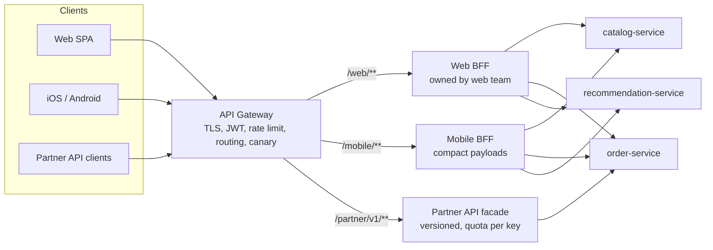

The BFF uses `@HttpExchange` clients, one group per downstream, and composes them in parallel with virtual threads. Each downstream has its own circuit breaker and fallback, so a dead recommendation service yields an empty carousel, not an error page.

**Trade-offs:**
- **Gains:** clients make one round trip per screen. Teams evolve their own BFF without asking backend teams. Internal services stay hidden.
- **Costs:** more services to run. BFFs can accumulate business logic if nobody guards the line: a BFF *composes and shapes*, and must never *own* data.
- GraphQL federation is the alternative when many clients need flexible shapes. It replaces a set of BFFs with one schema.

**Who uses it:**
- Netflix popularized device-specific edge adapters behind Zuul, and later its own gateway stack.
- SoundCloud coined the BFF term.
- Spotify, Zalando and most large e-commerce and streaming sites run a gateway-plus-BFF edge.

### 7.2 Strangler fig migration of a monolith

**Problem:** a 10-year-old monolith (a WAR on Tomcat with one Oracle schema) can't be rewritten in one go. Big-bang rewrites famously fail: the old system keeps changing while the new one chases it.

**Solution:** Martin Fowler's **strangler fig**, named after a vine that grows around a tree until it replaces it.
1. Put a **gateway in front of the monolith**. At first, it routes 100% of traffic to the monolith.
2. Pick one bounded context with clear seams and real business value, such as *notifications* or *catalog search*. Build it as a new service with **its own database**.
3. Sync the data. The monolith publishes changes (through an outbox or CDC with Debezium on its tables) into the new service's store. Use an **anti-corruption layer** so the new service doesn't inherit the old model.
4. Flip the route for that path in the gateway, using `Weight` for a gradual canary. Keep the monolith's code path as the rollback.
5. Delete the dead code in the monolith. Repeat with the next context.

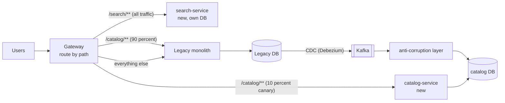

**Trade-offs:**
- **Gains:** risk is incremental, every step ships value, and you can roll back by flipping a route.
- **Costs:**
  - For a long time you run two systems, with dual writes or CDC between them.
  - Shared-database shortcuts are tempting. Don't let the new service read the legacy tables directly. That bakes in the coupling you are escaping.
  - Some contexts never get extracted. That's fine. A smaller, modularized monolith is a valid end state.

**Who uses it:**
- Amazon's move away from its "Obidos" monolith.
- Many banks extracting payments or onboarding from mainframe-era cores.
- Shopify chose a *modular monolith* instead (componentization within one Rails app). It is a reminder that the strangler fig's end state doesn't have to be microservices.

### 7.3 Protecting checkout from a slow recommendation service: circuit breaker + bulkhead

**Problem:** the checkout page calls `pricing` (critical), `inventory` (critical) and `recommendations` (nice to have). One Friday, recommendations goes from 50 ms to 8 s because its ML model cache got evicted. Checkout threads pile up waiting on it, Tomcat's pool is exhausted, and **checkout goes down because of a carousel**. This is a cascading failure.

**Solution:** classify dependencies, then isolate the optional ones.
- **TimeLimiter:** recommendations gets 300 ms, not 8 s.
- **Bulkhead:** at most 20 concurrent recommendation calls. A semaphore bulkhead with virtual threads, or a small thread pool on platform threads. Extra calls are rejected *immediately* and go to the fallback, so they never consume checkout capacity.
- **Circuit breaker:** after 50% slow or failed calls in a window of 20, open for 10 s. Calls during that time don't even try.
- **Fallback:** an empty list, or a cached "top sellers" list from Redis (note 09).
- Critical dependencies get a timeout and a retry with an idempotency key, but **no** silent fallback. If pricing is down, checkout must say so, not invent a price.

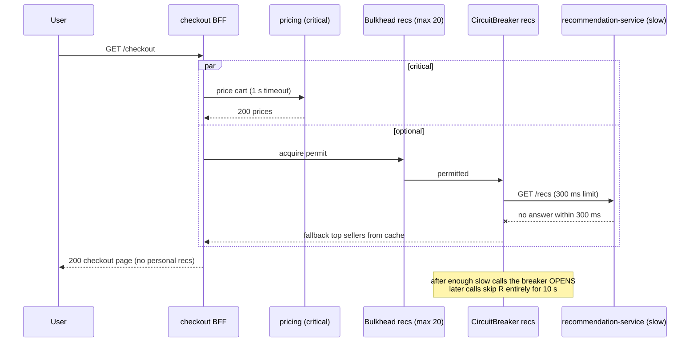

The configuration shape is section 4.4: `recommendations` instances under `resilience4j.circuitbreaker`, `timelimiter` and `bulkhead`, plus `resilience4j-bulkhead` on the classpath. Expose `resilience4j_circuitbreaker_state` and `resilience4j_bulkhead_available_concurrent_calls` on a dashboard, and alert when a breaker stays open (note 10).

**Trade-offs:**
- **Gains:** the critical path survives any optional dependency failing. Recovery is automatic (HALF_OPEN probes).
- **Costs:**
  - Thresholds need tuning against real latency percentiles.
  - Fallbacks hide outages unless you alert on breaker state.
  - Thread-pool bulkheads add context switches and break `ThreadLocal`-based context. Prefer semaphores with virtual threads, and propagate trace context.

**Who uses it:**
- Netflix designed Hystrix for exactly this case: the home page must render even if the "because you watched" row fails.
- Amazon's product page degrades widget by widget.
- Most retailers protect checkout this way on peak days.

### 7.4 From Netflix OSS to Kubernetes-native

**Problem:** the 2015-era Spring Cloud Netflix stack (Eureka, Ribbon, Hystrix, Zuul 1, Archaius, Sleuth/Zipkin) solved real problems on EC2 VMs. But it put **all** of the plumbing into every Java service, and most of those libraries entered maintenance around 2018. Teams then moved to Kubernetes, which solves several of the same problems in the platform.

**Solution:** move each concern to the layer that now owns it.

| Concern | Netflix OSS era | Spring Cloud today | Kubernetes / platform-native |
|---|---|---|---|
| Discovery | Eureka | Eureka (still maintained) or Spring Cloud Kubernetes | K8s Services + CoreDNS |
| Client-side load balancing | Ribbon | Spring Cloud LoadBalancer | kube-proxy, or mesh sidecars (Envoy) |
| Circuit breaker | Hystrix | Resilience4j via Spring Cloud CircuitBreaker | Mesh outlier detection (complements, doesn't replace, app fallbacks) |
| Edge gateway | Zuul 1 | Spring Cloud Gateway | Ingress / Gateway API, cloud API gateways |
| Config | Archaius + Config Server | Config Server | ConfigMaps, Secrets, External Secrets, Parameter Store |
| Tracing | Sleuth + Zipkin | Micrometer Tracing + OpenTelemetry | OTel Collector, mesh telemetry |
| Declarative client | Feign | `@HttpExchange` (Feign in maintenance) | n/a (app concern) |

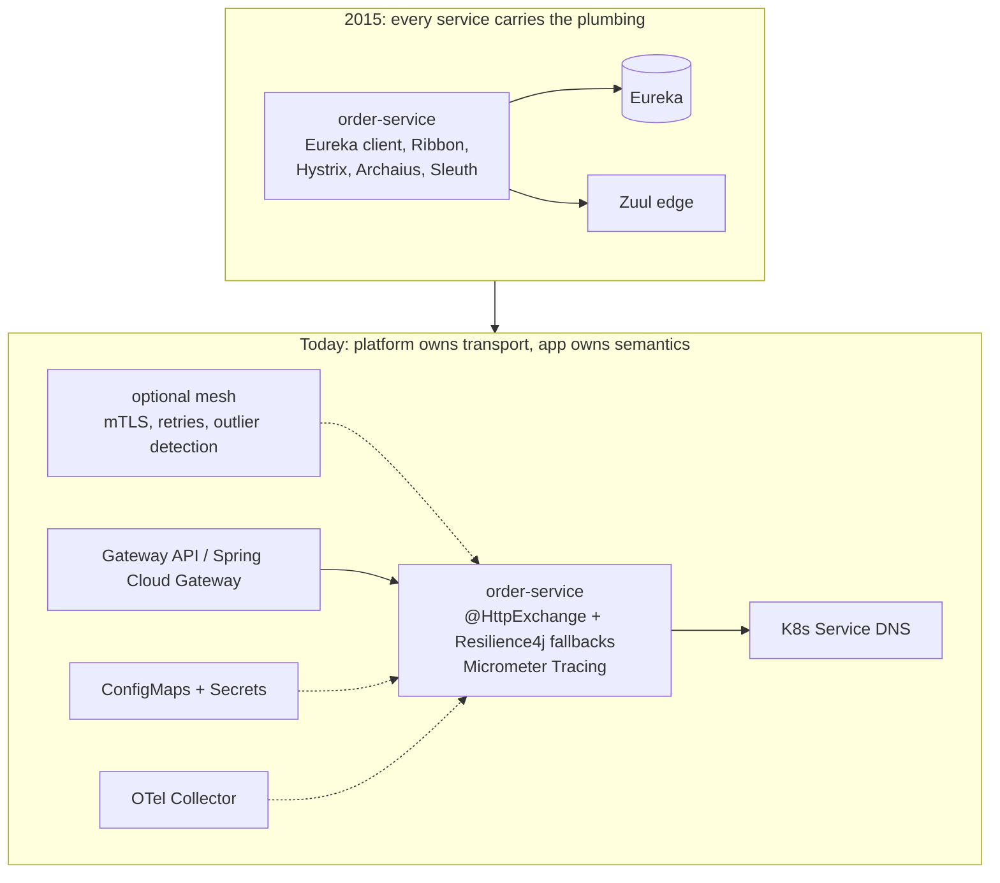

**What stays in the app** even with a mesh: **fallbacks** (only the app knows that "empty recommendations" is acceptable), **idempotency**, **timeouts per business operation**, and **business-level retries**. Configure retries in the mesh *or* the app, never both, or they multiply (section 5.7).

**Trade-offs:**
- **Gains:** fewer libraries per service, the plumbing works for any language, and K8s readiness is a better health signal than heartbeats.
- **Costs:**
  - You are now tied to Kubernetes.
  - A mesh adds latency (sidecar hops) and its own operations burden.
  - Local development needs Docker Compose or a kind/k3d cluster to mimic DNS-based discovery.

**Who uses it:**
- Netflix itself moved off Ribbon and Hystrix internally.
- Most companies that adopted Spring Cloud Netflix around 2016–2018 now run on EKS, GKE or AKS. They keep Spring Cloud Gateway and Resilience4j, and drop Eureka and Ribbon.

---

## 8. Pitfalls & debugging checklist

- [ ] **The build fails with "dependency version is missing" (or, if you pin 4.3.x, the app fails at runtime) after upgrading to Boot 4.** The project still declares `spring-cloud-starter-gateway` or `-gateway-mvc`. The 2025.1 BOM no longer manages them, and they have no 5.x release. Switch to `spring-cloud-starter-gateway-server-webflux` / `-webmvc`.
- [ ] **Routes defined in YAML are silently ignored.** The old prefix `spring.cloud.gateway.routes` is being used. Move to `spring.cloud.gateway.server.webflux.routes` (or `.server.webmvc.routes`). Add `spring-boot-properties-migrator` temporarily to get warnings.
  - The TokenRelay docs page itself mixes both prefixes, so copy-paste carefully.
- [ ] **Downstream sees the gateway's IP, or wrong redirect URLs (http instead of https).** `X-Forwarded-*` is ignored by default. Set `...trusted-proxies`.
- [ ] **The gateway returns fallbacks for a healthy but slowish service.** The default TimeLimiter (Resilience4j default 1 s) is cutting it. The section 4.1 proof shows a 1.5 s call being cut. Set `resilience4j.timelimiter.instances.<id>.timeout-duration`.
- [ ] **The circuit breaker never opens in a test.** `minimumNumberOfCalls` defaults to 100. Lower it in the test config, or call `transitionToOpenState()` on the registry's breaker.
- [ ] **The breaker opens on 404s or validation errors.** All exceptions are recorded by default. Add `ignore-exceptions` (4xx) or a `record-failure-predicate`.
- [ ] **Bulkhead config has no effect with Spring Cloud CircuitBreaker.** `resilience4j-bulkhead` is not on the classpath (the starter doesn't bring it). Add it explicitly.
- [ ] **`@Retry` and `@CircuitBreaker` annotations do nothing.**
  - The aspect starter is missing. In Boot 4, that is `spring-boot-starter-aspectj`.
  - Or the call is a self-invocation, which proxies don't intercept (note 02).
- [ ] **Framework 7 `@Retryable` does nothing.** `@EnableResilientMethods` is missing. Boot doesn't enable it.
- [ ] **Double charges after a timeout.** A `POST` was retried without an idempotency key. Add `Idempotency-Key` and dedupe on the server, or don't retry non-idempotent calls.
- [ ] **Retry storm during an incident.** Retries happen at several layers (client, gateway, mesh) with no jitter. Retry at one layer, use exponential backoff with jitter, and let the breaker open.
- [ ] **The `@HttpExchange` bean is not found.** It was not imported. Add `@ImportHttpServices(types or basePackages)`. Also check `spring-boot-starter-restclient` (Boot 4 modular starters).
- [ ] **The `@HttpExchange` group is unexpectedly load-balanced, or `UnknownHostException: inventory`.** The LoadBalancer starter is present and `base-url` is unset, so it became `http://<group>`. Set an explicit `http://` base URL, or name the group after the service id.
- [ ] **`@HttpServiceFallback` is never used.**
  - The fallback class or its methods are not `public`.
  - The parameter types don't match.
  - The `Throwable` is in the wrong position (it goes first).
  - Or `spring.cloud.circuitbreaker.http-services.enabled=false`.
- [ ] **Config refresh changed nothing.**
  - The value was copied into a field at startup.
  - The bean uses `@Value` without `@RefreshScope`.
  - The refresh endpoint is not exposed.
  - Or Bus is not configured, so only one pod refreshed.
- [ ] **The app starts with the defaults in production.** `optional:configserver:` hid an unreachable Config Server. Remove `optional:`, or alert on it.
- [ ] **Clients call dead instances for about a minute after a deploy (Eureka).** The cache layers add up: the registry, the client, and the LoadBalancer cache. Disable the LoadBalancer cache with Eureka, use graceful shutdown with deregistration, or move to K8s Services.
- [ ] **A trace breaks at one hop.** The client was built with `RestClient.create()` or `new RestTemplate()` instead of the Boot-provided builder, so no observation interceptor was added.
- [ ] **A distributed monolith.** Every feature needs coordinated deploys of 3 services. Merge the services, or redraw the bounded contexts.

**Debug toolkit:**
- `/actuator/gateway/routes` (WebFlux) or the route beans in `/actuator/beans`.
- `/actuator/circuitbreakers` and `/actuator/circuitbreakerevents` (Resilience4j), and the `resilience4j_*` meters.
- `/actuator/env`, to see which property source won (configserver vs local).
- `/actuator/refresh` and `/actuator/busrefresh`.
- `logging.level.org.springframework.cloud.gateway=DEBUG`.
- The trace waterfall in Tempo or Jaeger for latency hunting.

---

## 9. Interview questions

<details><summary>Q1. When would you choose microservices over a modular monolith, and what does the choice cost?</summary>

Choose microservices when you have **independent teams that need independent deploys**, parts with **very different scaling or availability needs**, or **isolation requirements** (PCI scope, fault isolation). The cost is the distributed systems tax:
- network failures and latency on every call (the eight fallacies);
- no ACID across services (sagas, outbox, eventual consistency);
- API versioning;
- per-service CI/CD, tracing, config and on-call.

For one team or an unclear domain, a modular monolith (Spring Modulith) gives enforced boundaries and in-process events at a fraction of the cost. It also keeps the option to extract later. Split along DDD bounded contexts, with a database per service. If two services always deploy together, you built a distributed monolith.
</details>

<details><summary>Q2. Explain the circuit breaker states and the settings that drive the transitions.</summary>

- **CLOSED:** calls pass, and their outcomes are recorded in a sliding window (count-based or time-based).
- **CLOSED to OPEN:** once at least `minimumNumberOfCalls` calls are recorded, the breaker opens when the failure rate reaches `failureRateThreshold` or the slow-call rate reaches `slowCallRateThreshold` (calls slower than `slowCallDurationThreshold`).
- **OPEN:** calls fail fast with `CallNotPermittedException` and go to the fallback.
- **OPEN to HALF_OPEN:** after `waitDurationInOpenState`.
- **HALF_OPEN:** allows `permittedNumberOfCallsInHalfOpenState` trial calls. It closes if they are healthy and opens again if not.
- **Manual states:** DISABLED, FORCED_OPEN and METRICS_ONLY.

The Resilience4j defaults are 100 calls in the window, 100 minimum calls, a 50% failure rate, 60 s open, and 10 half-open calls. The minimum of 100 is why breakers "never trip" in tests.
</details>

<details><summary>Q3. In which order do Retry, CircuitBreaker, RateLimiter, TimeLimiter and Bulkhead apply, and why does it matter?</summary>

With Resilience4j's Spring annotations, the default is `Retry(CircuitBreaker(RateLimiter(TimeLimiter(Bulkhead(call)))))`:
- **Retry is outermost**, so each attempt passes through the breaker and is counted. Once the breaker opens, the retries see `CallNotPermittedException`. Configure Retry to ignore it, or it wastes attempts.
- **The bulkhead is innermost**, so rejections count as breaker failures.

If you put the breaker *outside* the retry, it would count one failure per *logical* call instead of per attempt. Change the order with the `*AspectOrder` properties or the `Decorators` builder. Spring Cloud CircuitBreaker's factory itself composes CircuitBreaker + TimeLimiter (+ Bulkhead if present).
</details>

<details><summary>Q4. Spring Cloud Gateway: what are routes, predicates and filters, and how do you choose between the WebFlux and Web MVC servers?</summary>

- A **route** is an id, a destination URI, predicates and filters.
- **Predicates** (Path, Method, Host, Header, Weight and so on) decide whether the route matches. The first matching route wins.
- **Filters** modify the request or response: StripPrefix, headers, CircuitBreaker, Retry, TokenRelay, rate limiting.

**WebFlux** (`spring-cloud-starter-gateway-server-webflux`, `spring.cloud.gateway.server.webflux.*`) runs on Netty and is non-blocking. It suits very high concurrency, streaming and WebSockets, and it has the Redis rate limiter.

**Web MVC** (`...-server-webmvc`, `...server.webmvc.*`) is functional routing on the Servlet stack. It is simpler to debug, scales well with virtual threads, and uses Bucket4j for rate limiting.

Both were renamed in 2025.0, and the old starters don't exist for Boot 4. Initializr's `cloud-gateway` id is now the Web MVC variant.
</details>

<details><summary>Q5. How does gateway rate limiting work, and how do you make it work across several gateway replicas?</summary>

It uses the token bucket algorithm. Each key (user, API key, or IP) has a bucket with capacity B that refills at R tokens per second. A request consumes tokens, and an empty bucket means 429.

To share limits across replicas, the bucket state must be central:
- **WebFlux:** the `RequestRateLimiter` filter with `RedisRateLimiter` (`replenishRate`, `burstCapacity`, `requestedTokens`). It runs an atomic Lua script in Redis and needs `spring-boot-starter-data-redis-reactive`. The default key resolver is the principal name, and a missing key is denied.
- **Web MVC:** Bucket4j with a distributed `ProxyManager` backend. The key resolver is Java-DSL only, and a missing key returns 403.
</details>

<details><summary>Q6. Eureka vs Kubernetes Services: why do most K8s shops skip Eureka?</summary>

Kubernetes already provides discovery:
- A Service gets a stable DNS name and a virtual IP.
- Its endpoints are maintained from **readiness probes**.
- kube-proxy (or a mesh) balances traffic.

Eureka would add a stateful server to operate and a 30–90 s staleness window from heartbeats and caches, and it only helps JVM clients. On K8s you call `http://payment-service` and need neither Eureka nor client-side load balancing. With HTTP service groups, a plain `http://` base URL disables LoadBalancer interception.

Eureka still fits VM or ECS fleets, and hybrid setups where some services live outside the cluster.
</details>

<details><summary>Q7. How does `@RefreshScope` work, and when don't you need it?</summary>

A refresh (`/actuator/refresh`, or `/actuator/busrefresh` through Spring Cloud Bus) makes `ContextRefresher` rebuild the Environment and publish an `EnvironmentChangeEvent` with the changed keys:
- `ConfigurationPropertiesRebinder` then re-binds `@ConfigurationProperties` beans in place. That works for JavaBean-style classes with setters, but **not for records**. A test showed that a record keeps its old value, because constructor binding is immutable.
- `@RefreshScope` beans are lazy scoped proxies. Refreshing clears the scope's cache, so the next call builds a new instance with the new `@Value`s and constructor-time state.

A plain `@Value` on a singleton also keeps the old value. You need `@RefreshScope` for beans that take `@Value`s or bake config into their state at construction. The same test showed that a `@RefreshScope` bean's `@Value` does update.

On Kubernetes, many teams skip hot refresh entirely and roll pods on a ConfigMap change, for reproducibility.
</details>

<details><summary>Q8. `@HttpExchange` vs OpenFeign: what would you use on Boot 4, and how do you add load balancing and fallbacks?</summary>

Use `@HttpExchange`. OpenFeign has been feature-complete since 2022.0, and its docs recommend migrating to Spring HTTP Service Clients. `@HttpExchange` interfaces are backed by `RestClient` or `WebClient`, so you get their observability, SSL bundles, interceptors and Boot properties. They also support reactive types.

Framework 7's `@ImportHttpServices` registers the clients in **groups**, and Boot 4 configures each group with `spring.http.serviceclient.<group>.base-url`, timeouts and so on. Spring Cloud 2025.1 adds:
- **Load balancing:** the group's base URL is unset (it becomes `http://<group>`) or uses `lb://`.
- **Circuit breaking:** `@HttpServiceFallback(value = Fallback.class, group = "...")`. The fallback methods match by name and parameters, optionally with a leading `Throwable`.
</details>

<details><summary>Q9. How do you keep data consistent across services without distributed transactions?</summary>

Use a **saga**, a series of local transactions with compensating actions:
- **Choreography:** services react to each other's events.
- **Orchestration:** a central coordinator sends commands.

Make it reliable with three things:
1. **A transactional outbox.** The business row and the event row commit in one local transaction, and a relay or CDC publishes the events. That gives at-least-once delivery without dual-write races.
2. **Idempotent consumers.** A processed-message-id table is updated in the same transaction as the side effect. HTTP uses `Idempotency-Key`.
3. **A UX that accepts eventual consistency.** The order stays `PENDING` until the saga completes.

2PC/XA is avoided because it locks across the network, needs every participant to support it, and makes the coordinator a single point of failure.
</details>

<details><summary>Q10. API composition or CQRS for a page that needs data from four services?</summary>

**API composition** (a BFF calls the four services in parallel and merges the results) is simple and real-time. But its availability is the product of all four, so it needs fallbacks per call, and its latency is the slowest call.

**CQRS** builds a denormalized read model from the services' events in its own store. It is fast and stays available, but it is eventually consistent and needs replay and rebuild tooling.

Use composition for detail pages that must be fresh. Use CQRS for lists, search, dashboards and cross-service filtering or sorting, which composition can't do efficiently, for example "orders over $100 whose shipment is late".
</details>

<details><summary>Q11. How do you secure service-to-service calls?</summary>

There are two identities.

**The user's identity** travels as the user's JWT:
- The gateway validates it, or converts a session to a token with `TokenRelay`.
- Each service **re-validates** the JWT as a resource server (zero trust).
- Token exchange can narrow the token's audience.

**The service's own identity** is used when there is no user, such as a job or a consumer:
- It uses an OAuth2 `client_credentials` token, attached by `OAuth2ClientHttpRequestInterceptor` on `RestClient`.
- The downstream authorizes it by scope.

Add mTLS (a mesh or SSL bundles) for workload identity and encryption in transit. Never log or propagate tokens in baggage.
</details>

<details><summary>Q12. How do you test that a change in `payment-service` won't break `order-service`?</summary>

Use consumer-driven contract tests:
1. The order team writes contracts (or Pact files) describing the requests it makes and the responses it relies on.
2. The payment build verifies them against its real controllers and publishes stubs.
3. The order build tests its `@HttpExchange` client against those stubs.

A breaking change fails the producer's build before deploy.

Note the 2025.1 change: **Spring Cloud Contract is no longer in the release-train BOM**. Initializr offers Stubborn Contract, its official continuation, which reads existing contracts unchanged. Pact is the polyglot alternative.

Complement contracts with WireMock fault-injection tests for resilience, Testcontainers integration tests per service, and only a few end-to-end journeys.
</details>

<details><summary>Q13. What is the strangler fig pattern, and what is the most common mistake?</summary>

It is an incremental migration:
1. Put a gateway in front of the monolith.
2. Build one bounded context as a new service with its own database, synced through CDC or an outbox plus an anti-corruption layer.
3. Shift that context's routes gradually, using canary weights.
4. Delete the old code, and repeat.

**The most common mistake** is letting the new service read or write the legacy database directly to save time. That keeps the coupling, and the "migration" never finishes. The second most common is extracting a context with unclear seams first. Pick a well-bounded, valuable one.
</details>

<details><summary>Q14. Framework 7 ships `@Retryable`. Does that replace Resilience4j?</summary>

No. Framework 7's `@Retryable` and `@ConcurrencyLimit` (in `org.springframework.resilience.annotation`, activated by `@EnableResilientMethods`, which Boot doesn't auto-enable) cover retries and concurrency throttling without extra dependencies.

They have **no circuit breaker, rate limiter or time limiter, and no Micrometer metrics**. For calls across a network in production, use Resilience4j (directly, or via Spring Cloud CircuitBreaker, which the Gateway filter and `@HttpServiceFallback` use). Use the core annotations for simple in-service retries, such as an optimistic-lock retry or a flaky local resource.
</details>

<details><summary>Q15. A checkout page goes down whenever the recommendation service is slow. Walk through the fix.</summary>

This is a cascading failure. Slow calls hold request threads until the pool is exhausted. The fix:
1. **A timeout** on the optional call (TimeLimiter or a read timeout, e.g. 300 ms).
2. **A bulkhead** capping concurrent recommendation calls (a semaphore with virtual threads), so it can't consume checkout's capacity.
3. **A circuit breaker** that opens on the slow-call or failure rate, so calls stop entirely during the incident.
4. **A fallback**: an empty list or cached top sellers.
5. **Alerts** on breaker state, so the degradation is visible.

Critical dependencies (pricing) get timeouts and idempotent retries, but no silent fallback. Also check that nothing retries at several layers.
</details>

---

## 10. Sources

- **Spring Cloud:**
  - [Project page and release train / Boot compatibility table](https://spring.io/projects/spring-cloud)
  - [2025.1 release notes](https://github.com/spring-cloud/spring-cloud-release/wiki/Spring-Cloud-2025.1-Release-Notes)
  - [2025.0 release notes (gateway renames, property prefixes, trusted proxies)](https://github.com/spring-cloud/spring-cloud-release/wiki/Spring-Cloud-2025.0-Release-Notes)
  - `spring-cloud-dependencies-2025.1.4.pom` on Maven Central (module versions)
- **Spring Cloud Gateway:**
  - [Reference](https://docs.spring.io/spring-cloud-gateway/reference/)
  - [Server Web MVC starter](https://docs.spring.io/spring-cloud-gateway/reference/spring-cloud-gateway-server-webmvc/starter.html)
  - [Web MVC RateLimiter (Bucket4j)](https://docs.spring.io/spring-cloud-gateway/reference/spring-cloud-gateway-server-webmvc/filters/ratelimiter.html)
  - [Web MVC TokenRelay](https://docs.spring.io/spring-cloud-gateway/reference/spring-cloud-gateway-server-webmvc/filters/tokenrelay.html)
  - [WebFlux RequestRateLimiter (Redis)](https://docs.spring.io/spring-cloud-gateway/reference/spring-cloud-gateway-server-webflux/gatewayfilter-factories/requestratelimiter-factory.html)
- **Spring Cloud Commons:**
  - [Spring Cloud LoadBalancer (including HTTP Service Client groups)](https://docs.spring.io/spring-cloud-commons/reference/spring-cloud-commons/loadbalancer.html)
  - [Spring Cloud Circuit Breaker (including `@HttpServiceFallback`)](https://docs.spring.io/spring-cloud-commons/reference/spring-cloud-circuitbreaker.html)
- **Spring Cloud CircuitBreaker Resilience4j:**
  - [Default configuration](https://docs.spring.io/spring-cloud-circuitbreaker/reference/spring-cloud-circuitbreaker-resilience4j/default-configuration.html)
  - [Bulkhead support](https://docs.spring.io/spring-cloud-circuitbreaker/reference/spring-cloud-circuitbreaker-resilience4j/bulkhead-pattern-supporting.html)
  - [Properties configuration](https://docs.spring.io/spring-cloud-circuitbreaker/reference/spring-cloud-circuitbreaker-resilience4j/circuit-breaker-properties-configuration.html)
- **Other Spring Cloud projects:**
  - [Spring Cloud OpenFeign (feature-complete notice)](https://docs.spring.io/spring-cloud-openfeign/reference/)
  - [Spring Cloud Config](https://docs.spring.io/spring-cloud-config/reference/)
  - [Spring Cloud Bus](https://docs.spring.io/spring-cloud-bus/reference/)
  - [Spring Cloud Kubernetes](https://docs.spring.io/spring-cloud-kubernetes/reference/)
- **Spring Boot reference:**
  - [HTTP Service Interface Clients (`@ImportHttpServices`, `spring.http.serviceclient.*`)](https://docs.spring.io/spring-boot/reference/io/rest-client.html)
  - [Kubernetes probes and graceful shutdown](https://docs.spring.io/spring-boot/reference/actuator/endpoints.html#actuator.endpoints.kubernetes-probes)
  - [Spring Boot 4.0 Migration Guide](https://github.com/spring-projects/spring-boot/wiki/Spring-Boot-4.0-Migration-Guide)
- **Spring Framework:**
  - [HTTP Service Clients](https://docs.spring.io/spring-framework/reference/integration/rest-clients.html#rest-http-service-client)
  - [Resilience features (`@Retryable`, `@ConcurrencyLimit`)](https://docs.spring.io/spring-framework/reference/core/resilience.html)
  - [Spring Framework 7.0 Release Notes](https://github.com/spring-projects/spring-framework/wiki/Spring-Framework-7.0-Release-Notes)
- **Spring Modulith:** [reference](https://docs.spring.io/spring-modulith/reference/)
- **Resilience4j:**
  - [Getting started with Spring Boot (aspect order)](https://resilience4j.readme.io/docs/getting-started-3)
  - [CircuitBreaker](https://resilience4j.readme.io/docs/circuitbreaker)
  - [Bulkhead](https://resilience4j.readme.io/docs/bulkhead)
- **Contract testing:**
  - [Stubborn Contract (continuation of Spring Cloud Contract)](https://docs.stubborn.sh/contract/)
  - [Pact](https://docs.pact.io/)
- **Patterns:**
  - Martin Fowler: [Microservices](https://martinfowler.com/articles/microservices.html), [MonolithFirst](https://martinfowler.com/bliki/MonolithFirst.html), [StranglerFigApplication](https://martinfowler.com/bliki/StranglerFigApplication.html), [BoundedContext](https://martinfowler.com/bliki/BoundedContext.html), [CircuitBreaker](https://martinfowler.com/bliki/CircuitBreaker.html)
  - [microservices.io: Saga, Transactional outbox, API composition, CQRS](https://microservices.io/patterns/)
  - [The Twelve-Factor App](https://12factor.net/)
  - Sam Newman, [BFF pattern](https://samnewman.io/patterns/architectural/bff/)
- **Baeldung.** These articles are mostly Boot 3.x era, so check them against section 6. They use the old gateway starters and prefixes, `resilience4j-spring-boot3` and Feign.
  - [Spring Cloud Gateway](https://www.baeldung.com/spring-cloud-gateway)
  - [Spring Cloud Circuit Breaker](https://www.baeldung.com/spring-cloud-circuit-breaker)
  - [Resilience4j with Spring Boot](https://www.baeldung.com/spring-boot-resilience4j)
  - [Spring Cloud Config](https://www.baeldung.com/spring-cloud-configuration)
  - [Spring Cloud Netflix Eureka](https://www.baeldung.com/spring-cloud-netflix-eureka)
  - [HTTP interface clients](https://www.baeldung.com/spring-6-http-interface)
  - [Spring Modulith](https://www.baeldung.com/spring-modulith)
- **Oracle / JDK:**
  - [`java.net.http.HttpClient` (timeouts)](https://docs.oracle.com/en/java/javase/21/docs/api/java.net.http/java/net/http/HttpClient.html)
  - [`java.lang.reflect.Proxy` (how interface clients are generated)](https://docs.oracle.com/en/java/javase/21/docs/api/java.base/java/lang/reflect/Proxy.html)
  - [Virtual threads (JEP 444)](https://docs.oracle.com/en/java/javase/21/core/virtual-threads.html)
- **Spring source to read:** `HttpServiceProxyFactory`, `HttpServiceProxyRegistry`, `RestClientAdapter`, `GatewayRouterFunctions`, `HandlerFunctions`, `CircuitBreakerFilterFunctions`, `LoadBalancerRestClientHttpServiceGroupConfigurer`, `CircuitBreakerRestClientHttpServiceGroupConfigurer`, `Resilience4JCircuitBreakerFactory`, `ContextRefresher`, `ConfigurationPropertiesRebinder`, `RoundRobinLoadBalancer`.
