# 15 — Packaging & Deployment: Fat Jars, Containers, Native Images, CI & Kubernetes

> **Lab:** none. This topic is applied directly in the two capstones (Dockerfile, CI workflow, Kubernetes manifests). Every claim marked *proven* below was checked with a throwaway Boot 4.1.2 app (web + actuator) on 2026-11-19: `./mvnw package`, `jarmode` output, a multi-stage Docker build, CDS/AOT-cache timing runs, `process-aot`, and a `docker stop` graceful-shutdown run.
> **Capstone use:** both capstones ship as layered, non-root container images built and pushed by a path-filtered GitHub Actions workflow. They run locally with `compose.yaml` (Postgres, Redis, Kafka) through `spring-boot-docker-compose`, and deploy to Kubernetes with startup/liveness/readiness probes, graceful shutdown, a `preStop` sleep, an HPA and rolling updates.
> **Prereqs:** 03 Boot internals (the startup sequence and `AvailabilityChangeEvent`), 04 Configuration (env vars, `configtree:`), 08 Testing (Testcontainers), 10 Observability (health groups, probes), 14 Microservices (the twelve-factor table in §5.6).

---

## 1. What & why

Packaging answers "what artifact do we ship?" Deployment answers "how does that artifact become a running, healthy, replaceable process?" Spring Boot's opinion since 1.0 has been: **ship one self-contained executable, configure it from the environment, and let the platform run many copies.**

**How we got here:**

| Era | Artifact | How it ran | Pain |
|---|---|---|---|
| J2EE / early Spring | `.war` / `.ear` | Deployed into a shared app server (WebLogic, WebSphere, Tomcat) that ops owned | Server version drift, classloader hell, "works on my Tomcat", deploys were tickets |
| Shaded "uber" jar (Maven Shade) | One jar with all classes *merged* | `java -jar` | Overlapping files (`META-INF/services`, `spring.factories`) clobber each other, and you can't see which libraries are inside |
| **Boot executable jar (2014+)** | Jar with jars *nested* inside, plus a custom loader | `java -jar app.jar`, embedded Tomcat | One fat file. A 1-line code change re-ships ~20–100 MB |
| Containers (2015+) | OCI image: OS + JRE + app | Docker, then an orchestrator | Naive `COPY app.jar` images rebuild and re-push every dependency on every commit |
| **Layered images + Kubernetes (2020+)** | Image whose layers split dependencies from app code | K8s Deployment with probes, HPA, rolling updates | Startup time and memory now matter, because pods are created and killed constantly |
| **Startup acceleration (2023+)** | Same image + CDS/AOT cache, or a GraalVM native binary | Serverless, scale-to-zero, fast autoscaling | Build complexity, training runs, closed-world restrictions |

**What this note covers:** the fat jar's internals; extracting it for containers; Dockerfiles vs Cloud Native Buildpacks; JVM memory in containers; CDS, the Java 25 AOT cache, Spring AOT and GraalVM native image; Docker Compose for local infra; graceful shutdown and probes; GitHub Actions CI in a monorepo; and the Kubernetes objects a Spring service needs.

**When *not* to reach for each tool:**
- **Kubernetes** for one small app with steady traffic. A PaaS (App Runner, Cloud Run, Azure Container Apps, Elastic Beanstalk) or even a VM with systemd runs a Boot jar fine. K8s pays off when you have many services, a platform team, and need its scheduling and self-healing.
- **GraalVM native image** for long-running, high-throughput services. A warmed-up JIT usually wins on peak throughput, builds take minutes and gigabytes of RAM, and every reflective library needs hints (section 3.7).
- **A hand-written Dockerfile** when a buildpack already produces what you need. Buildpacks give you a patched base image, non-root user, memory calculator and SBOM for free. Write the Dockerfile when you need control (custom base image, extra OS packages, a specific layout).
- **CDS/AOT cache** when startup doesn't matter (a batch job that runs for an hour) or when you can't do a training run in the build (the app needs a live database to start and you can't stub it).

---

## 2. Mental model

Think of it as **one immutable artifact moving through stages**. CI builds the image *once*, tags it with the commit SHA, and every environment pulls *that* image. Only configuration differs per environment (twelve-factor III and V).

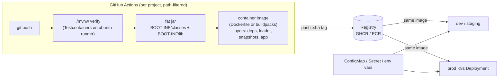

**Where each startup optimisation acts.** A JVM Spring app's startup time goes into three buckets: loading and linking thousands of classes, Spring working out what beans exist (scanning, conditions, reflection), and running code in the interpreter before the JIT warms up. Each tool attacks a different bucket:

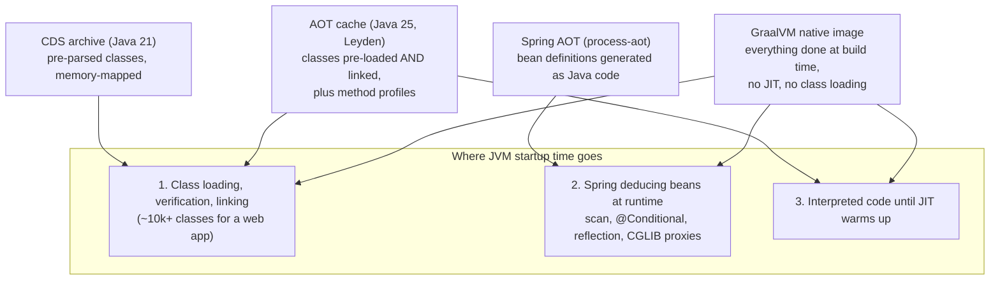

**Four rules hold everything together:**
1. **Build once, run anywhere you promote it.** Never rebuild for prod. Rebuilding means you're shipping something you didn't test.
2. **Order layers from least to most frequently changing** so a code change re-pushes kilobytes, not the whole dependency set.
3. **The platform owns the process lifecycle.** The app must start fast, report honestly whether it is alive and whether it is ready, and stop gracefully on `SIGTERM`.
4. **The container's limits are the JVM's world.** Size the heap as a *percentage* of the container memory, never as a fixed number that can drift out of sync with it.

---

## 3. How it works internally

### 3.1 The executable fat jar: anatomy (proven)

`spring-boot-maven-plugin`'s `repackage` goal (bound to `package` by `spring-boot-starter-parent`) takes the plain jar that `maven-jar-plugin` produced and rewrites it. This is the actual layout of the proof app's `demo-0.0.1-SNAPSHOT.jar` (22 MB, 42 nested jars):

```text
demo-0.0.1-SNAPSHOT.jar
├── META-INF/MANIFEST.MF
├── META-INF/services/java.nio.file.spi.FileSystemProvider   <- registers the nested-jar NIO FileSystem
├── META-INF/maven/dev.roadmap/demo/pom.xml
├── org/springframework/boot/loader/                         <- the loader, as plain classes (not a jar)
│   ├── launch/   JarLauncher, WarLauncher, PropertiesLauncher, LaunchedClassLoader, JarModeRunner
│   ├── jar/      NestedJarFile
│   ├── net/protocol/nested/Handler                           <- the "nested:" URL protocol
│   ├── zip/, nio/file/, jarmode/, ref/, log/
└── BOOT-INF/
    ├── classes/  application.properties, dev/roadmap/demo/DemoApplication.class
    ├── lib/      42 jars, incl. tomcat-embed-core-11.0.27.jar, jackson-databind-3.1.7.jar,
    │             spring-boot-jarmode-tools-4.1.2.jar
    ├── classpath.idx
    └── layers.idx
```

The manifest the plugin writes (copied verbatim from the proof jar):

```text
Main-Class: org.springframework.boot.loader.launch.JarLauncher
Start-Class: dev.roadmap.demo.DemoApplication
Spring-Boot-Version: 4.1.2
Spring-Boot-Classes: BOOT-INF/classes/
Spring-Boot-Lib: BOOT-INF/lib/
Spring-Boot-Classpath-Index: BOOT-INF/classpath.idx
Spring-Boot-Layers-Index: BOOT-INF/layers.idx
```

- **`Main-Class`** is what the JVM runs: Boot's launcher, not your app. **`Start-Class`** is your `@SpringBootApplication` class, which the launcher calls once the classloader is ready.
- **`classpath.idx`** fixes the order in which nested jars go on the classpath, so `java -jar` gives the same order as the build did. It's only used under `java -jar`, not from the IDE or `spring-boot:run`.
- **`layers.idx`** tells tooling how to split the jar into image layers. The default index for the proof app:

```text
- "dependencies":
  - "BOOT-INF/lib/"
- "spring-boot-loader":
  - "org/"
- "snapshot-dependencies":
- "application":
  - "BOOT-INF/classes/"
  - "BOOT-INF/classpath.idx"
  - "BOOT-INF/layers.idx"
  - "META-INF/"
```

The order matters: `dependencies` (release jars, change rarely) → `spring-boot-loader` (changes only on a Boot upgrade) → `snapshot-dependencies` (`-SNAPSHOT` jars, change often) → `application` (changes every commit). Docker caches each layer, so a code-only change rebuilds and pushes only the last one.

- **Nested jars are `STORED`, not deflated.** `unzip -v` on the proof jar shows `Stored 177206 0%` for `BOOT-INF/lib/HdrHistogram-2.2.2.jar`. This is a hard requirement of the loader: it must be able to seek directly into a nested jar's bytes. The *contents* of each nested jar are still compressed.

### 3.2 How `java -jar` actually boots: the nested-jar loader

Java has no standard way to load a jar that sits inside another jar. `URLClassLoader` understands `file:` and `jar:file:...!/` URLs, but not "a jar inside a jar". Boot solves this with its own loader, rewritten in Boot 3.2 and the only loader in Boot 4 (the "classic" loader was removed):

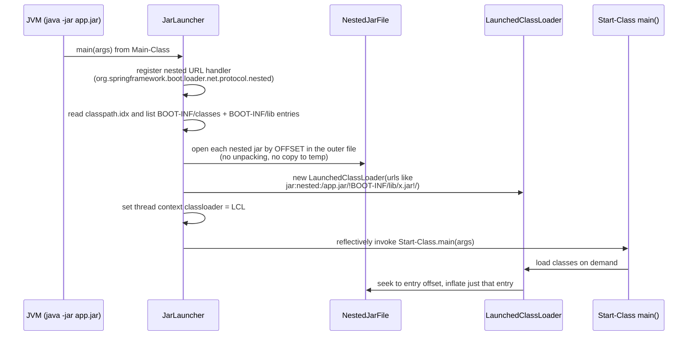

Key classes (all present in the proof jar under `org/springframework/boot/loader/`):

| Class | Role |
|---|---|
| `launch.Launcher` → `ExecutableArchiveLauncher` → `JarLauncher` / `WarLauncher` | Build the classpath from `BOOT-INF/` (or `WEB-INF/`) and call `Start-Class` |
| `launch.PropertiesLauncher` | Like `JarLauncher`, but adds extra classpath from `loader.path` / `LOADER_PATH` (plugin-style deployments, external drivers) |
| `launch.LaunchedClassLoader` | A `URLClassLoader` over `jar:nested:` URLs |
| `jar.NestedJarFile` | Extends `JarFile`. On first open it maps each entry to a byte offset in the outer jar, then seeks straight there. Nothing is unpacked or read fully into memory |
| `net.protocol.nested.Handler` | The `nested:` URL protocol, e.g. `jar:nested:/path/myjar.jar/!BOOT-INF/lib/mylib.jar!/B.class` |
| `launch.JarModeRunner` | Runs instead of your app when `-Djarmode=...` is set (section 3.3) |

**Two loader restrictions that still bite:**
- Code must load classes through `Thread.currentThread().getContextClassLoader()`. **`ClassLoader.getSystemClassLoader()` can't see nested jars.** `java.util.logging` always uses the system classloader, which is one more reason Boot uses Logback/Log4j2.
- Anything that assumes the jar is a directory (`new File(getClass().getResource(...).toURI())`) breaks under `java -jar`. Read resources as streams (`Resource.getInputStream()`), never as `File`.

### 3.3 Extracting the jar: `-Djarmode=tools` (proven)

Running from the fat jar costs a little at startup (nested-jar indirection) and, more importantly, **CDS and the AOT cache don't work on it**, because they need a plain classpath of real files (proven in section 3.6). For containers you *extract* the jar. Every Boot jar built by the plugin contains `spring-boot-jarmode-tools-4.1.2.jar`, so the jar can unpack itself:

```text
$ java -Djarmode=tools -jar demo-0.0.1-SNAPSHOT.jar help
Available commands:
  extract      Extract the contents from the jar
  list-layers  List layers from the jar that can be extracted
  help         Help about any command

$ java -Djarmode=tools -jar demo-0.0.1-SNAPSHOT.jar help extract
Options:
  --launcher                     Whether to extract the Spring Boot launcher
  --layers string list           Layers to extract
  --destination string           Directory to extract files to. Defaults to a directory named after the uber JAR (without the file extension)
  --libraries string             Name of the libraries directory. Only applicable when not using --launcher. Defaults to lib/
  --application-filename string  Name of the application JAR file. Only applicable when not using --launcher. Defaults to the uber JAR filename
  --force                        Whether to ignore non-empty directories, extract anyway

$ java -Djarmode=tools -jar demo-0.0.1-SNAPSHOT.jar list-layers
dependencies
spring-boot-loader
snapshot-dependencies
application

$ java -Djarmode=layertools -jar demo-0.0.1-SNAPSHOT.jar list
Error: Unsupported jarmode 'layertools'
```

The three extraction shapes (all produced and inspected on the proof jar):

| Command | Result | Run with |
|---|---|---|
| `extract` | `demo.jar` (your classes only) + `lib/*.jar`. The *new* `demo.jar` manifest has `Main-Class: dev.roadmap.demo.DemoApplication` and a `Class-Path: lib/HdrHistogram-2.2.2.jar lib/...` line | `java -jar demo.jar`. A plain classpath: **CDS/AOT-cache friendly** |
| `extract --layers` | Same shape, but split into `dependencies/lib/`, `spring-boot-loader/`, `snapshot-dependencies/`, `application/demo.jar` | Copy each folder as its own Docker layer into one directory, then `java -jar demo.jar` |
| `extract --layers --launcher` | The *old* exploded layout: `dependencies/BOOT-INF/lib`, `spring-boot-loader/org/...`, `application/BOOT-INF/classes`, `META-INF` | `java org.springframework.boot.loader.launch.JarLauncher`. Still goes through Boot's loader, so it's **not** the CDS-friendly form |

> **Use `extract --layers` without `--launcher` for images.** The docs' Dockerfile does exactly this, and the AOT cache and CDS docs say the cache works only "with the extracted form of the application".

### 3.4 Image layers and why order matters

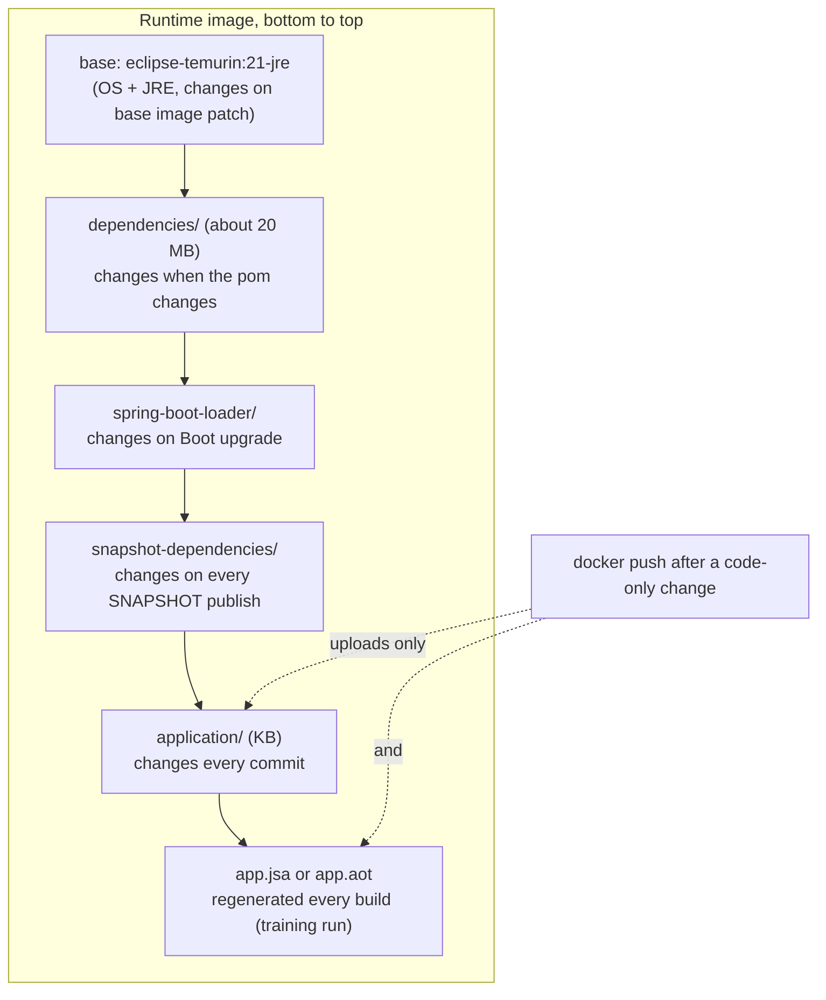

Docker reuses a cached layer only if **every layer below it** is unchanged. That's why `COPY app.jar` as a single layer is the anti-pattern: each commit produces a new 22 MB+ layer, every node pulls it again, and registries fill up. With the four layers above, a code-only change ships a few hundred KB (plus the CDS/AOT archive, which must be rebuilt because it fingerprints the classpath).

### 3.5 The JVM inside a container (proven)

Since JDK 10, `-XX:+UseContainerSupport` is on by default: the JVM reads the cgroup memory and CPU limits instead of the host's. The heap ergonomics are then **percentages of the container limit**. Measured inside the proof image with `--memory=512m`:

```text
$ java -XX:+PrintFlagsFinal -version | grep ...
   bool UseContainerSupport  = true        {default}
 double MaxRAMPercentage     = 25.000000   {default}
 size_t MaxHeapSize          = 134217728   {ergonomic}   <- 128 MB = 25% of 512 MB

$ java -XX:MaxRAMPercentage=75 -XX:+PrintFlagsFinal -version | grep MaxHeapSize
 size_t MaxHeapSize          = 402653184   {ergonomic}   <- 384 MB = 75% of 512 MB
```

So **the default heap is only a quarter of the container**. That's conservative, and it's why people reach for `-Xmx`. The better fix is `-XX:MaxRAMPercentage=75` (or 70–80):

**Why a fixed `-Xmx` is risky:**
- It **decouples the heap from the limit**. Someone lowers the pod's `resources.limits.memory` from 1 Gi to 512 Mi and forgets the `-Xmx768m` baked into the Dockerfile. The JVM happily grows past the limit, and the kernel **OOM-kills** the container (exit code 137, `OOMKilled`). There is no Java `OutOfMemoryError` and no heap dump, just a dead pod.
- **The heap is not the whole process.** Java memory = heap + metaspace (class metadata; a Spring app easily needs 100–150 MB) + code cache (JIT output, up to 240 MB reserved) + thread stacks (~1 MB each × threads; virtual threads help here) + direct/NIO buffers (Netty, Kafka clients) + GC structures + native allocations. `-Xmx` equal to the limit guarantees an OOM kill. That's also why the percentage should be ~75%, not 100%.
- One `-Xmx` per environment means per-environment images or env overrides. A percentage works unchanged at every size.

**CPU matters too.** The JVM sizes GC threads, the `ForkJoinPool.commonPool`, and Tomcat defaults from `Runtime.availableProcessors()`, which follows the CPU limit. Below 2 CPUs **or** about 1.8 GB, JDK ergonomics doesn't consider the machine "server class" and picks **SerialGC** instead of G1 (see the Oracle ergonomics guide). Also, a hard CPU *limit* throttles the CPU-hungry startup phase (JIT compilation, class loading). Many teams set a CPU *request* but no CPU *limit* for JVM pods for exactly this reason.

### 3.6 Faster startup on the JVM: CDS, the AOT cache, and Spring AOT

**Class Data Sharing (CDS), Java 21.** The JVM can dump the classes it loaded into an archive (`.jsa`) and memory-map that archive on the next start, skipping parsing and verification. The JDK ships a default archive for its own classes; **dynamic AppCDS** adds yours. Boot makes the "training run" easy with `-Dspring.context.exit=onRefresh`, which starts the context and exits right after refresh, so the run needs no traffic:

```bash
java -Djarmode=tools -jar app.jar extract --destination application
cd application
java -XX:ArchiveClassesAtExit=application.jsa -Dspring.context.exit=onRefresh -jar app.jar   # training run
java -XX:SharedArchiveFile=application.jsa -jar app.jar                                      # every real start
```

**The AOT cache, Java 25 (Project Leyden).** JEP 483 (JDK 24) generalised CDS into an *AOT cache* that stores classes already **loaded and linked**, not just parsed. JEP 514 (JDK 25) made it a one-step flag (`-XX:AOTCacheOutput`), and JEP 515 (JDK 25) adds **method profiles** from the training run, so the JIT starts optimising hot methods sooner. The Boot docs say: use the AOT cache on Java 25+, and CDS on earlier versions.

```bash
java -XX:AOTCacheOutput=app.aot -Dspring.context.exit=onRefresh -jar app.jar   # training run
java -XX:AOTCache=app.aot -jar app.jar
```

**Measured on the proof app** (this laptop, Docker Desktop, noisy; each row is 3–4 runs to context refresh; compare only rows within the same block, because the two blocks used different CPU and memory limits):

| Java 21 container, 1 vCPU, 512 MB | Time to refresh |
|---|---|
| Extracted, no app CDS | 5.8–7.1 s |
| Extracted + dynamic CDS archive | 3.4–4.0 s (about 45% less) |

| Java 25 container, 2 vCPU, 1 GB | Time to refresh |
|---|---|
| Fat jar (`java -jar app.jar`) | 4.7–6.1 s |
| Extracted | 3.8–4.9 s |
| Extracted + AOT cache (`app.aot`, 56 MB) | 2.1–3.3 s |
| Extracted + dynamic CDS on Java 25 | 3.6–4.5 s (little gain in this run; the docs recommend the AOT cache on 25 anyway) |
| AOT cache + **fat jar** | **Cache rejected**: the JVM logs `[aot] shared class paths mismatch` and starts without the cache |

Two niche facts surfaced by the proof:
- **The archive pins the classpath.** The AOT cache trained on `demo.jar` refused to load with `/fat/demo.jar`: `The name of app classpath [1] does not match`. The same jar file name, at the same path, from the same build, is required. That's why the training run happens **inside the image build**, in the final `WORKDIR`.
- **Training can fail on a developer laptop.** On Windows with an EDR product installed, the CDS dump failed with `CDS dumping does not support native JVMTI agent`. Native JVMTI agents (some APM agents, EDR products) are incompatible with dumping. Do the training run in the clean container build, and don't attach native agents to it.
- **Filesystem speed skews everything.** The first Java 25 attempt ran the jar from a Windows bind mount and took 17–27 s for the same work. Benchmark startup from the container's own filesystem.

**Spring AOT (`process-aot`).** Independent of the JVM features, Spring can do its own bean-definition work at build time. The `spring-boot-maven-plugin:process-aot` goal starts the application context *in build mode* (no beans instantiated), evaluates every `@Configuration`, `@Conditional` and `@Bean`, and writes the result as **plain Java source**. From the proof app's `target/spring-aot/main/sources/`:

```java
@Generated
public class DemoApplication__BeanDefinitions {
  public static BeanDefinition getDemoApplicationBeanDefinition() {
    RootBeanDefinition beanDefinition = new RootBeanDefinition(DemoApplication.class);
    beanDefinition.setInstanceSupplier(DemoApplication::new);   // no reflection
    return beanDefinition;
  }
}
```

It generated 93 source files: one `__BeanDefinitions` class per configuration (including every auto-configuration that matched), a `DemoApplication__ApplicationContextInitializer` that registers them all, compiled classes under `target/spring-aot/main/classes`, and GraalVM metadata under `target/spring-aot/main/resources/META-INF/native-image/dev.roadmap/demo/`. On the JVM, the generated code is used only when you run with **`-Dspring.aot.enabled=true`**. In the proof the gain was modest and noisy. Its main purpose is to make native image possible, and the AOT cache is the bigger JVM win.

**The price of Spring AOT (it also applies to native):** the bean graph is frozen at build time. `@Profile` and `@ConditionalOnProperty` are evaluated **during the build**, so changing `spring.profiles.active` or a `*.enabled` property at runtime no longer adds or removes beans. Property *values* still bind at runtime.

### 3.7 GraalVM native image

`native-image` performs a **closed-world** static analysis from `main`: everything reachable is compiled ahead of time into one OS executable with a small embedded runtime (Substrate VM). Everything unreachable is dropped. The result starts in tens of milliseconds and has a much smaller RSS, but:

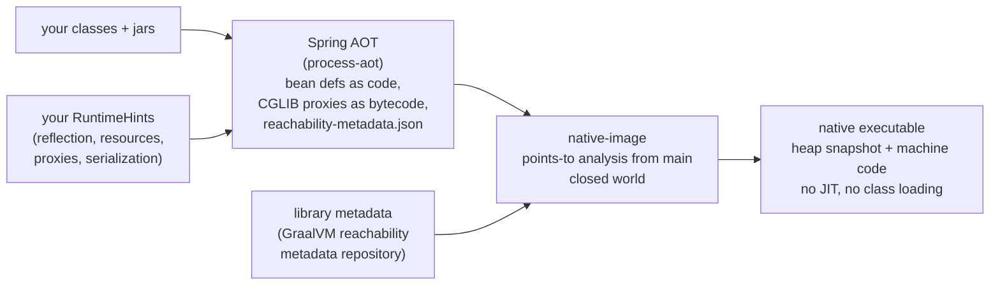

**What the closed world forbids or complicates:**
- **Reflection, resources, JDK dynamic proxies, serialization and JNI** must be declared ahead of time. Anything not declared simply isn't in the binary, and you get `ClassNotFoundException`/`NoSuchMethodException` *at runtime*, often only on an untested code path.
- **No runtime bytecode generation**: CGLIB proxies (for `@Configuration`, `@Transactional` on classes) are generated as classes at build time by Spring AOT.
- **The classpath is fixed** at build time. No plugins, no `loader.path`.
- **No lazy class loading**: everything in the binary is loaded at startup.
- **Bean conditions are frozen** (as in Spring AOT, section 3.6).

**`RuntimeHints` (proven).** When *your* code uses reflection or loads resources by pattern, tell Spring AOT about it with a `RuntimeHintsRegistrar`:

```java
@Configuration
@ImportRuntimeHints(PricingHints.class)
class PricingConfig { }

class PricingHints implements RuntimeHintsRegistrar {
    @Override
    public void registerHints(RuntimeHints hints, ClassLoader classLoader) {
        hints.reflection().registerType(PriceRule.class);        // Framework 7: implies ctor/method/field introspection
        hints.resources().registerPattern("rules/**/*.json");    // Framework 7: glob syntax, not regex
    }
}
```

Running `process-aot` on the proof app wrote both hints into `reachability-metadata.json`: `{"type": "dev.roadmap.demo.ProofBits$PriceRule"}` under `"reflection"`, and `{"glob": "rules/**/*.json"}` (plus the parent `{"glob": "rules"}`) under `"resources"`. Other entry points:
- `@RegisterReflectionForBinding(Dto.class)` for types you (de)serialize by hand, e.g. with Jackson through `RestClient`;
- `@Reflective` on a method or class;
- the `RuntimeHintsPredicates` API to assert in a unit test that a hint exists.

**Generated hint file format (Framework 7, proven).** The proof's AOT output contained exactly two files in `META-INF/native-image/dev.roadmap/demo/`: `native-image.properties` (`Args = -H:Class=dev.roadmap.demo.DemoApplication --no-fallback`) and a single **`reachability-metadata.json`** whose first line is `"comment": "Spring Framework 7.0.10"`. This is GraalVM's unified "exact reachability metadata" format. The Boot reference page still lists the 3.x-era `reflect-config.json`, `resource-config.json`, `proxy-config.json` and so on. That list is stale.

**Building it:**
```bash
./mvnw -Pnative native:compile          # needs a local GraalVM 25+ (native-image on PATH), binary in target/
./mvnw -Pnative spring-boot:build-image # Paketo builds the native binary inside Docker, no local GraalVM needed
./mvnw -PnativeTest test                # runs your JUnit tests compiled as a native image
```

The `native` profile is declared in `spring-boot-starter-parent`. It adds `Spring-Boot-Native-Processed: true` to the manifest, binds `process-aot`, and configures `native-maven-plugin` (you must also declare `org.graalvm.buildtools:native-maven-plugin` in your own `<plugins>`). Boot 4 **requires GraalVM 25 or later**. The Boot docs recommend at least 8 GB of memory for Docker on macOS for native builds.

**When not to use native image:**
- Long-running services where peak throughput matters (no JIT profile-guided optimisation; Oracle GraalVM's PGO narrows the gap but costs a profiling build).
- Apps that depend heavily on reflection-based libraries without reachability metadata, runtime class generation, or Java agents (most APM agents can't attach).
- Teams without the CI budget: a native build of a mid-size Spring app takes minutes and several GB of RAM per build.
- When the AOT cache gets you "fast enough". It keeps the JIT and the dynamic JVM, and costs one extra `RUN` line.

### 3.8 Cloud Native Buildpacks: `spring-boot:build-image`

Buildpacks turn source or a jar into an OCI image **without a Dockerfile**. The Maven goal talks to the Docker daemon, runs a *builder* image, and the builder's buildpacks detect "this is an executable jar, Java 21" and contribute layers:

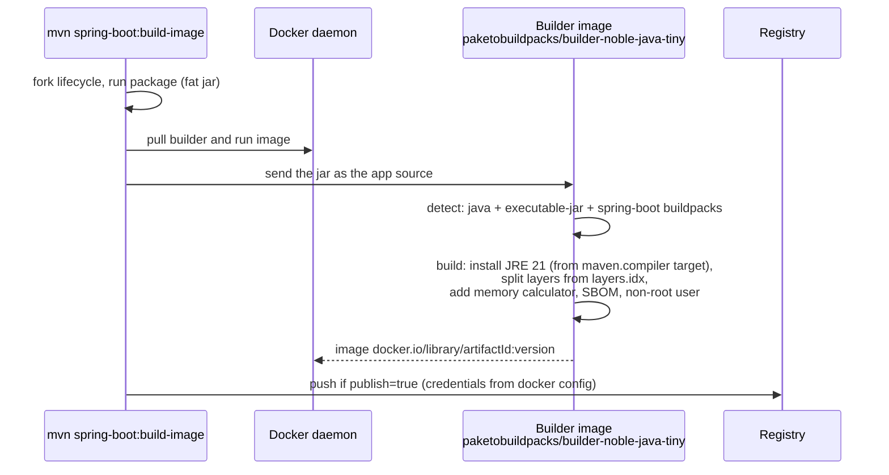

Facts from the 4.1.2 plugin docs:
- The default builder is **`paketobuildpacks/builder-noble-java-tiny:latest`**. The run image is whatever the builder says, unless you set `runImage`.
- The default image name is `docker.io/library/${project.artifactId}:${project.version}`. Override with `-Dspring-boot.build-image.imageName=ghcr.io/acme/orders:1.4.2`.
- `publish=true` pushes; credentials come from `<docker><publishRegistry>` or from `~/.docker/config.json` and credential helpers.
- `imagePlatform` (`linux/amd64`, `linux/arm64`) pulls builder images for another platform.
- `env` passes builder variables, e.g. `BP_JVM_VERSION`, or **`BP_JVM_AOTCACHE_ENABLED=true`** (Java 25+), which makes the buildpack do the training run and bake the AOT cache into the image. `TRAINING_RUN_JAVA_TOOL_OPTIONS` overrides JVM options for that run only.
- Images build and run as a **non-root** user. `spring-boot-devtools` and `spring-boot-docker-compose` are excluded (`excludeDevtools`, `excludeDockerCompose` default to `true`).
- `spring-boot:build-image` forks the lifecycle (for the command line). In a `<execution>`, use **`build-image-no-fork`**.
- The Paketo memory calculator sets `-Xmx`, `-XX:MaxMetaspaceSize`, `-Xss` and `-XX:ReservedCodeCacheSize` from the container limit at **container start**, so its fixed `-Xmx` is recomputed per start and is not the risk described in section 3.5 (unverified: behaviour of the Paketo calculator not re-checked against current Paketo docs).

**Dockerfile vs buildpacks:**

| | Hand-written Dockerfile | Buildpacks |
|---|---|---|
| Control | Full: any base image, OS packages, layout | Opinionated; configure with `BP_*` env vars |
| Base-image patching | You rebuild when the base changes | `pack rebase` swaps the OS layer without a rebuild |
| Memory flags | You set `MaxRAMPercentage` | Memory calculator does it |
| Non-root, SBOM | You write it | Built in |
| Needs Docker daemon in CI | Yes (or Kaniko/Buildah) | Yes |
| Shell in the image | Yes (temurin images) | No shell in `tiny` images (unverified), so `exec`-based probes and hooks won't work |

### 3.9 Graceful shutdown and probes on the platform (proven)

Boot 4.1.2 defaults (read from the `spring-configuration-metadata.json` files in the 4.1.2 jars):

| Property | Default |
|---|---|
| `server.shutdown` | `graceful` |
| `spring.lifecycle.timeout-per-shutdown-phase` | `30s` |
| `management.endpoint.health.probes.enabled` | `true` (on everywhere, not only on Kubernetes) |
| `management.endpoint.health.probes.add-additional-paths` | `false` (set `true` for `/livez` and `/readyz` on the main port) |

**What happens on `SIGTERM`, as observed.** The proof image served `GET /slow` (sleeps 8 s) and logged every `AvailabilityChangeEvent`. `docker stop` was sent 2 s into the request:

```text
11:49:32.563 availability -> CORRECT                    <- liveness, after context refresh
11:49:32.574 availability -> ACCEPTING_TRAFFIC          <- readiness, app ready
11:49:34.656 slow request started
11:49:37.562 [ionShutdownHook] availability -> REFUSING_TRAFFIC
11:49:37.566 [ionShutdownHook] o.s.boot.tomcat.GracefulShutdown : Commencing graceful shutdown. Waiting for active requests to complete
11:49:42.657 slow request finished                      <- client got 200 "done"
11:49:42.699 [tomcat-shutdown] o.s.boot.tomcat.GracefulShutdown : Graceful shutdown complete
```

So the order is: **readiness flips to `REFUSING_TRAFFIC` first** → the web server stops accepting new connections → in-flight requests drain (up to `timeout-per-shutdown-phase` per `SmartLifecycle` phase) → the context closes beans. Note the Boot 4 package: `org.springframework.boot.tomcat.GracefulShutdown` (it was `org.springframework.boot.web.embedded.tomcat` in 3.x, recalled rather than re-checked).

**Why Kubernetes still needs a `preStop` sleep.** When a pod is deleted, Kubernetes *concurrently* sends `SIGTERM` (after `preStop`) and removes the pod from the Service's endpoints. kube-proxy, ingress controllers and cloud load balancers learn about the removal *asynchronously*, a few seconds later. Without a delay, the app stops accepting connections while some proxies still route to it, and those requests fail. The readiness flip doesn't help, because nobody is polling it in time. The fix is to sleep in `preStop` *before* `SIGTERM` reaches the JVM:

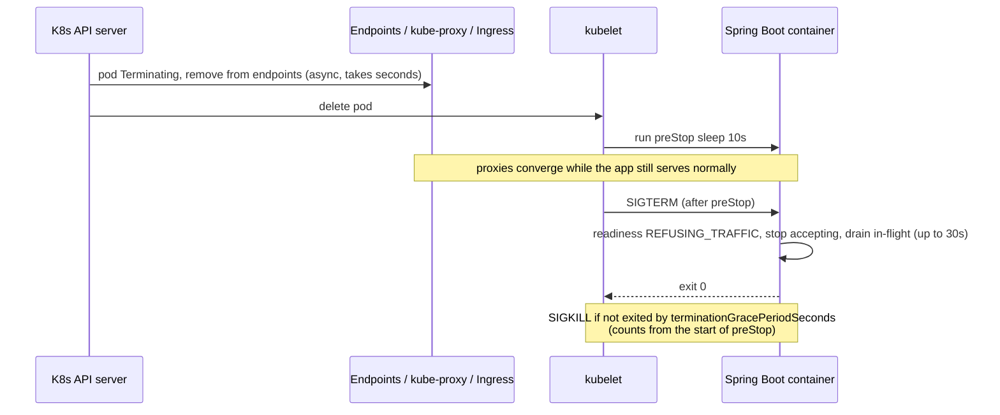

`terminationGracePeriodSeconds` (default 30) must cover **preStop sleep + timeout-per-shutdown-phase + bean shutdown**, e.g. 10 + 30 + a margin → 45–60. Kubernetes 1.32+ has a native `lifecycle.preStop.sleep.seconds` action, which matters for images without a shell (`exec: sleep` needs `/bin/sh`).

**The three probes:**

| Probe | Endpoint | Failure means | Must NOT include |
|---|---|---|---|
| `startupProbe` | `/actuator/health/liveness` | "Still booting"; liveness and readiness are not run until it passes | n/a. Give it a generous budget (e.g. `failureThreshold: 30 × periodSeconds: 2` = 60 s) so slow JVM starts aren't killed |
| `livenessProbe` | `/actuator/health/liveness` (`livenessState`) | "Restart me" | External dependencies (DB, Redis, downstream). A DB blip would restart every pod at once (note 10 §7.3) |
| `readinessProbe` | `/actuator/health/readiness` (`readinessState`, optionally specific checks) | "Stop sending me traffic for now" | Shared dependencies that every pod depends on equally (all pods go unready together, the Service has zero endpoints). Prefer per-pod concerns |

### 3.10 Local infrastructure: Docker Compose and Boot's Compose support

`docker compose up -d` with a `compose.yaml` is the baseline. Boot adds **`spring-boot-docker-compose`**. Its `DockerComposeListener` is registered in the jar's `META-INF/spring.factories` and reacts to `ApplicationPreparedEvent` (both checked in the 4.1.2 jar). It hands off to `DockerComposeLifecycleManager`, which finds `compose.yaml` (or `compose.yml` and the other common names, or `spring.docker.compose.file`), runs `docker compose up`, waits until each container accepts a TCP connection on its mapped port, and registers **`ConnectionDetails`** beans (`JdbcConnectionDetails`, `DataRedisConnectionDetails`, ...) from the running containers. You don't write `spring.datasource.url` for local dev at all: the service connection matches on the image name (`postgres`, `mysql`, `redis`, `mongo`, `rabbitmq` and the other images in the docs table) and uses the randomly mapped host port.

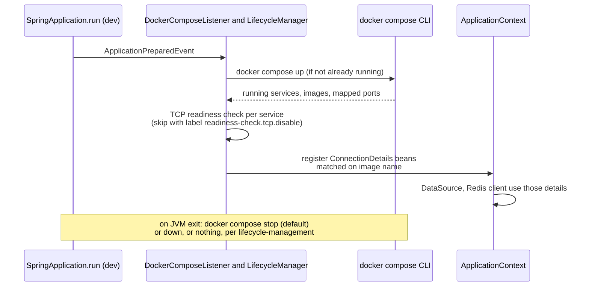

Key properties: `spring.docker.compose.lifecycle-management` = `start-and-stop` (default) | `start-only` | `none`; `start.command` = `up` | `start`; `stop.command` = `stop` (default) | `down`; `spring.docker.compose.profiles.active`; `spring.docker.compose.skip.in-tests` (default `true`, so tests use Testcontainers instead). Labels: `org.springframework.boot.ignore: true` skips a container, `org.springframework.boot.service-connection: redis` maps a custom image. The minimum Docker Compose version is 2.2.0.

The alternative is **Testcontainers at development time**: a `TestMyApplication` in `src/test` calls `SpringApplication.from(MyApplication::main).with(ContainersConfig.class).run(args)`, and `@ServiceConnection` container beans give the same `ConnectionDetails`. Run it with `./mvnw spring-boot:test-run`. Choose Compose when the team already maintains `compose.yaml` (and non-Java teammates use it); choose Testcontainers when you want dev and integration tests to share one container definition.

---

## 4. Full worked code

There's no lab for this note. The Dockerfile and the `RuntimeHints` code were built and run on the proof app; the CI workflow, pom fragments and Kubernetes manifests are the templates the capstones use (illustrative, not executed here).

### 4.1 Multi-stage Dockerfile: layered, non-root, CDS (proven)

This file built the proof image, ran as a non-root user, started with the CDS archive mapped (`-Xlog:cds` printed `Opened archive app.jsa`), and served the graceful-shutdown test. It has two changes from the proven version, both for Kubernetes:
- **The user is pinned to a numeric UID/GID (1001) and `USER` is numeric.** The proof used `useradd --system` (which got UID 999) and `USER spring`. With a *named* user, a pod with `runAsNonRoot: true` fails with `CreateContainerConfigError` because the kubelet can't verify that a name isn't root.
- **The heap flag moved from `ENTRYPOINT` into `ENV JAVA_TOOL_OPTIONS`.** Proven on the host: with `JAVA_TOOL_OPTIONS=-XX:MaxRAMPercentage=50` *and* `-XX:MaxRAMPercentage=75` on the command line, the JVM reports `75 {command line}`. A flag baked into the entrypoint can't be overridden from a ConfigMap, but an `ENV` default can.

```dockerfile
# syntax=docker/dockerfile:1
# ---- build stage: compile, test elsewhere (CI), package, extract layers ----
FROM eclipse-temurin:21-jdk AS build
WORKDIR /src
COPY .mvn/ .mvn/
COPY mvnw pom.xml ./
# Resolve dependencies in their own layer: re-runs only when pom.xml changes.
RUN --mount=type=cache,target=/root/.m2 ./mvnw -q dependency:go-offline
COPY src/ src/
RUN --mount=type=cache,target=/root/.m2 ./mvnw -q -DskipTests package \
 && java -Djarmode=tools -jar target/*.jar extract --layers --destination /extracted

# ---- runtime stage: JRE only, no Maven, no sources ----
FROM eclipse-temurin:21-jre
RUN groupadd --system --gid 1001 spring && useradd --system --uid 1001 --gid spring spring
WORKDIR /app
# Least to most frequently changing, so a code change re-pushes only the last layers.
COPY --from=build /extracted/dependencies/ ./
COPY --from=build /extracted/spring-boot-loader/ ./
COPY --from=build /extracted/snapshot-dependencies/ ./
COPY --from=build /extracted/application/ ./
# CDS training run: start the context, exit after refresh, dump loaded classes.
# Must run in the final WORKDIR with the final jar name, because the archive pins the classpath.
RUN java -XX:ArchiveClassesAtExit=app.jsa -Dspring.context.exit=onRefresh -jar demo-0.0.1-SNAPSHOT.jar \
 && chown -R spring:spring /app
USER 1001:1001
EXPOSE 8080
# A default the platform can override (a ConfigMap setting JAVA_TOOL_OPTIONS replaces this whole value).
ENV JAVA_TOOL_OPTIONS="-XX:MaxRAMPercentage=75"
# Exec form: java is PID 1 and receives SIGTERM directly (no shell swallowing it).
ENTRYPOINT ["java", "-XX:SharedArchiveFile=app.jsa", "-jar", "demo-0.0.1-SNAPSHOT.jar"]
```

Notes:
- **Java 25 variant:** replace both temurin tags with `25-jdk` / `25-jre`, the training line with `java -XX:AOTCacheOutput=app.aot -Dspring.context.exit=onRefresh -jar app.jar`, and the entrypoint flag with `-XX:AOTCache=app.aot`. The Boot docs' own example uses `bellsoft/liberica-openjre-debian:25-cds`.
- **Fixed jar name:** set `<finalName>app</finalName>` in the pom so the Dockerfile doesn't hard-code the version.
- **If the training run needs a database:** give it config that avoids remote calls during refresh (e.g. `spring.datasource.hikari.initialization-fail-timeout=-1`, Flyway disabled for the training run only), or the build will try to connect. The Boot docs point to the `spring-lifecycle-smoke-tests` training-run configuration for this.
- **`.dockerignore`** keeps `target/`, `.git/` and IDE files out of the build context:

```text
target/
.git/
.idea/
*.iml
.env
```

### 4.2 Production-ready `application.yaml` for containers

```yaml
spring:
  application:
    name: orders
  threads:
    virtual:
      enabled: true          # blocking I/O app; fewer platform-thread stacks in the memory budget
  lifecycle:
    timeout-per-shutdown-phase: 30s   # default, stated explicitly; K8s grace period must exceed preStop + this
  jpa:
    open-in-view: false
server:
  shutdown: graceful          # default in Boot 4, stated for readers
  forward-headers-strategy: framework   # behind an ingress/LB: honour X-Forwarded-*
management:
  endpoints:
    web:
      exposure:
        include: health,info,prometheus
  endpoint:
    health:
      probes:
        add-additional-paths: true     # /livez and /readyz on the MAIN port (8080)
      group:
        liveness:
          include: livenessState
        readiness:
          include: readinessState      # add per-pod checks only, never a shared DB (note 10)
  server:
    port: 8081                         # actuator on its own port, not exposed via the Service
logging:
  structured:
    format:
      console: ecs                     # JSON to stdout, twelve-factor XI
```

Secrets (`SPRING_DATASOURCE_PASSWORD`, etc.) come from the environment or mounted files, never from this file.

### 4.3 `RuntimeHints` for native image (proven)

```java
package dev.roadmap.pricing;

import org.springframework.aot.hint.RuntimeHints;
import org.springframework.aot.hint.RuntimeHintsRegistrar;
import org.springframework.context.annotation.Configuration;
import org.springframework.context.annotation.ImportRuntimeHints;

@Configuration
@ImportRuntimeHints(PricingConfig.PricingHints.class)
class PricingConfig {

    record PriceRule(String sku, int cents) {}

    // Only needed because rules are loaded reflectively from JSON files found by pattern.
    // Normal Spring beans, @ConfigurationProperties and controller DTOs get hints automatically.
    static class PricingHints implements RuntimeHintsRegistrar {
        @Override
        public void registerHints(RuntimeHints hints, ClassLoader classLoader) {
            hints.reflection().registerType(PriceRule.class);
            hints.resources().registerPattern("rules/**/*.json");
        }
    }
}
```

A unit test that pins the hint without building a native image:

```java
class PricingHintsTest {

    @Test
    void registersReflectionAndRuleResources() {
        var hints = new RuntimeHints();

        new PricingConfig.PricingHints().registerHints(hints, getClass().getClassLoader());

        assertThat(RuntimeHintsPredicates.reflection().onType(PricingConfig.PriceRule.class)).accepts(hints);
        assertThat(RuntimeHintsPredicates.resource().forResource("rules/eu/vat.json")).accepts(hints);
    }
}
```

(The registrar was proven through `process-aot` output; this test class itself was not compiled here.)

### 4.4 pom fragments: final name, buildpacks with AOT cache, native

```xml
<build>
  <finalName>app</finalName>
  <plugins>
    <plugin>
      <groupId>org.springframework.boot</groupId>
      <artifactId>spring-boot-maven-plugin</artifactId>
      <configuration>
        <image>
          <!-- CI overrides the tag: -Dspring-boot.build-image.imageName=ghcr.io/acme/orders:$GITHUB_SHA -->
          <name>ghcr.io/acme/${project.artifactId}:${project.version}</name>
          <env>
            <BP_JVM_VERSION>25</BP_JVM_VERSION>
            <BP_JVM_AOTCACHE_ENABLED>true</BP_JVM_AOTCACHE_ENABLED>  <!-- Java 25+: training run in the buildpack -->
          </env>
        </image>
      </configuration>
    </plugin>
    <!-- Only if you build native images; activated by -Pnative from spring-boot-starter-parent -->
    <plugin>
      <groupId>org.graalvm.buildtools</groupId>
      <artifactId>native-maven-plugin</artifactId>
    </plugin>
  </plugins>
</build>
```

`BP_JVM_AOTCACHE_ENABLED` needs the app compiled for, and run on, Java 25. On a Java 21 project, leave it out (Paketo's CDS switch exists but was not verified for this note).

### 4.5 Local infra: `compose.yaml` + Boot's Compose support

```yaml
# compose.yaml (project root). docker compose up -d, or just run the app with spring-boot-docker-compose.
services:
  postgres:
    image: postgres:17
    environment:
      POSTGRES_DB: orders
      POSTGRES_USER: orders
      POSTGRES_PASSWORD: orders       # local-only throwaway value
    ports:
      - "5432"                        # random host port; Boot discovers it
  redis:
    image: redis:8
    ports:
      - "6379"
  pgadmin:
    image: dpage/pgadmin4
    labels:
      org.springframework.boot.ignore: true   # started by compose, ignored by Boot
```

```xml
<dependency>
  <groupId>org.springframework.boot</groupId>
  <artifactId>spring-boot-docker-compose</artifactId>
  <optional>true</optional>   <!-- Boot 4: optional deps are excluded from the uber jar, so prod never runs compose -->
</dependency>
```

`./mvnw spring-boot:run` now starts Postgres and Redis, waits for them, wires the `DataSource` and Redis client, and stops them on exit. Image tags above were not pulled for this note; pin to whatever your team uses.

### 4.6 GitHub Actions: path-filtered monorepo CI, Testcontainers, image push

Action versions are the latest releases as of 2026-11-19 (`actions/checkout` v7, `actions/setup-java` v6, `dorny/paths-filter` v4, `docker/login-action` v4, `docker/setup-buildx-action` v4, `docker/metadata-action` v6, `docker/build-push-action` v7, `actions/upload-artifact` v7). The workflow was not run for this note.

```yaml
# .github/workflows/ci.yml
name: ci
on:
  push:
    branches: [main]
  pull_request:

permissions:
  contents: read

jobs:
  changes:                               # decide which projects changed
    runs-on: ubuntu-latest
    outputs:
      projects: ${{ steps.filter.outputs.changes }}
    steps:
      - uses: actions/checkout@v7
      - id: filter
        uses: dorny/paths-filter@v4
        with:
          filters: |
            ecommerce:
              - 'projects/ecommerce/**'
            payments:
              - 'projects/payments/**'

  build:
    needs: changes
    if: needs.changes.outputs.projects != '[]'
    runs-on: ubuntu-latest               # Docker is preinstalled: Testcontainers just works
    strategy:
      fail-fast: false
      matrix:
        project: ${{ fromJSON(needs.changes.outputs.projects) }}
    permissions:
      contents: read
      packages: write                    # push to GHCR with GITHUB_TOKEN
    defaults:
      run:
        working-directory: projects/${{ matrix.project }}
    steps:
      - uses: actions/checkout@v7
      - uses: actions/setup-java@v6
        with:
          distribution: temurin
          java-version: '21'
          cache: maven                   # caches ~/.m2/repository keyed on pom.xml hashes
          cache-dependency-path: projects/${{ matrix.project }}/pom.xml
      - name: Build and test (unit + Testcontainers integration tests)
        run: ./mvnw -B verify
      - name: Upload test reports on failure
        if: failure()
        uses: actions/upload-artifact@v7
        with:
          name: surefire-${{ matrix.project }}
          path: projects/${{ matrix.project }}/target/surefire-reports

      # Image only from main; PRs stop after tests.
      - if: github.ref == 'refs/heads/main'
        uses: docker/setup-buildx-action@v4
      - if: github.ref == 'refs/heads/main'
        uses: docker/login-action@v4
        with:
          registry: ghcr.io
          username: ${{ github.actor }}
          password: ${{ secrets.GITHUB_TOKEN }}
      - if: github.ref == 'refs/heads/main'
        id: meta
        uses: docker/metadata-action@v6
        with:
          images: ghcr.io/${{ github.repository_owner }}/${{ matrix.project }}
          tags: |
            type=sha,format=long
            type=raw,value=latest
      - if: github.ref == 'refs/heads/main'
        uses: docker/build-push-action@v7
        with:
          context: projects/${{ matrix.project }}
          push: true
          tags: ${{ steps.meta.outputs.tags }}
          labels: ${{ steps.meta.outputs.labels }}
          cache-from: type=gha,scope=${{ matrix.project }}
          cache-to: type=gha,mode=max,scope=${{ matrix.project }}
```

Why not plain `on.push.paths`? A workflow-level `paths:` filter decides whether the *whole workflow* runs. It can't tell the job *which* project changed, so you'd need one workflow file per project. That is also valid (simple, separate badges and required checks), but it is duplication. `dorny/paths-filter` gives one workflow and a dynamic matrix. A gotcha with workflow-level `paths:` and required status checks: if a PR doesn't touch the path, the workflow never runs, and a *required* check stays "pending" forever. Make the check non-required, or use the job-level filter pattern above, where the workflow always runs.

Tagging with the **commit SHA** (not just `latest`) is what makes "build once, promote the same image" possible, and gives you instant rollbacks by tag.

### 4.7 Kubernetes manifests: ConfigMap, Secret, Deployment, Service, HPA

```yaml
apiVersion: v1
kind: ConfigMap
metadata:
  name: orders-config
data:
  SPRING_PROFILES_ACTIVE: "prod"
  SPRING_DATASOURCE_URL: "jdbc:postgresql://orders-db:5432/orders"
  JAVA_TOOL_OPTIONS: "-XX:MaxRAMPercentage=75 -XX:+ExitOnOutOfMemoryError"   # replaces the image's ENV default
---
apiVersion: v1
kind: Secret
metadata:
  name: orders-secrets
type: Opaque
stringData:                     # in real life: External Secrets Operator / Sealed Secrets, never in git
  SPRING_DATASOURCE_USERNAME: "orders"
  SPRING_DATASOURCE_PASSWORD: "change-me"
---
apiVersion: apps/v1
kind: Deployment
metadata:
  name: orders
spec:
  replicas: 3
  revisionHistoryLimit: 5
  strategy:
    type: RollingUpdate
    rollingUpdate:
      maxSurge: 1               # one extra pod during rollout
      maxUnavailable: 0         # never drop below desired capacity
  selector:
    matchLabels: { app: orders }
  template:
    metadata:
      labels: { app: orders }
    spec:
      terminationGracePeriodSeconds: 60     # > preStop (10) + timeout-per-shutdown-phase (30) + margin
      securityContext:
        runAsNonRoot: true
        runAsUser: 1001         # numeric, matching the Dockerfile's USER 1001:1001
        runAsGroup: 1001
      containers:
        - name: app
          image: ghcr.io/acme/orders:3f2c1e9    # immutable SHA tag from CI, never :latest
          ports:
            - { name: http, containerPort: 8080 }
            - { name: management, containerPort: 8081 }
          envFrom:
            - configMapRef: { name: orders-config }
            - secretRef: { name: orders-secrets }
          resources:
            requests: { cpu: "500m", memory: "768Mi" }
            limits: { memory: "768Mi" }     # memory limit = request: predictable, no overcommit OOM
                                            # no CPU limit: avoids throttling the JIT/startup burst
          startupProbe:
            httpGet: { path: /livez, port: http }
            periodSeconds: 2
            failureThreshold: 30            # up to 60 s to start before liveness takes over
          livenessProbe:
            httpGet: { path: /livez, port: http }   # main port: proves the user-facing Tomcat answers
            periodSeconds: 10
            failureThreshold: 3
          readinessProbe:
            httpGet: { path: /readyz, port: http }
            periodSeconds: 5
            failureThreshold: 2
          lifecycle:
            preStop:
              sleep: { seconds: 10 }        # K8s 1.32+; older: exec ["sh","-c","sleep 10"] (needs a shell)
          securityContext:
            allowPrivilegeEscalation: false
            readOnlyRootFilesystem: true
          volumeMounts:
            - { name: tmp, mountPath: /tmp }   # Tomcat needs a writable temp dir
      volumes:
        - name: tmp
          emptyDir: {}
---
apiVersion: v1
kind: Service
metadata:
  name: orders
spec:
  selector: { app: orders }
  ports:
    - { name: http, port: 80, targetPort: http }   # management port 8081 deliberately not exposed
---
apiVersion: autoscaling/v2
kind: HorizontalPodAutoscaler
metadata:
  name: orders
spec:
  scaleTargetRef:
    apiVersion: apps/v1
    kind: Deployment
    name: orders
  minReplicas: 3
  maxReplicas: 12
  metrics:
    - type: Resource
      resource:
        name: cpu
        target: { type: Utilization, averageUtilization: 70 }   # % of the CPU *request*
  behavior:
    scaleDown:
      stabilizationWindowSeconds: 300    # don't flap; JVM pods are expensive to start
```

**Twelve-factor, mapped to these artifacts** (the full factor table is in note 14 §5.6):

| Factor | Where it lives in this note |
|---|---|
| I Codebase | One repo, one CI matrix entry per project (4.6) |
| II Dependencies | Maven BOM + fat jar; image layers isolate them (3.1, 3.4) |
| III Config | ConfigMap/Secret → env vars → `@ConfigurationProperties` (4.7) |
| IV Backing services | `SPRING_DATASOURCE_URL`, Compose `ConnectionDetails` locally (3.10) |
| V Build, release, run | CI builds `:sha` once; the Deployment references it; config is applied at release (4.6, 4.7) |
| VI Processes | Stateless pods, `readOnlyRootFilesystem`, no local session state (4.7) |
| VII Port binding | Embedded Tomcat on 8080, the `Service` maps 80 → `http` (4.7) |
| VIII Concurrency | HPA adds pods; virtual threads inside each (4.2, 4.7) |
| IX Disposability | CDS/AOT cache for fast start; graceful shutdown + preStop for fast, safe stop (3.6, 3.9) |
| X Dev/prod parity | Same image everywhere; Compose/Testcontainers use real Postgres (3.10) |
| XI Logs | ECS JSON on stdout, collected by the node agent (4.2) |
| XII Admin processes | Flyway on startup or as a K8s `Job` with the same image |

---

## 5. Gap fillers & niche details

**Jar and loader**
- **Optional dependencies are excluded from the uber jar in Boot 4.** `<optional>true</optional>` dependencies (like `spring-boot-docker-compose`) no longer end up in `BOOT-INF/lib`. Use `<includeOptional>true</includeOptional>` on the plugin if you really need them.
- **`spring-boot-jarmode-tools` ships inside every jar** (54 KB in the proof). The default `extract` also copies it into `lib/`. Exclude it with the plugin's `<includeTools>false</includeTools>` (the parameter exists in the 4.1.2 plugin descriptor) if you never extract.
- **Reproducible jars.** The proof jar's entries all carried the timestamp `1980-02-01 00:00`, so two builds of the same commit produce the same bytes. That makes image layers (and their digests) stable across rebuilds. The fixed-timestamp mechanism is `project.build.outputTimestamp` (unverified which component sets it by default in 4.1.2).
- **"Fully executable" jars (`<executable>true</executable>`, the embedded launch script for `./app.jar` and init.d/systemd) were removed in Boot 4.** Run with `java -jar` from a systemd unit instead.
- **The classic loader is gone.** Delete `<loaderImplementation>CLASSIC</loaderImplementation>` from old poms.
- **WAR deployment still exists** (`<packaging>war</packaging>` + `SpringBootServletInitializer`, `WEB-INF/lib-provided` for the container-provided jars), but embedded servers are the default and the norm.
- **`PropertiesLauncher`** (set via `<layout>ZIP</layout>`) lets ops drop extra jars (a JDBC driver, a plugin) onto `LOADER_PATH` without rebuilding.

**Images**
- **Exec-form `ENTRYPOINT ["java", ...]`**, never shell form (`ENTRYPOINT java -jar ...`). Shell form makes `/bin/sh` PID 1, which doesn't forward `SIGTERM`. The JVM gets `SIGKILL` after the grace period and graceful shutdown never happens.
- **`JAVA_TOOL_OPTIONS`** is read by the JVM itself (it prints `Picked up JAVA_TOOL_OPTIONS: ...` on stderr), so you can tune flags per environment from a ConfigMap. But **command-line flags win** (proven: `JAVA_TOOL_OPTIONS=-XX:MaxRAMPercentage=50` plus `-XX:MaxRAMPercentage=75` on the command line gives `75 {command line}`). Keep tunable flags out of the `ENTRYPOINT` and set them as an `ENV JAVA_TOOL_OPTIONS` default instead.
- **JRE, not JDK, at runtime.** The JDK stage carries `javac` and is ~2× larger. For even smaller images, `jlink` a custom runtime with only the modules you need (`jdeps --print-module-deps` on the extracted jars).
- **Distroless / shell-less images** shrink the attack surface, but `kubectl exec ... sh` and `exec` probes and hooks stop working. Use HTTP probes and the native `preStop.sleep`.
- **Multi-arch:** Apple Silicon laptops build `arm64` by default. Build `linux/amd64` explicitly for x86 clusters (`docker buildx build --platform linux/amd64,linux/arm64`, or `imagePlatform` for buildpacks).
- **`--mount=type=cache,target=/root/.m2`** (BuildKit) keeps the Maven repo between builds without baking it into a layer. In CI, `cache-from/cache-to: type=gha` persists layer cache between runs.

**JVM**
- **`-XX:InitialRAMPercentage`** sets the starting heap. Setting it equal to `MaxRAMPercentage` avoids heap-resize pauses during startup, at the cost of committing memory up front.
- **`-XX:+ExitOnOutOfMemoryError`** makes a Java OOM kill the process, so Kubernetes restarts it, instead of leaving a half-working JVM. Add `-XX:+HeapDumpOnOutOfMemoryError -XX:HeapDumpPath=/dumps` with a volume if you want the dump.
- **`-XX:ActiveProcessorCount=N`** overrides the detected CPU count, useful when a pod has no CPU limit but you don't want it to size thread pools for a 64-core node.
- **Virtual threads shrink the memory budget** for thread stacks (thousands of request threads become heap objects), but check pinning (note 12).

**Spring AOT, CDS, native**
- **`-Dspring.context.exit=onRefresh`** is what makes training runs cheap: no traffic generator needed. Beans that do remote I/O in their constructor or `@PostConstruct` will still do it during training (e.g. Flyway migrating, Kafka admin connecting).
- **CDS and the AOT cache must match the exact JVM build** that created them. A JRE patch upgrade in the base image invalidates the archive. Because the training run is inside the image build, a rebuild always regenerates it.
- **Spring AOT on the JVM is opt-in at runtime** (`-Dspring.aot.enabled=true`). Building with `-Pnative` alone doesn't change JVM behaviour.
- **Native tests:** `-PnativeTest` compiles your test suite into a native binary. Mockito-heavy unit tests often don't work there. Keep native tests for integration paths.
- **`@ConditionalOnProperty` + native** is the classic trap: a feature flag that toggled a bean in JVM mode is frozen at build time.

**Kubernetes**
- **Boot detects Kubernetes** from `*_SERVICE_HOST` / `*_SERVICE_PORT` env vars (override with `spring.main.cloud-platform`). In Boot 4 the probe endpoints exist regardless of detection.
- **HPA math uses the CPU *request*,** not the limit. Without a request, CPU-based HPA doesn't work.
- **JVM warm-up vs HPA:** a fresh pod is slow for its first seconds (JIT). If the HPA scales on a CPU spike, the new pods add load before they help. Use a scale-up stabilisation window, readiness that waits for warm-up, or the AOT cache (with JEP 515 profiles).
- **`maxUnavailable: 0` + `maxSurge: 1`** means rollouts never reduce capacity, but they need room in the cluster for one extra pod.
- **`configtree:`** imports mounted Secret files as properties: `spring.config.import=configtree:/etc/secrets/` (note 04). Env vars are visible to `kubectl describe` and leak into crash dumps more easily than mounted files.
- **Database migrations during rolling updates:** old and new pods run at the same time, so schema changes must be backward compatible (expand, migrate, contract). Running Flyway in every pod on startup works (Flyway takes a lock), but a dedicated pre-deploy `Job` makes failures visible before any pod rolls.

---

## 6. Boot 4 / Framework 7 delta

| Change | Status | What to do |
|---|---|---|
| `-Djarmode=layertools` removed. Proven: `Error: Unsupported jarmode 'layertools'` | **Removed** | Use `-Djarmode=tools extract --layers` (`tools` mode arrived in 3.3, recalled rather than re-checked) |
| Classic uber-jar loader removed (migration guide) | **Removed** | Delete `loaderImplementation=CLASSIC`. Only `org.springframework.boot.loader.launch.*` exists |
| Embedded launch scripts ("fully executable" jars) removed (migration guide) | **Removed** | Use `java -jar` under systemd, or a container |
| Optional dependencies excluded from uber jars (migration guide) | **Changed** | `<includeOptional>true</includeOptional>` if you need them |
| GraalVM native image needs **v25+** (migration guide) | **Changed** | Update CI's GraalVM setup; Buildpacks use the GraalVM matching your compile JDK, so compile with JDK 25 for buildpack native builds |
| Framework 7 writes a single **`reachability-metadata.json`** (unified format). Proven in the `process-aot` output | **Changed** | Third-party tooling that reads `reflect-config.json` must update. The Boot reference page still lists the old file names |
| Framework 7 resource hints use **glob** patterns, not regex. `excludes` registration removed (Framework 7 release notes) | **Changed** | `rules/*.json` no longer matches subfolders. Use `rules/**/*.json` |
| Framework 7: registering a reflection type hint implies introspection of all members. Most `MemberCategory` values except `INVOKE_*` deprecated | **Changed** | Replace `registerType(X.class, MemberCategory.DECLARED_FIELDS)` with `registerType(X.class)` |
| Liveness/readiness probes **enabled by default** everywhere (migration guide) | **Changed** | `management.endpoint.health.probes.enabled=false` to opt out |
| Graceful shutdown default `graceful` (since 3.4; metadata in 4.1.2) | Same as late 3.x | `server.shutdown=immediate` to disable |
| AOT cache documented as the preferred startup option on Java 25+, with CDS for older JDKs | **New docs** | Java 21: CDS. Java 25: `-XX:AOTCacheOutput` / `-XX:AOTCache`, or `BP_JVM_AOTCACHE_ENABLED=true` |
| Default buildpacks builder `paketobuildpacks/builder-noble-java-tiny` (Ubuntu 24.04) | Same as late 3.x | `builder-jammy-*` still trusted if you pin it |
| Modular Boot: graceful-shutdown class now `org.springframework.boot.tomcat.GracefulShutdown` (proven from log output) | **Moved** | Update log filters and alert rules that match the old logger name |

Links: [Boot 4.0 migration guide](https://github.com/spring-projects/spring-boot/wiki/Spring-Boot-4.0-Migration-Guide) · [Framework 7.0 release notes](https://github.com/spring-projects/spring-framework/wiki/Spring-Framework-7.0-Release-Notes).

**⚠️ Outdated advice still common in tutorials and Baeldung articles:**
- `java -Djarmode=layertools -jar app.jar extract` in Dockerfiles (Baeldung's layered-jar article and most 2020–2023 posts). **Fails in Boot 4.**
- `ENTRYPOINT ["java", "org.springframework.boot.loader.JarLauncher"]`. That class moved to `org.springframework.boot.loader.launch.JarLauncher` in 3.2. And with `extract --layers` (no `--launcher`), you don't need the launcher at all: run `java -jar app.jar`.
- `COPY target/*.jar app.jar` + `ENTRYPOINT ["java","-jar","/app.jar"]` as a single layer, running as root. It works, but it's the anti-pattern this note replaces.
- Hard-coding `-Xmx` in the Dockerfile, or `-XX:+UseCGroupMemoryLimitForHeap` (an experimental JDK 8u131/9 flag, deprecated in JDK 10 and removed in 11).
- "Probes only exist when running on Kubernetes" or `management.health.probes.enabled=true` (old property name). In Boot 4 they're always on.
- Native-image articles written for Spring Native 0.x (`spring-native` dependency, `@NativeHint`). Spring Native was folded into Boot 3; hints are now `RuntimeHintsRegistrar`.
- "CDS needs `-Xshare:dump` and a class list" (the JDK 12-era static AppCDS recipe). On Java 21 use `-XX:ArchiveClassesAtExit`; on Java 25 use the AOT cache.

---

## 7. Real-life architecture solutions

### 7.1 Monorepo CI with per-project path filters

**Problem:** this repo (and many companies' repos) holds several independently deployable services in one git repository. A naive workflow builds and tests *everything* on every push: 20+ minutes for a one-line change in one service, a flaky test in service A blocks a release of service B, and every image gets rebuilt and redeployed even when nothing changed.

**Solution:** one workflow that first computes which projects changed (`dorny/paths-filter`), then fans out a matrix job per changed project. Each job runs that project's own `./mvnw verify` in its own directory, with its own Maven cache key (`cache-dependency-path` pointing at that project's `pom.xml`), and pushes an image tagged with the commit SHA. Shared libraries (if any) are listed in *every* dependent project's filter, so a change there rebuilds all consumers.

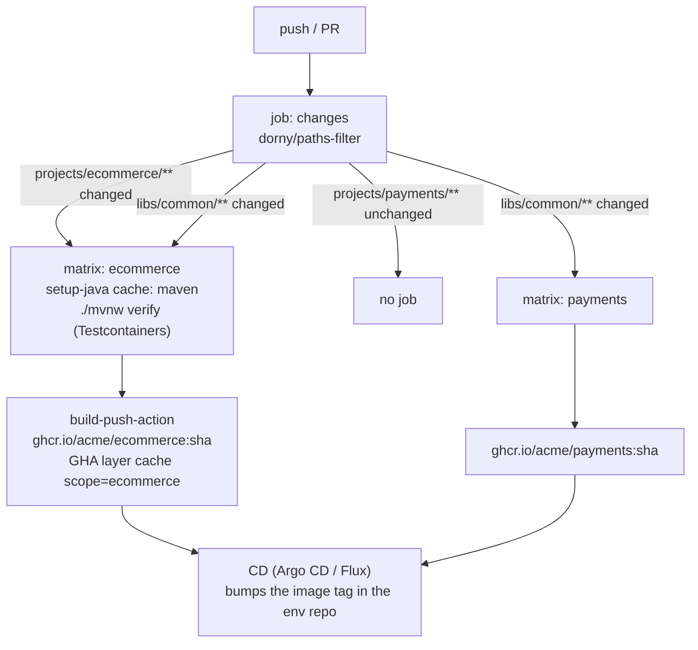

**Trade-offs:**
- **Pros:** CI time scales with the size of the change, not the repo. Failures are isolated per project. Separate Maven and Docker caches per project stay small and hit often.
- **Cons:** path filters are only as correct as their globs. A missed shared path (a parent pom, a shared `compose.yaml`, the workflow file itself) means a change ships untested. Add the workflow file and shared build files to every filter. Required status checks need care: a check that didn't run because nothing changed must not block merges (use a final "all green" job that always runs and depends on the matrix).
- **Alternatives:** one workflow file per project with `on.push.paths` (simplest, more duplication); build tools with native affected-project detection (Bazel, Gradle with Develocity, Nx for JS). Maven reactor builds (`-pl ... -amd`) work when the projects share a parent pom, which this repo deliberately avoids so each capstone can be split out later.

**Who uses it:** most companies with a monorepo of microservices on GitHub; Google/Meta-scale monorepos do the same idea with Bazel's dependency graph instead of path globs.

### 7.2 Rolling vs blue/green vs canary on Kubernetes

**Problem:** deploy a new version of `orders` with no downtime, and limit the damage when the new version is bad (a bug that tests didn't catch, a memory leak that shows after 10 minutes, a slow query under real traffic).

**Solutions:**

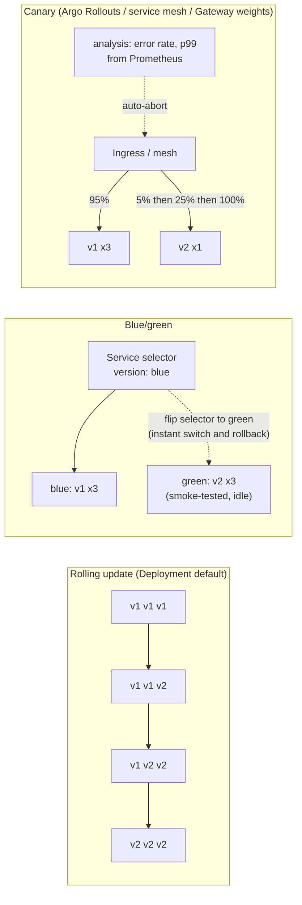

| | Rolling | Blue/green | Canary |
|---|---|---|---|
| How | Deployment replaces pods gradually (`maxSurge`, `maxUnavailable`), gated by readiness | Two full Deployments; the Service (or LB) switches all traffic at once | New version gets a small traffic share; analysis promotes or aborts automatically |
| Extra capacity | `maxSurge` pods | **2×** during the switch | A few pods |
| Rollback speed | Another rollout (`kubectl rollout undo`), minutes | Instant (flip back) | Instant (weight to 0) |
| Blast radius of a bad version | Grows as the rollout proceeds; readiness only catches "won't start" | All users at the flip; mitigated by pre-flip smoke tests | Small %, measured on real traffic |
| Mixed versions live | Yes, during the rollout | Briefly (in-flight requests) | Yes, for the whole analysis |
| Tooling | Built in | Two Deployments + selector switch, or Argo Rollouts `blueGreen` | Argo Rollouts / Flagger + Istio/Linkerd/Gateway API, metrics provider |

**What every strategy needs from the Spring app:**
- Honest **readiness** (gates traffic during rolling updates and the blue/green smoke test).
- **Graceful shutdown + preStop** (section 3.9), so old pods drain cleanly.
- **Backward-compatible DB migrations and APIs**, because two versions run side by side (expand/contract; note 14 for API versioning).
- **Version-tagged metrics** (`management.observations.key-values.version=${APP_VERSION}`-style common tags) so canary analysis can compare v1 and v2.

**Trade-offs:** rolling is free and good enough for most internal services. Blue/green suits releases that must switch atomically (e.g. a breaking change coordinated with a client release), at 2× capacity cost. Canary is the safest for high-traffic user-facing services but needs a mesh or Rollouts controller and good SLO metrics, otherwise the "analysis" is just a timer.

**Who uses it:** rolling is the default almost everywhere. Blue/green is common in banks and on AWS ECS/CodeDeploy and Elastic Beanstalk ("swap environment URLs"). Canary is standard at Netflix (Kayenta automated canary analysis), Google, and teams using Argo Rollouts or Flagger.

### 7.3 Fast startup for serverless / scale-to-zero: native image vs CDS/AOT cache

**Problem:** an internal pricing API gets bursty traffic: idle at night, spikes at sale launches. Running 3 JVM pods 24/7 wastes money. Scaling to zero (Knative, Cloud Run, AWS Lambda, KEDA) means the **first request after idle pays the whole startup**. A JVM Spring app that takes 4–6 s to refresh (the proof app's numbers, with almost no beans) turns into a 10 s+ cold start for a real service.

**Solution options:**

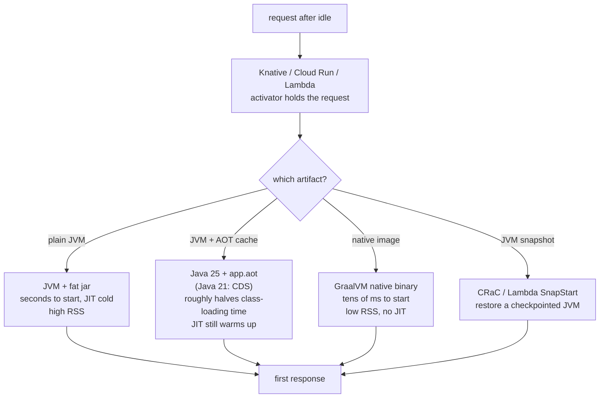

| | JVM + CDS/AOT cache | GraalVM native image | Checkpoint/restore (CRaC, SnapStart) |
|---|---|---|---|
| Cold start (Spring web app) | Large reduction but still seconds. The proof measured ~45% with CDS on 21, and with the AOT cache on 25 roughly 38% vs the extracted jar (about 50% vs the fat jar) | Typically tens to low hundreds of ms (GraalVM/Spring published figures; not measured here) | Sub-second restore; Lambda-specific or needs CRaC-enabled JDK |
| Peak throughput | Full JIT | Lower without PGO | Full JIT, restored warm |
| Memory (RSS) | JVM baseline | Much lower | JVM baseline |
| Build cost | One extra training-run `RUN` line; image + cache file (~56 MB here) | Minutes, multi-GB RAM per build | Checkpoint step in the pipeline; secrets/connections must be re-opened after restore |
| Compatibility | Everything works (agents, reflection, profiles) | Closed world: hints, frozen `@Profile`/`@ConditionalOnProperty`, no Java agents | Must handle restore (refresh connections, randomness, time) |
| Ops / debugging | Standard JVM tools (JFR, heap dumps, agents) | Limited (native debugging, limited JFR/JMX) | Standard JVM after restore |

**How to choose:**
- **Scale-to-zero functions, CLIs, sidecars, many tiny services where RAM is the bill:** native image. Accept the build cost and the hint maintenance, and run native tests in CI (`-PnativeTest`).
- **Normal services that autoscale (scale to N, not to 0):** JVM + AOT cache (Java 25) or CDS (Java 21). It's nearly free, keeps the JIT for throughput, and is compatible with everything.
- **AWS Lambda specifically:** SnapStart for Java is the low-effort option. Native image on a custom runtime is the fastest.
- **Combine:** min replicas 1 (no true zero) + AOT cache is often cheaper overall than a native build pipeline.

**Trade-offs:** native images move cost from runtime to build time and from ops to developers (hints, closed-world rules). JVM caches keep the developer experience but don't reach "instant". Keep the decision per service: the same Spring codebase can produce both, so measure.

**Who uses it:** native Spring/Quarkus/Micronaut functions are common on Google Cloud Run and AWS Lambda custom runtimes. Netflix and many large Spring shops stay on the JVM and invest in startup tuning (CDS/AOT cache) because peak throughput and JVM tooling matter more. Lambda SnapStart users (originally Java-only) include many AWS serverless Java teams.

---

## 8. Pitfalls & debugging checklist

- [ ] **`Error: Unsupported jarmode 'layertools'`** in a Dockerfile copied from a blog → Boot 4 removed it → `-Djarmode=tools extract --layers --destination extracted`.
- [ ] **`ClassNotFoundException: org.springframework.boot.loader.JarLauncher`** → pre-3.2 class name → `org.springframework.boot.loader.launch.JarLauncher`, or extract without `--launcher` and run `java -jar app.jar`.
- [ ] **Container exits with code 137 / `OOMKilled`, no Java OOM in logs** → heap + non-heap exceeded the cgroup limit (fixed `-Xmx` too big, or too many threads/direct buffers) → use `MaxRAMPercentage=70–75`, check metaspace and thread counts, and set memory request = limit.
- [ ] **Heap far smaller than expected** → default `MaxRAMPercentage` is 25% (proven: 128 MB in a 512 MB container) → set `-XX:MaxRAMPercentage=75`.
- [ ] **CDS/AOT cache "doesn't help"** → it's being used with the fat jar or a different path/jar name → run `-Xlog:cds` (Java 21) or `-Xlog:aot` (Java 25); look for `shared class paths mismatch`. Train and run on the extracted jar in the same `WORKDIR`.
- [ ] **CDS training run fails locally with `does not support native JVMTI agent`** → an EDR/APM native agent is attached → train inside the container build without agents.
- [ ] **Training run fails in the image build** → beans connect to DB/Kafka during refresh → stub or disable those for the training run (`TRAINING_RUN_JAVA_TOOL_OPTIONS` with buildpacks, a training profile in a Dockerfile).
- [ ] **Pod stuck in `CreateContainerConfigError`: "image has non-numeric user ... cannot verify user is non-root"** → `runAsNonRoot: true` with a named `USER spring` in the image → `USER 1001:1001` in the Dockerfile and `runAsUser: 1001` in the pod.
- [ ] **Requests fail (502/connection refused) during every rollout** → no `preStop` sleep, so proxies still route to stopping pods → add `preStop` sleep 5–10 s, check `terminationGracePeriodSeconds`.
- [ ] **Pods get `SIGKILL` mid-request at shutdown** → grace period shorter than preStop + drain, or shell-form `ENTRYPOINT` swallowing `SIGTERM` → exec-form entrypoint, grace period ≥ preStop + `timeout-per-shutdown-phase` + margin.
- [ ] **Pods restart in a loop during startup (`CrashLoopBackOff`, liveness failures in events)** → liveness probe kills the JVM before it finishes booting → add a `startupProbe` with a generous `failureThreshold`.
- [ ] **All pods restart together when the DB blips** → DB health indicator in the liveness group → liveness = `livenessState` only (note 10 §7.3).
- [ ] **Native binary throws `ClassNotFoundException` / missing resource at runtime only** → missing reflection/resource hint → add a `RuntimeHintsRegistrar`, run `-PnativeTest`, or use the GraalVM tracing agent to discover missing metadata.
- [ ] **Feature flag doesn't toggle a bean in native/AOT mode** → `@ConditionalOnProperty` evaluated at build time → toggle behaviour inside a bean instead, or build separate images.
- [ ] **Resource hint `rules/*.json` stops matching subfolders after upgrade** → Framework 7 glob semantics → `rules/**/*.json`.
- [ ] **Image works on a Mac, `exec format error` on the cluster** → arm64 image on amd64 nodes → build multi-arch or `--platform linux/amd64`.
- [ ] **CI: required check stuck "Expected — waiting for status"** → workflow-level `paths` filter skipped the workflow → job-level filtering with an always-running summary job.
- [ ] **CI: Testcontainers can't find Docker** → running on a non-Linux runner or inside a container job without the socket → use `ubuntu-latest` runners (Docker preinstalled).
- [ ] **`spring-boot-docker-compose` tries to start containers in prod** → it was on the classpath in a non-optional scope → keep it `<optional>true</optional>` (excluded from the uber jar in Boot 4), or set `spring.docker.compose.enabled=false` (default `true` in the 4.1.2 metadata).
- [ ] **Debugging a running pod:** `kubectl describe pod` (events, last state, exit code), `kubectl logs --previous` (the crashed container), `kubectl exec ... -- jcmd 1 VM.flags` (actual JVM flags), `jcmd 1 GC.heap_info`, and `/actuator/health/readiness` from inside the pod.

---

## 9. Interview questions

<details><summary>Q1. How does a Spring Boot fat jar run classes from jars nested inside it, when Java can't load nested jars?</summary>

The manifest's `Main-Class` is Boot's `org.springframework.boot.loader.launch.JarLauncher`, not your app; your class is in `Start-Class`. `JarLauncher` registers a `nested:` URL protocol handler, reads `BOOT-INF/classpath.idx`, and creates a `LaunchedClassLoader` (a `URLClassLoader`) over URLs like `jar:nested:/app.jar/!BOOT-INF/lib/x.jar!/`. `NestedJarFile` maps each entry of each nested jar to a byte offset in the outer file, so loading a class just seeks to the right offset and inflates that entry. Nothing is unpacked. That's why nested jars must be stored uncompressed (`STORED`). Finally it sets the thread context classloader and invokes `Start-Class.main()` reflectively. Caveat: `ClassLoader.getSystemClassLoader()` can't see nested classes.
</details>

<details><summary>Q2. What are layered jars, and how do you build an efficient Docker image from one in Boot 4?</summary>

The plugin writes `BOOT-INF/layers.idx`, which assigns jar content to layers ordered by change frequency: `dependencies`, `spring-boot-loader`, `snapshot-dependencies`, `application`. In a multi-stage Dockerfile you run `java -Djarmode=tools -jar app.jar extract --layers --destination extracted`, then `COPY` each layer folder separately into the runtime image, least-changing first. Docker caches layers, and a layer is reused only if all layers below it are unchanged, so a code-only change rebuilds and pushes only the small `application` layer. In Boot 4, `-Djarmode=layertools` was removed (it fails with "Unsupported jarmode"). Extracting without `--launcher` produces a plain `java -jar app.jar` + `lib/` classpath, which is also what CDS and the AOT cache need.
</details>

<details><summary>Q3. Why is setting -Xmx in a container image risky, and what do you do instead?</summary>

The kernel enforces the container's memory limit on the whole process, not on the heap. Java memory is heap + metaspace + code cache + thread stacks + direct buffers + GC overhead. A fixed `-Xmx` is decoupled from the limit: when someone lowers the pod's memory, the JVM can grow past it and gets OOM-killed (exit 137) with no `OutOfMemoryError` or heap dump. Since JDK 10 the JVM is container-aware (`UseContainerSupport`), so use `-XX:MaxRAMPercentage=70–75`, which scales with whatever limit the platform sets. The default is only 25% (in a 512 MB container that's a 128 MB heap). Leave ~25% headroom for non-heap memory, and set the memory request equal to the limit.
</details>

<details><summary>Q4. Explain CDS, the Java 25 AOT cache, and Spring AOT. Which problem does each solve?</summary>

CDS (Class Data Sharing) archives parsed class metadata to a `.jsa` file that the JVM memory-maps on startup, skipping class parsing and verification. On Java 21 you create it with `-XX:ArchiveClassesAtExit` during a training run (`-Dspring.context.exit=onRefresh`) and use it with `-XX:SharedArchiveFile`. The AOT cache (Project Leyden; JEP 483 in JDK 24, JEP 514/515 in JDK 25) goes further: classes are stored already loaded and linked, plus method profiles so the JIT warms up sooner. Use `-XX:AOTCacheOutput` / `-XX:AOTCache`. Both work only on the extracted jar with the same classpath and JVM build. Spring AOT is different: it runs at build time (`process-aot`) and generates Java source for bean definitions, so Spring doesn't scan, evaluate conditions or reflect at runtime. On the JVM it's enabled with `-Dspring.aot.enabled=true`, and it's mandatory for native image.
</details>

<details><summary>Q5. What are the trade-offs of GraalVM native image for a Spring Boot service, and when would you avoid it?</summary>

Pros: startup in tens of milliseconds, much lower memory, a single binary, a smaller attack surface. Cons: a closed world. Reflection, resources, proxies and serialization must be declared via hints; the classpath and the bean graph are fixed at build time (`@Profile` and `@ConditionalOnProperty` are evaluated during the build); there's no JIT, so peak throughput is usually lower; builds take minutes and GBs of RAM; Java agents and some libraries don't work; debugging tools are weaker. Boot 4 needs GraalVM 25+. Avoid it for long-running, throughput-bound services, apps that rely on dynamic features or agents, and teams without native test coverage. Use it for scale-to-zero functions, CLIs and memory-bound fleets.
</details>

<details><summary>Q6. How do you tell Spring AOT and GraalVM about reflection your code does?</summary>

Implement `RuntimeHintsRegistrar` and register it with `@ImportRuntimeHints` on a configuration class. In `registerHints`, call `hints.reflection().registerType(X.class)` (in Framework 7, a type hint implies member introspection; most `MemberCategory` values are deprecated), `hints.resources().registerPattern("rules/**/*.json")` (glob syntax since Framework 7), and the proxy and serialization registries as needed. For DTOs you bind manually, use `@RegisterReflectionForBinding`. Spring AOT writes all hints into `META-INF/native-image/<group>/<artifact>/reachability-metadata.json`. Test hints with `RuntimeHintsPredicates` in a plain unit test, and run `-PnativeTest` in CI.
</details>

<details><summary>Q7. Buildpacks vs a hand-written Dockerfile?</summary>

`./mvnw spring-boot:build-image` uses Cloud Native Buildpacks (default builder `paketobuildpacks/builder-noble-java-tiny`) to produce an OCI image with no Dockerfile. It installs the right JRE, uses `layers.idx`, runs as non-root, adds a memory calculator and an SBOM, and supports `pack rebase` to patch the OS layer without a rebuild. You configure it with `BP_*` env vars (e.g. `BP_JVM_AOTCACHE_ENABLED=true` on Java 25). A Dockerfile gives full control (base image, OS packages, custom layout, CDS on Java 21) at the cost of maintaining it, patching the base image and doing security hardening yourself. Choose buildpacks for standard services and platform consistency, and a Dockerfile when you need control.
</details>

<details><summary>Q8. Walk through what happens when Kubernetes terminates a Spring Boot pod, and how you avoid dropped requests.</summary>

Kubernetes marks the pod Terminating and, in parallel, removes it from the Service endpoints (proxies learn this asynchronously) and runs the `preStop` hook, then sends `SIGTERM`. Boot then publishes `ReadinessState.REFUSING_TRAFFIC`, the web server stops accepting new connections ("Commencing graceful shutdown"), in-flight requests drain for up to `spring.lifecycle.timeout-per-shutdown-phase` (30 s default), and the context closes. If the process is still alive after `terminationGracePeriodSeconds` (30 s default, counted from the start of `preStop`), it's `SIGKILL`ed. To avoid dropped requests: add a `preStop` sleep (5–10 s) so proxies converge before the app stops accepting; use exec-form `ENTRYPOINT` so Java receives `SIGTERM`; and set the grace period ≥ preStop + drain timeout + margin.
</details>

<details><summary>Q9. Liveness vs readiness vs startup probe: what goes in each?</summary>

Liveness answers "is this process broken beyond repair?" Failing it restarts the container, so it should reflect only internal state (`livenessState`), never the DB or downstream services, or one dependency blip restarts the whole fleet. Readiness answers "should this pod get traffic right now?" Failing it removes the pod from Service endpoints without a restart; it covers warm-up, shutdown (Boot flips it on `SIGTERM`) and per-pod issues. A startup probe protects slow-starting JVMs: liveness and readiness don't run until it passes, so give it a generous failure budget. In Boot 4 the `/actuator/health/liveness` and `/readiness` groups are on by default, and `add-additional-paths=true` serves `/livez` and `/readyz` on the main port, so probes test the same connector users hit.
</details>

<details><summary>Q10. How would you set up CI for a monorepo with several Spring Boot services?</summary>

One workflow whose first job computes changed projects with a path filter (e.g. `dorny/paths-filter`), then a matrix job per changed project: `actions/setup-java` with `cache: maven` and `cache-dependency-path` on that project's pom, `./mvnw -B verify` (Testcontainers works because Docker is preinstalled on `ubuntu-latest` runners), then on `main` a buildx build with GHA layer caching that pushes an image tagged with the commit SHA. Include shared files (parent poms, shared libraries, the workflow itself) in every relevant filter. Use an always-running summary job as the required check, because a workflow skipped by `on.push.paths` leaves required checks pending. CD (Argo CD/Flux) then promotes the same SHA through environments.
</details>

<details><summary>Q11. Rolling update vs blue/green vs canary: when would you choose each?</summary>

Rolling (the Deployment default) replaces pods gradually, controlled by `maxSurge`/`maxUnavailable` and gated by readiness. It's free and fine for most services, but a bad version reaches everyone as the rollout proceeds, and rollback is another rollout. Blue/green runs two full environments and flips the Service selector or LB at once. Rollback is instant and you can smoke-test green first, but it needs 2× capacity and everyone switches at once. Canary sends a small percentage of real traffic to the new version and promotes or aborts automatically based on metrics (Argo Rollouts, Flagger, a mesh). It has the smallest blast radius but needs traffic-splitting infra and good SLO metrics. All three require backward-compatible DB changes, because versions overlap.
</details>

<details><summary>Q12. What does spring-boot-docker-compose do, and how is it different from Testcontainers?</summary>

With `spring-boot-docker-compose` on the classpath (marked optional, so Boot 4 keeps it out of the uber jar), `DockerComposeLifecycleManager` runs `docker compose up` on startup for the project's `compose.yaml`, waits for each container's mapped port to accept TCP, and registers `ConnectionDetails` beans matched on image names, so `DataSource` and Redis wire themselves without URLs. It stops containers on exit (`lifecycle-management`), and it's skipped in tests by default. Testcontainers manages containers from Java code: `@ServiceConnection` beans in tests, or at dev time via `SpringApplication.from(App::main).with(Containers.class)` and `spring-boot:test-run`. Compose suits teams with a shared `compose.yaml`; Testcontainers reuses the same container definitions as the integration tests.
</details>

<details><summary>Q13. How do the twelve-factor principles map onto a Boot + Kubernetes deployment?</summary>

Config (III) lives in the environment: ConfigMaps/Secrets become env vars or `configtree:` files bound to `@ConfigurationProperties`. Build/release/run (V): CI builds one SHA-tagged image, and releases combine it with environment config. Processes (VI): stateless pods, no local session or files. Port binding (VII): embedded Tomcat behind a Service. Concurrency (VIII): HPA adds pods. Disposability (IX): fast startup (CDS/AOT cache/native) and graceful shutdown with preStop. Dev/prod parity (X): the same image everywhere, plus Compose/Testcontainers with real Postgres. Logs (XI): JSON to stdout. Admin processes (XII): Flyway or batch jobs as Kubernetes Jobs with the same image.
</details>

<details><summary>Q14. Your Spring service was fine on a VM but is slow to start and gets killed on Kubernetes. What do you check?</summary>

1. The CPU limit: startup is CPU-bound (JIT, class loading), and a 500m limit throttles it heavily. Raise it or remove the CPU limit and keep a request.
2. Probes: without a `startupProbe`, the liveness probe kills the JVM before it's ready (`CrashLoopBackOff` with liveness failures in events).
3. Memory: a heap from a fixed `-Xmx`, or the 25% default, versus the limit. Look for exit code 137 in `kubectl describe`.
4. Below 2 CPUs or ~1.8 GB, ergonomics picks SerialGC.
5. Startup acceleration: extracted jar + CDS (21) or AOT cache (25), and Spring AOT.
6. Beans doing remote I/O in constructors.

Check `/actuator/startup` with `BufferingApplicationStartup` to find slow beans.
</details>

---

## 10. Sources

**Spring reference docs (Boot 4.1.x, Framework 7)**
- Executable jar format: https://docs.spring.io/spring-boot/specification/executable-jar/index.html, [nested jars](https://docs.spring.io/spring-boot/specification/executable-jar/nested-jars.html), [launching](https://docs.spring.io/spring-boot/specification/executable-jar/launching.html), [NestedJarFile](https://docs.spring.io/spring-boot/specification/executable-jar/jarfile-class.html), [restrictions](https://docs.spring.io/spring-boot/specification/executable-jar/restrictions.html)
- Efficient deployments (extract): https://docs.spring.io/spring-boot/reference/packaging/efficient.html
- AOT cache and CDS: https://docs.spring.io/spring-boot/reference/packaging/aot-cache.html, and the how-to with buildpacks: https://docs.spring.io/spring-boot/how-to/aot-cache.html
- Dockerfiles: https://docs.spring.io/spring-boot/reference/packaging/container-images/dockerfiles.html
- Cloud Native Buildpacks: https://docs.spring.io/spring-boot/reference/packaging/container-images/cloud-native-buildpacks.html and the Maven plugin `build-image` goal: https://docs.spring.io/spring-boot/maven-plugin/build-image.html
- Maven plugin AOT: https://docs.spring.io/spring-boot/maven-plugin/aot.html
- GraalVM native images: https://docs.spring.io/spring-boot/reference/packaging/native-image/introducing-graalvm-native-images.html and https://docs.spring.io/spring-boot/how-to/native-image/developing-your-first-application.html
- Framework AOT and `RuntimeHints`: https://docs.spring.io/spring-framework/reference/core/aot.html
- Development-time services (Docker Compose, Testcontainers): https://docs.spring.io/spring-boot/reference/features/dev-services.html
- Graceful shutdown: https://docs.spring.io/spring-boot/reference/web/graceful-shutdown.html
- Deploying to the cloud / Kubernetes (preStop, grace period): https://docs.spring.io/spring-boot/how-to/deployment/cloud.html
- Actuator endpoints and Kubernetes probes: https://docs.spring.io/spring-boot/reference/actuator/endpoints.html
- Application availability: https://docs.spring.io/spring-boot/reference/features/spring-application.html
- Boot 4.0 migration guide: https://github.com/spring-projects/spring-boot/wiki/Spring-Boot-4.0-Migration-Guide
- Framework 7.0 release notes: https://github.com/spring-projects/spring-framework/wiki/Spring-Framework-7.0-Release-Notes

**Baeldung** (⚠️ written for Boot 2.x/3.x. Check jarmode names and loader class names against section 6)
- Reusing Docker layers with Spring Boot (uses `layertools`, removed in Boot 4): https://www.baeldung.com/docker-layers-spring-boot
- Creating Docker images with Spring Boot (buildpacks): https://www.baeldung.com/spring-boot-docker-images
- Spring Native intro (Spring Native 0.x era; concepts still apply, APIs don't): https://www.baeldung.com/spring-native-intro
- Self-healing apps with Kubernetes and Spring Boot: https://www.baeldung.com/spring-boot-kubernetes-self-healing-apps
- Graceful shutdown of a Spring Boot web server: https://www.baeldung.com/spring-boot-web-server-shutdown
- JVM heap size in Docker: https://www.baeldung.com/ops/docker-jvm-heap-size

**Oracle / JDK docs**
- Class Data Sharing, JDK 21: https://docs.oracle.com/en/java/javase/21/vm/class-data-sharing.html
- Class Data Sharing and the AOT cache, JDK 25: https://docs.oracle.com/en/java/javase/25/vm/class-data-sharing.html
- The `java` command (container flags, `MaxRAMPercentage`, `-XX:AOTCache`), JDK 21 and 25: https://docs.oracle.com/en/java/javase/21/docs/specs/man/java.html, https://docs.oracle.com/en/java/javase/25/docs/specs/man/java.html
- GC ergonomics (server-class machine detection, default collector): https://docs.oracle.com/en/java/javase/21/gctuning/ergonomics.html
- JEP 483 (AOT class loading and linking): https://openjdk.org/jeps/483, JEP 514 (AOT command-line ergonomics): https://openjdk.org/jeps/514, JEP 515 (AOT method profiling): https://openjdk.org/jeps/515

**Platform**
- Kubernetes HPA: https://kubernetes.io/docs/tasks/run-application/horizontal-pod-autoscale/
- GitHub Actions workflow syntax (`paths` filters): https://docs.github.com/en/actions/writing-workflows/workflow-syntax-for-github-actions, dependency caching: https://docs.github.com/en/actions/using-workflows/caching-dependencies-to-speed-up-workflows
- The Twelve-Factor App: https://12factor.net/
