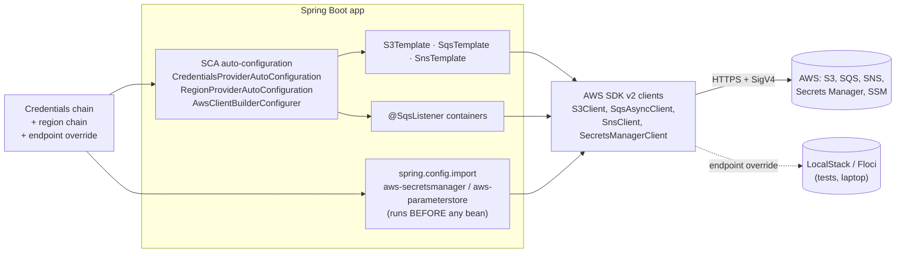
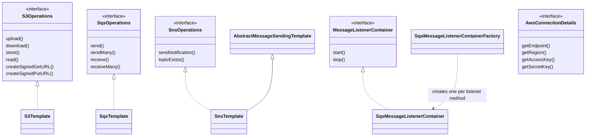
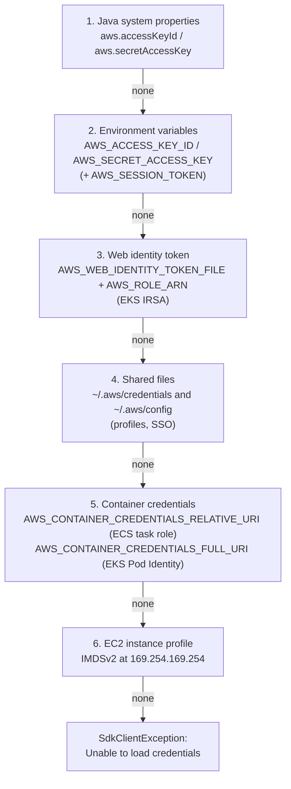
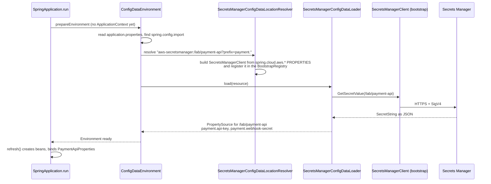
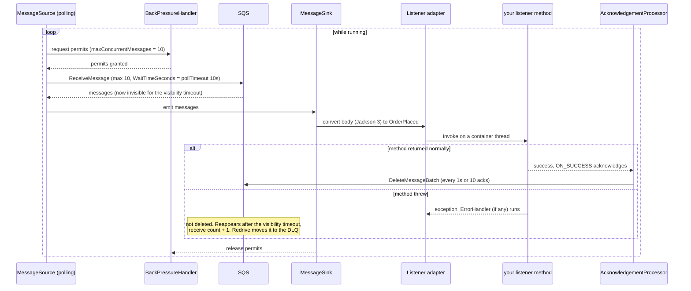
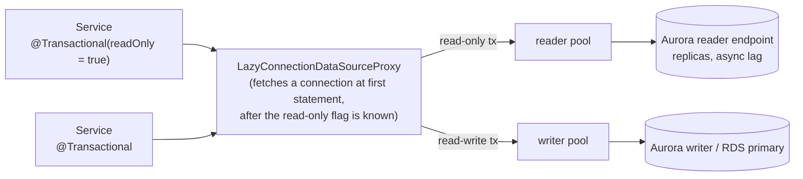
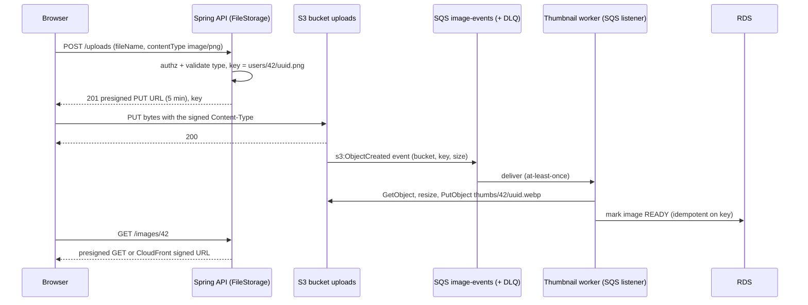
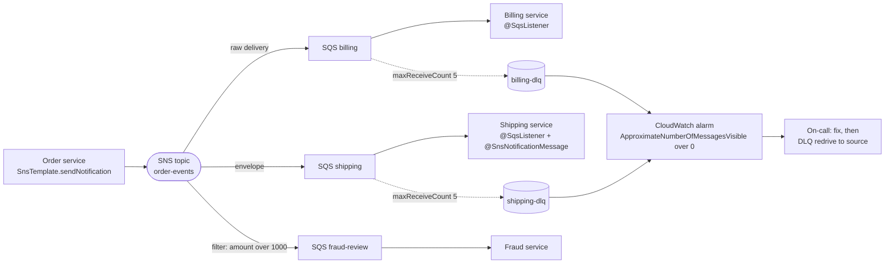
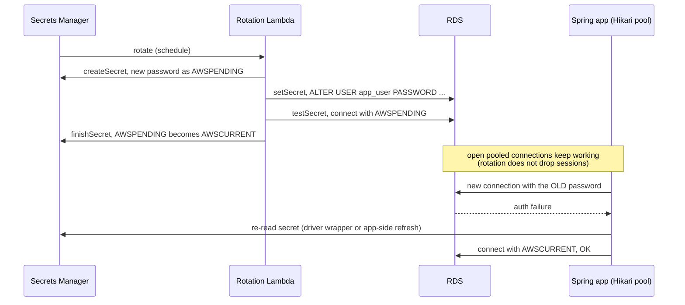

# 16 — AWS with Spring Cloud AWS

> **Lab:** [`labs/16-aws-localstack`](https://github.com/sumit-mishra-itp/springboot-roadmap/tree/main/labs/16-aws-localstack)
> **Capstone use:** e-commerce monolith: product images in S3 through presigned URLs, DB credentials from Secrets Manager, order-confirmation emails through an SQS consumer. Microservices platform: SNS to SQS notification fan-out with DLQs.
> **Prereqs:** note 04 (`@ConfigurationProperties`, `spring.config.import`), note 08 (Testcontainers, `@ServiceConnection`), note 11 (delivery semantics, DLQs, idempotent consumers).

---

## 1. What & why

AWS exposes every service as an HTTPS API. The **AWS SDK for Java 2.x** wraps those APIs in typed clients (`S3Client`, `SqsAsyncClient`, `SnsClient`, `SecretsManagerClient`, ...). **Spring Cloud AWS (SCA)** sits on top of the SDK and does for AWS what Boot does for everything else: it auto-configures the clients, wires credentials and region, and adds Spring-shaped APIs.

| Era | How a Spring app talked to AWS | Pain |
|---|---|---|
| Raw SDK v1 (`AmazonS3ClientBuilder`) | Build every client by hand, pass `BasicAWSCredentials` around | Boilerplate per client, keys in config files, blocking-only HTTP |
| `org.springframework.cloud:spring-cloud-aws` 1.x/2.2 | `@EnableSqs`, `QueueMessagingTemplate`, `cloud.aws.*` properties | Built on SDK v1, slow startup (it called EC2 metadata eagerly), project went unmaintained |
| `io.awspring.cloud` 2.3/2.4 | Same API, community-maintained | Still SDK v1. SDK v1 reached end of support on 31 Dec 2025 |
| **SCA 3.x** | SDK v2, rewritten SQS integration, `spring.config.import` for Secrets Manager / Parameter Store | Boot 3 only |
| **SCA 4.x** (this note, 4.2.2) | Boot 4, Spring Cloud 2025.1, Jackson 3 converters, Testcontainers 2 `@ServiceConnection`, Floci support | Compatibility table lists Boot 4.0.x. The lab proves 4.1.2 works |

**What SCA adds over the raw SDK:**
- Auto-configured, customizable SDK clients (`S3Client`, `SqsAsyncClient`, `SnsClient`, `SesClient`, `DynamoDbClient`, ...), all sharing one credentials provider and one region provider.
- **`S3Template`** (upload, download, JSON `store`/`read`, presigned URLs) and `s3://` Spring `Resource`s.
- **`SqsTemplate`** and **`@SqsListener`**: a full listener container with back pressure, batching, acknowledgement modes, visibility control, FIFO ordering, and Jackson 3 conversion.
- **`SnsTemplate`** plus `@SnsNotificationMessage` to unwrap SNS envelopes in SQS listeners.
- **Secrets Manager and Parameter Store as Boot config sources** (`spring.config.import=aws-secretsmanager:...`), with optional polling reload.
- Test support: `@ServiceConnection` for LocalStack and Floci containers, plus Docker Compose support.

**When *not* to use it:**
- **AWS Lambda functions** where cold start dominates. Use the plain SDK (or Spring Cloud Function with AOT/SnapStart) and keep the classpath tiny.
- **One service call in a batch job.** One `S3Client.create()` is less machinery than a starter.
- **When you need a log, not a queue**: replay, ordering per key across many consumers, long retention. That's Kafka or Kinesis, not SQS (note 11, section 3.11).
- **Cloud-portable messaging code.** SCA is AWS-only by design. If portability matters, put Spring Cloud Stream on top, and accept its abstraction cost.

---

## 2. Mental model

SCA is three layers. **Auto-configuration** resolves *who you are* (credentials), *where you are* (region), and *where to send requests* (endpoint). It builds SDK clients from those. **Templates and listener containers** wrap the clients in Spring idioms. **Config data loaders** run much earlier, while Boot is still building the `Environment`, and pull secrets and parameters in as property sources.



The three core messaging and storage services, in one picture:

| | S3 | SQS | SNS |
|---|---|---|---|
| Shape | Key → object (bytes + metadata) | Queue of messages, each consumed by **one** consumer | Topic, each message pushed to **all** subscribers |
| Delivery | n/a (storage) | Pull (long polling), **at-least-once** (standard), exactly-once processing within a group (FIFO) | Push to SQS, Lambda, HTTP, email, SMS, Firehose |
| Retention | Forever, or until a lifecycle rule acts | Default 4 days, max 14 days | None: if no subscriber accepts it, it's retried, then dropped or sent to a subscription DLQ |
| Typical use | Files, images, exports, data lake | Work queues, decoupling, buffering spikes | Fan-out of events to many queues |

### SCA's main types



`AwsConnectionDetails` is the Boot "connection details" abstraction for AWS. A `@ServiceConnection` LocalStack container produces one, and it overrides endpoint, region and keys for every auto-configured client.

---

## 3. How it works internally

### 3.1 Credentials: who is calling?

Every AWS request is signed with **SigV4**: an HMAC over the method, path, query, selected headers and a hash of the body, computed with a key derived from the secret access key, the date, the region and the service. The SDK needs a credentials provider to do that.

**SCA's decision tree** (`CredentialsProviderAutoConfiguration`):

| If you set... | SCA uses | Use it for |
|---|---|---|
| `spring.cloud.aws.credentials.access-key` + `secret-key` | `StaticCredentialsProvider` | LocalStack and tests **only** (dummy `test`/`test`) |
| `spring.cloud.aws.credentials.profile.name` (+ `profile.path`) | `ProfileCredentialsProvider` | Your laptop with named profiles or IAM Identity Center (SSO) |
| `spring.cloud.aws.credentials.instance-profile=true` | `InstanceProfileCredentialsProvider` | Forcing EC2 metadata |
| `spring.cloud.aws.credentials.sts.*` (role ARN, web identity token file) | STS web identity provider | EKS with IRSA |
| nothing | **`DefaultCredentialsProvider`** (the SDK chain) | **Production. This is the right answer almost always** |

The SDK's **default chain** is tried in order, and the first provider that finds credentials wins:



**Roles vs access keys.** An IAM **user access key** is a long-lived secret. It never expires on its own, it leaks through git, logs, CI variables and laptops, and every leaked key is a breach until someone rotates it. An IAM **role** has no secret of its own. A workload *assumes* it, and STS hands out **temporary credentials** (access key + secret + session token, valid from 15 minutes to 12 hours) that the SDK refreshes before they expire. On AWS compute you attach a role to the workload: an ECS task role, an EKS service account (Pod Identity or IRSA), an EC2 instance profile, or a Lambda execution role. Your code and config contain **no credentials at all**, and the default chain finds them. On a laptop, use IAM Identity Center (`aws sso login`) and a named profile, which also gives temporary credentials. Long-lived access keys belong nowhere except, perhaps, a legacy on-prem integration, behind a rotation policy.

**Least privilege.** Grant each workload's role only the actions it calls, on only the resources it touches:

```json
{
  "Version": "2012-10-17",
  "Statement": [
    { "Effect": "Allow", "Action": ["s3:PutObject", "s3:GetObject"],
      "Resource": "arn:aws:s3:::lab-uploads/avatars/*" },
    { "Effect": "Allow", "Action": ["sqs:ReceiveMessage", "sqs:DeleteMessage", "sqs:ChangeMessageVisibility", "sqs:GetQueueUrl", "sqs:GetQueueAttributes"],
      "Resource": "arn:aws:sqs:us-east-1:123456789012:orders" },
    { "Effect": "Allow", "Action": "sns:Publish",
      "Resource": "arn:aws:sns:us-east-1:123456789012:order-events" },
    { "Effect": "Allow", "Action": "secretsmanager:GetSecretValue",
      "Resource": "arn:aws:secretsmanager:us-east-1:123456789012:secret:/lab/payment-api-*" }
  ]
}
```

Things worth knowing:
- **Presigned URLs carry the signer's permissions.** The URL works only if the role that signed it may perform the action. A URL signed by a role without `s3:PutObject` signs fine and then fails with 403.
- **SCA's listener needs `GetQueueUrl` and `GetQueueAttributes`** (it resolves the queue URL and reads attributes such as the FIFO flag at startup), not only receive and delete. This is unverified against a real IAM policy: LocalStack doesn't enforce IAM. With the default `queue-not-found-strategy=CREATE` it also tries `CreateQueue` when the queue is missing. In production, set it to `FAIL` and don't grant `sqs:CreateQueue`.
- **`SnsTemplate` with a topic *name*** resolves it through the default `TopicArnResolver`, which calls `CreateTopic` (idempotent). Grant `sns:CreateTopic` or pass full topic ARNs.
- **Secret ARNs end in a random 6-character suffix** (`-a1b2c3`), so policies use `secret:/name-*`.
- KMS: a secret or SSE-KMS object encrypted with a customer-managed key also needs `kms:Decrypt` on that key.

### 3.2 Region and endpoint

Region resolution (`RegionProviderAutoConfiguration`): `spring.cloud.aws.region.static` if set. Otherwise the SDK's `DefaultAwsRegionProviderChain`: the `aws.region` system property, then `AWS_REGION`, then the profile files, then EC2 metadata. ECS and Lambda set `AWS_REGION` for you.

Endpoint override, in priority order. `AwsClientBuilderConfigurer.configure` applies the global endpoint, then the service endpoint, then the connection-details endpoint, and the last one wins (read from the 4.2.2 bytecode with `javap -c`):
1. An `AwsConnectionDetails` bean (from `@ServiceConnection` or Docker Compose support).
2. A service-specific property: `spring.cloud.aws.s3.endpoint`, `spring.cloud.aws.sqs.endpoint`, `spring.cloud.aws.secretsmanager.endpoint`, ...
3. The global `spring.cloud.aws.endpoint`.

Endpoint overrides exist for LocalStack, Floci, and S3-compatible stores (MinIO, Ceph, Cloudflare R2). In production you leave them unset, and the SDK derives `https://sqs.us-east-1.amazonaws.com` and so on. Every service and its config namespace also has `region` and `dualstack-enabled`.

Each client is built by `AwsClientBuilderConfigurer`. It applies credentials, region, endpoint and the Spring Cloud user agent, then any customizers. Customizers are the supported way to tune the SDK: `AwsSyncClientCustomizer` / `AwsAsyncClientCustomizer` for all clients, or per-service `S3ClientCustomizer`, `SqsAsyncClientCustomizer`, `SnsClientCustomizer`, `SecretsManagerClientCustomizer`, `SsmClientCustomizer`. Typical uses are HTTP client timeouts, connection pool size, retry strategy, and an `ExecutionInterceptor` for metrics.

### 3.3 Secrets Manager and Parameter Store as config data

Since SCA 3.0 there's no `bootstrap.yml`. The integration is a Boot **ConfigData** plugin: `SecretsManagerConfigDataLocationResolver` handles the `aws-secretsmanager:` prefix and `SecretsManagerConfigDataLoader` fetches the secret. Parameter Store uses the `ParameterStore*` equivalents with `aws-parameterstore:`.



What follows from that sequence:
- **The import runs before any bean exists**, so the bootstrap client sees only *properties*. Beans, `@ServiceConnection` containers and `AwsConnectionDetails` don't exist yet. The lab proves it: `SecretImportFailFastTest.configImport_ignoresServiceConnection_andUsesOnlyProperties` registers a LocalStack `@ServiceConnection` bean, points `spring.cloud.aws.secretsmanager.endpoint` at `localhost:1`, and startup fails with `Connection refused` after `SDK Attempt Count: 4` (the default retry policy: 1 call + 3 retries). To customize that bootstrap client, register a `SecretsManagerClient` (or a `SecretsManagerClientCustomizer`) through a `BootstrapRegistryInitializer` listed in `META-INF/spring.factories`, not through a `@Bean`.
- **JSON secrets explode into properties.** `{"api-key":"...","webhook-secret":"..."}` becomes `api-key` and `webhook-secret`. Use `?prefix=payment.` to namespace them, including the trailing dot. A **plain-text** secret becomes one property whose key is the last path segment of the secret name: `/secrets/prod/jdbc-url` gives `${jdbc-url}`.
- **Required vs optional.** Without `optional:` a missing secret fails startup with `AwsSecretsManagerPropertySourceNotFoundException` (root cause `ResourceNotFoundException`), and a failure analyzer prints "Could not import properties from AWS Secrets Manager". With `optional:` it's silently skipped. Both behaviors are proven in the lab. Use required for anything the app can't run without.
- **Several secrets:** `aws-secretsmanager:/a;/b`, or indexed `spring.config.import[0]=...`, `[1]=...` to mix optional and required.
- **Parameter Store** loads a whole *path*: `aws-parameterstore:/config/orders/` turns `/config/orders/feature.x` into `feature.x`. It supports `?prefix=` and `?extension=properties|json|yaml` for one parameter that holds a whole file. SecureString parameters are decrypted automatically.
- **Reload.** `spring.cloud.aws.secretsmanager.reload.strategy=refresh|restart_context`, `reload.period` (default `1m` in the 4.2.2 metadata, although one docs table says 15 s), and `reload.max-wait-for-restart` (default `2s`). The property name comes from the jar's metadata, while the prose docs say `max-wait-time-for-restart`. Reload needs `spring-cloud-context`, `spring-cloud-commons` and Actuator on the classpath. `restart_context` also needs the `restart` endpoint exposed. `refresh` re-binds JavaBean-style (setter) `@ConfigurationProperties` beans and re-creates `@RefreshScope` beans. **Record / constructor-bound properties are immutable and are not re-bound in place**: Boot's `ConfigurationPropertiesBindingPostProcessor` skips beans already bound as value objects (`hasBoundValueObject`). So a record like the lab's `PaymentApiProperties` keeps its startup values after a refresh. Use `@RefreshScope` on the consumer, setter-style properties, or `restart_context` (inferred from the Boot 4.1.2 class, not tested in the lab). Reload does **not** rebuild a connection pool either (see 7.3).

| | Secrets Manager | Parameter Store (SSM) |
|---|---|---|
| Unit | One secret = one JSON document (up to 64 KB) | One parameter = one value. Load a whole path (hierarchy) |
| Encryption | Always KMS | `SecureString` uses KMS, `String` is plain |
| Rotation | **Built in** (Lambda rotation functions, managed rotation for RDS) | None (DIY) |
| Cross-account, replication to other regions | Yes | Limited |
| Cost | Per secret per month + per API call | Standard parameters free (standard throughput). Advanced parameters and higher throughput cost money |
| Use for | DB credentials, API keys that rotate | Feature flags, endpoints, non-rotating config |

### 3.4 SQS semantics you must know before writing a listener

- **At-least-once.** A standard queue may deliver a message more than once, and doesn't guarantee order. Every consumer must be **idempotent** (note 11, section 4.4: dedupe table keyed by a message or business id).
- **Visibility timeout.** `ReceiveMessage` doesn't remove a message. It hides it for the visibility timeout (default 30 s, max 12 h). If the consumer calls `DeleteMessage` in time, it's gone. If not (crash, exception, slow processing), it reappears and is delivered again. Its `ApproximateReceiveCount` goes up each time.
- **Redrive policy and DLQ.** `RedrivePolicy={"deadLetterTargetArn": "...", "maxReceiveCount": "5"}` on the source queue. When a message is received more than `maxReceiveCount` times without being deleted, **SQS itself** moves it to the DLQ. The application has no DLQ code at all, as the lab shows. A **redrive allow policy** on the DLQ controls which queues may use it. **DLQ redrive** (console or `StartMessageMoveTask`) moves messages back once the bug is fixed.
- **Long polling.** `WaitTimeSeconds` 1–20. The call returns as soon as messages arrive, or empty after the wait. Short polling (0) samples a subset of servers and returns immediately, which wastes money and CPU on empty receives.
- **Limits.** Message size is 1 MiB since August 2025 (was 256 KiB). Use the extended client (S3 offload, `spring.cloud.aws.sqs.extended.*`) for more. Retention is 1 minute to 14 days (default 4 days). Delay queues allow 0–15 minutes. One receive returns at most 10 messages. An in-flight limit applies per queue (about 120,000 for standard).
- **Standard vs FIFO.**

| | Standard | FIFO (`name.fifo`) |
|---|---|---|
| Ordering | Best effort | Strict **within a `MessageGroupId`** |
| Duplicates | Possible | Deduplicated within a 5-minute window (`MessageDeduplicationId` or content-based) |
| Throughput | Nearly unlimited | 300 API calls/s per action (3,000 msgs/s with batching), much higher in high-throughput mode |
| Failure behavior | Other messages keep flowing | A failed message **blocks its group** until it succeeds or goes to the DLQ |
| Use for | Most work queues | Per-entity ordering: account ledger, order state machine |

The message-group key is the FIFO equivalent of the Kafka partition key: one group is processed in order by one consumer at a time, and different groups run in parallel.

### 3.5 Inside `@SqsListener`: the SCA 3+ listener container

SCA 3 rewrote the SQS integration from scratch on the **async** SDK client (`SqsAsyncClient`, Netty). One `SqsMessageListenerContainer` is created per `@SqsListener` by `SqsMessageListenerContainerFactory`. Its pipeline:



| Concept | Default | Notes |
|---|---|---|
| `maxConcurrentMessages` | 10 | Per queue. The container thread pool is sized from it × queues |
| `maxMessagesPerPoll` | 10 | SQS max is 10 |
| `pollTimeout` | 10 s | Long-polling wait |
| `maxDelayBetweenPolls` | 10 s | How long to wait for permits before polling anyway |
| `acknowledgementMode` | `ON_SUCCESS` | Also `ALWAYS` (delete even on failure) and `MANUAL` (inject `Acknowledgement` and call `acknowledge()`) |
| Acknowledgement batching | 1 s / 10 messages (standard), immediate (FIFO) | `BatchingAcknowledgementProcessor` sends `DeleteMessageBatch`. Deletes are asynchronous |
| `listenerMode` | `SINGLE_MESSAGE` | A `List` parameter switches the method to batch |
| `queueNotFoundStrategy` | `CREATE` | Use `FAIL` in production |
| `messageVisibility` | not set | Queue default. `@SqsListener(messageVisibilitySeconds = "...")` or a `Visibility` parameter (`changeTo(...)`) for long jobs |

Spring Boot properties map to the common ones: `spring.cloud.aws.sqs.listener.max-concurrent-messages`, `max-messages-per-poll`, `poll-timeout`, `max-delay-between-polls`, `auto-startup`, plus `spring.cloud.aws.sqs.queue-not-found-strategy`.

**Error handling.** With `ON_SUCCESS`, an exception means "don't delete". The message comes back after the visibility timeout, and the redrive policy eventually parks it in the DLQ. An `ErrorHandler`/`AsyncErrorHandler` on the factory runs after a failure. If it returns normally, the message counts as **recovered and is acknowledged**. Rethrow from the handler if you want SQS to retry. Unlike Spring Kafka, there's no in-process retry with back-off by default. Retry is *the queue's* job (visibility timeout + receive count). For exponential back-off, change the visibility in an error handler or interceptor, based on the receive count.

**Conversion.** `SqsMessagingMessageConverter` uses Jackson 3 by default and converts to the listener parameter's type. SCA 4 no longer uses the `JavaType` header to pick the target type (deprecated in 4.0.0). `LegacyJackson2SqsMessagingMessageConverter` exists for Jackson 2 apps.

**Threads.** Blocking listener methods run on the container's task executor (you'll see `BlockingMessageListenerAdapter` in stack traces). Since SCA 4.1.0 the containers support virtual threads on JDK 21+.

### 3.6 SNS → SQS fan-out

`SnsTemplate.sendNotification(topic, payload, subject)` converts the payload to JSON and calls `Publish`. SNS pushes a copy to every subscription. For an SQS subscription:
- **Default (envelope).** The SQS body is a JSON envelope: `{"Type":"Notification","MessageId":...,"TopicArn":...,"Subject":...,"Message":"<your JSON as a string>","Timestamp":...,"Signature":...}`. In the listener, annotate the parameter with **`@SnsNotificationMessage`** to unwrap and convert `Message`. Use `@SnsNotificationSubject` for the subject, or `SnsNotification<T>` for everything.
- **`RawMessageDelivery=true`** (a subscription attribute). The SQS body *is* your JSON, and SNS message attributes become SQS message attributes. The listener takes the plain type. This is smaller, cheaper to parse, and the lab's billing queue uses it.
- **Subscription filter policies** (on message attributes or, with `FilterPolicyScope=MessageBody`, on the body) let each queue receive only what it cares about, such as `{"eventType": ["OrderPlaced"]}`, without a topic per event type.
- **Queue access policy.** On real AWS the queue must allow `sqs:SendMessage` from `sns.amazonaws.com` with `aws:SourceArn` = the topic ARN, or deliveries silently fail. LocalStack doesn't enforce IAM by default (`ENFORCE_IAM=0`), so the lab skips it. Real Terraform must not.
- **Two DLQ layers.** The *SNS subscription* can have its own redrive policy (when SNS can't deliver to the queue, for example after a policy mistake). The *SQS queue* has its own DLQ (when the consumer keeps failing).

### 3.7 S3, `S3Template` and presigned URLs

- **`S3Template.upload(bucket, key, InputStream, ObjectMetadata)`** streams through an `S3OutputStream`. The default `InMemoryBufferingS3OutputStreamProvider` buffers parts in memory and uses multipart upload for large objects. `DiskBufferingS3OutputStreamProvider` and `TransferManagerS3OutputStreamProvider` (CRT-based) are alternatives. `download` returns an `S3Resource`, which is a Spring `WritableResource`, so `@Value("s3://bucket/key") Resource` also works.
- **`store`/`read`** serialize objects as JSON with the `S3ObjectConverter` (Jackson 3 by default).
- **Presigned URLs** (`createSignedGetURL`, `createSignedPutURL`) use the SDK's `S3Presigner`. The signature (SigV4 *query* auth: `X-Amz-Algorithm`, `X-Amz-Credential`, `X-Amz-Date`, `X-Amz-Expires`, `X-Amz-SignedHeaders`, `X-Amz-Signature`) is computed **locally**. No call to S3 is made, so presigning a key that doesn't exist works. The holder of the URL can do exactly one operation on exactly one key until it expires, with no AWS credentials.
- **Signed headers are part of the contract.** `createSignedPutURL(bucket, key, ttl, metadata, contentType)` signs `Content-Type` (and any metadata). The client must send the same values. The lab proves that a PUT with a different `Content-Type` gets `403 SignatureDoesNotMatch`.
- **Expiry is bounded twice**: SigV4 query auth allows at most 7 days, *and* the URL stops working when the credentials that signed it expire. A URL signed with a role session that has 1 hour left dies in 1 hour, whatever `X-Amz-Expires` says.
- **Path-style vs virtual-hosted URLs.** AWS uses `https://bucket.s3.region.amazonaws.com/key`. Path style (`https://host/bucket/key`) is legacy on AWS, but needed against `127.0.0.1:port` emulators: `spring.cloud.aws.s3.path-style-access-enabled=true`.

### 3.8 RDS from Spring: pools, IAM auth, read replicas

SCA doesn't wrap JDBC. RDS is "just Postgres/MySQL", and everything from notes 06 and 12 applies. The AWS-specific parts:

- **Connection pooling.** HikariCP's defaults (`maximum-pool-size=10`) times the number of tasks must stay under the DB's `max_connections`, which RDS derives from instance memory. 20 ECS tasks × 10 = 200 connections, which a `db.t4g.small` won't take. Size pools from measured concurrency, not guesses. Set `max-lifetime` a little below any server-side or proxy idle timeout. With many short-lived clients (Lambda, autoscaling bursts), put **RDS Proxy** in front: it multiplexes many client connections onto few DB connections and also pins sessions when you use session state.
- **IAM database authentication.** Instead of a password, the app generates a **15-minute auth token** (a SigV4-presigned `connect` request, `RdsUtilities.generateAuthenticationToken`) and uses it as the password over TLS. The token only matters at *connect* time, so pooled connections live on after it expires. Every new connection needs a fresh token, so a static `spring.datasource.password` doesn't work. Use the **AWS Advanced JDBC Wrapper** with its IAM plugin, or a custom `HikariDataSource` that computes the password per connection. The role needs `rds-db:connect`. IAM auth has a connection-rate limit, so it suits apps with steady pools, not connection storms (unverified exact limit: check the RDS docs for your engine).
- **Read replicas.** RDS and Aurora replicate asynchronously to read replicas (Aurora: a shared storage layer, a *reader endpoint* that load-balances replicas, lag usually under 100 ms but never zero). The app-side pattern is to route `@Transactional(readOnly = true)` to the reader and everything else to the writer:



Framework 6.1.2+ lets `LazyConnectionDataSourceProxy` hold a separate read-only `DataSource` (`setReadOnlyDataSource`), so no hand-written `AbstractRoutingDataSource` is needed. The catch is **read-your-writes**: a user who just saved something and immediately reads it through a replica may not see it. Read critical-after-write paths from the writer.

### 3.9 LocalStack, Floci, moto and Testcontainers

**LocalStack** emulates AWS APIs on one port (4566). Testcontainers 2 ships `org.testcontainers.localstack.LocalStackContainer` (artifact `testcontainers-localstack`). The old `org.testcontainers.containers.localstack.LocalStackContainer` is still in the jar but deprecated, and SCA's `AwsLocalstackContainerConnectionDetailsFactory` is typed to the **new** class (checked with `javap`). `@ServiceConnection` on that bean gives every auto-configured client the container's endpoint, region and keys.

**The 2026 licensing change.** From **2026.03.0** (23 March 2026, calendar versioning) every `localstack/localstack` tag requires `LOCALSTACK_AUTH_TOKEN`. Without it, the lab's check of `2026.03.0` printed `License activation failed! ... No credentials were found in the environment` and exited with code 55. The last community release, **`4.14.0`** (26 Feb 2026), still starts without a token. This lab pins it, after checking the Docker Hub tag list and starting both images. LocalStack's own docs suggest pinning (they cite 4.12). Pinned images get **no security patches and no new AWS features**.

Your options, in the order this lab considered them:
1. Pin `localstack/localstack:4.14.0` (this lab), and pass `LOCALSTACK_AUTH_TOKEN` through if it's set, so the tag can move to a calendar version.
2. **Floci** (`floci/floci`): a free, MIT-licensed emulator. SCA 4.2.2 has `@ServiceConnection` (`AwsFlociContainerConnectionDetailsFactory`) and Docker Compose support for it.
3. **moto** (`motoserver/moto`) in a `GenericContainer`, with `spring.cloud.aws.endpoint` pointed at it.
4. Gate AWS integration tests with `@EnabledIfEnvironmentVariable(named = "LOCALSTACK_AUTH_TOKEN", matches = ".+")` and keep unit tests for the logic.

**Emulators are not AWS.** LocalStack skips presigned-URL signature validation by default (`S3_SKIP_SIGNATURE_VALIDATION=1`), and the lab sets it to `0`. It doesn't evaluate IAM policies (`ENFORCE_IAM=0`), and its limits, throttling and eventual consistency differ. Emulator tests prove *your code's wiring and semantics*. Policies and limits still need a real sandbox account, verified with IaC plans and a smoke test after deploy.

---

## 4. Full worked code

These are the lab's files, trimmed of imports.

### 4.1 Dependencies (`pom.xml`)

```xml
<properties>
  <java.version>21</java.version>
  <spring-cloud-aws.version>4.2.2</spring-cloud-aws.version>
</properties>
<dependencyManagement>
  <dependencies>
    <dependency>
      <groupId>io.awspring.cloud</groupId>
      <artifactId>spring-cloud-aws-dependencies</artifactId>
      <version>${spring-cloud-aws.version}</version>
      <type>pom</type>
      <scope>import</scope>
    </dependency>
  </dependencies>
</dependencyManagement>
<dependencies>
  <dependency><groupId>io.awspring.cloud</groupId><artifactId>spring-cloud-aws-starter-s3</artifactId></dependency>
  <dependency><groupId>io.awspring.cloud</groupId><artifactId>spring-cloud-aws-starter-sqs</artifactId></dependency>
  <dependency><groupId>io.awspring.cloud</groupId><artifactId>spring-cloud-aws-starter-sns</artifactId></dependency>
  <dependency><groupId>io.awspring.cloud</groupId><artifactId>spring-cloud-aws-starter-secrets-manager</artifactId></dependency>
  <dependency><groupId>org.springframework.boot</groupId><artifactId>spring-boot-starter-jackson</artifactId></dependency>
  <dependency><groupId>org.springframework.boot</groupId><artifactId>spring-boot-starter-validation</artifactId></dependency>
  <!-- test -->
  <dependency><groupId>io.awspring.cloud</groupId><artifactId>spring-cloud-aws-testcontainers</artifactId><scope>test</scope></dependency>
  <dependency><groupId>org.testcontainers</groupId><artifactId>testcontainers-localstack</artifactId><scope>test</scope></dependency>
  <dependency><groupId>org.springframework.boot</groupId><artifactId>spring-boot-testcontainers</artifactId><scope>test</scope></dependency>
  <dependency><groupId>org.awaitility</groupId><artifactId>awaitility</artifactId><scope>test</scope></dependency>
</dependencies>
```

The BOM pins AWS SDK 2.57.0 and spring-cloud-commons 5.0.4. The SDK artifacts bring `apache5-client` (sync) and `netty-nio-client` (async) as their HTTP clients.

### 4.2 Configuration

```properties
# Secrets Manager as a config source. Not optional: the app fails fast if it is missing.
spring.config.import=aws-secretsmanager:/lab/payment-api?prefix=payment.
# No credentials here. On AWS the default chain finds the task/pod/instance role.
spring.cloud.aws.region.static=us-east-1

lab.bucket=lab-uploads
lab.orders-queue=orders
lab.order-events-topic=order-events
lab.billing-queue=billing
lab.shipping-queue=shipping
```

```java
@Validated
@ConfigurationProperties("lab")
public record LabProperties(@NotBlank String bucket, @NotBlank String ordersQueue, @NotBlank String orderEventsTopic) {}

/** Bound from the secret's JSON keys "api-key" and "webhook-secret", under the "payment." prefix. Never log it. */
@Validated
@ConfigurationProperties("payment")
public record PaymentApiProperties(@NotBlank String apiKey, @NotBlank String webhookSecret) {}
```

### 4.3 S3: upload, download, presigned URLs

```java
@Service
public class FileStorage {
    static final Duration PRESIGN_TTL = Duration.ofMinutes(5);
    private final S3Template s3;
    private final String bucket;

    public FileStorage(S3Template s3, LabProperties props) {
        this.s3 = s3;
        this.bucket = props.bucket();
    }

    public void upload(String key, InputStream content, String contentType) {
        s3.upload(bucket, key, content, ObjectMetadata.builder().contentType(contentType).build());
    }

    public byte[] download(String key) throws IOException {
        try (InputStream in = s3.download(bucket, key).getInputStream()) {
            return in.readAllBytes();
        }
    }

    /** Content-Type is signed: the client must send exactly this header. */
    public URL presignUpload(String key, String contentType) {
        return s3.createSignedPutURL(bucket, key, PRESIGN_TTL, null, contentType);
    }

    public URL presignDownload(String key) {
        return s3.createSignedGetURL(bucket, key, PRESIGN_TTL);
    }
}
```

### 4.4 SQS and SNS: publishing and listening

```java
public record OrderPlaced(UUID orderId, String sku, int quantity) {}

@Service
public class OrderPublisher {
    private final SqsTemplate sqs;
    private final SnsTemplate sns;
    private final LabProperties props;
    // constructor omitted

    public void enqueue(OrderPlaced order) {
        sqs.send(props.ordersQueue(), order);                                          // point-to-point
    }

    public void broadcast(OrderPlaced order) {
        sns.sendNotification(props.orderEventsTopic(), order, "OrderPlaced");          // fan-out
    }
}

@Component
class OrderListeners {
    private final OrderProcessor processor;
    OrderListeners(OrderProcessor processor) { this.processor = processor; }

    @SqsListener("${lab.orders-queue}")                 // ON_SUCCESS: deleted only if this returns normally
    void onOrder(OrderPlaced order) { processor.fulfil(order); }

    @SqsListener("${lab.billing-queue}")                // raw delivery: body IS the JSON
    void onOrderForBilling(OrderPlaced order) { processor.charge(order); }

    @SqsListener("${lab.shipping-queue}")               // SNS envelope: unwrap the inner Message
    void onOrderForShipping(@SnsNotificationMessage OrderPlaced order) { processor.ship(order); }
}

@Service
public class OrderProcessor {
    public void fulfil(OrderPlaced order) {
        if (order.quantity() <= 0) {                    // poison: retrying never fixes it
            throw new IllegalArgumentException("quantity must be positive for order " + order.orderId());
        }
        log.info("fulfilling order {}", order.orderId());
    }
    public void charge(OrderPlaced order) { log.info("charging order {}", order.orderId()); }
    public void ship(OrderPlaced order)   { log.info("shipping order {}", order.orderId()); }
}
```

For reference, not in the lab, here is manual acknowledgement and a FIFO send:

```java
@SqsListener(value = "payments.fifo", acknowledgementMode = "MANUAL")
void onPayment(Payment payment, Acknowledgement ack) {
    ledger.apply(payment);       // idempotent
    ack.acknowledge();           // delete only now
}

sqsTemplate.send(to -> to.queue("payments.fifo")
        .payload(payment)
        .messageGroupId(payment.accountId().toString())          // ordering scope
        .messageDeduplicationId(payment.paymentId().toString())); // 5-minute dedupe window
```

### 4.5 Test infrastructure: provision first, then start Spring

```java
final class LocalStackInfra {
    // Newest tag that starts without LOCALSTACK_AUTH_TOKEN. 2026.03.0+ refuse to start without one.
    static final DockerImageName IMAGE = DockerImageName.parse("localstack/localstack:4.14.0");
    private static final LocalStackContainer CONTAINER = startAndProvision();

    static LocalStackContainer container() { return CONTAINER; }

    private static LocalStackContainer startAndProvision() {
        var container = new LocalStackContainer(IMAGE).withServices("s3", "sqs", "sns", "secretsmanager")
                .withEnv("S3_SKIP_SIGNATURE_VALIDATION", "0");    // check presigned signatures like real S3
        var token = System.getenv("LOCALSTACK_AUTH_TOKEN");
        if (token != null && !token.isBlank()) {
            container.withEnv("LOCALSTACK_AUTH_TOKEN", token);
        }
        container.start();
        provision(new LocalstackAwsClientFactory(container));  // secret, bucket, queues + redrive, topic + subscriptions
        exposeToConfigDataLoader(container);                   // system properties: endpoint, region, test/test keys
        return container;
    }

    private static void provisionOrdersQueueWithDlq(SqsClient sqs) {
        var dlqArn = queueArn(sqs, sqs.createQueue(r -> r.queueName("orders-dlq")).queueUrl());
        var redrivePolicy = "{\"deadLetterTargetArn\":\"%s\",\"maxReceiveCount\":\"2\"}".formatted(dlqArn);
        sqs.createQueue(r -> r.queueName("orders").attributes(Map.of(
                QueueAttributeName.VISIBILITY_TIMEOUT, "1",
                QueueAttributeName.REDRIVE_POLICY, redrivePolicy)));
    }

    private static void subscribe(SqsClient sqs, SnsClient sns, String topicArn, String queue, boolean raw) {
        var arn = queueArn(sqs, sqs.createQueue(r -> r.queueName(queue)).queueUrl());
        sns.subscribe(r -> r.topicArn(topicArn).protocol("sqs").endpoint(arn)
                .attributes(Map.of("RawMessageDelivery", String.valueOf(raw))));
    }
    // provision(), queueArn() and exposeToConfigDataLoader() are in the lab
}

@TestConfiguration(proxyBeanMethods = false)
class TestcontainersConfiguration {
    @Bean
    @ServiceConnection                       // AwsConnectionDetails for S3/SQS/SNS clients
    LocalStackContainer localStack() { return LocalStackInfra.container(); }
}

@SpringBootTest
@Import(TestcontainersConfiguration.class)
public abstract class AwsIntegrationTest {
    static { LocalStackInfra.container(); }  // before Spring builds the Environment
    protected static final Duration TIMEOUT = Duration.ofSeconds(30);
    @MockitoSpyBean protected OrderProcessor processor;   // counts listener invocations
}
```

### 4.6 The tests that prove each behavior

```java
@Test
void presignedUrls_letAPlainHttpClientUploadAndDownload() throws Exception {
    var key = "avatars/" + UUID.randomUUID() + ".png";
    var putUrl = storage.presignUpload(key, "image/png").toURI();
    var put = browser.send(HttpRequest.newBuilder(putUrl).header("Content-Type", "image/png")
            .PUT(BodyPublishers.ofByteArray(bytes)).build(), BodyHandlers.discarding());

    assertThat(putUrl.getQuery()).contains("X-Amz-Algorithm=AWS4-HMAC-SHA256", "X-Amz-Expires=300", "X-Amz-Signature=");
    assertThat(put.statusCode()).isEqualTo(200);
    assertThat(storage.download(key)).isEqualTo(bytes);
}

@Test
void poisonOrder_isRedeliveredMaxReceiveCountTimes_thenMovedToDlq() {
    var poison = new OrderPlaced(UUID.randomUUID(), "BOOK-1", 0);
    publisher.enqueue(poison);

    var dead = await().atMost(TIMEOUT).until(
            () -> sqs.receive(from -> from.queue("orders-dlq").pollTimeout(Duration.ofSeconds(1)), OrderPlaced.class),
            message -> message.isPresent());
    assertThat(dead.orElseThrow().getPayload()).isEqualTo(poison);
    verify(processor, times(2)).fulfil(poison);    // exactly maxReceiveCount attempts
}

@Test
void oneSnsPublish_reachesEverySubscribedQueue_rawAndEnveloped() {
    publisher.broadcast(order);
    verify(processor, timeout(TIMEOUT.toMillis())).charge(order);   // raw delivery
    verify(processor, timeout(TIMEOUT.toMillis())).ship(order);     // envelope + @SnsNotificationMessage
    verify(processor, never()).fulfil(order);
}

@Test
void missingRequiredSecret_failsStartup() {
    assertThatThrownBy(() -> start("aws-secretsmanager:/lab/does-not-exist").close())
            .isInstanceOf(AwsSecretsManagerPropertySourceNotFoundException.class)
            .hasRootCauseInstanceOf(ResourceNotFoundException.class);
}
```

---

## 5. Gap fillers & niche details

- **SQS deletes are batched and asynchronous.** `ON_SUCCESS` queues the delete, and the batching processor flushes every 1 s or every 10 acks. If the JVM dies in that window, an already-processed message is redelivered. That's one more reason consumers must be idempotent.
- **The visibility timeout must exceed your worst-case processing time**, or a slow message is delivered to a second consumer while the first is still working on it. For long jobs, extend it from the listener (`Visibility.changeTo`) as a heartbeat, or set `messageVisibilitySeconds`.
- **For Lambda consumers, AWS recommends a queue visibility timeout of at least 6 × the function timeout.** Otherwise throttled retries bump the receive count and healthy messages land in the DLQ.
- **`maxReceiveCount` = 1 is a trap.** One transient failure (deploy, throttle) sends a good message to the DLQ. 3–5 is common.
- **A DLQ must be the same type as its source.** A FIFO queue needs a FIFO DLQ in the same account and region. Make DLQ retention longer than the source's, because the original enqueue timestamp is kept (standard queues). A message can expire in the DLQ sooner than you think.
- **FIFO + DLQ breaks ordering on purpose.** The failed message leaves its group so the rest of the group can proceed. If strict order matters more than progress, alert on the DLQ and pause.
- **SQS `SendMessage` has no transactional link to your DB.** Saving an order and then sending fails half-way sometimes. Use the transactional outbox from note 11. SCA ships no outbox, so look at Spring Modulith's event publication registry or a small polling relay.
- **`SqsTemplate.receive` deletes on receipt by default** (`TemplateAcknowledgementMode.ACKNOWLEDGE`, the default constant in `AbstractMessagingTemplate`, checked with `javap`). Use `MANUAL` when you need to process before deleting.
- **`@SqsListener` takes queue names, URLs or ARNs**, and SpEL or placeholders. Several queues in one annotation create one container polling them all.
- **`spring.cloud.aws.sqs.listener.auto-startup=false`** keeps containers from polling. The lab's fail-fast tests use it so a second app instance doesn't steal messages from the shared test context.
- **SNS topic name vs ARN.** `SnsTemplate` resolves names with `CreateTopic`, which needs `sns:CreateTopic`. Inject ARNs from config in locked-down accounts.
- **SQS allows at most 10 message attributes per message.** Raw delivery copies SNS message attributes onto the SQS message, so a tracing header plus a few custom headers can hit the limit. Keep attributes few, and put data in the body.
- **`S3Template.upload` without a Content-Type** leaves S3 to apply its default (`binary/octet-stream` per the S3 docs, not tested in the lab), and browsers then download instead of render. Always set it.
- **S3 is strongly consistent** (read-after-write, list-after-write) since December 2020. Old advice about eventual consistency and "sleep before read" is obsolete.
- **S3 keys are flat.** `avatars/u1.png` is a key with a slash, not a folder. Request-rate limits apply per prefix (3,500 writes and 5,500 reads per second per prefix), so spread hot keys across prefixes.
- **Presigned PUT can't enforce a maximum size.** If size matters, use a presigned POST policy with `content-length-range` (the SDK v2 `S3Presigner` doesn't build POST policies, unverified for SDK 2.57), or validate after upload in the S3-event consumer and delete oversize objects.
- **`spring.cloud.aws.s3.path-style-access-enabled`** is for emulators and S3-compatible stores. On AWS, keep virtual-hosted style.
- **The bootstrap Secrets Manager client is separate from bean clients.** It doesn't see `@Bean` customizers. Customize it through `BootstrapRegistryInitializer`.
- **Secret values arrive as ordinary properties**, so `/actuator/env` shows them unless sanitized. Boot 3+ masks all values by default (`management.endpoint.env.show-values=never`). Keep it that way. A record's `toString()` prints values, so never log a properties record that holds secrets.
- **Region mismatch errors look like auth errors.** A secret in `eu-west-1` read with region `us-east-1` returns `ResourceNotFoundException`. An S3 bucket in another region returns a 301 `PermanentRedirect`. Check `spring.cloud.aws.region.static` and per-service `region` before chasing IAM.
- **The SDK retries for you.** In the lab, a refused connection failed with `SDK Attempt Count: 4` (1 call + 3 retries, with backoff). The retry mode (`AWS_RETRY_MODE` = `legacy`, `standard` or `adaptive`, or `RetryStrategy` in a client customizer) changes the attempt count and adds a client-side retry quota. Check the effective policy in your own logs rather than trusting folklore. Don't stack your own retries on top without thinking about the multiplication: 3 app retries × 4 SDK attempts is 12 calls per failure.
- **Cost awareness:**
  - **NAT Gateway data processing** (per GB) is the classic surprise. Private subnets that talk to S3 through a NAT pay for every byte. A **VPC gateway endpoint for S3 (and DynamoDB) is free**. Interface endpoints for SQS, SNS and Secrets Manager cost per hour per AZ plus per GB, which is usually still cheaper than NAT at volume.
  - **SQS is billed per request** (64 KB chunks), and an empty receive is still a request. Long polling (`pollTimeout` 10–20 s) plus batching (`maxMessagesPerPoll=10`, batched deletes) cut the bill by an order of magnitude compared with short polling. 100 idle consumers short-polling around the clock is real money.
  - **Secrets Manager** charges per secret per month plus per 10,000 API calls. Reading at startup is cheap. Reading on every request is not. Parameter Store standard parameters are free.
  - **S3:** storage class matters. Lifecycle rules can move old objects to Infrequent Access or Glacier, and abort incomplete multipart uploads (orphaned parts are billed and invisible in normal listings). Cross-region egress and internet egress are billed. Requests are billed too: many tiny objects cost more in requests than in storage.
  - **KMS:** every SSE-KMS object read or written can call KMS. Enable **S3 Bucket Keys** to cut KMS requests drastically.
  - **CloudWatch Logs ingestion** often costs more than the compute. Use INFO in production, structured logs, and retention policies.
  - **LocalStack/Floci in CI cost nothing per request.** Integration tests against real AWS should be few, tagged, and torn down. Set a budget alert on any sandbox account.

---

## 6. Boot 4 / Framework 7 delta

Sources: [Spring Cloud AWS README compatibility table](https://github.com/awspring/spring-cloud-aws), [Spring Cloud AWS 4.2.2 reference](https://docs.awspring.io/spring-cloud-aws/docs/4.2.2/reference/html/index.html), [Spring Boot 4.0 Migration Guide](https://github.com/spring-projects/spring-boot/wiki/Spring-Boot-4.0-Migration-Guide), and the lab.

| Change | Status | What it means for you |
|---|---|---|
| SCA **4.x** ↔ Spring Cloud 2025.1.x, Boot 4, Framework 7 | **New line** | The compatibility table says "Boot 4.0.x". **The lab proves SCA 4.2.2 compiles and passes all tests on Boot 4.1.2** |
| BOM `io.awspring.cloud:spring-cloud-aws-dependencies:4.2.2` | | Imports AWS SDK BOM 2.57.0, spring-cloud-commons 5.0.4, spring-cloud-stream 5.0.4, Spring Modulith 2.1.2. Not part of the Spring Cloud release train BOM: import it separately |
| SQS/S3/SNS converters default to **Jackson 3** (`tools.jackson.*`) | **Changed** | `LegacyJackson2SqsMessagingMessageConverter` exists for Jackson 2 holdouts. The `JavaType` header is no longer used to choose the payload type (deprecated in 4.0.0). The method parameter type decides |
| Testcontainers 2: `org.testcontainers.localstack.LocalStackContainer`, artifact `testcontainers-localstack` | **Changed** | SCA's `AwsLocalstackContainerConnectionDetailsFactory` binds the **new** class. The old `containers.localstack` class won't get a service connection |
| `spring-cloud-aws-testcontainers` / `spring-cloud-aws-docker-compose` support **Floci** | **New** | Free emulator alternative after LocalStack's auth-token change. Also the source of a harmless startup WARN when Floci isn't on the classpath |
| Virtual threads for listener containers (SCA 4.1.0+) | **New** | Pairs with `spring.threads.virtual.enabled=true` (note 12) |
| `@MockBean` removed (Boot 4) | **Removed** | Spy on listener collaborators with `@MockitoSpyBean`, as the lab does |
| LocalStack `2026.03.0+` requires `LOCALSTACK_AUTH_TOKEN` | **External change** | Pin `4.14.0` (proven) or provide a token. See 3.9 |
| SQS max payload 1 MiB (AWS, Aug 2025) | **External change** | Fewer cases for the S3-offloading extended client |
| AWS SDK for Java v1 end of support (31 Dec 2025) | **External change** | Anything still on `com.amazonaws:*` (SCA 2.x, old Baeldung code) is unsupported |

> ⚠️ **Outdated advice still common in tutorials and Baeldung articles:**
> - `cloud.aws.credentials.access-key` / `cloud.aws.region.static` / `cloud.aws.stack.auto`: SCA 2.x property names. SCA 3+ uses `spring.cloud.aws.*`, and stack auto-detection is gone.
> - `@EnableSqs`, `QueueMessagingTemplate`, `NotificationMessagingTemplate`, `AmazonSQSAsync`, `AmazonS3`: SDK v1 / SCA 2.x API. Use `@SqsListener` (auto-enabled), `SqsTemplate`, `SnsTemplate`, `S3Template`.
> - `bootstrap.yml` with `aws.secretsmanager.*`: replaced by `spring.config.import=aws-secretsmanager:...`.
> - `@SqsListener(deletionPolicy = ON_SUCCESS)`: in SCA 3+ it's `acknowledgementMode` (`ON_SUCCESS` is the default).
> - `localstack/localstack:latest` in Testcontainers examples: it now needs an auth token. Pin a tag.
> - Putting `accessKey`/`secretKey` in `application.yml` "for simplicity": use roles and the default chain. Keys belong to LocalStack tests only.
> - "S3 is eventually consistent, so wait before reading": false since December 2020.

---

## 7. Real-life architecture solutions

### 7.1 Direct-to-S3 upload with presigned URLs, plus an event-driven thumbnail pipeline

**Problem:** users upload profile photos and product images of up to tens of MB. Streaming them through the app server ties up threads and bandwidth, needs a big request-size limit, and costs NAT/ALB data charges twice.

**Solution:** the app only *authorizes* the upload. It validates the request (type, user, quota), picks the key, and returns a presigned PUT URL. The browser uploads straight to S3. S3 emits an `ObjectCreated` event to SQS, and a worker builds thumbnails and updates the DB. The app never touches the bytes.



**Trade-offs:**
- **Pros:** the app scales independently of upload size. Bytes travel client → S3 only. The bucket stays private.
- **Cons:** the server learns about the upload *asynchronously*, so add a "pending" state and handle uploads that never happen (lifecycle rule on a `tmp/` prefix). A presigned PUT can't cap the size, so check `size` from the event and delete oversize objects, or use a POST policy.
- **Security:** keep TTLs short (minutes), sign `Content-Type`, generate keys server-side (never trust client file names), turn on S3 Block Public Access, and scan for malware before marking images READY if users share files.
- **Event delivery:** S3 → SQS events are at-least-once and can arrive out of order. Make the worker idempotent on bucket + key (+ `sequencer`). EventBridge is an alternative target when several consumers need the events.

**Who uses it:** practically every consumer app with user uploads. Slack and Dropbox-style file sharing, e-commerce product catalogs, and document-signing products all use this shape. The lab's `presignedUrls_letAPlainHttpClientUploadAndDownload` is exactly the B → S3 leg.

### 7.2 SNS → SQS fan-out with per-consumer DLQs

**Problem:** an `OrderPlaced` event must reach billing, shipping, analytics and email. Each consumer has its own pace and failure modes. Billing being down must not stop shipping, and a bad deploy in email must not lose events.

**Solution:** publish once to an SNS topic. Each consumer owns **its own SQS queue** subscribed to the topic, with its own DLQ, redrive policy, alarms and optionally a filter policy. This is the classic "topic-queue chaining" pattern.



**Trade-offs:**
- **Pros:** consumers are fully decoupled. Each queue buffers its consumer's outages for up to 14 days, a new consumer only needs a new subscription, and failures are isolated per consumer.
- **Cons:** there's no replay of history, unlike Kafka. A consumer added today doesn't see yesterday's events, so for replay archive events to S3 (Firehose subscription) or use EventBridge Archive. Delivery is at-least-once and unordered, unless you use SNS FIFO + SQS FIFO with message groups. The outbox pattern is still needed on the publishing side.
- **Operations:** alarm on every DLQ depth and on `ApproximateAgeOfOldestMessage` of each source queue. A DLQ nobody watches is a slow data-loss bug. Redrive only after the fix is deployed.

**Who uses it:** the canonical AWS microservices integration. Order and notification pipelines in retail and food delivery, and SaaS webhooks fan-out, use it. The lab proves the mechanics: one publish reaches both a raw and an enveloped queue, and a poison message lands in the DLQ after exactly `maxReceiveCount` deliveries.

### 7.3 Secrets Manager rotation, and how the app picks up rotated credentials

**Problem:** DB passwords and API keys must rotate (compliance: PCI-DSS, SOC 2), without an outage and without a redeploy.

**Solution:** Secrets Manager rotates on a schedule, either through *managed rotation* for RDS or a rotation Lambda with the four steps `createSecret` → `setSecret` → `testSecret` → `finishSecret`. Each step moves version labels: the new value is `AWSPENDING` until `finishSecret` makes it `AWSCURRENT`, and the old one becomes `AWSPREVIOUS`. Which app-side strategy is safe depends on the rotation strategy:



The two AWS rotation strategies:
- **Single user:** one DB user, whose password changes in place. Open connections aren't dropped. For a short window, the DB already has the new password while clients still hold the old one, so new connections from stale clients fail until they re-read the secret. Mitigate with retry/backoff on connect.
- **Alternating users:** two users (`app_user`, `app_user_clone`). Each rotation updates the *other* user, so the previous credentials (`AWSPREVIOUS`) stay valid for a whole rotation period. An app that read the secret before rotation keeps working, which makes this the strategy for high-availability apps.

App-side options, from simplest to most robust:
1. **Read at startup only** (this lab's `spring.config.import`) + **alternating users** + a rolling restart cadence shorter than the rotation period. It's simple, and the old credentials remain valid long enough.
2. **SCA reload** (`spring.cloud.aws.secretsmanager.reload.strategy=refresh`, polling `period`). It refreshes property sources, re-binds setter-style `@ConfigurationProperties` beans and re-creates `@RefreshScope` beans. Records are **not** updated (see 3.3). It does **not** re-create an already-built `HikariDataSource`, so on its own it doesn't fix DB passwords (unverified whether any SCA release rebinds Hikari's password; don't rely on it). It suits API keys read per call from a setter-style properties bean or a `@RefreshScope` client. `restart_context` restarts the whole context instead, which is heavier but rebuilds the pool.
3. **A secret-aware JDBC layer:** the AWS Secrets Manager JDBC driver wrapper, or the AWS Advanced JDBC Wrapper's Secrets Manager plugin. It caches the secret, and on an authentication failure it re-fetches it and retries the connection. Hikari keeps working unchanged. This is the usual production answer for single-user rotation.
4. **Skip passwords entirely: IAM database authentication** (3.8). Tokens are generated per connection from the task role, so there's nothing to rotate.

**Trade-offs:** alternating users means a superuser secret for the rotation Lambda and two DB users to keep in sync. Reload polling costs API calls (times the number of instances). Wrapper drivers add a dependency, but remove a class of 3 a.m. incidents.
**Who uses it:** any regulated workload on RDS. Banks and payment processors rotate at 30–90 day intervals, usually with alternating users or IAM auth.

---

## 8. Pitfalls & debugging checklist

- [ ] **`Unable to load credentials from any of the providers in the chain`** → nothing in the default chain. Locally: run `aws sso login` / check `AWS_PROFILE`. In ECS: is a *task* role set (not just the execution role)? In EKS: is the service account annotated / Pod Identity association present?
- [ ] **`Unable to load region`** → set `spring.cloud.aws.region.static` or `AWS_REGION`.
- [ ] **`AccessDenied` / `not authorized to perform: sqs:GetQueueUrl`** → the listener needs `GetQueueUrl` + `GetQueueAttributes` + `ReceiveMessage` + `DeleteMessage` + `ChangeMessageVisibility`. Read the *exact action* in the error and the policy simulator.
- [ ] **SNS publishes succeed but queues stay empty** → missing SQS queue policy allowing `sns.amazonaws.com` with `aws:SourceArn`, a filter policy that doesn't match, or a KMS-encrypted queue whose key policy doesn't allow SNS. Check the subscription's `NumberOfNotificationsFailed` metric.
- [ ] **Listener receives SNS JSON envelope and conversion fails / fields are null** → raw delivery is off. Use `@SnsNotificationMessage` or set `RawMessageDelivery=true`.
- [ ] **Messages processed twice** → normal for SQS. Visibility timeout shorter than processing time, crash before the batched delete, or a standard-queue duplicate. Make consumers idempotent.
- [ ] **Healthy messages land in the DLQ** → `maxReceiveCount` too low, visibility timeout too short, or a consumer that's too slow. Check `ApproximateReceiveCount` on DLQ messages.
- [ ] **DLQ never receives anything, failures loop forever** → no redrive policy on the *source* queue, or `acknowledgementMode = ALWAYS`, or an `ErrorHandler` that swallows the exception (which counts as recovered, so the message is deleted).
- [ ] **FIFO consumer "stuck"** → one failing message blocks its message group until it succeeds or redrives. Look at the oldest message in the group.
- [ ] **Startup fails with `Could not import properties from AWS Secrets Manager`** → wrong name or region, missing `secretsmanager:GetSecretValue`/`kms:Decrypt`, or (in tests) the endpoint isn't a *property* yet. `@ServiceConnection` can't help config import. Set system properties before the context starts (lab `LocalStackInfra`).
- [ ] **Presigned PUT returns 403 `SignatureDoesNotMatch`** → the client sent a different `Content-Type` (or extra signed header) than was signed, or the URL was URL-encoded twice. **403 `Request has expired`** → TTL or the signer's session token expired.
- [ ] **Presigned URL works against LocalStack but fails on AWS** → LocalStack skipped signature validation (`S3_SKIP_SIGNATURE_VALIDATION=1` is its default). Run emulators with `0`.
- [ ] **`UnknownHostException: bucket.127.0.0.1`** → virtual-hosted style against an emulator. Set `spring.cloud.aws.s3.path-style-access-enabled=true` (tests only).
- [ ] **Testcontainers LocalStack exits immediately with code 55** → `License activation failed`. The image is `2026.03.0` or later and needs `LOCALSTACK_AUTH_TOKEN`. Pin `4.14.0`, use Floci or moto, or provide the token through the environment (`.env`, never git).
- [ ] **WARN `Failed to introspect ... AwsFlociContainerConnectionDetailsFactory: Type io.floci.testcontainers.FlociContainer not present`** → harmless. SCA 4.2.2 registers a Floci factory that's skipped when Floci isn't on the classpath.
- [ ] **Two Spring test contexts and messages "vanish"** → each context starts its own listeners on the same queues. Share one context (one base class, same `@MockitoSpyBean`s), or set `spring.cloud.aws.sqs.listener.auto-startup=false` in extra contexts.
- [ ] **"Too many connections" on RDS after scaling out** → pool size × tasks exceeds `max_connections`. Shrink pools or add RDS Proxy.
- [ ] **Surprise bill** → NAT Gateway data processing (add an S3 gateway endpoint), short polling, chatty Secrets Manager reads, CloudWatch Logs ingestion, incomplete multipart uploads. Set AWS Budgets alerts on every account.

---

## 9. Interview questions

<details><summary>Q1. What does Spring Cloud AWS add on top of the AWS SDK v2?</summary>

Auto-configured SDK clients that share one credentials provider, one region provider and endpoint overrides. Spring-style templates: `S3Template` (with presigned URLs and JSON store/read), `SqsTemplate` and `SnsTemplate`. A full SQS listener container behind `@SqsListener`, with back pressure, batching, acknowledgement modes, visibility control and FIFO support. Secrets Manager and Parameter Store as Boot config data through `spring.config.import`, with optional reload. Testcontainers `@ServiceConnection` and Docker Compose support for LocalStack and Floci. It's opinionated wiring, and you can always drop down to the raw client beans.
</details>

<details><summary>Q2. How does an app running on ECS or EKS get AWS credentials, and why not access keys?</summary>

Through the SDK's default credentials chain, which finds container credentials: the ECS task role through `AWS_CONTAINER_CREDENTIALS_RELATIVE_URI`, EKS Pod Identity through `AWS_CONTAINER_CREDENTIALS_FULL_URI`, or IRSA through a web identity token. STS issues temporary credentials that the SDK refreshes automatically. Long-lived access keys never expire on their own, leak through config, logs and CI, and must be rotated by hand. Roles leave nothing to leak, and they scope permissions per workload. Keys are acceptable only against emulators with dummy values.
</details>

<details><summary>Q3. Explain SQS visibility timeout, maxReceiveCount and DLQ redrive.</summary>

A receive hides the message for the visibility timeout (default 30 s). If the consumer deletes it in time, it's done. If not, it becomes visible again and its receive count goes up. When the receive count exceeds the source queue's `RedrivePolicy.maxReceiveCount`, SQS moves the message to the dead-letter queue. The app doesn't do it. After fixing the bug, you redrive the DLQ back to the source. The lab shows a poison message invoked exactly `maxReceiveCount` (2) times, then found in the DLQ.
</details>

<details><summary>Q4. What happens when an @SqsListener method throws, and how do acknowledgement modes change that?</summary>

With the default `ON_SUCCESS`, the message isn't acknowledged (not deleted). It reappears after the visibility timeout, and the redrive policy eventually DLQs it. `ALWAYS` deletes it even on failure, so failures are dropped unless you handle them yourself. `MANUAL` injects an `Acknowledgement`, and nothing is deleted until you call `acknowledge()`. An `ErrorHandler` that completes normally marks the message as recovered, so it gets acknowledged. Rethrow from the handler to keep SQS retries.
</details>

<details><summary>Q5. Standard vs FIFO queues: when do you choose FIFO and what does it cost?</summary>

Standard queues have nearly unlimited throughput, at-least-once delivery, and best-effort order. FIFO queues give strict order within a `MessageGroupId` and 5-minute deduplication by `MessageDeduplicationId` or content hash. They have lower throughput (300 calls/s per action, more with batching or high-throughput mode), and a failed message blocks its group. Choose FIFO for per-entity ordering such as a ledger or an order state machine, and use the entity id as the group id. Consumers still need idempotence beyond the 5-minute window.
</details>

<details><summary>Q6. Why put SQS queues behind an SNS topic instead of having the producer send to each queue?</summary>

Fan-out decouples the producer from the consumers. The producer publishes once and doesn't know who listens. Each consumer owns its queue, which buffers its outages, holds its own DLQ and alarms, and can filter with a subscription filter policy. Adding a consumer is one subscription with no producer change. Sending to N queues yourself couples the producer to every consumer and makes partial failures (sent to 2 of 3) your problem.
</details>

<details><summary>Q7. What's the difference between raw message delivery and the default SNS envelope, and how does Spring handle each?</summary>

By default SQS receives a JSON envelope (`Type`, `MessageId`, `TopicArn`, `Subject`, `Message` as a string, signature fields). Annotate the listener parameter with `@SnsNotificationMessage` to unwrap and convert `Message`. Use `@SnsNotificationSubject` or `SnsNotification<T>` for the metadata. With `RawMessageDelivery=true`, the SQS body is the original payload and SNS attributes become SQS attributes, so the listener takes the plain type.
</details>

<details><summary>Q8. How do presigned URLs work, and what are their security properties?</summary>

The server computes a SigV4 signature locally with its own (role) credentials, over the method, bucket, key, expiry and signed headers, and puts it in the query string. Anyone holding the URL can perform that one operation until it expires, with no AWS credentials, and only if the signer's role is allowed to. Expiry is capped at 7 days and by the signer's session lifetime. Signed headers such as `Content-Type` must match exactly, otherwise `403 SignatureDoesNotMatch`. A PUT URL can't limit object size, so use a POST policy or validate after upload. Keep TTLs short and generate keys server-side.
</details>

<details><summary>Q9. How does spring.config.import=aws-secretsmanager work, and why can't @ServiceConnection configure it?</summary>

It's a Boot ConfigData location. While `SpringApplication` prepares the `Environment`, `SecretsManagerConfigDataLocationResolver` builds a bootstrap `SecretsManagerClient` from `spring.cloud.aws.*` properties, and `SecretsManagerConfigDataLoader` calls `GetSecretValue`. A JSON secret's keys become properties (optionally prefixed). This all happens before the `ApplicationContext` exists, so beans, including `@ServiceConnection` containers and `AwsConnectionDetails`, aren't there yet. In tests you must set the endpoint (and dummy credentials and region) as system properties or command-line args before startup. Customizing the bootstrap client goes through a `BootstrapRegistryInitializer`.
</details>

<details><summary>Q10. Secrets Manager vs Parameter Store?</summary>

Secrets Manager stores JSON secrets, always KMS-encrypted, with built-in rotation (managed rotation for RDS, or rotation Lambdas), cross-region replication and resource policies. It's billed per secret per month plus per API call. Parameter Store holds hierarchical key-values (plain or `SecureString`). Standard parameters are free, and it has no built-in rotation. Use Secrets Manager for rotating credentials, and Parameter Store for configuration and feature flags. SCA imports both with the same `spring.config.import` mechanism.
</details>

<details><summary>Q11. A DB password rotates in Secrets Manager. How does a running Spring app keep connecting?</summary>

Existing pooled connections survive rotation. New connections need the new password. The options are:
- **Alternating-users rotation:** previous credentials stay valid for a full period, so read-at-startup plus regular restarts is enough.
- **A secret-aware JDBC wrapper** (AWS Secrets Manager JDBC driver or AWS Advanced JDBC Wrapper): it re-fetches the secret on an auth failure and retries.
- **IAM DB authentication:** a per-connection token, so nothing to rotate.

SCA's reload (`refresh`) re-binds setter-style properties beans and `@RefreshScope` beans (not records), but doesn't rebuild an existing `HikariDataSource`, so on its own it isn't enough for DB passwords. `restart_context` works, but restarts the context.
</details>

<details><summary>Q12. How do you test Spring Cloud AWS code without an AWS account?</summary>

Run an emulator in Testcontainers (LocalStack, or Floci since LocalStack's 2026 auth-token change) and annotate the container bean with `@ServiceConnection` (artifact `spring-cloud-aws-testcontainers`). Provision queues, topics, buckets and secrets *before* the context starts, and expose the endpoint as properties for config import. Use dummy `test`/`test` credentials. Assert asynchronous effects with Awaitility or Mockito `verify(timeout(...))`. Share one test context so listener containers don't compete. Remember that emulators don't enforce IAM, or (by default) S3 signature validation.
</details>

<details><summary>Q13. How would you route reads to an RDS/Aurora read replica in Spring, and what's the catch?</summary>

Use two pools (writer, reader) behind `LazyConnectionDataSourceProxy` with a read-only data source (Framework 6.1.2+), or an `AbstractRoutingDataSource` keyed on `TransactionSynchronizationManager.isCurrentTransactionReadOnly()`. Then `@Transactional(readOnly = true)` methods hit the reader. The lazy proxy matters because the connection must be chosen after the transaction's read-only flag is set. The catch is replication lag: read-your-writes can fail. Keep post-write reads on the writer, and remember that the reader endpoint balances per connection, not per query.
</details>

<details><summary>Q14. Name three AWS cost traps for a typical Spring Boot service.</summary>

- **NAT Gateway data processing** for S3 and AWS API traffic from private subnets. Fix it with an S3 gateway endpoint (free) and interface endpoints.
- **Short polling or tiny batches on SQS.** Every receive, even an empty one, is billed. Fix it with long polling (10–20 s), receive batches of 10, and batched deletes (SCA's defaults).
- **Chatty Secrets Manager or KMS calls and CloudWatch Logs ingestion.** Fix them by caching secrets (read at startup), using S3 Bucket Keys, keeping log levels and retention sane, and adding lifecycle rules that abort incomplete multipart uploads.
</details>

---

## 10. Sources

- Spring Cloud AWS: [Reference 4.2.2](https://docs.awspring.io/spring-cloud-aws/docs/4.2.2/reference/html/index.html) (S3, SQS, SNS, Secrets Manager, Parameter Store, Testcontainers, Docker Compose), [GitHub README and compatibility table](https://github.com/awspring/spring-cloud-aws)
- Spring: [Spring Boot reference: External config, importing data](https://docs.spring.io/spring-boot/reference/features/external-config.html#features.external-config.files.importing), [Spring Boot reference: Testcontainers service connections](https://docs.spring.io/spring-boot/reference/testing/testcontainers.html), [Spring Framework `LazyConnectionDataSourceProxy`](https://docs.spring.io/spring-framework/docs/current/javadoc-api/org/springframework/jdbc/datasource/LazyConnectionDataSourceProxy.html), [Spring Boot 4.0 Migration Guide](https://github.com/spring-projects/spring-boot/wiki/Spring-Boot-4.0-Migration-Guide)
- AWS: [SDK for Java 2.x credentials provider chain](https://docs.aws.amazon.com/sdk-for-java/latest/developer-guide/credentials-chain.html), [SQS visibility timeout](https://docs.aws.amazon.com/AWSSimpleQueueService/latest/SQSDeveloperGuide/sqs-visibility-timeout.html), [SQS dead-letter queues](https://docs.aws.amazon.com/AWSSimpleQueueService/latest/SQSDeveloperGuide/sqs-dead-letter-queues.html), [SQS 1 MiB payloads (Aug 2025)](https://aws.amazon.com/about-aws/whats-new/2025/08/amazon-sqs-max-payload-size-1mib), [SNS raw message delivery](https://docs.aws.amazon.com/sns/latest/dg/sns-large-payload-raw-message-delivery.html), [SNS to SQS fan-out](https://docs.aws.amazon.com/sns/latest/dg/sns-sqs-as-subscriber.html), [S3 presigned URLs](https://docs.aws.amazon.com/AmazonS3/latest/userguide/using-presigned-url.html), [Secrets Manager rotation strategies](https://docs.aws.amazon.com/secretsmanager/latest/userguide/rotation-strategy.html), [RDS IAM database authentication](https://docs.aws.amazon.com/AmazonRDS/latest/UserGuide/UsingWithRDS.IAMDBAuth.html), [IAM roles vs users](https://docs.aws.amazon.com/IAM/latest/UserGuide/id_roles.html)
- LocalStack: [Configuration reference](https://docs.localstack.cloud/references/configuration/) (`S3_SKIP_SIGNATURE_VALIDATION`, `ENFORCE_IAM`), [2026.03.0 release (auth token required)](https://blog.localstack.cloud/localstack-for-aws-release-2026-03-0/), [Moving to a single image](https://blog.localstack.cloud/localstack-single-image-next-steps/), [Docker Hub tags](https://hub.docker.com/r/localstack/localstack/tags)
- Baeldung (3.x / SCA 2.x era; check against section 6): [Spring Cloud AWS 3 SQS](https://www.baeldung.com/java-spring-cloud-aws-v3-intro), [Message acknowledgement in SCA SQS v3](https://www.baeldung.com/java-spring-cloud-aws-v3-message-acknowledgement), [FIFO queue support](https://www.baeldung.com/spring-cloud-aws-fifo-queue-support), [Spring Cloud AWS S3](https://www.baeldung.com/spring-cloud-aws-s3). Their LocalStack examples pin 2.x–4.3 images, which still start without a token
- Oracle / JDK: [`java.net.http.HttpClient`](https://docs.oracle.com/en/java/javase/21/docs/api/java.net.http/java/net/http/HttpClient.html) (the "browser" in the presigned-URL test), [`java.net.URL`](https://docs.oracle.com/en/java/javase/21/docs/api/java.base/java/net/URL.html)
