# 17 — Deploy to AWS: ECS Fargate, ALB, RDS, CI/CD with OIDC, IaC, Cost & Teardown

> **Lab:** none. This optional topic is a deployment guide, and running it means creating billable AWS resources, so nothing here was deployed. The key AWS defaults were read from the AWS docs on 2026-11-19 and are listed in §10: task-definition timeouts, secret injection, connection draining, the circuit breaker, ALB health-check and idle-timeout defaults, and billing metrics. Other specifics are marked *(unverified)*, and every price is approximate. Boot-side facts (the `AWS_ECS` cloud platform, Tomcat property metadata) were read from the Boot 4.1.2 jars and the v4.1.2 source. All task-definition, workflow, CDK, Terraform and CloudFormation code is **illustrative, not executed**.
> **Capstone use:** optional. Either capstone can be deployed as the 3-tier Fargate setup in §7.1, built and shipped by the OIDC workflow in §4.4. Use the dev setup in §7.2 if you want to keep the bill near zero.
> **Prereqs:** 15 Packaging & deploy (the image, graceful shutdown, probes, CI), [16 AWS with Spring](../16-aws/aws-spring.md) (credentials chain, Secrets Manager, RDS from Spring), 10 Observability (OTLP, health groups), 07 Security (secrets hygiene).

> ⚠️ **Money warning, read first.** Unlike every other topic in this repo, the things in this note cost money **by the hour, whether or not anyone uses them**. A NAT gateway, an ALB, a Multi-AZ RDS instance and two Fargate tasks left running for a month come to roughly $150 or more (approximate, check the AWS pricing page). **Before you create anything:** set up a budget and a billing alarm (§4.1), tag every resource, and use the ordered teardown checklist in §8.1 when you finish.

---

## 1. What & why

Note 15 ended with an immutable, layered, non-root container image that starts fast, reports liveness and readiness honestly, and drains on `SIGTERM`. This note answers the next question: **where on AWS does that image run, how does traffic reach it, how do new versions roll out safely, and how do you avoid an unexpected bill?**

**How deploying a Java service on AWS evolved:**

| Era | How a Spring app ran on AWS | Pain |
|---|---|---|
| 2008+ EC2 by hand | SSH in, install a JDK, `java -jar` under systemd, an ELB in front | Snowflake servers, manual patching, scaling meant cloning AMIs |
| 2011+ Elastic Beanstalk | Upload a jar. Beanstalk builds the EC2 + ASG + ELB stack for you | Hard to customise past its opinions. Deploys are slow, and the EC2 instances are still yours to size |
| 2015+ ECS on EC2 | Containers scheduled onto a cluster of EC2 instances you manage | You patch and scale the instances *and* the containers (bin-packing, AMI updates) |
| **2017+ ECS on Fargate** | Containers with no servers. You declare CPU/memory per task, and AWS runs it in a micro-VM | Higher unit price than EC2. Networking (VPC, NAT, endpoints) is now your problem |
| 2018+ EKS | Managed Kubernetes control plane. Note 15's manifests run here | The control plane fee plus Kubernetes skills. Worth it only with many services or a platform team |
| 2021–2026 App Runner | Image or source in, HTTPS URL out | **Closed to new customers.** AWS recommends ECS Express Mode instead |
| **2025+ ECS Express Mode** | One API call (image + two IAM roles) provisions a Fargate service, an ALB, auto scaling and networking in *your* account | New. It is a shortcut to the same building blocks this note explains |

**What this note covers:** the reference architecture (Route 53 → ALB → Fargate in private subnets → RDS and ElastiCache); the alternatives and when each wins; task definitions and the two IAM roles; how secrets reach the container; ALB health checks mapped to actuator readiness; draining vs Boot graceful shutdown timing; rolling deploys with the circuit breaker; blue/green; GitHub Actions to ECR to ECS with OIDC (no stored keys); CDK vs Terraform vs CloudFormation; CloudWatch and X-Ray/ADOT; what silently costs money; and a mandatory teardown checklist.

**When *not* to use this architecture:**
- **Learning on a budget.** The full 3-tier setup idles at tens of dollars a week. Run the app locally with Compose (note 15 §3.10) or LocalStack (note 16), and deploy to AWS only to learn the deployment itself, then tear down the same day.
- **One small app with steady, low traffic.** A single EC2 instance, Lightsail, or ECS Express Mode is cheaper and simpler than a hand-built VPC + ALB + Multi-AZ RDS.
- **Spiky, mostly idle HTTP APIs or event handlers.** Lambda (with SnapStart) bills per request and scales to zero. Fargate bills per second that a task exists.
- **A company that already runs Kubernetes.** Use EKS and note 15's manifests. Running two orchestrators doubles the operational knowledge you need.

---

## 2. Mental model

Think of the deployment as **three concentric rings**:
1. **The network**: a VPC split into public and private subnets across at least two Availability Zones (AZs).
2. **The compute**: an ECS *service* that keeps N copies of a *task definition* running on Fargate and registers them with a load balancer.
3. **The managed backing services**: RDS, ElastiCache, Secrets Manager, CloudWatch and ECR, reached over the VPC.

Traffic only enters through the load balancer. Nothing in a private subnet has a public IP.

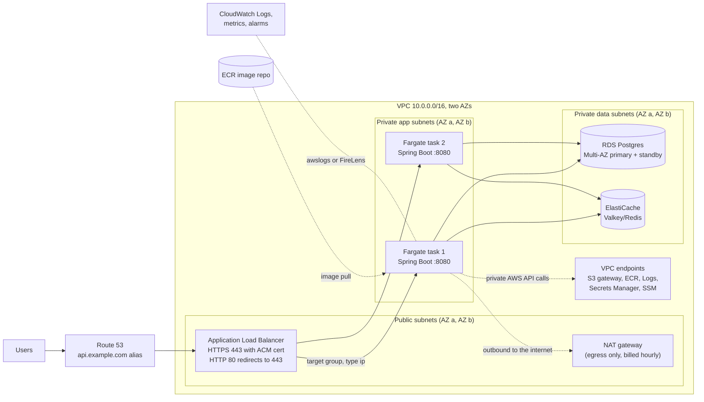

**The ECS object model.** Interviewers expect you to name these correctly:

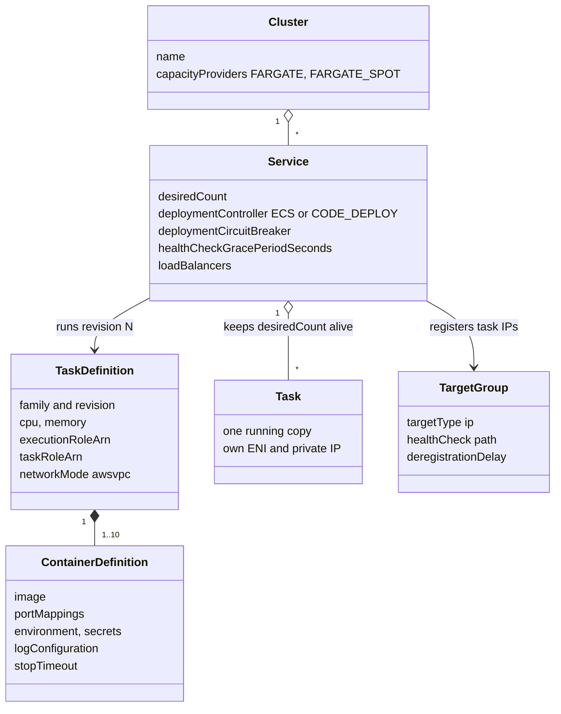

- A **task definition** is an immutable, versioned recipe (`orders:42`). Every change, including a new image tag, registers a new revision.
- A **service** runs `desiredCount` tasks from one revision, replaces failed tasks, registers them with the target group, and performs deployments when you point it at a new revision.
- A **task** is one running copy of the recipe. On Fargate each task gets its own elastic network interface (ENI) and private IP (`awsvpc` mode). That's why the ALB target group must use **target type `ip`**, not `instance`.

**Four rules hold the design together:**
1. **Only the ALB is public.** Tasks, databases and caches live in private subnets, and security groups allow traffic only from the tier in front of them.
2. **Two roles, two jobs.** The *execution role* is what ECS uses to start your task (pull the image, fetch secrets, write logs). The *task role* is what your Spring code uses at runtime (S3, SQS). Never merge them.
3. **The load balancer decides when a task gets traffic.** Its health check plays Kubernetes' readiness role, and ECS waits for the ALB to drain a task *before* sending `SIGTERM`.
4. **Every hour costs money.** Design for teardown from day one: tag everything, keep everything in IaC, and know which resources IaC leaves behind.

---

## 3. How it works internally

### 3.1 The network: subnets, NAT gateway vs VPC endpoints, security groups

**Subnets.** A subnet is *public* if its route table sends `0.0.0.0/0` to an **internet gateway (IGW)**. A *private* subnet has no such route. Its outbound internet traffic goes through a **NAT gateway** in a public subnet, or nowhere. Each subnet lives in exactly one AZ. The ALB requires subnets in at least two AZs, and RDS Multi-AZ needs a DB subnet group spanning two AZs.

**Why a Fargate task in a private subnet needs egress at all.** Even if your app never calls the internet, the *platform* must reach AWS APIs on the task's behalf before your code starts:
- pull the image manifest from **ECR API** and the layers from **ECR (dkr)**, which are stored in **S3**;
- fetch `secrets` from **Secrets Manager** or **SSM Parameter Store**;
- create log streams and push logs to **CloudWatch Logs**.

There are two ways to provide that path:

| | NAT gateway | VPC endpoints |
|---|---|---|
| What it is | A managed NAT in a public subnet. Private subnets route `0.0.0.0/0` to it | **Gateway endpoints** (S3, DynamoDB): route-table entries, **free**. **Interface endpoints** (everything else): ENIs with private IPs in your subnets |
| Reaches | The whole internet *and* all AWS APIs | Only the AWS services you create endpoints for |
| Price | ~$0.045/hour per NAT gateway plus ~$0.045 per GB processed (approximate, check the AWS pricing page), so about $33/month idle, per AZ if you run one per AZ | Interface endpoint ~$0.01/hour **per AZ** plus ~$0.01 per GB (approximate, check the AWS pricing page). Gateway endpoints are free |
| Fargate needs | Nothing else | `com.amazonaws.<region>.ecr.api`, `ecr.dkr`, the **S3 gateway endpoint** (layers live in S3), `logs`, plus `secretsmanager` and/or `ssm` if you inject secrets, and anything your app calls (`sqs`, `sts`...) |

**The cost trap runs both ways.**
- *NAT trap:* every byte your tasks pull through the NAT is charged per GB, including image layers from ECR and S3 traffic. Always add the **free S3 gateway endpoint**, even if you keep the NAT. Layer pulls then bypass the NAT's per-GB charge.
- *Endpoint trap:* "replace the NAT with endpoints" is not automatically cheaper. Five interface endpoints × two AZs is ~$0.10/hour (approximate, check the AWS pricing page), which is *more* than one NAT gateway's hourly fee. Endpoints win on per-GB charges and on security (no internet route), not on idle cost in a small setup. For dev, see §7.2.

**Public IPv4 addresses are billed.** Every public IPv4 address, including the ones on an ALB, a NAT gateway's Elastic IP, and a Fargate task launched with `assignPublicIp=ENABLED`, costs ~$0.005/hour (approximate, check the AWS pricing page), about $3.65/month each. An internet-facing ALB in two AZs has (at least) two.

**Security groups as a chain.** Security groups are stateful firewalls attached to ENIs. The idiomatic pattern references *other security groups* as the source, never CIDR ranges, so the rules follow the tasks wherever their IPs land:

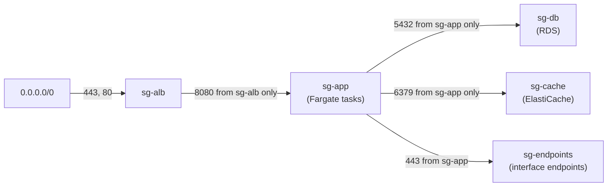

Security groups allow all outbound traffic by default. Tighten `sg-app` egress if you need to (443 to endpoints, 5432 to `sg-db`, 6379 to `sg-cache`). Network ACLs are a second, stateless layer at the subnet level. Leave them at their defaults unless compliance requires otherwise.

### 3.2 ECR: the image registry

- One **repository** per service (`orders`), addressed as `123456789012.dkr.ecr.eu-west-1.amazonaws.com/orders:<tag>`.
- Turn on **tag immutability**. Once `orders:3f2c1e9` is pushed, nobody can overwrite it. That makes the commit-SHA tag from note 15 a trustworthy deployment identifier.
- Add a **lifecycle policy** (for example, "keep the last 30 images, expire untagged after 1 day"). Storage costs ~$0.10/GB-month (approximate, check the AWS pricing page), and CI pushes an image on every merge.
- **Scan on push** (basic scanning) flags CVEs in OS packages. Enhanced scanning (Amazon Inspector) also covers language packages such as Maven jars, and is billed separately.
- Registry authentication uses a 12-hour token from `ecr:GetAuthorizationToken`. In CI, `aws-actions/amazon-ecr-login` handles it. Inside ECS, the execution role does.

### 3.3 Task definition anatomy

A task definition is JSON. The full worked example is in §4.3. These are the fields that matter for a Spring service:

| Field | Level | What it does | Spring-relevant advice |
|---|---|---|---|
| `family` | task | Name. Each registration creates revision N+1 | One family per service |
| `requiresCompatibilities: ["FARGATE"]`, `networkMode: "awsvpc"` | task | Fargate requires `awsvpc` | Gives each task its own ENI, so the target type is `ip` |
| `cpu`, `memory` | task | The Fargate size. Only fixed combinations are valid (e.g. 0.25 vCPU with 0.5–2 GB, 1 vCPU with 2–8 GB; unverified, check the docs table) | The JVM sees this as its cgroup limit. Keep `-XX:MaxRAMPercentage=75` from note 15. Below 2 vCPUs the JVM picks SerialGC |
| `runtimePlatform` | task | `cpuArchitecture` `X86_64` or `ARM64`, and the OS family | ARM64 (Graviton) is roughly 20% cheaper per vCPU-hour (approximate, check the AWS pricing page), but the image must be built for `linux/arm64` |
| `executionRoleArn` | task | The role ECS uses to start the task | See §3.4 |
| `taskRoleArn` | task | The role your code's AWS SDK calls use | See §3.4 |
| `ephemeralStorage` | task | Extra disk for the task (platform version 1.4.0+) | The default (20 GiB, unverified) is plenty for Tomcat temp files |
| `containerDefinitions[].image` | container | Image URI. Use an immutable SHA tag | CI renders this per deploy (§4.4) |
| `portMappings` | container | `containerPort: 8080`. In `awsvpc` mode the host port equals the container port | The target group forwards to it |
| `environment` | container | Plain env vars | Non-secret config: `SPRING_PROFILES_ACTIVE`, `JAVA_TOOL_OPTIONS` |
| `secrets` | container | Env vars resolved from Secrets Manager or SSM **at task start** | See §3.5 |
| `logConfiguration` | container | `awslogs` or `awsfirelens` driver | See §3.6 |
| `healthCheck` | container | A Docker-style command check. Defaults: interval 30 s, timeout 5 s, retries 3, `startPeriod` disabled (0–300 s) | Needs a shell and `curl` in the image. Usually the ALB check alone is enough (§3.7) |
| `stopTimeout` | container | Seconds between `SIGTERM` and `SIGKILL`. **Default 30, max 120** on Fargate | **Must exceed** Boot's `spring.lifecycle.timeout-per-shutdown-phase` (default 30 s). See §3.8 |
| `essential` | container | If an essential container stops, the whole task stops | `true` for the app. Sidecars (ADOT, Fluent Bit) are often `false` |
| `readonlyRootFilesystem` | container | Hardening, like note 15's K8s `securityContext` | Mount a writable volume at `/tmp` for Tomcat |
| `dependsOn` + `startTimeout` | container | Start order between containers (`START`, `HEALTHY`...). `startTimeout` max 120 s | Make the app depend on the log router or collector sidecar |

### 3.4 IAM: execution role vs task role

The most common ECS interview question, and the most common misconfiguration:

| | **Task execution role** | **Task role** |
|---|---|---|
| Who uses it | The ECS agent / Fargate platform, **before and around** your container | **Your code**, through the AWS SDK default credential chain |
| Used for | Pulling the image from ECR, fetching `secrets` from Secrets Manager/SSM, creating log streams and writing `awslogs` logs | S3 `PutObject`, SQS `SendMessage`, `secretsmanager:GetSecretValue` if *Spring* reads secrets (note 16), X-Ray/ADOT export |
| Managed policy to start from | `AmazonECSTaskExecutionRolePolicy` (ECR pull + CloudWatch Logs). Add `secretsmanager:GetSecretValue` / `ssm:GetParameters` on the specific ARNs, and `kms:Decrypt` if the secret uses a customer-managed key | None. Write least-privilege policies per service |
| Trust policy principal | `ecs-tasks.amazonaws.com` | `ecs-tasks.amazonaws.com` |
| Symptom when it's wrong | Task never starts: `CannotPullContainerError`, `ResourceInitializationError: unable to pull secrets or registry auth` | Task runs, then the app logs `AccessDeniedException` |

**How the task role reaches the Spring app.** ECS injects `AWS_CONTAINER_CREDENTIALS_RELATIVE_URI` into the container. The AWS SDK v2 default credentials provider chain (note 16 §3.1) finds it, calls the local credentials endpoint (`169.254.170.2`), and receives short-lived credentials that it refreshes automatically. There are no keys in env vars and no `~/.aws/credentials` file. If you ever see `AWS_ACCESS_KEY_ID` in a task definition, something is wrong.

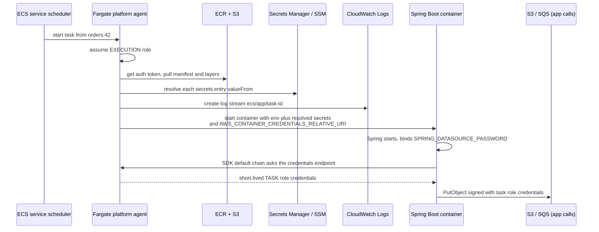

`iam:PassRole` is the hidden third permission. Whoever *registers* the task definition or *updates* the service (your CI role) needs `iam:PassRole` on both roles, ideally with the condition `iam:PassedToService = ecs-tasks.amazonaws.com`. Without it the deploy fails with an `AccessDenied` that names `PassRole`.

### 3.5 Secrets: injected env vars vs read by Spring

ECS can inject secrets as environment variables. The `valueFrom` formats (from the ECS docs):

```text
# whole secret (the env var holds the full JSON string)
arn:aws:secretsmanager:eu-west-1:123456789012:secret:orders/db-AbCdEf
# one JSON key, AWSCURRENT version. The trailing colons are required placeholders
arn:aws:secretsmanager:eu-west-1:123456789012:secret:orders/db-AbCdEf:password::
# full syntax
arn:aws:secretsmanager:<region>:<account>:secret:<name>:<json-key>:<version-stage>:<version-id>
# SSM Parameter Store (SecureString or String)
arn:aws:ssm:eu-west-1:123456789012:parameter/orders/jwt-issuer
```

RDS-managed master credentials are stored as a JSON secret with `username` and `password` keys. Inject `SPRING_DATASOURCE_USERNAME` and `SPRING_DATASOURCE_PASSWORD` from the two JSON keys, and Spring's relaxed binding maps them to `spring.datasource.*`, with no code at all. JSON-key injection needs Fargate platform version 1.4.0+.

**Three facts that drive the design:**
1. **Secrets are resolved once, at task start.** The ECS docs say a rotated secret is *not* picked up automatically: "You must either launch a new task or ... use the Force new deployment option." If you rotate DB passwords (RDS managed rotation), either redeploy after every rotation, or let Spring read the secret itself through `spring.config.import=aws-secretsmanager:` and handle rotation in the pool (note 16 §7.3).
2. **Injected secrets are plain env vars inside the container.** Anything that dumps the environment can leak them: an exposed `/actuator/env` endpoint (keep it unexposed; Boot masks values by default, but don't rely on that), crash dumps, or a debug `System.getenv()` log line. The ECS console shows only the `valueFrom` ARN, never the value.
3. **The execution role, not the task role, needs `GetSecretValue`** for injected secrets. If Spring reads the secret itself, the *task* role needs it.

| Approach | Rotation | Code needed | Choose when |
|---|---|---|---|
| ECS `secrets` → env vars | Needs a new deployment | None | Static or rarely rotated secrets, simplest path |
| Spring Cloud AWS `aws-secretsmanager:` config import (note 16) | Can refresh in-process (with care) | Starter + one property | Rotated DB credentials, many secrets per service |
| RDS IAM authentication (note 16 §3.8) | 15-minute tokens, no password at all | Token-generating `DataSource` wrapper | Highest security bar. Watch the connection-rate limits |

### 3.6 Logs: `awslogs` vs FireLens

**`awslogs` driver (the default choice).** The container's stdout/stderr go straight to a CloudWatch Logs group. Options:
- `awslogs-group` and `awslogs-region`;
- `awslogs-stream-prefix`, which gives stream names like `app/app/<task-id>`;
- `mode: non-blocking` with `max-buffer-size` (default `10m` per the docs). Use it so a CloudWatch slowdown can't block your app's `System.out` writes. The trade-off is that logs are dropped when the buffer fills.

Combine it with Boot's structured logging (`logging.structured.format.console=ecs`, note 15 §4.2): each line is JSON, and **CloudWatch Logs Insights** can query fields directly (`fields @timestamp, log.level, message | filter log.level = "ERROR"`).

**FireLens (`awsfirelens` driver).** A **Fluent Bit** sidecar container (the AWS for Fluent Bit image) receives the app's output and routes it anywhere: CloudWatch, S3, OpenSearch, Datadog, Splunk. You can also filter or sample on the way. You pay for the sidecar's CPU and memory, and you maintain its config. Choose it when logs must go somewhere other than CloudWatch, or need routing or filtering.

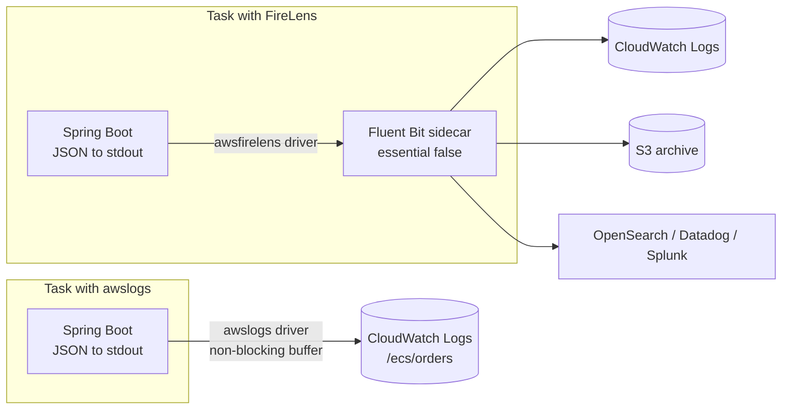

**Cost note.** CloudWatch log groups default to **"Never expire"**. Ingestion is ~$0.50/GB and storage ~$0.03/GB-month (approximate, check the AWS pricing page). A chatty `DEBUG` logger in prod is a recurring bill. Set a retention period on every log group (7–30 days for dev) in IaC.

### 3.7 ALB health checks mapped to actuator readiness

A **listener** (HTTPS :443, with a certificate from AWS Certificate Manager (ACM); ACM public certificates are free) forwards to a **target group**. The target group health-checks each registered task IP independently.

| Target group health check setting | ALB default | Recommended for Spring Boot |
|---|---|---|
| Protocol / port | HTTP / traffic port | HTTP / traffic port (8080) |
| Path | `/` | **`/readyz`** (Boot 4: `management.endpoint.health.probes.add-additional-paths=true` serves it on the main port) or `/actuator/health/readiness` |
| Matcher | `200` | `200` (Boot returns 503 when readiness is `REFUSING_TRAFFIC`) |
| Interval / timeout | 30 s / 5 s | 10–15 s / 5 s |
| Healthy / unhealthy threshold | 5 / 2 | 2–3 / 2–3 |

**ECS uses this check for two jobs at once:**
- *readiness:* the ALB sends traffic only to healthy targets;
- *liveness:* the ECS service **replaces** tasks that the ELB reports unhealthy.

There is no separate liveness probe. That has two consequences:
1. **Keep shared dependencies out of the readiness group** (note 10 §7.3). If readiness includes the DB, a 20-second RDS failover marks *every* task unhealthy. The ALB then "fails open" (the docs say it routes to all targets when every target is unhealthy), but ECS still starts replacing every task at once. Keep `readiness.include=readinessState` plus per-task checks only.
2. **Protect the JVM's startup with `healthCheckGracePeriodSeconds`** on the service. During the grace period ECS ignores ELB health failures, so a slow-starting task isn't killed. This plays the role of Kubernetes' `startupProbe`. Set it above your worst cold start, e.g. 60–120 s for a JVM app on 0.5–1 vCPU.

**Health-check on the main port, not on the management port.** Keep note 15's split: actuator on `management.server.port=8081`, which you **don't** put in `portMappings` or the security group, so `/actuator/**` is never reachable through the ALB. `add-additional-paths=true` still serves `/readyz` and `/livez` on 8080, so the ALB checks the same connector users hit, with no second port mapping or security-group rule.

### 3.8 Draining: deregistration delay vs Boot graceful shutdown

This is where ECS and Kubernetes differ most. In Kubernetes, endpoint removal and `SIGTERM` happen **concurrently**, which is why note 15 needed a `preStop` sleep. On ECS behind an ALB, the order is **sequential**. The ECS docs say: "Amazon ECS monitors the load balancer, and waits for the load balancer to report that the keep alive connection is closed (the target is in an `UNUSED` state)". Only then does it stop the container.

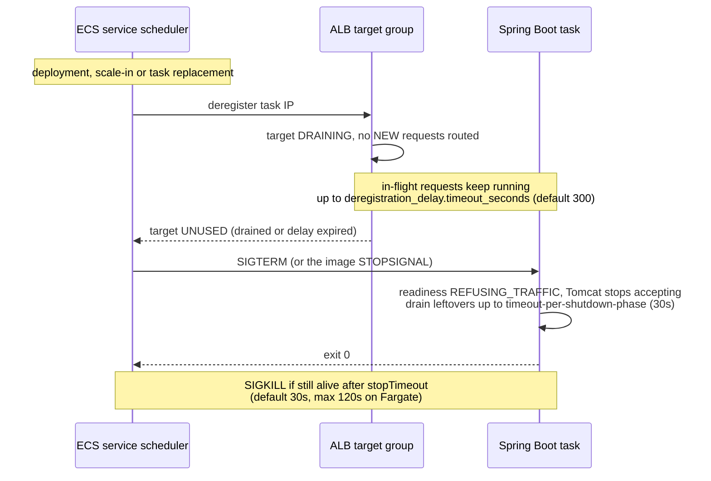

**The timing rules that follow:**

| Knob | Default | Set it to | Why |
|---|---|---|---|
| Target group `deregistration_delay.timeout_seconds` | **300 s** | Longest normal request + margin, e.g. **30 s**. The ECS docs suggest 5 s for sub-second APIs, but warn against it for long uploads and streaming | It is the effective `preStop`. At 300 s, *every* rolling deploy waits 5 minutes per batch, and scale-in is slow |
| Boot `spring.lifecycle.timeout-per-shutdown-phase` | 30 s | Keep 30 s, or the longest request you tolerate | Catches anything still in flight when `SIGTERM` arrives (rare, because the ALB already drained) |
| Container `stopTimeout` | **30 s** | **≥ Boot timeout + ~15 s**, e.g. **60 s** (max 120) | Default 30 s **equals** Boot's 30 s phase timeout, so a slow drain plus bean shutdown races `SIGKILL` |
| `server.shutdown` | `graceful` (Boot 4) | Keep | Without it Tomcat drops in-flight connections on `SIGTERM` |

**No `preStop` sleep is needed on ECS.** The deregistration delay does that job. The note-15 Dockerfile's exec-form `ENTRYPOINT` still matters: shell form would make `/bin/sh` PID 1, swallow `SIGTERM`, and turn every stop into a `stopTimeout`-long wait followed by `SIGKILL`.

**Keep-alive must outlive the ALB's idle timeout.** The ALB keeps idle connections to targets open for its **idle timeout (default 60 s)**. If Tomcat closes an idle keep-alive connection at the same moment the ALB reuses it, the client gets a sporadic **502**. AWS's guidance is to make the target's keep-alive timeout **longer** than the load balancer's idle timeout. In Boot 4.1.2, `server.tomcat.keep-alive-timeout` has no default in the metadata ("When not set the connectionTimeout is used"). Tomcat's own connection timeout default is 60 s (unverified for embedded Tomcat), which ties with the ALB. Set `server.tomcat.keep-alive-timeout=75s`.

*These timing facts come from the AWS docs and the Boot 4.1.2 metadata. They were not proven with a test in this repo, because that would mean running on real ECS.*

### 3.9 Deployments: rolling with circuit breaker, and blue/green

**Rolling update (`deploymentController: ECS`, the default).** Two percentages bound the rollout:
- `minimumHealthyPercent` (e.g. 100) is how much of `desiredCount` must stay healthy;
- `maximumPercent` (e.g. 200) is how far above `desiredCount` ECS may go.

With 2 tasks at 100/200, ECS starts 2 new tasks, waits until they pass ALB health checks, drains and stops the 2 old ones, and repeats as needed.

**Deployment circuit breaker (sourced from the ECS docs).** Without it, a broken image makes ECS retry forever. Tasks crash-loop, and the deployment stays `IN_PROGRESS` for hours. With `deploymentCircuitBreaker: {enable: true, rollback: true}`:
- **Stage 1:** ECS counts tasks that fail to reach `RUNNING`.
- **Stage 2:** once at least one task is `RUNNING`, ECS counts tasks replaced because of failed health checks (ELB, Cloud Map, container health check).
- **Threshold:** by default `BOUNDED_PERCENT` with a value of 50 means 50% of desired count, rounded up and clamped to **[3, 200]**. A 2-task service therefore fails after 3 failed tasks. Newer options: `COUNT` and `UNBOUNDED_PERCENT` threshold types, and `resetOnHealthyTask` (default `true`, so only consecutive failures count).
- **Rollback:** on failure the deployment becomes `FAILED`, and ECS redeploys the most recent `COMPLETED` deployment. If no completed deployment exists (for example, the very first deploy failed), it simply stops launching tasks.
- ECS emits `SERVICE_DEPLOYMENT_FAILED` to EventBridge. Alert on it.
- The circuit breaker works **only with the rolling (`ECS`) deployment controller**.
- **CloudWatch alarm rollback** (`deploymentConfiguration.alarms`) adds "roll back if *this* alarm fires during the deployment", e.g. a 5xx-rate alarm. The circuit breaker only sees "tasks won't start or get healthy". The alarm also catches "starts fine but returns errors".

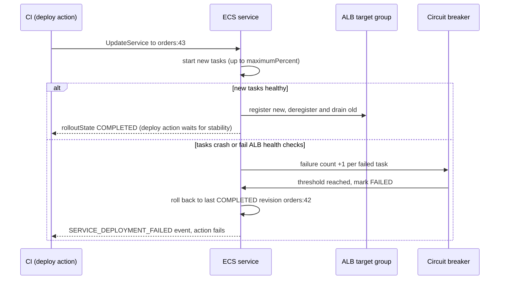

**Blue/green with CodeDeploy (`deploymentController: CODE_DEPLOY`).** The classic AWS approach:
- The service gets **two target groups** (blue and green) and two listeners: the **production listener** (443) and an optional **test listener** (e.g. 8443).
- CodeDeploy launches the green task set and registers it with the green target group, so you can smoke-test it on the test listener.
- It then shifts production traffic using a deployment config: `CodeDeployDefault.ECSAllAtOnce`, `ECSCanary10Percent5Minutes`, or `ECSLinear10PercentEvery1Minutes` (config and hook names unverified).
- It keeps blue alive for a termination wait time, so rollback is a listener flip.
- Lifecycle hooks (`BeforeInstall`, `AfterInstall`, `AfterAllowTestTraffic`, `BeforeAllowTraffic`, `AfterAllowTraffic`) invoke Lambda functions that can fail the deployment.

The cost is double capacity during the switch, an `appspec.yaml`, and a CodeDeploy application and deployment group.

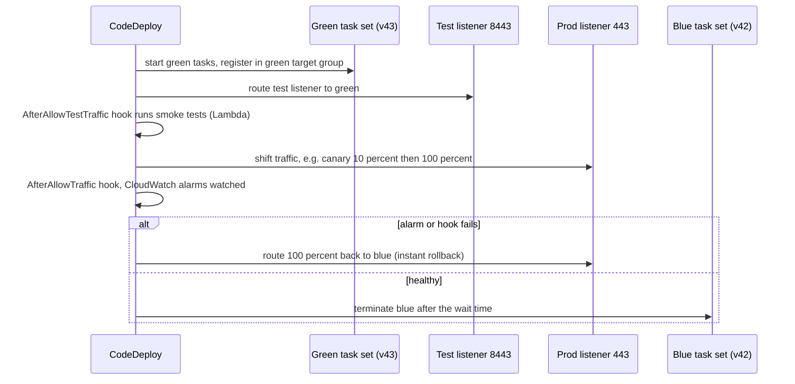

**ECS-native blue/green (July 2025).** ECS now does blue/green *inside the ECS deployment controller*, with no CodeDeploy application. It has a bake time (blue stays up after the shift for instant rollback), lifecycle hooks, and a test-traffic path. **Linear and canary** strategies followed (AWS's own posts disagree on the launch date, so it is unverified here). They use ALB weighted target groups and CloudWatch alarms for automated rollback. For new services, start with native ECS blue/green. Choose CodeDeploy only if you already depend on its hooks or tooling. This was sourced from AWS blog and docs pages, and the exact property names were not checked.

### 3.10 Auto scaling

ECS service auto scaling is **Application Auto Scaling**: a scalable target (`ecs:service:DesiredCount`, min/max) plus policies.
- **Target tracking** on `ECSServiceAverageCPUUtilization` (e.g. 60%) or on `ALBRequestCountPerTarget`. Request count usually tracks load better for I/O-bound Spring apps with virtual threads, where CPU stays low while latency climbs.
- **Scheduled actions**, e.g. min=max=0 at 20:00 on weekdays for dev environments (§7.2).
- **JVM warm-up:** a new task serves slowly for its first minute (JIT). Use a scale-out cooldown that covers startup plus warm-up, ALB **slow start** mode on the target group (traffic ramps up over N seconds for new targets), and the CDS/AOT cache from note 15.
- **Fargate Spot** (via a capacity provider strategy) runs tasks on spare capacity at a large discount, with a 2-minute interruption notice (`SIGTERM`; unverified). It's fine for stateless Spring APIs if you keep a base of on-demand tasks.

### 3.11 What Spring Boot itself knows about ECS (Boot 4)

Boot 4.0 added **`CloudPlatform.AWS_ECS`**. In the v4.1.2 source it is detected when the `AWS_EXECUTION_ENV` environment variable starts with `AWS_ECS`, which the ECS agent sets (e.g. `AWS_ECS_FARGATE`; exact values unverified). Like every non-`NONE` platform, `isUsingForwardHeaders()` returns `true`. So when `server.forward-headers-strategy` is not set, Boot honours `X-Forwarded-For`/`-Proto`/`-Port` from the ALB, and redirects and `ServletUriComponentsBuilder` produce `https://` links. In 3.x no platform was detected on ECS, so you had to set the strategy yourself. Setting it explicitly is still clearer, and that's what §4.2 does. Override detection with `spring.main.cloud-platform`.

### 3.12 The alternatives, compared

| Option | What you manage | Scale to zero | Spring Boot fit | Pricing shape (approximate, check the AWS pricing page) | Pick it when |
|---|---|---|---|---|---|
| **ECS on Fargate** (this note) | VPC, ALB, task definitions, IAM | No. Min 0 tasks is possible, but the ALB, NAT etc. still bill | Excellent: the note-15 image as-is | Per vCPU-second and GB-second while a task exists: ~$0.04/vCPU-hour + ~$0.0044/GB-hour on x86 (approximate, check the AWS pricing page) | Default for containerised Spring services on AWS without Kubernetes |
| **ECS Express Mode** (2025+) | An image and two IAM roles. ECS creates the Fargate service, ALB, scaling and networking in your account | No | Excellent | No extra charge. You pay for the underlying Fargate, ALB etc. | Fastest path for one service. You can grow into full ECS, because the resources are ordinary ECS/ELB |
| **ECS on EC2** | The above plus EC2 instances (AMIs, patching, capacity providers) | No | Excellent | EC2 instance-hours. Cheaper at steady high utilisation with Savings Plans | Large steady fleets, GPUs, daemon tasks, or when Fargate's per-unit premium matters |
| **Elastic Beanstalk** | Platform version upgrades. It generates EC2 + ASG + ELB | No | Good: the "Java SE" platform (Corretto) runs the jar. nginx forwards to port 5000 by default (unverified) | No extra charge. You pay for the EC2/ELB it creates | Legacy apps, or teams that want a jar-upload PaaS and accept its opinions |
| **App Runner** | Almost nothing | No | Good | Per active vCPU/GB + provisioned memory | **Not for new projects:** closed to new customers. AWS recommends ECS Express Mode |
| **EKS** | Kubernetes add-ons, node groups or Fargate profiles, upgrades | Partly, with Karpenter/KEDA | Excellent: note 15's manifests | ~$0.10/hour per cluster control plane (approximate, check the AWS pricing page) + nodes | Many services, an existing platform team, Kubernetes skills and tooling |
| **Lambda + SnapStart** | Function config, API Gateway or a Function URL | **Yes** | Workable: `aws-serverless-java-container` 3.x (`-springboot4` module) adapts a Boot 4 app. Or use Spring Cloud Function | Per request + GB-second of execution | Spiky or low-traffic APIs, event handlers (S3, SQS). Avoid for long-lived connections, WebSockets, heavy pools |
| **EC2 (+ ASG)** | Everything: OS, JDK, systemd, patching | No | Fine: `java -jar` under systemd (Boot 4 removed the "fully executable" jar script, note 15) | Instance-hours | Full control, special OS needs, or one tiny always-on box on a budget |

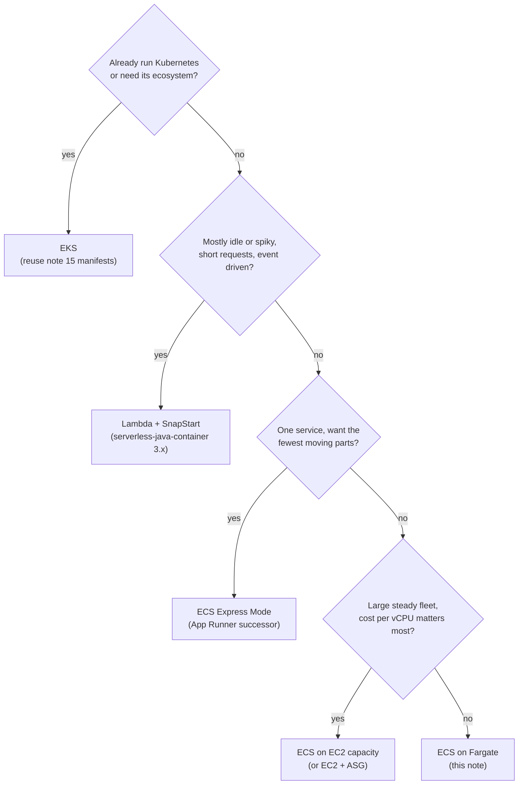

**Lambda + SnapStart, in detail.** A Spring Boot JVM cold start of several seconds (note 15 §7.3) is unacceptable per request.
- **SnapStart** runs your function's init phase once, when you **publish a version**. It snapshots the initialised Firecracker micro-VM and restores it on cold starts, which takes a fraction of a full Spring start.
- **Uniqueness and staleness:** everything created during init is cloned into every restored environment: random seeds, cached credentials, open DB connections. Re-establish connections after restore with **CRaC runtime hooks** (`org.crac.Resource.afterRestore`). Prefer RDS Proxy or the RDS Data API over long-lived Hikari pools.
- **Priming:** invoking hot code paths in `beforeCheckpoint` puts JIT-warmed classes into the snapshot.
- **Wiring Boot 4:** `com.amazonaws.serverless:aws-serverless-java-container-springboot4` translates API Gateway or Function URL events into servlet requests for your existing `@RestController`s. Its 3.x release line targets Jakarta EE 11, Spring 7 and Boot 4, per the project README.
- **Limits:** 15-minute max execution, payload size limits, and per-request billing that gets *more* expensive than Fargate at sustained high traffic.
- SnapStart support on the newest Java runtimes (21 and 25) was not re-verified for this note (unverified).

### 3.13 CI/CD with OIDC federation: no long-lived keys

**The old way, which you should stop using:** create an IAM user, generate an access key, paste it into GitHub Secrets. That key never expires unless someone rotates it, works from anywhere on the internet, and leaks through fork PRs, logs and compromised third-party actions.

**The OIDC way:**
1. GitHub runs an OpenID Connect issuer at `https://token.actions.githubusercontent.com`.
2. You register it once in the AWS account as an **IAM OIDC identity provider**, with audience `sts.amazonaws.com`.
3. You create an IAM role whose **trust policy** says: "tokens from that issuer may assume me, **only** if the `sub` claim is `repo:acme/orders:environment:production`" (or a specific branch).
4. At run time, a job with `permissions: id-token: write` asks GitHub for a signed JWT. `aws-actions/configure-aws-credentials` calls **`sts:AssumeRoleWithWebIdentity`** with it and gets credentials that expire in about an hour.

Nothing secret is stored in GitHub at all. The role ARN is not a secret.

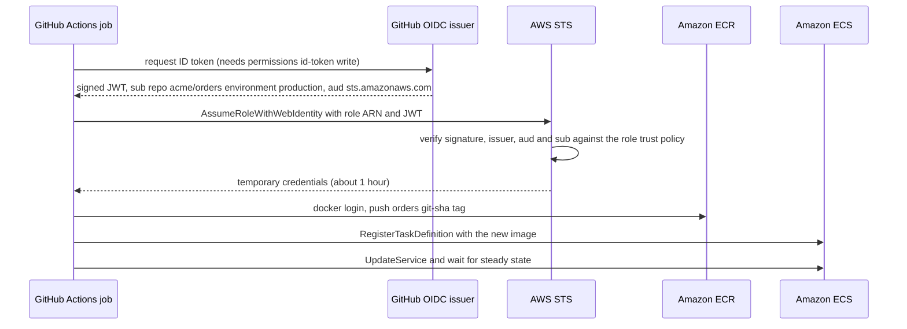

**The `sub` condition is the whole security model.**
- `repo:acme/orders:*` lets **any branch, PR workflow or environment** of that repo deploy to prod.
- `repo:acme/*` lets every repo in the org deploy.
- With no `sub` condition, **any GitHub repository in the world** can assume your role. AWS now rejects trust policies for the GitHub provider that don't constrain `sub` (unverified).

Pin `sub` to `environment:production` and protect that GitHub environment with required reviewers and branch rules, or pin it to `ref:refs/heads/main`. Use a **separate role per environment** (dev, staging, prod), each in its own account (§7.3).

**The least-privilege deploy role needs:**
- `ecr:GetAuthorizationToken` (resource `*`);
- push actions on *one* repository;
- `ecs:RegisterTaskDefinition` and `ecs:DescribeTaskDefinition` (these don't support resource-level restriction);
- `ecs:UpdateService` and `ecs:DescribeServices` on the one service ARN;
- `iam:PassRole` on exactly the execution and task roles.

It needs nothing else: no `AdministratorAccess`, and no IaC permissions unless this pipeline also runs `cdk deploy`. The full policy is in §4.4.

### 3.14 Infrastructure as code: CDK vs Terraform vs CloudFormation

| | CloudFormation | AWS CDK | Terraform / OpenTofu |
|---|---|---|---|
| Language | YAML/JSON templates | Java, TypeScript, Python, Go, C#. It **synthesises** CloudFormation | HCL |
| State | Managed by AWS (the stack) | CloudFormation stacks | A state file you store (S3 bucket + locking) |
| Abstraction | One resource = one block | L1 (raw `Cfn*`), L2 (sane defaults, grants), **L3 patterns**: `ApplicationLoadBalancedFargateService` builds the ALB, service, task definition and security groups in ~20 lines | Providers + community modules (`terraform-aws-modules/ecs`, `/vpc`) |
| Multi-cloud / SaaS | AWS only | AWS only | AWS, GCP, Azure, Datadog, GitHub, Cloudflare... |
| Failure handling | Failed stack updates roll back automatically. Drift detection | Same (it is CloudFormation) | `plan` shows the diff. No automatic rollback: `apply` stops part-way on error |
| Teardown | `delete-stack` | `cdk destroy` | `terraform destroy` |
| Java team fit | Verbose | **Natural**: same language and IDE, unit tests with `Template.fromStack` assertions | New language, but the most common IaC tool in job adverts |
| Gotcha | Thousands of lines of YAML, hard to reuse | Synth-time lookups (`Vpc.fromLookup`) call AWS and cache into `cdk.context.json`. L2 defaults can surprise you, e.g. `RETAIN` removal policies (§8.1) | The state file holds secrets in plain text. Protect the bucket |

Rule of thumb:
- **CDK** for an AWS-only Java team.
- **Terraform** when the org standardises on it, or spans clouds and SaaS.
- **Raw CloudFormation** for small, stable templates (a budget, an OIDC provider, StackSets rolled out to many accounts).

Whichever you pick, every resource must come from code. That is what makes the teardown in §8.1 reliable.

### 3.15 Observability on AWS: CloudWatch, X-Ray, ADOT

**Metrics you get without writing code:**
- **ALB:** `HTTPCode_Target_5XX_Count`, `HTTPCode_ELB_5XX_Count` (the ALB's own 502/503/504), `TargetResponseTime` (use p95/p99), `UnHealthyHostCount`, `RequestCountPerTarget`.
- **ECS:** service `CPUUtilization` and `MemoryUtilization`. **Container Insights** (enhanced observability) adds per-task and per-container metrics, and you pay for them as custom metrics and log ingestion.
- **RDS:** `CPUUtilization`, `DatabaseConnections`, `FreeStorageSpace`, `ReadLatency`/`WriteLatency`. Performance Insights / Database Insights show the top SQL.
- **ElastiCache:** `EngineCPUUtilization`, `CurrConnections`, `Evictions`.

**App metrics from Micrometer** can take three routes:
1. `micrometer-registry-cloudwatch2` pushes custom metrics. **Beware the bill:** each unique name and dimension combination is a custom metric at ~$0.30/month (approximate, check the AWS pricing page). The default `http.server.requests` timer, with its `uri`, `status`, `method`, `outcome` and `exception` tags, can become hundreds of metrics per service. Filter tags with a `MeterFilter` (note 10).
2. OTLP to an **ADOT collector**, which writes CloudWatch **Embedded Metric Format** (EMF) logs or remote-writes to Amazon Managed Prometheus.
3. Amazon Managed Prometheus scraping `/actuator/prometheus`.

**Alarms worth having on day one:**
- target 5xx rate above 1% for 5 minutes;
- p99 `TargetResponseTime` above your SLO;
- `UnHealthyHostCount` above 0 for 5 minutes;
- RDS `FreeStorageSpace` below 20%;
- ECS `SERVICE_DEPLOYMENT_FAILED` via EventBridge.

Route them to SNS for email or Slack, and use the 5xx alarm for deployment rollback (§3.9).

**Tracing: X-Ray via OpenTelemetry, not the X-Ray SDK.** The AWS X-Ray SDKs and the X-Ray daemon entered **maintenance mode on 2026-02-25** and reach **end of support on 2027-02-25** (AWS X-Ray docs). AWS recommends OpenTelemetry instead. The X-Ray *service* itself remains fully supported. The Boot 4 path builds on note 10 §3.8:
1. `spring-boot-starter-opentelemetry` sends Micrometer Tracing spans, bridged to the OTel SDK, out over OTLP HTTP.
2. An **ADOT collector sidecar** in the same task (`public.ecr.aws/aws-observability/aws-otel-collector`) receives them on `localhost:4318`.
3. The sidecar exports traces to X-Ray and EMF metrics to CloudWatch. The image ships an ECS default config for exactly this (file name `ecs-default-config.yaml`, unverified).
4. The **task role** needs X-Ray write permissions (`AWSXRayDaemonWriteAccess`).

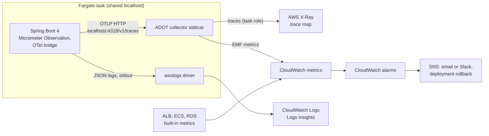

To correlate logs and traces, put `traceId`/`spanId` in the JSON log lines. Boot's structured logging does this when tracing is on (note 10). A Logs Insights query on one trace ID then finds every log line of that request across services.

---

## 4. Full worked code

Everything below is **illustrative, not executed**. No AWS account was used, and no `cdk synth`, `terraform plan` or `aws` command was run. Account `123456789012`, region `eu-west-1`, repo `acme/orders` and `you@example.com` are placeholders.

### 4.1 Step zero: a budget and a billing alarm (do this before anything else)

Create these **first**, by hand in the console or with this CloudFormation template. A budget is the only thing that will tell you about a forgotten NAT gateway before the month ends.

```yaml
# budget.yaml (CloudFormation). Deploy once per account.
AWSTemplateFormatVersion: "2010-09-09"
Description: Learning-account guard rails. Email alerts on actual and forecast spend.
Parameters:
  AlertEmail:
    Type: String
Resources:
  MonthlyCostBudget:
    Type: AWS::Budgets::Budget
    Properties:
      Budget:
        BudgetName: learning-monthly-cost
        BudgetType: COST
        TimeUnit: MONTHLY
        BudgetLimit:
          Amount: 10            # USD per month. Pick your own pain threshold
          Unit: USD
      NotificationsWithSubscribers:
        - Notification:
            NotificationType: ACTUAL
            ComparisonOperator: GREATER_THAN
            Threshold: 50       # percent of the limit
          Subscribers:
            - SubscriptionType: EMAIL
              Address: !Ref AlertEmail
        - Notification:
            NotificationType: FORECASTED
            ComparisonOperator: GREATER_THAN
            Threshold: 100
          Subscribers:
            - SubscriptionType: EMAIL
              Address: !Ref AlertEmail
```

- **Billing alarm (belt and braces):**
  1. In *Billing preferences*, enable "Receive CloudWatch billing alerts".
  2. Create a CloudWatch alarm on `AWS/Billing` → `EstimatedCharges` (dimension `Currency=USD`) **in `us-east-1`**. Billing metrics are only published in that region, and they update a few times a day.
- **Free Tier usage alerts** (also in Billing preferences) email you when a Free Tier allowance is about to run out.
- **Cost Anomaly Detection** is free (unverified) and flags unusual daily spend per service.
- The console's **"zero spend" budget template** alerts on the first cent, which suits a pure-learning account.

### 4.2 `application-aws.yaml`: the Spring side

This builds on note 15 §4.2. The AWS-specific overrides below are activated by `SPRING_PROFILES_ACTIVE=aws` from the task definition:

```yaml
server:
  shutdown: graceful                     # Boot 4 default, stated for readers
  forward-headers-strategy: native       # the ALB sends X-Forwarded-*. Boot 4 also implies this on ECS (CloudPlatform.AWS_ECS)
  tomcat:
    keep-alive-timeout: 75s              # longer than the ALB idle timeout (60s default): the ALB closes idle connections first, so no 502s
spring:
  lifecycle:
    timeout-per-shutdown-phase: 30s      # container stopTimeout is 60s, comfortably above this
  datasource:
    # The URL is plain config from the task definition environment.
    # Username and password come from Secrets Manager via ECS "secrets" (§4.3).
    hikari:
      maximum-pool-size: 10              # tasks x pool size must stay below RDS max_connections
      max-lifetime: 600000               # recycle connections every 10 min (ms). Helps after a Multi-AZ failover
  data:
    redis:
      host: ${CACHE_HOST}
      ssl:
        enabled: true                    # ElastiCache with in-transit encryption requires TLS
management:
  server:
    port: 8081                           # not in portMappings, so actuator is unreachable through the ALB
  endpoint:
    health:
      probes:
        add-additional-paths: true       # /readyz and /livez on 8080 for the ALB health check
      group:
        readiness:
          include: readinessState        # never the DB: an RDS failover must not fail every task's health check
  opentelemetry:
    tracing:
      export:
        otlp:
          endpoint: http://localhost:4318/v1/traces   # ADOT sidecar in the same task (awsvpc shares localhost)
  tracing:
    sampling:
      probability: 0.1
logging:
  structured:
    format:
      console: ecs                       # JSON lines for CloudWatch Logs Insights
```

**JVM DNS caching matters for RDS Multi-AZ failover.** The endpoint's DNS name moves to the standby's IP. The JDK caches successful lookups for `networkaddress.cache.ttl` seconds, which is 30 s when no security manager is installed. The comment in the JDK 21 `conf/security/java.security` file says: "When a security manager is not set, the default behavior in this implementation is to cache for 30 seconds." Don't raise it. Let Hikari's `max-lifetime` and connection validation retire dead connections.

### 4.3 Task definition (`deploy/task-definition.json`)

```json
{
  "family": "orders",
  "requiresCompatibilities": ["FARGATE"],
  "networkMode": "awsvpc",
  "cpu": "1024",
  "memory": "2048",
  "runtimePlatform": { "cpuArchitecture": "X86_64", "operatingSystemFamily": "LINUX" },
  "executionRoleArn": "arn:aws:iam::123456789012:role/orders-execution",
  "taskRoleArn": "arn:aws:iam::123456789012:role/orders-task",
  "containerDefinitions": [
    {
      "name": "app",
      "image": "123456789012.dkr.ecr.eu-west-1.amazonaws.com/orders:replaced-by-ci",
      "essential": true,
      "portMappings": [{ "name": "http", "containerPort": 8080, "protocol": "tcp" }],
      "environment": [
        { "name": "SPRING_PROFILES_ACTIVE", "value": "aws" },
        { "name": "JAVA_TOOL_OPTIONS", "value": "-XX:MaxRAMPercentage=75 -XX:+ExitOnOutOfMemoryError" },
        { "name": "SPRING_DATASOURCE_URL", "value": "jdbc:postgresql://orders-db.abc123.eu-west-1.rds.amazonaws.com:5432/orders" },
        { "name": "CACHE_HOST", "value": "orders-cache.abc123.euw1.cache.amazonaws.com" }
      ],
      "secrets": [
        { "name": "SPRING_DATASOURCE_USERNAME",
          "valueFrom": "arn:aws:secretsmanager:eu-west-1:123456789012:secret:orders/db-AbCdEf:username::" },
        { "name": "SPRING_DATASOURCE_PASSWORD",
          "valueFrom": "arn:aws:secretsmanager:eu-west-1:123456789012:secret:orders/db-AbCdEf:password::" },
        { "name": "APP_JWT_ISSUER_URI",
          "valueFrom": "arn:aws:ssm:eu-west-1:123456789012:parameter/orders/jwt-issuer-uri" }
      ],
      "logConfiguration": {
        "logDriver": "awslogs",
        "options": {
          "awslogs-group": "/ecs/orders",
          "awslogs-region": "eu-west-1",
          "awslogs-stream-prefix": "app",
          "mode": "non-blocking",
          "max-buffer-size": "25m"
        }
      },
      "stopTimeout": 60,
      "readonlyRootFilesystem": true,
      "mountPoints": [{ "sourceVolume": "tmp", "containerPath": "/tmp" }],
      "dependsOn": [{ "containerName": "otel-collector", "condition": "START" }]
    },
    {
      "name": "otel-collector",
      "image": "public.ecr.aws/aws-observability/aws-otel-collector:latest",
      "essential": false,
      "command": ["--config=/etc/ecs/ecs-default-config.yaml"],
      "logConfiguration": {
        "logDriver": "awslogs",
        "options": {
          "awslogs-group": "/ecs/orders",
          "awslogs-region": "eu-west-1",
          "awslogs-stream-prefix": "otel"
        }
      }
    }
  ],
  "volumes": [{ "name": "tmp" }]
}
```

Notes (JSON has no comments):
- **`cpu: 1024` / `memory: 2048`** gives a ~1.5 GB heap at 75%. One vCPU still means SerialGC (note 15 §3.5). Use 2 vCPU for latency-sensitive services.
- **`stopTimeout: 60`** is above Boot's 30 s shutdown phase (§3.8).
- **The DB URL is not a secret**, so it stays in `environment`. Only the credentials come from `secrets`, which the **execution role** resolves at task start.
- **`/tmp` volume:** a named volume with no `host` block is task-scoped ephemeral storage on Fargate. It lets `readonlyRootFilesystem` work with Tomcat's temp directory. The note-15 CDS archive is read from the image, and reading from a read-only filesystem is fine.
- **Pin the collector version.** `latest` is used here only for brevity. The `--config` path is the one documented for ADOT on ECS (unverified).
- **Health checks live on the target group** (§3.7). There is no container `healthCheck`, so the image doesn't need `curl`.

### 4.4 GitHub Actions: build, push to ECR, deploy to ECS with OIDC

**IAM trust policy** for the role `gha-orders-deploy`. Before using it, create the OIDC provider `token.actions.githubusercontent.com` (audience `sts.amazonaws.com`) once per account.

```json
{
  "Version": "2012-10-17",
  "Statement": [
    {
      "Effect": "Allow",
      "Principal": {
        "Federated": "arn:aws:iam::123456789012:oidc-provider/token.actions.githubusercontent.com"
      },
      "Action": "sts:AssumeRoleWithWebIdentity",
      "Condition": {
        "StringEquals": {
          "token.actions.githubusercontent.com:aud": "sts.amazonaws.com",
          "token.actions.githubusercontent.com:sub": "repo:acme/orders:environment:production"
        }
      }
    }
  ]
}
```

**Permissions policy** (least privilege: one repository, one service):

```json
{
  "Version": "2012-10-17",
  "Statement": [
    { "Sid": "EcrAuth", "Effect": "Allow", "Action": "ecr:GetAuthorizationToken", "Resource": "*" },
    { "Sid": "EcrPush", "Effect": "Allow",
      "Action": ["ecr:BatchCheckLayerAvailability", "ecr:InitiateLayerUpload", "ecr:UploadLayerPart",
                 "ecr:CompleteLayerUpload", "ecr:PutImage", "ecr:BatchGetImage"],
      "Resource": "arn:aws:ecr:eu-west-1:123456789012:repository/orders" },
    { "Sid": "TaskDef", "Effect": "Allow",
      "Action": ["ecs:RegisterTaskDefinition", "ecs:DescribeTaskDefinition"], "Resource": "*" },
    { "Sid": "Service", "Effect": "Allow",
      "Action": ["ecs:UpdateService", "ecs:DescribeServices"],
      "Resource": "arn:aws:ecs:eu-west-1:123456789012:service/shop/orders" },
    { "Sid": "PassTaskRoles", "Effect": "Allow", "Action": "iam:PassRole",
      "Resource": ["arn:aws:iam::123456789012:role/orders-execution",
                   "arn:aws:iam::123456789012:role/orders-task"],
      "Condition": { "StringEquals": { "iam:PassedToService": "ecs-tasks.amazonaws.com" } } }
  ]
}
```

**The workflow.** Action versions are the latest releases as of 2026-11-19, from the GitHub releases API: `aws-actions/configure-aws-credentials` v6.3.0, `amazon-ecr-login` v2.2.0, `amazon-ecs-render-task-definition` v1.9.1 and `amazon-ecs-deploy-task-definition` v2.6.4. The Docker and setup actions match note 15.

```yaml
# .github/workflows/deploy-orders.yml
name: deploy-orders
on:
  push:
    branches: [main]
    paths: ['projects/ecommerce/**', '.github/workflows/deploy-orders.yml']

permissions:
  contents: read
  id-token: write                         # lets the job request the OIDC token. No AWS keys anywhere

concurrency:
  group: deploy-orders-production         # never two deploys to the same service at once
  cancel-in-progress: false

env:
  AWS_REGION: eu-west-1
  ECR_REPOSITORY: orders
  ECS_CLUSTER: shop
  ECS_SERVICE: orders

jobs:
  deploy:
    runs-on: ubuntu-latest
    environment: production               # must match the role's sub condition. Add required reviewers here
    defaults:
      run:
        working-directory: projects/ecommerce
    steps:
      - uses: actions/checkout@v7
      - uses: actions/setup-java@v6
        with:
          distribution: temurin
          java-version: '21'
          cache: maven
          cache-dependency-path: projects/ecommerce/pom.xml
      - name: Build and test
        run: ./mvnw -B verify

      - name: Assume the deploy role via OIDC
        uses: aws-actions/configure-aws-credentials@v6
        with:
          role-to-assume: arn:aws:iam::123456789012:role/gha-orders-deploy
          aws-region: ${{ env.AWS_REGION }}

      - name: Log in to ECR
        id: ecr
        uses: aws-actions/amazon-ecr-login@v2

      - uses: docker/setup-buildx-action@v4
      - name: Build and push image (immutable SHA tag)
        uses: docker/build-push-action@v7
        with:
          context: projects/ecommerce
          platforms: linux/amd64          # must match runtimePlatform.cpuArchitecture in the task definition
          push: true
          tags: ${{ steps.ecr.outputs.registry }}/${{ env.ECR_REPOSITORY }}:${{ github.sha }}
          cache-from: type=gha,scope=orders
          cache-to: type=gha,mode=max,scope=orders

      - name: Render task definition with the new image
        id: render
        uses: aws-actions/amazon-ecs-render-task-definition@v1
        with:
          task-definition: projects/ecommerce/deploy/task-definition.json
          container-name: app
          image: ${{ steps.ecr.outputs.registry }}/${{ env.ECR_REPOSITORY }}:${{ github.sha }}

      - name: Deploy to ECS and wait
        uses: aws-actions/amazon-ecs-deploy-task-definition@v2
        with:
          task-definition: ${{ steps.render.outputs.task-definition }}
          cluster: ${{ env.ECS_CLUSTER }}
          service: ${{ env.ECS_SERVICE }}
          wait-for-service-stability: true    # fails the job if the circuit breaker rolls back
```

- **Why render and deploy rather than use `latest`?** The rendered task definition pins the SHA tag, so every revision of `orders` maps to exactly one commit, and rolling back means pointing the service at the previous revision.
- **Building ARM64** on an x86 runner needs QEMU emulation, which is slow, or an ARM runner such as `ubuntu-24.04-arm` (availability for private repos unverified).
- **For ECS Express Mode**, AWS publishes `aws-actions/amazon-ecs-deploy-express-service@v1` to replace the last two steps.

### 4.5 CDK (Java): the whole stack in one class

```java
package dev.roadmap.infra;

import java.util.Map;

import software.amazon.awscdk.Duration;
import software.amazon.awscdk.RemovalPolicy;
import software.amazon.awscdk.Stack;
import software.amazon.awscdk.StackProps;
import software.amazon.awscdk.services.ec2.GatewayVpcEndpointAwsService;
import software.amazon.awscdk.services.ec2.GatewayVpcEndpointOptions;
import software.amazon.awscdk.services.ec2.InstanceClass;
import software.amazon.awscdk.services.ec2.InstanceSize;
import software.amazon.awscdk.services.ec2.InstanceType;
import software.amazon.awscdk.services.ec2.SubnetSelection;
import software.amazon.awscdk.services.ec2.SubnetType;
import software.amazon.awscdk.services.ec2.Vpc;
import software.amazon.awscdk.services.ecr.Repository;
import software.amazon.awscdk.services.ecs.AwsLogDriverProps;
import software.amazon.awscdk.services.ecs.CfnTaskDefinition;
import software.amazon.awscdk.services.ecs.Cluster;
import software.amazon.awscdk.services.ecs.ContainerImage;
import software.amazon.awscdk.services.ecs.CpuUtilizationScalingProps;
import software.amazon.awscdk.services.ecs.DeploymentCircuitBreaker;
import software.amazon.awscdk.services.ecs.EnableScalingProps;
import software.amazon.awscdk.services.ecs.LogDrivers;
import software.amazon.awscdk.services.ecs.Secret;
import software.amazon.awscdk.services.ecs.patterns.ApplicationLoadBalancedFargateService;
import software.amazon.awscdk.services.ecs.patterns.ApplicationLoadBalancedTaskImageOptions;
import software.amazon.awscdk.services.elasticloadbalancingv2.HealthCheck;
import software.amazon.awscdk.services.logs.LogGroup;
import software.amazon.awscdk.services.logs.RetentionDays;
import software.amazon.awscdk.services.rds.Credentials;
import software.amazon.awscdk.services.rds.DatabaseInstance;
import software.amazon.awscdk.services.rds.DatabaseInstanceEngine;
import software.amazon.awscdk.services.rds.PostgresEngineVersion;
import software.amazon.awscdk.services.rds.PostgresInstanceEngineProps;
import software.constructs.Construct;

public class OrdersStack extends Stack {

    public OrdersStack(Construct scope, String id, StackProps props, String imageTag) {
        super(scope, id, props);

        // 2 AZs, public + private-with-egress subnets, ONE NAT gateway (not one per AZ) to save cost.
        var vpc = Vpc.Builder.create(this, "Vpc").maxAzs(2).natGateways(1).build();
        // Free gateway endpoint: ECR image layers come from S3 and skip the NAT per-GB charge.
        vpc.addGatewayEndpoint("S3", GatewayVpcEndpointOptions.builder()
                .service(GatewayVpcEndpointAwsService.S3).build());

        var db = DatabaseInstance.Builder.create(this, "Db")
                .engine(DatabaseInstanceEngine.postgres(PostgresInstanceEngineProps.builder()
                        .version(PostgresEngineVersion.VER_17).build()))
                .instanceType(InstanceType.of(InstanceClass.BURSTABLE4_GRAVITON, InstanceSize.MICRO))
                .vpc(vpc)
                .vpcSubnets(SubnetSelection.builder().subnetType(SubnetType.PRIVATE_WITH_EGRESS).build())
                .credentials(Credentials.fromGeneratedSecret("orders"))   // JSON secret: username, password
                .databaseName("orders")
                .multiAz(false)                         // true in prod (doubles the instance cost)
                .allocatedStorage(20)
                .deletionProtection(false)              // learning stack: must be destroyable
                .removalPolicy(RemovalPolicy.DESTROY)   // the default keeps a final snapshot
                .build();

        var repo = Repository.fromRepositoryName(this, "Repo", "orders");   // created once, outside this stack
        var logs = LogGroup.Builder.create(this, "Logs")
                .logGroupName("/ecs/orders")
                .retention(RetentionDays.ONE_WEEK)      // never leave "Never expire"
                .removalPolicy(RemovalPolicy.DESTROY)
                .build();

        var service = ApplicationLoadBalancedFargateService.Builder.create(this, "Orders")
                .cluster(Cluster.Builder.create(this, "Cluster").vpc(vpc).build())
                .cpu(1024)
                .memoryLimitMiB(2048)
                .desiredCount(2)
                .minHealthyPercent(100)
                .circuitBreaker(DeploymentCircuitBreaker.builder().rollback(true).build())
                .healthCheckGracePeriod(Duration.seconds(120))   // JVM cold start: the startupProbe role
                .taskImageOptions(ApplicationLoadBalancedTaskImageOptions.builder()
                        .image(ContainerImage.fromEcrRepository(repo, imageTag))
                        .containerPort(8080)
                        .environment(Map.of(
                                "SPRING_PROFILES_ACTIVE", "aws",
                                "SPRING_DATASOURCE_URL",
                                "jdbc:postgresql://" + db.getDbInstanceEndpointAddress() + ":5432/orders"))
                        .secrets(Map.of(
                                "SPRING_DATASOURCE_USERNAME", Secret.fromSecretsManager(db.getSecret(), "username"),
                                "SPRING_DATASOURCE_PASSWORD", Secret.fromSecretsManager(db.getSecret(), "password")))
                        .logDriver(LogDrivers.awsLogs(AwsLogDriverProps.builder()
                                .logGroup(logs).streamPrefix("app").build()))
                        .build())
                .build();

        // ALB health check = actuator readiness on the traffic port.
        service.getTargetGroup().configureHealthCheck(HealthCheck.builder()
                .path("/readyz").healthyHttpCodes("200")
                .interval(Duration.seconds(15)).healthyThresholdCount(2).unhealthyThresholdCount(3)
                .build());
        // Drain for 30 s, not the 300 s default, so deploys and scale-in are fast.
        service.getTargetGroup().setAttribute("deregistration_delay.timeout_seconds", "30");
        // The pattern doesn't expose stopTimeout: use the L1 escape hatch.
        var cfnTaskDef = (CfnTaskDefinition) service.getTaskDefinition().getNode().getDefaultChild();
        cfnTaskDef.addPropertyOverride("ContainerDefinitions.0.StopTimeout", 60);

        // Security group chain: only the service's tasks may reach Postgres.
        db.getConnections().allowDefaultPortFrom(service.getService());

        service.getService()
                .autoScaleTaskCount(EnableScalingProps.builder().minCapacity(2).maxCapacity(6).build())
                .scaleOnCpuUtilization("Cpu", CpuUtilizationScalingProps.builder()
                        .targetUtilizationPercent(60).build());
    }
}
```

```java
package dev.roadmap.infra;

import software.amazon.awscdk.App;
import software.amazon.awscdk.Environment;
import software.amazon.awscdk.StackProps;
import software.amazon.awscdk.Tags;

public final class InfraApp {
    public static void main(String[] args) {
        var app = new App();
        var imageTag = (String) app.getNode().tryGetContext("imageTag");   // cdk deploy -c imageTag=3f2c1e9
        if (imageTag == null || imageTag.isBlank()) {
            // Without a tag, fromEcrRepository falls back to "latest", which breaks the immutable-tag rule.
            throw new IllegalArgumentException("Pass the commit SHA: cdk deploy -c imageTag=<sha>");
        }
        new OrdersStack(app, "orders-dev", StackProps.builder()
                .env(Environment.builder().account("123456789012").region("eu-west-1").build())
                .build(), imageTag);
        // Tag EVERYTHING: the teardown verification in §8.1 searches for this tag.
        Tags.of(app).add("Project", "springboot-roadmap");
        Tags.of(app).add("Env", "dev");
        app.synth();
    }
}
```

- **Imports and API names:** CDK v2 is a single artifact, `software.amazon.awscdk:aws-cdk-lib`. The class and builder names follow the CDK v2 Java API from memory and were not compiled here (unverified).
- **ElastiCache** has only L1 constructs in CDK (`CfnReplicationGroup`, `CfnServerlessCache`; unverified), so it is left out of this sample. Add it the same way, with a security-group rule from the service.
- **The pattern creates an internet-facing ALB** with its security group (open on 80) and a service security group (open from the ALB). For a real domain, add an HTTPS listener with an ACM certificate (`certificate(...)`, `redirectHttp(true)`) and a Route 53 alias (`domainName`, `domainZone`).

### 4.6 The same service in Terraform (excerpt)

```hcl
resource "aws_lb_target_group" "orders" {
  name                 = "orders"
  port                 = 8080
  protocol             = "HTTP"
  target_type          = "ip"                 # Fargate awsvpc: register task IPs, not instances
  vpc_id               = module.vpc.vpc_id
  deregistration_delay = 30                   # the 300 s default makes every deploy crawl

  health_check {
    path                = "/readyz"
    matcher             = "200"
    interval            = 15
    healthy_threshold   = 2
    unhealthy_threshold = 3
  }
}

resource "aws_ecs_service" "orders" {
  name                               = "orders"
  cluster                            = aws_ecs_cluster.shop.id
  task_definition                    = aws_ecs_task_definition.orders.arn
  desired_count                      = 2
  launch_type                        = "FARGATE"
  health_check_grace_period_seconds  = 120
  deployment_minimum_healthy_percent = 100
  deployment_maximum_percent         = 200

  deployment_circuit_breaker {
    enable   = true
    rollback = true
  }

  network_configuration {
    subnets          = module.vpc.private_subnets
    security_groups  = [aws_security_group.app.id]
    assign_public_ip = false
  }

  load_balancer {
    target_group_arn = aws_lb_target_group.orders.arn
    container_name   = "app"
    container_port   = 8080
  }

  lifecycle {
    ignore_changes = [task_definition]        # CI owns the image revision (§4.4). Terraform owns the shape
  }
}
```

`ignore_changes = [task_definition]` is the standard truce between IaC and CI. Without it, every `terraform apply` rolls the service back to the revision Terraform knows about. CDK has the same tension: either let CI run `cdk deploy -c imageTag=...` (as in §4.5), or let CDK own the service and CI own task-definition revisions. Never both.

---

## 5. Gap fillers & niche details

### 5.1 Cost: what silently bills you

All prices are rough us-east-1 list prices from memory, not re-checked for this note (unverified). Other regions are usually higher. **Every figure is approximate, check the AWS pricing page.**

| Item | Price (approximate, check the AWS pricing page) | Why it surprises people |
|---|---|---|
| **NAT gateway** | ~$0.045/hour (~$33/month) **per NAT**, plus ~$0.045 per GB processed (approximate, check the AWS pricing page) | Bills from the moment it exists, even with zero traffic. Templates often create **one per AZ**. Image pulls without an S3 gateway endpoint add per-GB charges. It is not covered by any free tier |
| **Public IPv4 addresses** | ~$0.005/hour each (~$3.65/month) (approximate, check the AWS pricing page) | Charged since 2024 for *every* public IPv4: the ALB's (one per AZ), the NAT's Elastic IP, tasks with `assignPublicIp`, idle Elastic IPs |
| **ALB** | ~$0.0225/hour (~$16/month) plus ~$0.008 per LCU-hour (approximate, check the AWS pricing page) | Can't be stopped, only deleted. One ALB per environment adds up. Share one ALB across dev services with host-based rules |
| **Interface VPC endpoints** | ~$0.01/hour **per endpoint per AZ** plus ~$0.01/GB (approximate, check the AWS pricing page) | 5 endpoints × 2 AZs ≈ $73/month (approximate, check the AWS pricing page): more than a NAT gateway |
| **Fargate** | ~$0.04048 per vCPU-hour + ~$0.004445 per GB-hour on x86. ARM is ~20% less, Spot up to ~70% less (approximate, check the AWS pricing page) | A 1 vCPU / 2 GB task ≈ $36/month (approximate, check the AWS pricing page). Fargate has never had a free tier. A crash-looping service bills for every attempt's runtime |
| **RDS** | db.t4g.micro Postgres ≈ $0.016/hour single-AZ, **×2 for Multi-AZ**, plus storage ~$0.115/GB-month (approximate, check the AWS pricing page) | **A stopped RDS instance restarts by itself after 7 days** (unverified). Storage, snapshots and backups bill while it is stopped. Manual snapshots live forever |
| **ElastiCache** | cache.t4g.micro ≈ $0.016/hour per node (approximate, check the AWS pricing page). Serverless has a minimum metered storage charge (unverified) | Replicas and Multi-AZ multiply the node count. It can't be stopped, only deleted |
| **CloudWatch Logs** | Ingestion ~$0.50/GB, storage ~$0.03/GB-month (approximate, check the AWS pricing page) | **The default retention is "Never expire"**. Log groups that the `awslogs` driver auto-creates (`awslogs-create-group`) live outside IaC and survive `cdk destroy` |
| **CloudWatch metrics and alarms** | Custom metric ~$0.30/month, standard alarm ~$0.10/month (approximate, check the AWS pricing page) | Micrometer → CloudWatch with high-cardinality tags. Container Insights adds per-task metrics |
| **Secrets Manager / KMS** | ~$0.40 per secret-month; customer-managed KMS key ~$1/month (approximate, check the AWS pricing page) | Deleted secrets and keys wait 7–30 days in a recovery or pending-deletion window |
| **Route 53** | Hosted zone ~$0.50/month, plus domain registration yearly (approximate, check the AWS pricing page) | `cdk destroy` doesn't delete a zone it didn't create, and never cancels a domain |
| **EKS** (if chosen) | ~$0.10/hour per cluster (approximate, check the AWS pricing page) | Higher for clusters on extended-support Kubernetes versions |
| **Data transfer** | Internet egress ~$0.09/GB after the free monthly allowance; cross-AZ ~$0.01/GB each way (approximate, check the AWS pricing page) | Chatty services spread across AZs pay for every cross-AZ hop, including to RDS and ElastiCache in the other AZ |

**Free Tier warnings (changed in 2025):**
- **New customers (the change took effect mid-July 2025; secondary sources give 2025-07-15 as the cut-off)** choose a *Free plan* or a *Paid plan* at sign-up. The official AWS "What's New" post (2025-07-16) says new customers get up to $200 in credits: $100 at sign-up and $100 more earned by using services. It also says: "The free account plan expires either 6 months after sign-up or when Free Tier credits are depleted, whichever comes first." Afterwards you can switch to the paid plan, and 30+ always-free services remain. Credits are consumed by NAT gateways, ALBs and Fargate just like cash.
- **Older accounts** keep the legacy 12-month Free Tier (per secondary sources; the AWS post doesn't cover existing accounts). Allowances such as 750 hours/month of a micro RDS **single-AZ** instance and 750 ALB hours apply only within the first 12 months (unverified exact list).
- **Not free under either model:** NAT gateways, Fargate, Multi-AZ RDS, interface endpoints, and public IPv4 beyond any EC2 allowance (unverified). The ECS control plane and Express Mode are free, but everything they create is not.
- **"Free" is per account, not per resource.** Two micro RDS instances share one 750-hour allowance, so running two all month exceeds it.

### 5.2 Other details tutorials skip

**ECS and Fargate**
- **Fargate sizes are fixed combinations.** `cpu: 1024` with `memory: 1024` is rejected. 1 vCPU allows 2–8 GB (unverified). Check the table in the task-definition docs.
- **The Fargate platform version matters.** Use `LATEST` or 1.4.0+ (Linux). JSON-key secrets, ephemeral-storage resizing and EFS need it.
- **ECS Exec** (`aws ecs execute-command`) gives a shell in a running task through SSM. It requires `enableExecuteCommand` on the service, SSM permissions on the **task role**, and a shell in the image. It is the ECS equivalent of `kubectl exec`.
- **`awsvpc` ENIs:** each task consumes one IP in the subnet. A `/24` subnet has 251 usable IPs (AWS reserves 5; unverified), so size private subnets for peak tasks × 2 during deployments.
- **Image tag vs digest:** ECS resolves the tag to a digest when a deployment starts, so tasks started later in the same deployment run the same image even if the tag is moved (unverified). Immutable SHA tags make this moot.
- **Architecture mismatch:** an `arm64` image on an `X86_64` task fails with `exec format error`. Build for the platform in `runtimePlatform`.
- **Flyway in every task** (note 06) works, because Flyway takes a database lock. But a migration failure then shows up as a deployment circuit-breaker rollback, which is hard to read. For risky migrations, run a one-off task (`aws ecs run-task` with the same image and a `migrate` profile) before updating the service. Schema changes must stay backward compatible, because old and new tasks overlap during a rolling deploy.

**ALB**
- **Slow start** (`slow_start.duration_seconds`) ramps traffic to new targets linearly, which suits JVM warm-up. It doesn't work with the least-outstanding-requests algorithm (unverified).
- **The idle timeout default is 60 s.** Set Tomcat `keep-alive-timeout` above it (§3.8). For long-running endpoints (reports, SSE), raise the ALB idle timeout as well. Otherwise the ALB returns 504 at 60 s.
- **Status code origin:** `HTTPCode_ELB_502` means the target closed the connection or sent a malformed response, `ELB_503` means there are no healthy targets, and `ELB_504` means a target timeout. `HTTPCode_Target_5XX` is your app's own 5xx.
- **Sticky sessions** exist, but don't use them. Keep the app stateless (twelve-factor VI) and put sessions in ElastiCache (note 09) if you need them.

**RDS and ElastiCache**
- **Multi-AZ instance** = a synchronous standby in another AZ, with no reads from the standby and a failover of roughly 60–120 s (unverified). **Multi-AZ DB cluster** (two readable standbys) and **Aurora** fail over faster. Read replicas are asynchronous and separate (note 16 §3.8).
- **Connection math:** tasks × `maximum-pool-size` must stay below `max_connections`, which depends on instance memory and is small on micro instances. Autoscaling to 6 tasks × 10 connections = 60 connections. **RDS Proxy** pools connections in front of RDS, which helps with Lambda and bursty scaling (billed per vCPU of the DB).
- **ElastiCache encryption in transit** requires TLS on the client (`spring.data.redis.ssl.enabled=true`). AUTH tokens or RBAC users come from Secrets Manager like any other secret.

**IAM, secrets and CI**
- **`AWS_ACCESS_KEY_ID` should never appear** in a task definition, a GitHub secret or `application.yml`. Tasks use the task role, CI uses OIDC, and developers use IAM Identity Center (SSO) with `aws sso login`.
- **The OIDC provider thumbprint** used to be required. AWS now validates GitHub's certificate through its own trusted CA list, so the thumbprint is ignored (unverified). Old Terraform modules still compute it, harmlessly.
- **Every `RegisterTaskDefinition` creates a revision forever.** Revisions are free, and you can deregister and delete old ones, but they never expire on their own.

---

## 6. Boot 4 / Framework 7 delta

| Change | Status | What to do |
|---|---|---|
| **`CloudPlatform.AWS_ECS`**, `@since 4.0.0`, detected when `AWS_EXECUTION_ENV` starts with `AWS_ECS` (read in the v4.1.2 source and present in the 4.0.2 and 4.1.2 jars) | **New** | Forward headers are honoured by default on ECS (`isUsingForwardHeaders()` is `true`). Override with `spring.main.cloud-platform`. Use `@ConditionalOnCloudPlatform(CloudPlatform.AWS_ECS)` for ECS-only beans |
| The Boot how-to "Deploying to the Cloud" lists ECS and Elastic Beanstalk under AWS and documents the `AWS_EXECUTION_ENV` detection | Docs | Read it alongside this note |
| Liveness/readiness probe groups on by default everywhere (migration guide, note 15) | **Changed** | Point the ALB health check at `/readyz` with `add-additional-paths=true`. There's nothing to enable |
| `spring-boot-starter-opentelemetry` (note 10) | **New** | The OTLP → ADOT collector → X-Ray path in §3.15. No X-Ray SDK |
| Modular starters: the Tomcat config class now lives in `org.springframework.boot.tomcat.autoconfigure.TomcatServerProperties` (from the 4.1.2 metadata) | **Moved** | Property names (`server.tomcat.keep-alive-timeout`) are unchanged |
| Spring Cloud AWS **4.x** for Boot 4 (note 16) | **New major** | Use it if Spring reads Secrets Manager or Parameter Store itself instead of ECS injecting them |
| `aws-serverless-java-container` **3.x**, with the `-springboot4` module, for Lambda | **New major** | 2.x targets Boot 3, 1.x targets Boot 2 (project README) |

Links: [Boot 4.0 migration guide](https://github.com/spring-projects/spring-boot/wiki/Spring-Boot-4.0-Migration-Guide) · [Framework 7.0 release notes](https://github.com/spring-projects/spring-framework/wiki/Spring-Framework-7.0-Release-Notes) · [Boot how-to: deploying to the cloud](https://docs.spring.io/spring-boot/how-to/deployment/cloud.html).

**⚠️ Outdated advice still common in tutorials and Baeldung articles:**
- **"Use App Runner, it's the easiest."** It is closed to new customers. AWS points to ECS Express Mode.
- **"Blue/green on ECS requires CodeDeploy."** ECS has had native blue/green since July 2025, and linear/canary since then.
- **"Instrument with the AWS X-Ray SDK for Java / run the X-Ray daemon sidecar."** Both are in maintenance mode, with end of support on 2027-02-25. Use OpenTelemetry (ADOT).
- **"Store `AWS_ACCESS_KEY_ID`/`AWS_SECRET_ACCESS_KEY` in GitHub Secrets."** Use OIDC federation (§3.13).
- **"`aws ecr get-login`."** Removed in AWS CLI v2. Use `aws ecr get-login-password | docker login --password-stdin`, or the `amazon-ecr-login` action.
- **"AWS Free Tier = 12 months free."** Only for accounts created before mid-July 2025. New accounts get credits and a Free plan that expires after 6 months or when the credits run out.
- **"Set `server.forward-headers-strategy` or redirects will be `http://`."** Still good practice, but Boot 4 detects ECS and honours forward headers automatically.
- **Baeldung's Elastic Beanstalk article** (`eb deploy` with `spring-boot:repackage`) and **Lambda articles** (`SpringBootLambdaContainerHandler` from serverless-java-container 1.x) describe Boot 2/3-era setups. The concepts still apply, but use the 3.x `-springboot4` artifact for Boot 4.
- **The 300 s target-group deregistration delay left at its default**, which makes every ECS rolling deploy take 5+ minutes per batch.
- **`management.health.probes.enabled=true`**: the old property name. Probes are on by default in Boot 4.

---

## 7. Real-life architecture solutions

### 7.1 The standard 3-tier Fargate production setup

**Problem:** run a customer-facing Spring Boot API (the e-commerce capstone) with no single point of failure, zero-downtime deploys, private data stores, and no long-lived credentials anywhere.

**Solution:** the reference architecture from §2, hardened:
- **Edge:** Route 53 alias → ALB in two public subnets → HTTPS 443 with an ACM certificate, HTTP 80 redirecting to 443, and optionally AWS WAF on the ALB.
- **App:** an ECS service with `desiredCount ≥ 2` spread across two AZs in private subnets. Rolling deploys with the circuit breaker and alarm-based rollback. Target tracking on `ALBRequestCountPerTarget`.
- **Data:** RDS Postgres Multi-AZ, ElastiCache with a replica in the second AZ, both in isolated subnets reachable only from `sg-app`.
- **Egress:** one NAT gateway per AZ (an AZ failure doesn't cut egress) plus the S3 gateway endpoint. Interface endpoints for ECR, Logs and Secrets Manager if per-GB NAT traffic is high or compliance forbids internet routes.
- **Secrets:** RDS-managed master secret in Secrets Manager, injected as JSON keys. The task role is scoped to the service's own S3 bucket and SQS queues.
- **Delivery:** GitHub Actions → OIDC → ECR (immutable tags, scan on push) → render task definition → deploy, wait for stability.
- **Observability:** awslogs JSON with 30-day retention; ADOT sidecar → X-Ray; ALB and RDS alarms → SNS.

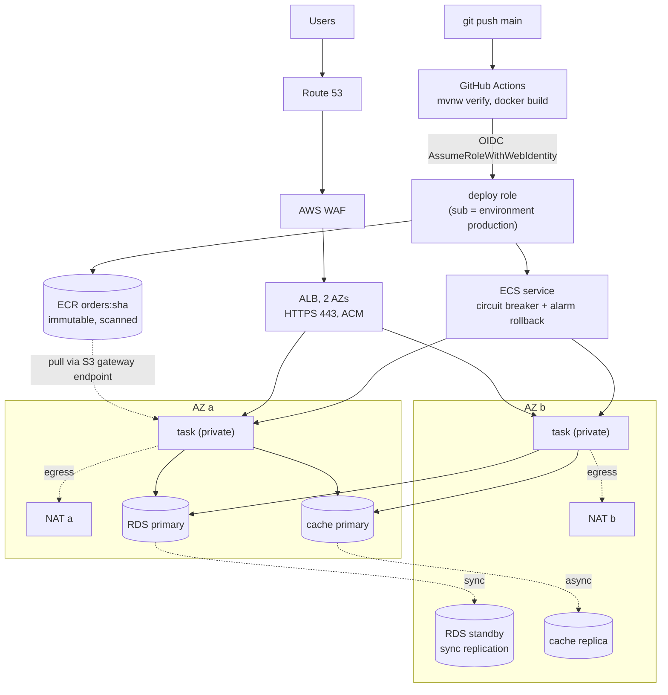

**Trade-offs:**
- **Pros:** survives the loss of an AZ, deploys without downtime, rolls back automatically, has no public compute and no stored keys, and every piece is a managed service.
- **Cons:** the idle cost floor. Two NATs, an ALB, Multi-AZ RDS, two cache nodes and two tasks come to roughly $200–250/month before any traffic (approximate, check the AWS pricing page). Some cross-AZ data-transfer charges are inherent.
- **The complexity is real:** VPC design, three security groups, two IAM roles, endpoints, and IaC to hold it all together. ECS Express Mode or the CDK L3 pattern shortcuts most of it.
- **Scaling ceiling:** RDS connections, not Fargate. Add RDS Proxy before you add tasks.

**Who uses it:** the default reference for containerised web apps in AWS's own ECS reference architectures and Well-Architected guidance. Common at startups and mid-size SaaS companies that don't want to run Kubernetes.

### 7.2 Cost-optimised dev/staging: no NAT, scheduled scale-to-zero

**Problem:** a dev or staging copy of 7.1 costs nearly as much as prod while being used for perhaps 40 hours a week. Developers forget to turn it off, and the learning account's budget alarm fires every month.

**Solution:** keep the *shape* of production (ALB → ECS → RDS, same image, same task definition) but remove the components whose cost is time-based and that dev doesn't need:
- **No NAT gateway.** Choose one of two options:
  - **(a)** Run tasks in **public subnets with `assignPublicIp=ENABLED`** and a security group that accepts inbound traffic **only from `sg-alb`**. Each task then has a public IPv4 (~$0.005/hour each, approximate, check the AWS pricing page), but no NAT hourly fee.
  - **(b)** Keep private subnets in **one AZ** with only the S3 gateway endpoint and the interface endpoints you strictly need (`ecr.api`, `ecr.dkr`, `logs`, `secretsmanager`), in that single AZ.
  - The ALB still needs two AZs' subnets.
- **Single-AZ, smallest RDS** (`db.t4g.micro`, `multiAz=false`, 7-day backups), with a scheduler that **stops it at night**. A Lambda or EventBridge Scheduler calling `StopDBInstance`, re-run at least every 7 days, because AWS restarts a stopped instance automatically after 7 days (unverified).
- **Scheduled scale-to-zero.** Application Auto Scaling **scheduled actions** set min=max=0 at 20:00 on weekdays and min=1/max=2 at 08:00. Fargate stops billing the moment tasks stop. The ALB keeps billing.
- **One shared ALB** for all dev services, with host-based listener rules (`orders.dev.example.com`, `payments.dev.example.com`).
- **Fargate Spot** for every dev task, and ARM64 if the image supports it.
- **7-day log retention**, Container Insights off, no custom CloudWatch metrics.
- **Ephemeral per-PR environments**, if you want them: a CDK stack per PR (`orders-pr-123`), created on PR open and **destroyed on PR close** by the same workflow.

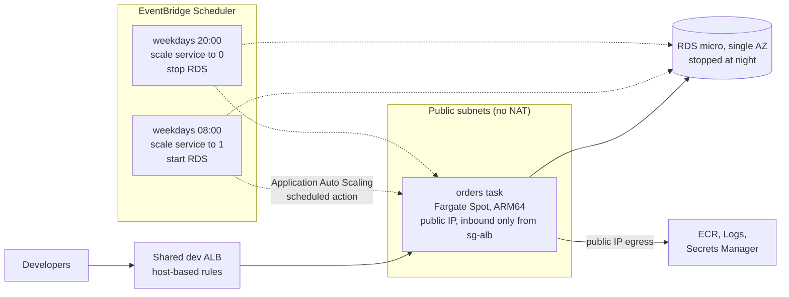

**Trade-offs:**
- **Pros:** compute and DB cost drop by roughly 70% or more outside working hours. No NAT hourly fee. Same image and task definition as prod, so dev/prod parity holds where it matters (the app).
- **Cons:** tasks with public IPs are a weaker posture. Acceptable for dev **only** because the security group admits traffic solely from the ALB. Never do this for prod data.
- **Cold mornings:** the first request after 08:00 waits for task start, JVM start and RDS start (several minutes for RDS).
- **Fargate Spot** can interrupt mid-demo.
- **The floor is still not zero:** the ALB, public IPv4s, secrets, log storage and RDS storage keep billing. For true zero, destroy the stack every evening (IaC makes that one command).

**Who uses it:** common FinOps practice. AWS publishes the "Instance Scheduler on AWS" solution for exactly this pattern (unverified). Teams with per-PR preview environments (Vercel-style) on ECS use the create-on-open, destroy-on-close variant.

### 7.3 Multi-account landing zone basics

**Problem:** one AWS account for everything means one blast radius:
- a dev mistake can delete prod;
- IAM policies grow into exceptions;
- the bill can't be split by team or environment;
- a compromised CI role reaches production data.

**Solution:** separate accounts as hard boundaries, managed centrally:
- **AWS Organizations** with **organizational units (OUs)**: `Security` (log-archive and audit accounts), `Infrastructure` (shared services: ECR, networking, CI), and `Workloads` with `dev`, `staging` and `prod` accounts per product.
- **AWS Control Tower** sets this up as a *landing zone*: account vending, CloudTrail organisation trail to the log-archive account, AWS Config, and guardrails.
- **Service control policies (SCPs)** cap what *any* principal in an OU may do. Examples: deny leaving the organisation, deny disabling CloudTrail, deny regions you don't use, deny creating IAM users with access keys.
- **IAM Identity Center** (SSO) for humans: one login, short-lived role sessions per account. No IAM users.
- **CI:** one GitHub OIDC provider and deploy role **per workload account**, each trusting only its own GitHub environment (`environment:dev`, `environment:prod`).
- **Images:** built once and pushed to an **ECR repo in the shared-services account**, with a repository policy that allows pull from the workload accounts. Or use ECR cross-account replication. The same digest is promoted from dev to prod, as in note 15's "build once" rule.
- **Billing:** consolidated billing with per-account Budgets. Cost allocation tags (`Project`, `Env`) are activated in the payer account.

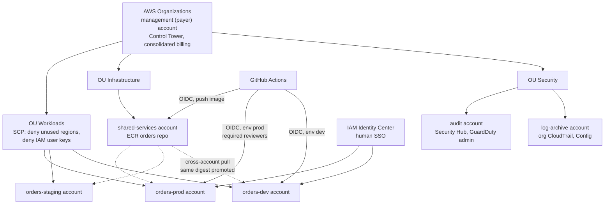

**Trade-offs:**
- **Pros:** hard isolation (an SCP can't be bypassed by an admin inside the account), a clear cost split, least privilege by construction, and centrally collected audit logs.
- **Cons:**
  - more accounts to bootstrap (CDK bootstrap per account and region, OIDC provider per account);
  - cross-account plumbing (ECR policies, KMS key policies for shared encrypted images or snapshots);
  - networking between accounts needs Transit Gateway or VPC sharing if services talk privately;
  - Control Tower has opinions of its own.
- **For a solo learner:** one account plus a budget is fine. Use a separate account from your employer's, always.

**Who uses it:** it's AWS's documented baseline for any multi-team organisation. Regulated industries (banks, healthcare) treat it as mandatory.

---

## 8. Pitfalls & debugging checklist

- [ ] **Task stuck, then `CannotPullContainerError ... i/o timeout`** → private subnet with no NAT and no ECR/S3 endpoints, or an endpoint security group that doesn't allow 443 from `sg-app` → add the NAT or the `ecr.api` + `ecr.dkr` + **S3 gateway** endpoints, and check route tables.
- [ ] **`CannotPullContainerError ... not authorized` / `403`** → the execution role lacks ECR pull permissions, or a cross-account repo policy is missing → attach `AmazonECSTaskExecutionRolePolicy`, add a repo policy for the workload account.
- [ ] **`ResourceInitializationError: unable to pull secrets or registry auth`** → execution role lacks `secretsmanager:GetSecretValue` / `ssm:GetParameters` / `kms:Decrypt`, no route to the service, or a malformed `valueFrom` (missing trailing `::` with a JSON key) → fix the policy, the endpoint, or the ARN.
- [ ] **App starts, then `AccessDeniedException` calling S3/SQS** → the permission went on the execution role instead of the task role, or there is no `taskRoleArn` → move it to the task role.
- [ ] **Tasks killed during startup, `Task failed ELB health checks`, circuit breaker rolls back a good image** → `healthCheckGracePeriodSeconds` shorter than the JVM's cold start, or a health-check path that 404s (`/actuator/health/readiness` while actuator is on 8081) → raise the grace period, use `/readyz` on 8080 with `add-additional-paths=true`.
- [ ] **All tasks replaced at once during an RDS failover or maintenance window** → the DB health indicator is in the readiness group used by the ALB → readiness = `readinessState` only.
- [ ] **Every deploy takes 10+ minutes** → target group `deregistration_delay` left at 300 s → 15–30 s for normal APIs.
- [ ] **Requests cut off with 502s during deploys, logs show `SIGKILL`** → `stopTimeout` (30) not above Boot's `timeout-per-shutdown-phase` (30), or a shell-form `ENTRYPOINT` → `stopTimeout: 60`, exec-form entrypoint (note 15).
- [ ] **Sporadic 502s under low traffic** → Tomcat's keep-alive timeout ≤ the ALB idle timeout (60 s) → `server.tomcat.keep-alive-timeout=75s`.
- [ ] **504 after exactly 60 s on a report endpoint** → ALB idle timeout → raise it, or make the endpoint asynchronous (202 + polling, note 12).
- [ ] **Redirects or HATEOAS links say `http://` or the internal IP** → forward headers ignored. Was `spring.main.cloud-platform=none` set? Is it a custom launcher? → `server.forward-headers-strategy=native`.
- [ ] **Deployment `FAILED` and never rolls back** → no previous `COMPLETED` deployment (first deploy) → fix the image or config and deploy again. The circuit breaker can only roll back to a completed deployment.
- [ ] **`exec format error` in task logs** → arm64 image on an `X86_64` task, or the reverse → build with `--platform` matching `runtimePlatform`.
- [ ] **GitHub: `Not authorized to perform sts:AssumeRoleWithWebIdentity`** → missing `permissions: id-token: write`, `sub` mismatch (workflow not running in the `production` environment, or a branch the trust policy doesn't allow), or wrong `aud` → compare the token's `sub` (format `repo:OWNER/REPO:environment:NAME` or `:ref:refs/heads/BRANCH`) with the trust policy.
- [ ] **GitHub: `AccessDenied ... iam:PassRole`** → the deploy role lacks `iam:PassRole` on the execution or task role → add it, scoped with `iam:PassedToService`.
- [ ] **Rotated DB password, app keeps working until the next deploy, then breaks (or the reverse)** → ECS-injected secrets are fixed at task start → force a new deployment after rotation, or read the secret in-app (note 16 §7.3).
- [ ] **`FATAL: too many connections`** after scale-out → tasks × pool size > `max_connections` → smaller pools, a bigger instance, or RDS Proxy.
- [ ] **Bill much higher than the "free" estimate** → NAT gateways (one per AZ), public IPv4s, logs with no retention, a forgotten Multi-AZ instance, a stopped RDS that restarted itself after 7 days → Cost Explorer by service and usage type, then §8.1.
- [ ] **Debugging a live task:** ECS console → task → **Stopped reason** (it explains most start failures); `aws ecs describe-tasks` (`stopCode`, `containers[].reason`); the service **Events** tab (health-check failures, circuit-breaker decisions); target-group **Targets** tab (health reason codes such as `Target.ResponseCodeMismatch`, `Target.Timeout`); Logs Insights; ECS Exec for `jcmd 1 VM.flags`.

### 8.1 Mandatory teardown checklist (ordered)

Do this **every time** you finish an AWS session. The order matters: dependencies block deletion, and some resources stay behind after an IaC destroy.

**0. Before you build (once):** the budget and billing alarm from §4.1 exist. Every resource carries `Project=springboot-roadmap` (CDK `Tags.of(app)`, Terraform `default_tags` in the provider block).

**1. Stop the traffic and the compute:**
1. Set the ECS service desired count to 0 (or let step 2 do it).
2. Delete any **manually** created services, tasks started with `run-task`, and scheduled scaling actions.

**2. Destroy the IaC stacks, newest first:**
1. `cdk destroy --all` (or `terraform destroy`) for app stacks first, then network stacks. The VPC can't be deleted while ENIs, endpoints or NATs exist in it.
2. If a CloudFormation delete fails with `DELETE_FAILED`, the stack events name the resource. Usually it's a non-empty S3 bucket or ECR repo, or an ENI still detaching. Fix it and retry.

**3. Sweep what IaC leaves behind** (these keep billing or keep data):
- [ ] **RDS:** final snapshots created on delete (the CDK default removal policy for databases is `SNAPSHOT`, unverified), **manual snapshots**, and retained automated backups. Delete them in RDS → Snapshots and Automated backups.
- [ ] **ECR repositories and images.** Repos created outside the stack, or with a `RETAIN` policy (the CDK default for repositories, unverified), stay behind with their images.
- [ ] **S3 buckets** (CDK default `RETAIN`, unverified), including ALB access-log buckets.
- [ ] **CloudWatch log groups** auto-created by `awslogs-create-group`, and groups with `RETAIN`. Delete `/ecs/*` and `/aws/lambda/*` groups you own.
- [ ] **NAT gateways and Elastic IPs** created by hand. An Elastic IP that isn't attached to anything still bills public IPv4 hours.
- [ ] **Interface VPC endpoints** created by hand.
- [ ] **Secrets Manager secrets** (pending deletion for 7–30 days; use `--force-delete-without-recovery` for throwaway ones) and **KMS keys** (minimum 7-day pending deletion).
- [ ] **Route 53 hosted zones** you created for the exercise (~$0.50/month, approximate, check the AWS pricing page). Registered domains renew yearly unless you disable auto-renew.
- [ ] **CloudWatch alarms and dashboards**, and **Container Insights**, if enabled on the account.
- [ ] **The CDK bootstrap stack** `CDKToolkit` (an S3 assets bucket and an ECR assets repo) in every account/region you bootstrapped. Empty the bucket and repo, then delete the stack. The Terraform equivalent is the state bucket and lock table, which you delete *last*.
- [ ] **IAM:** the GitHub OIDC provider and deploy roles. They're free, but they're standing access. Delete them if the project is over.

**4. Verify that nothing is left:**
- [ ] **Tag Editor** (Resource Groups & Tag Editor → Tag Editor): Regions = **All regions**, Resource types = **All supported**, tag `Project = springboot-roadmap`. The result must be empty. Then repeat **without** the tag filter for the regions you used, to catch untagged leftovers.
- [ ] **EC2 Global View** (EC2 console) lists VPCs, subnets, security groups, instances and volumes across all regions. Only the default VPCs should remain.
- [ ] **VPC console**, per region you used: NAT gateways = 0, Elastic IPs = 0, endpoints = 0, load balancers = 0.
- [ ] **Cost Explorer:** *daily* granularity, group by **Service**, last 7 days. Check again **24–48 hours later**, because Cost Explorer data lags by about a day. Every service you used should drop to 0 for the day after teardown. If something persists, group by **Usage type** (e.g. `NatGateway-Hours`, `PublicIPv4:InUseAddress`, `TimedStorage-ByteHrs`) to name it.
- [ ] **Billing → Bills**, charges by service and region for the current month: no growing line items.
- [ ] Keep the **budget and billing alarm**. They are your safety net for the next session.

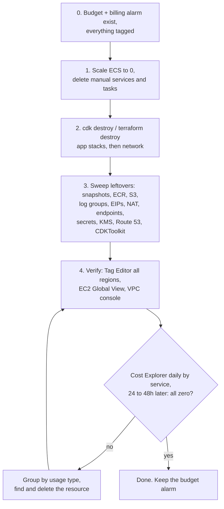

---

## 9. Interview questions

<details><summary>Q1. Walk me through a production deployment of a Spring Boot API on AWS ECS Fargate.</summary>

Route 53 aliases the domain to an internet-facing ALB in two public subnets. The ALB terminates TLS with an ACM certificate and forwards to an `ip`-type target group. An ECS service runs at least two Fargate tasks from a task definition across two AZs in private subnets. Each task gets its own ENI (`awsvpc`). The app reaches RDS Postgres (Multi-AZ) and ElastiCache in isolated subnets. Security groups chain ALB → app → DB/cache by referencing each other. Egress for image pulls, logs and secrets goes through a NAT gateway or VPC endpoints, with the free S3 gateway endpoint always added. Images live in ECR with immutable SHA tags. Secrets are injected from Secrets Manager by the execution role, logs go to CloudWatch via `awslogs`, and traces go through an ADOT sidecar to X-Ray. Deploys are rolling with the circuit breaker, driven by GitHub Actions using OIDC. Everything is defined in CDK or Terraform.
</details>

<details><summary>Q2. What is the difference between the ECS task execution role and the task role?</summary>

The **execution role** is used by the ECS/Fargate agent to *start* the task: pull the image from ECR, fetch values for the `secrets` block from Secrets Manager or SSM, and create log streams and send `awslogs` output. The **task role** is assumed by your *application code*. The SDK default credential chain reads it from the container credentials endpoint (`AWS_CONTAINER_CREDENTIALS_RELATIVE_URI`) and gets short-lived, auto-refreshed credentials for S3, SQS and so on. A start failure such as `CannotPullContainerError` or "unable to pull secrets" points at the execution role. A runtime `AccessDeniedException` points at the task role. Whoever registers the task definition also needs `iam:PassRole` on both.
</details>

<details><summary>Q3. How do ALB health checks map onto Spring Boot's liveness and readiness?</summary>

On ECS one mechanism plays both roles. The ALB stops routing to a target that fails the health check (readiness), and the ECS service *replaces* tasks the ELB reports unhealthy (liveness). So point the target group at the readiness endpoint: `/readyz` on the traffic port with `management.endpoint.health.probes.add-additional-paths=true`, or `/actuator/health/readiness`. Keep it free of shared dependencies such as the database, otherwise one RDS failover fails every task and ECS replaces the whole fleet. Use the service's `healthCheckGracePeriodSeconds` as the startup probe, so a slow JVM start isn't killed. A container `healthCheck` is optional and needs `curl` in the image.
</details>

<details><summary>Q4. How do ECS deregistration delay, stopTimeout and Spring's graceful shutdown interact?</summary>

ECS processes a task stop sequentially. It deregisters the task from the target group, and the ALB stops sending new requests while in-flight ones finish, for up to `deregistration_delay.timeout_seconds` (default 300). ECS waits for the target to reach `UNUSED`, then sends `SIGTERM`, then `SIGKILL` after the container's `stopTimeout` (default 30 s, max 120 s on Fargate). Spring on `SIGTERM` flips readiness to refusing, stops accepting, and drains for up to `spring.lifecycle.timeout-per-shutdown-phase` (30 s). Practical settings:
- deregistration delay ≈ longest request plus a margin (e.g. 30 s), so deploys aren't 5 minutes per batch;
- `stopTimeout` above Boot's phase timeout (e.g. 60 s), because 30 = 30 races `SIGKILL`;
- exec-form `ENTRYPOINT`, so Java actually receives `SIGTERM`.

Unlike Kubernetes, no `preStop` sleep is needed, because the deregistration delay already happens before the signal.
</details>

<details><summary>Q5. What does the ECS deployment circuit breaker do, and how is its threshold calculated?</summary>

It stops a rolling deployment from retrying a broken revision forever. Stage 1 counts tasks that never reach `RUNNING`. Stage 2, once one task is running, counts tasks replaced for failing ELB, Cloud Map or container health checks. The default threshold (`BOUNDED_PERCENT`, value 50) is 50% of the desired count, rounded up and clamped to a minimum of 3 and a maximum of 200. With `resetOnHealthyTask=true` (the default) only consecutive failures count. When the threshold is reached, the deployment is `FAILED`. With `rollback: true`, ECS redeploys the last `COMPLETED` deployment and emits `SERVICE_DEPLOYMENT_FAILED` to EventBridge. It works only with the rolling (`ECS`) deployment controller. Add CloudWatch-alarm rollback to also catch "healthy but returning errors".
</details>

<details><summary>Q6. Rolling vs blue/green on ECS: how do they work and when do you use each?</summary>

**Rolling** (the ECS controller) replaces tasks gradually within `minimumHealthyPercent`/`maximumPercent`, gated by ALB health checks, with the circuit breaker and alarm rollback as safety nets. It's cheap, but a bad version reaches all users progressively, and rollback is another deployment. **Blue/green** stands up the full new task set behind a second target group, optionally tests it on a test listener, then shifts production traffic all at once, as a canary, or linearly. Rollback is an instant listener switch back to blue, which stays alive during a bake or wait period. Historically this needed CodeDeploy (`CODE_DEPLOY` controller, `appspec.yaml`, Lambda lifecycle hooks). Since July 2025 ECS supports blue/green natively, and later linear and canary. Use blue/green for high-risk or high-traffic releases where instant rollback is worth double capacity during the switch.
</details>

<details><summary>Q7. How does GitHub Actions deploy to AWS without storing access keys?</summary>

Through OIDC federation. You register GitHub's issuer (`token.actions.githubusercontent.com`, audience `sts.amazonaws.com`) as an IAM OIDC identity provider, and create a role whose trust policy allows `sts:AssumeRoleWithWebIdentity` only when the token's `sub` matches, e.g. `repo:acme/orders:environment:production`. The workflow needs `permissions: id-token: write`. `aws-actions/configure-aws-credentials` exchanges the GitHub-signed JWT for temporary credentials (about an hour). Nothing secret lives in GitHub. The risks are in the conditions: a wildcard `sub` lets any branch or PR deploy, and a missing `sub` would let any repo assume the role. Pair it with a protected GitHub environment and a least-privilege policy: ECR push to one repo, register task definitions, update one service, `iam:PassRole` on two roles.
</details>

<details><summary>Q8. NAT gateway vs VPC endpoints: which do Fargate tasks in private subnets need, and what are the cost implications?</summary>

Before your code runs, Fargate must reach ECR (API and dkr), S3 (image layers), CloudWatch Logs, and Secrets Manager/SSM for injected secrets. A NAT gateway provides that, plus general internet egress. It costs about $0.045/hour plus about $0.045/GB processed (approximate, check the AWS pricing page), often once per AZ. VPC endpoints provide private access to specific AWS services only. The S3 **gateway** endpoint is free and should always exist, because it removes per-GB NAT charges on image pulls. **Interface** endpoints cost about $0.01/hour per AZ each plus per-GB (approximate, check the AWS pricing page), so five endpoints in two AZs cost more per hour than one NAT. Choose endpoints for security (no internet route) or for high AWS-bound traffic. Choose a NAT when the app also needs the internet. For cheap dev setups, use a single AZ or public-IP tasks restricted to traffic from the ALB.
</details>

<details><summary>Q9. How should a Spring app on ECS get its database password, and what happens when the secret rotates?</summary>

Option 1: the ECS `secrets` block with `valueFrom` pointing at the RDS-managed Secrets Manager secret's JSON keys (`...:secret:orders/db-AbCdEf:password::`), mapped to `SPRING_DATASOURCE_USERNAME`/`PASSWORD`. Relaxed binding does the rest, and the execution role needs `GetSecretValue` (and `kms:Decrypt` for a customer-managed key). The value is resolved **once, at task start**. After a rotation, running tasks keep the old value until you force a new deployment, so pair rotation with a redeploy, or keep the old credentials valid long enough. Option 2: Spring reads Secrets Manager itself (`spring.config.import=aws-secretsmanager:` with Spring Cloud AWS, using the task role) and reacts to rotation in-process. Option 3: RDS IAM authentication, with no password at all. Never put the secret in `application.yml`, a plain `environment` entry, or logs, and keep `/actuator/env` unexposed.
</details>

<details><summary>Q10. ECS Fargate vs EKS vs Lambda vs Elastic Beanstalk vs App Runner for a Spring Boot service: how do you choose?</summary>

- **Fargate (ECS):** the default for containerised services without Kubernetes. No servers, per-second billing, a deep integration with ALB, IAM and CloudWatch.
- **ECS Express Mode:** the one-call shortcut that creates the same resources. It is AWS's recommended replacement for **App Runner**, which is closed to new customers.
- **EKS:** when you already run Kubernetes or need its ecosystem, at the cost of a control-plane fee and K8s skills.
- **Lambda with SnapStart** and `aws-serverless-java-container` 3.x for Boot 4: spiky or event-driven workloads that benefit from scale-to-zero, but watch connection pooling, the 15-minute limit, and cost at sustained load.
- **Elastic Beanstalk:** a jar-upload PaaS on EC2 that suits legacy apps.
- **Plain EC2 or ECS on EC2:** wins on cost for big steady fleets, or when you need OS control.
</details>

<details><summary>Q11. Which AWS resources silently cost money in a "small" learning deployment, and how do you protect yourself?</summary>

- NAT gateways (hourly, per AZ, plus per GB);
- public IPv4 addresses (every ALB node, NAT EIP, public task IP or idle Elastic IP);
- ALB hours (an ALB can't be stopped);
- interface endpoints (per AZ, per hour);
- Multi-AZ RDS (double), and stopped RDS instances that restart after 7 days;
- snapshots and backups;
- CloudWatch log groups with the default "Never expire" retention;
- high-cardinality custom metrics;
- Secrets Manager secrets and KMS keys;
- Route 53 zones.

Protection, in order:
1. a budget with actual and forecast alerts, plus a billing alarm in us-east-1, before creating anything;
2. tag everything and build everything with IaC;
3. scale-to-zero schedules for dev;
4. a teardown routine that destroys the stacks, sweeps retained resources (snapshots, ECR, S3, log groups, CDKToolkit), and verifies with Tag Editor across all regions and with Cost Explorer daily by service 24–48 hours later.

Remember that accounts created since July 2025 get credits for up to 6 months, not a 12-month free tier.
</details>

<details><summary>Q12. How do you get traces and metrics from a Spring Boot 4 app on ECS into AWS's observability stack?</summary>

Logs: Boot structured JSON on stdout → `awslogs` driver → CloudWatch Logs (set retention) → Logs Insights. Or use FireLens/Fluent Bit to route elsewhere. Traces: the X-Ray SDK and daemon are in maintenance mode (end of support 2027-02-25), so use `spring-boot-starter-opentelemetry` to export OTLP to an ADOT collector sidecar on `localhost:4318`, which exports to X-Ray using the task role. Metrics: the built-in ALB/ECS/RDS metrics, plus app metrics either through the ADOT collector as EMF, via Amazon Managed Prometheus, or with `micrometer-registry-cloudwatch2`. With the registry, control tag cardinality, because each dimension combination is a billed custom metric. Alarms on target 5xx rate, p99 latency, unhealthy hosts and RDS storage go to SNS and drive deployment rollback.
</details>

<details><summary>Q13. CDK vs Terraform vs CloudFormation for deploying this stack?</summary>

All three describe the same resources. **CloudFormation** is AWS's native engine: YAML/JSON, AWS-managed state, automatic rollback of failed updates, but verbose. **CDK** synthesises CloudFormation from a real language (Java here). L3 patterns like `ApplicationLoadBalancedFargateService` create the ALB, service, task definition and security groups in a few lines, and you can unit-test templates. Its defaults (such as `RETAIN` policies) need care at teardown. **Terraform** uses HCL with a self-managed state file, covers every cloud and SaaS provider, and is very common in industry. It has no automatic rollback, and you must protect the state, which can contain secrets. In every case, decide who owns the task-definition revision: IaC or the CI pipeline. Terraform's `ignore_changes = [task_definition]` is the usual truce.
</details>

<details><summary>Q14. What does Spring Boot 4 do automatically when it runs on ECS?</summary>

Boot 4.0 added `CloudPlatform.AWS_ECS`, detected when the `AWS_EXECUTION_ENV` variable starts with `AWS_ECS` (ECS sets it, e.g. `AWS_ECS_FARGATE`). As with other detected platforms, `isUsingForwardHeaders()` is true, so if `server.forward-headers-strategy` isn't set, Boot honours the ALB's `X-Forwarded-*` headers and builds correct `https://` URLs. You can gate beans with `@ConditionalOnCloudPlatform(CloudPlatform.AWS_ECS)` and override detection with `spring.main.cloud-platform`. Combined with Boot 4's always-on health probe groups and graceful shutdown default, the app needs very little ECS-specific config: readiness for the ALB, a keep-alive longer than the ALB idle timeout, and a container `stopTimeout` above the shutdown phase.
</details>

---

## 10. Sources

**Spring reference docs (Boot 4.1.x)**
- Deploying to the cloud (AWS: ECS and Elastic Beanstalk, `AWS_EXECUTION_ENV` detection; Kubernetes `preStop` for contrast): https://docs.spring.io/spring-boot/how-to/deployment/cloud.html
- Graceful shutdown: https://docs.spring.io/spring-boot/reference/web/graceful-shutdown.html
- Actuator endpoints and health groups / probes: https://docs.spring.io/spring-boot/reference/actuator/endpoints.html
- Application availability (liveness/readiness states): https://docs.spring.io/spring-boot/reference/features/spring-application.html
- Structured logging: https://docs.spring.io/spring-boot/reference/features/logging.html
- Tracing / OpenTelemetry: https://docs.spring.io/spring-boot/reference/actuator/tracing.html
- `CloudPlatform` source (v4.1.2): https://github.com/spring-projects/spring-boot/blob/v4.1.2/core/spring-boot/src/main/java/org/springframework/boot/cloud/CloudPlatform.java
- Boot 4.0 migration guide: https://github.com/spring-projects/spring-boot/wiki/Spring-Boot-4.0-Migration-Guide
- Spring Cloud AWS reference (for in-app secrets, note 16): https://docs.awspring.io/spring-cloud-aws/docs/current/reference/html/index.html

**Baeldung** (⚠️ Boot 2/3-era. Check against §6)
- Deploy a Spring Boot app to AWS Elastic Beanstalk: https://www.baeldung.com/spring-boot-deploy-aws-beanstalk
- Run a Spring Boot application in AWS Lambda: https://www.baeldung.com/spring-boot-aws-lambda
- Java enterprise apps on AWS Lambda (serverless-java-container): https://www.baeldung.com/java-enterprise-aws-lambda

**Oracle / JDK docs**
- `InetAddress` (`networkaddress.cache.ttl`, DNS caching during RDS failover): https://docs.oracle.com/en/java/javase/21/docs/api/java.base/java/net/InetAddress.html. The 30 s default is stated in the JDK's own `conf/security/java.security` file, read from JDK 21.0.10
- Networking properties: https://docs.oracle.com/en/java/javase/21/docs/api/java.base/java/net/doc-files/net-properties.html
- The `java` command (`MaxRAMPercentage`, container flags): https://docs.oracle.com/en/java/javase/21/docs/specs/man/java.html
- GC ergonomics (SerialGC below 2 CPUs): https://docs.oracle.com/en/java/javase/21/gctuning/ergonomics.html

**AWS docs (read 2026-11-19)**
- ECS task definition parameters for Fargate (`stopTimeout` default 30/max 120, `healthCheck` defaults, `secrets`): https://docs.aws.amazon.com/AmazonECS/latest/developerguide/task_definition_parameters.html
- Pass Secrets Manager secrets through ECS environment variables (`valueFrom` JSON-key syntax, start-time resolution): https://docs.aws.amazon.com/AmazonECS/latest/developerguide/secrets-envvar-secrets-manager.html
- Load balancer connection draining for ECS (deregistration delay 300 s, ECS waits for `UNUSED` before stopping): https://docs.aws.amazon.com/AmazonECS/latest/developerguide/load-balancer-connection-draining.html
- ALB target-group health checks (defaults 30 s / 5 s / 5 / 2, matcher 200, fail-open): https://docs.aws.amazon.com/elasticloadbalancing/latest/application/target-group-health-checks.html
- ALB attributes (idle timeout default 60 s, "configure the idle timeout of your application to be larger"): https://docs.aws.amazon.com/elasticloadbalancing/latest/application/edit-load-balancer-attributes.html
- Deployment circuit breaker (stages, `BOUNDED_PERCENT` 3–200): https://docs.aws.amazon.com/AmazonECS/latest/developerguide/deployment-circuit-breaker.html
- CodeDeploy blue/green for ECS: https://docs.aws.amazon.com/AmazonECS/latest/developerguide/deployment-type-bluegreen.html
- ECS linear deployments: https://docs.aws.amazon.com/AmazonECS/latest/developerguide/deployment-type-linear.html
- Migrating from CodeDeploy to ECS native blue/green: https://aws.amazon.com/blogs/containers/migrating-from-aws-codedeploy-to-amazon-ecs-for-blue-green-deployments
- Task execution IAM role: https://docs.aws.amazon.com/AmazonECS/latest/developerguide/task_execution_IAM_role.html and task IAM role: https://docs.aws.amazon.com/AmazonECS/latest/developerguide/task-iam-roles.html
- App Runner availability change and ECS Express Mode migration: https://docs.aws.amazon.com/apprunner/latest/dg/apprunner-availability-change.html
- X-Ray SDK and daemon end-of-support timeline: https://docs.aws.amazon.com/xray/latest/devguide/xray-daemon-eos.html and migration to OpenTelemetry: https://docs.aws.amazon.com/xray/latest/devguide/xray-sdk-migration.html
- Free Tier update (credits and 6-month Free plan, 2025-07-15): https://aws.amazon.com/about-aws/whats-new/2025/07/aws-free-tier-credits-month-free-plan
- AWS Budgets: https://docs.aws.amazon.com/cost-management/latest/userguide/budgets-managing-costs.html, billing alarms: https://docs.aws.amazon.com/AmazonCloudWatch/latest/monitoring/monitor_estimated_charges_with_cloudwatch.html
- Pricing pages (always check these, all figures in this note are approximate): https://aws.amazon.com/fargate/pricing/, https://aws.amazon.com/vpc/pricing/, https://aws.amazon.com/elasticloadbalancing/pricing/, https://aws.amazon.com/rds/postgresql/pricing/, https://aws.amazon.com/cloudwatch/pricing/
- Optimise a Spring Boot application for AWS Fargate (AWS Containers blog): https://aws.amazon.com/blogs/containers/optimize-your-spring-boot-application-for-aws-fargate

**GitHub and tooling**
- Configuring OpenID Connect in AWS (GitHub docs): https://docs.github.com/en/actions/how-tos/secure-your-work/security-harden-deployments/oidc-in-aws
- `aws-actions/configure-aws-credentials` (v6.3.0): https://github.com/aws-actions/configure-aws-credentials, `amazon-ecr-login` (v2.2.0), `amazon-ecs-render-task-definition` (v1.9.1), `amazon-ecs-deploy-task-definition` (v2.6.4) under https://github.com/aws-actions
- `aws-serverless-java-container` (3.x for Boot 4): https://github.com/aws/serverless-java-container
- AWS CDK v2 API reference: https://docs.aws.amazon.com/cdk/api/v2/ · Terraform AWS provider: https://registry.terraform.io/providers/hashicorp/aws/latest/docs
