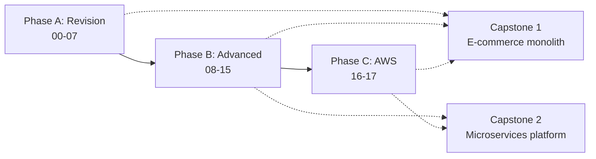

# Spring Boot Roadmap: Notes

Deep, self-contained notes for **Spring Boot 4 / Spring Framework 7 / Java 21**. Each note covers:

1. What and why
2. A mental model with diagrams
3. Internals
4. Full worked code
5. Gap fillers and niche details
6. Boot 4 delta
7. Real-life architecture solutions
8. Pitfalls
9. Interview Q&A
10. Sources

Use the sidebar to navigate and the search box to find anything.



## Viewing these notes locally

From the repo root, run either of these:

```bash
# Uses the JDK's built-in web server, so there is nothing to install
java -m jdk.httpserver -d "$PWD/notes" -p 3000

# Or use Node, which adds live reload
npx docsify-cli serve notes
```

Then open http://localhost:3000.

The full progress checklist lives in the [repo README](https://github.com/sumit-mishra-itp/springboot-roadmap#readme).
