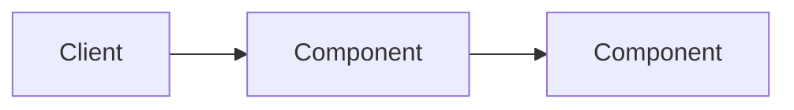

# NN — Topic Name

> **Lab:** [`labs/NN-topic`](https://github.com/sumit-mishra-itp/springboot-roadmap/tree/main/labs/NN-topic) · **Capstone use:** _feature it powers_ · **Prereqs:** _notes to read first_

## 1. What & why
- What problem it solves and what people did before it existed.
- When **not** to use it.

## 2. Mental model
A short explanation, plus at least one Mermaid diagram of the moving parts.



## 3. How it works internally
A walk-through of the key classes, the lifecycle order, and the proxies or callbacks involved, which is the level interviews probe. Name the real framework classes (e.g. `DispatcherServlet`, `AbstractAutoProxyCreator`).

## 4. Full worked code
Complete code that runs, not fragments, kept in sync with the lab.

```java
// ...
```

## 5. Gap fillers & niche details
Things tutorials skip: defaults that bite, ordering rules, silent no-ops, and property names worth knowing.

## 6. Boot 4 / Framework 7 delta
- What changed from Boot 3.x / Framework 6.x, with a link to the release notes or migration guide.
- ⚠️ Outdated advice still common in tutorials and Baeldung articles.

## 7. Real-life architecture solutions
For each of 1–3 classic industry patterns that use this topic:
- **Problem**, **Solution**, a Mermaid diagram, **Trade-offs**, and **Who uses it**.

## 8. Pitfalls & debugging checklist
- [ ] Symptom → cause → fix

## 9. Interview questions
<details><summary>Q1. ...</summary>

Answer.
</details>

_Copy these into [`../interview-qna.md`](../interview-qna.md)._

## 10. Sources
- Spring reference docs: ...
- Baeldung: ...
- Oracle / JDK docs: ...
