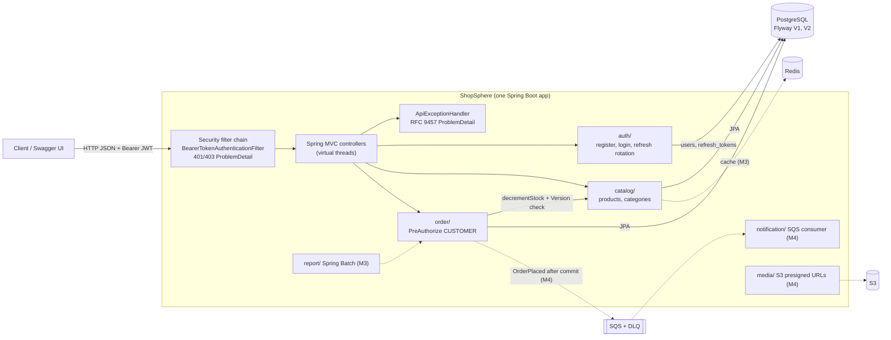
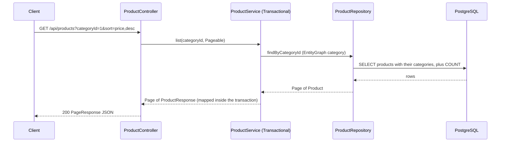
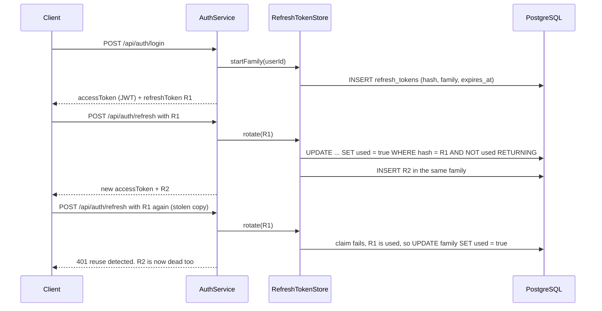
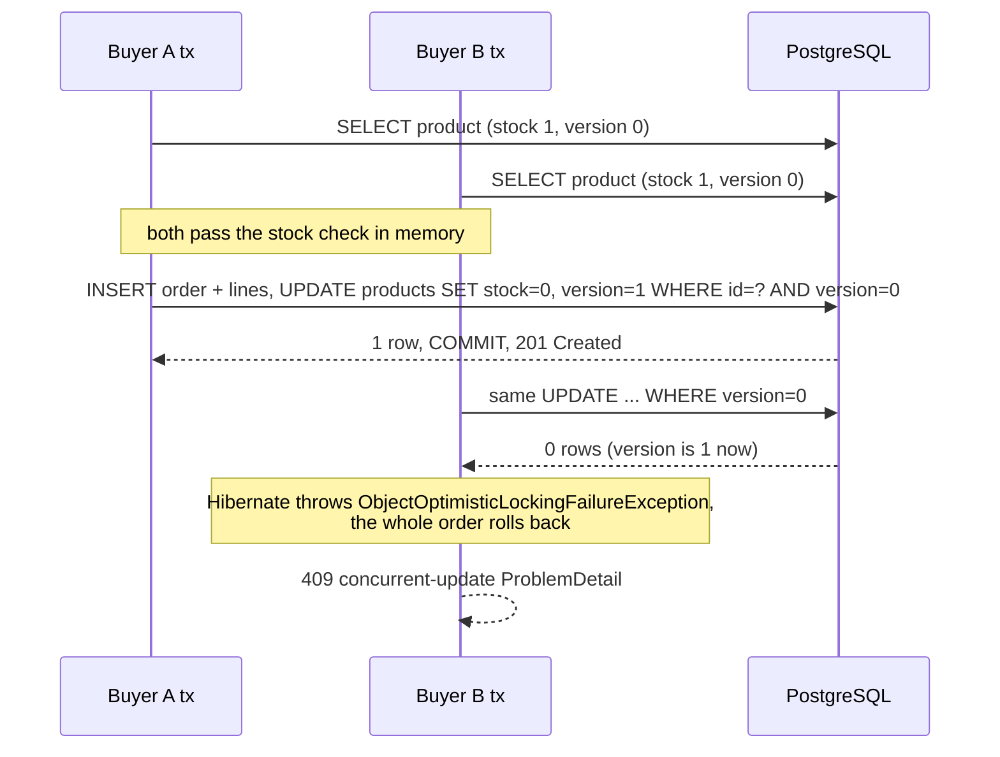

# ShopSphere: e-commerce order-management API

ShopSphere is a modular-monolith REST API for an online shop, built with **Spring Boot 4.1.2**, Java 21, and PostgreSQL. It is capstone 1 of the [springboot-roadmap](https://github.com/sumit-mishra-itp/springboot-roadmap). The API covers the catalog, orders with optimistic-locking stock control, JWT auth, Redis caching, observability, a nightly Spring Batch report, and AWS integrations that run against LocalStack.

## Architecture



Solid lines are built. Dashed lines are planned milestones.

The code is organized package-by-feature under `dev.roadmap.shop`: `auth/`, `catalog/`, `order/`, `common/`, and, as later milestones land, `media/`, `notification/` and `report/`.

### Request flow (catalog)



### Auth: login, refresh rotation, reuse detection

Access tokens are short-lived (15 min) RS256 JWTs that the app signs itself. The API verifies them with Spring Security's own resource-server filter, with no hand-written JWT filter. The `sub` claim is the user id and `roles` holds the role. Refresh tokens are opaque random strings, stored only as SHA-256 hashes in Postgres. Every refresh rotates the token. If a used token is replayed, the whole token family is revoked.



### Order placement and the oversell race



`OversellConcurrencyTest` reproduces this interleaving for real. It sends two HTTP requests on two threads with a start latch. It holds a `SELECT ... FOR UPDATE` on the product until `pg_stat_activity` shows that both transactions have read the product and are blocked. Then it releases them. Exactly one gets 201, the other gets 409 `concurrent-update`, the stock ends at 0, and one unit is sold. Mutation-checked by hand: with `@Version` removed, both requests get 201 (the oversell), and so do all 8 buyers in the 3-unit free-for-all test. Without `noRollbackFor` the reuse-revocation test fails, and without `@EnableMethodSecurity` the admin-order test gets a 201.

## Feature checklist

- [x] **M1 Catalog**
  - [x] Categories and products CRUD with paging, sorting, and filtering by category
  - [x] Flyway schema, `ddl-auto=validate`, `open-in-view=false`
  - [x] Product `stock` has a `CHECK (stock >= 0)` constraint and a `@Version` optimistic-lock column
  - [x] Record DTOs with Bean Validation
  - [x] One `@RestControllerAdvice` that returns RFC 9457 ProblemDetail (400 / 404 / 409)
  - [x] OpenAPI 3 + Swagger UI (springdoc 3.x)
  - [x] Tests: `@WebMvcTest`, `@DataJpaTest` on Testcontainers Postgres, and an end-to-end `@SpringBootTest`
- [x] **M2 Auth + orders**
  - [x] Registration (always CUSTOMER), login, and an admin bootstrapped from an env var
  - [x] Self-issued RS256 JWT access tokens validated by the OAuth2 resource server (issuer + audience checked)
  - [x] Refresh-token rotation with reuse detection, stored hashed in Postgres with an atomic `UPDATE ... RETURNING`
  - [x] Roles ADMIN and CUSTOMER. Catalog GETs are public and writes are ADMIN only (URL rules). Orders need CUSTOMER (`@PreAuthorize`)
  - [x] 401/403 as ProblemDetail. Swagger UI and `/v3/api-docs` stay public, with a bearer "Authorize" button
  - [x] Transactional order placement with a price snapshot. Insufficient stock gives 409, and the whole order rolls back
  - [x] `@Version` stock decrement proven by a forced-interleaving concurrency test (one winner, loser gets 409 `concurrent-update`)
  - [x] Customers see only their own orders (other customers' orders return 404)
- [ ] **M3 Cache + observability + batch**: Redis product cache, Actuator health groups, Prometheus metrics, nightly Spring Batch sales report
- [ ] **M4 AWS (LocalStack)**: S3 presigned image URLs, DB credentials from Secrets Manager, order-confirmation email via SQS with a DLQ
- [ ] **M5 Delivery**: layered Dockerfile, `compose.yaml`, GitHub Actions CI

## Tech stack

| Concern | Choice |
|---|---|
| Runtime | Java 21, Spring Boot 4.1.2 (Spring Framework 7), virtual threads |
| Persistence | Spring Data JPA (Hibernate 7), PostgreSQL 16, Flyway, `JdbcClient` for refresh tokens |
| Security | Spring Security 7.1: OAuth2 resource server (Nimbus JWT, RS256), `DelegatingPasswordEncoder` (bcrypt), method security |
| API | Spring MVC, Jackson 3, Bean Validation, RFC 9457 ProblemDetail |
| API docs | springdoc-openapi 3.2.0 (the Boot 4 line) |
| Tests | JUnit 5, Mockito (`@MockitoBean`), Spring Security Test, MockMvcTester, RestTestClient, Testcontainers 2 |

## Running it

Prerequisites: JDK 21 and Docker. Maven is provided by the wrapper.

```bash
# Build and run all tests (needs Docker for Testcontainers)
./mvnw verify

# Run locally with a throwaway Postgres container. Set the admin password first, or no admin account exists:
APP_AUTH_ADMIN_PASSWORD=change-me-admin ./mvnw spring-boot:test-run

# Or run against your own Postgres. Credentials come from the environment, never from application.properties:
SPRING_DATASOURCE_URL=jdbc:postgresql://localhost:5432/shop \
SPRING_DATASOURCE_USERNAME=shop SPRING_DATASOURCE_PASSWORD=change-me \
APP_AUTH_ADMIN_PASSWORD=change-me-admin \
./mvnw spring-boot:run
```

Then open:
- Swagger UI: http://localhost:8080/swagger-ui.html. Click **Authorize** and paste an `accessToken`.
- OpenAPI JSON: http://localhost:8080/v3/api-docs

## API overview

| Method | Path | Who | Purpose | Success |
|---|---|---|---|---|
| POST | `/api/auth/register` | anyone | Create a CUSTOMER account | 201 |
| POST | `/api/auth/login` | anyone | Get an access token + refresh token | 200 |
| POST | `/api/auth/refresh` | anyone with a refresh token | Rotate: new access token + new refresh token | 200 |
| GET | `/api/categories?page&size&sort` | anyone | List categories (default `sort=name`) | 200 |
| GET | `/api/categories/{id}` | anyone | Get one category | 200 |
| POST | `/api/categories` | ADMIN | Create a category | 201 + `Location` |
| PUT | `/api/categories/{id}` | ADMIN | Rename a category | 200 |
| DELETE | `/api/categories/{id}` | ADMIN | Delete a category (409 if products still use it) | 204 |
| GET | `/api/products?categoryId&page&size&sort` | anyone | List products, optionally filtered by category (default `sort=id`) | 200 |
| GET | `/api/products/{id}` | anyone | Get one product | 200 |
| POST | `/api/products` | ADMIN | Create a product | 201 + `Location` |
| PUT | `/api/products/{id}` | ADMIN | Replace a product | 200 |
| DELETE | `/api/products/{id}` | ADMIN | Delete a product (409 once it has been ordered) | 204 |
| POST | `/api/orders` | CUSTOMER | Place an order for the caller | 201 + `Location` |
| GET | `/api/orders?page&size&sort` | CUSTOMER | The caller's orders (default `sort=createdAt,desc`) | 200 |
| GET | `/api/orders/{id}` | CUSTOMER | One of the caller's orders, with lines (404 if it isn't theirs) | 200 |

Paging: `page` is zero-based, `size` defaults to 20 and is capped at 100. `sort=field,asc|desc` can be repeated.

```bash
# Admin creates the catalog
ADMIN=$(curl -s -X POST localhost:8080/api/auth/login -H 'Content-Type: application/json' \
  -d '{"username":"admin","password":"change-me-admin"}' | jq -r .accessToken)
curl -i -X POST localhost:8080/api/categories -H "Authorization: Bearer $ADMIN" \
  -H 'Content-Type: application/json' -d '{"name":"Peripherals"}'
# HTTP/1.1 201  Location: http://localhost:8080/api/categories/1
curl -X POST localhost:8080/api/products -H "Authorization: Bearer $ADMIN" -H 'Content-Type: application/json' \
  -d '{"sku":"KB-001","name":"Mechanical keyboard","price":89.90,"stock":5,"categoryId":1}'
# {"id":1,"sku":"KB-001",...,"stock":5,"version":0,"categoryId":1,"categoryName":"Peripherals"}

# Anyone can browse
curl 'localhost:8080/api/products?categoryId=1&page=0&size=20&sort=price,desc'

# A customer registers, logs in and orders
curl -X POST localhost:8080/api/auth/register -H 'Content-Type: application/json' \
  -d '{"username":"alice","password":"alice-pass-1"}'
# {"id":51,"username":"alice","role":"CUSTOMER"}
TOKENS=$(curl -s -X POST localhost:8080/api/auth/login -H 'Content-Type: application/json' \
  -d '{"username":"alice","password":"alice-pass-1"}')
# {"accessToken":"eyJ...","refreshToken":"Qm9...","tokenType":"Bearer","expiresIn":900}
ALICE=$(echo "$TOKENS" | jq -r .accessToken)
curl -i -X POST localhost:8080/api/orders -H "Authorization: Bearer $ALICE" -H 'Content-Type: application/json' \
  -d '{"lines":[{"productId":1,"quantity":2}]}'
# HTTP/1.1 201  Location: http://localhost:8080/api/orders/1
# {"id":1,"total":179.80,"createdAt":"2026-11-19T12:00:00Z","lines":[{"productId":1,"quantity":2,"unitPrice":89.90}]}
curl localhost:8080/api/orders -H "Authorization: Bearer $ALICE"

# When the access token expires: rotate. The old refresh token is now used, and replaying it revokes the login.
curl -X POST localhost:8080/api/auth/refresh -H 'Content-Type: application/json' \
  -d "{\"refreshToken\":\"$(echo "$TOKENS" | jq -r .refreshToken)\"}"
```

### Errors (RFC 9457 ProblemDetail, `application/problem+json`)

| Case | Status | `type` suffix |
|---|---|---|
| Bean Validation failure (with an `errors` array of `{field, message}`) | 400 | `validation-error` |
| `?sort=` names an unknown property | 400 | `invalid-sort` |
| No token, an invalid or expired token, bad credentials, or a bad refresh token (`WWW-Authenticate: Bearer`) | 401 | `unauthorized` |
| Valid token, wrong role (URL rule or `@PreAuthorize`) | 403 | `forbidden` |
| Unknown product, category, or order (including someone else's order) | 404 | `not-found` |
| Duplicate SKU, category name or username, or deleting something still referenced | 409 | `conflict` |
| `@Version` check failed (concurrent update). Re-read and retry | 409 | `concurrent-update` |
| Order asks for more than the stock (has `productId`, `requested`, `available`) | 409 | `insufficient-stock` |

```bash
curl -X POST localhost:8080/api/products -H "Authorization: Bearer $ADMIN" -H 'Content-Type: application/json' \
  -d '{"sku":"kb 1","name":"","price":0}'
# {"type":"https://api.shopsphere.dev/problems/validation-error","title":"Validation failed","status":400,
#  "detail":"5 invalid value(s)","instance":"/api/products",
#  "errors":[{"field":"categoryId","message":"must not be null"}, ...]}
```

## Design decisions

- **The database is the judge of uniqueness and integrity.** There is no check-then-insert. The `UNIQUE`, `CHECK` and `FOREIGN KEY` constraints throw `DataIntegrityViolationException`, which becomes a 409. This holds even under concurrent requests, and it covers duplicate usernames too.
- **Services return DTOs.** With `open-in-view=false`, the session closes at the end of the service's transaction. Product finders use `@EntityGraph(attributePaths = "category")`, and the order detail uses `@EntityGraph("lines")`. The order list returns line-less summaries, because fetching a collection together with `LIMIT` makes Hibernate paginate in memory.
- **Optimistic locking, no retry.** Placing an order reads products, decrements stock in memory, and lets Hibernate's `UPDATE ... WHERE version = ?` detect a lost update at commit. The loser gets 409 `concurrent-update`, a different slug from `insufficient-stock`, so a client knows a retry is worth it. The service does not retry by itself. Framework 7's `@Retryable` could do that, but the retried request would then fail on stock or succeed silently, and the race would no longer be visible. The `CHECK (stock >= 0)` constraint stays as the last line of defence.
- **No deadlocks between multi-product orders.** `hibernate.order_updates=true` sorts the product UPDATEs by id, so every transaction locks product rows in the same order.
- **Ownership is part of the query.** `findByIdAndCustomerId` means another customer's order doesn't exist for you (404, not 403), so ids can't be probed. The customer id always comes from the token's `sub`, never from the request body.
- **Two layers of authorization, each load-bearing.** Catalog rules are URL rules in the filter chain. Order rules are `@PreAuthorize("hasRole('CUSTOMER')")` on `OrderService`, and the URL rule there only says `authenticated()`, so the method rule is what rejects an admin (proven by a test).
- **Refresh tokens in Postgres, not memory.** One conditional `UPDATE ... SET used = true WHERE ... AND NOT used RETURNING` makes rotation atomic across threads and instances. It needs no `synchronized`, which would also pin virtual threads around JDBC. `refresh()` is `@Transactional(noRollbackFor = InvalidRefreshTokenException.class)`, because the reuse path revokes the family and then throws. A rollback would silently undo the revocation.
- **No secrets in git.** The admin password comes only from `APP_AUTH_ADMIN_PASSWORD`. Every DTO and properties record holding a secret masks it in `toString`. Tokens are never logged (checked by hand: the full `verify` log contains no `eyJ` and no test password).
- **Own `PageResponse` envelope**, not a serialized `PageImpl`, so the JSON shape is a contract we control.
- **Sequence ids with `allocationSize = 50`** to match `INCREMENT BY 50`. They keep JDBC batching possible, unlike `IDENTITY`.

## Tests

| Test | Kind | What it proves |
|---|---|---|
| `ProductControllerTest` | `@WebMvcTest` + real `SecurityConfig` | 201 + `Location`. 400 ProblemDetail lists every invalid field. 404 / 409 mapping. `Pageable` binding (size clamped to 100, defaults 20 by id). Anonymous GET is public, anonymous POST gets 401 `unauthorized`, CUSTOMER POST/DELETE gets 403 `forbidden` |
| `CategoryControllerTest` | `@WebMvcTest` + real `SecurityConfig` | 201, 400 on a blank name, 400 problem+json on malformed JSON, 204 on delete |
| `ProductStockTest` | plain JUnit | `decrementStock` reduces stock, or throws and leaves it unchanged |
| `ProductRepositoryTest` | `@DataJpaTest` + Testcontainers Postgres | Flyway schema (V1 + V2) matches the entities. `@EntityGraph` loads the category. Unique SKU fires at flush. The `stock >= 0` constraint. `@Version` increments at flush |
| `CatalogApiTest` | `@SpringBootTest` + `RestTestClient` | Full HTTP round trip with an admin token. Duplicate SKU at COMMIT gives 409. A customer token can't write the catalog. `/v3/api-docs` (with the bearer scheme) and `/swagger-ui/index.html` are public |
| `AuthApiTest` | `@SpringBootTest` | Register stores only a bcrypt hash. Duplicate username gives 409. Bad input gives 400. bcrypt rejects more than 72 bytes. Wrong password and unknown user get an identical 401. Token `sub`/`roles`/`aud`. **Rotation plus reuse detection revokes the family, and the revocation survives the failed request**. A refresh token is no access token. Wrong-audience JWT gives 401. A garbage bearer on a public GET gives 401. Unmatched path is denied |
| `OrderApiTest` | `@SpringBootTest` | 201 + `Location`, price snapshot, stock decremented, version bumped. Insufficient stock gives 409 and rolls back every line. Unknown product gives 404. Invalid body gives 400. **Admin token gives 403 from `@PreAuthorize`**. No token gives 401. Customers see only their own orders |
| `OversellConcurrencyTest` | `@SpringBootTest`, 2 and 8 threads | **Forced interleaving: both buyers read the last unit, exactly one 201, the other 409 `concurrent-update`, stock 0, one unit sold.** Free-for-all of 8 buyers on 3 units: never a 500, stock never below 0, units sold equal stock removed |

All `@SpringBootTest` classes extend `ApiTestSupport`, so they share one Spring context and one Postgres container.
