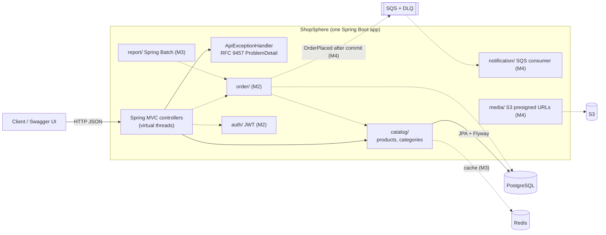
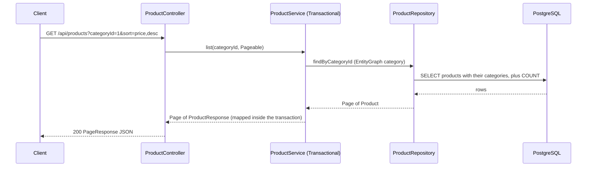

# ShopSphere: e-commerce order-management API

ShopSphere is a modular-monolith REST API for an online shop, built with **Spring Boot 4.1.2**, Java 21, and PostgreSQL. It is capstone 1 of the [springboot-roadmap](https://github.com/sumit-mishra-itp/springboot-roadmap). The API covers the catalog, orders with optimistic-locking stock control, JWT auth, Redis caching, observability, a nightly Spring Batch report, and AWS integrations that run against LocalStack.

## Architecture



Solid lines are built. Dashed lines are planned milestones.

The code is organized package-by-feature under `dev.roadmap.shop`: `catalog/`, `common/`, and, as later milestones land, `order/`, `auth/`, `media/`, `notification/` and `report/`.

### Request flow (catalog)



## Feature checklist

- [x] **M1 Catalog**
  - [x] Categories and products CRUD with paging, sorting, and filtering by category
  - [x] Flyway schema, `ddl-auto=validate`, `open-in-view=false`
  - [x] Product `stock` has a `CHECK (stock >= 0)` constraint and a `@Version` optimistic-lock column
  - [x] Record DTOs with Bean Validation
  - [x] One `@RestControllerAdvice` that returns RFC 9457 ProblemDetail (400 / 404 / 409)
  - [x] OpenAPI 3 + Swagger UI (springdoc 3.x)
  - [x] Tests: `@WebMvcTest`, `@DataJpaTest` on Testcontainers Postgres, and an end-to-end `@SpringBootTest`
- [ ] **M2 Auth + orders**: JWT access and refresh-token rotation, ADMIN/CUSTOMER roles, transactional order placement, optimistic-lock stock decrement proven by a concurrency test
- [ ] **M3 Cache + observability + batch**: Redis product cache, Actuator health groups, Prometheus metrics, nightly Spring Batch sales report
- [ ] **M4 AWS (LocalStack)**: S3 presigned image URLs, DB credentials from Secrets Manager, order-confirmation email via SQS with a DLQ
- [ ] **M5 Delivery**: layered Dockerfile, `compose.yaml`, GitHub Actions CI

## Tech stack

| Concern | Choice |
|---|---|
| Runtime | Java 21, Spring Boot 4.1.2 (Spring Framework 7), virtual threads |
| Persistence | Spring Data JPA (Hibernate 7), PostgreSQL 16, Flyway |
| API | Spring MVC, Jackson 3, Bean Validation, RFC 9457 ProblemDetail |
| API docs | springdoc-openapi 3.2.0 (the Boot 4 line) |
| Tests | JUnit 5, Mockito (`@MockitoBean`), MockMvcTester, RestTestClient, Testcontainers 2 |

## Running it

Prerequisites: JDK 21 and Docker. Maven is provided by the wrapper.

```bash
# Build and run all tests (needs Docker for Testcontainers)
./mvnw verify

# Run locally with a throwaway Postgres container. No setup needed:
# spring-boot:test-run starts TestEcommerceMonolithApplication, which adds a Testcontainers Postgres.
./mvnw spring-boot:test-run

# Or run against your own Postgres. Credentials come from the environment, never from application.properties:
SPRING_DATASOURCE_URL=jdbc:postgresql://localhost:5432/shop \
SPRING_DATASOURCE_USERNAME=shop SPRING_DATASOURCE_PASSWORD=change-me \
./mvnw spring-boot:run
```

Then open:
- Swagger UI: http://localhost:8080/swagger-ui.html
- OpenAPI JSON: http://localhost:8080/v3/api-docs

## API overview

| Method | Path | Purpose | Success |
|---|---|---|---|
| GET | `/api/categories?page&size&sort` | List categories (default `sort=name`) | 200 |
| GET | `/api/categories/{id}` | Get one category | 200 |
| POST | `/api/categories` | Create a category | 201 + `Location` |
| PUT | `/api/categories/{id}` | Rename a category | 200 |
| DELETE | `/api/categories/{id}` | Delete a category (409 if products still use it) | 204 |
| GET | `/api/products?categoryId&page&size&sort` | List products, optionally filtered by category (default `sort=id`) | 200 |
| GET | `/api/products/{id}` | Get one product | 200 |
| POST | `/api/products` | Create a product | 201 + `Location` |
| PUT | `/api/products/{id}` | Replace a product | 200 |
| DELETE | `/api/products/{id}` | Delete a product | 204 |

Paging: `page` is zero-based, `size` defaults to 20 and is capped at 100. `sort=field,asc|desc` can be repeated.

```bash
curl -i -X POST localhost:8080/api/categories -H 'Content-Type: application/json' -d '{"name":"Peripherals"}'
# HTTP/1.1 201  Location: http://localhost:8080/api/categories/1
# {"id":1,"name":"Peripherals"}

curl -X POST localhost:8080/api/products -H 'Content-Type: application/json' \
  -d '{"sku":"KB-001","name":"Mechanical keyboard","price":89.90,"stock":5,"categoryId":1}'
# {"id":1,"sku":"KB-001","name":"Mechanical keyboard","description":null,"price":89.90,"stock":5,
#  "version":0,"categoryId":1,"categoryName":"Peripherals"}

curl 'localhost:8080/api/products?categoryId=1&page=0&size=20&sort=price,desc'
# {"content":[{...}],"page":0,"size":20,"totalElements":1,"totalPages":1}
```

### Errors (RFC 9457 ProblemDetail, `application/problem+json`)

| Case | Status | `type` suffix |
|---|---|---|
| Bean Validation failure (with an `errors` array of `{field, message}`) | 400 | `validation-error` |
| `?sort=` names an unknown property | 400 | `invalid-sort` |
| Unknown product or category id | 404 | `not-found` |
| Duplicate SKU or category name, or deleting a category that still has products | 409 | `conflict` |
| `@Version` check failed (concurrent update) | 409 | `concurrent-update` |

```bash
curl -X POST localhost:8080/api/products -H 'Content-Type: application/json' -d '{"sku":"kb 1","name":"","price":0}'
# {"type":"https://api.shopsphere.dev/problems/validation-error","title":"Validation failed","status":400,
#  "detail":"5 invalid value(s)","instance":"/api/products",
#  "errors":[{"field":"categoryId","message":"must not be null"}, ...]}
```

## Design decisions

- **The database is the judge of uniqueness and integrity.** There is no check-then-insert. The `UNIQUE`, `CHECK` and `FOREIGN KEY` constraints throw `DataIntegrityViolationException`, which becomes a 409. This holds even under concurrent requests.
- **Services return DTOs.** With `open-in-view=false`, the session closes at the end of the service's transaction. Product finders use `@EntityGraph(attributePaths = "category")`, so the category arrives with the page and mapping it causes no N+1.
- **Optimistic locking from day one.** `products.version` exists now so that M2's stock decrement can detect lost updates, which surface as a 409 `concurrent-update`.
- **Own `PageResponse` envelope**, not a serialized `PageImpl`, so the JSON shape is a contract we control.
- **Sequence ids with `allocationSize = 50`** to match `INCREMENT BY 50`. They keep JDBC batching possible, unlike `IDENTITY`.

## Tests

| Test | Kind | What it proves |
|---|---|---|
| `ProductControllerTest` | `@WebMvcTest` | 201 + `Location`. 400 ProblemDetail lists every invalid field. 404 / 409 mapping. `Pageable` binding: filter, page, sort, `size` clamped to 100, defaults to 20 sorted by id |
| `CategoryControllerTest` | `@WebMvcTest` | 201, 400 on a blank name, 400 problem+json on malformed JSON, 204 on delete |
| `ProductRepositoryTest` | `@DataJpaTest` + Testcontainers Postgres | Flyway schema matches the entities. `@EntityGraph` loads the category with the page. Category filter and page totals. The unique-SKU violation fires at flush, not at `save()`. The `stock >= 0` constraint. `@Version` increments at flush, not in the setter |
| `CatalogApiTest` | `@SpringBootTest` + `RestTestClient` + Testcontainers | Full HTTP round trip (create, filter, sort, update bumps version, delete). Duplicate SKU at COMMIT gives 409. Deleting a used category gives 409. Unknown sort gives 400. `/v3/api-docs` documents the API |
